# Roadmap

**Status: draft. Ratings are not yet confirmed by the owner, and the forward order is provisional until the law ledger lands.**

Tech tree of the Raptorpath work: what is done, what failed, what comes next. Everything between the
`GENERATED` markers is rebuilt from `docs/roadmap/nodes.yaml`; do not edit it by hand.

## How to update

1. Edit `docs/roadmap/nodes.yaml` (the one source of truth; fields and enums are enforced by `check.py`).
2. Run `python tools/roadmap/build.py` to rewrite the generated regions below.
3. Run `python tools/roadmap/check.py`; it fails on dangling edges, cycles, bad enums and stale regions.
4. Tests for the tools: `python tools/roadmap/test_roadmap.py`.

Text outside the markers is hand-written and is preserved by the build.

## Legend

<!-- BEGIN GENERATED: legend -->
Colour is never the only signal: every node label carries a status tag on its second line.

| Tag | Meaning |
|---|---|
| `✔ done · <outcome>` | finished; outcome is the recorded verdict (green = very successful, light green = successful, amber = mixed, red = bad) |
| `▶ in progress` | being worked on (blue) |
| `○ next` | planned, not started (white) |
| `⛔ blocked` | waiting on a prerequisite or an outside call (white, red dashed border) |
| `⏸ parked` | deliberately set aside (light grey) |
| `✖ dead end` | refuted or archived, nothing reused (grey, dashed border) |
| `↷ superseded` | replaced by another node, drawn with a dashed `replaced by` arrow (grey, dashed border) |

Shapes: hexagon = user decision (purple while pending), parallelogram = law, flag = defect verdict, rectangle = everything else.
Solid arrow = hard prerequisite (prerequisite to dependant). Dashed arrow = `replaced by`.
Diagrams omit prerequisite arrows that are implied by a longer chain (the table keeps the full `depends_on`). A per-track tree draws only arrows inside its track; a node's references to other tracks are written on its label as `ext: ...`.
Thin grey dotted arrow = `then`: VM queue order, not a dependency. A defect verdict reads `⚠ open defect` or `✔ fixed` and never shows an outcome.
Amber dotted arrow = `⚠ qualified by`: a later defect or verdict limits the rating of the done node it leaves; that node's label ends in `⚠`.
<!-- END GENERATED: legend -->

## Overview

<!-- BEGIN GENERATED: overview -->
```mermaid
flowchart TB
    subgraph sg_cod["cod - coding core"]
        direction TB
        cod_block_pipeline["RaptorQ block FEC<br/>pipeline<br/>↷ superseded"]
        cod_unified_span["Unified span machine<br/>(ADR-0064)<br/>✔ done · successful"]
        cod_one_pipeline["One window pipeline<br/>(ADR-0069)<br/>✔ done · successful"]
        cod_block_pipeline ~~~ cod_one_pipeline
        cod_unified_span ~~~ cod_one_pipeline
    end
    subgraph sg_rec["rec - recovery"]
        direction TB
        rec_reliable_window["Reliable window (RWM<br/>Phase A)<br/>✔ done · successful"]
        rec_goal101[/"Recovery clock law<br/>family (4 arms)<br/>✖ dead end"/]
        rec_snapver_law[/"Snapshot-order<br/>filter as law<br/>⏳ waiting"/]
        rec_s54_session["#167;54: filter guard,<br/>store budget<br/>⛔ blocked"]
        rec_leverb_guard["Lever-B guard v2,<br/>then merge<br/>⛔ blocked"]
        rec_reliable_window ~~~ rec_s54_session
        rec_goal101 ~~~ rec_s54_session
        rec_snapver_law ~~~ rec_s54_session
        rec_s54_session ~~~ rec_leverb_guard
    end
    subgraph sg_rate["rate - rate law"]
        direction TB
        rate_retention_is_rho{{"Retention is the ρ<br/>dial<br/>✔ done · n/a"}}
        rate_est_cadence["Batched BOCD<br/>estimator cadence<br/>✔ done · very-successful ⚠"]
        rate_r_battery["Funded coding at r #gt;<br/>0<br/>✖ dead end"]
    end
    subgraph sg_store["store - store law"]
        direction TB
        store_honest_cap_family[/"Honest floor-clock<br/>cap family (6 arms)<br/>✖ dead end"/]
        store_delta_cap[/"Derived setpoint 1 +<br/>q(δ)<br/>✔ done · very-successful ⚠"/]
        store_adr72_one_law[/"One store law<br/>(ADR-0072)<br/>✔ done · successful ⚠"/]
        store_power_law[/"Power-seeking store<br/>law D<br/>✖ dead end"/]
        store_defect_cap_constant>"Store cap constant<br/>at c8<br/>⚠ open defect"]
        store_engine_form_impl[/"Store-law engine<br/>form<br/>⛔ blocked"/]
        store_fix_maxbw_minrtt[/"Honest rate and<br/>delay inputs<br/>○ next"/]
        store_honest_cap_family ~~~ store_defect_cap_constant
        store_honest_cap_family ~~~ store_fix_maxbw_minrtt
        store_honest_cap_family ~~~ store_adr72_one_law
        store_delta_cap ~~~ store_defect_cap_constant
        store_delta_cap ~~~ store_fix_maxbw_minrtt
        store_delta_cap ~~~ store_adr72_one_law
        store_power_law ~~~ store_defect_cap_constant
        store_power_law ~~~ store_fix_maxbw_minrtt
        store_power_law ~~~ store_adr72_one_law
        store_defect_cap_constant ~~~ store_engine_form_impl
        store_fix_maxbw_minrtt ~~~ store_engine_form_impl
        store_adr72_one_law ~~~ store_engine_form_impl
    end
    subgraph sg_place["place - placement"]
        direction TB
        place_wire_price["Wire-RTT placement<br/>price<br/>✔ done · successful"]
    end
    subgraph sg_cc["cc - congestion control"]
        direction TB
        cc_bbr_default["BBR as substrate<br/>default (ADR-0054)<br/>✔ done · successful ⚠"]
        cc_quinn_bbr_collapse>"Quinn BBR window<br/>collapse (#167;47)<br/>⚠ open defect"]
        cc_bbrrs_r1["Fixed bbr_rs versus<br/>quinn BBR<br/>✔ done · bad ⚠"]
        cc_bbrrs_r2["bbr_rs round 2 fixes<br/>⏳ waiting"]
        cc_bbrrs_promote["bbr_rs promotion<br/>(new ADR)<br/>⛔ blocked"]
        cc_hybrid["BBR/Copa hybrid<br/>build (ADR-0068)<br/>⏸ parked"]
        cc_bbr_default ~~~ cc_bbrrs_promote
        cc_bbr_default ~~~ cc_bbrrs_r1
        cc_quinn_bbr_collapse ~~~ cc_bbrrs_promote
        cc_quinn_bbr_collapse ~~~ cc_bbrrs_r1
        cc_bbrrs_r2 ~~~ cc_bbrrs_promote
        cc_bbrrs_r2 ~~~ cc_bbrrs_r1
        cc_bbrrs_promote ~~~ cc_hybrid
        cc_bbrrs_r1 ~~~ cc_hybrid
    end
    subgraph sg_perf["perf - performance"]
        direction TB
        perf_emit_batch_law0["Emission batching,<br/>Law 0 (#167;8)<br/>✔ done · very-successful"]
        perf_threading_p2a["Threading P2a logic<br/>actor (#167;12)<br/>✖ dead end"]
        perf_io_owner["Per-path I/O owner<br/>(Q1)<br/>✔ done · very-successful"]
        perf_decoder_prune["Decoder prune per<br/>drain (#167;32)<br/>✔ done · very-successful"]
        perf_emit_batch_law0 ~~~ perf_decoder_prune
        perf_threading_p2a ~~~ perf_decoder_prune
        perf_io_owner ~~~ perf_decoder_prune
    end
    subgraph sg_meas["meas - measurement"]
        direction TB
        meas_adr52_discipline["L1 measurement<br/>discipline<br/>(ADR-0052)<br/>✔ done · successful"]
        meas_formula_first["Formula-first review<br/>(ADR-0070)<br/>✔ done · successful"]
        meas_guard_41c["Rank-minp merge<br/>guard (#167;41c)<br/>✔ done · successful ⚠"]
        meas_guard_v2_impl["Guard v2<br/>implementation<br/>▶ in progress"]
        meas_s51_session["Off-Bulk baseline<br/>and δ sweep<br/>⛔ blocked"]
        meas_adr52_discipline ~~~ meas_guard_v2_impl
        meas_adr52_discipline ~~~ meas_s51_session
        meas_formula_first ~~~ meas_guard_v2_impl
        meas_formula_first ~~~ meas_s51_session
        meas_guard_41c ~~~ meas_guard_v2_impl
        meas_guard_41c ~~~ meas_s51_session
    end
    subgraph sg_model["model - model and paper"]
        direction TB
        model_vis_continuum["Visualizer as one<br/>continuum law<br/>✔ done · successful ⚠"]
        model_law_ledger["Law ledger<br/>✔ done · unrated"]
    end
    subgraph sg_infra["infra - repo and simplification"]
        direction TB
        infra_adr73{{"Promote or archive<br/>at verdict<br/>✔ done · n/a"}}
    end
    sg_cod ~~~ sg_rec ~~~ sg_rate ~~~ sg_store ~~~ sg_place ~~~ sg_cc ~~~ sg_perf ~~~ sg_meas ~~~ sg_model ~~~ sg_infra
    cod_block_pipeline -.->|replaced by| cod_one_pipeline
    cod_unified_span --> cod_one_pipeline
    store_delta_cap -.->|⚠ qualified by| store_defect_cap_constant
    store_delta_cap --> store_adr72_one_law
    meas_formula_first --> store_adr72_one_law
    store_adr72_one_law -.->|⚠ qualified by| store_defect_cap_constant
    cc_bbr_default -.->|⚠ qualified by| cc_quinn_bbr_collapse
    cc_quinn_bbr_collapse --> cc_bbrrs_r1
    meas_guard_41c --> cc_bbrrs_r1
    cod_unified_span --> model_vis_continuum
    meas_adr52_discipline --> infra_adr73
    meas_guard_v2_impl --> rec_s54_session
    rec_snapver_law --> rec_s54_session
    rec_s54_session --> rec_leverb_guard
    store_fix_maxbw_minrtt --> store_engine_form_impl
    cc_bbrrs_promote --> cc_hybrid
    model_law_ledger --> store_fix_maxbw_minrtt
    rec_leverb_guard -.->|then| meas_s51_session
    linkStyle 46,49,50 stroke:#e69500,stroke-width:2px,stroke-dasharray:2 3,color:#a86400
    linkStyle 61 stroke:#999,stroke-width:1px,color:#777
    classDef vsucc fill:#2e9e4f,stroke:#1b6b34,color:#fff
    classDef succ fill:#bfe8c8,stroke:#2e9e4f,color:#111
    classDef mixed fill:#ffd37a,stroke:#c98a00,color:#111
    classDef bad fill:#f28b82,stroke:#b3261e,color:#111
    classDef dead fill:#e6e6e6,stroke:#777,stroke-dasharray:5 5,color:#555
    classDef inprog fill:#a8cdf5,stroke:#1f6fc5,color:#111
    classDef next fill:#fff,stroke:#333,color:#111
    classDef blocked fill:#fff,stroke:#b3261e,stroke-dasharray:2 2,color:#111
    classDef parked fill:#f3f3f3,stroke:#999,color:#555
    classDef unrated fill:#fff,stroke:#333,stroke-dasharray:1 3,color:#111
    classDef userdec fill:#d9c2f0,stroke:#7b3fb5,color:#111
    classDef defect fill:#ffe0b2,stroke:#d84315,stroke-width:2px,color:#111
    classDef waiting fill:#e3f2fd,stroke:#1f6fc5,stroke-dasharray:5 5,color:#111
    class cod_block_pipeline,rec_goal101,rate_r_battery,store_honest_cap_family,store_power_law,perf_threading_p2a dead
    class cod_unified_span,cod_one_pipeline,rec_reliable_window,store_adr72_one_law,place_wire_price,cc_bbr_default,meas_adr52_discipline,meas_formula_first,meas_guard_41c,model_vis_continuum succ
    class rec_snapver_law,cc_bbrrs_r2 waiting
    class rate_retention_is_rho,infra_adr73 userdec
    class rate_est_cadence,store_delta_cap,perf_emit_batch_law0,perf_io_owner,perf_decoder_prune vsucc
    class store_defect_cap_constant,cc_quinn_bbr_collapse defect
    class cc_bbrrs_r1 bad
    class meas_guard_v2_impl inprog
    class model_law_ledger unrated
    class rec_s54_session,rec_leverb_guard,meas_s51_session,store_engine_form_impl,cc_bbrrs_promote blocked
    class cc_hybrid parked
    class store_fix_maxbw_minrtt next
```
<!-- END GENERATED: overview -->

## In plain words

<!-- BEGIN GENERATED: plain-words -->
| title | status | in plain words |
|---|---|---|
| RaptorQ block FEC pipeline | ↷ superseded | The original design sent data in fixed blocks of error-correcting code; it was replaced by one sliding window for every kind of traffic. |
| Generation cross-path fungible coding | ⏸ parked | An optional feature that codes data across paths in groups has never been switched on by default, and nobody has yet decided whether to keep it. |
| Unified span machine (ADR-0064) | ✔ done · successful | Merged two separate decoders into one machine that slides smoothly from low-delay to bulk traffic, with no switch between modes. |
| One window pipeline (ADR-0069) | ✔ done · successful | Deleted the old block path so that every kind of traffic now goes through the same window, which was at least as fast everywhere. |
| Owner call: keep generation coding | ○ next | Owner decision on whether to keep or archive the optional cross-path coding feature that has never been switched on by default. |
| Reliable window (RWM Phase A) | ✔ done · successful | Made the window keep every packet until the receiver confirms it, so one design can serve bulk transfers without a separate mode. |
| Recovery clock law family (4 arms) | ✖ dead end | A search for a derived formula for the retransmit timer ended with the whole family of candidates refuted; the hand-set timer limit stayed. |
| Gap horizon lever B (§52) | ⏳ waiting | Letting the sender hear about many more missing packets at once removed most of the end-of-transfer wait on the hardest test, but raised duplicate packets; the merge is still pending. |
| Snapshot-order filter as law | ⏳ waiting | Turning the fix for outdated loss reports into a permanent rule, written into the paper first; it ships once its merge check passes. |
| [QCLK] w_us pinned at clamp | ⚠ open defect | Open problem: on the hardest two-path test the retransmit timer always sits at its hand-set upper limit, so the formula behind it never acts. |
| c8 hole law never measured | ⚠ open defect | Open problem: the rule that decides when a missing packet is lost had never been measured in the conditions where it matters most. |
| Hole refresh clock degenerate input | ⚠ open defect | Open problem: the receiver timer that re-reports missing packets reads a fixed default delay instead of a measured one. |
| Singles hole suppression (RECOV_SP) | ⏸ parked | A switched-off option that suppresses some loss reports on single paths gave a tiny gain on one test and a tie on another, and is kept but unused. |
| Lever B c1d duplicate cost | ⚠ open defect | Open problem: the end-of-transfer fix adds about thirteen percent more duplicate packets on the fast two-path test, and the loss-report fix does not remove them. |
| Main's duplicates mostly unexplained | ⚠ open defect | Open problem: even the current main version receives a thousand or more duplicate packets per run, and most of them are unexplained. |
| §54: filter guard, store budget | ⛔ blocked | Real-network session that checks and merges the fix for outdated loss reports, and tests whether a smaller in-flight budget cuts waiting in the send queue. |
| Retransmit leg choice with filter | ⛔ blocked | Checking, with the loss-report fix in place, whether retransmissions should be spread across paths like normal data. |
| Lever-B guard v2, then merge | ⛔ blocked | Checking and merging the change that lets the sender hear about more missing packets at once, which removed most of the end-of-transfer wait. |
| Recovery timeouts after store law | ⛔ blocked | Re-deriving the retransmit timers from the new in-flight limit, so they stop sitting at a fixed hand-set ceiling. |
| Honest per-path wire clock | ○ next | Giving every recovery timer a delay measured on the network itself, instead of one that includes time waiting in the sender's own queue. |
| Per-path recovery clock, not pooled | ⛔ blocked | Making each missing packet's timer follow the delay of the path it was sent on, instead of the slowest path. |
| Receiver refresh clock input | ⛔ blocked | Giving the receiver a real delay for its re-report timer, which today runs on a fixed default. |
| Retransmit cooldown on its leg | ⛔ blocked | Making the wait before re-sending a packet follow the path it travels on. |
| Loss time threshold and age gate | ⛔ blocked | Making the rule that declares a packet lost use the network delay, and use the same rule on one path as on many. |
| NACK repair throttle: gauge, paper | ⛔ blocked | Measuring, then justifying or removing, a hidden rule that limits how many packets one loss report may ask to re-send. |
| Retention is the ρ dial | ✔ done · n/a | The owner decided that how long data is kept for resending is one of the three main dials, not a separate setting. |
| Batched BOCD estimator cadence | ✔ done · very-successful ⚠ | Made the loss estimator update in batches instead of on every packet, which raised two-path throughput by about 40 percent and cut sender CPU. |
| Funded coding at r > 0 | ✖ dead end | Tested sending extra repair data ahead of losses; in one small run it made the lossy single-path transfer slower, so the system keeps repairing on demand. |
| DoF ledger feedback leg (§39) | ⏸ parked | An analysis found that feeding repair results back into the repair rate is sound in principle but cannot help measurably today, so it is on hold. |
| P_fec truncation divergence | ⚠ open defect | Open problem: the code that estimates how often extra repair data helps jumps from zero to one half at one point, where the paper describes a smooth curve. |
| Owner calls on rate law | ○ next | Owner decision on five mismatches between the paper and the code in how much repair data to send. |
| Rate-law reconciliation (W22, W*) | ⛔ blocked | Making the paper and the code agree on how much repair data to send, with a test for every remaining difference. |
| Rate-law term-win gauge | ⛔ blocked | Adding a readout that shows which part of the repair-rate formula is actually in control. |
| Loss estimator approximations | ⛔ blocked | Checking and tightening three approximations inside the loss and delay estimators. |
| Low-latency and partial-reliability laws | ⛔ blocked | Fixing the rules that only act when data may be dropped or latency is preferred, so they follow the dials smoothly instead of switching on a preset. |
| Honest floor-clock cap family (6 arms) | ✖ dead end | Six attempts to size the in-flight data limit from more honest measurements; none was adopted, and all six were archived. |
| Derived setpoint 1 + q(δ) | ✔ done · very-successful ⚠ | Replaced a hand-picked doubling factor in the in-flight data limit with one derived from the latency dial, cutting queueing delay at equal throughput. |
| One store law (ADR-0072) | ✔ done · successful ⚠ | Made one in-flight data limit rule apply to any number of paths, removing a special case for single-path links. |
| Power-seeking store law D | ✖ dead end | Tried a self-tuning in-flight limit that hunts for the best throughput-to-delay balance; its measurements were too noisy to work. |
| Dispersion and oracle store law | ⏸ parked | Tests of how the in-flight data limit could read the real link rate and delay found no reliable source yet, so the work is on hold until better measurements exist. |
| Who limits at each δ | ⏳ waiting | Working out whether the congestion controller or the in-flight data limit should carry the latency setting; the answer so far is the limit. |
| Store-budget test design (§54) | ⏳ waiting | Designed a test of whether a smaller in-flight budget stops data from piling up in the send queue after the end-of-transfer fix. |
| Store cap constant at c8 | ⚠ open defect | Open problem: on the hardest two-path test the in-flight data limit is stuck at its ceiling, because both of its inputs read far too high. |
| Store-law engine form guard | ⛔ blocked | Real-network check of the rebuilt in-flight data limit, confirming it no longer sits stuck at its ceiling. |
| δ seat diagnostic and guard (§48c) | ⛔ blocked | Real-network test of tying the in-flight limit to the latency dial, including one low-latency row. |
| Owner calls U1–U3 | ○ next | Owner decision on three questions: whether the congestion controller or the in-flight limit is in charge, what sets the latency trade, and whether two percent less bulk speed is worth ten times less delay. |
| Store-law engine form | ⛔ blocked | Rebuilding the in-flight data limit on measured link rate and delay, written as a derived formula first. |
| δ seat on the store | ⛔ blocked | Making the in-flight data limit follow the latency dial smoothly, so lower-latency settings queue less. |
| Honest rate and delay inputs | ○ next | Finding honest measurements of link speed and minimum delay for the in-flight data limit, which today reads both far too high. |
| Derived diversity weight, leg choice | ⏳ waiting | A wiring change that lets retransmissions be spread across paths differently has been built but never fully measured. |
| Wire-RTT placement price | ✔ done · successful | Fixed a bug where an idle path could stay priced too high and never be used again, by pricing each path on its measured network delay. |
| One per-leg state design | ⏳ waiting | A design for keeping all of each path's measurements in one place instead of in several slightly different copies. |
| Owner calls on per-leg design | ○ next | Owner decision on five open design questions for keeping each path's measurements in one place. |
| Per-leg state implementation | ⛔ blocked | Keeping all of each path's measurements in one place instead of in several slightly different copies. |
| BBR as substrate default (ADR-0054) | ✔ done · successful ⚠ | Switched the underlying congestion controller to BBR, which removed a hidden speed ceiling and raised throughput about four times. |
| Copa-BBR fusion (ADR-0068) | ⏸ parked | A proposed design for a controller that blends the speed of BBR with the low queues of Copa; prerequisite measurements are done but nothing is built. |
| Quinn BBR window collapse (§47) | ⚠ open defect | Open problem: the default congestion controller can shrink its sending window to almost nothing on fast links because it remembers one unrealistically low delay sample. |
| Fixed bbr_rs versus quinn BBR | ✔ done · bad ⚠ | Our own fixed BBR controller stopped that collapse but cost a little throughput and CPU, so it was not adopted; a later check also found it delayed delivery. |
| bbr_rs round 2 fixes | ⏳ waiting | Second round of fixes to our own BBR controller, aimed at keeping the collapse fix without its costs. |
| Pacing-seam audit (W2) | ⏳ waiting | Checked what our controller would need in order to set the sending pace itself; the standard library ignores the pace a controller asks for. |
| Vendored quinn-proto pacing hook | ⏳ waiting | Adding a small hook to our own copy of the network library so our controller can set the sending pace. |
| Copa min_rtt reads own queue | ⚠ open defect | Open problem: the minimum delay the system measures includes time spent in its own send queue, so it reads ten or more times too high. |
| §48d bbr_rs round 2 | ⛔ blocked | Real-network test of the second round of fixes to our own BBR controller, now also measuring how long data waits before delivery. |
| Pacing seam first reading | ⛔ blocked | First measurement of letting our controller set the sending pace itself, watching how much data then waits in the send queue. |
| Owner call: ADR-0068 direction | ○ next | Owner decision on whether the future hybrid controller should grow out of our BBR controller instead of being a second one. |
| Owner call: bbr_rs promotion | ⛔ blocked | Owner decision on whether our BBR controller replaces the standard one by default. |
| Copa consumers onto per-leg state | ⛔ blocked | Moving the parts that read the Copa controller onto the shared per-path measurements and replacing its per-setting table with one smooth rule. |
| bbr_rs promotion (new ADR) | ⛔ blocked | Making our BBR controller the default, recorded as a new architecture decision. |
| BBR/Copa hybrid build (ADR-0068) | ⏸ parked | Designing a controller that blends BBR's speed with Copa's low queues, with pass or fail targets fixed before anything is built. |
| Emission batching, Law 0 (§8) | ✔ done · very-successful | Sent packets in small bursts instead of one at a time, which raised throughput by about 40 percent on the fast two-path test and cut CPU everywhere. |
| Threading P2a logic actor (§12) | ✖ dead end | Tried moving all control logic onto one task; the sender then spun far more often and lost a third of its speed, so it was deleted. |
| Per-path I/O owner (Q1) | ✔ done · very-successful | Gave each network path its own input and output task, which raised single-path throughput by about half. |
| Decoder prune per drain (§32) | ✔ done · very-successful | Made the receiver clean up finished decoding work more often, which raised fast two-path throughput by about a fifth. |
| bbr_rs send-record ring fix | ○ next | Cutting the per-packet bookkeeping cost of our own BBR controller to at most twice that of the standard one. |
| Emission burst bound derivation | ○ next | Working out how many packets the sender should send in one burst instead of using a hand-picked sixty-four. |
| L1 measurement discipline (ADR-0052) | ✔ done · successful | Wrote down the measurement rules every real-network result must follow, such as fixing predictions before a run. |
| Formula-first review (ADR-0070) | ✔ done · successful | After a limit rule turned out to be wrong in shape despite passing every test, every rule must now be written as a formula and derived before it is coded. |
| Rank-minp merge guard (§41c) | ✔ done · successful ⚠ | Built the statistical check that every change must pass before merging, calibrated against identical runs. |
| Guard clause rtp_floor_p0 measures drain | ⚠ open defect | Open problem: one reading in the merge check measured the start or the end of a run rather than the network path, so it scored good fixes as worse. |
| ETA route and σ witness mismatch | ⚠ open defect | Open problem: the script that checks the finish-time prediction uses a different delay than the formula itself, and one of its checks fails. |
| c8 control bimodal collapse | ⚠ open defect | Open problem: on the hardest two-path test, the control runs sometimes fall back to using only the fast path, which makes results very noisy. |
| [DIAG] rtp prints whole milliseconds | ⚠ open defect | Open problem: one diagnostic line rounds the delay to whole milliseconds, which hides small delays on fast links. |
| Guard v2 implementation | ▶ in progress | Building the new merge check, which drops a misleading delay reading and adds a proper measure of how long data waits before delivery. |
| Off-Bulk benchmark design (§51) | ○ next | Planning the first real-network test of the low-latency and default settings, to check the system behaves smoothly across the latency dial. |
| Adversarial cells: build and validate | ○ next | Building harder network test conditions: variable delay, very small router buffers and a rate limiter, and checking each behaves as intended. |
| Harness robustness for every plan | ○ next | Making sure every test plan can be rehearsed end to end without the real network, so a long test session does not die on a script bug. |
| Guard CPU and lag resolution | ○ next | Making the merge check sensitive to smaller CPU and delay changes, which it currently cannot see. |
| Test hygiene fixes | ○ next | Fixing tests that pass for the wrong reason or depend on which machine they run on. |
| Off-Bulk baseline and δ sweep | ⛔ blocked | First real-network measurement of the system away from the bulk setting, checking that behaviour changes smoothly as the latency dial moves. |
| Adversarial cells measured | ⛔ blocked | Measuring the current system, our BBR controller and the Copa controller on the harder network conditions. |
| Competitor battery | ⛔ blocked | Measuring standard Linux BBR and CUBIC on the same tests, to compare against outside protocols. |
| Cumulative progress benchmark | ○ next | One measurement of the current system against the early-July version, showing how much each result has improved since. |
| Gauges for the remaining constants | ⛔ blocked | Adding readouts or derivations for the last hand-set numbers, so none hides inside a formula. |
| Visualizer as one continuum law | ✔ done · successful ⚠ | Rebuilt the visualizer around one smooth law across the latency dial, with an automatic test that forbids any mode switch. |
| Engine NO-MODE-SWITCH debts (§3.3) | ⚠ open defect | Open problem: five places in the engine still switch behaviour on the chosen preset instead of following one smooth rule. |
| Open-constants register (§3.4) | ⚠ open defect | Open problem: about twenty numbers in the code were picked by hand and have no derivation behind them. |
| Paper versus engine reconciliation | ⏳ waiting | Compared every claim in the paper with what the code actually does and listed the mismatches; a few questions wait on the owner. |
| Wasm mode-switch audit | ⏳ waiting | Checked the visualizer's model for hidden mode switches before its formulas move into the shared library. |
| T_cut give-up law pinned | ⚠ open defect | Open problem: the visualizer's rule for when to give up on a missing packet only ever takes one of two fixed values and jumps at unexpected points. |
| Wasm dead second machine | ⚠ open defect | Open problem: the visualizer still carries an older second copy of the machine that only the tests use. |
| Erratum: pre-flight tests not run | ⚠ open defect | Open problem: three checks planned for the last test session, including the visualizer build, were never run and move to the next session. |
| Law ledger | ✔ done · unrated | Audited every formula in the system for where it comes from and whether it has been checked in real conditions, and ranked the fixes. |
| Owner calls on wasm audit | ○ next | Owner decision on how to clean up the visualizer's model, including removing a second, unused copy of the machine. |
| Wasm model fixes | ⛔ blocked | Applying the owner's calls to the visualizer's model and proving it stays smooth across the dial. |
| Paper text for placement and bbr_rs | ○ next | Correcting two places where the paper does not match the code. |
| Paper-only law records | ⛔ blocked | Writing four small rules into the paper that the code uses but the paper never states. |
| Metrics registry and OTel design | ⏳ waiting | A design for one metrics system that feeds the status page, the logs and standard monitoring tools, including a packet-level recorder. |
| Observability implementation | ⛔ blocked | Building one metrics system that feeds the status page, the logs and standard monitoring tools. |
| Promote or archive at verdict | ✔ done · n/a | The owner ruled that every experiment is either promoted or archived once its result is in, instead of lingering switched off. |
| Workspace restructure (ADR-0076) | ⏳ waiting | Reorganising the repository layout in stages; the documentation and tools moves are done and the code splits are still open. |
| Recorded, not fixed (§3.7) | ⚠ open defect | Open problems recorded but not fixed: a loss estimate that never drops below a small floor, extra sender CPU when spreading over two paths, and an old acknowledgement option that releases too much. |
| Inventory merges to main | ○ next | Merging the finished design documents and small test fixes that are still sitting on side branches. |
| tech-tree skill PR | ⛔ blocked | Packaging this roadmap tool so other projects can use it, offered as a proposal to the shared skills repository. |
<!-- END GENERATED: plain-words -->

## Ready now

<!-- BEGIN GENERATED: ready-now -->
**vm**

- `meas-progress-baseline`: Cumulative progress benchmark

**host-cargo**

- `perf-bbrrs-ring-fix`: bbr_rs send-record ring fix
- `meas-guard-resolution`: Guard CPU and lag resolution
- `meas-test-hygiene`: Test hygiene fixes
- `rec-fix-wire-clock`: Honest per-path wire clock

**no-cargo**

- `meas-s51-design`: Off-Bulk benchmark design (§51)
- `infra-inventory-merges`: Inventory merges to main
- `meas-adversarial-cells-build`: Adversarial cells: build and validate
- `meas-harness-robustness`: Harness robustness for every plan
- `store-fix-maxbw-minrtt`: Honest rate and delay inputs
- `model-fix-paper-p2`: Paper text for placement and bbr_rs
- `perf-fix-burst-bound`: Emission burst bound derivation
<!-- END GENERATED: ready-now -->

## Running

<!-- BEGIN GENERATED: running -->
**no-cargo**

- `meas-guard-v2-impl`: Guard v2 implementation
<!-- END GENERATED: running -->

## Built, waiting

<!-- BEGIN GENERATED: built-waiting -->
**the lever-B guard on the new main**

- `rec-gap-horizon`: Gap horizon lever B (§52)

**its guard in the next VM session**

- `rec-snapver-law`: Snapshot-order filter as law

**the owner's answers to the three latency-setting questions, then merge to main**

- `store-w1-who-limits`: Who limits at each δ

**the next VM session**

- `store-s54-budget`: Store-budget test design (§54)

**the leg-choice row in a VM session, then merge to main**

- `place-wdiv`: Derived diversity weight, leg choice

**the owner's answers to the five per-path design questions, then merge to main**

- `place-per-leg-state`: One per-leg state design

**the per-packet cost fix, then the bbr_rs round-2 session**

- `cc-bbrrs-r2`: bbr_rs round 2 fixes

**the owner's call on the hybrid controller's direction, then merge to main**

- `cc-pacing-audit`: Pacing-seam audit (W2)

**the round-2 controller work it is stacked on, then its first VM reading**

- `cc-pacing-seam`: Vendored quinn-proto pacing hook

**the owner's calls on the rate law, then merge to main**

- `model-paper-recon`: Paper versus engine reconciliation

**the owner's five calls**

- `model-wasm-audit`: Wasm mode-switch audit

**merge to main, then the per-path state work it builds on**

- `obs-otel-design`: Metrics registry and OTel design

**the open branches merging before the code splits**

- `infra-restructure`: Workspace restructure (ADR-0076)
<!-- END GENERATED: built-waiting -->

## Waiting on the owner

<!-- BEGIN GENERATED: waiting-on-owner -->
- `store-user-u1u3`: Owner calls U1–U3
- `model-user-wasm-calls`: Owner calls on wasm audit
- `rate-user-rate-law`: Owner calls on rate law
- `cc-user-adr68-direction`: Owner call: ADR-0068 direction
- `cc-user-bbrrs-promotion`: Owner call: bbr_rs promotion
- `cod-user-generation-seat`: Owner call: keep generation coding
- `place-user-perleg-questions`: Owner calls on per-leg design
<!-- END GENERATED: waiting-on-owner -->

## VM queue

<!-- BEGIN GENERATED: vm-queue -->
1. `rec-s54-session`: §54: filter guard, store budget. First, because the owner approved shipping the loss-report fix before anything else, and every later session should run on that new main version.
2. `rec-w0-leg-question`: Retransmit leg choice with filter. Before the lever-B merge, so the question of which path should carry retransmissions is answered first. It could instead ride the lever-B session as an extra reported block rather than take a session of its own.
3. `rec-leverb-guard`: Lever-B guard v2, then merge. Runs on the main version the first session produces, in the order the owner approved.
4. `meas-s51-session`: Off-Bulk baseline and δ sweep. After the recovery fixes land so the baseline describes the current system; it does not need them to run.
5. `cc-s48d-session`: §48d bbr_rs round 2. After the recovery fixes, because they change the results on the hardest test that this session predicts.
6. `cc-pacing-seam-reading`: Pacing seam first reading. Right after the controller round-two session, because the pacing hook sits on top of that work.
7. `meas-adversarial-cells-run`: Adversarial cells measured. After the controller changes it is meant to measure.
8. `store-engine-form-guard`: Store-law engine form guard. When the rebuilt in-flight limit is ready; it is one of the later checks.
9. `store-s48c-session`: δ seat diagnostic and guard (§48c). After the latency-dial version of the in-flight limit is built and the low-latency baseline exists.
10. `meas-competitor-battery`: Competitor battery. At the end, once our controller is the default, to compare the finished system with outside protocols.
11. `meas-progress-baseline`: Cumulative progress benchmark. Whenever the queue has room; it only measures progress and gates nothing.
<!-- END GENERATED: vm-queue -->

## Timeline

<!-- BEGIN GENERATED: timeline -->
%% today: 2026-11-13

```mermaid
gantt
    dateFormat YYYY-MM-DD
    axisFormat %Y-%m-%d
    section cod - coding core
    RaptorQ block FEC pipeline :crit, cod_block_pipeline, 2026-03-12, 2026-10-04
    METTLE swappable FEC backend :crit, cod_mettle, 2026-03-13, 2026-08-07
    Mid-stream FEC backend switching :crit, cod_backend_switch, 2026-03-16, 2026-08-08
    Streaming two-layer Realtime code :crit, cod_streaming_code, 2026-03-14, 2026-07-28
    SIMD GF(2^8) and gf256 crate :cod_gf256_simd, 2026-03-17, 2026-03-18
    Windowed RLC for every profile :crit, cod_rlc_all_profiles, 2026-07-04, 2026-07-06
    Generation cross-path fungible coding :cod_generation_coding, 2026-07-07, 2026-07-13
    Coded-only generation wire :crit, cod_coded_only_wire, 2026-07-07, 2026-07-13
    Systematic wire, sparse decoder :cod_systematic_wire, 2026-07-13, 2026-07-13
    Coded-only fungible window :crit, cod_fungible_window, 2026-07-07, 2026-07-07
    FMTCP-class decode-on-total :crit, cod_fmtcp, 2026-07-08, 2026-07-28
    Legacy sliding-window/generation decode… :crit, cod_legacy_rlc, 2026-03-14, 2026-07-21
    Unified span machine (ADR-0064) :cod_unified_span, 2026-07-18, 2026-07-21
    One window pipeline (ADR-0069) :cod_one_pipeline, 2026-08-10, 2026-10-04
    Compact v5 DATA framing :cod_wire_compact, 2026-08-06, 2026-08-06
    Decoder re-delivery stall fix (§31) :cod_debug_stall, 2026-10-28, 2026-10-28
    section rec - recovery
    Early ACK, NACK and repair :rec_early_arq, 2026-03-12, 2026-03-20
    P_lost(t) mix and SACK WindowAck :rec_plost_sack, 2026-03-21, 2026-04-07
    Bulk ARQ and batch acknowledgements :rec_bulk_arq, 2026-07-02, 2026-07-04
    Reliable window (RWM Phase A) :rec_reliable_window, 2026-07-04, 2026-07-06
    Proactive FEC versus ARQ frontier :rec_fec_vs_arq, 2026-07-07, 2026-07-08
    Proactive repair timing (3 arms) :crit, rec_proactive_repair, 2026-07-08, 2026-07-27
    Per-path recovery clocks (RECOV_MP) :rec_per_path_clocks, 2026-07-21, 2026-07-21
    Global loss serials under striping :crit, rec_mp_serial, 2026-07-21, 2026-07-27
    Derived recovery-timing candidates (4 a… :crit, rec_clock_candidates, 2026-08-07, 2026-08-19
    Recovery primitives and σ (goal 100) :rec_goal100, 2026-08-20, 2026-08-21
    Recovery clock law family (4 arms) :crit, rec_goal101, 2026-08-21, 2026-08-21
    Receiver request law (Track C) :crit, rec_receiver_law, 2026-09-08, 2026-09-08
    Cost-ratio decision (owner ruling) :rec_cost_ratio_decision, 2026-08-19, 2026-08-20
    Wire v9 per-path sequence :rec_wire_v9, 2026-09-30, 2026-09-30
    Gap horizon lever B (§52) :active, rec_gap_horizon, 2026-11-12, 2026-11-13
    Stale gap reports, snapshot filter (§53) :rec_snapver_filter, 2026-11-12, 2026-11-13
    Snapshot-order filter as law :active, rec_snapver_law, 2026-11-13, 2026-11-13
    [QCLK] w_us pinned at clamp :active, rec_defect_qclk_clamp, 2026-11-13, 2026-11-13
    c8 hole law never measured :active, rec_defect_hole_law, 2026-11-13, 2026-11-13
    Hole refresh clock degenerate input :active, rec_defect_refresh_input, 2026-11-13, 2026-11-13
    Inner-feedback repair floor (P10a) :crit, rec_p10a_repair_floor, 2026-07-04, 2026-07-04
    Singles hole suppression (RECOV_SP) :rec_recov_sp, 2026-07-21, 2026-07-27
    Lever B c1d duplicate cost :active, rec_leverb_c1d_cost, 2026-11-13, 2026-11-13
    Main's duplicates mostly unexplained :active, rec_defect_base_duplicates, 2026-11-13, 2026-11-13
    section rate - rate law
    Gilbert-Elliott loss model (ADR-0023) :rate_ge_hmm, 2026-03-14, 2026-07-07
    BOCD FEC rate control (ADR-0050) :rate_fec_rate_v1, 2026-03-18, 2026-03-21
    Saturation-aware r* and window :rate_saturation_rstar, 2026-07-02, 2026-07-07
    r* window-mass provisioning (ADR-0063) :rate_rstar_window_mass, 2026-07-13, 2026-07-13
    Taper emission budget law :rate_taper_r, 2026-07-18, 2026-07-18
    Leading-window taper emission :crit, rate_leading_taper, 2026-07-18, 2026-07-19
    Retention is the ρ dial :rate_retention_is_rho, 2026-07-06, 2026-07-06
    δ-honest overload shedding :rate_unified_shed, 2026-07-21, 2026-07-21
    Batched BOCD estimator cadence :rate_est_cadence, 2026-08-06, 2026-10-04
    Sender-truth loss estimator :crit, rate_sender_truth_loss, 2026-08-18, 2026-08-19
    Funded coding at r > 0 :crit, rate_r_battery, 2026-09-08, 2026-09-08
    DoF ledger feedback leg (§39) :rate_dof_ledger, 2026-11-10, 2026-11-10
    The dials made real :rate_dials_made_real, 2026-09-08, 2026-09-08
    P_fec truncation divergence :active, rate_defect_pfec, 2026-11-13, 2026-11-13
    section store - store law
    Path-scaled pool ×N (STORE_PATHS) :crit, store_xn_pool, 2026-07-14, 2026-08-19
    Per-path store accounts family (4 arms) :crit, store_percap_family, 2026-07-18, 2026-07-27
    Honest floor-clock cap family (6 arms) :crit, store_honest_cap_family, 2026-07-19, 2026-08-07
    Composed cadence and pool-anchor flip :store_pool_anchor_flip, 2026-08-07, 2026-08-07
    SACK pruning of the store :crit, store_sack_prune, 2026-07-08, 2026-07-27
    SACK-clocked store release (ADR-0060) :store_sack_release, 2026-07-21, 2026-07-21
    Sender decoupling attempts (4 arms) :crit, store_sender_decoupling, 2026-07-07, 2026-08-06
    Anchor hygiene laws (ADR-0061) :store_anchor_hygiene, 2026-07-19, 2026-07-21
    Three-term and composed caps (5 arms) :crit, store_three_term, 2026-08-10, 2026-08-18
    Store-cap unification over live paths :store_cap_unification, 2026-08-11, 2026-09-30
    Honest inputs and O(1) anchor :store_honest_inputs, 2026-08-10, 2026-08-11
    Sum cap - ×N deletion (SUM_CAP) :store_sum_cap, 2026-08-18, 2026-08-19
    Derived setpoint 1 + q(δ) :store_delta_cap, 2026-08-19, 2026-08-19
    One store law (ADR-0072) :store_adr72_one_law, 2026-10-26, 2026-10-26
    Store-law input search (8 inputs) :crit, store_input_search, 2026-10-26, 2026-11-02
    Power-seeking store law D :crit, store_power_law, 2026-10-26, 2026-10-28
    Dispersion and oracle store law :store_engine_form, 2026-11-09, 2026-11-10
    Who limits at each δ :active, store_w1_who_limits, 2026-11-12, 2026-11-13
    Store-budget test design (§54) :active, store_s54_budget, 2026-11-13, 2026-11-13
    Store cap constant at c8 :active, store_defect_cap_constant, 2026-11-13, 2026-11-13
    section place - placement
    Marginal-cost placement law (RWM B) :place_marginal_cost, 2026-07-04, 2026-07-06
    DAPS and rate estimator (4 arms) :crit, place_daps, 2026-07-12, 2026-07-27
    Place-slack :crit, place_slack, 2026-08-06, 2026-08-06
    Placement battery (Track A) :place_stage2_battery, 2026-09-08, 2026-09-09
    Placement frontier term (PLACE_HOL) :crit, place_hol, 2026-09-08, 2026-09-09
    Derived placement temperature :crit, place_t_derived, 2026-09-08, 2026-09-09
    Derived diversity weight, leg choice :active, place_wdiv, 2026-09-08, 2026-11-13
    Frozen app-echo srtt price :crit, place_frozen_echo, 2026-07-06, 2026-11-10
    Wire-RTT placement price :place_wire_price, 2026-11-10, 2026-11-12
    One per-leg state design :active, place_per_leg_state, 2026-11-12, 2026-11-13
    Sub-max quantile rate anchor :crit, place_submax_anchor, 2026-07-12, 2026-07-27
    Path event after promotion (§46) :place_path_event, 2026-11-10, 2026-11-10
    section cc - congestion control
    Delay-based CC replaces AIMD :cc_early_delay_cc, 2026-03-13, 2026-03-22
    Production Copa-lite port (P-series) :cc_copa_lite, 2026-07-02, 2026-07-04
    Copa per path as substrate :crit, cc_copa_sole_substrate, 2026-07-13, 2026-07-27
    Quinn stock Cubic substrate :crit, cc_cubic_substrate, 2026-03-12, 2026-07-21
    Copa wire signal, compete mode :cc_copa_wire_signal, 2026-07-13, 2026-07-22
    BBR as substrate default (ADR-0054) :cc_bbr_default, 2026-07-13, 2026-07-21
    bbr_rs v1 on shal8 :cc_bbrrs_v1, 2026-08-07, 2026-08-07
    Copa-BBR fusion (ADR-0068) :cc_adr68_fusion, 2026-07-22, 2026-11-13
    Quinn BBR window collapse (§47) :active, cc_quinn_bbr_collapse, 2026-11-10, 2026-11-13
    Fixed bbr_rs versus quinn BBR :cc_bbrrs_r1, 2026-11-10, 2026-11-12
    Owner call - continue bbr_rs :cc_user_continue_bbrrs, 2026-11-12, 2026-11-12
    bbr_rs round 2 fixes :active, cc_bbrrs_r2, 2026-11-12, 2026-11-13
    Pacing-seam audit (W2) :active, cc_pacing_audit, 2026-11-12, 2026-11-13
    Owner call - vendored pacing seam :cc_user_pacing_s3, 2026-11-12, 2026-11-12
    Vendored quinn-proto pacing hook :active, cc_pacing_seam, 2026-11-12, 2026-11-13
    Copa min_rtt reads own queue :active, cc_defect_copa_minrtt, 2026-11-13, 2026-11-13
    section perf - performance
    Engine or receiver parallelisation :crit, perf_parallelisation, 2026-07-08, 2026-07-21
    Emission batching, first attempt :crit, perf_emit_batch_v1, 2026-07-27, 2026-07-27
    One control datagram per message :perf_ack_merge, 2026-08-07, 2026-08-08
    Receive-buffer fix F-A (§7) :perf_rcvbuf, 2026-10-05, 2026-10-05
    Emission batching, Law 0 (§8) :perf_emit_batch_law0, 2026-10-05, 2026-10-05
    Per-path datagram feeder (§10) :crit, perf_quic_feeder, 2026-10-05, 2026-10-05
    Threading P0 thread budget (§9) :perf_threading_p0, 2026-10-05, 2026-10-05
    Threading P1 defect fixes (§11) :perf_threading_p1, 2026-10-05, 2026-10-05
    Threading P2a logic actor (§12) :crit, perf_threading_p2a, 2026-10-05, 2026-10-06
    Per-path I/O owner (Q1) :perf_io_owner, 2026-10-06, 2026-10-06
    Scheduler split by direction (Q2) :perf_sched_split, 2026-10-06, 2026-10-06
    Threading Q3 lock-free send :crit, perf_q3_investigation, 2026-10-06, 2026-10-06
    Receiver per-datagram cost R1 :crit, perf_receiver_r1, 2026-10-26, 2026-10-26
    Receiver cost R2 with floor fix :perf_receiver_r2, 2026-10-26, 2026-10-26
    Threading R3 receiver re-profile :crit, perf_threading_r3, 2026-10-26, 2026-10-27
    c8 client lag diagnosis :perf_c8_lag, 2026-10-26, 2026-11-01
    Incremental SACK marking (§28) :perf_incremental_sack, 2026-10-27, 2026-10-27
    Decoder prune per drain (§32) :perf_decoder_prune, 2026-10-28, 2026-10-29
    Receiver follow-ups (§35) :perf_receiver_followups, 2026-11-01, 2026-11-02
    bbr_rs per-packet cost bench :perf_bbrrs_ns_cost, 2026-11-10, 2026-11-12
    section meas - measurement
    Netsim harness and ablation benches :meas_l0_sim_bench, 2026-03-17, 2026-03-20
    Canonical scenarios and goal gate :meas_adr51_scenarios, 2026-07-02, 2026-07-02
    L1 netns harness and baselines :meas_l1_harness, 2026-07-03, 2026-07-04
    L2/L3 multipath and tail evaluation :meas_l2_multipath, 2026-07-04, 2026-07-04
    C8 heterogeneous aggregation arc :crit, meas_c8_aggregation_arc, 2026-07-06, 2026-07-19
    Generation-inert measurement era :meas_gen_inert_era, 2026-07-07, 2026-07-13
    Hardware-honest regime map :meas_regime_map, 2026-07-19, 2026-07-27
    L1 measurement discipline (ADR-0052) :meas_adr52_discipline, 2026-07-21, 2026-08-08
    Formula-first review (ADR-0070) :meas_formula_first, 2026-08-12, 2026-09-27
    Pipeline verification matrix :meas_pipeline_verification, 2026-08-11, 2026-08-12
    Era, latency-truth and c9 batteries :meas_goal_0819, 2026-08-19, 2026-08-19
    Attribution audit D0 :meas_attribution_audit, 2026-09-07, 2026-09-07
    Stage-2 instruments and owed findings :meas_wire_v8, 2026-09-08, 2026-09-09
    Owner rule - 5 h measurement cap :meas_5h_cap, 2026-09-08, 2026-09-08
    Per-datagram loss truth (GSO) :meas_gso_truth, 2026-09-30, 2026-09-30
    V4 verification of new main (§6) :meas_v4_verification, 2026-10-04, 2026-10-05
    Rank-minp merge guard (§41c) :meas_guard_41c, 2026-11-10, 2026-11-11
    Harness on main, rehearsal mode :meas_harness_consolidation, 2026-11-12, 2026-11-12
    Guard clause rtp_floor_p0 measures drain :active, meas_defect_rtp_floor, 2026-11-13, 2026-11-13
    Guard clause dry run :meas_guard_clause_dry, 2026-11-13, 2026-11-13
    Merge guard v2 accepted (§41d) :meas_guard_v2, 2026-11-13, 2026-11-13
    ETA route and σ witness mismatch :active, meas_defect_eta_witness, 2026-09-09, 2026-11-13
    c8 control bimodal collapse :active, meas_defect_c8_bimodal, 2026-09-09, 2026-11-13
    [DIAG] rtp prints whole milliseconds :active, meas_defect_diag_rtp_ms, 2026-09-27, 2026-11-13
    Guard v2 implementation :active, meas_guard_v2_impl, 2026-11-13, 2026-11-13
    section model - model and paper
    Unified FEC/ARQ model paper :model_paper_v1, 2026-03-21, 2026-04-10
    Mathematical verification of the model :model_math_verification, 2026-04-12, 2026-04-12
    raptorpath-math and wasm L0 model :model_wasm_l0, 2026-04-08, 2026-07-06
    Visualizer as one continuum law :model_vis_continuum, 2026-07-28, 2026-07-28
    Engine NO-MODE-SWITCH debts (§3.3) :active, model_mode_switch_debts, 2026-09-27, 2026-11-13
    Open-constants register (§3.4) :active, model_open_constants, 2026-09-27, 2026-11-13
    Model review (§37) :model_review_37, 2026-11-10, 2026-11-10
    Paper versus engine reconciliation :active, model_paper_recon, 2026-11-12, 2026-11-13
    Bounding tests for divergences :model_bound_tests, 2026-11-12, 2026-11-12
    Wasm mode-switch audit :active, model_wasm_audit, 2026-11-13, 2026-11-13
    T_cut give-up law pinned :active, model_defect_tcut, 2026-11-13, 2026-11-13
    Wasm dead second machine :active, model_defect_dead_machine, 2026-11-13, 2026-11-13
    Erratum - pre-flight tests not run :active, model_bound_tests_unrun, 2026-11-13, 2026-11-13
    Law ledger :model_law_ledger, 2026-11-13, 2026-11-13
    section obs - observability
    Runtime status endpoint (ADR-0013) :obs_status_endpoint, 2026-03-12, 2026-03-12
    [GATES] liveness echo :obs_gates_echo, 2026-08-09, 2026-08-09
    Readouts as one write :obs_readout_macro, 2026-09-27, 2026-09-27
    Metrics registry and OTel design :active, obs_otel_design, 2026-11-12, 2026-11-13
    Owner answers on OTel Q1–Q6 :obs_user_otel_answers, 2026-11-12, 2026-11-12
    section infra - repo and simplification
    Tunnel platform - handshake, TLS, migra… :infra_early_platform, 2026-03-12, 2026-03-13
    MTU floor 1350 (PMTU wedge) :infra_mtu_floor, 2026-07-13, 2026-07-13
    Deprecation register and consolidation :infra_consolidation, 2026-07-21, 2026-07-28
    Net seams and dead-code refactor :infra_net_seams, 2026-08-08, 2026-08-10
    Whole-project cleanup pass :infra_cleanup_0927, 2026-09-27, 2026-09-27
    Defect fix program :infra_fix_program, 2026-09-29, 2026-09-30
    Simplification review (§44–§45) :infra_simplify_review, 2026-11-10, 2026-11-10
    Promote or archive at verdict :infra_adr73, 2026-11-10, 2026-11-10
    Simplify batch 1 (§49) :infra_simplify_batch1, 2026-11-10, 2026-11-12
    Simplify batches 1b–3 (§50) :infra_simplify_batch2, 2026-11-12, 2026-11-12
    Workspace restructure (ADR-0076) :active, infra_restructure, 2026-11-12, 2026-11-13
    Recorded, not fixed (§3.7) :active, infra_defect_recorded_not_fixed, 2026-09-30, 2026-11-13
```

Not shown (no `start`): `cod-user-generation-seat`, `rec-s54-session`, `rec-w0-leg-question`, `rec-leverb-guard`, `rec-recovery-timeouts`, `rec-fix-wire-clock`, `rec-fix-pooled-clock`, `rec-fix-refresh-clock`, `rec-fix-cooldown`, `rec-fix-time-threshold`, `rec-fix-nack-throttle`, `rate-user-rate-law`, `rate-law-reconcile`, `rate-fix-term-gauge`, `rate-fix-estimators`, `rate-fix-rho-realtime`, `store-engine-form-guard`, `store-s48c-session`, `store-user-u1u3`, `store-engine-form-impl`, `store-delta-seat`, `store-fix-maxbw-minrtt`, `place-user-perleg-questions`, `place-per-leg-impl`, `cc-s48d-session`, `cc-pacing-seam-reading`, `cc-user-adr68-direction`, `cc-user-bbrrs-promotion`, `cc-copa-consumers`, `cc-bbrrs-promote`, `cc-hybrid`, `perf-bbrrs-ring-fix`, `perf-fix-burst-bound`, `meas-s51-design`, `meas-adversarial-cells-build`, `meas-harness-robustness`, `meas-guard-resolution`, `meas-test-hygiene`, `meas-s51-session`, `meas-adversarial-cells-run`, `meas-competitor-battery`, `meas-progress-baseline`, `meas-fix-gauges-p3`, `model-user-wasm-calls`, `model-wasm-fixes`, `model-fix-paper-p2`, `model-fix-paper-p3`, `obs-impl`, `infra-inventory-merges`, `infra-tech-tree-skill`
<!-- END GENERATED: timeline -->

History from March to June 2026 is reconstructed from commits only; dates marked as placeholders in a node's notes are approximate.

## Tracks

### cod - coding core

<!-- BEGIN GENERATED: track-cod -->
```mermaid
flowchart TB
    cod_block_pipeline["RaptorQ block FEC<br/>pipeline<br/>↷ superseded"]
    cod_mettle["METTLE swappable FEC<br/>backend<br/>✖ dead end"]
    cod_backend_switch["Mid-stream FEC<br/>backend switching<br/>✖ dead end"]
    cod_streaming_code["Streaming two-layer<br/>Realtime code<br/>↷ superseded"]
    cod_gf256_simd["SIMD GF(2^8) and<br/>gf256 crate<br/>✔ done · successful"]
    cod_rlc_all_profiles["Windowed RLC for<br/>every profile<br/>↷ superseded<br/>ext: rec-reliable-<br/>window"]
    cod_generation_coding["Generation cross-<br/>path fungible coding<br/>⏸ parked"]
    cod_coded_only_wire["Coded-only<br/>generation wire<br/>↷ superseded"]
    cod_systematic_wire["Systematic wire,<br/>sparse decoder<br/>✔ done · successful"]
    cod_fungible_window["Coded-only fungible<br/>window<br/>✖ dead end"]
    cod_fmtcp["FMTCP-class decode-<br/>on-total<br/>✖ dead end"]
    cod_legacy_rlc["Legacy sliding-<br/>window/generation<br/>decoders<br/>↷ superseded"]
    cod_unified_span["Unified span machine<br/>(ADR-0064)<br/>✔ done · successful"]
    cod_one_pipeline["One window pipeline<br/>(ADR-0069)<br/>✔ done · successful"]
    cod_wire_compact["Compact v5 DATA<br/>framing<br/>✔ done · very-successful"]
    cod_debug_stall["Decoder re-delivery<br/>stall fix (#167;31)<br/>✔ done · successful"]
    cod_user_generation_seat{{"Owner call: keep<br/>generation coding<br/>○ next"}}
    cod_block_pipeline ~~~ cod_gf256_simd
    cod_block_pipeline ~~~ cod_rlc_all_profiles
    cod_block_pipeline ~~~ cod_generation_coding
    cod_block_pipeline ~~~ cod_coded_only_wire
    cod_mettle ~~~ cod_gf256_simd
    cod_mettle ~~~ cod_rlc_all_profiles
    cod_mettle ~~~ cod_generation_coding
    cod_mettle ~~~ cod_coded_only_wire
    cod_backend_switch ~~~ cod_gf256_simd
    cod_backend_switch ~~~ cod_rlc_all_profiles
    cod_backend_switch ~~~ cod_generation_coding
    cod_backend_switch ~~~ cod_coded_only_wire
    cod_streaming_code ~~~ cod_gf256_simd
    cod_streaming_code ~~~ cod_rlc_all_profiles
    cod_streaming_code ~~~ cod_generation_coding
    cod_streaming_code ~~~ cod_coded_only_wire
    cod_gf256_simd ~~~ cod_fungible_window
    cod_gf256_simd ~~~ cod_fmtcp
    cod_gf256_simd ~~~ cod_legacy_rlc
    cod_gf256_simd ~~~ cod_wire_compact
    cod_rlc_all_profiles ~~~ cod_fungible_window
    cod_rlc_all_profiles ~~~ cod_fmtcp
    cod_rlc_all_profiles ~~~ cod_legacy_rlc
    cod_rlc_all_profiles ~~~ cod_wire_compact
    cod_generation_coding ~~~ cod_fungible_window
    cod_generation_coding ~~~ cod_fmtcp
    cod_generation_coding ~~~ cod_legacy_rlc
    cod_generation_coding ~~~ cod_wire_compact
    cod_coded_only_wire ~~~ cod_fungible_window
    cod_coded_only_wire ~~~ cod_fmtcp
    cod_coded_only_wire ~~~ cod_legacy_rlc
    cod_coded_only_wire ~~~ cod_wire_compact
    cod_fungible_window ~~~ cod_debug_stall
    cod_fungible_window ~~~ cod_systematic_wire
    cod_fungible_window ~~~ cod_user_generation_seat
    cod_fmtcp ~~~ cod_debug_stall
    cod_fmtcp ~~~ cod_systematic_wire
    cod_fmtcp ~~~ cod_user_generation_seat
    cod_legacy_rlc ~~~ cod_debug_stall
    cod_legacy_rlc ~~~ cod_systematic_wire
    cod_legacy_rlc ~~~ cod_user_generation_seat
    cod_wire_compact ~~~ cod_debug_stall
    cod_wire_compact ~~~ cod_systematic_wire
    cod_wire_compact ~~~ cod_user_generation_seat
    cod_debug_stall ~~~ cod_unified_span
    cod_systematic_wire ~~~ cod_unified_span
    cod_user_generation_seat ~~~ cod_unified_span
    cod_unified_span ~~~ cod_one_pipeline
    cod_block_pipeline -.->|replaced by| cod_one_pipeline
    cod_streaming_code -.->|replaced by| cod_unified_span
    cod_coded_only_wire -.->|replaced by| cod_systematic_wire
    cod_generation_coding --> cod_systematic_wire
    cod_legacy_rlc -.->|replaced by| cod_unified_span
    cod_systematic_wire --> cod_unified_span
    cod_unified_span --> cod_one_pipeline
    cod_generation_coding --> cod_user_generation_seat
    classDef vsucc fill:#2e9e4f,stroke:#1b6b34,color:#fff
    classDef succ fill:#bfe8c8,stroke:#2e9e4f,color:#111
    classDef mixed fill:#ffd37a,stroke:#c98a00,color:#111
    classDef bad fill:#f28b82,stroke:#b3261e,color:#111
    classDef dead fill:#e6e6e6,stroke:#777,stroke-dasharray:5 5,color:#555
    classDef inprog fill:#a8cdf5,stroke:#1f6fc5,color:#111
    classDef next fill:#fff,stroke:#333,color:#111
    classDef blocked fill:#fff,stroke:#b3261e,stroke-dasharray:2 2,color:#111
    classDef parked fill:#f3f3f3,stroke:#999,color:#555
    classDef unrated fill:#fff,stroke:#333,stroke-dasharray:1 3,color:#111
    classDef userdec fill:#d9c2f0,stroke:#7b3fb5,color:#111
    classDef defect fill:#ffe0b2,stroke:#d84315,stroke-width:2px,color:#111
    classDef waiting fill:#e3f2fd,stroke:#1f6fc5,stroke-dasharray:5 5,color:#111
    class cod_block_pipeline,cod_mettle,cod_backend_switch,cod_streaming_code,cod_rlc_all_profiles,cod_coded_only_wire,cod_fungible_window,cod_fmtcp,cod_legacy_rlc dead
    class cod_gf256_simd,cod_systematic_wire,cod_unified_span,cod_one_pipeline,cod_debug_stall succ
    class cod_generation_coding parked
    class cod_wire_compact vsucc
    class cod_user_generation_seat userdec
```
<!-- END GENERATED: track-cod -->

### rec - recovery

<!-- BEGIN GENERATED: track-rec -->
```mermaid
flowchart TB
    rec_early_arq["Early ACK, NACK and<br/>repair<br/>✔ done · successful"]
    rec_plost_sack["P_lost(t) mix and<br/>SACK WindowAck<br/>✔ done · unrated"]
    rec_bulk_arq["Bulk ARQ and batch<br/>acknowledgements<br/>✔ done · successful"]
    rec_reliable_window["Reliable window (RWM<br/>Phase A)<br/>✔ done · successful"]
    rec_fec_vs_arq["Proactive FEC versus<br/>ARQ frontier<br/>✔ done · unrated"]
    rec_proactive_repair["Proactive repair<br/>timing (3 arms)<br/>✖ dead end<br/>ext: cod-unified-<br/>span"]
    rec_per_path_clocks["Per-path recovery<br/>clocks (RECOV_MP)<br/>✔ done · successful ⚠"]
    rec_mp_serial["Global loss serials<br/>under striping<br/>↷ superseded"]
    rec_clock_candidates[/"Derived recovery-<br/>timing candidates (4<br/>arms)<br/>✖ dead end"/]
    rec_goal100["Recovery primitives<br/>and σ (goal #35;100)<br/>✔ done · successful"]
    rec_goal101[/"Recovery clock law<br/>family (4 arms)<br/>✖ dead end"/]
    rec_receiver_law[/"Receiver request law<br/>(Track C)<br/>✖ dead end<br/>ext: meas-wire-v8"/]
    rec_cost_ratio_decision{{"Cost-ratio decision<br/>(owner ruling)<br/>✔ done · n/a"}}
    rec_wire_v9["Wire v9 per-path<br/>sequence<br/>✔ done · successful"]
    rec_gap_horizon["Gap horizon lever B<br/>(#167;52)<br/>⏳ waiting<br/>ext: meas-guard-41c,<br/>cc-bbrrs-r1"]
    rec_snapver_filter["Stale gap reports,<br/>snapshot filter<br/>(#167;53)<br/>✔ done · successful ⚠"]
    rec_snapver_law[/"Snapshot-order<br/>filter as law<br/>⏳ waiting"/]
    rec_defect_qclk_clamp>"#91;QCLK#93; w_us pinned<br/>at clamp<br/>⚠ open defect"]
    rec_defect_hole_law>"c8 hole law never<br/>measured<br/>⚠ open defect"]
    rec_defect_refresh_input>"Hole refresh clock<br/>degenerate input<br/>⚠ open defect"]
    rec_p10a_repair_floor["Inner-feedback<br/>repair floor (P10a)<br/>✖ dead end"]
    rec_recov_sp["Singles hole<br/>suppression<br/>(RECOV_SP)<br/>⏸ parked"]
    rec_leverb_c1d_cost>"Lever B c1d<br/>duplicate cost<br/>⚠ open defect"]
    rec_defect_base_duplicates>"Main's duplicates<br/>mostly unexplained<br/>⚠ open defect"]
    rec_s54_session["#167;54: filter guard,<br/>store budget<br/>⛔ blocked<br/>ext: meas-<br/>guard-v2-impl,<br/>store-s54-budget"]
    rec_w0_leg_question["Retransmit leg<br/>choice with filter<br/>⛔ blocked<br/>ext: place-wdiv"]
    rec_leverb_guard["Lever-B guard v2,<br/>then merge<br/>⛔ blocked<br/>ext: meas-<br/>guard-v2-impl"]
    rec_recovery_timeouts[/"Recovery timeouts<br/>after store law<br/>⛔ blocked<br/>ext: store-engine-<br/>form-impl"/]
    rec_fix_wire_clock[/"Honest per-path wire<br/>clock<br/>○ next<br/>ext: model-law-<br/>ledger"/]
    rec_fix_pooled_clock[/"Per-path recovery<br/>clock, not pooled<br/>⛔ blocked"/]
    rec_fix_refresh_clock[/"Receiver refresh<br/>clock input<br/>⛔ blocked"/]
    rec_fix_cooldown[/"Retransmit cooldown<br/>on its leg<br/>⛔ blocked"/]
    rec_fix_time_threshold[/"Loss time threshold<br/>and age gate<br/>⛔ blocked"/]
    rec_fix_nack_throttle[/"NACK repair<br/>throttle: gauge,<br/>paper<br/>⛔ blocked"/]
    rec_early_arq ~~~ rec_fec_vs_arq
    rec_early_arq ~~~ rec_proactive_repair
    rec_early_arq ~~~ rec_per_path_clocks
    rec_early_arq ~~~ rec_mp_serial
    rec_plost_sack ~~~ rec_fec_vs_arq
    rec_plost_sack ~~~ rec_proactive_repair
    rec_plost_sack ~~~ rec_per_path_clocks
    rec_plost_sack ~~~ rec_mp_serial
    rec_bulk_arq ~~~ rec_fec_vs_arq
    rec_bulk_arq ~~~ rec_proactive_repair
    rec_bulk_arq ~~~ rec_per_path_clocks
    rec_bulk_arq ~~~ rec_mp_serial
    rec_reliable_window ~~~ rec_fec_vs_arq
    rec_reliable_window ~~~ rec_proactive_repair
    rec_reliable_window ~~~ rec_per_path_clocks
    rec_reliable_window ~~~ rec_mp_serial
    rec_fec_vs_arq ~~~ rec_clock_candidates
    rec_fec_vs_arq ~~~ rec_goal100
    rec_fec_vs_arq ~~~ rec_receiver_law
    rec_fec_vs_arq ~~~ rec_cost_ratio_decision
    rec_proactive_repair ~~~ rec_clock_candidates
    rec_proactive_repair ~~~ rec_goal100
    rec_proactive_repair ~~~ rec_receiver_law
    rec_proactive_repair ~~~ rec_cost_ratio_decision
    rec_per_path_clocks ~~~ rec_clock_candidates
    rec_per_path_clocks ~~~ rec_goal100
    rec_per_path_clocks ~~~ rec_receiver_law
    rec_per_path_clocks ~~~ rec_cost_ratio_decision
    rec_mp_serial ~~~ rec_clock_candidates
    rec_mp_serial ~~~ rec_goal100
    rec_mp_serial ~~~ rec_receiver_law
    rec_mp_serial ~~~ rec_cost_ratio_decision
    rec_clock_candidates ~~~ rec_wire_v9
    rec_clock_candidates ~~~ rec_gap_horizon
    rec_clock_candidates ~~~ rec_p10a_repair_floor
    rec_clock_candidates ~~~ rec_recov_sp
    rec_goal100 ~~~ rec_wire_v9
    rec_goal100 ~~~ rec_gap_horizon
    rec_goal100 ~~~ rec_p10a_repair_floor
    rec_goal100 ~~~ rec_recov_sp
    rec_receiver_law ~~~ rec_wire_v9
    rec_receiver_law ~~~ rec_gap_horizon
    rec_receiver_law ~~~ rec_p10a_repair_floor
    rec_receiver_law ~~~ rec_recov_sp
    rec_cost_ratio_decision ~~~ rec_wire_v9
    rec_cost_ratio_decision ~~~ rec_gap_horizon
    rec_cost_ratio_decision ~~~ rec_p10a_repair_floor
    rec_cost_ratio_decision ~~~ rec_recov_sp
    rec_wire_v9 ~~~ rec_fix_wire_clock
    rec_wire_v9 ~~~ rec_goal101
    rec_wire_v9 ~~~ rec_snapver_filter
    rec_wire_v9 ~~~ rec_defect_qclk_clamp
    rec_gap_horizon ~~~ rec_fix_wire_clock
    rec_gap_horizon ~~~ rec_goal101
    rec_gap_horizon ~~~ rec_snapver_filter
    rec_gap_horizon ~~~ rec_defect_qclk_clamp
    rec_p10a_repair_floor ~~~ rec_fix_wire_clock
    rec_p10a_repair_floor ~~~ rec_goal101
    rec_p10a_repair_floor ~~~ rec_snapver_filter
    rec_p10a_repair_floor ~~~ rec_defect_qclk_clamp
    rec_recov_sp ~~~ rec_fix_wire_clock
    rec_recov_sp ~~~ rec_goal101
    rec_recov_sp ~~~ rec_snapver_filter
    rec_recov_sp ~~~ rec_defect_qclk_clamp
    rec_fix_wire_clock ~~~ rec_fix_pooled_clock
    rec_fix_wire_clock ~~~ rec_fix_refresh_clock
    rec_fix_wire_clock ~~~ rec_fix_nack_throttle
    rec_fix_wire_clock ~~~ rec_snapver_law
    rec_goal101 ~~~ rec_fix_pooled_clock
    rec_goal101 ~~~ rec_fix_refresh_clock
    rec_goal101 ~~~ rec_fix_nack_throttle
    rec_goal101 ~~~ rec_snapver_law
    rec_snapver_filter ~~~ rec_fix_pooled_clock
    rec_snapver_filter ~~~ rec_fix_refresh_clock
    rec_snapver_filter ~~~ rec_fix_nack_throttle
    rec_snapver_filter ~~~ rec_snapver_law
    rec_defect_qclk_clamp ~~~ rec_fix_pooled_clock
    rec_defect_qclk_clamp ~~~ rec_fix_refresh_clock
    rec_defect_qclk_clamp ~~~ rec_fix_nack_throttle
    rec_defect_qclk_clamp ~~~ rec_snapver_law
    rec_fix_pooled_clock ~~~ rec_defect_hole_law
    rec_fix_pooled_clock ~~~ rec_defect_refresh_input
    rec_fix_pooled_clock ~~~ rec_leverb_c1d_cost
    rec_fix_pooled_clock ~~~ rec_defect_base_duplicates
    rec_fix_refresh_clock ~~~ rec_defect_hole_law
    rec_fix_refresh_clock ~~~ rec_defect_refresh_input
    rec_fix_refresh_clock ~~~ rec_leverb_c1d_cost
    rec_fix_refresh_clock ~~~ rec_defect_base_duplicates
    rec_fix_nack_throttle ~~~ rec_defect_hole_law
    rec_fix_nack_throttle ~~~ rec_defect_refresh_input
    rec_fix_nack_throttle ~~~ rec_leverb_c1d_cost
    rec_fix_nack_throttle ~~~ rec_defect_base_duplicates
    rec_snapver_law ~~~ rec_defect_hole_law
    rec_snapver_law ~~~ rec_defect_refresh_input
    rec_snapver_law ~~~ rec_leverb_c1d_cost
    rec_snapver_law ~~~ rec_defect_base_duplicates
    rec_defect_hole_law ~~~ rec_recovery_timeouts
    rec_defect_hole_law ~~~ rec_fix_cooldown
    rec_defect_hole_law ~~~ rec_fix_time_threshold
    rec_defect_hole_law ~~~ rec_s54_session
    rec_defect_refresh_input ~~~ rec_recovery_timeouts
    rec_defect_refresh_input ~~~ rec_fix_cooldown
    rec_defect_refresh_input ~~~ rec_fix_time_threshold
    rec_defect_refresh_input ~~~ rec_s54_session
    rec_leverb_c1d_cost ~~~ rec_recovery_timeouts
    rec_leverb_c1d_cost ~~~ rec_fix_cooldown
    rec_leverb_c1d_cost ~~~ rec_fix_time_threshold
    rec_leverb_c1d_cost ~~~ rec_s54_session
    rec_defect_base_duplicates ~~~ rec_recovery_timeouts
    rec_defect_base_duplicates ~~~ rec_fix_cooldown
    rec_defect_base_duplicates ~~~ rec_fix_time_threshold
    rec_defect_base_duplicates ~~~ rec_s54_session
    rec_recovery_timeouts ~~~ rec_w0_leg_question
    rec_recovery_timeouts ~~~ rec_leverb_guard
    rec_fix_cooldown ~~~ rec_w0_leg_question
    rec_fix_cooldown ~~~ rec_leverb_guard
    rec_fix_time_threshold ~~~ rec_w0_leg_question
    rec_fix_time_threshold ~~~ rec_leverb_guard
    rec_s54_session ~~~ rec_w0_leg_question
    rec_s54_session ~~~ rec_leverb_guard
    rec_per_path_clocks -.->|⚠ qualified by| rec_defect_qclk_clamp
    rec_per_path_clocks -.->|⚠ qualified by| rec_defect_hole_law
    rec_mp_serial -.->|replaced by| rec_wire_v9
    rec_goal100 --> rec_goal101
    rec_gap_horizon --> rec_snapver_filter
    rec_snapver_filter -.->|⚠ qualified by| rec_leverb_c1d_cost
    rec_snapver_filter --> rec_snapver_law
    rec_gap_horizon --> rec_defect_qclk_clamp
    rec_snapver_filter --> rec_defect_hole_law
    rec_snapver_filter --> rec_defect_refresh_input
    rec_snapver_filter --> rec_leverb_c1d_cost
    rec_snapver_filter --> rec_defect_base_duplicates
    rec_snapver_law --> rec_s54_session
    rec_s54_session --> rec_w0_leg_question
    rec_s54_session --> rec_leverb_guard
    rec_fix_pooled_clock --> rec_recovery_timeouts
    rec_fix_wire_clock --> rec_fix_pooled_clock
    rec_fix_wire_clock --> rec_fix_refresh_clock
    rec_fix_pooled_clock --> rec_fix_cooldown
    rec_fix_pooled_clock --> rec_fix_time_threshold
    rec_fix_wire_clock --> rec_fix_nack_throttle
    rec_s54_session -.->|then| rec_w0_leg_question
    rec_w0_leg_question -.->|then| rec_leverb_guard
    linkStyle 120,121,125 stroke:#e69500,stroke-width:2px,stroke-dasharray:2 3,color:#a86400
    linkStyle 141,142 stroke:#999,stroke-width:1px,color:#777
    classDef vsucc fill:#2e9e4f,stroke:#1b6b34,color:#fff
    classDef succ fill:#bfe8c8,stroke:#2e9e4f,color:#111
    classDef mixed fill:#ffd37a,stroke:#c98a00,color:#111
    classDef bad fill:#f28b82,stroke:#b3261e,color:#111
    classDef dead fill:#e6e6e6,stroke:#777,stroke-dasharray:5 5,color:#555
    classDef inprog fill:#a8cdf5,stroke:#1f6fc5,color:#111
    classDef next fill:#fff,stroke:#333,color:#111
    classDef blocked fill:#fff,stroke:#b3261e,stroke-dasharray:2 2,color:#111
    classDef parked fill:#f3f3f3,stroke:#999,color:#555
    classDef unrated fill:#fff,stroke:#333,stroke-dasharray:1 3,color:#111
    classDef userdec fill:#d9c2f0,stroke:#7b3fb5,color:#111
    classDef defect fill:#ffe0b2,stroke:#d84315,stroke-width:2px,color:#111
    classDef waiting fill:#e3f2fd,stroke:#1f6fc5,stroke-dasharray:5 5,color:#111
    class rec_early_arq,rec_bulk_arq,rec_reliable_window,rec_per_path_clocks,rec_goal100,rec_wire_v9,rec_snapver_filter succ
    class rec_plost_sack,rec_fec_vs_arq unrated
    class rec_proactive_repair,rec_mp_serial,rec_clock_candidates,rec_goal101,rec_receiver_law,rec_p10a_repair_floor dead
    class rec_cost_ratio_decision userdec
    class rec_gap_horizon,rec_snapver_law waiting
    class rec_defect_qclk_clamp,rec_defect_hole_law,rec_defect_refresh_input,rec_leverb_c1d_cost,rec_defect_base_duplicates defect
    class rec_recov_sp parked
    class rec_s54_session,rec_w0_leg_question,rec_leverb_guard,rec_recovery_timeouts,rec_fix_pooled_clock,rec_fix_refresh_clock,rec_fix_cooldown,rec_fix_time_threshold,rec_fix_nack_throttle blocked
    class rec_fix_wire_clock next
```
<!-- END GENERATED: track-rec -->

### rate - rate law

<!-- BEGIN GENERATED: track-rate -->
```mermaid
flowchart TB
    rate_ge_hmm[/"Gilbert-Elliott loss<br/>model (ADR-0023)<br/>✔ done · successful"/]
    rate_fec_rate_v1[/"BOCD FEC rate<br/>control (ADR-0050)<br/>✔ done · successful"/]
    rate_saturation_rstar[/"Saturation-aware r*<br/>and window<br/>✔ done · successful ⚠"/]
    rate_rstar_window_mass[/"r* window-mass<br/>provisioning<br/>(ADR-0063)<br/>✔ done · successful"/]
    rate_taper_r[/"Taper emission<br/>budget law<br/>✔ done · successful"/]
    rate_leading_taper["Leading-window taper<br/>emission<br/>↷ superseded<br/>ext: cod-unified-<br/>span"]
    rate_retention_is_rho{{"Retention is the ρ<br/>dial<br/>✔ done · n/a"}}
    rate_unified_shed[/"δ-honest overload<br/>shedding<br/>✔ done · successful<br/>ext: cod-unified-<br/>span"/]
    rate_est_cadence["Batched BOCD<br/>estimator cadence<br/>✔ done · very-successful ⚠<br/>ext: infra-defect-<br/>recorded-not-fixed"]
    rate_sender_truth_loss["Sender-truth loss<br/>estimator<br/>✖ dead end"]
    rate_r_battery["Funded coding at r #gt;<br/>0<br/>✖ dead end"]
    rate_dof_ledger[/"DoF ledger feedback<br/>leg (#167;39)<br/>⏸ parked"/]
    rate_dials_made_real["The dials made real<br/>✔ done · successful"]
    rate_defect_pfec>"P_fec truncation<br/>divergence<br/>⚠ open defect"]
    rate_user_rate_law{{"Owner calls on rate<br/>law<br/>○ next<br/>ext: model-paper-<br/>recon"}}
    rate_law_reconcile[/"Rate-law<br/>reconciliation (W22,<br/>W*)<br/>⛔ blocked<br/>ext:<br/>meas-s51-session"/]
    rate_fix_term_gauge["Rate-law term-win<br/>gauge<br/>⛔ blocked<br/>ext: rec-fix-wire-<br/>clock"]
    rate_fix_estimators[/"Loss estimator<br/>approximations<br/>⛔ blocked<br/>ext: rec-fix-wire-<br/>clock"/]
    rate_fix_rho_realtime[/"Low-latency and<br/>partial-reliability<br/>laws<br/>⛔ blocked<br/>ext: store-engine-<br/>form-impl, rec-fix-<br/>wire-clock +1"/]
    rate_ge_hmm ~~~ rate_leading_taper
    rate_ge_hmm ~~~ rate_retention_is_rho
    rate_ge_hmm ~~~ rate_sender_truth_loss
    rate_ge_hmm ~~~ rate_dials_made_real
    rate_fec_rate_v1 ~~~ rate_leading_taper
    rate_fec_rate_v1 ~~~ rate_retention_is_rho
    rate_fec_rate_v1 ~~~ rate_sender_truth_loss
    rate_fec_rate_v1 ~~~ rate_dials_made_real
    rate_saturation_rstar ~~~ rate_leading_taper
    rate_saturation_rstar ~~~ rate_retention_is_rho
    rate_saturation_rstar ~~~ rate_sender_truth_loss
    rate_saturation_rstar ~~~ rate_dials_made_real
    rate_taper_r ~~~ rate_leading_taper
    rate_taper_r ~~~ rate_retention_is_rho
    rate_taper_r ~~~ rate_sender_truth_loss
    rate_taper_r ~~~ rate_dials_made_real
    rate_leading_taper ~~~ rate_defect_pfec
    rate_leading_taper ~~~ rate_fix_estimators
    rate_leading_taper ~~~ rate_rstar_window_mass
    rate_leading_taper ~~~ rate_unified_shed
    rate_retention_is_rho ~~~ rate_defect_pfec
    rate_retention_is_rho ~~~ rate_fix_estimators
    rate_retention_is_rho ~~~ rate_rstar_window_mass
    rate_retention_is_rho ~~~ rate_unified_shed
    rate_sender_truth_loss ~~~ rate_defect_pfec
    rate_sender_truth_loss ~~~ rate_fix_estimators
    rate_sender_truth_loss ~~~ rate_rstar_window_mass
    rate_sender_truth_loss ~~~ rate_unified_shed
    rate_dials_made_real ~~~ rate_defect_pfec
    rate_dials_made_real ~~~ rate_fix_estimators
    rate_dials_made_real ~~~ rate_rstar_window_mass
    rate_dials_made_real ~~~ rate_unified_shed
    rate_defect_pfec ~~~ rate_est_cadence
    rate_defect_pfec ~~~ rate_r_battery
    rate_defect_pfec ~~~ rate_user_rate_law
    rate_defect_pfec ~~~ rate_fix_term_gauge
    rate_fix_estimators ~~~ rate_est_cadence
    rate_fix_estimators ~~~ rate_r_battery
    rate_fix_estimators ~~~ rate_user_rate_law
    rate_fix_estimators ~~~ rate_fix_term_gauge
    rate_rstar_window_mass ~~~ rate_est_cadence
    rate_rstar_window_mass ~~~ rate_r_battery
    rate_rstar_window_mass ~~~ rate_user_rate_law
    rate_rstar_window_mass ~~~ rate_fix_term_gauge
    rate_unified_shed ~~~ rate_est_cadence
    rate_unified_shed ~~~ rate_r_battery
    rate_unified_shed ~~~ rate_user_rate_law
    rate_unified_shed ~~~ rate_fix_term_gauge
    rate_est_cadence ~~~ rate_dof_ledger
    rate_est_cadence ~~~ rate_law_reconcile
    rate_r_battery ~~~ rate_dof_ledger
    rate_r_battery ~~~ rate_law_reconcile
    rate_user_rate_law ~~~ rate_dof_ledger
    rate_user_rate_law ~~~ rate_law_reconcile
    rate_fix_term_gauge ~~~ rate_dof_ledger
    rate_fix_term_gauge ~~~ rate_law_reconcile
    rate_dof_ledger ~~~ rate_fix_rho_realtime
    rate_law_reconcile ~~~ rate_fix_rho_realtime
    rate_saturation_rstar -.->|⚠ qualified by| rate_defect_pfec
    rate_ge_hmm --> rate_rstar_window_mass
    rate_fec_rate_v1 --> rate_rstar_window_mass
    rate_retention_is_rho --> rate_unified_shed
    rate_fec_rate_v1 --> rate_est_cadence
    rate_dials_made_real --> rate_r_battery
    rate_r_battery --> rate_dof_ledger
    rate_defect_pfec --> rate_user_rate_law
    rate_fix_estimators --> rate_fix_term_gauge
    rate_law_reconcile --> rate_fix_rho_realtime
    linkStyle 58 stroke:#e69500,stroke-width:2px,stroke-dasharray:2 3,color:#a86400
    classDef vsucc fill:#2e9e4f,stroke:#1b6b34,color:#fff
    classDef succ fill:#bfe8c8,stroke:#2e9e4f,color:#111
    classDef mixed fill:#ffd37a,stroke:#c98a00,color:#111
    classDef bad fill:#f28b82,stroke:#b3261e,color:#111
    classDef dead fill:#e6e6e6,stroke:#777,stroke-dasharray:5 5,color:#555
    classDef inprog fill:#a8cdf5,stroke:#1f6fc5,color:#111
    classDef next fill:#fff,stroke:#333,color:#111
    classDef blocked fill:#fff,stroke:#b3261e,stroke-dasharray:2 2,color:#111
    classDef parked fill:#f3f3f3,stroke:#999,color:#555
    classDef unrated fill:#fff,stroke:#333,stroke-dasharray:1 3,color:#111
    classDef userdec fill:#d9c2f0,stroke:#7b3fb5,color:#111
    classDef defect fill:#ffe0b2,stroke:#d84315,stroke-width:2px,color:#111
    classDef waiting fill:#e3f2fd,stroke:#1f6fc5,stroke-dasharray:5 5,color:#111
    class rate_ge_hmm,rate_fec_rate_v1,rate_saturation_rstar,rate_rstar_window_mass,rate_taper_r,rate_unified_shed,rate_dials_made_real succ
    class rate_leading_taper,rate_sender_truth_loss,rate_r_battery dead
    class rate_retention_is_rho,rate_user_rate_law userdec
    class rate_est_cadence vsucc
    class rate_dof_ledger parked
    class rate_defect_pfec defect
    class rate_law_reconcile,rate_fix_term_gauge,rate_fix_estimators,rate_fix_rho_realtime blocked
```
<!-- END GENERATED: track-rate -->

### store - store law

<!-- BEGIN GENERATED: track-store -->
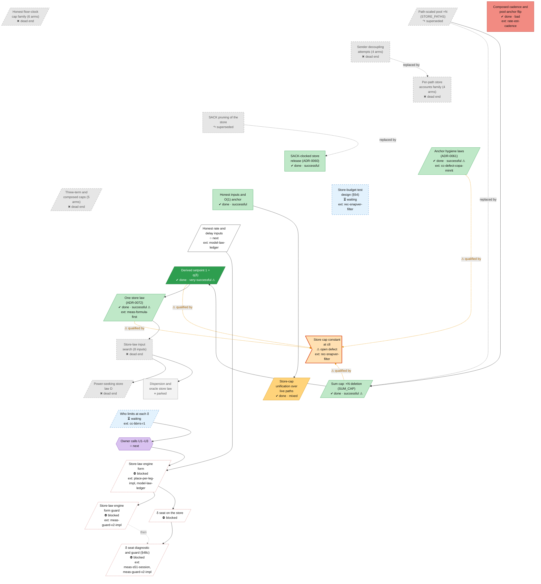
<!-- END GENERATED: track-store -->

### place - placement

<!-- BEGIN GENERATED: track-place -->
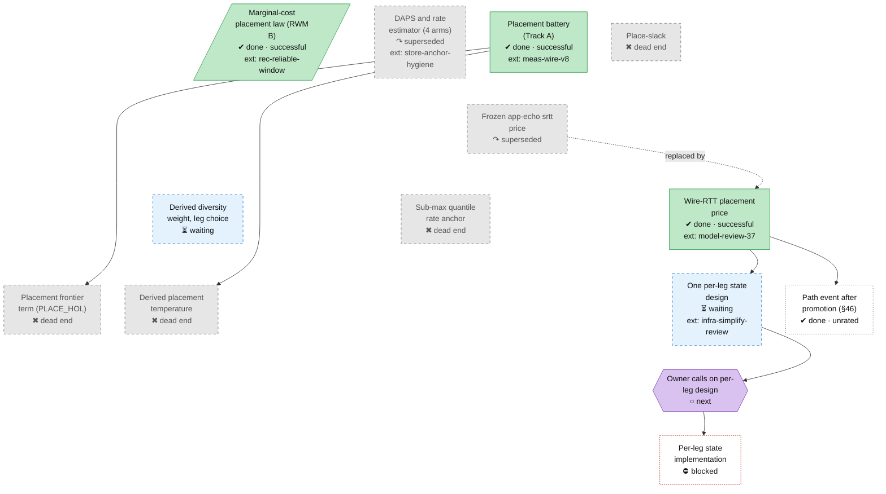
<!-- END GENERATED: track-place -->

### cc - congestion control

<!-- BEGIN GENERATED: track-cc -->
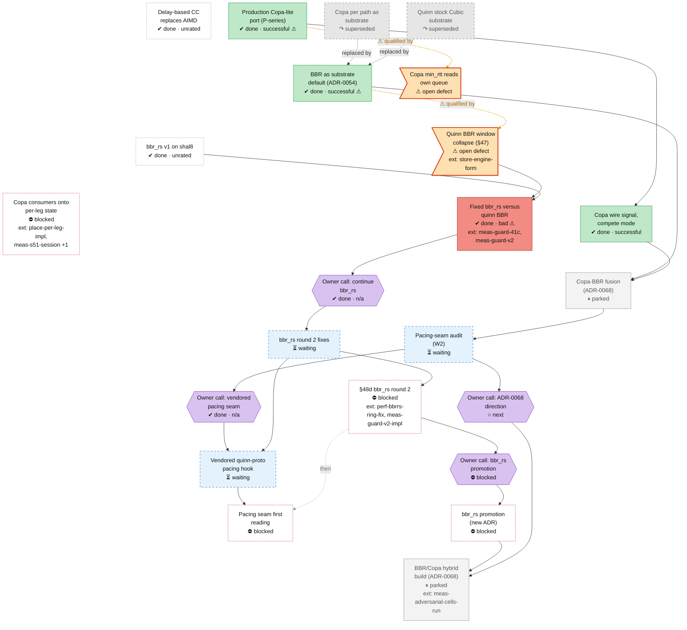
<!-- END GENERATED: track-cc -->

### perf - performance

<!-- BEGIN GENERATED: track-perf -->
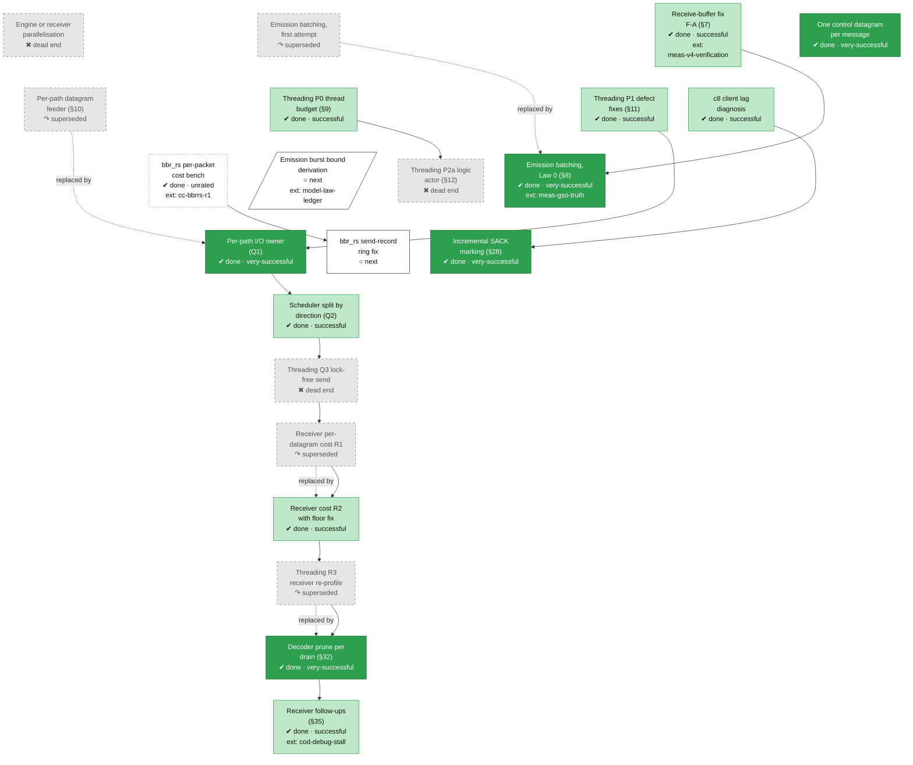
<!-- END GENERATED: track-perf -->

### meas - measurement

<!-- BEGIN GENERATED: track-meas -->
```mermaid
flowchart TB
    meas_l0_sim_bench["Netsim harness and<br/>ablation benches<br/>✔ done · unrated"]
    meas_adr51_scenarios["Canonical scenarios<br/>and goal gate<br/>✔ done · successful"]
    meas_l1_harness["L1 netns harness and<br/>baselines<br/>✔ done · unrated"]
    meas_l2_multipath["L2/L3 multipath and<br/>tail evaluation<br/>✔ done · unrated"]
    meas_c8_aggregation_arc["C8 heterogeneous<br/>aggregation arc<br/>↷ superseded<br/>ext: place-marginal-<br/>cost"]
    meas_gen_inert_era>"Generation-inert<br/>measurement era<br/>✔ fixed"]
    meas_regime_map["Hardware-honest<br/>regime map<br/>✔ done · unrated"]
    meas_adr52_discipline["L1 measurement<br/>discipline<br/>(ADR-0052)<br/>✔ done · successful"]
    meas_formula_first["Formula-first review<br/>(ADR-0070)<br/>✔ done · successful"]
    meas_pipeline_verification["Pipeline<br/>verification matrix<br/>✔ done · unrated"]
    meas_goal_0819["Era, latency-truth<br/>and c9 batteries<br/>✔ done · unrated"]
    meas_attribution_audit["Attribution audit D0<br/>✔ done · unrated"]
    meas_wire_v8["Stage-2 instruments<br/>and owed findings<br/>✔ done · successful ⚠"]
    meas_5h_cap{{"Owner rule: 5 h<br/>measurement cap<br/>✔ done · n/a"}}
    meas_gso_truth>"Per-datagram loss<br/>truth (GSO)<br/>✔ fixed"]
    meas_v4_verification["V4 verification of<br/>new main (#167;6)<br/>✔ done · successful<br/>ext: cod-one-<br/>pipeline"]
    meas_guard_41c["Rank-minp merge<br/>guard (#167;41c)<br/>✔ done · successful ⚠"]
    meas_harness_consolidation["Harness on main,<br/>rehearsal mode<br/>✔ done · successful"]
    meas_defect_rtp_floor>"Guard clause<br/>rtp_floor_p0<br/>measures drain<br/>⚠ open defect<br/>ext: rec-snapver-<br/>filter"]
    meas_guard_clause_dry["Guard clause dry run<br/>✔ done · successful"]
    meas_guard_v2{{"Merge guard v2<br/>accepted (#167;41d)<br/>✔ done · n/a"}}
    meas_defect_eta_witness>"ETA route and σ<br/>witness mismatch<br/>⚠ open defect"]
    meas_defect_c8_bimodal>"c8 control bimodal<br/>collapse<br/>⚠ open defect"]
    meas_defect_diag_rtp_ms>"#91;DIAG#93; rtp prints<br/>whole milliseconds<br/>⚠ open defect"]
    meas_guard_v2_impl["Guard v2<br/>implementation<br/>▶ in progress"]
    meas_s51_design["Off-Bulk benchmark<br/>design (#167;51)<br/>○ next"]
    meas_adversarial_cells_build["Adversarial cells:<br/>build and validate<br/>○ next"]
    meas_harness_robustness["Harness robustness<br/>for every plan<br/>○ next"]
    meas_guard_resolution["Guard CPU and lag<br/>resolution<br/>○ next"]
    meas_test_hygiene["Test hygiene fixes<br/>○ next"]
    meas_s51_session["Off-Bulk baseline<br/>and δ sweep<br/>⛔ blocked<br/>ext: rate-fix-term-<br/>gauge, rate-user-<br/>rate-law"]
    meas_adversarial_cells_run["Adversarial cells<br/>measured<br/>⛔ blocked"]
    meas_competitor_battery["Competitor battery<br/>⛔ blocked<br/>ext: cc-bbrrs-<br/>promote"]
    meas_progress_baseline["Cumulative progress<br/>benchmark<br/>○ next"]
    meas_fix_gauges_p3["Gauges for the<br/>remaining constants<br/>⛔ blocked<br/>ext: rate-fix-<br/>estimators, model-<br/>fix-paper-p2 +1"]
    meas_l0_sim_bench ~~~ meas_gen_inert_era
    meas_l0_sim_bench ~~~ meas_regime_map
    meas_l0_sim_bench ~~~ meas_adr52_discipline
    meas_l0_sim_bench ~~~ meas_formula_first
    meas_adr51_scenarios ~~~ meas_gen_inert_era
    meas_adr51_scenarios ~~~ meas_regime_map
    meas_adr51_scenarios ~~~ meas_adr52_discipline
    meas_adr51_scenarios ~~~ meas_formula_first
    meas_l2_multipath ~~~ meas_gen_inert_era
    meas_l2_multipath ~~~ meas_regime_map
    meas_l2_multipath ~~~ meas_adr52_discipline
    meas_l2_multipath ~~~ meas_formula_first
    meas_c8_aggregation_arc ~~~ meas_gen_inert_era
    meas_c8_aggregation_arc ~~~ meas_regime_map
    meas_c8_aggregation_arc ~~~ meas_adr52_discipline
    meas_c8_aggregation_arc ~~~ meas_formula_first
    meas_gen_inert_era ~~~ meas_pipeline_verification
    meas_gen_inert_era ~~~ meas_goal_0819
    meas_gen_inert_era ~~~ meas_attribution_audit
    meas_gen_inert_era ~~~ meas_wire_v8
    meas_regime_map ~~~ meas_pipeline_verification
    meas_regime_map ~~~ meas_goal_0819
    meas_regime_map ~~~ meas_attribution_audit
    meas_regime_map ~~~ meas_wire_v8
    meas_adr52_discipline ~~~ meas_pipeline_verification
    meas_adr52_discipline ~~~ meas_goal_0819
    meas_adr52_discipline ~~~ meas_attribution_audit
    meas_adr52_discipline ~~~ meas_wire_v8
    meas_formula_first ~~~ meas_pipeline_verification
    meas_formula_first ~~~ meas_goal_0819
    meas_formula_first ~~~ meas_attribution_audit
    meas_formula_first ~~~ meas_wire_v8
    meas_pipeline_verification ~~~ meas_5h_cap
    meas_pipeline_verification ~~~ meas_gso_truth
    meas_pipeline_verification ~~~ meas_v4_verification
    meas_pipeline_verification ~~~ meas_guard_41c
    meas_goal_0819 ~~~ meas_5h_cap
    meas_goal_0819 ~~~ meas_gso_truth
    meas_goal_0819 ~~~ meas_v4_verification
    meas_goal_0819 ~~~ meas_guard_41c
    meas_attribution_audit ~~~ meas_5h_cap
    meas_attribution_audit ~~~ meas_gso_truth
    meas_attribution_audit ~~~ meas_v4_verification
    meas_attribution_audit ~~~ meas_guard_41c
    meas_wire_v8 ~~~ meas_5h_cap
    meas_wire_v8 ~~~ meas_gso_truth
    meas_wire_v8 ~~~ meas_v4_verification
    meas_wire_v8 ~~~ meas_guard_41c
    meas_5h_cap ~~~ meas_harness_consolidation
    meas_5h_cap ~~~ meas_defect_rtp_floor
    meas_5h_cap ~~~ meas_defect_eta_witness
    meas_5h_cap ~~~ meas_defect_c8_bimodal
    meas_gso_truth ~~~ meas_harness_consolidation
    meas_gso_truth ~~~ meas_defect_rtp_floor
    meas_gso_truth ~~~ meas_defect_eta_witness
    meas_gso_truth ~~~ meas_defect_c8_bimodal
    meas_v4_verification ~~~ meas_harness_consolidation
    meas_v4_verification ~~~ meas_defect_rtp_floor
    meas_v4_verification ~~~ meas_defect_eta_witness
    meas_v4_verification ~~~ meas_defect_c8_bimodal
    meas_guard_41c ~~~ meas_harness_consolidation
    meas_guard_41c ~~~ meas_defect_rtp_floor
    meas_guard_41c ~~~ meas_defect_eta_witness
    meas_guard_41c ~~~ meas_defect_c8_bimodal
    meas_harness_consolidation ~~~ meas_defect_diag_rtp_ms
    meas_harness_consolidation ~~~ meas_adversarial_cells_build
    meas_harness_consolidation ~~~ meas_harness_robustness
    meas_harness_consolidation ~~~ meas_guard_resolution
    meas_defect_rtp_floor ~~~ meas_defect_diag_rtp_ms
    meas_defect_rtp_floor ~~~ meas_adversarial_cells_build
    meas_defect_rtp_floor ~~~ meas_harness_robustness
    meas_defect_rtp_floor ~~~ meas_guard_resolution
    meas_defect_eta_witness ~~~ meas_defect_diag_rtp_ms
    meas_defect_eta_witness ~~~ meas_adversarial_cells_build
    meas_defect_eta_witness ~~~ meas_harness_robustness
    meas_defect_eta_witness ~~~ meas_guard_resolution
    meas_defect_c8_bimodal ~~~ meas_defect_diag_rtp_ms
    meas_defect_c8_bimodal ~~~ meas_adversarial_cells_build
    meas_defect_c8_bimodal ~~~ meas_harness_robustness
    meas_defect_c8_bimodal ~~~ meas_guard_resolution
    meas_defect_diag_rtp_ms ~~~ meas_test_hygiene
    meas_defect_diag_rtp_ms ~~~ meas_competitor_battery
    meas_defect_diag_rtp_ms ~~~ meas_progress_baseline
    meas_defect_diag_rtp_ms ~~~ meas_l1_harness
    meas_adversarial_cells_build ~~~ meas_test_hygiene
    meas_adversarial_cells_build ~~~ meas_competitor_battery
    meas_adversarial_cells_build ~~~ meas_progress_baseline
    meas_adversarial_cells_build ~~~ meas_l1_harness
    meas_harness_robustness ~~~ meas_test_hygiene
    meas_harness_robustness ~~~ meas_competitor_battery
    meas_harness_robustness ~~~ meas_progress_baseline
    meas_harness_robustness ~~~ meas_l1_harness
    meas_guard_resolution ~~~ meas_test_hygiene
    meas_guard_resolution ~~~ meas_competitor_battery
    meas_guard_resolution ~~~ meas_progress_baseline
    meas_guard_resolution ~~~ meas_l1_harness
    meas_test_hygiene ~~~ meas_guard_clause_dry
    meas_test_hygiene ~~~ meas_adversarial_cells_run
    meas_competitor_battery ~~~ meas_guard_clause_dry
    meas_competitor_battery ~~~ meas_adversarial_cells_run
    meas_progress_baseline ~~~ meas_guard_clause_dry
    meas_progress_baseline ~~~ meas_adversarial_cells_run
    meas_l1_harness ~~~ meas_guard_clause_dry
    meas_l1_harness ~~~ meas_adversarial_cells_run
    meas_guard_clause_dry ~~~ meas_guard_v2
    meas_adversarial_cells_run ~~~ meas_guard_v2
    meas_guard_v2 ~~~ meas_guard_v2_impl
    meas_guard_v2 ~~~ meas_s51_design
    meas_guard_v2_impl ~~~ meas_s51_session
    meas_s51_design ~~~ meas_s51_session
    meas_s51_session ~~~ meas_fix_gauges_p3
    meas_adr51_scenarios --> meas_l1_harness
    meas_c8_aggregation_arc -.->|replaced by| meas_regime_map
    meas_wire_v8 -.->|⚠ qualified by| meas_defect_eta_witness
    meas_guard_41c -.->|⚠ qualified by| meas_guard_v2
    meas_defect_rtp_floor --> meas_guard_clause_dry
    meas_guard_clause_dry --> meas_guard_v2
    meas_guard_v2 --> meas_guard_v2_impl
    meas_guard_v2 --> meas_s51_design
    meas_s51_design --> meas_s51_session
    meas_adversarial_cells_build --> meas_adversarial_cells_run
    meas_s51_session --> meas_fix_gauges_p3
    meas_competitor_battery -.->|then| meas_progress_baseline
    linkStyle 113,114 stroke:#e69500,stroke-width:2px,stroke-dasharray:2 3,color:#a86400
    linkStyle 122 stroke:#999,stroke-width:1px,color:#777
    classDef vsucc fill:#2e9e4f,stroke:#1b6b34,color:#fff
    classDef succ fill:#bfe8c8,stroke:#2e9e4f,color:#111
    classDef mixed fill:#ffd37a,stroke:#c98a00,color:#111
    classDef bad fill:#f28b82,stroke:#b3261e,color:#111
    classDef dead fill:#e6e6e6,stroke:#777,stroke-dasharray:5 5,color:#555
    classDef inprog fill:#a8cdf5,stroke:#1f6fc5,color:#111
    classDef next fill:#fff,stroke:#333,color:#111
    classDef blocked fill:#fff,stroke:#b3261e,stroke-dasharray:2 2,color:#111
    classDef parked fill:#f3f3f3,stroke:#999,color:#555
    classDef unrated fill:#fff,stroke:#333,stroke-dasharray:1 3,color:#111
    classDef userdec fill:#d9c2f0,stroke:#7b3fb5,color:#111
    classDef defect fill:#ffe0b2,stroke:#d84315,stroke-width:2px,color:#111
    classDef waiting fill:#e3f2fd,stroke:#1f6fc5,stroke-dasharray:5 5,color:#111
    class meas_l0_sim_bench,meas_l1_harness,meas_l2_multipath,meas_regime_map,meas_pipeline_verification,meas_goal_0819,meas_attribution_audit unrated
    class meas_adr51_scenarios,meas_gen_inert_era,meas_adr52_discipline,meas_formula_first,meas_wire_v8,meas_gso_truth,meas_v4_verification,meas_guard_41c,meas_harness_consolidation,meas_guard_clause_dry succ
    class meas_c8_aggregation_arc dead
    class meas_5h_cap,meas_guard_v2 userdec
    class meas_defect_rtp_floor,meas_defect_eta_witness,meas_defect_c8_bimodal,meas_defect_diag_rtp_ms defect
    class meas_guard_v2_impl inprog
    class meas_s51_design,meas_adversarial_cells_build,meas_harness_robustness,meas_guard_resolution,meas_test_hygiene,meas_progress_baseline next
    class meas_s51_session,meas_adversarial_cells_run,meas_competitor_battery,meas_fix_gauges_p3 blocked
```
<!-- END GENERATED: track-meas -->

### model - model and paper

<!-- BEGIN GENERATED: track-model -->
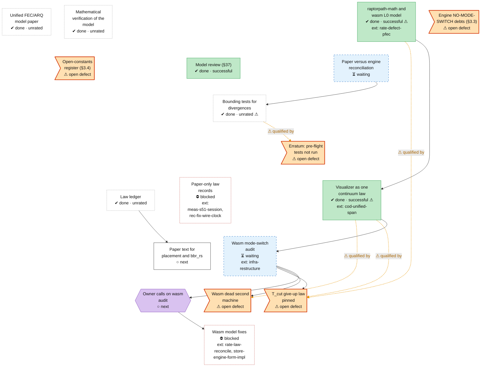
<!-- END GENERATED: track-model -->

### obs - observability

<!-- BEGIN GENERATED: track-obs -->
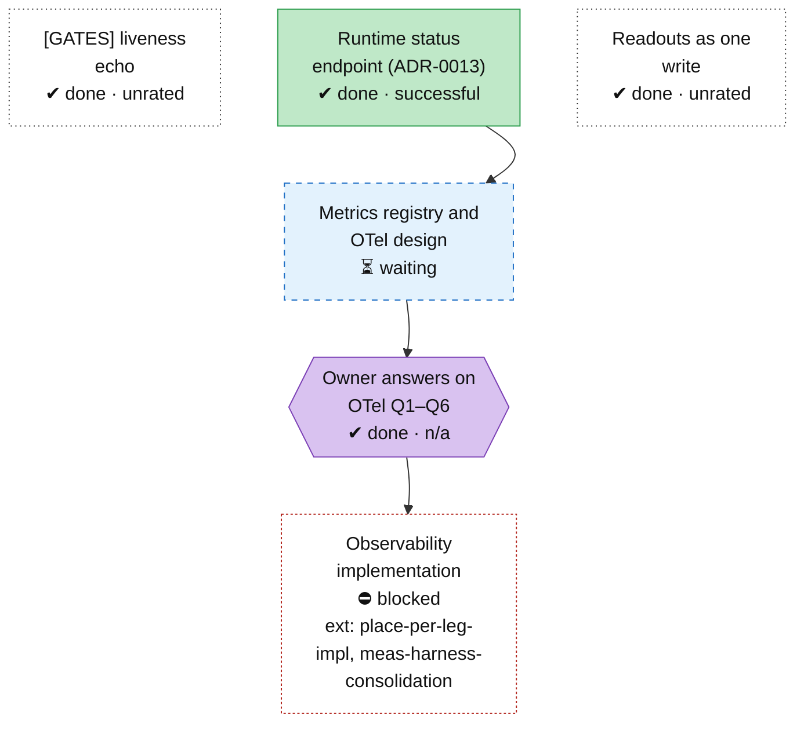
<!-- END GENERATED: track-obs -->

### infra - repo and simplification

<!-- BEGIN GENERATED: track-infra -->
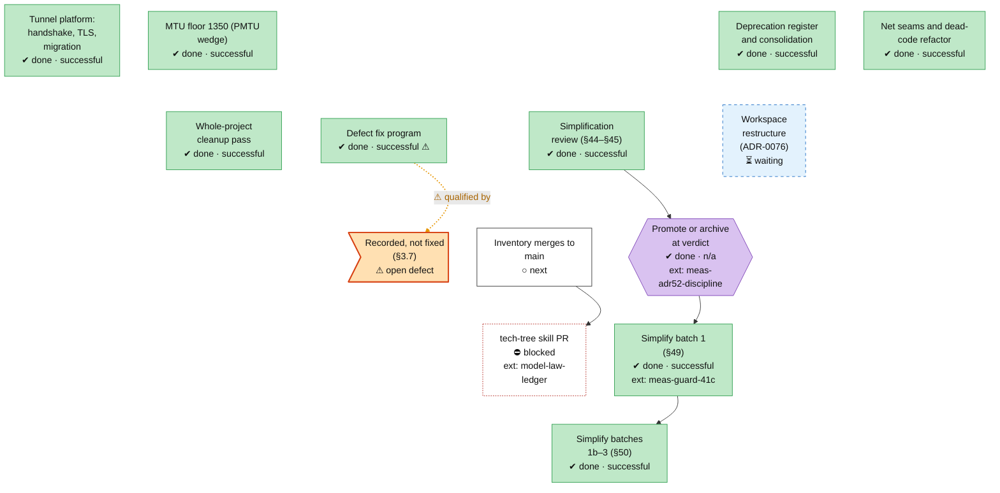
<!-- END GENERATED: track-infra -->

## Node table

<!-- BEGIN GENERATED: table -->
### cod - coding core

| id | title | state | outcome | headline | evidence | depends_on |
|---|---|---|---|---|---|---|
| `cod-block-pipeline` | RaptorQ block FEC pipeline | abandoned | superseded |  | ADR-0002; ADR-0004; ADR-0014; status §4; status §3.7 row 236; status §3.7 row 238 |  |
| `cod-mettle` | METTLE swappable FEC backend | abandoned | dead-end |  | paper §10 row METTLE FEC backend |  |
| `cod-backend-switch` | Mid-stream FEC backend switching | abandoned | dead-end |  | paper §10 row Mid-stream backend switching (loss-threshold selector) |  |
| `cod-streaming-code` | Streaming two-layer Realtime code | abandoned | superseded |  | paper §10 row Streaming two-layer code (Realtime machine) |  |
| `cod-gf256-simd` | SIMD GF(2^8) and gf256 crate | done | successful | ~15-25× speedup on the FEC decode hot path | ADR-0041 |  |
| `cod-rlc-all-profiles` | Windowed RLC for every profile | abandoned | superseded |  | commit 341857ec |  |
| `cod-generation-coding` | Generation cross-path fungible coding | parked | unrated |  | status §3.2 |  |
| `cod-coded-only-wire` | Coded-only generation wire | abandoned | superseded | 70.9 Mbit/s | paper §10 row Coded-only generation wire |  |
| `cod-systematic-wire` | Systematic wire, sparse decoder | done | successful | Gen single-c2 33.9 → 70.9 Mbit/s | ADR-0056 | cod-generation-coding |
| `cod-fungible-window` | Coded-only fungible window | abandoned | dead-end | 3.9 Mbit/s | paper §10 row Coded-only fungible window (coded-object mode) |  |
| `cod-fmtcp` | FMTCP-class decode-on-total | abandoned | dead-end | 0.48× | commit f8417579 |  |
| `cod-legacy-rlc` | Legacy sliding-window/generation decoders | abandoned | superseded |  | paper §10 row Legacy RLC decoders (sliding-window, generation) |  |
| `cod-unified-span` | Unified span machine (ADR-0064) | done | successful |  | ADR-0064 | cod-systematic-wire |
| `cod-one-pipeline` | One window pipeline (ADR-0069) | done | successful |  | ADR-0069; status §5 | cod-unified-span |
| `cod-wire-compact` | Compact v5 DATA framing | done | very-successful | +2.6/+3.6 Mbit/s | commit 078b0ce9 |  |
| `cod-debug-stall` | Decoder re-delivery stall fix (§31) | done | successful | 0 of 40 iterations stalled | status §31 |  |
| `cod-user-generation-seat` | Owner call: keep generation coding | next | n/a |  | plan user decision 4, W4.4; status §3.2 | cod-generation-coding |

### rec - recovery

| id | title | state | outcome | headline | evidence | depends_on |
|---|---|---|---|---|---|---|
| `rec-early-arq` | Early ACK, NACK and repair | done | successful |  | ADR-0003; ADR-0005; ADR-0007 |  |
| `rec-plost-sack` | P_lost(t) mix and SACK WindowAck | done | unrated |  | commit 5b9f6def |  |
| `rec-bulk-arq` | Bulk ARQ and batch acknowledgements | done | successful |  | branch P8 |  |
| `rec-reliable-window` | Reliable window (RWM Phase A) | done | successful |  | branch RWM Phase A |  |
| `rec-fec-vs-arq` | Proactive FEC versus ARQ frontier | done | unrated |  | branch proactive-frontier diagnosis |  |
| `rec-proactive-repair` | Proactive repair timing (3 arms) | abandoned | dead-end |  | tag archive/RWM_REPAIR_WAIT; tag archive/RWM_PROACTIVE_PACER |  |
| `rec-per-path-clocks` | Per-path recovery clocks (RECOV_MP) | done | successful | repair share ×2.2–2.5 | ADR-0059 |  |
| `rec-mp-serial` | Global loss serials under striping | abandoned | superseded | 0.1 % | paper §10 row Global loss serials under striping (`RWM_RECOV_MP_SERIAL`) |  |
| `rec-clock-candidates` | Derived recovery-timing candidates (4 arms) | abandoned | dead-end | −23 % | tag archive/RWM_DERIVED_SWEEP |  |
| `rec-goal100` | Recovery primitives and σ (goal #100) | done | successful |  | commit 6e1e356a |  |
| `rec-goal101` | Recovery clock law family (4 arms) | abandoned | dead-end |  | tag archive/RWM_HOLDDOWN_Q; tag archive/RWM_REFRESH_FLOOR_US | rec-goal100 |
| `rec-receiver-law` | Receiver request law (Track C) | abandoned | dead-end |  | status §2 row "Receiver-law battery (Track C)"; status §3.1 item 1 | meas-wire-v8 |
| `rec-cost-ratio-decision` | Cost-ratio decision (owner ruling) | done | n/a |  | commit ca058db4 |  |
| `rec-wire-v9` | Wire v9 per-path sequence | done | successful |  | status §3.5 item 2 |  |
| `rec-gap-horizon` | Gap horizon lever B (§52) | in-progress | mixed | p = 0.2471 | status §52; branch gaphorizon; branch cand52; branch base52 | meas-guard-41c, cc-bbrrs-r1 |
| `rec-snapver-filter` | Stale gap reports, snapshot filter (§53) | done | successful | CANDS duplicates (mean 1 291) | status §53; derivation dup-diag.md (branch dup-diag); branch dup-diag; branch dup-diag-instr; branch cand53; branch base53; branch test-debts | rec-gap-horizon |
| `rec-snapver-law` | Snapshot-order filter as law | in-progress | unrated |  | branch snapver-law (head 8191b3de); paper §7.1 "Snapshot order"; plan Live state 2026-11-13 item 1 | rec-snapver-filter |
| `rec-defect-qclk-clamp` | [QCLK] w_us pinned at clamp | in-progress | unrated | p05 = p95 = 100 000 µs | status §3.10 item 4; status §3.5 item 5 | rec-gap-horizon |
| `rec-defect-hole-law` | c8 hole law never measured | in-progress | unrated | 3.7–6.6 k times per run | status §3.10 item 5 | rec-gap-horizon, rec-snapver-filter |
| `rec-defect-refresh-input` | Hole refresh clock degenerate input | in-progress | unrated | srtt = exactly 50 000 µs | status §3.10 item 6 | rec-snapver-filter |
| `rec-p10a-repair-floor` | Inner-feedback repair floor (P10a) | abandoned | dead-end |  | branch P10a |  |
| `rec-recov-sp` | Singles hole suppression (RECOV_SP) | parked | unrated | +0.3 Mbit/s | paper §10 row Singles hole suppression (`RWM_RECOV_SP`) |  |
| `rec-leverb-c1d-cost` | Lever B c1d duplicate cost | in-progress | unrated | +13 % | status §53 open item 2 | rec-snapver-filter |
| `rec-defect-base-duplicates` | Main's duplicates mostly unexplained | in-progress | unrated |  | status §53 open item 3 | rec-snapver-filter |
| `rec-s54-session` | §54: filter guard, store budget | blocked | unrated |  | plan Live state items 1-2; branch p0-dwell-diag §8 | meas-guard-v2-impl, rec-snapver-law, store-s54-budget |
| `rec-w0-leg-question` | Retransmit leg choice with filter | blocked | unrated |  | status §53 open item 5 ("W0 with the filter is the row that answers it"); plan W3.6f | rec-s54-session, place-wdiv |
| `rec-leverb-guard` | Lever-B guard v2, then merge | blocked | unrated |  | plan Live state item 4; status §53 "What follows" | rec-s54-session, meas-guard-v2-impl, rec-gap-horizon |
| `rec-recovery-timeouts` | Recovery timeouts after store law | blocked | unrated |  | plan W3.6; status §3.10 items 4 and 6 | store-engine-form-impl, rec-fix-pooled-clock |
| `rec-fix-wire-clock` | Honest per-path wire clock | next | unrated |  | law ledger rows E01 | model-law-ledger |
| `rec-fix-pooled-clock` | Per-path recovery clock, not pooled | blocked | unrated |  | law ledger rows E11 | rec-fix-wire-clock |
| `rec-fix-refresh-clock` | Receiver refresh clock input | blocked | unrated |  | law ledger rows E10, C07 | rec-fix-wire-clock |
| `rec-fix-cooldown` | Retransmit cooldown on its leg | blocked | unrated |  | law ledger rows C05 | rec-fix-pooled-clock |
| `rec-fix-time-threshold` | Loss time threshold and age gate | blocked | unrated |  | law ledger rows C01, C04 | rec-fix-wire-clock, rec-fix-pooled-clock |
| `rec-fix-nack-throttle` | NACK repair throttle: gauge, paper | blocked | unrated |  | law ledger rows C09 | rec-fix-wire-clock |

### rate - rate law

| id | title | state | outcome | headline | evidence | depends_on |
|---|---|---|---|---|---|---|
| `rate-ge-hmm` | Gilbert-Elliott loss model (ADR-0023) | done | successful |  | ADR-0023 |  |
| `rate-fec-rate-v1` | BOCD FEC rate control (ADR-0050) | done | successful | DC (ε≈0.1%): 4.3% actual vs 0.1% optimal → 43x | ADR-0050 |  |
| `rate-saturation-rstar` | Saturation-aware r* and window | done | successful |  | branch unified deadline-constrained r* (§8.9) |  |
| `rate-rstar-window-mass` | r* window-mass provisioning (ADR-0063) | done | successful |  | ADR-0063 | rate-ge-hmm, rate-fec-rate-v1 |
| `rate-taper-r` | Taper emission budget law | done | successful |  | commit 33b29f81 |  |
| `rate-leading-taper` | Leading-window taper emission | abandoned | superseded | −22 pp | paper §10 row Leading-window taper emission |  |
| `rate-retention-is-rho` | Retention is the ρ dial | done | n/a |  | commit 49ab700c |  |
| `rate-unified-shed` | δ-honest overload shedding | done | successful |  | commit 6568822c | cod-unified-span, rate-retention-is-rho |
| `rate-est-cadence` | Batched BOCD estimator cadence | done | very-successful | +41 % | paper §10 row Estimator cadence alone (`RWM_EST_CADENCE`, pool anchor decoupled) | rate-fec-rate-v1 |
| `rate-sender-truth-loss` | Sender-truth loss estimator | abandoned | dead-end | 20× | paper §10 row Sender-truth loss estimator (`RWM_LOSS_SENT_TRUTH`) |  |
| `rate-r-battery` | Funded coding at r > 0 | abandoned | dead-end |  | status §2 row "r > 0 battery (Track B)"; status §3.1 item 7; status §3.1 note (cod= counter) | rate-dials-made-real |
| `rate-dof-ledger` | DoF ledger feedback leg (§39) | parked | unrated |  | status §39 | rate-r-battery |
| `rate-dials-made-real` | The dials made real | done | successful |  | branch THE DIALS MADE REAL |  |
| `rate-defect-pfec` | P_fec truncation divergence | in-progress | unrated | 0.0267 at c2 and 0.0515 at c3 | status §3.10 item 2 |  |
| `rate-user-rate-law` | Owner calls on rate law | next | n/a |  | plan user decision 11; status §3.10 item 2 (conflict for the owner) | model-paper-recon, rate-defect-pfec |
| `rate-law-reconcile` | Rate-law reconciliation (W22, W*) | blocked | unrated |  | plan W3.5, W3.7 | rate-user-rate-law, meas-s51-session |
| `rate-fix-term-gauge` | Rate-law term-win gauge | blocked | unrated |  | law ledger rows R02 | rate-fix-estimators, rec-fix-wire-clock |
| `rate-fix-estimators` | Loss estimator approximations | blocked | unrated |  | law ledger rows E07, E08, E09 | rec-fix-wire-clock |
| `rate-fix-rho-realtime` | Low-latency and partial-reliability laws | blocked | unrated |  | law ledger rows F02, S01, S02, S04, S05, S06, S08, S09 | store-engine-form-impl, rec-fix-wire-clock, rate-law-reconcile, rec-fix-refresh-clock, rate-fix-estimators |

### store - store law

| id | title | state | outcome | headline | evidence | depends_on |
|---|---|---|---|---|---|---|
| `store-xn-pool` | Path-scaled pool ×N (STORE_PATHS) | abandoned | superseded |  | paper §10 row ×N pool multiplier `clamp(gain·N·Σ, floor, N·knee)` |  |
| `store-percap-family` | Per-path store accounts family (4 arms) | abandoned | dead-end | 0.89–0.94× | paper §10 row Per-path store accounts (`RWM_STORE_PERCAP`, `RWM_PERCAP_GUARD`) |  |
| `store-honest-cap-family` | Honest floor-clock cap family (6 arms) | abandoned | dead-end |  | tag archive/RWM_HONEST_CAP; tag archive/RWM_HONEST_K; tag archive/RWM_PLAIN_RS; tag archive/RWM_RS_ATTR |  |
| `store-pool-anchor-flip` | Composed cadence and pool-anchor flip | done | bad | 0.959–0.968× | tag archive/RWM_POOL_ANCHOR | rate-est-cadence |
| `store-sack-prune` | SACK pruning of the store | abandoned | superseded |  | paper §10 row SACK pruning of the store (`RWM_SACK_PRUNE`) |  |
| `store-sack-release` | SACK-clocked store release (ADR-0060) | done | successful |  | ADR-0060 |  |
| `store-sender-decoupling` | Sender decoupling attempts (4 arms) | abandoned | dead-end | 27 ms | tag archive/RWM_REASM_BDP |  |
| `store-anchor-hygiene` | Anchor hygiene laws (ADR-0061) | done | successful | +31% | ADR-0061 |  |
| `store-three-term` | Three-term and composed caps (5 arms) | abandoned | dead-end | 2.4× | tag archive/RWM_COMPOSED_CAP |  |
| `store-cap-unification` | Store-cap unification over live paths | done | mixed | +16–25 % | status §3.5 item 3 | store-honest-inputs |
| `store-honest-inputs` | Honest inputs and O(1) anchor | done | successful |  | commit 9f6e56ba |  |
| `store-sum-cap` | Sum cap: ×N deletion (SUM_CAP) | done | successful |  | branch RWM_SUM_CAP DEFAULT ON | store-xn-pool |
| `store-delta-cap` | Derived setpoint 1 + q(δ) | done | very-successful | queue −10 to −200 ms | paper §10 row Pool gain 2.0 (N ≥ 2) | store-sum-cap |
| `store-adr72-one-law` | One store law (ADR-0072) | done | successful |  | ADR-0072; status §18; status §19 | store-delta-cap, meas-formula-first |
| `store-input-search` | Store-law input search (8 inputs) | abandoned | dead-end | knee is 1 024 at both cells | status §23; status §24; status §27; status §34 | store-adr72-one-law |
| `store-power-law` | Power-seeking store law D | abandoned | dead-end | ×5–12 | status §29; status §30; tag archive/store-power; branch archive/wt-status29-power | store-input-search |
| `store-engine-form` | Dispersion and oracle store law | parked | successful |  | status §36; status §40; status §42; status §43; branch harness43; branch run43 | store-input-search |
| `store-w1-who-limits` | Who limits at each δ | in-progress | unrated |  | derivation w1-who-limits.md (branch derive-w1); branch derive-w1; branch w1r2 | cc-bbrrs-r1, store-engine-form |
| `store-s54-budget` | Store-budget test design (§54) | in-progress | unrated | from a mean of about 5.3 s to about 1.0 s | derivation p0-dwell-diag.md (branch p0-dwell-diag); branch p0-dwell-diag | rec-snapver-filter |
| `store-defect-cap-constant` | Store cap constant at c8 | in-progress | unrated | N·pool = 4 096 | status §3.10 item 8 | rec-snapver-filter |
| `store-engine-form-guard` | Store-law engine form guard | blocked | unrated |  | plan VM queue 8 | store-engine-form-impl, meas-guard-v2-impl |
| `store-s48c-session` | δ seat diagnostic and guard (§48c) | blocked | unrated |  | plan W1.4 | store-delta-seat, meas-s51-session, meas-guard-v2-impl |
| `store-user-u1u3` | Owner calls U1–U3 | next | n/a |  | plan user decisions 3 and 10 | store-w1-who-limits |
| `store-engine-form-impl` | Store-law engine form | blocked | unrated |  | plan W3.3; CLAUDE.md FORMULA-FIRST | place-per-leg-impl, store-user-u1u3, store-fix-maxbw-minrtt, model-law-ledger |
| `store-delta-seat` | δ seat on the store | blocked | unrated |  | plan W1.2 RESULT, W1.3, W1 round 2 (iii) | store-user-u1u3, store-engine-form-impl |
| `store-fix-maxbw-minrtt` | Honest rate and delay inputs | next | unrated |  | law ledger rows E04, E03 | model-law-ledger |

### place - placement

| id | title | state | outcome | headline | evidence | depends_on |
|---|---|---|---|---|---|---|
| `place-marginal-cost` | Marginal-cost placement law (RWM B) | done | successful |  | branch RWM Phase B | rec-reliable-window |
| `place-daps` | DAPS and rate estimator (4 arms) | abandoned | superseded | −30 % | paper §10 row DAPS chain, pace-all, per-path rate-sample estimator (`RWM_DAPS*`, `RWM_PACE_ALL`, `RWM_RATE_SAMPLE`, `RWM_PER_PATH_EST`) |  |
| `place-slack` | Place-slack | abandoned | dead-end | 6 % | paper §10 row Place-slack (`RWM_PLACE_SLACK`) |  |
| `place-stage2-battery` | Placement battery (Track A) | done | successful | 6 % of delivered latency | status §2 row "Placement battery (Track A)" | meas-wire-v8 |
| `place-hol` | Placement frontier term (PLACE_HOL) | abandoned | dead-end | 6 % | tag archive/RWM_PLACE_HOL | place-stage2-battery |
| `place-t-derived` | Derived placement temperature | abandoned | dead-end | 0.78–0.85× | tag archive/RWM_PLACE_T_DERIVED | place-stage2-battery |
| `place-wdiv` | Derived diversity weight, leg choice | in-progress | unrated |  | branch wdiv-diag |  |
| `place-frozen-echo` | Frozen app-echo srtt price | abandoned | superseded |  | paper §10 row Frozen app-echo srtt as the placement base, `(½ + ε̂)·s_i` (the pre-§41b base; `RWM_PLACE_WIRE` unset) |  |
| `place-wire-price` | Wire-RTT placement price | done | successful | p = 0.7195 | status §38; status §41; status §41b; status §3.9 | model-review-37 |
| `place-per-leg-state` | One per-leg state design | in-progress | unrated |  | derivation w3-per-leg-state.md (branch perleg-design); branch perleg-design | infra-simplify-review, place-wire-price |
| `place-submax-anchor` | Sub-max quantile rate anchor | abandoned | dead-end | 65× | paper §10 row Sub-max quantile rate anchor (`RWM_RATE_WIRE`, `RWM_RATE_Q`) |  |
| `place-path-event` | Path event after promotion (§46) | done | unrated |  | status §46 | place-wire-price |
| `place-user-perleg-questions` | Owner calls on per-leg design | next | n/a |  | plan user decision 9 | place-per-leg-state |
| `place-per-leg-impl` | Per-leg state implementation | blocked | unrated |  | plan W3.2, W3.6a | place-per-leg-state, place-user-perleg-questions |

### cc - congestion control

| id | title | state | outcome | headline | evidence | depends_on |
|---|---|---|---|---|---|---|
| `cc-early-delay-cc` | Delay-based CC replaces AIMD | done | unrated |  | commit cbbbfdbd |  |
| `cc-copa-lite` | Production Copa-lite port (P-series) | done | successful |  | branch P7 |  |
| `cc-copa-sole-substrate` | Copa per path as substrate | abandoned | superseded | 0.57–0.97× | paper §10 row Copa per path as the substrate default (the original design) |  |
| `cc-cubic-substrate` | Quinn stock Cubic substrate | abandoned | superseded | 15–17 Mbit/s | paper §10 row Quinn's stock Cubic under the engine |  |
| `cc-copa-wire-signal` | Copa wire signal, compete mode | done | successful | 0.4–0.6× BBR's bulk throughput | ADR-0062 | cc-copa-lite |
| `cc-bbr-default` | BBR as substrate default (ADR-0054) | done | successful | plain 17.5 → plain+BBR 74.5 pooled, ×4.3 | ADR-0054 |  |
| `cc-bbrrs-v1` | bbr_rs v1 on shal8 | done | unrated |  | branch fix/shal8-anchor |  |
| `cc-adr68-fusion` | Copa-BBR fusion (ADR-0068) | parked | unrated |  | ADR-0068 | cc-bbr-default, cc-copa-wire-signal |
| `cc-quinn-bbr-collapse` | Quinn BBR window collapse (§47) | in-progress | unrated |  | status §47 | store-engine-form |
| `cc-bbrrs-r1` | Fixed bbr_rs versus quinn BBR | done | bad | wire RTT at c2 112.4 → 21.8 ms | status §48; status §48b; branch bbr48cand; branch bbrfix48-impl; branch bbrfix48b; branch harness48 | cc-quinn-bbr-collapse, meas-guard-41c, cc-bbrrs-v1 |
| `cc-user-continue-bbrrs` | Owner call: continue bbr_rs | done | n/a |  | status commit 1425acbd (nm.txt); plan W1 §48b RESULT | cc-bbrrs-r1 |
| `cc-bbrrs-r2` | bbr_rs round 2 fixes | in-progress | unrated |  | branch bbrrs-r2; branch bbrrs-r3 | cc-user-continue-bbrrs |
| `cc-pacing-audit` | Pacing-seam audit (W2) | in-progress | unrated |  | derivation w2-pacing-seam.md (branch adr68-amend); branch adr68-amend | cc-adr68-fusion |
| `cc-user-pacing-s3` | Owner call: vendored pacing seam | done | n/a |  | plan W2.5; ADR-0075 | cc-pacing-audit |
| `cc-pacing-seam` | Vendored quinn-proto pacing hook | in-progress | unrated |  | branch pacing-seam; branch pacing-seam-2 | cc-user-pacing-s3, cc-bbrrs-r2 |
| `cc-defect-copa-minrtt` | Copa min_rtt reads own queue | in-progress | unrated | 95–129 ms on main and 163–319 ms under lever B | status §3.10 item 9 |  |
| `cc-s48d-session` | §48d bbr_rs round 2 | blocked | unrated |  | plan W1 §48b RESULT (round 2 = §48d); status §41d §48b addendum | cc-bbrrs-r2, perf-bbrrs-ring-fix, meas-guard-v2-impl |
| `cc-pacing-seam-reading` | Pacing seam first reading | blocked | unrated |  | plan W2.5 (first reading after §48d) | cc-pacing-seam |
| `cc-user-adr68-direction` | Owner call: ADR-0068 direction | next | n/a |  | plan user decision 2; branch adr68-amend | cc-pacing-audit |
| `cc-user-bbrrs-promotion` | Owner call: bbr_rs promotion | blocked | n/a |  | plan W1.5, user decision 1 | cc-s48d-session |
| `cc-copa-consumers` | Copa consumers onto per-leg state | blocked | unrated |  | plan W3.4, W3.6a; status §3.3 | place-per-leg-impl, meas-s51-session, store-fix-maxbw-minrtt |
| `cc-bbrrs-promote` | bbr_rs promotion (new ADR) | blocked | unrated |  | plan W1.5 | cc-user-bbrrs-promotion |
| `cc-hybrid` | BBR/Copa hybrid build (ADR-0068) | parked | unrated |  | plan W2.4 | cc-adr68-fusion, cc-bbrrs-promote, meas-adversarial-cells-run, cc-user-adr68-direction |

### perf - performance

| id | title | state | outcome | headline | evidence | depends_on |
|---|---|---|---|---|---|---|
| `perf-parallelisation` | Engine or receiver parallelisation | abandoned | dead-end | 136–188 Mbit/s | paper §10 row Engine or receiver parallelisation |  |
| `perf-emit-batch-v1` | Emission batching, first attempt | abandoned | superseded | +10–16 % | paper §10 row Emission batching as default (`RWM_EMIT_BATCH`), first attempt |  |
| `perf-ack-merge` | One control datagram per message | done | very-successful | +12.7% | commit bdab7deb |  |
| `perf-rcvbuf` | Receive-buffer fix F-A (§7) | done | successful |  | status §7 | meas-v4-verification |
| `perf-emit-batch-law0` | Emission batching, Law 0 (§8) | done | very-successful | +41.1 % | status §8 | perf-rcvbuf, meas-gso-truth |
| `perf-quic-feeder` | Per-path datagram feeder (§10) | abandoned | superseded | c1d-400 goodput 292.4 → 491.4 Mbit/s | status §10; tag archive/quic-feeder; tag archive/quic-feeder-v2 |  |
| `perf-threading-p0` | Threading P0 thread budget (§9) | done | successful | busy median 79.0 % | status §9 |  |
| `perf-threading-p1` | Threading P1 defect fixes (§11) | done | successful |  | status §11 |  |
| `perf-threading-p2a` | Threading P2a logic actor (§12) | abandoned | dead-end | goodput −33.0 % | status §12; tag archive/thread-p2a | perf-threading-p0 |
| `perf-io-owner` | Per-path I/O owner (Q1) | done | very-successful | +48 % | status §13; status §15 | perf-threading-p1 |
| `perf-sched-split` | Scheduler split by direction (Q2) | done | successful |  | status §14 | perf-io-owner |
| `perf-q3-investigation` | Threading Q3 lock-free send | abandoned | dead-end | 0.16–0.19 of wall | status §16 | perf-sched-split |
| `perf-receiver-r1` | Receiver per-datagram cost R1 | abandoned | superseded | c1s goodput −69.6 % | status §17; status §20; tag archive/thread-r1 | perf-q3-investigation |
| `perf-receiver-r2` | Receiver cost R2 with floor fix | done | successful | 717 Mbit/s | status §21 | perf-receiver-r1 |
| `perf-threading-r3` | Threading R3 receiver re-profile | abandoned | superseded |  | status §22; tag archive/thread-r3; branch archive/wt-status22-amend5 | perf-receiver-r2 |
| `perf-c8-lag` | c8 client lag diagnosis | done | successful | 81 % | status §25; status §26; status §33 |  |
| `perf-incremental-sack` | Incremental SACK marking (§28) | done | very-successful | -30 % | status §28 | perf-c8-lag |
| `perf-decoder-prune` | Decoder prune per drain (§32) | done | very-successful | +19.6 % | status §32 | perf-threading-r3 |
| `perf-receiver-followups` | Receiver follow-ups (§35) | done | successful |  | status §35 | perf-decoder-prune, cod-debug-stall |
| `perf-bbrrs-ns-cost` | bbr_rs per-packet cost bench | done | unrated |  | branch nsbench48; branch nsbench48-2 | cc-bbrrs-r1 |
| `perf-bbrrs-ring-fix` | bbr_rs send-record ring fix | next | unrated |  | plan W3.6e | perf-bbrrs-ns-cost |
| `perf-fix-burst-bound` | Emission burst bound derivation | next | unrated |  | law ledger rows F03 | model-law-ledger |

### meas - measurement

| id | title | state | outcome | headline | evidence | depends_on |
|---|---|---|---|---|---|---|
| `meas-l0-sim-bench` | Netsim harness and ablation benches | done | unrated |  | ADR-0031; ADR-0042 |  |
| `meas-adr51-scenarios` | Canonical scenarios and goal gate | done | successful |  | ADR-0051 |  |
| `meas-l1-harness` | L1 netns harness and baselines | done | unrated |  | commit f73704c2 | meas-adr51-scenarios |
| `meas-l2-multipath` | L2/L3 multipath and tail evaluation | done | unrated |  | commit beae05b1 |  |
| `meas-c8-aggregation-arc` | C8 heterogeneous aggregation arc | abandoned | superseded |  | paper §10 row "Arc concluded" aggregation verdict | place-marginal-cost |
| `meas-gen-inert-era` | Generation-inert measurement era | done | unrated |  | paper §10 row Generation-inert era |  |
| `meas-regime-map` | Hardware-honest regime map | done | unrated |  | commit acefc473 |  |
| `meas-adr52-discipline` | L1 measurement discipline (ADR-0052) | done | successful |  | ADR-0052 |  |
| `meas-formula-first` | Formula-first review (ADR-0070) | done | successful |  | branch ADR-0070 |  |
| `meas-pipeline-verification` | Pipeline verification matrix | done | unrated |  | branch PIPELINE VERIFICATION MATRIX |  |
| `meas-goal-0819` | Era, latency-truth and c9 batteries | done | unrated |  | branch THE ERA LEDGER, SCORED |  |
| `meas-attribution-audit` | Attribution audit D0 | done | unrated | 0.0077 (c1) | status §2 row "Attribution audit (D0)" |  |
| `meas-wire-v8` | Stage-2 instruments and owed findings | done | successful |  | status §2 row "Crown no-regression spot (wire v8 merges)" |  |
| `meas-5h-cap` | Owner rule: 5 h measurement cap | done | n/a |  | commit 3eb28db6 |  |
| `meas-gso-truth` | Per-datagram loss truth (GSO) | done | unrated | 5 300 datagrams lost at 5 per skb while dropped read 1 060 | status §3.8 |  |
| `meas-v4-verification` | V4 verification of new main (§6) | done | successful |  | status §6 | cod-one-pipeline |
| `meas-guard-41c` | Rank-minp merge guard (§41c) | done | successful | p = 0.2256 | status §41c; branch archive/nsbench41c |  |
| `meas-harness-consolidation` | Harness on main, rehearsal mode | done | successful |  | branch harness-main |  |
| `meas-defect-rtp-floor` | Guard clause rtp_floor_p0 measures drain | in-progress | unrated | 6/12 BASE and 5/12 CAND rows | status §3.10 item 7 | rec-snapver-filter |
| `meas-guard-clause-dry` | Guard clause dry run | done | successful |  | branch guard-clause-dry (5f73fc6b); docs/derivations/guard-clause-dry.md; status §3.10 item 7; status §41d | meas-defect-rtp-floor, meas-guard-41c |
| `meas-guard-v2` | Merge guard v2 accepted (§41d) | done | n/a |  | status §41d (github/main 005cf240, f73338f8); docs/derivations/guard-clause-dry.md | meas-guard-clause-dry, meas-defect-rtp-floor, meas-guard-41c |
| `meas-defect-eta-witness` | ETA route and σ witness mismatch | in-progress | unrated |  | status §3.1 item 3 |  |
| `meas-defect-c8-bimodal` | c8 control bimodal collapse | in-progress | unrated | 4/8 reps | status §3.1 item 4 |  |
| `meas-defect-diag-rtp-ms` | [DIAG] rtp prints whole milliseconds | in-progress | unrated |  | status §3.5 item 4 |  |
| `meas-guard-v2-impl` | Guard v2 implementation | in-progress | unrated |  | status §41d implementation prerequisites | meas-guard-v2 |
| `meas-s51-design` | Off-Bulk benchmark design (§51) | next | unrated |  | plan W5.1; status §3.10 item 2 (crossing r per cell for §51); status §41d domain note | meas-guard-v2 |
| `meas-adversarial-cells-build` | Adversarial cells: build and validate | next | unrated |  | plan W5.3 |  |
| `meas-harness-robustness` | Harness robustness for every plan | next | unrated |  | plan W5.2 |  |
| `meas-guard-resolution` | Guard CPU and lag resolution | next | unrated |  | plan W5.4 |  |
| `meas-test-hygiene` | Test hygiene fixes | next | unrated |  | plan W5.5 |  |
| `meas-s51-session` | Off-Bulk baseline and δ sweep | blocked | unrated |  | plan W5.1 and VM queue 4 | meas-s51-design, rate-fix-term-gauge, rate-user-rate-law |
| `meas-adversarial-cells-run` | Adversarial cells measured | blocked | unrated |  | plan W5.3, W2.3 | meas-adversarial-cells-build |
| `meas-competitor-battery` | Competitor battery | blocked | unrated |  | plan W5.6 (at the W1 milestone) | cc-bbrrs-promote |
| `meas-progress-baseline` | Cumulative progress benchmark | next | unrated |  | user-requests 2026-08-19 ("tell me which attributes improved by how much"); user-requests 2026-11-11 ("can we already see the performance improvements") |  |
| `meas-fix-gauges-p3` | Gauges for the remaining constants | blocked | unrated |  | law ledger rows S03, S07, R06, K06, K07, C11, F04 | rate-fix-estimators, model-fix-paper-p2, meas-s51-session, store-engine-form-impl |

### model - model and paper

| id | title | state | outcome | headline | evidence | depends_on |
|---|---|---|---|---|---|---|
| `model-paper-v1` | Unified FEC/ARQ model paper | done | unrated |  | commit fc5867a3 |  |
| `model-math-verification` | Mathematical verification of the model | done | unrated |  | commit 3a8fdfcb |  |
| `model-wasm-l0` | raptorpath-math and wasm L0 model | done | successful |  | branch multipath visualizer |  |
| `model-vis-continuum` | Visualizer as one continuum law | done | successful |  | commit b0e16638 | cod-unified-span, model-wasm-l0 |
| `model-mode-switch-debts` | Engine NO-MODE-SWITCH debts (§3.3) | in-progress | unrated |  | status §3.3 row `net/emit_source.rs` (`protocol_hint == Realtime`); status §3.3 row `net/sender_policy.rs` `use_packing`; status §3.3 row `scheduler/copa.rs` `queue_target_mult`; status §3.3 row `gates/scheduler_gates.rs` `copa_compete_active` (`RWM_COPA_COMPETE`); status §3.3 row `reliable` boolean branches in the window sender/receiver |  |
| `model-open-constants` | Open-constants register (§3.4) | in-progress | unrated |  | status §3.4 |  |
| `model-review-37` | Model review (§37) | done | successful |  | status §37 |  |
| `model-paper-recon` | Paper versus engine reconciliation | in-progress | unrated |  | derivation w3-paper-reconciliation.md (branch paper-recon); branch paper-recon |  |
| `model-bound-tests` | Bounding tests for divergences | done | unrated |  | branch bound-tests | model-paper-recon |
| `model-wasm-audit` | Wasm mode-switch audit | in-progress | successful |  | derivation wasm-modeswitch-audit.md (branch wasm-modeswitch-audit); branch wasm-modeswitch-audit | model-vis-continuum, infra-restructure |
| `model-defect-tcut` | T_cut give-up law pinned | in-progress | unrated |  | status §3.10 item 1 | model-wasm-audit |
| `model-defect-dead-machine` | Wasm dead second machine | in-progress | unrated |  | status §3.10 item 3 | model-wasm-audit |
| `model-bound-tests-unrun` | Erratum: pre-flight tests not run | in-progress | unrated |  | status §53 Erratum 2 (cbe2be3f) |  |
| `model-law-ledger` | Law ledger | done | unrated |  | branch law-ledger (head 4f84ce63); docs/derivations/law-ledger.md; docs/derivations/law-ledger.yaml |  |
| `model-user-wasm-calls` | Owner calls on wasm audit | next | n/a |  | status §3.10 items 1 and 3; docs/derivations/wasm-modeswitch-audit.md | model-wasm-audit |
| `model-wasm-fixes` | Wasm model fixes | blocked | unrated |  | CLAUDE.md NO-MODE-SWITCH; plan W7 phase 6 | model-user-wasm-calls, rate-law-reconcile, store-engine-form-impl |
| `model-fix-paper-p2` | Paper text for placement and bbr_rs | next | unrated |  | law ledger rows K05, K10 | model-law-ledger |
| `model-fix-paper-p3` | Paper-only law records | blocked | unrated |  | law ledger rows S10, C08, C10, E12 | meas-s51-session, rec-fix-wire-clock |

### obs - observability

| id | title | state | outcome | headline | evidence | depends_on |
|---|---|---|---|---|---|---|
| `obs-status-endpoint` | Runtime status endpoint (ADR-0013) | done | successful |  | ADR-0013 |  |
| `obs-gates-echo` | [GATES] liveness echo | done | unrated |  | status §3.1 item 5 |  |
| `obs-readout-macro` | Readouts as one write | done | unrated |  | status §3.1 item 6 |  |
| `obs-otel-design` | Metrics registry and OTel design | in-progress | unrated |  | derivation observability-design.md (branch otel-design); branch otel-design | obs-status-endpoint |
| `obs-user-otel-answers` | Owner answers on OTel Q1–Q6 | done | n/a |  | plan user decision 12; ADR-0074 (otel-design 73130d6d) | obs-otel-design |
| `obs-impl` | Observability implementation | blocked | unrated |  | plan W5.7; ADR-0074 (draft) | place-per-leg-impl, meas-harness-consolidation, obs-otel-design, obs-user-otel-answers |

### infra - repo and simplification

| id | title | state | outcome | headline | evidence | depends_on |
|---|---|---|---|---|---|---|
| `infra-early-platform` | Tunnel platform: handshake, TLS, migration | done | successful |  | ADR-0010; ADR-0011; ADR-0012; ADR-0015; ADR-0017; ADR-0018; ADR-0020 |  |
| `infra-mtu-floor` | MTU floor 1350 (PMTU wedge) | done | successful | 7.6% of historic runs | ADR-0055 |  |
| `infra-consolidation` | Deprecation register and consolidation | done | successful |  | commit be246605 |  |
| `infra-net-seams` | Net seams and dead-code refactor | done | successful |  | commit e9545399 |  |
| `infra-cleanup-0927` | Whole-project cleanup pass | done | successful |  | branch cleanup/final |  |
| `infra-fix-program` | Defect fix program | done | successful |  | status §3.1 item 2; status §3.5 item 1; status §3.6 |  |
| `infra-simplify-review` | Simplification review (§44–§45) | done | successful |  | status §44; status §45 |  |
| `infra-adr73` | Promote or archive at verdict | done | n/a |  | ADR-0073 | infra-simplify-review, meas-adr52-discipline |
| `infra-simplify-batch1` | Simplify batch 1 (§49) | done | successful | p = 0.9566 | status §49 | infra-adr73, meas-guard-41c |
| `infra-simplify-batch2` | Simplify batches 1b–3 (§50) | done | successful | p = 0.1716 | status §50 | infra-simplify-batch1 |
| `infra-restructure` | Workspace restructure (ADR-0076) | in-progress | unrated |  | ADR-0076 |  |
| `infra-defect-recorded-not-fixed` | Recorded, not fixed (§3.7) | in-progress | unrated | ≈ 0.0354 | status §3.7 row 234; status §3.7 row 235; status §3.7 row 237 |  |
| `infra-inventory-merges` | Inventory merges to main | next | unrated |  | git branch -r --no-merged github/main (2026-11-13) |  |
| `infra-tech-tree-skill` | tech-tree skill PR | blocked | unrated |  | plan Live state TECH TREE (AFTERWARDS) | infra-inventory-merges, model-law-ledger |

#### Details per node: cod - coding core

| id | title | notes | evidence |
|---|---|---|---|
| `cod-block-pipeline` | RaptorQ block FEC pipeline | The original design (initial commit 2026-03-12) through its deletion in dacfd7c (2026-10-04); §4 found block better before the window caught up in §5. Dates: ADR end dates in the raw set equal their start (placeholder); ADR-0052..0067 carry the 2026-07-21 migration date; status-section end dates are the section file's last edit, not the verdict date; paper §10 rows carry an end (removal) date only. | ADR-0002; ADR-0004; ADR-0014; status §4; status §3.7 row 236; status §3.7 row 238 |
| `cod-mettle` | METTLE swappable FEC backend | Removal was the owner's call (user 2026-08-07). Dates: paper §10 rows carry an end (removal) date only. | paper §10 row METTLE FEC backend |
| `cod-backend-switch` | Mid-stream FEC backend switching | Dates: paper §10 rows carry an end (removal) date only. | paper §10 row Mid-stream backend switching (loss-threshold selector) |
| `cod-streaming-code` | Streaming two-layer Realtime code | Dates: paper §10 rows carry an end (removal) date only. | paper §10 row Streaming two-layer code (Realtime machine) |
| `cod-gf256-simd` | SIMD GF(2^8) and gf256 crate | Dates: ADR end dates in the raw set equal their start (placeholder); ADR-0052..0067 carry the 2026-07-21 migration date. | ADR-0041 |
| `cod-generation-coding` | Generation cross-path fungible coding | Owner greenlit generation coding 2026-07-06 (user-requests). §3.2: opt-in, never default, no keep-or-remove decision (plan user decision 4). | status §3.2 |
| `cod-coded-only-wire` | Coded-only generation wire | Paper §10 row has an end date only (2026-07-13). Dates: paper §10 rows carry an end (removal) date only. | paper §10 row Coded-only generation wire |
| `cod-systematic-wire` | Systematic wire, sparse decoder | End 2026-07-21 was a placeholder (ADR-0056: last edit or migration date); date from merge 2122481b. Dates: ADR end dates in the raw set equal their start (placeholder); ADR-0052..0067 carry the 2026-07-21 migration date. | ADR-0056 |
| `cod-fungible-window` | Coded-only fungible window | Dates: paper §10 rows carry an end (removal) date only. | paper §10 row Coded-only fungible window (coded-object mode) |
| `cod-fmtcp` | FMTCP-class decode-on-total | Dates: paper §10 rows carry an end (removal) date only. | commit f8417579 |
| `cod-legacy-rlc` | Legacy sliding-window/generation decoders | Paper §10 row has an end date only; start taken from the sliding-window FEC commit 628fdb1c (2026-03-14). Dates: paper §10 rows carry an end (removal) date only. | paper §10 row Legacy RLC decoders (sliding-window, generation) |
| `cod-unified-span` | Unified span machine (ADR-0064) | Folds paper §11.1 open question 4 (does the span law stay continuous). The NO-MODE-SWITCH machine in the engine. Dates: ADR end dates in the raw set equal their start (placeholder); ADR-0052..0067 carry the 2026-07-21 migration date. | ADR-0064 |
| `cod-one-pipeline` | One window pipeline (ADR-0069) | ADR-0069 deprecated block 2026-08-10 (re-test clause), executed 2026-10-04 on §5 WINDOW-NOT-WORSE. §5 also carries the estimator-cadence flip (rate-est-cadence) and the crown spot. Dates: ADR end dates in the raw set equal their start (placeholder); ADR-0052..0067 carry the 2026-07-21 migration date; status-section end dates are the section file's last edit, not the verdict date. | ADR-0069; status §5 |
| `cod-wire-compact` | Compact v5 DATA framing | Headline is verbatim from the sibling paper row (window decoupling, A69): "Its sibling, compact wire framing, shipped (+2.6/+3.6 Mbit/s)". | commit 078b0ce9 |
| `cod-debug-stall` | Decoder re-delivery stall fix (§31) | Dates: status-section end dates are the section file's last edit, not the verdict date. | status §31 |
| `cod-user-generation-seat` | Owner call: keep generation coding | Law ledger: F05, R09 (P3): the opt-in seat's constants wait for this disposition. Done when: the owner decides to keep or archive the opt-in generation-coding stack (DAPS, the rate-sample estimator, RWM_GEN*, RWM_OOO_RETAIN), with its record. | plan user decision 4, W4.4; status §3.2 |

#### Details per node: rec - recovery

| id | title | notes | evidence |
|---|---|---|---|
| `rec-early-arq` | Early ACK, NACK and repair | March 2026 direct landings: ACK feedback, echo RTT, NACK retransmit, cross-path repair, tapered repair interleaving (ADR-0003/5/7/29/37/42-47). Dates: ADR end dates in the raw set equal their start (placeholder); ADR-0052..0067 carry the 2026-07-21 migration date. | ADR-0003; ADR-0005; ADR-0007 |
| `rec-plost-sack` | P_lost(t) mix and SACK WindowAck | Direct landings 2026-03-21 to 2026-04-07; no recorded verdict. | commit 5b9f6def |
| `rec-bulk-arq` | Bulk ARQ and batch acknowledgements | P4/P6/P8/P10b of the July wave. P10a is its own node (rec-p10a-repair-floor). | branch P8 |
| `rec-reliable-window` | Reliable window (RWM Phase A) | Paper §16 (fountain multipath aggregation, then Reliable Windowed Multipath) and Phase A: retain-until-acked window, auto-switch removed. | branch RWM Phase A |
| `rec-fec-vs-arq` | Proactive FEC versus ARQ frontier | 2026-07-07/08 arc; folds the FEC recovery bug fix, transport sender fixes, the store-bloat fix and the O(n^2) per-symbol fix found along the way. | branch proactive-frontier diagnosis |
| `rec-proactive-repair` | Proactive repair timing (3 arms) | Three proactive-repair timing arms refuted 2026-07-08 (repair-wait, present-at-stall pacer) and 2026-07-27 (inline/frontier repair); REPAIR_WAIT and PROACTIVE_PACER archived 2026-11-10 (Group A, ADR-0073). Arms (3): repair-wait RWM_REPAIR_WAIT; present-at-stall pacer RWM_PROACTIVE_PACER; inline/frontier repair RWM_INLINE_REPAIR, RWM_FRONTIER*. Replaced by the unified span machine: the inline-repair delete commit says "superseded on geometry", and the trailing-span geometry is that machine's (owner-side decision 2026-11-13). Dates: paper §10 rows carry an end (removal) date only; archive/RWM_REPAIR_WAIT archived 2026-11-10 (tag date not used for end); archive/RWM_PROACTIVE_PACER archived 2026-11-10 (tag date not used for end). | tag archive/RWM_REPAIR_WAIT; tag archive/RWM_PROACTIVE_PACER |
| `rec-per-path-clocks` | Per-path recovery clocks (RECOV_MP) | ADR-0059 records the 2026-07-21 migration date; the work is G401/G402 (2026-07-21). RWM_RECOV_SP is its own node (rec-recov-sp). Dates: ADR end dates in the raw set equal their start (placeholder); ADR-0052..0067 carry the 2026-07-21 migration date. | ADR-0059 |
| `rec-mp-serial` | Global loss serials under striping | Dates: paper §10 rows carry an end (removal) date only. | paper §10 row Global loss serials under striping (`RWM_RECOV_MP_SERIAL`) |
| `rec-clock-candidates` | Derived recovery-timing candidates (4 arms) | Derived recovery-timing candidates 2026-08-07 to 2026-08-19, each refuted; RWM_DERIVED_SWEEP archived 2026-11-12 (§50). Arms (4): derived patience RWM_PATIENCE_DERIVED; derived recovery sweep RWM_DERIVED_SWEEP; RACK-shaped clocks RWM_RACK_CLOCKS/RWM_RACK_REO_MULT; Cantelli clock RWM_QUANTILE_CLOCKS/RWM_ALPHA_OVERRIDE. Dates: paper §10 rows carry an end (removal) date only; archive/RWM_DERIVED_SWEEP archived 2026-11-12 (tag date not used for end). | tag archive/RWM_DERIVED_SWEEP |
| `rec-goal100` | Recovery primitives and σ (goal #100) | Goal #100 (2026-08-20): primitives re-measured, [RFA] instrument, alpha-sweep, the 287x estimator spread. Closed NEEDS-MORE. | commit 6e1e356a |
| `rec-goal101` | Recovery clock law family (4 arms) | Folds the quantile-native clock, the hold-down clock and the refresh-floor lift (each removed; HOLDDOWN_Q and REFRESH_FLOOR_US archived 2026-11-12) and paper §11.1 open question 7. Terminal closure: the shipped clamp survives on merit. Arms (4): quantile-native clock RWM_W_FORM; hold-down clock RWM_HOLDDOWN_Q; refresh-floor lift RWM_REFRESH_FLOOR_US; the dispersion (σ) estimators, fixed-sample-lag and fixed-time-lag (paper row still "open"). Later verdict: goal #101 closed with "the clamp survives on merit", but status §3.10 item 4 (2026-11-13) finds that clamp always binds at c8, so the clamp's survival was never tested in its operating regime. Dates: paper §10 rows carry an end (removal) date only; archive/RWM_HOLDDOWN_Q archived 2026-11-12 (tag date not used for end); archive/RWM_REFRESH_FLOOR_US archived 2026-11-12 (tag date not used for end). | tag archive/RWM_HOLDDOWN_Q; tag archive/RWM_REFRESH_FLOOR_US |
| `rec-receiver-law` | Receiver request law (Track C) | Folds §3.1 item 1 (the self-heal estimator counted retransmits; fixed, battery not re-run). Dates: paper §10 rows carry an end (removal) date only. | status §2 row "Receiver-law battery (Track C)"; status §3.1 item 1 |
| `rec-wire-v9` | Wire v9 per-path sequence | fix/wire-v9 (7825196): per-path path_seq, next_expected, received_above. | status §3.5 item 2 |
| `rec-gap-horizon` | Gap horizon lever B (§52) | §52 guard PASS; c8 600 MB tail 4.19 -> 0.40 s with receiver duplicates x2.1 beyond BASE; the merge went to the owner. Plan 2026-11-13: lever B re-guarded on the new main, cand52 superseded. Dates: status-section end dates are the section file's last edit, not the verdict date. | status §52; branch gaphorizon; branch cand52; branch base52 |
| `rec-snapver-filter` | Stale gap reports, snapshot filter (§53) | dup-diag diagnosis + [SNAPV] instrument + RWM_RECOV_SNAPVER arm measured in §53; CANDS duplicates 4004 -> 1291. Owner approved shipping the filter as a law 2026-11-13 (plan Live state). test-debts fixes the §52 holeclass flake on base53. Dates: status-section end dates are the section file's last edit, not the verdict date. | status §53; derivation dup-diag.md (branch dup-diag); branch dup-diag; branch dup-diag-instr; branch cand53; branch base53; branch test-debts |
| `rec-snapver-law` | Snapshot-order filter as law | Law ledger: C03 (rank 5, P0), ships with C02. The owner-approved order ships the filter first; the ledger allows it (the filter alone left main's duplicates inside its range in §53). No raw record. snapver-law head 8191b3de (2026-11-13): the paper §7.1 + A.6 law first (4d848355), shipped with no env arm (87c2135d), serve_gaps seam extracted so tests drive the shipped code (00a42e38), red-then-green seam tests; derivation status SHIPPED LAW. In progress until its filter-only guard (v2) passes and it merges. | branch snapver-law (head 8191b3de); paper §7.1 "Snapshot order"; plan Live state 2026-11-13 item 1 |
| `rec-defect-qclk-clamp` | [QCLK] w_us pinned at clamp | Folds status §3.5 item 5: the recovery-clock bind fractions were measured on the saturation-filtered path set and never re-measured. | status §3.10 item 4; status §3.5 item 5 |
| `rec-defect-hole-law` | c8 hole law never measured | §53 open item 6: [HOLD] is skewed on main too (hn and ripe_frac mostly re-stamps from stale reports), so item 5's "main already wastes about 12 % of its retransmits" must be re-checked if it came from this gauge. | status §3.10 item 5 |
| `rec-p10a-repair-floor` | Inner-feedback repair floor (P10a) | Split from rec-bulk-arq (its parent). The source names no replacement; P10b (window-mode reactive repair, G236) merged the same day. | branch P10a |
| `rec-recov-sp` | Singles hole suppression (RECOV_SP) | Split from rec-per-path-clocks (its parent). Not refuted and not archived: the paper row reads "off (kept; open)" and status §1 keeps RWM_RECOV_SP as an off arm, so it is parked and unrated, not dead-end as the review asked. Dates are placeholders (the RECOV_MP work, 2026-07-21; paper row end 2026-07-27). Dates: paper §10 rows carry an end (removal) date only. | paper §10 row Singles hole suppression (`RWM_RECOV_SP`) |
| `rec-leverb-c1d-cost` | Lever B c1d duplicate cost | No raw record (§53 open items are in the section text, not extracted as items). Goes with the lever-B merge question. | status §53 open item 2 |
| `rec-defect-base-duplicates` | Main's duplicates mostly unexplained | No raw record. §53 open item 6 ([HOLD] skewed on main; §3.10 item 5's "12 % wasted" to re-check) is attached to rec-defect-hole-law. | status §53 open item 3 |
| `rec-s54-session` | §54: filter guard, store budget | Done when: the §54 Result is in status: the filter-only guard v2 against main PASSes and snapver-law merges, and the store-budget block (reduced RWM_STORE_PATH_POOL on BASE' and CAND', quinn evictions, tail/H0, in-order delay, the pool-arm causal test of §53 Erratum 1) is reported. | plan Live state items 1-2; branch p0-dwell-diag §8 |
| `rec-w0-leg-question` | Retransmit leg choice with filter | Needs the RWM_PLACE_WDIV knob, which lives on the unmerged branch wdiv-diag (node place-wdiv). Option: run it as a reported block inside the lever-B guard session instead of a session of its own. Done when: a reported-only W0 row (retransmits placed like source) on main + filter + lever B answers the open leg question under the 64-gap horizon, with the duplicate account complete (pt_st and det explained). | status §53 open item 5 ("W0 with the filter is the row that answers it"); plan W3.6f |
| `rec-leverb-guard` | Lever-B guard v2, then merge | Law ledger: C02 (rank 4, P0), ships with C03: lever B must not merge without the filter. Done when: lever B on the new main (main + the snapshot-order law) passes its own guard v2 and the owner's go merges it, with its c1d duplicate cost and the leg answer in the merge question (cand52 superseded). | plan Live state item 4; status §53 "What follows" |
| `rec-recovery-timeouts` | Recovery timeouts after store law | Law ledger: C06 (rank 17, P2), the tail sweep, derived from self-heal lateness after E11. Done when: the tail-sweep and refresh clocks are re-derived on the store law's hold time H with measured inputs and a bind-fraction gauge; the 100 ms clamp no longer binds always at c8. | plan W3.6; status §3.10 items 4 and 6 |
| `rec-fix-wire-clock` | Honest per-path wire clock | Law ledger: E01. Done when: a per-path wire RTT (and an age measured from the wire send) is in the paper with provenance, every recovery law reads it instead of the app-echo EWMA, and red-first tests show the clock excludes the sender's send-buffer dwell. | law ledger rows E01 |
| `rec-fix-pooled-clock` | Per-path recovery clock, not pooled | Law ledger: E11. Done when: the pooled recovery srtt (max over live paths) is replaced by each sequence's own path clock, in the paper first, with tests. | law ledger rows E11 |
| `rec-fix-refresh-clock` | Receiver refresh clock input | Law ledger: E10, C07. Fixes the open defect rec-defect-refresh-input. Done when: the receiver reads the data sender's honest RTT (published or measured at the receiver) and the refresh cadence is derived in the paper, with a bind-fraction gauge; ships E10 and C07 together. | law ledger rows E10, C07 |
| `rec-fix-cooldown` | Retransmit cooldown on its leg | Law ledger: C05. Done when: the per-sequence retransmit cooldown reads the wire clock of the retransmit's own leg and is derived in the paper, with tests. | law ledger rows C05 |
| `rec-fix-time-threshold` | Loss time threshold and age gate | Law ledger: C01, C04. C04 (P2): the shipped single-path recovery law is the pre-RFC srtt/2 age gate; covered here because C01 at N = 1 replaces it. Done when: the per-path time threshold reads the wire clock with an age from the wire send, the paper's single-path age-gate text is corrected now, and one law across any number of paths (the RECOV_SP arm at N = 1) passes a battery. | law ledger rows C01, C04 |
| `rec-fix-nack-throttle` | NACK repair throttle: gauge, paper | Law ledger: C09. New in the ledger: a default-path AIMD heuristic with no paper entry. Done when: a gauge reports the per-report cap and multiplier bind fractions at c8, then the throttle gets a paper entry with provenance for its seven constants, or is deleted. | law ledger rows C09 |

#### Details per node: rate - rate law

| id | title | notes | evidence |
|---|---|---|---|
| `rate-ge-hmm` | Gilbert-Elliott loss model (ADR-0023) | Real-trace validation (2026-07-07) found GE inadequate for real loss (G217); the burst multiplier was superseded by ADR-0050. Dates: ADR end dates in the raw set equal their start (placeholder); ADR-0052..0067 carry the 2026-07-21 migration date. | ADR-0023 |
| `rate-fec-rate-v1` | BOCD FEC rate control (ADR-0050) | Headline is the motivating inefficiency, not a gain. Dates: ADR end dates in the raw set equal their start (placeholder); ADR-0052..0067 carry the 2026-07-21 migration date. | ADR-0050 |
| `rate-saturation-rstar` | Saturation-aware r* and window | P5 saturation-aware r*, soft saturation, derive_window (paper 8.8), unified deadline-constrained r* (paper §8.9). | branch unified deadline-constrained r* (§8.9) |
| `rate-rstar-window-mass` | r* window-mass provisioning (ADR-0063) | Feat/rstar-bursty merged 2026-07-13; RWM_RSTAR_TAIL on by default since (status §1). End 2026-07-21 was a placeholder (ADR-0063: last edit or migration date); date from merge aba1a523. Dates: ADR end dates in the raw set equal their start (placeholder); ADR-0052..0067 carry the 2026-07-21 migration date. | ADR-0063 |
| `rate-taper-r` | Taper emission budget law | RWM_TAPER_R is on by default (status §1). | commit 33b29f81 |
| `rate-leading-taper` | Leading-window taper emission | Paper §10 row is undated; dates from git (not raw records): 8ef5ff18 (2026-07-18) rescoped the -22 pp to the streaming family and 4b8e5384 (2026-07-19) kept the RWM_TAPER_R flip closed on it. Replaced by trailing-span emission, the unified span machine's emission policy. Dates: paper §10 rows carry an end (removal) date only. | paper §10 row Leading-window taper emission |
| `rate-retention-is-rho` | Retention is the ρ dial | Owner corrections 2026-07-06 (retention moves to the ARQ layer; retention is the triangle's ρ). Folds paper §11.1 open question 2 (is ρ a runtime dial). | commit 49ab700c |
| `rate-unified-shed` | δ-honest overload shedding | Pre-registered 2026-07-21; RWM_UNIFIED_SHED on by default (status §1). | commit 6568822c |
| `rate-est-cadence` | Batched BOCD estimator cadence | Built 2026-08-06 (default off); first composed flip with the pool anchor reverted 2026-08-07 (store-pool-anchor-flip); shipped alone on status §5 (d), flipped in 83462ae. Folds §3.7 row 234 (BOCD plu floor, not fixed). Dates: paper §10 rows carry an end (removal) date only. | paper §10 row Estimator cadence alone (`RWM_EST_CADENCE`, pool anchor decoupled) |
| `rate-sender-truth-loss` | Sender-truth loss estimator | G142 (2026-08-18) shipped "loss estimator rides sender truth"; the paper row and status §3.8 record it refuted (27e36e3) and off. Dates: paper §10 rows carry an end (removal) date only. | paper §10 row Sender-truth loss estimator (`RWM_LOSS_SENT_TRUTH`) |
| `rate-r-battery` | Funded coding at r > 0 | Stage-2 Track B (2026-09-08), truncated at n = 4 by the 5 h cap. Folds §3.1 item 7 and the cod= counter note. Dates: paper §10 rows carry an end (removal) date only. | status §2 row "r > 0 battery (Track B)"; status §3.1 item 7; status §3.1 note (cod= counter) |
| `rate-dof-ledger` | DoF ledger feedback leg (§39) | Dates: status-section end dates are the section file's last edit, not the verdict date. | status §39 |
| `rate-dials-made-real` | The dials made real | RWM_DELTA, the χ arm, EVICT instruments; three invariant repairs bit-exact at every preset. Folds paper §11.1 open question 3. | branch THE DIALS MADE REAL |
| `rate-user-rate-law` | Owner calls on rate law | Done when: the owner rules on the W* budget (b(δ)·SRTT or retabulate the paper), the 200 cap, χ ≡ 0 on the tunnel, one RTTVAR, and P_fec(0) (paper form vs engine pin). | plan user decision 11; status §3.10 item 2 (conflict for the owner) |
| `rate-law-reconcile` | Rate-law reconciliation (W22, W*) | Law ledger: R07, R03, R04, R05 (ranks 18-20, 24, P2): owner calls on file, then the law fixes; they wait on the off-Bulk measurement. Done when: code and paper agree on P_fec (no 0 -> ½ step) and the W* budget, with a bounding test per remaining divergence. | plan W3.5, W3.7 |
| `rate-fix-term-gauge` | Rate-law term-win gauge | Law ledger: R02. Done when: an engine gauge reports which term or clamp of controller_rate wins, per tick, so the off-Bulk session can read it. | law ledger rows R02 |
| `rate-fix-estimators` | Loss estimator approximations | Law ledger: E07, E08, E09. Done when: the BOCD quantile floor is explained in the paper or bounded, the Gilbert-Elliott batch lumping gets the bounding test paper-recon specified, and one measured RTTVAR per leg replaces the two stand-ins. | law ledger rows E07, E08, E09 |
| `rate-fix-rho-realtime` | Low-latency and partial-reliability laws | Law ledger: F02, S01, S02, S04, S05, S06, S08, S09. Done when: the store gate carries the ρ term derived in the paper, the span deadline and shed budget read a wire clock, the receiver hold is b(δ)·SRTT, the taper-copy decision is diagnosed, and the two live hint equalities become continuous laws (or are deleted), each with continuity tests through every preset. | law ledger rows F02, S01, S02, S04, S05, S06, S08, S09 |

#### Details per node: store - store law

| id | title | notes | evidence |
|---|---|---|---|
| `store-xn-pool` | Path-scaled pool ×N (STORE_PATHS) | RWM_STORE_PATHS stays on; what was superseded is the ×N multiplier in its formula. Dates: paper §10 rows carry an end (removal) date only. | paper §10 row ×N pool multiplier `clamp(gain·N·Σ, floor, N·knee)` |
| `store-percap-family` | Per-path store accounts family (4 arms) | Folds per-path accounts, the delay-aware redirect guard, bounded borrowing, the capacity-weighted pool and paper §11.1 open question 5. Arms (4): per-path store accounts RWM_STORE_PERCAP; delay-aware redirect guard RWM_PERCAP_GUARD; bounded account borrowing RWM_STORE_BORROW; capacity-weighted pool RWM_STORE_CAPW. Dates: paper §10 rows carry an end (removal) date only. | paper §10 row Per-path store accounts (`RWM_STORE_PERCAP`, `RWM_PERCAP_GUARD`) |
| `store-honest-cap-family` | Honest floor-clock cap family (6 arms) | Honest cap, raw echo-ratio floor, plain-mode sampler, flight witness, delivery- and floor-bound anchors (2026-07-19 to 2026-08-07); archived 2026-11-10 (simplify batch 1). Arms (6): honest floor-clock cap RWM_HONEST_CAP; raw-sample echo-ratio floor RWM_HONEST_K; plain-mode send-interval sampler RWM_PLAIN_RS; flight-time witness RWM_RS_ATTR; delivery-clocked anchor RWM_POOL_DELIV; floor-bound anchor RWM_FLOOR_BOUND. Dates: paper §10 rows carry an end (removal) date only; archive/RWM_HONEST_CAP archived 2026-11-10 (tag date not used for end); archive/RWM_HONEST_K archived 2026-11-10 (tag date not used for end); archive/RWM_PLAIN_RS archived 2026-11-10 (tag date not used for end); archive/RWM_RS_ATTR archived 2026-11-10 (tag date not used for end). | tag archive/RWM_HONEST_CAP; tag archive/RWM_HONEST_K; tag archive/RWM_PLAIN_RS; tag archive/RWM_RS_ATTR |
| `store-pool-anchor-flip` | Composed cadence and pool-anchor flip | Paper rows carry the end date only; flip e84ef1c and revert on 2026-08-07; the end date is the RWM_POOL_ANCHOR archive tag (2026-11-10). Dates: paper §10 rows carry an end (removal) date only; archive/RWM_POOL_ANCHOR archived 2026-11-10 (tag date not used for end). | tag archive/RWM_POOL_ANCHOR |
| `store-sack-prune` | SACK pruning of the store | Start date is a placeholder (the 2026-07-08 SACK work); the row carries the removal date only. Dates: paper §10 rows carry an end (removal) date only. | paper §10 row SACK pruning of the store (`RWM_SACK_PRUNE`) |
| `store-sack-release` | SACK-clocked store release (ADR-0060) | Pre-registered 2026-07-21 (discipline 11) and flipped the same day. Dates: ADR end dates in the raw set equal their start (placeholder); ADR-0052..0067 carry the 2026-07-21 migration date. | ADR-0060 |
| `store-sender-decoupling` | Sender decoupling attempts (4 arms) | SACK sender flow control, the reassembly BDP clamp, source backpressure (2026-07-07 to 2026-07-12) and window decoupling (2026-08-06); each refuted. The compact framing sibling shipped (cod-wire-compact). Arms (4): SACK sender flow control; never-evict reassembly clamp RWM_REASM_BDP; source backpressure RWM_SRC_BP; window decoupling RWM_WIN_DECOUPLE. Replaced by the per-path account family: the source-backpressure delete commit says "superseded by the percap account family" (decision 2026-11-13); that family was itself refuted. Dates: paper §10 rows carry an end (removal) date only; archive/RWM_REASM_BDP archived 2026-11-10 (tag date not used for end). | tag archive/RWM_REASM_BDP |
| `store-anchor-hygiene` | Anchor hygiene laws (ADR-0061) | A* windowed-max anchor, M* pair, process-clock stall witness (2026-07-19); flips in the 2026-07-21 consolidation battery. End date from commit 5ebbcda8 (the 2026-07-21 consolidation flip of MSTAR_ANCHOR and CLOCK_GAP); the ADR date is the migration. Dates: ADR end dates in the raw set equal their start (placeholder); ADR-0052..0067 carry the 2026-07-21 migration date. | ADR-0061 |
| `store-three-term` | Three-term and composed caps (5 arms) | Three-term outstanding law (2026-08-10), its fourth-term coverage verdict, the latency battery, the queue-free slack clock and the composed cap (2026-08-12/13; archived 2026-11-10). Arms (5): three-term outstanding law RWM_THREE_TERM; the fourth (coverage) term; queue-free slack clock; the latency-battery lever (shipped default off); composed cap RWM_COMPOSED_CAP. Dates: paper §10 rows carry an end (removal) date only; archive/RWM_COMPOSED_CAP archived 2026-11-10 (tag date not used for end). | tag archive/RWM_COMPOSED_CAP |
| `store-cap-unification` | Store-cap unification over live paths | Shipped unconditionally; folds the dead-wall and mode-hunt batteries (the paper row places the dead-wall mode in this arm) and the e1ce7e7 live-path fix (§3.5 item 3). HONEST INPUTS phase 3 named the active_paths() store-cap cliff that the unification battery measured. Dates: paper §10 rows carry an end (removal) date only. | status §3.5 item 3 |
| `store-honest-inputs` | Honest inputs and O(1) anchor | HONEST INPUTS battery (2026-08-10/11): the -35 % was an O(rate^2) fold under the scheduler lock; RWM_HONEST_ANCHOR shipped. | commit 9f6e56ba |
| `store-sum-cap` | Sum cap: ×N deletion (SUM_CAP) | The 2026-08-18 cap-law sweep and ladder, ADR-0071 (successor candidates, for review). Owner's formula request 2026-08-18 (user-requests). | branch RWM_SUM_CAP DEFAULT ON |
| `store-delta-cap` | Derived setpoint 1 + q(δ) | RWM_DELTA_CAP default on (2026-08-19); CoDel derivation transferred; the literature cross-check and Tier-0/1 re-scores folded in. Dates: paper §10 rows carry an end (removal) date only. | paper §10 row Pool gain 2.0 (N ≥ 2) |
| `store-adr72-one-law` | One store law (ADR-0072) | Dates: ADR end dates in the raw set equal their start (placeholder); ADR-0052..0067 carry the 2026-07-21 migration date; status-section end dates are the section file's last edit, not the verdict date. | ADR-0072; status §18; status §19 |
| `store-input-search` | Store-law input search (8 inputs) | §23 (c1 over-read MECHANISM-CONFIRMED), §24 (no candidate passes), §27 PREMISES-FAIL with the probe-gain row (P), §34 NONE-CLOSES with rows b1-b4. Candidate inputs (8): §23 send-interval anchor; §24 min-filtered loop time; §24 quinn BBR rate; §27 (P) probe gain; §34 (b1) BBR window knee; (b2) cwnd-binding share; (b3) path memory; (b4) receiver-capacity ceiling. Dates: status-section end dates are the section file's last edit, not the verdict date; paper §10 rows carry an end (removal) date only. | status §23; status §24; status §27; status §34 |
| `store-power-law` | Power-seeking store law D | §29 NOT-VIABLE, §30 DOES-NOT-CLOSE; code at archive/store-power. Dates: status-section end dates are the section file's last edit, not the verdict date; paper §10 rows carry an end (removal) date only; archive/store-power archived 2026-10-27 (tag date not used for end). | status §29; status §30; tag archive/store-power; branch archive/wt-status29-power |
| `store-engine-form` | Dispersion and oracle store law | §36/§40 receiver dispersion as link rate (NOT-YET), §42 kernel timestamps FEASIBLE-IN-TREE, §43 oracle law (c2 BISTABLE, c1s UNSTABLE) and §43b (CONVERGES-ONE-POINT, in the §43 file). Continues as plan W3.3. Dates: status-section end dates are the section file's last edit, not the verdict date. | status §36; status §40; status §42; status §43; branch harness43; branch run43 |
| `store-w1-who-limits` | Who limits at each δ | Derivation (derive-w1, w1r2): δ's seat on the store, bbr_rs window δ-free; waits on owner questions U1-U3 (plan user decision 10). | derivation w1-who-limits.md (branch derive-w1); branch derive-w1; branch w1r2 |
| `store-s54-budget` | Store-budget test design (§54) | p0-dwell-diag: lever B triples p0 quinn backlog; §8 holds the §54 store-budget test design (reduced RWM_STORE_PATH_POOL on BASE' and CAND'), plan item 2 of 2026-11-13. | derivation p0-dwell-diag.md (branch p0-dwell-diag); branch p0-dwell-diag |
| `store-defect-cap-constant` | Store cap constant at c8 | Plan 2026-11-13: the store law becomes its own track (items 8-9). | status §3.10 item 8 |
| `store-engine-form-guard` | Store-law engine form guard | Law ledger: F01 battery (with E03, E04). Done when: guard v2 against main PASSes and the c8 clamp bind fraction is reported below 1 (the law is not pinned over its operating range). | plan VM queue 8 |
| `store-s48c-session` | δ seat diagnostic and guard (§48c) | Done when: the §48c (a) reported-only fixed-gain/fixed-τ rows and the (b) guard v2 battery of the derived δ seat (c1s, c2, c8 and a Realtime row at c2) are in status. | plan W1.4 |
| `store-user-u1u3` | Owner calls U1–U3 | Done when: the owner answers U1 (substrate as controller or safety net), U2 (δ's authority: q's band or A(c) with a c_B source) and U3 (~2 % Bulk goodput for Tp50 19 vs 208 ms), recorded in status or the plan. | plan user decisions 3 and 10 |
| `store-engine-form-impl` | Store-law engine form | Law ledger: F01 (rank 3, P0), the law change that ships with E03 and E04 in one change and battery: write the hole-population term and the no-queue offset b0 that the paper's Little's-law sentence omits, with [SUMCAP] pin= and ask= gauges. Done when: the store law reads an engine L̂ and time term from the per-leg state (formula and derivation in the paper first), with a bind-fraction gauge on its clamp and red-first law tests. | plan W3.3; CLAUDE.md FORMULA-FIRST |
| `store-delta-seat` | δ seat on the store | Done when: the store time term carries δ (W1.2 candidate A) with absolute tests continuous and monotone through every preset (±2 %), in cc_sim. | plan W1.2 RESULT, W1.3, W1 round 2 (iii) |
| `store-fix-maxbw-minrtt` | Honest rate and delay inputs | Law ledger: E04, E03. Ranks 1-2, ships with F01 (store-engine-form-impl). Replaces the former max_bw diagnosis node: the over-read mechanism (ack bunching, §23) is known, so the next step is a derivation, not more samplers. Done when: a derivation in the paper names a link-rate source the store cap does not itself set (or a law that needs none) and an RTprop from a wire clock (quinn rtt.min or the bbr_rs minimum), each with a test that the input reads the link at c8 within a stated bound; ships in one change and one battery with the store-law fix. | law ledger rows E04, E03 |

#### Details per node: place - placement

| id | title | notes | evidence |
|---|---|---|---|
| `place-marginal-cost` | Marginal-cost placement law (RWM B) | Block-granular path affinity (2026-07-04) then one continuous marginal-cost law with striping (2026-07-06). Owner: no equal-weight striping, no hard mode switch (2026-07-06). | branch RWM Phase B |
| `place-daps` | DAPS and rate estimator (4 arms) | 2026-07-12 arc, deleted 2026-07-27. Arms (4): DAPS queue management; DAPS read-ahead depth bound; pace-all at BtlBw_i (RWM_PACE_ALL); per-path rate-sample estimator (RWM_RATE_SAMPLE, RWM_PER_PATH_EST). The sub-max quantile anchor is now its own node (place-submax-anchor). Dates: paper §10 rows carry an end (removal) date only. | paper §10 row DAPS chain, pace-all, per-path rate-sample estimator (`RWM_DAPS*`, `RWM_PACE_ALL`, `RWM_RATE_SAMPLE`, `RWM_PER_PATH_EST`) |
| `place-slack` | Place-slack | G179 (feat/c8-conversion, 2026-08-06) is matched to this row by date and subject (slow-path conversion); uncertain. Dates: paper §10 rows carry an end (removal) date only. | paper §10 row Place-slack (`RWM_PLACE_SLACK`) |
| `place-stage2-battery` | Placement battery (Track A) | Verdict "First readout MIXED" is the battery's own word, not the outcome scale's mixed. | status §2 row "Placement battery (Track A)" |
| `place-hol` | Placement frontier term (PLACE_HOL) | Archived 2026-11-12 (simplify batch 3) on the owner's housekeeping call. The archive tag's quote names another commit; the verdict is the paper row. Dates: paper §10 rows carry an end (removal) date only; archive/RWM_PLACE_HOL archived 2026-11-12 (tag date not used for end). | tag archive/RWM_PLACE_HOL |
| `place-t-derived` | Derived placement temperature | Archived 2026-11-12 on the owner's ruling (archive code, keep formula). Dates: paper §10 rows carry an end (removal) date only; archive/RWM_PLACE_T_DERIVED archived 2026-11-12 (tag date not used for end). | tag archive/RWM_PLACE_T_DERIVED |
| `place-wdiv` | Derived diversity weight, leg choice | Never in a battery; wdiv-diag wires RWM_PLACE_WDIV and the [HOLD] cx_leg field; reported arms in §52; unmerged. Dates: paper §10 rows carry an end (removal) date only. | branch wdiv-diag |
| `place-frozen-echo` | Frozen app-echo srtt price | Paper row is undated: the base dates from the placement law (2026-07-06) and was replaced on 2026-11-10 (§41b, ADR-0073). Dates: paper §10 rows carry an end (removal) date only. | paper §10 row Frozen app-echo srtt as the placement base, `(½ + ε̂)·s_i` (the pre-§41b base; `RWM_PLACE_WIRE` unset) |
| `place-wire-price` | Wire-RTT placement price | Start set to §38 (2026-11-10); the diag36 branch has a 2026-11-09 first commit from §36. §38 REGRESSES (CPU) -> §41 FAIL (gate not A/A-sized) -> §41b GATE PASS -> owner promotion (ADR-0073) -> merged via diag36 (85c2295). The §3.9 lock-out classifier rule is folded in; §46 is its own node. Dates: status-section end dates are the section file's last edit, not the verdict date. | status §38; status §41; status §41b; status §3.9 |
| `place-per-leg-state` | One per-leg state design | Design only (plan W3.2); prerequisite of W3.3/W3.4; open owner questions (plan user decision 9). The per-leg state takes over the wire price's inputs. | derivation w3-per-leg-state.md (branch perleg-design); branch perleg-design |
| `place-submax-anchor` | Sub-max quantile rate anchor | Split from place-daps (its parent). The row says the windowed max is the correct statistic for decode-clocked samples; it names no replacing node. Dates: paper §10 rows carry an end (removal) date only. | paper §10 row Sub-max quantile rate anchor (`RWM_RATE_WIRE`, `RWM_RATE_Q`) |
| `place-path-event` | Path event after promotion (§46) | Own verdict: NO-DIFFERENCE against the registered prediction CAND-RECOVERS-FASTER (result in the §41c file, session 3). Dates: status-section end dates are the section file's last edit, not the verdict date. | status §46 |
| `place-user-perleg-questions` | Owner calls on per-leg design | Done when: the owner answers the per-leg design questions (queue_target_mult for a kept Copa arm, the L sampler switch, S's horizon, revival reseed, the leak backstop). | plan user decision 9 |
| `place-per-leg-impl` | Per-leg state implementation | Done when: one per-leg struct (m̂, b̂, RTT σ, app-echo spread, idle rule) replaces the two srtt copies, with the store-cap units bounding test and migration step A1 tests green in the VM pre-flight. | plan W3.2, W3.6a |

#### Details per node: cc - congestion control

| id | title | notes | evidence |
|---|---|---|---|
| `cc-early-delay-cc` | Delay-based CC replaces AIMD | Direct landings (ADR-0019 not in the raw set); paper §10 recommended Copa. | commit cbbbfdbd |
| `cc-copa-lite` | Production Copa-lite port (P-series) | P1 hint-coupled queue target, P2 honest floor, P7 Copa-lite with fixes, P-CC BtlBw-anchored recovery, the BBR-lessons note (2026-07-02 to 07-04). | branch P7 |
| `cc-copa-sole-substrate` | Copa per path as substrate | Dates: paper §10 rows carry an end (removal) date only. | paper §10 row Copa per path as the substrate default (the original design) |
| `cc-cubic-substrate` | Quinn stock Cubic substrate | Cubic was quinn's default from the start; named as the hidden ceiling 2026-07-13. Dates: paper §10 rows carry an end (removal) date only. | paper §10 row Quinn's stock Cubic under the engine |
| `cc-copa-wire-signal` | Copa wire signal, compete mode | ADR date is the 2026-07-21 migration; built 2026-07-13, compete mode 2026-07-19. RWM_COPA_COMPETE is a §3.3 debt. Dates: ADR end dates in the raw set equal their start (placeholder); ADR-0052..0067 carry the 2026-07-21 migration date. | ADR-0062 |
| `cc-bbr-default` | BBR as substrate default (ADR-0054) | Start 2026-07-13 (the substrate ceiling was named in 0d9f26e7); ADR date is the migration. Dates: ADR end dates in the raw set equal their start (placeholder); ADR-0052..0067 carry the 2026-07-21 migration date. | ADR-0054 |
| `cc-bbrrs-v1` | bbr_rs v1 on shal8 | fix/shal8-anchor merge (2026-08-07). git log 2eb88de3 (not a raw record): "bbr_rs falsified x2 at 21-22 Mbit (gate >=70, NO FLIP, default unchanged)". The raw record has no verdict. | branch fix/shal8-anchor |
| `cc-adr68-fusion` | Copa-BBR fusion (ADR-0068) | Owner asked for a fusion ADR 2026-07-21 ("a better copa would be best"); prerequisite battery (adversarial cells) complete; plan W2 future track. Folds paper §11.1 open question 12. Dates: ADR end dates in the raw set equal their start (placeholder); ADR-0052..0067 carry the 2026-07-21 migration date. | ADR-0068 |
| `cc-quinn-bbr-collapse` | Quinn BBR window collapse (§47) | Still live: quinn BBR is main's default controller (status §1), and bbr_rs, the fix, is not promoted. Dates: status-section end dates are the section file's last edit, not the verdict date. | status §47 |
| `cc-bbrrs-r1` | Fixed bbr_rs versus quinn BBR | §48 host gate STOP-NOT-REPRODUCED (post hoc 10 µs grid holds), §48b VERDICT48 REGRESSION: collapse controlled, cost c8 CPU and 1.5-2.6 % goodput. Code at archive/bbr-rs. Builds on the in-tree bbr_rs first written for the shal8 cell on 2026-08-07 (git 51bc04bd). Dates: status-section end dates are the section file's last edit, not the verdict date. | status §48; status §48b; branch bbr48cand; branch bbrfix48-impl; branch bbrfix48b; branch harness48 |
| `cc-user-continue-bbrrs` | Owner call: continue bbr_rs | No raw record. nm.txt 1425acbd: "status §48b: user decision - continue bbr_rs (delta-free fixes first, then delta on the store law; same ladder)". | status commit 1425acbd (nm.txt); plan W1 §48b RESULT |
| `cc-bbrrs-r2` | bbr_rs round 2 fixes | Start set to the owner call (2026-11-12); the branches carry 2026-11-10 commits from the bbr48 ancestry. bbrrs-r2 folded into its rebased successor bbrrs-r3 (2026-11-13): one-round δ-free ProbeRtt, cc_sim quinn-dump. Ratchet prediction failed (nm.txt c34d4431). | branch bbrrs-r2; branch bbrrs-r3 |
| `cc-pacing-audit` | Pacing-seam audit (W2) | Input to ADR-0068 Addendum 3 (branch adr68-amend, unmerged). | derivation w2-pacing-seam.md (branch adr68-amend); branch adr68-amend |
| `cc-user-pacing-s3` | Owner call: vendored pacing seam | No raw record. User 2026-11-12: "so the fork is the proper way? do it. should we vendor it?"; plan W2.5 "USER DECISION 2026-11-12, do it (S3, vendored)". | plan W2.5; ADR-0075 |
| `cc-pacing-seam` | Vendored quinn-proto pacing hook | Start set to the owner call (2026-11-12); the branch carries 2026-11-10 commits from its bbrrs-r2 base. pacing-seam folded into its rebased successor pacing-seam-2; ADR-0075 Accepted on the owner's word; stacked on bbrrs-r2. | branch pacing-seam; branch pacing-seam-2 |
| `cc-s48d-session` | §48d bbr_rs round 2 | Done when: the §48d Result is in status with in-order delay registered as a readout and the §48b +46 % c8 in-order-delay cost carried as a known cost; the label goes to the owner. | plan W1 §48b RESULT (round 2 = §48d); status §41d §48b addendum |
| `cc-pacing-seam-reading` | Pacing seam first reading | Done when: a reported-only c2/c8 diagnostic of RWM_BBR_PACE is in status with quinn's send-buffer backlog registered as a readout. | plan W2.5 (first reading after §48d) |
| `cc-user-adr68-direction` | Owner call: ADR-0068 direction | Done when: the owner accepts or rejects ADR-0068 Addendum 3 ("grow bbr_rs, don't build a second controller"). | plan user decision 2; branch adr68-amend |
| `cc-user-bbrrs-promotion` | Owner call: bbr_rs promotion | Done when: the owner decides on the §48d label whether bbr_rs replaces quinn BBR as the default (and whether quinn BBR stays as a reference arm). | plan W1.5, user decision 1 |
| `cc-copa-consumers` | Copa consumers onto per-leg state | Law ledger: K01, K02, K03, K04, K08, E02 (P3): Copa's legacy controller and its readers, deleted or reduced; one clock. Done when: the four Copa cwnd consumers read the per-leg state and queue_target_mult is one continuous function of δ (no hint table), with continuity tests through every preset; the §3.3 hint- and ρ-keyed sites are each one continuous formula. | plan W3.4, W3.6a; status §3.3 |
| `cc-bbrrs-promote` | bbr_rs promotion (new ADR) | Law ledger: K09 (rank 6, P1): replace quinn BBR as the default substrate. Done when: a new ADR supersedes ADR-0054's default and the bbr_rs code, [QCC] gauges and cc_sim merge to main after a guard v2 PASS. | plan W1.5 |
| `cc-hybrid` | BBR/Copa hybrid build (ADR-0068) | The forward build of the cc-adr68-fusion design. Done when: a registration with falsifiable per-cell targets (ADR-0068 bars: shal8 >= 75 Mbit, jit0-jit25 >= 0.9x without the standing queue) is committed before any build. | plan W2.4 |

#### Details per node: perf - performance

| id | title | notes | evidence |
|---|---|---|---|
| `perf-parallelisation` | Engine or receiver parallelisation | Refuted, never built (the third threading refutation, 2026-07-21). Dates: paper §10 rows carry an end (removal) date only. | paper §10 row Engine or receiver parallelisation |
| `perf-emit-batch-v1` | Emission batching, first attempt | Dates: paper §10 rows carry an end (removal) date only. | paper §10 row Emission batching as default (`RWM_EMIT_BATCH`), first attempt |
| `perf-ack-merge` | One control datagram per message | First battery NO FLIP (2026-08-07); re-registered and flipped 2026-08-08. | commit bdab7deb |
| `perf-rcvbuf` | Receive-buffer fix F-A (§7) | Dates: status-section end dates are the section file's last edit, not the verdict date. | status §7 |
| `perf-emit-batch-law0` | Emission batching, Law 0 (§8) | Its registered feed clause is "fed loss vs truth unchanged at every leg", read on the per-datagram [TRUTH] counter. Dates: status-section end dates are the section file's last edit, not the verdict date; paper §10 rows carry an end (removal) date only. | status §8 |
| `perf-quic-feeder` | Per-path datagram feeder (§10) | §10 is headed "superseded by the threading redesign"; the per-path I/O owner (Q1) is that redesign's delivered piece. Dates: status-section end dates are the section file's last edit, not the verdict date; archive/quic-feeder archived 2026-10-05 (tag date not used for end); archive/quic-feeder-v2 archived 2026-10-05 (tag date not used for end). | status §10; tag archive/quic-feeder; tag archive/quic-feeder-v2 |
| `perf-threading-p0` | Threading P0 thread budget (§9) | Dates: status-section end dates are the section file's last edit, not the verdict date. | status §9 |
| `perf-threading-p1` | Threading P1 defect fixes (§11) | Dates: status-section end dates are the section file's last edit, not the verdict date. | status §11 |
| `perf-threading-p2a` | Threading P2a logic actor (§12) | Deleted, not patched (coop-budget starvation); code at archive/thread-p2a. Owner 2026-10-05: "i rather think your impl is shit... rethink". Dates: status-section end dates are the section file's last edit, not the verdict date; archive/thread-p2a archived 2026-10-05 (tag date not used for end). | status §12; tag archive/thread-p2a |
| `perf-io-owner` | Per-path I/O owner (Q1) | Folds §15 (D9 attribution, KEEP-D9). Dates: status-section end dates are the section file's last edit, not the verdict date. | status §13; status §15 |
| `perf-sched-split` | Scheduler split by direction (Q2) | Dates: status-section end dates are the section file's last edit, not the verdict date. | status §14 |
| `perf-q3-investigation` | Threading Q3 lock-free send | End 2026-10-26 was a placeholder (status §16: last edit or migration date); date from merge ce600796. Dates: status-section end dates are the section file's last edit, not the verdict date. | status §16 |
| `perf-receiver-r1` | Receiver per-datagram cost R1 | §17 REFUTED-WITH-RECORD; §20 traced the collapse to R1's [LAT] pending store; R2 is R1 with that fix. Dates: status-section end dates are the section file's last edit, not the verdict date; archive/thread-r1 archived 2026-10-26 (tag date not used for end). | status §17; status §20; tag archive/thread-r1 |
| `perf-receiver-r2` | Receiver cost R2 with floor fix | Same-session result (§21): c1s goodput WITHIN (720.8 vs 717.3 Mbit/s, +0.5 %), c1d TREND-BETTER (+7.3 %); the larger gap to MAIN 621 in §17 is cross-session. End 2026-10-27 was a placeholder (status §21: last edit or migration date); date from merge 0972c3c4. Dates: status-section end dates are the section file's last edit, not the verdict date. | status §21 |
| `perf-threading-r3` | Threading R3 receiver re-profile | Dates: status-section end dates are the section file's last edit, not the verdict date; archive/thread-r3 archived 2026-10-27 (tag date not used for end). | status §22; tag archive/thread-r3; branch archive/wt-status22-amend5 |
| `perf-c8-lag` | c8 client lag diagnosis | §25 UNSETTLED, §26 UNBOUNDED-PER-WAKE(sack) (led to §28), §33 NOT MATERIAL; RWM_RTOBS instruments. Dates: status-section end dates are the section file's last edit, not the verdict date. | status §25; status §26; status §33 |
| `perf-incremental-sack` | Incremental SACK marking (§28) | Dates: status-section end dates are the section file's last edit, not the verdict date. | status §28 |
| `perf-decoder-prune` | Decoder prune per drain (§32) | End 2026-11-01 was a placeholder (status §32: last edit or migration date); date from merge bb29595e. Dates: status-section end dates are the section file's last edit, not the verdict date. | status §32 |
| `perf-receiver-followups` | Receiver follow-ups (§35) | End 2026-11-09 was a placeholder (status §35: last edit or migration date); date from merge 4926822a. Dates: status-section end dates are the section file's last edit, not the verdict date. | status §35 |
| `perf-bbrrs-ns-cost` | bbr_rs per-packet cost bench | nsbench48 folded into its rebased successor nsbench48-2 (unmerged). Result recorded in status §48b (nm.txt fee4f580, 78156b46): bbr_rs +417 ns/packet net over quinn BBR (x4.9), +339 ns at 200 in flight, a fixed per-packet cost. | branch nsbench48; branch nsbench48-2 |
| `perf-bbrrs-ring-fix` | bbr_rs send-record ring fix | Done when: the send-record map is a fixed ring (or sampled) and a red-first ns gate holds bbr_rs at <= 2x quinn BBR per packet on the VM release bench. | plan W3.6e |
| `perf-fix-burst-bound` | Emission burst bound derivation | Law ledger: F03. Done when: the 64-symbol burst bound is derived as a CPU/latency quantum in the paper, or swept and recorded as a declared constant with its bind fraction. | law ledger rows F03 |

#### Details per node: meas - measurement

| id | title | notes | evidence |
|---|---|---|---|
| `meas-l0-sim-bench` | Netsim harness and ablation benches | Dates: ADR end dates in the raw set equal their start (placeholder); ADR-0052..0067 carry the 2026-07-21 migration date. | ADR-0031; ADR-0042 |
| `meas-adr51-scenarios` | Canonical scenarios and goal gate | Owner 2026-07-02: "define a goal that we want to surpass tcp and that the model reacts correctly in our defined scenarios". Dates: ADR end dates in the raw set equal their start (placeholder); ADR-0052..0067 carry the 2026-07-21 migration date. | ADR-0051 |
| `meas-l1-harness` | L1 netns harness and baselines | VM access given 2026-07-02. Folds paper §11.1 open question 11 (beat BBR-class stacks; no same-session competitor battery). L1 harness phase 1 is built for ADR-0051's cells (G350). | commit f73704c2 |
| `meas-l2-multipath` | L2/L3 multipath and tail evaluation | C7 validated (23.9 vs MPTCP 15.4), C8 refuted (8.81); tail claim validated at C2; window-mode path-liveness bug fixed. | commit beae05b1 |
| `meas-c8-aggregation-arc` | C8 heterogeneous aggregation arc | RWM Phase C refuted C8 aggregation at L1 (2026-07-06); "final verdict" 2026-07-08 later shown to be measured under three hidden binders. Dates: paper §10 rows carry an end (removal) date only. | paper §10 row "Arc concluded" aggregation verdict |
| `meas-gen-inert-era` | Generation-inert measurement era | The harness never enabled generation coding; the re-baseline with a liveness guard is G372 (2026-07-13). Fixed by the 2026-07-13 re-baseline with a liveness guard (G372); the measurement era it voided is superseded by the regime map. Dates: paper §10 rows carry an end (removal) date only. | paper §10 row Generation-inert era |
| `meas-regime-map` | Hardware-honest regime map | Consolidated verdict and paper §17 (2026-07-19). Folds paper §11.1 open question 0 (do sc3 and c7 still read). | commit acefc473 |
| `meas-adr52-discipline` | L1 measurement discipline (ADR-0052) | Owner 2026-07-21: many changes performed worse and are off by default, "this does not speak for a principled approach". Folds discipline 14 (component benches, 2026-08-08). ADR date is the migration. Start date from commit 3bcf8690 (the deprecation register and discipline item 11, 2026-07-21), not from the ADR migration. Dates: ADR end dates in the raw set equal their start (placeholder); ADR-0052..0067 carry the 2026-07-21 migration date. | ADR-0052 |
| `meas-formula-first` | Formula-first review (ADR-0070) | Store-cap law on trial (2026-08-12) after the owner asked for the formula, not the diff; ADR-0070 later deleted in the cleanup, the rules moved to CLAUDE.md (2026-09-27). | branch ADR-0070 |
| `meas-pipeline-verification` | Pipeline verification matrix | Owner 2026-08-11: "back off and re-think... analyze the different stages of our encoder-decoder pipeline". Folds the 2026-08-12 paper refresh. | branch PIPELINE VERIFICATION MATRIX |
| `meas-goal-0819` | Era, latency-truth and c9 batteries | The 2026-08-19 goal (owner: "fix the ping probe in there. we cannot mislead ourselves"): latency truth, era ledger, c9 quad cell, gap battery, cpuprof, span run, σ at c8, Eppen at c8. | branch THE ERA LEDGER, SCORED |
| `meas-attribution-audit` | Attribution audit D0 | §2 row is undated; dates from the 2026-09-07 merges. | status §2 row "Attribution audit (D0)" |
| `meas-wire-v8` | Stage-2 instruments and owed findings | Wire v8 + [LAT]/[ETA]/[LATE]/[RANK], the crown spot (2026-09-08) and the Stage-2 close (2026-09-09). Its two open owed findings are their own defect nodes. | status §2 row "Crown no-regression spot (wire v8 merges)" |
| `meas-5h-cap` | Owner rule: 5 h measurement cap | Owner 2026-09-08: "continue your measurements but they cannot take over 5 hours". | commit 3eb28db6 |
| `meas-gso-truth` | Per-datagram loss truth (GSO) | §3.8 is undated in the raw record; dates from harness/datagram-truth (2026-09-30). Folds paper §11.1 open question 10. Fixed: the harness measures per-datagram truth ([TRUTH]). | status §3.8 |
| `meas-v4-verification` | V4 verification of new main (§6) | Verifies the window-only main with the sender allocation/clock cleanup and the cadence on; its finding 1 led to §7. Dates: status-section end dates are the section file's last edit, not the verdict date. | status §6 |
| `meas-guard-41c` | Rank-minp merge guard (§41c) | A/A-calibrated rank-minp guard at 12+12; used by §49, §50, §52. nsbench41c is its ns/stamp bench. End 2026-11-12 was a placeholder (status §41c: last edit or migration date); date from merge ?. Dates: status-section end dates are the section file's last edit, not the verdict date. | status §41c; branch archive/nsbench41c |
| `meas-harness-consolidation` | Harness on main, rehearsal mode | Plan W5.0; LD_REHEARSE and verified LD_PRIOR_TESTS. | branch harness-main |
| `meas-defect-rtp-floor` | Guard clause rtp_floor_p0 measures drain | Open until guard v2 is implemented (meas-guard-v2-impl). | status §3.10 item 7 |
| `meas-guard-clause-dry` | Guard clause dry run | No raw record. Dry run done (status §3.10 item 7: "the source-phase floor is degenerate on guard rows; in-order delay resolves only on long rows"); feeds §41d. Branch unmerged (inventory merge). | branch guard-clause-dry (5f73fc6b); docs/derivations/guard-clause-dry.md; status §3.10 item 7; status §41d |
| `meas-guard-v2` | Merge guard v2 accepted (§41d) | No raw record (status §41d is newer than the extract). The owner accepted the v2 spec on 2026-11-13 with two calls: the start-up RTT floor is reported only everywhere, and the +34 min guard cost is accepted (f73338f8). The spec: in-order delay mean scored on 600 MB c2/c8 rows; splice dry run flips no verdict; §48b addendum: bbr_rs raised c8 in-order delay by 46 %. Merged with the former meas-user-guard-v2 node. Implementation: meas-guard-v2-impl. | status §41d (github/main 005cf240, f73338f8); docs/derivations/guard-clause-dry.md |
| `meas-defect-eta-witness` | ETA route and σ witness mismatch | Status §3.1 item 3: exit flush fixed, but eta_s4.py uses RTprop where the law uses SRTT and the σ̂ witness fails at c7/sc3. Undated raw record; date approximate (Stage-2 close). | status §3.1 item 3 |
| `meas-defect-c8-bimodal` | c8 control bimodal collapse | Status §3.1 item 4; not re-checked on the current stack. Undated raw record; date approximate (Stage-2 close). | status §3.1 item 4 |
| `meas-defect-diag-rtp-ms` | [DIAG] rtp prints whole milliseconds | Status §3.5 item 4. Undated raw record; date approximate (the cleanup). | status §3.5 item 4 |
| `meas-guard-v2-impl` | Guard v2 implementation | Done when: the clause set is selectable (v1 kept; guard47_checks.py and test_bbr48_parse still pass), the guard-clause-dry functions are merged, the c2/c8 600 MB size and timeout, the void rule and a stub-run path exist and pass, and the 600 MB d80 table is committed. Every later guard needs it. | status §41d implementation prerequisites |
| `meas-s51-design` | Off-Bulk benchmark design (§51) | Done when: the §51 pre-registration is committed (Realtime and Auto rows at c2/c8, a 5-point δ sweep through the presets, an in-order delay definition valid for ρ < 1, reading r per cell for the W22 crossing) and its harness path passes a stub run and LD_REHEARSE. | plan W5.1; status §3.10 item 2 (crossing r per cell for §51); status §41d domain note |
| `meas-adversarial-cells-build` | Adversarial cells: build and validate | Done when: the netem cells (jitter 0/5/15/25 ms, an 8-packet shallow buffer, a 100 Mbit policer) exist in the harness, each mechanism-validated by a stub run and a check that the shaper does what it claims. | plan W5.3 |
| `meas-harness-robustness` | Harness robustness for every plan | Done when: LD_REHEARSE covers every plan, each plan path has an end-to-end stub-run test, the sudo env-propagation contract is pinned by a test, and one HARNESS_PATHS table ties plans to tested paths. | plan W5.2 |
| `meas-guard-resolution` | Guard CPU and lag resolution | Done when: a per-row CPU instrument over the measured window only (per-thread getrusage or perf task-clock) with lower variance is in the harness, and lag questions are either raised in n or reported only, written into the guard rules. | plan W5.4 |
| `meas-test-hygiene` | Test hygiene fixes | Done when: recv_alloc_bound uses a per-platform measured baseline (or is VM-only with a named reason), every reachability test asserts the regime it needs, and sigma_candidates/tlag are audited in a VM pre-flight. | plan W5.5 |
| `meas-s51-session` | Off-Bulk baseline and δ sweep | Law ledger: R01 (rank 14, P1): the rate mix has never run off the Bulk corner; this session is that measurement. Done when: the §51 Result is in status: behaviour continuous in δ through every preset within the noise floor (or the step named as a defect), and r read per cell to settle which side of the P_fec crossing the engine runs on. | plan W5.1 and VM queue 4 |
| `meas-adversarial-cells-run` | Adversarial cells measured | Done when: BASE, bbr_rs and Copa-sole are measured on the jitter, shallow-buffer and policer cells on the current substrate, results in status. | plan W5.3, W2.3 |
| `meas-competitor-battery` | Competitor battery | Done when: kernel BBRv1 and CUBIC are measured in the same session over the same cells and the result answers paper §11.1 open question 11. | plan W5.6 (at the W1 milestone) |
| `meas-progress-baseline` | Cumulative progress benchmark | Owner request with no node; asked twice, answered only in conversation. Done when: one same-session battery of current main against an early-July baseline on the canonical cells reports, per readout (goodput, CPU per byte, delivered delay), how much each improved, written into status. | user-requests 2026-08-19 ("tell me which attributes improved by how much"); user-requests 2026-11-11 ("can we already see the performance improvements") |
| `meas-fix-gauges-p3` | Gauges for the remaining constants | Law ledger: S03, S07, R06, K06, K07, C11, F04. Done when: each listed constant has a gauge or a derivation: the trailing offset, the taper-cache staleness, the burst-tail provisioning bind, the placement temperature, the diversity weight, the repair-debt reduction, and the store-cap control arm (deleted once the store-law fix lands). | law ledger rows S03, S07, R06, K06, K07, C11, F04 |

#### Details per node: model - model and paper

| id | title | notes | evidence |
|---|---|---|---|
| `model-paper-v1` | Unified FEC/ARQ model paper | Direct landings 2026-03-21 to 2026-04-10. | commit fc5867a3 |
| `model-math-verification` | Mathematical verification of the model | 23 tests, three paper errors found (2026-04-12). | commit 3a8fdfcb |
| `model-wasm-l0` | raptorpath-math and wasm L0 model | Folds paper §11.1 open question 6 (do the three channel implementations agree). | branch multipath visualizer |
| `model-vis-continuum` | Visualizer as one continuum law | 2026-07-28: "kill the mode-switch class - ONE continuum law, executable invariant, standing rule" (G434). | commit b0e16638 |
| `model-mode-switch-debts` | Engine NO-MODE-SWITCH debts (§3.3) | Five hint- or ρ-keyed engine sites; undated in the raw records (status §3 since 2026-09-27). Folds paper §11.1 open question 13. Open: none of the five sites is fixed. | status §3.3 row `net/emit_source.rs` (`protocol_hint == Realtime`); status §3.3 row `net/sender_policy.rs` `use_packing`; status §3.3 row `scheduler/copa.rs` `queue_target_mult`; status §3.3 row `gates/scheduler_gates.rs` `copa_compete_active` (`RWM_COPA_COMPETE`); status §3.3 row `reliable` boolean branches in the window sender/receiver |
| `model-open-constants` | Open-constants register (§3.4) | 21 unprovenanced constants (FORMULA-FIRST); undated raw record. Folds paper §11.1 open questions 8 and 9. Open: no constant is provenanced yet. | status §3.4 |
| `model-review-37` | Model review (§37) | Found the idle-leg stale-price lock-out (-> §38). Dates: status-section end dates are the section file's last edit, not the verdict date. | status §37 |
| `model-paper-recon` | Paper versus engine reconciliation | Plan W3.7 marks it done (18 true, 8 stale, 3 fixed); the branch is unmerged and the rate-law questions wait on the owner (plan user decision 11). | derivation w3-paper-reconciliation.md (branch paper-recon); branch paper-recon |
| `model-wasm-audit` | Wasm mode-switch audit | Audit before ADR-0076 phase 6; 27 hint-keyed sites; fixes wait on owner calls. | derivation wasm-modeswitch-audit.md (branch wasm-modeswitch-audit); branch wasm-modeswitch-audit |
| `model-bound-tests-unrun` | Erratum: pre-flight tests not run | No raw record. Status §53 Erratum 2 (cbe2be3f): the visualizer build, the native golden test and the bound-tests wasm pool test were registered for the pre-flight but not run; they move to the next VM session's pre-flight. | status §53 Erratum 2 (cbe2be3f) |
| `model-law-ledger` | Law ledger | The correctness audit of every shipped law (70 rows, ranked fix order). Branch unmerged (inventory merge). Rows owing no fix (rank 61-70 and C12): E05, E06, F06, R08, D01, D02, D03, D04, D05, D06, and C12 (an off arm, re-run or retire). | branch law-ledger (head 4f84ce63); docs/derivations/law-ledger.md; docs/derivations/law-ledger.yaml |
| `model-user-wasm-calls` | Owner calls on wasm audit | Done when: the owner rules on the audit's five calls (including removal or cfg(test) of the dead second machine and the T_cut floor), recorded in status. | status §3.10 items 1 and 3; docs/derivations/wasm-modeswitch-audit.md |
| `model-wasm-fixes` | Wasm model fixes | Law ledger: M01, M02, M03, M04, C13 (P3): the 512 pool waits for F01 (M01); the cartoon shed and T_cut wait for R03. Done when: the dead second machine and the T_cut steps are resolved per the owner calls, with continuity tests through every preset in test_visualizer.mjs and a deliberate golden re-capture if the model changes. | CLAUDE.md NO-MODE-SWITCH; plan W7 phase 6 |
| `model-fix-paper-p2` | Paper text for placement and bbr_rs | Law ledger: K05, K10. Done when: the paper carries the placement cost lines (A.4) and the bbr_rs minimum-filter sign, checked against the code. | law ledger rows K05, K10 |
| `model-fix-paper-p3` | Paper-only law records | Law ledger: S10, C08, C10, E12. Done when: the taper grant law, the gap-report minimum interval, the reactive repair margin and the send-rate anchor each have a paper line with provenance. | law ledger rows S10, C08, C10, E12 |

#### Details per node: obs - observability

| id | title | notes | evidence |
|---|---|---|---|
| `obs-status-endpoint` | Runtime status endpoint (ADR-0013) | Dates: ADR end dates in the raw set equal their start (placeholder); ADR-0052..0067 carry the 2026-07-21 migration date. | ADR-0013 |
| `obs-readout-macro` | Readouts as one write | §3.1 item 6 is undated; fixed in the cleanup (5bad678). | status §3.1 item 6 |
| `obs-otel-design` | Metrics registry and OTel design | ADR-0074 draft (supersedes ADR-0013 Layer 4); owner widened the scope to the flight recorder and the analysis stack 2026-11-12. | derivation observability-design.md (branch otel-design); branch otel-design |
| `obs-user-otel-answers` | Owner answers on OTel Q1–Q6 | No raw record. User 2026-11-12: "Q1 remove. Q2 http/protobuf for now. Q3 configurable like probabilistic tracing... Q6 prometheus through a collector." | plan user decision 12; ADR-0074 (otel-design 73130d6d) |
| `obs-impl` | Observability implementation | Done when: the metrics registry renders /status and the log tags from one source with the OTLP exporter feature-gated, verified by an ns bench, a guard (metrics on vs off) and a single-source rendering test. | plan W5.7; ADR-0074 (draft) |

#### Details per node: infra - repo and simplification

| id | title | notes | evidence |
|---|---|---|---|
| `infra-early-platform` | Tunnel platform: handshake, TLS, migration | Dates: ADR end dates in the raw set equal their start (placeholder); ADR-0052..0067 carry the 2026-07-21 migration date. | ADR-0010; ADR-0011; ADR-0012; ADR-0015; ADR-0017; ADR-0018; ADR-0020 |
| `infra-mtu-floor` | MTU floor 1350 (PMTU wedge) | Root-caused 2026-07-13 (0/68 fix-arm collapses). End 2026-07-21 was a placeholder (ADR-0055: last edit or migration date); date from merge ea746b83. Dates: ADR end dates in the raw set equal their start (placeholder); ADR-0052..0067 carry the 2026-07-21 migration date. | ADR-0055 |
| `infra-consolidation` | Deprecation register and consolidation | Owner 2026-07-21: move the experiments into ADRs and decide what to keep. Two-stage deprecation register, ADR migration (ADR-0052..0067), gates.rs, consolidations 1 and 2. | commit be246605 |
| `infra-net-seams` | Net seams and dead-code refactor | 2026-08-08 to 2026-08-10; recovery-plane pure functions, SchedSnapshot deleted unmeasured. | commit e9545399 |
| `infra-cleanup-0927` | Whole-project cleanup pass | Owner 2026-09-26: review and clean up duplication, dead code, complexity and "yapping". Its two open known issues are their own nodes. | branch cleanup/final |
| `infra-fix-program` | Defect fix program | Owner 2026-09-29: "finding self-caused issues is not uncomfortable. analyze and find the cause". §3.6 table, §3.7 rows 235/237 (recorded, not fixed). §3.6 and §3.7 rows are undated; dates from the 2026-09-29/30 merges. | status §3.1 item 2; status §3.5 item 1; status §3.6 |
| `infra-simplify-review` | Simplification review (§44–§45) | Dates: status-section end dates are the section file's last edit, not the verdict date. | status §44; status §45 |
| `infra-adr73` | Promote or archive at verdict | ADR-0073 supersedes ADR-0052's two-stage retirement (cites it as premise). Dates: ADR end dates in the raw set equal their start (placeholder); ADR-0052..0067 carry the 2026-07-21 migration date. | ADR-0073 |
| `infra-simplify-batch1` | Simplify batch 1 (§49) | -2 665 lines; archive tags for Groups A/B sit on their design nodes. Dates: status-section end dates are the section file's last edit, not the verdict date. | status §49 |
| `infra-simplify-batch2` | Simplify batches 1b–3 (§50) | Dates: status-section end dates are the section file's last edit, not the verdict date. | status §50 |
| `infra-restructure` | Workspace restructure (ADR-0076) | Owner request 2026-11-12; decisions the same day. Phases 0, 1, 2, 3, 4 merged; phases 5-6 open (phase 6 moves wasm closed forms into raptorpath-math). Dates: ADR end dates in the raw set equal their start (placeholder); ADR-0052..0067 carry the 2026-07-21 migration date. | ADR-0076 |
| `infra-defect-recorded-not-fixed` | Recorded, not fixed (§3.7) | Status §3.7 rows: the BOCD predictive_loss_upper floor (≈ 0.0354 on clean links, unverified), balanced v9 striping at ≈ 1.34x sender kernel CPU at the dual c1 cell, and the per-batch Ack arm releasing more than was sent under reorder. Undated raw records; date approximate (fix-program VM runs). | status §3.7 row 234; status §3.7 row 235; status §3.7 row 237 |
| `infra-inventory-merges` | Inventory merges to main | Done when: the docs-only derivation branches (derive-w1, w1r2, perleg-design, paper-recon, otel-design, adr68-amend, wasm-modeswitch-audit, p0-dwell-diag, guard-clause-dry, dup-diag docs), test-debts and roadmap-tool are merged into main or recorded as kept-unmerged with a reason. | git branch -r --no-merged github/main (2026-11-13) |
| `infra-tech-tree-skill` | tech-tree skill PR | Done when: a project-neutral tech-tree skill is opened as a PR to the design-skills repo (no direct commit to its main, no link in ~/.claude/skills) and tested with skill-creator on a fixture or a second project. | plan Live state TECH TREE (AFTERWARDS) |
<!-- END GENERATED: table -->

## Details per node

_Hand-written section, to be filled in later._
