# Roadmap

**Status: draft. Ratings are not yet confirmed by the owner. The forward order follows the law ledger (status §55): correctness first, inputs before the laws that read them.**

Tech tree of the Raptorpath work: what is done, what failed, what comes next. Everything between the
`GENERATED` markers is rebuilt from `docs/roadmap/nodes.yaml`; do not edit it by hand.

## How to update

1. Edit `docs/roadmap/nodes.yaml` (the one source of truth; fields and enums are enforced by `check.py`).
2. Run `python tools/roadmap/build.py` to rewrite the generated regions below.
3. Run `python tools/roadmap/check.py`; it fails on dangling edges, cycles, bad enums and stale regions.
4. Tests for the tools: `python tools/roadmap/test_roadmap.py`.

Text outside the markers is hand-written and is preserved by the build.

## Legend

```mermaid
flowchart TB
    %% legend
    subgraph lg_g0["Done: colour is the rating"]
        direction LR
        lg_s0["✔ very successful"]
        lg_s1["✔ successful, or a<br/>fixed defect"]
        lg_s2["✔ mixed"]
        lg_s3["✔ bad (regression)"]
        lg_s4["✔ done, not rated"]
    end
    subgraph lg_g1["Closed"]
        direction LR
        lg_s5["✖ dead end"]
        lg_s6["↷ superseded"]
    end
    subgraph lg_g2["Open: colour is the state"]
        direction LR
        lg_s7["▶ in progress"]
        lg_s8["⏳ built, waiting"]
        lg_s9["○ next"]
        lg_s10["⛔ blocked"]
        lg_s11["⏸ parked"]
        lg_s12>"⚠ open defect"]
    end
    subgraph lg_shape["Shape: kind"]
        direction LR
        lg_k0[/"✔ law"/]
        lg_k1["✔ mechanism, research,<br/>instrument"]
        lg_k2>"⚠ defect verdict"]
    end
    subgraph lg_edge["Arrow (in the trees every arrow points down, forward in time)"]
        direction LR
        lg_e0a["prerequisite"]
        lg_e0b["depends on it"]
        lg_e1a["old design"]
        lg_e1b["replaced by"]
        lg_e2a["rated node"]
        lg_e2b["qualified by a later defect"]
    end
    lg_g0 ~~~ lg_g1 ~~~ lg_g2 ~~~ lg_shape ~~~ lg_edge
    lg_e0a --> lg_e0b
    lg_e1a -.-> lg_e1b
    lg_e2a -.-> lg_e2b
    linkStyle 6 stroke:#e69500,stroke-width:3px,stroke-dasharray:2 3
    classDef vsucc fill:#2e9e4f,stroke:#1b6b34,color:#fff
    classDef succ fill:#bfe8c8,stroke:#2e9e4f,color:#111
    classDef mixed fill:#ffd37a,stroke:#c98a00,color:#111
    classDef bad fill:#f28b82,stroke:#b3261e,color:#111
    classDef dead fill:#e6e6e6,stroke:#777,stroke-dasharray:5 5,color:#555
    classDef inprog fill:#a8cdf5,stroke:#1f6fc5,color:#111
    classDef next fill:#fff,stroke:#333,color:#111
    classDef blocked fill:#fff,stroke:#b3261e,stroke-dasharray:2 2,color:#111
    classDef parked fill:#f3f3f3,stroke:#999,color:#555
    classDef unrated fill:#fff,stroke:#333,stroke-dasharray:1 3,color:#111
    classDef userdec fill:#d9c2f0,stroke:#7b3fb5,color:#111
    classDef defect fill:#ffe0b2,stroke:#d84315,stroke-width:2px,color:#111
    classDef waiting fill:#e3f2fd,stroke:#1f6fc5,stroke-dasharray:5 5,color:#111
    class lg_s0 vsucc
    class lg_s1,lg_k0,lg_k1 succ
    class lg_s2 mixed
    class lg_s3 bad
    class lg_s4 unrated
    class lg_s5,lg_s6 dead
    class lg_s7 inprog
    class lg_s8 waiting
    class lg_s9,lg_e0a,lg_e0b,lg_e1a,lg_e1b,lg_e2a,lg_e2b next
    class lg_s10 blocked
    class lg_s11 parked
    class lg_s12,lg_k2 defect
```

<!-- BEGIN GENERATED: legend -->

Owner calls (a purple hexagon) are not drawn in the trees; they are listed under *Waiting on the owner*. The prefix on an overview box is its track. A prerequisite implied by a longer chain is not drawn; the node tables keep every edge.
<!-- END GENERATED: legend -->

## Overview

```mermaid
flowchart TB
    subgraph bd_0["Earlier (no start date)"]
        meas_blocke_pacing_gate>"meas · ✔ Pacer late-<br/>send check replaced"]
    end
    subgraph bd_1["Mar 2026 to Jul 2026"]
        cod_block_pipeline["cod · ↷ RaptorQ block<br/>FEC pipeline"]
        rec_reliable_window["rec · ✔ Reliable<br/>window"]
        place_daps["place · ↷ DAPS queue-<br/>management chain"]
        cc_bbr_default["cc · ✔ BBR as<br/>substrate default"]
        cod_unified_span["cod · ✔ Unified span<br/>machine"]
        model_vis_continuum["model · ✔ Visualizer<br/>as one continuum law"]
    end
    subgraph bd_2["Aug 2026 to Sep 2026"]
        rate_est_cadence["rate · ✔ Batched BOCD<br/>estimator cadence"]
        cod_one_pipeline["cod · ✔ One window<br/>pipeline"]
        meas_formula_first["meas · ✔ Formula-first<br/>review"]
        rate_r_battery["rate · ✖ Funded coding<br/>at r #gt; 0"]
    end
    subgraph bd_3["Oct 2026"]
        perf_emit_batch_law0["perf · ✔ Emission<br/>batching law"]
        perf_io_owner["perf · ✔ Per-path I/O<br/>owner"]
        store_adr72_one_law[/"store · ✔ One store<br/>law"/]
        store_power_law[/"store · ✖ Power-<br/>seeking store law"/]
    end
    subgraph bd_4["Nov 2026"]
        cc_quinn_bbr_collapse>"cc · ⚠ Quinn BBR<br/>window collapse"]
        meas_guard_41c["meas · ✔ Rank-minp<br/>merge guard"]
        cc_bbrrs_r1["cc · ✔ Fixed bbr_rs<br/>versus quinn BBR"]
        place_wire_price["place · ✔ Wire-RTT<br/>placement price"]
        rec_snapver_law[/"rec · ✔ Snapshot-order<br/>filter as law"/]
        model_law_ledger["model · ✔ Law ledger"]
        store_s60a["store · ✔ Queue-free<br/>floor on small stores"]
        rec_defect_realtime_framing>"rec · ✔ Realtime<br/>receiver misread<br/>packets (fixed)"]
        store_s62_j0["store · ✔ Slow-link<br/>knee without jitter"]
        store_count_rule["store · ✔ Sample-count<br/>rule derivation"]
        rec_f2_merge_guard["rec · ✔ Framing fix<br/>regression test"]
        rate_evict_epre["rate · ✔ Evicting-seat<br/>test suites and binary"]
        rec_realtime_delay_recheck["rec · ✔ Realtime delay<br/>re-check"]
        meas_s51_session["meas · ✔ Off-Bulk<br/>baseline and δ sweep"]
        rate_evict_session["rate · ✔ Evicting-seat<br/>test, rehearsal and<br/>runs"]
        rate_k4_input_checks>"rate · ✔ Two checks<br/>before the repair-<br/>share comparison"]
    end
    subgraph bd_5["Now (in progress)"]
        cc_bbrrs_r2["cc · ⏳ bbr_rs round 2<br/>fixes"]
        store_law_derivation["store · ▶ Store-law<br/>derivation"]
    end
    subgraph bd_6["Next"]
        store_defect_b0p_brake>"store · ⚠ Boot-time<br/>brake estimate latches<br/>transients"]
        store_sampler_design[/"store · ○ Store-law<br/>delay sampler design"/]
        rate_delta_jitter_fix["rate · ○ Jitter margin<br/>reads wrong direction"]
        rate_s06_plost_derivation["rate · ○ Delete the<br/>taper copy branch"]
    end
    subgraph bd_7["Later (blocked or parked)"]
        store_fix_maxbw_minrtt[/"store · ⛔ Honest rate<br/>and delay inputs"/]
        store_engine_form_impl[/"store · ⛔ Store-law<br/>engine form"/]
    end
    meas_blocke_pacing_gate ~~~ cod_block_pipeline
    meas_blocke_pacing_gate ~~~ rec_reliable_window
    cod_block_pipeline ~~~ place_daps
    rec_reliable_window ~~~ cc_bbr_default
    place_daps ~~~ cod_unified_span
    cc_bbr_default ~~~ cod_unified_span
    cod_unified_span ~~~ model_vis_continuum
    model_vis_continuum ~~~ rate_est_cadence
    model_vis_continuum ~~~ cod_one_pipeline
    rate_est_cadence ~~~ meas_formula_first
    cod_one_pipeline ~~~ rate_r_battery
    meas_formula_first ~~~ perf_emit_batch_law0
    rate_r_battery ~~~ perf_io_owner
    perf_emit_batch_law0 ~~~ store_adr72_one_law
    perf_io_owner ~~~ store_power_law
    store_adr72_one_law ~~~ cc_quinn_bbr_collapse
    store_power_law ~~~ meas_guard_41c
    cc_quinn_bbr_collapse ~~~ cc_bbrrs_r1
    meas_guard_41c ~~~ place_wire_price
    cc_bbrrs_r1 ~~~ rec_snapver_law
    place_wire_price ~~~ model_law_ledger
    rec_snapver_law ~~~ store_s60a
    model_law_ledger ~~~ rec_defect_realtime_framing
    store_s60a ~~~ store_s62_j0
    rec_defect_realtime_framing ~~~ store_s62_j0
    store_s62_j0 ~~~ store_count_rule
    store_s62_j0 ~~~ rec_f2_merge_guard
    store_count_rule ~~~ rate_evict_epre
    rec_f2_merge_guard ~~~ rec_realtime_delay_recheck
    rate_evict_epre ~~~ meas_s51_session
    rec_realtime_delay_recheck ~~~ rate_evict_session
    meas_s51_session ~~~ rate_k4_input_checks
    rate_evict_session ~~~ rate_k4_input_checks
    rate_k4_input_checks ~~~ cc_bbrrs_r2
    rate_k4_input_checks ~~~ store_law_derivation
    cc_bbrrs_r2 ~~~ store_defect_b0p_brake
    store_law_derivation ~~~ store_defect_b0p_brake
    store_defect_b0p_brake ~~~ store_sampler_design
    store_defect_b0p_brake ~~~ rate_delta_jitter_fix
    store_sampler_design ~~~ rate_s06_plost_derivation
    rate_delta_jitter_fix ~~~ rate_s06_plost_derivation
    rate_s06_plost_derivation ~~~ store_fix_maxbw_minrtt
    store_fix_maxbw_minrtt ~~~ store_engine_form_impl
    cod_block_pipeline -.-> cod_one_pipeline
    cc_bbr_default -.-> cc_quinn_bbr_collapse
    cod_unified_span --> model_vis_continuum
    cod_unified_span --> cod_one_pipeline
    meas_guard_41c --> cc_bbrrs_r1
    store_s62_j0 --> store_count_rule
    rec_f2_merge_guard --> rate_evict_epre
    rec_f2_merge_guard --> meas_s51_session
    rate_evict_epre --> rate_evict_session
    rate_evict_session --> rate_k4_input_checks
    cc_bbrrs_r1 --> cc_bbrrs_r2
    model_law_ledger --> store_law_derivation
    store_count_rule --> store_defect_b0p_brake
    store_defect_b0p_brake --> store_sampler_design
    rate_k4_input_checks --> rate_delta_jitter_fix
    model_law_ledger --> store_fix_maxbw_minrtt
    cc_bbrrs_r2 --> store_fix_maxbw_minrtt
    store_fix_maxbw_minrtt --> store_engine_form_impl
    linkStyle 44 stroke:#e69500,stroke-width:3px,stroke-dasharray:2 3
    classDef vsucc fill:#2e9e4f,stroke:#1b6b34,color:#fff
    classDef succ fill:#bfe8c8,stroke:#2e9e4f,color:#111
    classDef mixed fill:#ffd37a,stroke:#c98a00,color:#111
    classDef bad fill:#f28b82,stroke:#b3261e,color:#111
    classDef dead fill:#e6e6e6,stroke:#777,stroke-dasharray:5 5,color:#555
    classDef inprog fill:#a8cdf5,stroke:#1f6fc5,color:#111
    classDef next fill:#fff,stroke:#333,color:#111
    classDef blocked fill:#fff,stroke:#b3261e,stroke-dasharray:2 2,color:#111
    classDef parked fill:#f3f3f3,stroke:#999,color:#555
    classDef unrated fill:#fff,stroke:#333,stroke-dasharray:1 3,color:#111
    classDef userdec fill:#d9c2f0,stroke:#7b3fb5,color:#111
    classDef defect fill:#ffe0b2,stroke:#d84315,stroke-width:2px,color:#111
    classDef waiting fill:#e3f2fd,stroke:#1f6fc5,stroke-dasharray:5 5,color:#111
    class cod_block_pipeline,rate_r_battery,store_power_law,place_daps dead
    class cod_unified_span,cod_one_pipeline,rec_reliable_window,rate_k4_input_checks,store_adr72_one_law,meas_blocke_pacing_gate,rec_defect_realtime_framing,place_wire_price,cc_bbr_default,meas_formula_first,meas_guard_41c,model_vis_continuum,meas_s51_session succ
    class rec_snapver_law,rate_evict_epre,rate_evict_session,store_count_rule,rec_realtime_delay_recheck,model_law_ledger unrated
    class rate_est_cadence,rec_f2_merge_guard,perf_emit_batch_law0,perf_io_owner vsucc
    class rate_delta_jitter_fix,store_sampler_design,rate_s06_plost_derivation next
    class store_law_derivation inprog
    class store_s60a,store_s62_j0 mixed
    class store_defect_b0p_brake,cc_quinn_bbr_collapse defect
    class cc_bbrrs_r1 bad
    class cc_bbrrs_r2 waiting
    class store_engine_form_impl,store_fix_maxbw_minrtt blocked
```

<!-- BEGIN GENERATED: overview -->

<!-- END GENERATED: overview -->

## In plain words

<!-- BEGIN GENERATED: plain-words -->
| title | status | in plain words |
|---|---|---|
| RaptorQ block FEC pipeline | ↷ superseded | The original design sent data in fixed blocks of error-correcting code; it was replaced by one sliding window for every kind of traffic. |
| Generation cross-path fungible coding | ⏸ parked | An optional feature that codes data across paths in groups has never been switched on by default, and nobody has yet decided whether to keep it. |
| Unified span machine | ✔ done · successful | Merged two separate decoders into one machine that slides smoothly from low-delay to bulk traffic, with no switch between modes. |
| One window pipeline | ✔ done · successful | Deleted the old block path so that every kind of traffic now goes through the same window, which was at least as fast everywhere. |
| Owner call: keep generation coding | ⏸ parked | Owner decision on whether to keep or archive the optional cross-path coding feature that has never been switched on by default. |
| Reliable window | ✔ done · successful | Made the window keep every packet until the receiver confirms it, so one design can serve bulk transfers without a separate mode. |
| σ dispersion estimators (fixed lag) | ⏸ parked | Estimators of the delay spread that a derived recovery clock would need; all failed their bar, and the paper keeps the question open. |
| Gap horizon | ⏳ waiting | Letting the sender hear about many more missing packets at once removed most of the end-of-transfer wait on the hardest test, but raised duplicate packets; the merge is still pending. |
| Snapshot-order filter as law | ✔ done · unrated | Turned the fix for outdated loss reports into a permanent rule, written into the paper first, then passed its merge check. |
| Tail-sweep timer pinned at clamp | ⚠ open defect | Open problem: on the hardest two-path test the retransmit timer always sits at its hand-set upper limit, so the formula behind it never acts. |
| Hole law unmeasured where it operates | ⚠ open defect | Open problem: the rule that decides when a missing packet is lost had never been measured in the conditions where it matters most. |
| Hole refresh clock degenerate input | ⚠ open defect | Open problem: the receiver timer that re-reports missing packets reads a fixed default delay instead of a measured one. |
| Framing fix regression test | ✔ done · very-successful | The full regression test for the framing fix: the fast and slow links behave as before, the low-latency setting no longer dies at start-up, and the fix is now on main. |
| Realtime delay re-check | ✔ done · unrated | A registered repeat of the guard's low-latency runs, 24 pairs of the old and fixed programs, to see whether the framing fix really adds delivery delay. It did not show up; a cost up to about a quarter is not ruled out. |
| Server delay lean, fixed build | ⏸ parked | In two low-latency runs the fixed program's server-side delay read about a fifth higher than the old one's. It is a side reading, not a scored result, so nothing runs on it unless it shows up again. |
| Realtime receiver misread packets (fixed) | ✔ fixed | Fixed: on the low-latency setting, losing one start-up message made the receiver misread all data for the whole connection, while every counter looked fine. |
| Framing fix leftovers | ○ next | Closing what the framing fix left open: peers on different presets still connect without any check, which needs an owner call; the sender still picks packing by preset; and some status text names the wrong protocol version for a planned field. |
| Singles hole suppression | ⏸ parked | A switched-off option that suppresses some loss reports on single paths gave a tiny gain on one test and a tie on another, and is kept but unused. |
| Gap horizon two-path duplicate cost | ⚠ open defect | Open problem: the end-of-transfer fix adds about thirteen percent more duplicate packets on the fast two-path test, and the loss-report fix does not remove them. |
| Main's duplicates mostly unexplained | ⚠ open defect | Open problem: even the current main version receives a thousand or more duplicate packets per run, and most of them are unexplained. |
| Retransmit leg choice with filter | ⛔ blocked | Checking, with the loss-report fix in place, whether retransmissions should be spread across paths like normal data. |
| Gap horizon guard, then merge | ⏸ parked | Checking and merging the change that lets the sender hear about more missing packets at once, which removed most of the end-of-transfer wait. |
| Recovery timeouts after store law | ⛔ blocked | Re-deriving the retransmit timers from the new in-flight limit, so they stop sitting at a fixed hand-set ceiling. |
| Per-leg recovery clock, one law | ○ next | Making each missing packet's timer follow its own path, using the same loss rule on one path as on many, and keeping the re-send cooldown only until a counter proves it never acts. |
| Receiver refresh clock input | ⛔ blocked | Giving the receiver a real delay for its re-report timer; it waits for the in-flight limit fix, because until then the timer's limits decide its value anyway. |
| NACK repair throttle: gauge, paper | ○ next | First measuring how often a hidden rule that limits re-sends per loss report actually bites, then justifying it in the paper or removing it. |
| Retransmits queued behind source? | ○ next | Checking whether re-sent packets have to wait behind new data in each path's send queue, which would slow the recovery of lost packets. |
| Retention is the ρ dial | ✔ done · n/a | The owner decided that how long data is kept for resending is one of the three main dials, not a separate setting. |
| Batched BOCD estimator cadence | ✔ done · very-successful ⚠ | Made the loss estimator update in batches instead of on every packet, which raised two-path throughput by about 40 percent and cut sender CPU. |
| Funded coding at r > 0 | ✖ dead end | Tested sending extra repair data ahead of losses; in one small run it made the lossy single-path transfer slower, so the system keeps repairing on demand. |
| DoF ledger feedback leg | ⏸ parked | An analysis found that feeding repair results back into the repair rate is sound in principle but cannot help measurably today, so it is on hold. |
| P_fec truncation divergence | ⚠ open defect | Open problem: the code that estimates how often extra repair data helps jumps from zero to one half at one point, where the paper describes a smooth curve. |
| Executed sliding P_fec oracle | ⏳ waiting | A test that runs the engine's real encoder and decoder to measure how often repair data recovers a loss, to settle the repair-rate formula. |
| Repair taper shape inert as wired | ⚠ open defect | Open problem: the law that shapes when repairs are sent has no effect as the code calls it, so repairs go out at the flat rate. |
| Evicting-seat test suites and binary | ✔ done · unrated | Running the engine's full test suites on the fixed test tree and recording the exact program build that every later step of the evicting-seat test must use. |
| Evicting-seat test, rehearsal and runs | ✔ done · unrated | Measuring the repair loop on a low-latency path that may drop late data, with the sender paced below the link rate: a rehearsal, then the measured runs, to feed the repair-rate oracle. |
| Spare clamp on Realtime: verdict | ○ next | Deciding, from a run that does not overload the link, whether the cap that zeroes the repair rate on a full path is a defect. |
| Two checks before the repair-share comparison | ✔ fixed | Two readings from the paced repair test needed explaining before the comparison with the model. The jitter allowance reads the jitter of the wrong direction, so it always sits at its minimum (an engine defect to fix). The repair share only looked too high because the bound it was checked against forgot one kind of repair slot. |
| Jitter margin reads wrong direction | ○ next | The sender sizes a jitter safety margin from the jitter of traffic coming back to it, not of the traffic it sends, so the margin is always at its minimum. The fix reads the jitter the receiver reports, with a derivation and a guard. |
| Repair-rate readout | ○ next | Adding a readout of how much repair data the formula asks for and which limit is in control, without changing behaviour. |
| Repair rate over-provision verdict | ⚠ open defect | The repair rate spends about a fifth of the link on repair where real loss is about 3 %; decide whether that is a defect and derive the fix, in parallel with the re-send fix, since this is where the lost throughput is. |
| Delete the taper copy branch | ○ next | Remove the re-send-copy branch so every repair slot sends coded repair, after a new ADR and the paper change, with tests that no copies are sent and that dropping past-deadline packets still works. |
| Owner calls on rate law | ⛔ blocked | Owner decision on five mismatches between the paper and the code in how much repair data to send. |
| Rate-law reconciliation | ⛔ blocked | Making the paper and the code agree on how much repair data to send, with a test for every remaining difference. |
| Rate-law term-win gauge | ⛔ blocked | Adding a readout that shows which part of the repair-rate formula is actually in control. |
| Loss estimator approximations | ⛔ blocked | Checking and tightening three approximations inside the loss and delay estimators. |
| Low-latency and partial-reliability laws | ⛔ blocked | Fixing the rules that only act when data may be dropped, so they follow the dials smoothly and read honest delays. |
| One store law | ✔ done · successful ⚠ | Made one in-flight data limit rule apply to any number of paths, removing a special case for single-path links. |
| Power-seeking store law | ✖ dead end | Tried a self-tuning in-flight limit that hunts for the best throughput-to-delay balance; its measurements were too noisy to work. |
| Who limits at each δ | ⏳ waiting | Working out whether the congestion controller or the in-flight data limit should carry the latency setting; the answer so far is the limit. |
| Store-law derivation | ▶ in progress | Working out the formula for how much unconfirmed data the sender may hold, from the link and the delay dial, instead of a fixed number that is far too big. |
| Store-law gauge build | ⏳ waiting | Engine logging that shows, per window, the inputs and outputs of the in-flight data limit, so the session can read its floors. |
| Queue-free floor on small stores | ✔ done · mixed | Measured on the test network where the queue-free floor of the in-flight data limit lies on very small stores, and tested the limit's target form against it. |
| Slow-link knee without jitter | ✔ done · mixed | Measured the slow link with its delay jitter switched off: the delay floor still depended on how many samples were counted, so the knee was not read. |
| Sample-count rule derivation | ✔ done · unrated | Checked on the existing runs whether a fixed number of delay samples gives a stable floor: none does, and the store law's start-up estimate of its brake turned out to be faulty. |
| Boot-time brake estimate latches transients | ⚠ open defect | The store law estimates its delay floor from the first few quarter-seconds of a connection, so one odd early sample can skew it for the whole run. |
| Store-law delay sampler design | ○ next | Work out how the store law should sample delay, since the no-queue delay shows up mostly after retransmissions and a quarter-second window usually misses it. |
| Allowance short of 100 Mbit knee | ⚠ open defect | Open problem: with honest floors, the store law's safety margin is too small on the 100 Mbit single-path test, so it would size the store below the point where goodput tops out. |
| Store cap pinned at its clamp | ⚠ open defect | Open problem: on the hardest two-path test the in-flight data limit is stuck at its ceiling, because both of its inputs read far too high. |
| Store-law engine form guard | ⛔ blocked | Real-network check of the rebuilt in-flight data limit, confirming it no longer sits stuck at its ceiling. |
| δ seat diagnostic and guard | ⛔ blocked | Real-network test of tying the in-flight limit to the latency dial, including one low-latency row. |
| Store-law engine form | ⛔ blocked | Rebuilding the in-flight data limit on measured link rate and delay, written as a derived formula first. |
| δ seat on the store | ⛔ blocked | Making the in-flight data limit follow the latency dial smoothly, so lower-latency settings queue less. |
| Honest rate and delay inputs | ⛔ blocked | An open research problem: nobody has yet found an honest way to measure link speed and minimum delay for the in-flight data limit, after seven failed attempts, so this node may end with a declared fallback instead of a fix. |
| DAPS queue-management chain | ↷ superseded | A delay-aware way of picking which path carries each packet, which failed when retested. |
| Derived diversity weight, leg choice | ⏳ waiting | A wiring change that lets retransmissions be spread across paths differently has been built but never fully measured. |
| Wire-RTT placement price | ✔ done · successful | Fixed a bug where an idle path could stay priced too high and never be used again, by pricing each path on its measured network delay. |
| One per-leg state design | ⏳ waiting | A design for keeping all of each path's measurements in one place instead of in several slightly different copies. |
| Per-leg state relocation step | ⏳ waiting | Moving each path's measurements into one per-path record with no change in behaviour; it is built and waits for its merge check. |
| Owner calls on per-leg design | ○ next | Owner decision on five open design questions for keeping each path's measurements in one place. |
| Per-leg state implementation | ⛔ blocked | Keeping all of each path's measurements in one place instead of in several slightly different copies. |
| BBR as substrate default | ✔ done · successful ⚠ | Switched the underlying congestion controller to BBR, which removed a hidden speed ceiling and raised throughput about four times. |
| Copa-BBR fusion | ⏸ parked | A proposed design for a controller that blends the speed of BBR with the low queues of Copa; prerequisite measurements are done but nothing is built. |
| Quinn BBR window collapse | ⚠ open defect | Open problem: the default congestion controller can shrink its sending window to almost nothing on fast links because it remembers one unrealistically low delay sample. |
| Fixed bbr_rs versus quinn BBR | ✔ done · bad ⚠ | Our own fixed BBR controller stopped that collapse but cost a little throughput and CPU, so it was not adopted; a later check also found it delayed delivery. |
| bbr_rs round 2 fixes | ⏳ waiting | Second round of fixes to our own BBR controller, aimed at keeping the collapse fix without its costs. |
| Pacing-seam audit | ⏳ waiting | Checked what our controller would need in order to set the sending pace itself; the standard library ignores the pace a controller asks for. |
| Vendored quinn-proto pacing hook | ⏳ waiting | Adding a small hook to our own copy of the network library so our controller can set the sending pace. |
| Copa min_rtt reads own queue | ⚠ open defect | Open problem: the minimum delay the system measures includes time spent in its own send queue, so it reads ten or more times too high. |
| bbr_rs controller, round 2 | ⛔ blocked | Real-network test of the second round of fixes to our own BBR controller, now also measuring how long data waits before delivery. |
| Pacing seam first reading | ⛔ blocked | First measurement of letting our controller set the sending pace itself, watching how much data then waits in the send queue. |
| Owner call: bbr_rs promotion | ⛔ blocked | Owner decision on whether our BBR controller replaces the standard one by default. |
| Copa consumers onto per-leg state | ⛔ blocked | Moving the parts that read the Copa controller onto the shared per-path measurements and replacing its per-setting table with one smooth rule. |
| bbr_rs promotion | ⛔ blocked | Making our BBR controller the default, recorded as a new architecture decision. |
| BBR/Copa hybrid build | ⏸ parked | Designing a controller that blends BBR's speed with Copa's low queues, with pass or fail targets fixed before anything is built. |
| Emission batching law | ✔ done · very-successful | Sent packets in small bursts instead of one at a time, which raised throughput by about 40 percent on the fast two-path test and cut CPU everywhere. |
| Per-path I/O owner | ✔ done · very-successful | Gave each network path its own input and output task, which raised single-path throughput by about half. |
| bbr_rs send-record ring fix | ⏳ waiting | Cutting the per-packet bookkeeping cost of our own BBR controller to at most twice that of the standard one. |
| Emission burst bound derivation | ○ next | Working out how many packets the sender should send in one burst instead of using a hand-picked sixty-four. |
| Repair-share bound counts every slot | ○ next | The check on the measured repair share forgot that some repair slots are spent re-sending old data instead of new repair symbols. The fix adds them, and the model's definition is checked to mean the same thing. |
| Pacer late-send check replaced | ✔ fixed | The planned test of loss repair on a low-latency link required its rate pacer to send almost nothing late, against a limit set without data. Lateness turned out to be ordinary timer delay on both programs, so the limit was replaced by a check for gross stalls, and lateness is now reported instead of voiding runs. |
| Collapse rule blind at large pools | ⚠ open defect | The rule that tells a collapsed run from a healthy one misfires on a large, healthy control queue at the slower link shape; the wide delay tail there is not yet explained. |
| Formula-first review | ✔ done · successful | After a limit rule turned out to be wrong in shape despite passing every test, every rule must now be written as a formula and derived before it is coded. |
| Rank-minp merge guard | ✔ done · successful ⚠ | Built the statistical check that every change must pass before merging, calibrated against identical runs. |
| Start-up floor clause measures drain | ⚠ open defect | Open problem: one reading in the merge check measured the start or the end of a run rather than the network path, so it scored good fixes as worse. |
| ETA route and σ witness mismatch | ⚠ open defect | Open problem: the script that checks the finish-time prediction uses a different delay than the formula itself, and one of its checks fails. |
| Two-path control bimodal collapse | ⚠ open defect | Open problem: on the hardest two-path test, the control runs sometimes fall back to using only the fast path, which makes results very noisy. |
| Delay readout prints whole milliseconds | ⚠ open defect | Open problem: one diagnostic line rounds the delay to whole milliseconds, which hides small delays on fast links. |
| Partial-reliability measurement block | ⛔ blocked | A follow-up test of the mode where some data may be dropped, which first needs that setting to be adjustable on its own. |
| Merge guard blind off Bulk | ○ next | The standard merge guard runs only Bulk rows, which send no repair slots, so it cannot see any change to the repair path; give it off-Bulk stages. |
| Per-leg clamp and saturation gauges | ○ next | Fix the measurements that only work on one path, so the next two-path run can read the congestion-window clamp and saturation per path. |
| Harness robustness for every plan | ○ next | Making sure every test plan can be rehearsed end to end without the real network, so a long test session does not die on a script bug. |
| Guard CPU and lag resolution | ○ next | Making the merge check sensitive to smaller CPU and delay changes, which it currently cannot see. |
| Test hygiene fixes | ○ next | Fixing tests that pass for the wrong reason or depend on which machine they run on. |
| Off-Bulk baseline and δ sweep | ✔ done · successful | First real-network measurement of the system away from the bulk setting, checking that behaviour changes smoothly as the latency dial moves. |
| Adversarial cells measured | ⛔ blocked | Measuring the current system, our BBR controller and the Copa controller on the harder network conditions. |
| Competitor battery | ⛔ blocked | Measuring standard Linux BBR and CUBIC on the same tests, to compare against outside protocols. |
| Cumulative progress benchmark | ○ next | One measurement of the current system against the early-July version, showing how much each result has improved since. |
| Gauges for the remaining constants | ⛔ blocked | Adding readouts or derivations for the last hand-set numbers, so none hides inside a formula. |
| Shared engine laws and decisions | ▶ in progress | Letting the visualizer call the same code as the engine, so the model cannot drift from it. |
| Visualizer as one continuum law | ✔ done · successful ⚠ | Rebuilt the visualizer around one smooth law across the latency dial, with an automatic test that forbids any mode switch. |
| Engine NO-MODE-SWITCH debts | ⚠ open defect | Open problem: seven places in the engine still switch behaviour on the chosen preset instead of following one smooth rule. |
| Open-constants register | ⚠ open defect | Open problem: about twenty numbers in the code were picked by hand and have no derivation behind them. |
| Paper versus engine reconciliation | ⏳ waiting | Compared every claim in the paper with what the code actually does and listed the mismatches; a few questions wait on the owner. |
| Erratum: pre-flight tests not run | ⚠ open defect | Open problem: three checks planned for the last test session, including the visualizer build, were never run and move to the next session. |
| Law ledger | ✔ done · unrated ⚠ | Audited every formula in the system for where it comes from and whether it has been checked in real conditions, and ranked the fixes. |
| Hint-keyed engine paths made continuous | ○ next | Removing the five places where the engine still changes behaviour by the name of the preset instead of following the latency dial smoothly. |
| ρ inert at Auto, Realtime | ⚠ open defect | Open problem: in the visualizer's give-up rule the retention dial has no effect at the Auto and Realtime settings, because the other limit is always smaller. |
| Wasm model fixes | ▶ in progress | Applying the owner's calls to the visualizer's model and proving it stays smooth across the dial. |
| Paper text for placement and bbr_rs | ○ next | Correcting two places where the paper does not match the code. |
| Paper-only law records | ⛔ blocked | Writing four small rules into the paper that the code uses but the paper never states. |
| Metrics registry and OTel design | ⏳ waiting | A design for one metrics system that feeds the status page, the logs and standard monitoring tools, including a packet-level recorder. |
| Observability implementation | ⛔ blocked | Building one metrics system that feeds the status page, the logs and standard monitoring tools. |
| Workspace restructure | ⏳ waiting | Reorganising the repository layout in stages; the documentation and tools moves are done and the code splits are still open. |
| Recorded, not fixed | ⚠ open defect | Open problems recorded but not fixed: a loss estimate that never drops below a small floor, extra sender CPU when spreading over two paths, and an old acknowledgement option that releases too much. |
| tech-tree skill PR | ○ next | Packaging this roadmap tool so other projects can use it, offered as a proposal to the shared skills repository. |
<!-- END GENERATED: plain-words -->

## Ready now

<!-- BEGIN GENERATED: ready-now -->
**vm**

- `meas-progress-baseline`: Cumulative progress benchmark

**host-cargo**

- `rate-delta-jitter-fix`: Jitter margin reads wrong direction
- `rate-fix-rate-readout`: Repair-rate readout
- `meas-s51-c8-gauges`: Per-leg clamp and saturation gauges
- `model-fix-hint-keyed-paths`: Hint-keyed engine paths made continuous
- `meas-guard-resolution`: Guard CPU and lag resolution
- `meas-test-hygiene`: Test hygiene fixes
- `rec-fix-perleg-clock-n1`: Per-leg recovery clock, one law
- `rec-fix-nack-throttle`: NACK repair throttle: gauge, paper

**no-cargo**

- `rate-spare-clamp-verdict`: Spare clamp on Realtime: verdict
- `meas-w1-bracket-fix`: Repair-share bound counts every slot
- `store-defect-b0p-brake`: Boot-time brake estimate latches transients
- `store-sampler-design`: Store-law delay sampler design
- `meas-defect-cr61-large-pool`: Collapse rule blind at large pools
- `rec-framing-followups`: Framing fix leftovers
- `rate-s06-plost-derivation`: Delete the taper copy branch
- `meas-guard-bulk-blind`: Merge guard blind off Bulk
- `meas-harness-robustness`: Harness robustness for every plan
- `infra-tech-tree-skill`: tech-tree skill PR
- `rec-retx-behind-source`: Retransmits queued behind source?
- `model-fix-paper-p2`: Paper text for placement and bbr_rs
- `perf-fix-burst-bound`: Emission burst bound derivation

**none**

- `store-defect-allowance-short`: Allowance short of 100 Mbit knee
<!-- END GENERATED: ready-now -->

## Running

<!-- BEGIN GENERATED: running -->
**host-cargo**

- `model-shared-core`: Shared engine laws and decisions
- `model-wasm-fixes`: Wasm model fixes

**no-cargo**

- `store-law-derivation`: Store-law derivation
<!-- END GENERATED: running -->

## Built, waiting

<!-- BEGIN GENERATED: built-waiting -->
**the owner's new call after the store-law derivation (paused)**

- `rec-gap-horizon`: Gap horizon

**the evicting-seat test's measured rows**

- `rate-pfec-oracle`: Executed sliding P_fec oracle

**merge to main**

- `store-w1-who-limits`: Who limits at each δ

**the owner's call: reach main through a stacked merge guard, or be dropped**

- `store-slaw-gauge`: Store-law gauge build

**the leg-choice row in a VM session, then merge to main**

- `place-wdiv`: Derived diversity weight, leg choice

**the owner's answers to the remaining per-path questions, then merge to main**

- `place-per-leg-state`: One per-leg state design

**one merge guard shared by the steps that change no behaviour**

- `place-per-leg-relocate`: Per-leg state relocation step

**the per-packet cost fix, then the bbr_rs round-2 session**

- `cc-bbrrs-r2`: bbr_rs round 2 fixes

**merge to main; the hybrid's direction was accepted on condition of the controller's round-two result**

- `cc-pacing-audit`: Pacing-seam audit

**the round-2 controller work it is stacked on, then its first VM reading**

- `cc-pacing-seam`: Vendored quinn-proto pacing hook

**the owner's calls on the rate law, then merge to main**

- `model-paper-recon`: Paper versus engine reconciliation

**merge to main, then the per-path state work it builds on**

- `obs-otel-design`: Metrics registry and OTel design

**the open branches merging before the code splits**

- `infra-restructure`: Workspace restructure

**the bbr_rs round-2 session on the VM**

- `perf-bbrrs-ring-fix`: bbr_rs send-record ring fix
<!-- END GENERATED: built-waiting -->

## Waiting on the owner

<!-- BEGIN GENERATED: waiting-on-owner -->
- `rate-user-rate-law`: Owner calls on rate law
- `cc-user-bbrrs-promotion`: Owner call: bbr_rs promotion
- `cod-user-generation-seat`: Owner call: keep generation coding
- `place-user-perleg-questions`: Owner calls on per-leg design
<!-- END GENERATED: waiting-on-owner -->

## VM queue

<!-- BEGIN GENERATED: vm-queue -->
_The VM queue is empty._
<!-- END GENERATED: vm-queue -->

## Timeline

<!-- BEGIN GENERATED: timeline -->
[The timeline](roadmap/timeline.md) shows every dated node as a bar from its start to its end.

Generated from nodes.yaml on 2026-11-19.
<!-- END GENERATED: timeline -->

History from March to June 2026 is reconstructed from commits only; dates marked as placeholders in a node's notes are approximate.

## Tracks

<!-- BEGIN GENERATED: tracks -->
Each track has its own page with its tree, node table and per-node details.

- [cod - coding core](roadmap/tracks/cod.md): 19 nodes (8 done, 2 parked, 9 abandoned)
- [rec - recovery](roadmap/tracks/rec.md): 53 nodes (22 done, 6 in progress, 4 next, 3 blocked, 4 parked, 14 abandoned)
- [rate - rate law](roadmap/tracks/rate.md): 33 nodes (16 done, 4 in progress, 4 next, 5 blocked, 1 parked, 3 abandoned)
- [store - store law](roadmap/tracks/store.md): 70 nodes (36 done, 4 in progress, 3 next, 5 blocked, 22 abandoned)
- [place - placement](roadmap/tracks/place.md): 19 nodes (6 done, 3 in progress, 1 next, 1 blocked, 8 abandoned)
- [cc - congestion control](roadmap/tracks/cc.md): 25 nodes (10 done, 5 in progress, 5 blocked, 2 parked, 3 abandoned)
- [perf - performance](roadmap/tracks/perf.md): 27 nodes (18 done, 1 in progress, 1 next, 7 abandoned)
- [meas - measurement](roadmap/tracks/meas.md): 58 nodes (41 done, 4 in progress, 8 next, 4 blocked, 1 abandoned)
- [model - model and paper](roadmap/tracks/model.md): 29 nodes (19 done, 7 in progress, 2 next, 1 blocked)
- [obs - observability](roadmap/tracks/obs.md): 6 nodes (4 done, 1 in progress, 1 blocked)
- [infra - repo and simplification](roadmap/tracks/infra.md): 15 nodes (12 done, 2 in progress, 1 next)
<!-- END GENERATED: tracks -->

