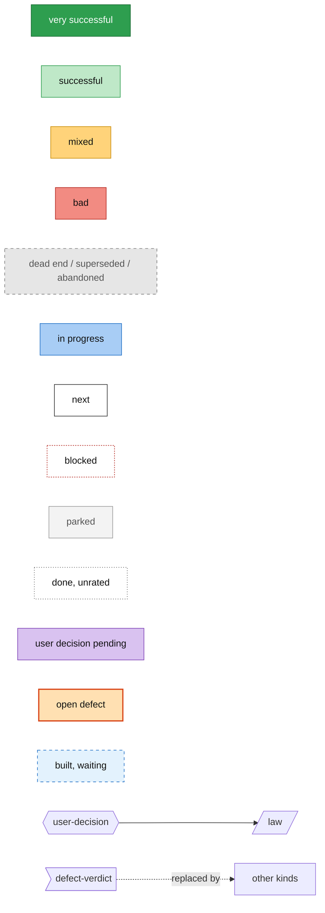

# Roadmap

**Status: draft. Ratings are not yet confirmed by the owner. The forward order follows the law ledger (status §55): correctness first, inputs before the laws that read them.**

Tech tree of the Raptorpath work: what is done, what failed, what comes next. Everything between the
`GENERATED` markers is rebuilt from `docs/roadmap/nodes.yaml`; do not edit it by hand.

## How to update

1. Edit `docs/roadmap/nodes.yaml` (the one source of truth; fields and enums are enforced by `check.py`).
2. Run `python tools/roadmap/build.py` to rewrite the generated regions below.
3. Run `python tools/roadmap/check.py`; it fails on dangling edges, cycles, bad enums and stale regions.
4. Tests for the tools: `python tools/roadmap/test_roadmap.py`.

Text outside the markers is hand-written and is preserved by the build.

## Legend

<!-- BEGIN GENERATED: legend -->
Colour is never the only signal: every node label carries a status tag on its second line.



| Tag | Meaning |
|---|---|
| `✔ done · <outcome>` | finished; outcome is the recorded verdict (green = very successful, light green = successful, amber = mixed, red = bad) |
| `▶ in progress` | being worked on (blue) |
| `○ next` | planned, not started (white) |
| `⛔ blocked` | waiting on a prerequisite or an outside call (white, red dashed border) |
| `⏸ parked` | deliberately set aside (light grey) |
| `✖ dead end` | refuted or archived, nothing reused (grey, dashed border) |
| `↷ superseded` | replaced by another node, drawn with a dashed `replaced by` arrow (grey, dashed border) |

Shapes: hexagon = user decision (purple while pending), parallelogram = law, flag = defect verdict, rectangle = everything else.
Solid arrow = hard prerequisite (prerequisite to dependant). Dashed arrow = `replaced by`.
Diagrams omit prerequisite arrows that are implied by a longer chain (the table keeps the full `depends_on`). A per-track tree draws only arrows inside its track; a node's references to other tracks are written on its label as `ext: ...`.
Thin grey dotted arrow = `then`: VM queue order, not a dependency. A defect verdict reads `⚠ open defect` or `✔ fixed` and never shows an outcome.
Amber dotted arrow = `⚠ qualified by`: a later defect or verdict limits the rating of the done node it leaves; that node's label ends in `⚠`.
<!-- END GENERATED: legend -->

## Overview

```mermaid
flowchart TB
    subgraph sg_cod["cod - coding core"]
        direction TB
        cod_block_pipeline["RaptorQ block FEC<br/>pipeline<br/>↷ superseded"]
        cod_unified_span["Unified span machine<br/>(ADR-0064)<br/>✔ done · successful"]
        cod_one_pipeline["One window pipeline<br/>(ADR-0069)<br/>✔ done · successful"]
        cod_block_pipeline ~~~ cod_one_pipeline
        cod_unified_span ~~~ cod_one_pipeline
    end
    subgraph sg_rec["rec - recovery"]
        direction TB
        rec_reliable_window["Reliable window (RWM<br/>Phase A)<br/>✔ done · successful"]
        rec_goal101[/"Recovery clock law<br/>family (4 arms)<br/>✖ dead end"/]
        rec_snapver_law[/"Snapshot-order<br/>filter as law<br/>⏳ waiting"/]
        rec_s54_session["#167;54: filter guard,<br/>store budget<br/>▶ in progress"]
        rec_leverb_guard["Lever-B guard v2,<br/>then merge<br/>⛔ blocked"]
        rec_reliable_window ~~~ rec_s54_session
        rec_goal101 ~~~ rec_s54_session
        rec_snapver_law ~~~ rec_s54_session
        rec_s54_session ~~~ rec_leverb_guard
    end
    subgraph sg_rate["rate - rate law"]
        direction TB
        rate_retention_is_rho{{"Retention is the ρ<br/>dial<br/>✔ done · n/a"}}
        rate_est_cadence["Batched BOCD<br/>estimator cadence<br/>✔ done · very-successful ⚠"]
        rate_r_battery["Funded coding at r #gt;<br/>0<br/>✖ dead end"]
    end
    subgraph sg_store["store - store law"]
        direction TB
        store_honest_cap_family[/"Honest floor-clock<br/>cap family (6 arms)<br/>✖ dead end"/]
        store_delta_cap[/"Derived setpoint 1 +<br/>q(δ)<br/>✔ done · very-successful ⚠"/]
        store_adr72_one_law[/"One store law<br/>(ADR-0072)<br/>✔ done · successful ⚠"/]
        store_power_law[/"Power-seeking store<br/>law D<br/>✖ dead end"/]
        store_defect_cap_constant>"Store cap constant<br/>at c8<br/>⚠ open defect"]
        store_engine_form_impl[/"Store-law engine<br/>form<br/>⛔ blocked"/]
        store_fix_maxbw_minrtt[/"Honest rate and<br/>delay inputs<br/>⛔ blocked"/]
        store_honest_cap_family ~~~ store_defect_cap_constant
        store_honest_cap_family ~~~ store_fix_maxbw_minrtt
        store_honest_cap_family ~~~ store_adr72_one_law
        store_delta_cap ~~~ store_defect_cap_constant
        store_delta_cap ~~~ store_fix_maxbw_minrtt
        store_delta_cap ~~~ store_adr72_one_law
        store_power_law ~~~ store_defect_cap_constant
        store_power_law ~~~ store_fix_maxbw_minrtt
        store_power_law ~~~ store_adr72_one_law
        store_defect_cap_constant ~~~ store_engine_form_impl
        store_fix_maxbw_minrtt ~~~ store_engine_form_impl
        store_adr72_one_law ~~~ store_engine_form_impl
    end
    subgraph sg_place["place - placement"]
        direction TB
        place_wire_price["Wire-RTT placement<br/>price<br/>✔ done · successful"]
    end
    subgraph sg_cc["cc - congestion control"]
        direction TB
        cc_bbr_default["BBR as substrate<br/>default (ADR-0054)<br/>✔ done · successful ⚠"]
        cc_quinn_bbr_collapse>"Quinn BBR window<br/>collapse (#167;47)<br/>⚠ open defect"]
        cc_bbrrs_r1["Fixed bbr_rs versus<br/>quinn BBR<br/>✔ done · bad ⚠"]
        cc_bbrrs_r2["bbr_rs round 2 fixes<br/>⏳ waiting"]
        cc_bbrrs_promote["bbr_rs promotion<br/>(new ADR)<br/>⛔ blocked"]
        cc_hybrid["BBR/Copa hybrid<br/>build (ADR-0068)<br/>⏸ parked"]
        cc_bbr_default ~~~ cc_bbrrs_promote
        cc_bbr_default ~~~ cc_bbrrs_r1
        cc_quinn_bbr_collapse ~~~ cc_bbrrs_promote
        cc_quinn_bbr_collapse ~~~ cc_bbrrs_r1
        cc_bbrrs_r2 ~~~ cc_bbrrs_promote
        cc_bbrrs_r2 ~~~ cc_bbrrs_r1
        cc_bbrrs_promote ~~~ cc_hybrid
        cc_bbrrs_r1 ~~~ cc_hybrid
    end
    subgraph sg_perf["perf - performance"]
        direction TB
        perf_emit_batch_law0["Emission batching,<br/>Law 0 (#167;8)<br/>✔ done · very-successful"]
        perf_threading_p2a["Threading P2a logic<br/>actor (#167;12)<br/>✖ dead end"]
        perf_io_owner["Per-path I/O owner<br/>(Q1)<br/>✔ done · very-successful"]
        perf_decoder_prune["Decoder prune per<br/>drain (#167;32)<br/>✔ done · very-successful"]
        perf_emit_batch_law0 ~~~ perf_decoder_prune
        perf_threading_p2a ~~~ perf_decoder_prune
        perf_io_owner ~~~ perf_decoder_prune
    end
    subgraph sg_meas["meas - measurement"]
        direction TB
        meas_adr52_discipline["L1 measurement<br/>discipline<br/>(ADR-0052)<br/>✔ done · successful"]
        meas_formula_first["Formula-first review<br/>(ADR-0070)<br/>✔ done · successful"]
        meas_guard_41c["Rank-minp merge<br/>guard (#167;41c)<br/>✔ done · successful ⚠"]
        meas_guard_v2_impl["Guard v2<br/>implementation<br/>✔ done · unrated"]
        meas_s51_session["Off-Bulk baseline<br/>and δ sweep<br/>⛔ blocked"]
        meas_adr52_discipline ~~~ meas_guard_v2_impl
        meas_adr52_discipline ~~~ meas_s51_session
        meas_formula_first ~~~ meas_guard_v2_impl
        meas_formula_first ~~~ meas_s51_session
        meas_guard_41c ~~~ meas_guard_v2_impl
        meas_guard_41c ~~~ meas_s51_session
    end
    subgraph sg_model["model - model and paper"]
        direction TB
        model_vis_continuum["Visualizer as one<br/>continuum law<br/>✔ done · successful ⚠"]
        model_law_ledger["Law ledger<br/>✔ done · unrated ⚠"]
    end
    subgraph sg_infra["infra - repo and simplification"]
        direction TB
        infra_adr73{{"Promote or archive<br/>at verdict<br/>✔ done · n/a"}}
    end
    sg_cod ~~~ sg_rec ~~~ sg_rate ~~~ sg_store ~~~ sg_place ~~~ sg_cc ~~~ sg_perf ~~~ sg_meas ~~~ sg_model ~~~ sg_infra
    cod_block_pipeline -.->|replaced by| cod_one_pipeline
    cod_unified_span --> cod_one_pipeline
    store_delta_cap -.->|⚠ qualified by| store_defect_cap_constant
    store_delta_cap --> store_adr72_one_law
    meas_formula_first --> store_adr72_one_law
    store_adr72_one_law -.->|⚠ qualified by| store_defect_cap_constant
    cc_bbr_default -.->|⚠ qualified by| cc_quinn_bbr_collapse
    cc_quinn_bbr_collapse --> cc_bbrrs_r1
    meas_guard_41c --> cc_bbrrs_r1
    cod_unified_span --> model_vis_continuum
    meas_adr52_discipline --> infra_adr73
    meas_guard_v2_impl --> rec_s54_session
    rec_snapver_law --> rec_s54_session
    rec_s54_session --> rec_leverb_guard
    store_fix_maxbw_minrtt --> store_engine_form_impl
    cc_bbrrs_promote --> cc_hybrid
    model_law_ledger --> store_fix_maxbw_minrtt
    cc_bbrrs_r2 --> store_fix_maxbw_minrtt
    rec_leverb_guard -.->|then| meas_s51_session
    linkStyle 46,49,50 stroke:#e69500,stroke-width:2px,stroke-dasharray:2 3,color:#a86400
    linkStyle 62 stroke:#999,stroke-width:1px,color:#777
    classDef vsucc fill:#2e9e4f,stroke:#1b6b34,color:#fff
    classDef succ fill:#bfe8c8,stroke:#2e9e4f,color:#111
    classDef mixed fill:#ffd37a,stroke:#c98a00,color:#111
    classDef bad fill:#f28b82,stroke:#b3261e,color:#111
    classDef dead fill:#e6e6e6,stroke:#777,stroke-dasharray:5 5,color:#555
    classDef inprog fill:#a8cdf5,stroke:#1f6fc5,color:#111
    classDef next fill:#fff,stroke:#333,color:#111
    classDef blocked fill:#fff,stroke:#b3261e,stroke-dasharray:2 2,color:#111
    classDef parked fill:#f3f3f3,stroke:#999,color:#555
    classDef unrated fill:#fff,stroke:#333,stroke-dasharray:1 3,color:#111
    classDef userdec fill:#d9c2f0,stroke:#7b3fb5,color:#111
    classDef defect fill:#ffe0b2,stroke:#d84315,stroke-width:2px,color:#111
    classDef waiting fill:#e3f2fd,stroke:#1f6fc5,stroke-dasharray:5 5,color:#111
    class cod_block_pipeline,rec_goal101,rate_r_battery,store_honest_cap_family,store_power_law,perf_threading_p2a dead
    class cod_unified_span,cod_one_pipeline,rec_reliable_window,store_adr72_one_law,place_wire_price,cc_bbr_default,meas_adr52_discipline,meas_formula_first,meas_guard_41c,model_vis_continuum succ
    class rec_snapver_law,cc_bbrrs_r2 waiting
    class rate_retention_is_rho,infra_adr73 userdec
    class rate_est_cadence,store_delta_cap,perf_emit_batch_law0,perf_io_owner,perf_decoder_prune vsucc
    class store_defect_cap_constant,cc_quinn_bbr_collapse defect
    class cc_bbrrs_r1 bad
    class meas_guard_v2_impl,model_law_ledger unrated
    class rec_s54_session inprog
    class rec_leverb_guard,meas_s51_session,store_engine_form_impl,cc_bbrrs_promote,store_fix_maxbw_minrtt blocked
    class cc_hybrid parked
```

<!-- BEGIN GENERATED: overview -->

<!-- END GENERATED: overview -->

## In plain words

<!-- BEGIN GENERATED: plain-words -->
| title | status | in plain words |
|---|---|---|
| RaptorQ block FEC pipeline | ↷ superseded | The original design sent data in fixed blocks of error-correcting code; it was replaced by one sliding window for every kind of traffic. |
| Generation cross-path fungible coding | ⏸ parked | An optional feature that codes data across paths in groups has never been switched on by default, and nobody has yet decided whether to keep it. |
| Unified span machine (ADR-0064) | ✔ done · successful | Merged two separate decoders into one machine that slides smoothly from low-delay to bulk traffic, with no switch between modes. |
| One window pipeline (ADR-0069) | ✔ done · successful | Deleted the old block path so that every kind of traffic now goes through the same window, which was at least as fast everywhere. |
| Owner call: keep generation coding | ○ next | Owner decision on whether to keep or archive the optional cross-path coding feature that has never been switched on by default. |
| Reliable window (RWM Phase A) | ✔ done · successful | Made the window keep every packet until the receiver confirms it, so one design can serve bulk transfers without a separate mode. |
| Recovery clock law family (4 arms) | ✖ dead end | A search for a derived formula for the retransmit timer ended with the whole family of candidates refuted; the hand-set timer limit stayed. |
| Gap horizon lever B (§52) | ⏳ waiting | Letting the sender hear about many more missing packets at once removed most of the end-of-transfer wait on the hardest test, but raised duplicate packets; the merge is still pending. |
| Snapshot-order filter as law | ⏳ waiting | Turning the fix for outdated loss reports into a permanent rule, written into the paper first; it ships once its merge check passes. |
| [QCLK] w_us pinned at clamp | ⚠ open defect | Open problem: on the hardest two-path test the retransmit timer always sits at its hand-set upper limit, so the formula behind it never acts. |
| c8 hole law never measured | ⚠ open defect | Open problem: the rule that decides when a missing packet is lost had never been measured in the conditions where it matters most. |
| Hole refresh clock degenerate input | ⚠ open defect | Open problem: the receiver timer that re-reports missing packets reads a fixed default delay instead of a measured one. |
| Singles hole suppression (RECOV_SP) | ⏸ parked | A switched-off option that suppresses some loss reports on single paths gave a tiny gain on one test and a tie on another, and is kept but unused. |
| Lever B c1d duplicate cost | ⚠ open defect | Open problem: the end-of-transfer fix adds about thirteen percent more duplicate packets on the fast two-path test, and the loss-report fix does not remove them. |
| Main's duplicates mostly unexplained | ⚠ open defect | Open problem: even the current main version receives a thousand or more duplicate packets per run, and most of them are unexplained. |
| §54: filter guard, store budget | ▶ in progress | Real-network session that checks and merges the fix for outdated loss reports, and tests whether a smaller in-flight budget cuts waiting in the send queue. |
| Retransmit leg choice with filter | ⛔ blocked | Checking, with the loss-report fix in place, whether retransmissions should be spread across paths like normal data. |
| Lever-B guard v2, then merge | ⛔ blocked | Checking and merging the change that lets the sender hear about more missing packets at once, which removed most of the end-of-transfer wait. |
| Recovery timeouts after store law | ⛔ blocked | Re-deriving the retransmit timers from the new in-flight limit, so they stop sitting at a fixed hand-set ceiling. |
| Per-leg recovery clock, one law | ⛔ blocked | Making each missing packet's timer follow its own path, using the same loss rule on one path as on many, and keeping the re-send cooldown only until a counter proves it never acts. |
| Receiver refresh clock input | ⛔ blocked | Giving the receiver a real delay for its re-report timer; it waits for the in-flight limit fix, because until then the timer's limits decide its value anyway. |
| NACK repair throttle: gauge, paper | ○ next | First measuring how often a hidden rule that limits re-sends per loss report actually bites, then justifying it in the paper or removing it. |
| Retransmits queued behind source? | ○ next | Checking whether re-sent packets have to wait behind new data in each path's send queue, which would slow the recovery of lost packets. |
| Retention is the ρ dial | ✔ done · n/a | The owner decided that how long data is kept for resending is one of the three main dials, not a separate setting. |
| Batched BOCD estimator cadence | ✔ done · very-successful ⚠ | Made the loss estimator update in batches instead of on every packet, which raised two-path throughput by about 40 percent and cut sender CPU. |
| Funded coding at r > 0 | ✖ dead end | Tested sending extra repair data ahead of losses; in one small run it made the lossy single-path transfer slower, so the system keeps repairing on demand. |
| DoF ledger feedback leg (§39) | ⏸ parked | An analysis found that feeding repair results back into the repair rate is sound in principle but cannot help measurably today, so it is on hold. |
| P_fec truncation divergence | ⚠ open defect | Open problem: the code that estimates how often extra repair data helps jumps from zero to one half at one point, where the paper describes a smooth curve. |
| Repair-rate readout | ○ next | Adding a readout of how much repair data the formula asks for and which limit is in control, without changing behaviour. |
| Owner calls on rate law | ⛔ blocked | Owner decision on five mismatches between the paper and the code in how much repair data to send. |
| Rate-law reconciliation (W22, W*) | ⛔ blocked | Making the paper and the code agree on how much repair data to send, with a test for every remaining difference. |
| Rate-law term-win gauge | ⛔ blocked | Adding a readout that shows which part of the repair-rate formula is actually in control. |
| Loss estimator approximations | ⛔ blocked | Checking and tightening three approximations inside the loss and delay estimators. |
| Low-latency and partial-reliability laws | ⛔ blocked | Fixing the rules that only act when data may be dropped, so they follow the dials smoothly and read honest delays. |
| Honest floor-clock cap family (6 arms) | ✖ dead end | Six attempts to size the in-flight data limit from more honest measurements; none was adopted, and all six were archived. |
| Derived setpoint 1 + q(δ) | ✔ done · very-successful ⚠ | Replaced a hand-picked doubling factor in the in-flight data limit with one derived from the latency dial, cutting queueing delay at equal throughput. |
| One store law (ADR-0072) | ✔ done · successful ⚠ | Made one in-flight data limit rule apply to any number of paths, removing a special case for single-path links. |
| Power-seeking store law D | ✖ dead end | Tried a self-tuning in-flight limit that hunts for the best throughput-to-delay balance; its measurements were too noisy to work. |
| Dispersion and oracle store law | ⏸ parked | Tests of how the in-flight data limit could read the real link rate and delay found no reliable source yet, so the work is on hold until better measurements exist. |
| Who limits at each δ | ⏳ waiting | Working out whether the congestion controller or the in-flight data limit should carry the latency setting; the answer so far is the limit. |
| Store-budget test design (§54) | ⏳ waiting | Designed a test of whether a smaller in-flight budget stops data from piling up in the send queue after the end-of-transfer fix. |
| Store cap constant at c8 | ⚠ open defect | Open problem: on the hardest two-path test the in-flight data limit is stuck at its ceiling, because both of its inputs read far too high. |
| Store-law engine form guard | ⛔ blocked | Real-network check of the rebuilt in-flight data limit, confirming it no longer sits stuck at its ceiling. |
| δ seat diagnostic and guard (§48c) | ⛔ blocked | Real-network test of tying the in-flight limit to the latency dial, including one low-latency row. |
| Owner calls U1–U3 | ○ next | Owner decision on three questions: whether the congestion controller or the in-flight limit is in charge, what sets the latency trade, and whether two percent less bulk speed is worth ten times less delay. |
| Store-law engine form | ⛔ blocked | Rebuilding the in-flight data limit on measured link rate and delay, written as a derived formula first. |
| δ seat on the store | ⛔ blocked | Making the in-flight data limit follow the latency dial smoothly, so lower-latency settings queue less. |
| Honest rate and delay inputs | ⛔ blocked | An open research problem: nobody has yet found an honest way to measure link speed and minimum delay for the in-flight data limit, after seven failed attempts, so this node may end with a declared fallback instead of a fix. |
| Derived diversity weight, leg choice | ⏳ waiting | A wiring change that lets retransmissions be spread across paths differently has been built but never fully measured. |
| Wire-RTT placement price | ✔ done · successful | Fixed a bug where an idle path could stay priced too high and never be used again, by pricing each path on its measured network delay. |
| One per-leg state design | ⏳ waiting | A design for keeping all of each path's measurements in one place instead of in several slightly different copies. |
| Owner calls on per-leg design | ○ next | Owner decision on five open design questions for keeping each path's measurements in one place. |
| Per-leg state implementation | ⛔ blocked | Keeping all of each path's measurements in one place instead of in several slightly different copies. |
| BBR as substrate default (ADR-0054) | ✔ done · successful ⚠ | Switched the underlying congestion controller to BBR, which removed a hidden speed ceiling and raised throughput about four times. |
| Copa-BBR fusion (ADR-0068) | ⏸ parked | A proposed design for a controller that blends the speed of BBR with the low queues of Copa; prerequisite measurements are done but nothing is built. |
| Quinn BBR window collapse (§47) | ⚠ open defect | Open problem: the default congestion controller can shrink its sending window to almost nothing on fast links because it remembers one unrealistically low delay sample. |
| Fixed bbr_rs versus quinn BBR | ✔ done · bad ⚠ | Our own fixed BBR controller stopped that collapse but cost a little throughput and CPU, so it was not adopted; a later check also found it delayed delivery. |
| bbr_rs round 2 fixes | ⏳ waiting | Second round of fixes to our own BBR controller, aimed at keeping the collapse fix without its costs. |
| Pacing-seam audit (W2) | ⏳ waiting | Checked what our controller would need in order to set the sending pace itself; the standard library ignores the pace a controller asks for. |
| Vendored quinn-proto pacing hook | ⏳ waiting | Adding a small hook to our own copy of the network library so our controller can set the sending pace. |
| Copa min_rtt reads own queue | ⚠ open defect | Open problem: the minimum delay the system measures includes time spent in its own send queue, so it reads ten or more times too high. |
| §48d bbr_rs round 2 | ⛔ blocked | Real-network test of the second round of fixes to our own BBR controller, now also measuring how long data waits before delivery. |
| Pacing seam first reading | ⛔ blocked | First measurement of letting our controller set the sending pace itself, watching how much data then waits in the send queue. |
| Owner call: ADR-0068 direction | ○ next | Owner decision on whether the future hybrid controller should grow out of our BBR controller instead of being a second one. |
| Owner call: bbr_rs promotion | ⛔ blocked | Owner decision on whether our BBR controller replaces the standard one by default. |
| Copa consumers onto per-leg state | ⛔ blocked | Moving the parts that read the Copa controller onto the shared per-path measurements and replacing its per-setting table with one smooth rule. |
| bbr_rs promotion (new ADR) | ⛔ blocked | Making our BBR controller the default, recorded as a new architecture decision. |
| BBR/Copa hybrid build (ADR-0068) | ⏸ parked | Designing a controller that blends BBR's speed with Copa's low queues, with pass or fail targets fixed before anything is built. |
| Emission batching, Law 0 (§8) | ✔ done · very-successful | Sent packets in small bursts instead of one at a time, which raised throughput by about 40 percent on the fast two-path test and cut CPU everywhere. |
| Threading P2a logic actor (§12) | ✖ dead end | Tried moving all control logic onto one task; the sender then spun far more often and lost a third of its speed, so it was deleted. |
| Per-path I/O owner (Q1) | ✔ done · very-successful | Gave each network path its own input and output task, which raised single-path throughput by about half. |
| Decoder prune per drain (§32) | ✔ done · very-successful | Made the receiver clean up finished decoding work more often, which raised fast two-path throughput by about a fifth. |
| bbr_rs send-record ring fix | ⏳ waiting | Cutting the per-packet bookkeeping cost of our own BBR controller to at most twice that of the standard one. |
| Emission burst bound derivation | ○ next | Working out how many packets the sender should send in one burst instead of using a hand-picked sixty-four. |
| L1 measurement discipline (ADR-0052) | ✔ done · successful | Wrote down the measurement rules every real-network result must follow, such as fixing predictions before a run. |
| Formula-first review (ADR-0070) | ✔ done · successful | After a limit rule turned out to be wrong in shape despite passing every test, every rule must now be written as a formula and derived before it is coded. |
| Rank-minp merge guard (§41c) | ✔ done · successful ⚠ | Built the statistical check that every change must pass before merging, calibrated against identical runs. |
| Guard clause rtp_floor_p0 measures drain | ⚠ open defect | Open problem: one reading in the merge check measured the start or the end of a run rather than the network path, so it scored good fixes as worse. |
| ETA route and σ witness mismatch | ⚠ open defect | Open problem: the script that checks the finish-time prediction uses a different delay than the formula itself, and one of its checks fails. |
| c8 control bimodal collapse | ⚠ open defect | Open problem: on the hardest two-path test, the control runs sometimes fall back to using only the fast path, which makes results very noisy. |
| [DIAG] rtp prints whole milliseconds | ⚠ open defect | Open problem: one diagnostic line rounds the delay to whole milliseconds, which hides small delays on fast links. |
| Guard v2 implementation | ✔ done · unrated | Building the new merge check, which drops a misleading delay reading and adds a proper measure of how long data waits before delivery. |
| §51 harness and scorer | ⛔ blocked | Building the scripts that run and score the off-Bulk test, after the next session's scripts merge, because they edit the same files. |
| Partial-reliability measurement block | ⛔ blocked | A follow-up test of the mode where some data may be dropped, which first needs that setting to be adjustable on its own. |
| Harness robustness for every plan | ○ next | Making sure every test plan can be rehearsed end to end without the real network, so a long test session does not die on a script bug. |
| Guard CPU and lag resolution | ○ next | Making the merge check sensitive to smaller CPU and delay changes, which it currently cannot see. |
| Test hygiene fixes | ○ next | Fixing tests that pass for the wrong reason or depend on which machine they run on. |
| Off-Bulk baseline and δ sweep | ⛔ blocked | First real-network measurement of the system away from the bulk setting, checking that behaviour changes smoothly as the latency dial moves. |
| Adversarial cells measured | ⛔ blocked | Measuring the current system, our BBR controller and the Copa controller on the harder network conditions. |
| Competitor battery | ⛔ blocked | Measuring standard Linux BBR and CUBIC on the same tests, to compare against outside protocols. |
| Cumulative progress benchmark | ○ next | One measurement of the current system against the early-July version, showing how much each result has improved since. |
| Gauges for the remaining constants | ⛔ blocked | Adding readouts or derivations for the last hand-set numbers, so none hides inside a formula. |
| Visualizer as one continuum law | ✔ done · successful ⚠ | Rebuilt the visualizer around one smooth law across the latency dial, with an automatic test that forbids any mode switch. |
| Engine NO-MODE-SWITCH debts (§3.3) | ⚠ open defect | Open problem: five places in the engine still switch behaviour on the chosen preset instead of following one smooth rule. |
| Open-constants register (§3.4) | ⚠ open defect | Open problem: about twenty numbers in the code were picked by hand and have no derivation behind them. |
| Paper versus engine reconciliation | ⏳ waiting | Compared every claim in the paper with what the code actually does and listed the mismatches; a few questions wait on the owner. |
| Wasm mode-switch audit | ⏳ waiting | Checked the visualizer's model for hidden mode switches before its formulas move into the shared library. |
| T_cut give-up law pinned | ⚠ open defect | Open problem: the visualizer's rule for when to give up on a missing packet only ever takes one of two fixed values and jumps at unexpected points. |
| Wasm dead second machine | ⚠ open defect | Open problem: the visualizer still carries an older second copy of the machine that only the tests use. |
| Erratum: pre-flight tests not run | ⚠ open defect | Open problem: three checks planned for the last test session, including the visualizer build, were never run and move to the next session. |
| Law ledger | ✔ done · unrated ⚠ | Audited every formula in the system for where it comes from and whether it has been checked in real conditions, and ranked the fixes. |
| Hint-keyed engine paths made continuous | ⛔ blocked | Removing the five places where the engine still changes behaviour by the name of the preset instead of following the latency dial smoothly. |
| Owner calls on wasm audit | ○ next | Owner decision on how to clean up the visualizer's model, including removing a second, unused copy of the machine. |
| Wasm model fixes | ⛔ blocked | Applying the owner's calls to the visualizer's model and proving it stays smooth across the dial. |
| Paper text for placement and bbr_rs | ○ next | Correcting two places where the paper does not match the code. |
| Paper-only law records | ⛔ blocked | Writing four small rules into the paper that the code uses but the paper never states. |
| Metrics registry and OTel design | ⏳ waiting | A design for one metrics system that feeds the status page, the logs and standard monitoring tools, including a packet-level recorder. |
| Observability implementation | ⛔ blocked | Building one metrics system that feeds the status page, the logs and standard monitoring tools. |
| Promote or archive at verdict | ✔ done · n/a | The owner ruled that every experiment is either promoted or archived once its result is in, instead of lingering switched off. |
| Workspace restructure (ADR-0076) | ⏳ waiting | Reorganising the repository layout in stages; the documentation and tools moves are done and the code splits are still open. |
| Recorded, not fixed (§3.7) | ⚠ open defect | Open problems recorded but not fixed: a loss estimate that never drops below a small floor, extra sender CPU when spreading over two paths, and an old acknowledgement option that releases too much. |
| Derivation branch merges | ○ next | Merging the finished design documents that are still on side branches. |
| tech-tree skill PR | ⛔ blocked | Packaging this roadmap tool so other projects can use it, offered as a proposal to the shared skills repository. |
<!-- END GENERATED: plain-words -->

## Ready now

<!-- BEGIN GENERATED: ready-now -->
**vm**

- `meas-progress-baseline`: Cumulative progress benchmark

**host-cargo**

- `rate-fix-rate-readout`: Repair-rate readout
- `meas-guard-resolution`: Guard CPU and lag resolution
- `meas-test-hygiene`: Test hygiene fixes
- `rec-fix-nack-throttle`: NACK repair throttle: gauge, paper

**no-cargo**

- `infra-derivation-merges`: Derivation branch merges
- `meas-harness-robustness`: Harness robustness for every plan
- `rec-retx-behind-source`: Retransmits queued behind source?
- `model-fix-paper-p2`: Paper text for placement and bbr_rs
- `perf-fix-burst-bound`: Emission burst bound derivation
<!-- END GENERATED: ready-now -->

## Running

<!-- BEGIN GENERATED: running -->
**vm**

- `rec-s54-session`: §54: filter guard, store budget
<!-- END GENERATED: running -->

## Built, waiting

<!-- BEGIN GENERATED: built-waiting -->
**the lever-B guard on the new main**

- `rec-gap-horizon`: Gap horizon lever B (§52)

**its guard in the next VM session**

- `rec-snapver-law`: Snapshot-order filter as law

**the owner's answers to the three latency-setting questions, then merge to main**

- `store-w1-who-limits`: Who limits at each δ

**the next VM session**

- `store-s54-budget`: Store-budget test design (§54)

**the leg-choice row in a VM session, then merge to main**

- `place-wdiv`: Derived diversity weight, leg choice

**the owner's answers to the five per-path design questions, then merge to main**

- `place-per-leg-state`: One per-leg state design

**the per-packet cost fix, then the bbr_rs round-2 session**

- `cc-bbrrs-r2`: bbr_rs round 2 fixes

**the owner's call on the hybrid controller's direction, then merge to main**

- `cc-pacing-audit`: Pacing-seam audit (W2)

**the round-2 controller work it is stacked on, then its first VM reading**

- `cc-pacing-seam`: Vendored quinn-proto pacing hook

**the owner's calls on the rate law, then merge to main**

- `model-paper-recon`: Paper versus engine reconciliation

**the owner's five calls**

- `model-wasm-audit`: Wasm mode-switch audit

**merge to main, then the per-path state work it builds on**

- `obs-otel-design`: Metrics registry and OTel design

**the open branches merging before the code splits**

- `infra-restructure`: Workspace restructure (ADR-0076)

**the bbr_rs round-2 session on the VM**

- `perf-bbrrs-ring-fix`: bbr_rs send-record ring fix
<!-- END GENERATED: built-waiting -->

## Waiting on the owner

<!-- BEGIN GENERATED: waiting-on-owner -->
- `store-user-u1u3`: Owner calls U1–U3
- `model-user-wasm-calls`: Owner calls on wasm audit
- `rate-user-rate-law`: Owner calls on rate law
- `cc-user-adr68-direction`: Owner call: ADR-0068 direction
- `cc-user-bbrrs-promotion`: Owner call: bbr_rs promotion
- `cod-user-generation-seat`: Owner call: keep generation coding
- `place-user-perleg-questions`: Owner calls on per-leg design
<!-- END GENERATED: waiting-on-owner -->

## VM queue

<!-- BEGIN GENERATED: vm-queue -->
1. `rec-s54-session`: §54: filter guard, store budget. First, because the owner approved shipping the loss-report fix before anything else, and every later session should run on that new main version.
2. `rec-w0-leg-question`: Retransmit leg choice with filter. Before the lever-B merge, so the question of which path should carry retransmissions is answered first. It could instead ride the lever-B session as an extra reported block rather than take a session of its own.
3. `rec-leverb-guard`: Lever-B guard v2, then merge. Runs on the main version the first session produces, in the order the owner approved.
4. `meas-s51-session`: Off-Bulk baseline and δ sweep. After the recovery fixes land so the baseline describes the current system; it does not need them to run.
5. `cc-s48d-session`: §48d bbr_rs round 2. After the recovery fixes, because they change the results on the hardest test that this session predicts.
6. `cc-pacing-seam-reading`: Pacing seam first reading. Right after the controller round-two session, because the pacing hook sits on top of that work.
7. `meas-adversarial-cells-run`: Adversarial cells measured. After the controller changes it is meant to measure.
8. `store-engine-form-guard`: Store-law engine form guard. When the rebuilt in-flight limit is ready; it is one of the later checks.
9. `store-s48c-session`: δ seat diagnostic and guard (§48c). After the latency-dial version of the in-flight limit is built and the low-latency baseline exists.
10. `meas-competitor-battery`: Competitor battery. At the end, once our controller is the default, to compare the finished system with outside protocols.
11. `meas-progress-baseline`: Cumulative progress benchmark. Whenever the queue has room; it only measures progress and gates nothing.
12. `meas-s51b-rho`: Partial-reliability measurement block. A follow-on to the off-Bulk session; it first needs the drop setting to be adjustable on its own.
<!-- END GENERATED: vm-queue -->

## Timeline

<!-- BEGIN GENERATED: timeline -->
%% today: 2026-11-13

```mermaid
gantt
    dateFormat YYYY-MM-DD
    axisFormat %Y-%m-%d
    section cod - coding core
    RaptorQ block FEC pipeline :crit, cod_block_pipeline, 2026-03-12, 2026-10-04
    METTLE swappable FEC backend :crit, cod_mettle, 2026-03-13, 2026-08-07
    Mid-stream FEC backend switching :crit, cod_backend_switch, 2026-03-16, 2026-08-08
    Streaming two-layer Realtime code :crit, cod_streaming_code, 2026-03-14, 2026-07-28
    SIMD GF(2^8) and gf256 crate :cod_gf256_simd, 2026-03-17, 2026-03-18
    Windowed RLC for every profile :crit, cod_rlc_all_profiles, 2026-07-04, 2026-07-06
    Generation cross-path fungible coding :cod_generation_coding, 2026-07-07, 2026-07-13
    Coded-only generation wire :crit, cod_coded_only_wire, 2026-07-07, 2026-07-13
    Systematic wire, sparse decoder :cod_systematic_wire, 2026-07-13, 2026-07-13
    Coded-only fungible window :crit, cod_fungible_window, 2026-07-07, 2026-07-07
    FMTCP-class decode-on-total :crit, cod_fmtcp, 2026-07-08, 2026-07-28
    Legacy sliding-window/generation decode… :crit, cod_legacy_rlc, 2026-03-14, 2026-07-21
    Unified span machine (ADR-0064) :cod_unified_span, 2026-07-18, 2026-07-21
    One window pipeline (ADR-0069) :cod_one_pipeline, 2026-08-10, 2026-10-04
    Compact v5 DATA framing :cod_wire_compact, 2026-08-06, 2026-08-06
    Decoder re-delivery stall fix (§31) :cod_debug_stall, 2026-10-28, 2026-10-28
    Overhead reduction (packing, repair ali… :cod_overhead_reduction, 2026-03-18, 2026-03-20
    section rec - recovery
    Early ACK, NACK and repair :rec_early_arq, 2026-03-12, 2026-03-20
    P_lost(t) mix and SACK WindowAck :rec_plost_sack, 2026-03-21, 2026-04-07
    Bulk ARQ and batch acknowledgements :rec_bulk_arq, 2026-07-02, 2026-07-04
    Reliable window (RWM Phase A) :rec_reliable_window, 2026-07-04, 2026-07-06
    Proactive FEC versus ARQ frontier :rec_fec_vs_arq, 2026-07-07, 2026-07-08
    Proactive repair timing (3 arms) :crit, rec_proactive_repair, 2026-07-08, 2026-07-27
    Per-path recovery clocks (RECOV_MP) :rec_per_path_clocks, 2026-07-21, 2026-07-21
    Global loss serials under striping :crit, rec_mp_serial, 2026-07-21, 2026-07-27
    Derived recovery-timing candidates (4 a… :crit, rec_clock_candidates, 2026-08-07, 2026-08-19
    Recovery primitives and σ (goal 100) :rec_goal100, 2026-08-20, 2026-08-21
    Recovery clock law family (4 arms) :crit, rec_goal101, 2026-08-21, 2026-08-21
    Receiver request law (Track C) :crit, rec_receiver_law, 2026-09-08, 2026-09-08
    Cost-ratio decision (owner ruling) :rec_cost_ratio_decision, 2026-08-19, 2026-08-20
    Wire v9 per-path sequence :rec_wire_v9, 2026-09-30, 2026-09-30
    Gap horizon lever B (§52) :active, rec_gap_horizon, 2026-11-12, 2026-11-13
    Stale gap reports, snapshot filter (§53) :rec_snapver_filter, 2026-11-12, 2026-11-13
    Snapshot-order filter as law :active, rec_snapver_law, 2026-11-13, 2026-11-13
    [QCLK] w_us pinned at clamp :active, rec_defect_qclk_clamp, 2026-11-13, 2026-11-13
    c8 hole law never measured :active, rec_defect_hole_law, 2026-11-13, 2026-11-13
    Hole refresh clock degenerate input :active, rec_defect_refresh_input, 2026-11-13, 2026-11-13
    Inner-feedback repair floor (P10a) :crit, rec_p10a_repair_floor, 2026-07-04, 2026-07-04
    Singles hole suppression (RECOV_SP) :rec_recov_sp, 2026-07-21, 2026-07-27
    Lever B c1d duplicate cost :active, rec_leverb_c1d_cost, 2026-11-13, 2026-11-13
    Main's duplicates mostly unexplained :active, rec_defect_base_duplicates, 2026-11-13, 2026-11-13
    §54 - filter guard, store budget :active, rec_s54_session, 2026-11-13, 2026-11-13
    Recovery-clock derivation (wire clock) :rec_wire_clock_derivation, 2026-11-13, 2026-11-13
    Congestion-aware NACK throttle (first f… :rec_nack_congestion, 2026-03-20, 2026-03-20
    section rate - rate law
    Gilbert-Elliott loss model (ADR-0023) :rate_ge_hmm, 2026-03-14, 2026-07-07
    BOCD FEC rate control (ADR-0050) :rate_fec_rate_v1, 2026-03-18, 2026-03-21
    Saturation-aware r* and window :rate_saturation_rstar, 2026-07-02, 2026-07-07
    r* window-mass provisioning (ADR-0063) :rate_rstar_window_mass, 2026-07-13, 2026-07-13
    Taper emission budget law :rate_taper_r, 2026-07-18, 2026-07-18
    Leading-window taper emission :crit, rate_leading_taper, 2026-07-18, 2026-07-19
    Retention is the ρ dial :rate_retention_is_rho, 2026-07-06, 2026-07-06
    δ-honest overload shedding :rate_unified_shed, 2026-07-21, 2026-07-21
    Batched BOCD estimator cadence :rate_est_cadence, 2026-08-06, 2026-10-04
    Sender-truth loss estimator :crit, rate_sender_truth_loss, 2026-08-18, 2026-08-19
    Funded coding at r > 0 :crit, rate_r_battery, 2026-09-08, 2026-09-08
    DoF ledger feedback leg (§39) :rate_dof_ledger, 2026-11-10, 2026-11-10
    The dials made real :rate_dials_made_real, 2026-09-08, 2026-09-08
    P_fec truncation divergence :active, rate_defect_pfec, 2026-11-13, 2026-11-13
    section store - store law
    Path-scaled pool ×N (STORE_PATHS) :crit, store_xn_pool, 2026-07-14, 2026-08-19
    Per-path store accounts family (4 arms) :crit, store_percap_family, 2026-07-18, 2026-07-27
    Honest floor-clock cap family (6 arms) :crit, store_honest_cap_family, 2026-07-19, 2026-08-07
    Composed cadence and pool-anchor flip :store_pool_anchor_flip, 2026-08-07, 2026-08-07
    SACK pruning of the store :crit, store_sack_prune, 2026-07-08, 2026-07-27
    SACK-clocked store release (ADR-0060) :store_sack_release, 2026-07-21, 2026-07-21
    Sender decoupling attempts (4 arms) :crit, store_sender_decoupling, 2026-07-07, 2026-08-06
    Anchor hygiene laws (ADR-0061) :store_anchor_hygiene, 2026-07-19, 2026-07-21
    Three-term and composed caps (5 arms) :crit, store_three_term, 2026-08-10, 2026-08-18
    Store-cap unification over live paths :store_cap_unification, 2026-08-11, 2026-09-30
    Honest inputs and O(1) anchor :store_honest_inputs, 2026-08-10, 2026-08-11
    Sum cap - ×N deletion (SUM_CAP) :store_sum_cap, 2026-08-18, 2026-08-19
    Derived setpoint 1 + q(δ) :store_delta_cap, 2026-08-19, 2026-08-19
    One store law (ADR-0072) :store_adr72_one_law, 2026-10-26, 2026-10-26
    Store-law input search (8 inputs) :crit, store_input_search, 2026-10-26, 2026-11-02
    Power-seeking store law D :crit, store_power_law, 2026-10-26, 2026-10-28
    Dispersion and oracle store law :store_engine_form, 2026-11-09, 2026-11-10
    Who limits at each δ :active, store_w1_who_limits, 2026-11-12, 2026-11-13
    Store-budget test design (§54) :active, store_s54_budget, 2026-11-13, 2026-11-13
    Store cap constant at c8 :active, store_defect_cap_constant, 2026-11-13, 2026-11-13
    section place - placement
    Marginal-cost placement law (RWM B) :place_marginal_cost, 2026-07-04, 2026-07-06
    DAPS and rate estimator (4 arms) :crit, place_daps, 2026-07-12, 2026-07-27
    Place-slack :crit, place_slack, 2026-08-06, 2026-08-06
    Placement battery (Track A) :place_stage2_battery, 2026-09-08, 2026-09-09
    Placement frontier term (PLACE_HOL) :crit, place_hol, 2026-09-08, 2026-09-09
    Derived placement temperature :crit, place_t_derived, 2026-09-08, 2026-09-09
    Derived diversity weight, leg choice :active, place_wdiv, 2026-09-08, 2026-11-13
    Frozen app-echo srtt price :crit, place_frozen_echo, 2026-07-06, 2026-11-10
    Wire-RTT placement price :place_wire_price, 2026-11-10, 2026-11-12
    One per-leg state design :active, place_per_leg_state, 2026-11-12, 2026-11-13
    Sub-max quantile rate anchor :crit, place_submax_anchor, 2026-07-12, 2026-07-27
    Path event after promotion (§46) :place_path_event, 2026-11-10, 2026-11-10
    Loss-ranked multipath window scheduling :crit, place_early_window_sched, 2026-03-14, 2026-07-04
    section cc - congestion control
    Delay-based CC replaces AIMD :cc_early_delay_cc, 2026-03-13, 2026-03-22
    Production Copa-lite port (P-series) :cc_copa_lite, 2026-07-02, 2026-07-04
    Copa per path as substrate :crit, cc_copa_sole_substrate, 2026-07-13, 2026-07-27
    Quinn stock Cubic substrate :crit, cc_cubic_substrate, 2026-03-12, 2026-07-21
    Copa wire signal, compete mode :cc_copa_wire_signal, 2026-07-13, 2026-07-22
    BBR as substrate default (ADR-0054) :cc_bbr_default, 2026-07-13, 2026-07-21
    bbr_rs v1 on shal8 :cc_bbrrs_v1, 2026-08-07, 2026-08-07
    Copa-BBR fusion (ADR-0068) :cc_adr68_fusion, 2026-07-22, 2026-11-13
    Quinn BBR window collapse (§47) :active, cc_quinn_bbr_collapse, 2026-11-10, 2026-11-13
    Fixed bbr_rs versus quinn BBR :cc_bbrrs_r1, 2026-11-10, 2026-11-12
    Owner call - continue bbr_rs :cc_user_continue_bbrrs, 2026-11-12, 2026-11-12
    bbr_rs round 2 fixes :active, cc_bbrrs_r2, 2026-11-12, 2026-11-13
    Pacing-seam audit (W2) :active, cc_pacing_audit, 2026-11-12, 2026-11-13
    Owner call - vendored pacing seam :cc_user_pacing_s3, 2026-11-12, 2026-11-12
    Vendored quinn-proto pacing hook :active, cc_pacing_seam, 2026-11-12, 2026-11-13
    Copa min_rtt reads own queue :active, cc_defect_copa_minrtt, 2026-11-13, 2026-11-13
    AIMD congestion control (first CC) :crit, cc_aimd_v1, 2026-03-12, 2026-03-13
    section perf - performance
    Engine or receiver parallelisation :crit, perf_parallelisation, 2026-07-08, 2026-07-21
    Emission batching, first attempt :crit, perf_emit_batch_v1, 2026-07-27, 2026-07-27
    One control datagram per message :perf_ack_merge, 2026-08-07, 2026-08-08
    Receive-buffer fix F-A (§7) :perf_rcvbuf, 2026-10-05, 2026-10-05
    Emission batching, Law 0 (§8) :perf_emit_batch_law0, 2026-10-05, 2026-10-05
    Per-path datagram feeder (§10) :crit, perf_quic_feeder, 2026-10-05, 2026-10-05
    Threading P0 thread budget (§9) :perf_threading_p0, 2026-10-05, 2026-10-05
    Threading P1 defect fixes (§11) :perf_threading_p1, 2026-10-05, 2026-10-05
    Threading P2a logic actor (§12) :crit, perf_threading_p2a, 2026-10-05, 2026-10-06
    Per-path I/O owner (Q1) :perf_io_owner, 2026-10-06, 2026-10-06
    Scheduler split by direction (Q2) :perf_sched_split, 2026-10-06, 2026-10-06
    Threading Q3 lock-free send :crit, perf_q3_investigation, 2026-10-06, 2026-10-06
    Receiver per-datagram cost R1 :crit, perf_receiver_r1, 2026-10-26, 2026-10-26
    Receiver cost R2 with floor fix :perf_receiver_r2, 2026-10-26, 2026-10-26
    Threading R3 receiver re-profile :crit, perf_threading_r3, 2026-10-26, 2026-10-27
    c8 client lag diagnosis :perf_c8_lag, 2026-10-26, 2026-11-01
    Incremental SACK marking (§28) :perf_incremental_sack, 2026-10-27, 2026-10-27
    Decoder prune per drain (§32) :perf_decoder_prune, 2026-10-28, 2026-10-29
    Receiver follow-ups (§35) :perf_receiver_followups, 2026-11-01, 2026-11-02
    bbr_rs per-packet cost bench :perf_bbrrs_ns_cost, 2026-11-10, 2026-11-12
    bbr_rs send-record ring fix :active, perf_bbrrs_ring_fix, 2026-11-13, 2026-11-13
    Receiver per-message wall :perf_receiver_msg_wall, 2026-08-06, 2026-08-07
    section meas - measurement
    Netsim harness and ablation benches :meas_l0_sim_bench, 2026-03-17, 2026-03-20
    Canonical scenarios and goal gate :meas_adr51_scenarios, 2026-07-02, 2026-07-02
    L1 netns harness and baselines :meas_l1_harness, 2026-07-03, 2026-07-04
    L2/L3 multipath and tail evaluation :meas_l2_multipath, 2026-07-04, 2026-07-04
    C8 heterogeneous aggregation arc :crit, meas_c8_aggregation_arc, 2026-07-06, 2026-07-19
    Generation-inert measurement era :meas_gen_inert_era, 2026-07-07, 2026-07-13
    Hardware-honest regime map :meas_regime_map, 2026-07-19, 2026-07-27
    L1 measurement discipline (ADR-0052) :meas_adr52_discipline, 2026-07-21, 2026-08-08
    Formula-first review (ADR-0070) :meas_formula_first, 2026-08-12, 2026-09-27
    Pipeline verification matrix :meas_pipeline_verification, 2026-08-11, 2026-08-12
    Era, latency-truth and c9 batteries :meas_goal_0819, 2026-08-19, 2026-08-19
    Attribution audit D0 :meas_attribution_audit, 2026-09-07, 2026-09-07
    Stage-2 instruments and owed findings :meas_wire_v8, 2026-09-08, 2026-09-09
    Owner rule - 5 h measurement cap :meas_5h_cap, 2026-09-08, 2026-09-08
    Per-datagram loss truth (GSO) :meas_gso_truth, 2026-09-30, 2026-09-30
    V4 verification of new main (§6) :meas_v4_verification, 2026-10-04, 2026-10-05
    Rank-minp merge guard (§41c) :meas_guard_41c, 2026-11-10, 2026-11-11
    Harness on main, rehearsal mode :meas_harness_consolidation, 2026-11-12, 2026-11-12
    Guard clause rtp_floor_p0 measures drain :active, meas_defect_rtp_floor, 2026-11-13, 2026-11-13
    Guard clause dry run :meas_guard_clause_dry, 2026-11-13, 2026-11-13
    Merge guard v2 accepted (§41d) :meas_guard_v2, 2026-11-13, 2026-11-13
    ETA route and σ witness mismatch :active, meas_defect_eta_witness, 2026-09-09, 2026-11-13
    c8 control bimodal collapse :active, meas_defect_c8_bimodal, 2026-09-09, 2026-11-13
    [DIAG] rtp prints whole milliseconds :active, meas_defect_diag_rtp_ms, 2026-09-27, 2026-11-13
    Guard v2 implementation :meas_guard_v2_impl, 2026-11-13, 2026-11-13
    Off-Bulk benchmark design (§51) :meas_s51_design, 2026-11-13, 2026-11-13
    QUIC/MPTCP comparison and overhead taxo… :meas_transport_comparison, 2026-03-17, 2026-03-18
    Matrix benchmark, audit and dashboard :meas_matrix_bench, 2026-03-20, 2026-03-20
    Ship The Wins battery :meas_ship_the_wins, 2026-08-07, 2026-08-07
    Unlock The Default battery :meas_unlock_the_default, 2026-08-07, 2026-08-08
    Latency Lever battery :meas_latency_lever, 2026-08-10, 2026-08-10
    Alpha-sweep and quantile-native sweep :meas_alpha_sweep, 2026-08-20, 2026-08-21
    Era battery :meas_era_battery, 2026-08-19, 2026-08-19
    Mode-hunt battery :meas_mode_hunt, 2026-08-12, 2026-08-12
    Verdict battery (paper 16.79) :meas_verdict_battery, 2026-08-21, 2026-08-21
    (q, refresh) sweep :meas_q_refresh_sweep, 2026-08-21, 2026-08-21
    Successor Arrival :meas_successor_arrival, 2026-08-21, 2026-08-21
    Gap phases 1 and 2 :meas_gap_phases, 2026-08-19, 2026-08-19
    Deadwall battery :meas_deadwall_battery, 2026-08-12, 2026-08-12
    SF latency feedback :meas_sf_latency_feedback, 2026-08-12, 2026-08-12
    Coupling model :meas_coupling_model, 2026-08-11, 2026-08-12
    SF accounting axis :meas_sf_accounting_axis, 2026-08-11, 2026-08-11
    Adversarial cells B1 :meas_adversarial_cells_b1, 2026-08-06, 2026-08-06
    section model - model and paper
    Unified FEC/ARQ model paper :model_paper_v1, 2026-03-21, 2026-04-10
    Mathematical verification of the model :model_math_verification, 2026-04-12, 2026-04-12
    raptorpath-math and wasm L0 model :model_wasm_l0, 2026-04-07, 2026-07-06
    Visualizer as one continuum law :model_vis_continuum, 2026-07-28, 2026-07-28
    Engine NO-MODE-SWITCH debts (§3.3) :active, model_mode_switch_debts, 2026-09-27, 2026-11-13
    Open-constants register (§3.4) :active, model_open_constants, 2026-09-27, 2026-11-13
    Model review (§37) :model_review_37, 2026-11-10, 2026-11-10
    Paper versus engine reconciliation :active, model_paper_recon, 2026-11-12, 2026-11-13
    Bounding tests for divergences :model_bound_tests, 2026-11-12, 2026-11-12
    Wasm mode-switch audit :active, model_wasm_audit, 2026-11-13, 2026-11-13
    T_cut give-up law pinned :active, model_defect_tcut, 2026-11-13, 2026-11-13
    Wasm dead second machine :active, model_defect_dead_machine, 2026-11-13, 2026-11-13
    Erratum - pre-flight tests not run :active, model_bound_tests_unrun, 2026-11-13, 2026-11-13
    Law ledger :model_law_ledger, 2026-11-13, 2026-11-13
    section obs - observability
    Runtime status endpoint (ADR-0013) :obs_status_endpoint, 2026-03-12, 2026-03-12
    [GATES] liveness echo :obs_gates_echo, 2026-08-09, 2026-08-09
    Readouts as one write :obs_readout_macro, 2026-09-27, 2026-09-27
    Metrics registry and OTel design :active, obs_otel_design, 2026-11-12, 2026-11-13
    Owner answers on OTel Q1–Q6 :obs_user_otel_answers, 2026-11-12, 2026-11-12
    section infra - repo and simplification
    Tunnel platform - handshake, TLS, migra… :infra_early_platform, 2026-03-12, 2026-03-13
    MTU floor 1350 (PMTU wedge) :infra_mtu_floor, 2026-07-13, 2026-07-13
    Deprecation register and consolidation :infra_consolidation, 2026-07-21, 2026-07-28
    Net seams and dead-code refactor :infra_net_seams, 2026-08-08, 2026-08-10
    Whole-project cleanup pass :infra_cleanup_0927, 2026-09-27, 2026-09-27
    Defect fix program :infra_fix_program, 2026-09-29, 2026-09-30
    Simplification review (§44–§45) :infra_simplify_review, 2026-11-10, 2026-11-10
    Promote or archive at verdict :infra_adr73, 2026-11-10, 2026-11-10
    Simplify batch 1 (§49) :infra_simplify_batch1, 2026-11-10, 2026-11-12
    Simplify batches 1b–3 (§50) :infra_simplify_batch2, 2026-11-12, 2026-11-12
    Workspace restructure (ADR-0076) :active, infra_restructure, 2026-11-12, 2026-11-13
    Recorded, not fixed (§3.7) :active, infra_defect_recorded_not_fixed, 2026-09-30, 2026-11-13
    Inventory merges (first batch) :infra_inventory_merges, 2026-11-13, 2026-11-13
```

Not shown (no `start`): `cod-user-generation-seat`, `rec-w0-leg-question`, `rec-leverb-guard`, `rec-recovery-timeouts`, `rec-fix-perleg-clock-n1`, `rec-fix-refresh-clock`, `rec-fix-nack-throttle`, `rec-retx-behind-source`, `rate-fix-rate-readout`, `rate-user-rate-law`, `rate-law-reconcile`, `rate-fix-term-gauge`, `rate-fix-estimators`, `rate-fix-rho-realtime`, `store-engine-form-guard`, `store-s48c-session`, `store-user-u1u3`, `store-engine-form-impl`, `store-delta-seat`, `store-fix-maxbw-minrtt`, `place-user-perleg-questions`, `place-per-leg-impl`, `cc-s48d-session`, `cc-pacing-seam-reading`, `cc-user-adr68-direction`, `cc-user-bbrrs-promotion`, `cc-copa-consumers`, `cc-bbrrs-promote`, `cc-hybrid`, `perf-fix-burst-bound`, `meas-s51-harness`, `meas-s51b-rho`, `meas-adversarial-cells-build`, `meas-harness-robustness`, `meas-guard-resolution`, `meas-test-hygiene`, `meas-s51-session`, `meas-adversarial-cells-run`, `meas-competitor-battery`, `meas-progress-baseline`, `meas-fix-gauges-p3`, `model-fix-hint-keyed-paths`, `model-user-wasm-calls`, `model-wasm-fixes`, `model-fix-paper-p2`, `model-fix-paper-p3`, `obs-impl`, `infra-derivation-merges`, `infra-tech-tree-skill`
<!-- END GENERATED: timeline -->

History from March to June 2026 is reconstructed from commits only; dates marked as placeholders in a node's notes are approximate.

## Tracks

<!-- BEGIN GENERATED: tracks -->
Each track has its own page with its tree, node table and per-node details.

- [cod - coding core](roadmap/tracks/cod.md): 18 nodes (7 done, 1 next, 1 parked, 9 abandoned)
- [rec - recovery](roadmap/tracks/rec.md): 34 nodes (12 done, 8 in progress, 2 next, 5 blocked, 1 parked, 6 abandoned)
- [rate - rate law](roadmap/tracks/rate.md): 20 nodes (9 done, 1 in progress, 1 next, 5 blocked, 1 parked, 3 abandoned)
- [store - store law](roadmap/tracks/store.md): 26 nodes (8 done, 3 in progress, 1 next, 5 blocked, 1 parked, 8 abandoned)
- [place - placement](roadmap/tracks/place.md): 15 nodes (4 done, 2 in progress, 1 next, 1 blocked, 7 abandoned)
- [cc - congestion control](roadmap/tracks/cc.md): 24 nodes (8 done, 5 in progress, 1 next, 5 blocked, 2 parked, 3 abandoned)
- [perf - performance](roadmap/tracks/perf.md): 23 nodes (14 done, 1 in progress, 1 next, 7 abandoned)
- [meas - measurement](roadmap/tracks/meas.md): 54 nodes (39 done, 4 in progress, 4 next, 6 blocked, 1 abandoned)
- [model - model and paper](roadmap/tracks/model.md): 19 nodes (7 done, 7 in progress, 2 next, 3 blocked)
- [obs - observability](roadmap/tracks/obs.md): 6 nodes (4 done, 1 in progress, 1 blocked)
- [infra - repo and simplification](roadmap/tracks/infra.md): 15 nodes (11 done, 2 in progress, 1 next, 1 blocked)
<!-- END GENERATED: tracks -->

## Details per node

_Hand-written section, to be filled in later._
