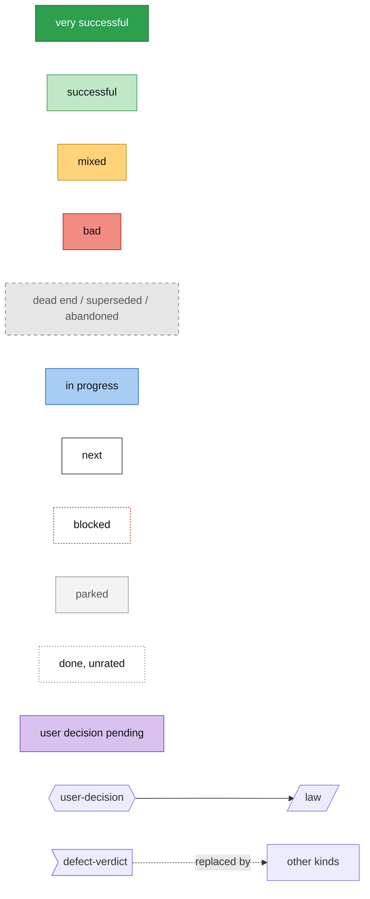
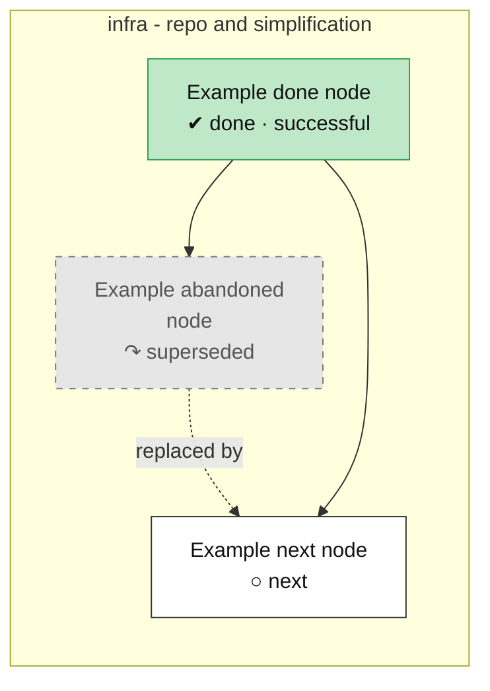
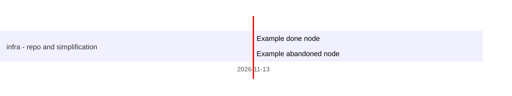
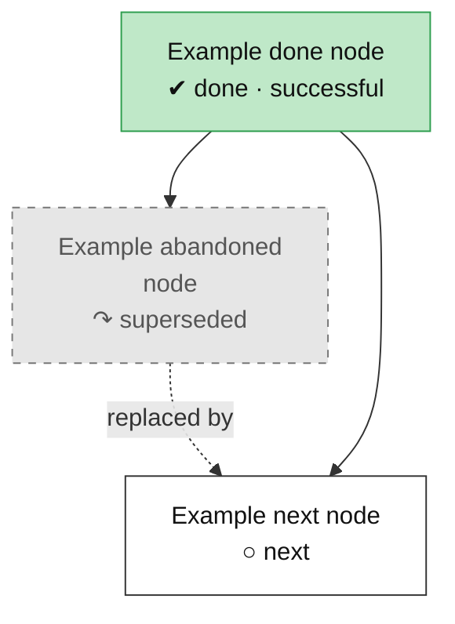

# Roadmap

Tech tree of the Raptorpath work: what is done, what failed, what comes next. Everything between the
`GENERATED` markers is rebuilt from `docs/roadmap/nodes.yaml`; do not edit it by hand.

## How to update

1. Edit `docs/roadmap/nodes.yaml` (the one source of truth; fields and enums are enforced by `check.py`).
2. Run `python tools/roadmap/build.py` to rewrite the generated regions below.
3. Run `python tools/roadmap/check.py`; it fails on dangling edges, cycles, bad enums and stale regions.
4. Tests for the tools: `python tools/roadmap/test_roadmap.py`.

Text outside the markers is hand-written and is preserved by the build.

## Legend

<!-- BEGIN GENERATED: legend -->
Colour is never the only signal: every node label carries a status tag on its second line.

| Tag | Meaning |
|---|---|
| `✔ done · <outcome>` | finished; outcome is the recorded verdict (green = very successful, light green = successful, amber = mixed, red = bad) |
| `▶ in progress` | being worked on (blue) |
| `○ next` | planned, not started (white) |
| `⛔ blocked` | waiting on a prerequisite or an outside call (white, red dashed border) |
| `⏸ parked` | deliberately set aside (light grey) |
| `✖ dead end` | refuted or archived, nothing reused (grey, dashed border) |
| `↷ superseded` | replaced by another node, drawn with a dashed `replaced by` arrow (grey, dashed border) |

Shapes: hexagon = user decision (purple while pending), parallelogram = law, flag = defect verdict, rectangle = everything else.
Solid arrow = hard prerequisite (prerequisite to dependant). Dashed arrow = `replaced by`.
Amber dotted arrow = `⚠ qualified by`: a later defect or verdict limits the rating of the done node it leaves; that node's label ends in `⚠`.
<!-- END GENERATED: legend -->

## Overview

<!-- BEGIN GENERATED: overview -->

<!-- END GENERATED: overview -->

## Timeline

<!-- BEGIN GENERATED: timeline -->
%% today: 2026-11-13

Not shown (no `start`): `infra-example-next`
<!-- END GENERATED: timeline -->

## Tracks

### cod - coding core

<!-- BEGIN GENERATED: track-cod -->
_No nodes in this track yet._
<!-- END GENERATED: track-cod -->

### rec - recovery

<!-- BEGIN GENERATED: track-rec -->
_No nodes in this track yet._
<!-- END GENERATED: track-rec -->

### rate - rate law

<!-- BEGIN GENERATED: track-rate -->
_No nodes in this track yet._
<!-- END GENERATED: track-rate -->

### store - store law

<!-- BEGIN GENERATED: track-store -->
_No nodes in this track yet._
<!-- END GENERATED: track-store -->

### place - placement

<!-- BEGIN GENERATED: track-place -->
_No nodes in this track yet._
<!-- END GENERATED: track-place -->

### cc - congestion control

<!-- BEGIN GENERATED: track-cc -->
_No nodes in this track yet._
<!-- END GENERATED: track-cc -->

### perf - performance

<!-- BEGIN GENERATED: track-perf -->
_No nodes in this track yet._
<!-- END GENERATED: track-perf -->

### meas - measurement

<!-- BEGIN GENERATED: track-meas -->
_No nodes in this track yet._
<!-- END GENERATED: track-meas -->

### model - model and paper

<!-- BEGIN GENERATED: track-model -->
_No nodes in this track yet._
<!-- END GENERATED: track-model -->

### obs - observability

<!-- BEGIN GENERATED: track-obs -->
_No nodes in this track yet._
<!-- END GENERATED: track-obs -->

### infra - repo and simplification

<!-- BEGIN GENERATED: track-infra -->

<!-- END GENERATED: track-infra -->

## Node table

<!-- BEGIN GENERATED: table -->
### infra - repo and simplification

| id | title | state | outcome | headline | evidence | depends_on |
|---|---|---|---|---|---|---|
| `infra-example-done` | Example done node | done | successful |  | branch roadmap-tool |  |
| `infra-example-abandoned` | Example abandoned node | abandoned | superseded |  | branch example-archived | infra-example-done |
| `infra-example-next` | Example next node | next | unrated |  |  | infra-example-done |
<!-- END GENERATED: table -->

## Details per node

_Hand-written section, to be filled in later._
