# Roadmap

**Status: draft. Ratings are not yet confirmed by the owner. The forward order follows the law ledger (status §55): correctness first, inputs before the laws that read them.**

Tech tree of the Raptorpath work: what is done, what failed, what comes next. Everything between the
`GENERATED` markers is rebuilt from `docs/roadmap/nodes.yaml`; do not edit it by hand.

## How to update

1. Edit `docs/roadmap/nodes.yaml` (the one source of truth; fields and enums are enforced by `check.py`).
2. Run `python tools/roadmap/build.py` to rewrite the generated regions below.
3. Run `python tools/roadmap/check.py`; it fails on dangling edges, cycles, bad enums and stale regions.
4. Tests for the tools: `python tools/roadmap/test_roadmap.py`.

Text outside the markers is hand-written and is preserved by the build.

## Legend

<!-- BEGIN GENERATED: legend -->
| | |
|---|---|
| **Box** | one glyph and a title. Glyph: ✔ done, ▶ in progress, ⏳ built and waiting, ○ next, ⛔ blocked, ⏸ parked, ⚠ open defect, ↷ superseded, ✖ dead end. Colour: dark green very successful, light green successful, amber mixed, red bad, grey dead end or superseded, blue in progress, white next, purple owner call, orange defect. Shape: hexagon owner call, parallelogram law, flag defect. The prefix on an overview box is its track. |
| **Arrow** | solid: depends on. Dotted: replaced by. Thick orange dotted: ⚠ qualified by (a later defect limits the rating). Arrows always point down, forward in time; a prerequisite implied by a longer chain is not drawn. |
<!-- END GENERATED: legend -->

## Overview

```mermaid
flowchart TB
    subgraph bd_0["Mar 2026"]
        cod_block_pipeline["cod · ↷ RaptorQ block<br/>FEC pipeline"]
        cc_aimd_v1["cc · ↷ AIMD congestion<br/>control (first CC)"]
        cod_mettle["cod · ✖ METTLE<br/>swappable FEC backend"]
        cod_legacy_rlc["cod · ↷ Legacy<br/>sliding-<br/>window/generation<br/>decoders"]
        place_early_window_sched["place · ↷ Loss-ranked<br/>multipath window<br/>scheduling"]
    end
    subgraph bd_1["Jul 2026"]
        rec_reliable_window["rec · ✔ Reliable<br/>window (RWM Phase A)"]
        place_daps["place · ↷ DAPS and<br/>rate estimator (4<br/>arms)"]
        cc_bbr_default["cc · ✔ BBR as<br/>substrate default<br/>(ADR-0054)"]
        cod_unified_span["cod · ✔ Unified span<br/>machine (ADR-0064)"]
        store_honest_cap_family[/"store · ✖ Honest<br/>floor-clock cap family<br/>(6 arms)"/]
        meas_adr52_discipline["meas · ✔ L1<br/>measurement discipline<br/>(ADR-0052)"]
        model_vis_continuum["model · ✔ Visualizer<br/>as one continuum law"]
    end
    subgraph bd_2["Aug 2026"]
        rate_est_cadence["rate · ✔ Batched BOCD<br/>estimator cadence"]
        cod_one_pipeline["cod · ✔ One window<br/>pipeline (ADR-0069)"]
        meas_formula_first["meas · ✔ Formula-first<br/>review (ADR-0070)"]
        store_delta_cap[/"store · ✔ Derived<br/>setpoint 1 + q(δ)"/]
        rec_goal101[/"rec · ✖ Recovery clock<br/>law family (4 arms)"/]
    end
    subgraph bd_3["Sep 2026 to Oct 2026"]
        rate_r_battery["rate · ✖ Funded coding<br/>at r #gt; 0"]
        perf_emit_batch_law0["perf · ✔ Emission<br/>batching, Law 0 (#167;8)"]
        perf_io_owner["perf · ✔ Per-path I/O<br/>owner (Q1)"]
        store_adr72_one_law[/"store · ✔ One store<br/>law (ADR-0072)"/]
        store_power_law[/"store · ✖ Power-<br/>seeking store law D"/]
    end
    subgraph bd_4["Nov 2026"]
        cc_quinn_bbr_collapse>"cc · ⚠ Quinn BBR<br/>window collapse (#167;47)"]
        meas_guard_41c["meas · ✔ Rank-minp<br/>merge guard (#167;41c)"]
        cc_bbrrs_r1["cc · ✔ Fixed bbr_rs<br/>versus quinn BBR"]
        place_wire_price["place · ✔ Wire-RTT<br/>placement price"]
        store_defect_cap_constant>"store · ⚠ Store cap<br/>constant at c8"]
        meas_guard_v2_impl["meas · ✔ Guard v2<br/>implementation"]
        model_law_ledger["model · ✔ Law ledger"]
    end
    subgraph bd_5["Now (in progress)"]
        cc_bbrrs_r2["cc · ⏳ bbr_rs round 2<br/>fixes"]
        rec_snapver_law[/"rec · ⏳ Snapshot-order<br/>filter as law"/]
        rec_s54_session["rec · ▶ #167;54: filter<br/>guard, store budget"]
    end
    subgraph bd_6["Later (blocked or parked)"]
        rec_leverb_guard["rec · ⛔ Lever-B guard<br/>v2, then merge"]
        meas_s51_session["meas · ⛔ Off-Bulk<br/>baseline and δ sweep"]
        cc_bbrrs_promote["cc · ⛔ bbr_rs<br/>promotion (new ADR)"]
        cc_hybrid["cc · ⏸ BBR/Copa hybrid<br/>build (ADR-0068)"]
        store_fix_maxbw_minrtt[/"store · ⛔ Honest rate<br/>and delay inputs"/]
        store_engine_form_impl[/"store · ⛔ Store-law<br/>engine form"/]
    end
    cod_block_pipeline ~~~ cod_mettle
    cc_aimd_v1 ~~~ cod_legacy_rlc
    cod_mettle ~~~ place_early_window_sched
    cod_legacy_rlc ~~~ place_early_window_sched
    place_early_window_sched ~~~ rec_reliable_window
    place_early_window_sched ~~~ place_daps
    rec_reliable_window ~~~ cc_bbr_default
    place_daps ~~~ cod_unified_span
    cc_bbr_default ~~~ store_honest_cap_family
    cod_unified_span ~~~ meas_adr52_discipline
    store_honest_cap_family ~~~ model_vis_continuum
    meas_adr52_discipline ~~~ model_vis_continuum
    model_vis_continuum ~~~ rate_est_cadence
    model_vis_continuum ~~~ cod_one_pipeline
    rate_est_cadence ~~~ meas_formula_first
    cod_one_pipeline ~~~ store_delta_cap
    meas_formula_first ~~~ rec_goal101
    store_delta_cap ~~~ rec_goal101
    rec_goal101 ~~~ rate_r_battery
    rec_goal101 ~~~ perf_emit_batch_law0
    rate_r_battery ~~~ perf_io_owner
    perf_emit_batch_law0 ~~~ store_adr72_one_law
    perf_io_owner ~~~ store_power_law
    store_adr72_one_law ~~~ store_power_law
    store_power_law ~~~ cc_quinn_bbr_collapse
    store_power_law ~~~ meas_guard_41c
    cc_quinn_bbr_collapse ~~~ cc_bbrrs_r1
    meas_guard_41c ~~~ place_wire_price
    cc_bbrrs_r1 ~~~ store_defect_cap_constant
    place_wire_price ~~~ meas_guard_v2_impl
    store_defect_cap_constant ~~~ model_law_ledger
    meas_guard_v2_impl ~~~ model_law_ledger
    model_law_ledger ~~~ cc_bbrrs_r2
    model_law_ledger ~~~ rec_snapver_law
    cc_bbrrs_r2 ~~~ rec_s54_session
    rec_snapver_law ~~~ rec_s54_session
    rec_s54_session ~~~ rec_leverb_guard
    rec_s54_session ~~~ meas_s51_session
    rec_leverb_guard ~~~ cc_bbrrs_promote
    meas_s51_session ~~~ cc_bbrrs_promote
    cc_bbrrs_promote ~~~ cc_hybrid
    cc_bbrrs_promote ~~~ store_fix_maxbw_minrtt
    cc_hybrid ~~~ store_engine_form_impl
    store_fix_maxbw_minrtt ~~~ store_engine_form_impl
    cod_block_pipeline -.-> cod_one_pipeline
    cod_legacy_rlc -.-> cod_unified_span
    cc_bbr_default -.-> cc_quinn_bbr_collapse
    cod_unified_span --> model_vis_continuum
    cod_unified_span --> cod_one_pipeline
    store_delta_cap -.-> store_defect_cap_constant
    store_delta_cap --> store_adr72_one_law
    meas_formula_first --> store_adr72_one_law
    store_adr72_one_law -.-> store_defect_cap_constant
    cc_quinn_bbr_collapse --> cc_bbrrs_r1
    meas_guard_41c --> cc_bbrrs_r1
    cc_bbrrs_r1 --> cc_bbrrs_r2
    meas_guard_v2_impl --> rec_s54_session
    rec_snapver_law --> rec_s54_session
    rec_s54_session --> rec_leverb_guard
    cc_bbrrs_promote --> cc_hybrid
    model_law_ledger --> store_fix_maxbw_minrtt
    cc_bbrrs_r2 --> store_fix_maxbw_minrtt
    store_fix_maxbw_minrtt --> store_engine_form_impl
    linkStyle 46,49,52 stroke:#e69500,stroke-width:3px,stroke-dasharray:2 3
    classDef vsucc fill:#2e9e4f,stroke:#1b6b34,color:#fff
    classDef succ fill:#bfe8c8,stroke:#2e9e4f,color:#111
    classDef mixed fill:#ffd37a,stroke:#c98a00,color:#111
    classDef bad fill:#f28b82,stroke:#b3261e,color:#111
    classDef dead fill:#e6e6e6,stroke:#777,stroke-dasharray:5 5,color:#555
    classDef inprog fill:#a8cdf5,stroke:#1f6fc5,color:#111
    classDef next fill:#fff,stroke:#333,color:#111
    classDef blocked fill:#fff,stroke:#b3261e,stroke-dasharray:2 2,color:#111
    classDef parked fill:#f3f3f3,stroke:#999,color:#555
    classDef unrated fill:#fff,stroke:#333,stroke-dasharray:1 3,color:#111
    classDef userdec fill:#d9c2f0,stroke:#7b3fb5,color:#111
    classDef defect fill:#ffe0b2,stroke:#d84315,stroke-width:2px,color:#111
    classDef waiting fill:#e3f2fd,stroke:#1f6fc5,stroke-dasharray:5 5,color:#111
    class cod_block_pipeline,cod_mettle,cod_legacy_rlc,rec_goal101,rate_r_battery,store_honest_cap_family,store_power_law,place_daps,cc_aimd_v1,place_early_window_sched dead
    class cod_unified_span,cod_one_pipeline,rec_reliable_window,store_adr72_one_law,place_wire_price,cc_bbr_default,meas_adr52_discipline,meas_formula_first,meas_guard_41c,model_vis_continuum succ
    class rec_snapver_law,cc_bbrrs_r2 waiting
    class rate_est_cadence,store_delta_cap,perf_emit_batch_law0,perf_io_owner vsucc
    class store_defect_cap_constant,cc_quinn_bbr_collapse defect
    class cc_bbrrs_r1 bad
    class meas_guard_v2_impl,model_law_ledger unrated
    class rec_s54_session inprog
    class rec_leverb_guard,meas_s51_session,store_engine_form_impl,cc_bbrrs_promote,store_fix_maxbw_minrtt blocked
    class cc_hybrid parked
```

<!-- BEGIN GENERATED: overview -->

<!-- END GENERATED: overview -->

## In plain words

<!-- BEGIN GENERATED: plain-words -->
| title | status | in plain words |
|---|---|---|
| RaptorQ block FEC pipeline | ↷ superseded | The original design sent data in fixed blocks of error-correcting code; it was replaced by one sliding window for every kind of traffic. |
| METTLE swappable FEC backend | ✖ dead end | An experimental lighter error-correcting code that needed more spare data than the standard one, so it was dropped. |
| Generation cross-path fungible coding | ⏸ parked | An optional feature that codes data across paths in groups has never been switched on by default, and nobody has yet decided whether to keep it. |
| Legacy sliding-window/generation decoders | ↷ superseded | The older decoders for the sliding-window code, replaced by one decoder that handles every case. |
| Unified span machine (ADR-0064) | ✔ done · successful | Merged two separate decoders into one machine that slides smoothly from low-delay to bulk traffic, with no switch between modes. |
| One window pipeline (ADR-0069) | ✔ done · successful | Deleted the old block path so that every kind of traffic now goes through the same window, which was at least as fast everywhere. |
| Owner call: keep generation coding | ○ next | Owner decision on whether to keep or archive the optional cross-path coding feature that has never been switched on by default. |
| Reliable window (RWM Phase A) | ✔ done · successful | Made the window keep every packet until the receiver confirms it, so one design can serve bulk transfers without a separate mode. |
| Recovery clock law family (4 arms) | ✖ dead end | A search for a derived formula for the retransmit timer ended with the whole family of candidates refuted; the hand-set timer limit stayed. |
| Gap horizon lever B (§52) | ⏳ waiting | Letting the sender hear about many more missing packets at once removed most of the end-of-transfer wait on the hardest test, but raised duplicate packets; the merge is still pending. |
| Snapshot-order filter as law | ⏳ waiting | Turning the fix for outdated loss reports into a permanent rule, written into the paper first; it ships once its merge check passes. |
| [QCLK] w_us pinned at clamp | ⚠ open defect | Open problem: on the hardest two-path test the retransmit timer always sits at its hand-set upper limit, so the formula behind it never acts. |
| c8 hole law never measured | ⚠ open defect | Open problem: the rule that decides when a missing packet is lost had never been measured in the conditions where it matters most. |
| Hole refresh clock degenerate input | ⚠ open defect | Open problem: the receiver timer that re-reports missing packets reads a fixed default delay instead of a measured one. |
| Singles hole suppression (RECOV_SP) | ⏸ parked | A switched-off option that suppresses some loss reports on single paths gave a tiny gain on one test and a tie on another, and is kept but unused. |
| Lever B c1d duplicate cost | ⚠ open defect | Open problem: the end-of-transfer fix adds about thirteen percent more duplicate packets on the fast two-path test, and the loss-report fix does not remove them. |
| Main's duplicates mostly unexplained | ⚠ open defect | Open problem: even the current main version receives a thousand or more duplicate packets per run, and most of them are unexplained. |
| §54: filter guard, store budget | ▶ in progress | Real-network session that checks and merges the fix for outdated loss reports, and tests whether a smaller in-flight budget cuts waiting in the send queue. |
| Retransmit leg choice with filter | ⛔ blocked | Checking, with the loss-report fix in place, whether retransmissions should be spread across paths like normal data. |
| Lever-B guard v2, then merge | ⛔ blocked | Checking and merging the change that lets the sender hear about more missing packets at once, which removed most of the end-of-transfer wait. |
| Recovery timeouts after store law | ⛔ blocked | Re-deriving the retransmit timers from the new in-flight limit, so they stop sitting at a fixed hand-set ceiling. |
| Per-leg recovery clock, one law | ⛔ blocked | Making each missing packet's timer follow its own path, using the same loss rule on one path as on many, and keeping the re-send cooldown only until a counter proves it never acts. |
| Receiver refresh clock input | ⛔ blocked | Giving the receiver a real delay for its re-report timer; it waits for the in-flight limit fix, because until then the timer's limits decide its value anyway. |
| NACK repair throttle: gauge, paper | ○ next | First measuring how often a hidden rule that limits re-sends per loss report actually bites, then justifying it in the paper or removing it. |
| Retransmits queued behind source? | ○ next | Checking whether re-sent packets have to wait behind new data in each path's send queue, which would slow the recovery of lost packets. |
| Retention is the ρ dial | ✔ done · n/a | The owner decided that how long data is kept for resending is one of the three main dials, not a separate setting. |
| Batched BOCD estimator cadence | ✔ done · very-successful ⚠ | Made the loss estimator update in batches instead of on every packet, which raised two-path throughput by about 40 percent and cut sender CPU. |
| Funded coding at r > 0 | ✖ dead end | Tested sending extra repair data ahead of losses; in one small run it made the lossy single-path transfer slower, so the system keeps repairing on demand. |
| DoF ledger feedback leg (§39) | ⏸ parked | An analysis found that feeding repair results back into the repair rate is sound in principle but cannot help measurably today, so it is on hold. |
| P_fec truncation divergence | ⚠ open defect | Open problem: the code that estimates how often extra repair data helps jumps from zero to one half at one point, where the paper describes a smooth curve. |
| Repair-rate readout | ○ next | Adding a readout of how much repair data the formula asks for and which limit is in control, without changing behaviour. |
| Owner calls on rate law | ⛔ blocked | Owner decision on five mismatches between the paper and the code in how much repair data to send. |
| Rate-law reconciliation (W22, W*) | ⛔ blocked | Making the paper and the code agree on how much repair data to send, with a test for every remaining difference. |
| Rate-law term-win gauge | ⛔ blocked | Adding a readout that shows which part of the repair-rate formula is actually in control. |
| Loss estimator approximations | ⛔ blocked | Checking and tightening three approximations inside the loss and delay estimators. |
| Low-latency and partial-reliability laws | ⛔ blocked | Fixing the rules that only act when data may be dropped, so they follow the dials smoothly and read honest delays. |
| Honest floor-clock cap family (6 arms) | ✖ dead end | Six attempts to size the in-flight data limit from more honest measurements; none was adopted, and all six were archived. |
| Derived setpoint 1 + q(δ) | ✔ done · very-successful ⚠ | Replaced a hand-picked doubling factor in the in-flight data limit with one derived from the latency dial, cutting queueing delay at equal throughput. |
| One store law (ADR-0072) | ✔ done · successful ⚠ | Made one in-flight data limit rule apply to any number of paths, removing a special case for single-path links. |
| Power-seeking store law D | ✖ dead end | Tried a self-tuning in-flight limit that hunts for the best throughput-to-delay balance; its measurements were too noisy to work. |
| Dispersion and oracle store law | ⏸ parked | Tests of how the in-flight data limit could read the real link rate and delay found no reliable source yet, so the work is on hold until better measurements exist. |
| Who limits at each δ | ⏳ waiting | Working out whether the congestion controller or the in-flight data limit should carry the latency setting; the answer so far is the limit. |
| Store-budget test design (§54) | ⏳ waiting | Designed a test of whether a smaller in-flight budget stops data from piling up in the send queue after the end-of-transfer fix. |
| Store cap constant at c8 | ⚠ open defect | Open problem: on the hardest two-path test the in-flight data limit is stuck at its ceiling, because both of its inputs read far too high. |
| Store-law engine form guard | ⛔ blocked | Real-network check of the rebuilt in-flight data limit, confirming it no longer sits stuck at its ceiling. |
| δ seat diagnostic and guard (§48c) | ⛔ blocked | Real-network test of tying the in-flight limit to the latency dial, including one low-latency row. |
| Owner calls U1–U3 | ○ next | Owner decision on three questions: whether the congestion controller or the in-flight limit is in charge, what sets the latency trade, and whether two percent less bulk speed is worth ten times less delay. |
| Store-law engine form | ⛔ blocked | Rebuilding the in-flight data limit on measured link rate and delay, written as a derived formula first. |
| δ seat on the store | ⛔ blocked | Making the in-flight data limit follow the latency dial smoothly, so lower-latency settings queue less. |
| Honest rate and delay inputs | ⛔ blocked | An open research problem: nobody has yet found an honest way to measure link speed and minimum delay for the in-flight data limit, after seven failed attempts, so this node may end with a declared fallback instead of a fix. |
| DAPS and rate estimator (4 arms) | ↷ superseded | A delay-aware way of picking which path carries each packet, which failed when retested. |
| Derived diversity weight, leg choice | ⏳ waiting | A wiring change that lets retransmissions be spread across paths differently has been built but never fully measured. |
| Wire-RTT placement price | ✔ done · successful | Fixed a bug where an idle path could stay priced too high and never be used again, by pricing each path on its measured network delay. |
| One per-leg state design | ⏳ waiting | A design for keeping all of each path's measurements in one place instead of in several slightly different copies. |
| Owner calls on per-leg design | ○ next | Owner decision on five open design questions for keeping each path's measurements in one place. |
| Per-leg state implementation | ⛔ blocked | Keeping all of each path's measurements in one place instead of in several slightly different copies. |
| Loss-ranked multipath window scheduling | ↷ superseded | An early way of picking paths that ranked them by loss rate, later replaced by pricing each path's marginal cost. |
| BBR as substrate default (ADR-0054) | ✔ done · successful ⚠ | Switched the underlying congestion controller to BBR, which removed a hidden speed ceiling and raised throughput about four times. |
| Copa-BBR fusion (ADR-0068) | ⏸ parked | A proposed design for a controller that blends the speed of BBR with the low queues of Copa; prerequisite measurements are done but nothing is built. |
| Quinn BBR window collapse (§47) | ⚠ open defect | Open problem: the default congestion controller can shrink its sending window to almost nothing on fast links because it remembers one unrealistically low delay sample. |
| Fixed bbr_rs versus quinn BBR | ✔ done · bad ⚠ | Our own fixed BBR controller stopped that collapse but cost a little throughput and CPU, so it was not adopted; a later check also found it delayed delivery. |
| bbr_rs round 2 fixes | ⏳ waiting | Second round of fixes to our own BBR controller, aimed at keeping the collapse fix without its costs. |
| Pacing-seam audit (W2) | ⏳ waiting | Checked what our controller would need in order to set the sending pace itself; the standard library ignores the pace a controller asks for. |
| Vendored quinn-proto pacing hook | ⏳ waiting | Adding a small hook to our own copy of the network library so our controller can set the sending pace. |
| Copa min_rtt reads own queue | ⚠ open defect | Open problem: the minimum delay the system measures includes time spent in its own send queue, so it reads ten or more times too high. |
| §48d bbr_rs round 2 | ⛔ blocked | Real-network test of the second round of fixes to our own BBR controller, now also measuring how long data waits before delivery. |
| Pacing seam first reading | ⛔ blocked | First measurement of letting our controller set the sending pace itself, watching how much data then waits in the send queue. |
| Owner call: ADR-0068 direction | ○ next | Owner decision on whether the future hybrid controller should grow out of our BBR controller instead of being a second one. |
| Owner call: bbr_rs promotion | ⛔ blocked | Owner decision on whether our BBR controller replaces the standard one by default. |
| Copa consumers onto per-leg state | ⛔ blocked | Moving the parts that read the Copa controller onto the shared per-path measurements and replacing its per-setting table with one smooth rule. |
| bbr_rs promotion (new ADR) | ⛔ blocked | Making our BBR controller the default, recorded as a new architecture decision. |
| BBR/Copa hybrid build (ADR-0068) | ⏸ parked | Designing a controller that blends BBR's speed with Copa's low queues, with pass or fail targets fixed before anything is built. |
| AIMD congestion control (first CC) | ↷ superseded | The first congestion control backed off on loss like classic TCP and was replaced a day later by a delay-based one. |
| Emission batching, Law 0 (§8) | ✔ done · very-successful | Sent packets in small bursts instead of one at a time, which raised throughput by about 40 percent on the fast two-path test and cut CPU everywhere. |
| Per-path I/O owner (Q1) | ✔ done · very-successful | Gave each network path its own input and output task, which raised single-path throughput by about half. |
| bbr_rs send-record ring fix | ⏳ waiting | Cutting the per-packet bookkeeping cost of our own BBR controller to at most twice that of the standard one. |
| Emission burst bound derivation | ○ next | Working out how many packets the sender should send in one burst instead of using a hand-picked sixty-four. |
| L1 measurement discipline (ADR-0052) | ✔ done · successful | Wrote down the measurement rules every real-network result must follow, such as fixing predictions before a run. |
| Formula-first review (ADR-0070) | ✔ done · successful | After a limit rule turned out to be wrong in shape despite passing every test, every rule must now be written as a formula and derived before it is coded. |
| Rank-minp merge guard (§41c) | ✔ done · successful ⚠ | Built the statistical check that every change must pass before merging, calibrated against identical runs. |
| Guard clause rtp_floor_p0 measures drain | ⚠ open defect | Open problem: one reading in the merge check measured the start or the end of a run rather than the network path, so it scored good fixes as worse. |
| ETA route and σ witness mismatch | ⚠ open defect | Open problem: the script that checks the finish-time prediction uses a different delay than the formula itself, and one of its checks fails. |
| c8 control bimodal collapse | ⚠ open defect | Open problem: on the hardest two-path test, the control runs sometimes fall back to using only the fast path, which makes results very noisy. |
| [DIAG] rtp prints whole milliseconds | ⚠ open defect | Open problem: one diagnostic line rounds the delay to whole milliseconds, which hides small delays on fast links. |
| Guard v2 implementation | ✔ done · unrated | Building the new merge check, which drops a misleading delay reading and adds a proper measure of how long data waits before delivery. |
| §51 harness and scorer | ⛔ blocked | Building the scripts that run and score the off-Bulk test, after the next session's scripts merge, because they edit the same files. |
| Partial-reliability measurement block | ⛔ blocked | A follow-up test of the mode where some data may be dropped, which first needs that setting to be adjustable on its own. |
| Harness robustness for every plan | ○ next | Making sure every test plan can be rehearsed end to end without the real network, so a long test session does not die on a script bug. |
| Guard CPU and lag resolution | ○ next | Making the merge check sensitive to smaller CPU and delay changes, which it currently cannot see. |
| Test hygiene fixes | ○ next | Fixing tests that pass for the wrong reason or depend on which machine they run on. |
| Off-Bulk baseline and δ sweep | ⛔ blocked | First real-network measurement of the system away from the bulk setting, checking that behaviour changes smoothly as the latency dial moves. |
| Adversarial cells measured | ⛔ blocked | Measuring the current system, our BBR controller and the Copa controller on the harder network conditions. |
| Competitor battery | ⛔ blocked | Measuring standard Linux BBR and CUBIC on the same tests, to compare against outside protocols. |
| Cumulative progress benchmark | ○ next | One measurement of the current system against the early-July version, showing how much each result has improved since. |
| Gauges for the remaining constants | ⛔ blocked | Adding readouts or derivations for the last hand-set numbers, so none hides inside a formula. |
| Visualizer as one continuum law | ✔ done · successful ⚠ | Rebuilt the visualizer around one smooth law across the latency dial, with an automatic test that forbids any mode switch. |
| Engine NO-MODE-SWITCH debts (§3.3) | ⚠ open defect | Open problem: five places in the engine still switch behaviour on the chosen preset instead of following one smooth rule. |
| Open-constants register (§3.4) | ⚠ open defect | Open problem: about twenty numbers in the code were picked by hand and have no derivation behind them. |
| Paper versus engine reconciliation | ⏳ waiting | Compared every claim in the paper with what the code actually does and listed the mismatches; a few questions wait on the owner. |
| Wasm mode-switch audit | ⏳ waiting | Checked the visualizer's model for hidden mode switches before its formulas move into the shared library. |
| T_cut give-up law pinned | ⚠ open defect | Open problem: the visualizer's rule for when to give up on a missing packet only ever takes one of two fixed values and jumps at unexpected points. |
| Wasm dead second machine | ⚠ open defect | Open problem: the visualizer still carries an older second copy of the machine that only the tests use. |
| Erratum: pre-flight tests not run | ⚠ open defect | Open problem: three checks planned for the last test session, including the visualizer build, were never run and move to the next session. |
| Law ledger | ✔ done · unrated ⚠ | Audited every formula in the system for where it comes from and whether it has been checked in real conditions, and ranked the fixes. |
| Hint-keyed engine paths made continuous | ⛔ blocked | Removing the five places where the engine still changes behaviour by the name of the preset instead of following the latency dial smoothly. |
| Owner calls on wasm audit | ○ next | Owner decision on how to clean up the visualizer's model, including removing a second, unused copy of the machine. |
| Wasm model fixes | ⛔ blocked | Applying the owner's calls to the visualizer's model and proving it stays smooth across the dial. |
| Paper text for placement and bbr_rs | ○ next | Correcting two places where the paper does not match the code. |
| Paper-only law records | ⛔ blocked | Writing four small rules into the paper that the code uses but the paper never states. |
| Metrics registry and OTel design | ⏳ waiting | A design for one metrics system that feeds the status page, the logs and standard monitoring tools, including a packet-level recorder. |
| Observability implementation | ⛔ blocked | Building one metrics system that feeds the status page, the logs and standard monitoring tools. |
| Promote or archive at verdict | ✔ done · n/a | The owner ruled that every experiment is either promoted or archived once its result is in, instead of lingering switched off. |
| Workspace restructure (ADR-0076) | ⏳ waiting | Reorganising the repository layout in stages; the documentation and tools moves are done and the code splits are still open. |
| Recorded, not fixed (§3.7) | ⚠ open defect | Open problems recorded but not fixed: a loss estimate that never drops below a small floor, extra sender CPU when spreading over two paths, and an old acknowledgement option that releases too much. |
| Derivation branch merges | ○ next | Merging the finished design documents that are still on side branches. |
| tech-tree skill PR | ⛔ blocked | Packaging this roadmap tool so other projects can use it, offered as a proposal to the shared skills repository. |
<!-- END GENERATED: plain-words -->

## Ready now

<!-- BEGIN GENERATED: ready-now -->
**vm**

- `meas-progress-baseline`: Cumulative progress benchmark

**host-cargo**

- `rate-fix-rate-readout`: Repair-rate readout
- `meas-guard-resolution`: Guard CPU and lag resolution
- `meas-test-hygiene`: Test hygiene fixes
- `rec-fix-nack-throttle`: NACK repair throttle: gauge, paper

**no-cargo**

- `infra-derivation-merges`: Derivation branch merges
- `meas-harness-robustness`: Harness robustness for every plan
- `rec-retx-behind-source`: Retransmits queued behind source?
- `model-fix-paper-p2`: Paper text for placement and bbr_rs
- `perf-fix-burst-bound`: Emission burst bound derivation
<!-- END GENERATED: ready-now -->

## Running

<!-- BEGIN GENERATED: running -->
**vm**

- `rec-s54-session`: §54: filter guard, store budget
<!-- END GENERATED: running -->

## Built, waiting

<!-- BEGIN GENERATED: built-waiting -->
**the lever-B guard on the new main**

- `rec-gap-horizon`: Gap horizon lever B (§52)

**its guard in the next VM session**

- `rec-snapver-law`: Snapshot-order filter as law

**the owner's answers to the three latency-setting questions, then merge to main**

- `store-w1-who-limits`: Who limits at each δ

**the next VM session**

- `store-s54-budget`: Store-budget test design (§54)

**the leg-choice row in a VM session, then merge to main**

- `place-wdiv`: Derived diversity weight, leg choice

**the owner's answers to the five per-path design questions, then merge to main**

- `place-per-leg-state`: One per-leg state design

**the per-packet cost fix, then the bbr_rs round-2 session**

- `cc-bbrrs-r2`: bbr_rs round 2 fixes

**the owner's call on the hybrid controller's direction, then merge to main**

- `cc-pacing-audit`: Pacing-seam audit (W2)

**the round-2 controller work it is stacked on, then its first VM reading**

- `cc-pacing-seam`: Vendored quinn-proto pacing hook

**the owner's calls on the rate law, then merge to main**

- `model-paper-recon`: Paper versus engine reconciliation

**the owner's five calls**

- `model-wasm-audit`: Wasm mode-switch audit

**merge to main, then the per-path state work it builds on**

- `obs-otel-design`: Metrics registry and OTel design

**the open branches merging before the code splits**

- `infra-restructure`: Workspace restructure (ADR-0076)

**the bbr_rs round-2 session on the VM**

- `perf-bbrrs-ring-fix`: bbr_rs send-record ring fix
<!-- END GENERATED: built-waiting -->

## Waiting on the owner

<!-- BEGIN GENERATED: waiting-on-owner -->
- `store-user-u1u3`: Owner calls U1–U3
- `model-user-wasm-calls`: Owner calls on wasm audit
- `rate-user-rate-law`: Owner calls on rate law
- `cc-user-adr68-direction`: Owner call: ADR-0068 direction
- `cc-user-bbrrs-promotion`: Owner call: bbr_rs promotion
- `cod-user-generation-seat`: Owner call: keep generation coding
- `place-user-perleg-questions`: Owner calls on per-leg design
<!-- END GENERATED: waiting-on-owner -->

## VM queue

<!-- BEGIN GENERATED: vm-queue -->
1. `rec-s54-session`: §54: filter guard, store budget. First, because the owner approved shipping the loss-report fix before anything else, and every later session should run on that new main version.
2. `rec-w0-leg-question`: Retransmit leg choice with filter. Before the lever-B merge, so the question of which path should carry retransmissions is answered first. It could instead ride the lever-B session as an extra reported block rather than take a session of its own.
3. `rec-leverb-guard`: Lever-B guard v2, then merge. Runs on the main version the first session produces, in the order the owner approved.
4. `meas-s51-session`: Off-Bulk baseline and δ sweep. After the recovery fixes land so the baseline describes the current system; it does not need them to run.
5. `cc-s48d-session`: §48d bbr_rs round 2. After the recovery fixes, because they change the results on the hardest test that this session predicts.
6. `cc-pacing-seam-reading`: Pacing seam first reading. Right after the controller round-two session, because the pacing hook sits on top of that work.
7. `meas-adversarial-cells-run`: Adversarial cells measured. After the controller changes it is meant to measure.
8. `store-engine-form-guard`: Store-law engine form guard. When the rebuilt in-flight limit is ready; it is one of the later checks.
9. `store-s48c-session`: δ seat diagnostic and guard (§48c). After the latency-dial version of the in-flight limit is built and the low-latency baseline exists.
10. `meas-competitor-battery`: Competitor battery. At the end, once our controller is the default, to compare the finished system with outside protocols.
11. `meas-progress-baseline`: Cumulative progress benchmark. Whenever the queue has room; it only measures progress and gates nothing.
12. `meas-s51b-rho`: Partial-reliability measurement block. A follow-on to the off-Bulk session; it first needs the drop setting to be adjustable on its own.
<!-- END GENERATED: vm-queue -->

## Timeline

<!-- BEGIN GENERATED: timeline -->
[The timeline](roadmap/timeline.md) shows every dated node as a bar from its start to its end.

Generated from nodes.yaml on 2026-11-13.
<!-- END GENERATED: timeline -->

History from March to June 2026 is reconstructed from commits only; dates marked as placeholders in a node's notes are approximate.

## Tracks

<!-- BEGIN GENERATED: tracks -->
Each track has its own page with its tree, node table and per-node details.

- [cod - coding core](roadmap/tracks/cod.md): 18 nodes (7 done, 1 next, 1 parked, 9 abandoned)
- [rec - recovery](roadmap/tracks/rec.md): 34 nodes (12 done, 8 in progress, 2 next, 5 blocked, 1 parked, 6 abandoned)
- [rate - rate law](roadmap/tracks/rate.md): 20 nodes (9 done, 1 in progress, 1 next, 5 blocked, 1 parked, 3 abandoned)
- [store - store law](roadmap/tracks/store.md): 28 nodes (10 done, 3 in progress, 1 next, 5 blocked, 1 parked, 8 abandoned)
- [place - placement](roadmap/tracks/place.md): 15 nodes (4 done, 2 in progress, 1 next, 1 blocked, 7 abandoned)
- [cc - congestion control](roadmap/tracks/cc.md): 24 nodes (8 done, 5 in progress, 1 next, 5 blocked, 2 parked, 3 abandoned)
- [perf - performance](roadmap/tracks/perf.md): 22 nodes (13 done, 1 in progress, 1 next, 7 abandoned)
- [meas - measurement](roadmap/tracks/meas.md): 39 nodes (24 done, 4 in progress, 4 next, 6 blocked, 1 abandoned)
- [model - model and paper](roadmap/tracks/model.md): 19 nodes (7 done, 7 in progress, 2 next, 3 blocked)
- [obs - observability](roadmap/tracks/obs.md): 6 nodes (4 done, 1 in progress, 1 blocked)
- [infra - repo and simplification](roadmap/tracks/infra.md): 15 nodes (11 done, 2 in progress, 1 next, 1 blocked)
<!-- END GENERATED: tracks -->

