# Roadmap

**Status: draft. Ratings are not yet confirmed by the owner. The forward order follows the law ledger (status §55): correctness first, inputs before the laws that read them.**

Tech tree of the Raptorpath work: what is done, what failed, what comes next. Everything between the
`GENERATED` markers is rebuilt from `docs/roadmap/nodes.yaml`; do not edit it by hand.

## How to update

1. Edit `docs/roadmap/nodes.yaml` (the one source of truth; fields and enums: `tools/roadmap/skill/schema.md` and `docs/roadmap/NODE-SCHEMA.md`, names and kinds: `docs/roadmap/tech-tree.yaml`).
2. Run `python tools/roadmap/build.py` to rewrite the generated regions below.
3. Run `python tools/roadmap/check.py`; it fails on dangling edges, cycles, bad enums, a rating without a quoted verdict, a recorded field no page shows, and stale pages.
4. Tests for the tools: `python tools/roadmap/test_wrappers.py` and `python -m unittest discover -s tools/roadmap/skill/scripts/tests`.

Text outside the markers is hand-written and is preserved by the build. The scripts are a vendored copy of the design-skills `tech-tree` skill (`tools/roadmap/skill/VERSION`). Work reviewed and left out of the tree: [dropped.md](roadmap/dropped.md).

## Legend

```mermaid
flowchart TB
    %% legend
    subgraph lg_g0["Done: colour is the rating"]
        direction LR
        lg_s0["✔ very successful"]
        lg_s1["✔ successful, or fixed"]
        lg_s2["✔ mixed"]
        lg_s3["✔ bad (regression)"]
        lg_s4["✔ done, not rated"]
    end
    subgraph lg_g1["Closed"]
        direction LR
        lg_s5["✖ dead end"]
        lg_s6["↷ superseded"]
    end
    subgraph lg_g2["Open: colour is the state"]
        direction LR
        lg_s7["▶ in progress"]
        lg_s8["⏳ built, waiting"]
        lg_s9["○ next"]
        lg_s10["⛔ blocked"]
        lg_s11["⏸ parked"]
        lg_s12>"⚠ open, never rated"]
    end
    subgraph lg_shape["Shape: kind"]
        direction LR
        lg_k0[/"○ law"/]
        lg_k1["○ mechanism"]
        lg_k2["○ instrument"]
        lg_k3["○ infra"]
        lg_k4["○ research"]
        lg_k5["○ simplification"]
        lg_k6>"⚠ defect-verdict"]
        lg_k7{{"○ user-decision (open,<br/>not drawn)"}}
        lg_k8{{"✔ user-decision<br/>(decided)"}}
    end
    subgraph lg_edge["Arrow (in the trees every arrow points down, forward in time)"]
        direction LR
        lg_e0a["prerequisite"]
        lg_e0b["depends on it"]
        lg_e1a["old design"]
        lg_e1b["replaced by"]
        lg_e2a["rated node"]
        lg_e2b["qualified by a later finding"]
    end
    lg_g0 ~~~ lg_g1 ~~~ lg_g2 ~~~ lg_shape ~~~ lg_edge
    lg_e0a --> lg_e0b
    lg_e1a -.-> lg_e1b
    lg_e2a -.-> lg_e2b
    linkStyle 6 stroke:#e69500,stroke-width:3px,stroke-dasharray:2 3
    classDef vsucc fill:#2e9e4f,stroke:#1b6b34,color:#fff
    classDef succ fill:#bfe8c8,stroke:#2e9e4f,color:#111
    classDef mixed fill:#ffd37a,stroke:#c98a00,color:#111
    classDef bad fill:#f28b82,stroke:#b3261e,color:#111
    classDef dead fill:#e6e6e6,stroke:#777,stroke-dasharray:5 5,color:#555
    classDef inprog fill:#a8cdf5,stroke:#1f6fc5,color:#111
    classDef next fill:#fff,stroke:#333,color:#111
    classDef blocked fill:#fff,stroke:#b3261e,stroke-dasharray:2 2,color:#111
    classDef parked fill:#f3f3f3,stroke:#999,color:#555
    classDef unrated fill:#fff,stroke:#333,stroke-dasharray:1 3,color:#111
    classDef gate fill:#d9c2f0,stroke:#7b3fb5,color:#111
    classDef decided fill:#ece0f7,stroke:#7b3fb5,stroke-dasharray:2 2,color:#111
    classDef finding fill:#ffe0b2,stroke:#d84315,stroke-width:2px,color:#111
    classDef waiting fill:#e3f2fd,stroke:#1f6fc5,stroke-dasharray:5 5,color:#111
    class lg_s0 vsucc
    class lg_s1 succ
    class lg_s2 mixed
    class lg_s3 bad
    class lg_s4 unrated
    class lg_s5,lg_s6 dead
    class lg_s7 inprog
    class lg_s8 waiting
    class lg_s9,lg_k0,lg_k1,lg_k2,lg_k3,lg_k4,lg_k5,lg_e0a,lg_e0b,lg_e1a,lg_e1b,lg_e2a,lg_e2b next
    class lg_s10 blocked
    class lg_s11 parked
    class lg_s12,lg_k6 finding
    class lg_k7 gate
    class lg_k8 decided
```

<!-- BEGIN GENERATED: legend -->

Owner calls are the purple shape. A decided owner call is drawn in the overview only, never in the track trees; an open one is listed under *Waiting on the owner*. The prefix on an overview box is its track. A prerequisite implied by a longer chain is not drawn; the node tables keep every edge.
<!-- END GENERATED: legend -->

## Overview

```mermaid
flowchart TB
    subgraph bd_0["Mar 2026"]
        cod_block_pipeline["cod · ↷ First design:<br/>fixed FEC blocks"]
        infra_early_platform["infra · ✔ Base<br/>connection layer"]
        rate_fec_rate_v1[/"rate · ✔ First<br/>automatic repair-rate<br/>control"/]
        rec_plost_sack["rec · ✔ Loss-<br/>probability resends<br/>and selective acks"]
        model_paper_v1["model · ✔ Unified<br/>FEC/ARQ model paper"]
        model_user_three_dials{{"model · ✔ Owner call:<br/>three dials"}}
    end
    subgraph bd_1["Apr 2026"]
        model_wasm_l0["model · ✔ Shared math<br/>library and browser<br/>simulator"]
    end
    subgraph bd_2["Jul 2026"]
        meas_adr51_scenarios["meas · ✔ Standard test<br/>scenarios and pass<br/>criteria"]
        model_user_no_mode_switch{{"model · ✔ Owner rule:<br/>no mode switches"}}
        meas_l1_harness["meas · ✔ Emulated-<br/>network test rig and<br/>baselines"]
        rec_reliable_window["rec · ✔ Window keeps<br/>packets until<br/>confirmed"]
        place_marginal_cost[/"place · ✔ Packets go<br/>to the cheapest path"/]
        rate_retention_is_rho{{"rate · ✔ Owner call:<br/>retention is ρ"}}
        meas_c8_aggregation_arc["meas · ↷ Combining a<br/>fast and slow path"]
        meas_gen_inert_era>"meas · ✔ Tests ran<br/>with cross-path coding<br/>off"]
        meas_user_consolidate_arc{{"meas · ✔ Owner call:<br/>stop, consolidate two-<br/>path results"}}
        cc_bbr_default["cc · ✔ Switch to BBR<br/>congestion control"]
        cod_unified_span["cod · ✔ One decoder<br/>for every latency<br/>setting"]
        meas_regime_map["meas · ✔ What works<br/>where, on real<br/>hardware"]
        meas_adr52_discipline["meas · ✔ Measurement<br/>discipline"]
        model_vis_continuum["model · ✔ Visualizer<br/>rebuilt on one smooth<br/>law"]
    end
    subgraph bd_3["Aug 2026"]
        rate_est_cadence["rate · ✔ Loss<br/>estimator updates in<br/>batches"]
        perf_ack_merge["perf · ✔ One control<br/>datagram per message"]
        cod_one_pipeline["cod · ✔ One sliding<br/>window for all traffic"]
        meas_formula_first["meas · ✔ Formula-first<br/>review"]
        rec_cost_ratio_decision{{"rec · ✔ Owner ruling:<br/>derive the timer ratio"}}
        store_delta_cap[/"store · ✔ In-flight<br/>limit: derived factor<br/>replaces doubling"/]
        rec_goal101[/"rec · ✖ Derived<br/>retransmit timer:<br/>candidates refuted"/]
    end
    subgraph bd_4["Sep 2026"]
        meas_attribution_audit["meas · ✔ What actually<br/>fills each gap"]
        rate_dials_made_real["rate · ✔ Latency dial<br/>becomes a formula"]
        rate_r_battery["rate · ✖ Sending<br/>repair ahead of losses"]
        infra_cleanup_0927["infra · ✔ Whole-<br/>project cleanup pass"]
        infra_fix_program["infra · ✔ Defect fix<br/>program"]
    end
    subgraph bd_5["Oct 2026"]
        perf_emit_batch_law0["perf · ✔ Packets sent<br/>in small bursts"]
        perf_threading_p2a["perf · ✖ All control<br/>logic on one task"]
        perf_io_owner["perf · ✔ One I/O task<br/>per path"]
        store_adr72_one_law[/"store · ✔ One in-<br/>flight limit, any path<br/>count"/]
        store_power_law[/"store · ✖ Self-tuning<br/>in-flight limit"/]
        perf_decoder_prune["perf · ✔ Receiver<br/>clears decoder work<br/>more often"]
    end
    subgraph bd_6["Nov 2026"]
        cc_quinn_bbr_collapse>"cc · ⚠ Default BBR<br/>sending window<br/>collapses"]
        meas_guard_41c["meas · ✔ Statistical<br/>merge check"]
        cc_bbrrs_r1["cc · ✔ Our own BBR<br/>against the default"]
        place_wire_price["place · ✔ Paths priced<br/>by measured network<br/>delay"]
        rec_snapver_law[/"rec · ✔ Outdated loss<br/>reports ignored, by<br/>rule"/]
        model_law_ledger["model · ✔ Audit of<br/>every formula"]
        rec_defect_realtime_framing>"rec · ✔ Realtime<br/>receiver misread<br/>packets (fixed)"]
        store_s62_j0["store · ✔ Slow link<br/>measured without<br/>jitter"]
        store_count_rule["store · ✔ Fixed delay-<br/>sample count: none<br/>stable"]
        rec_f2_merge_guard["rec · ✔ Framing fix<br/>regression test"]
        meas_s51_session["meas · ✔ First<br/>measurements away from<br/>bulk setting"]
        rate_evict_session["rate · ✔ Repair test<br/>with droppable late<br/>data"]
        rate_k4_input_checks>"rate · ⚠ Two repair-<br/>test readings<br/>explained"]
    end
    subgraph bd_7["Now (in progress)"]
        cc_bbrrs_r2["cc · ⏳ Our own BBR:<br/>second round fixes"]
        store_law_derivation["store · ▶ Deriving the<br/>in-flight data limit"]
    end
    subgraph bd_8["Next"]
        store_defect_b0p_brake>"store · ⚠ Start-up<br/>sample skews the in-<br/>flight limit"]
        store_sampler_design[/"store · ○ How the in-<br/>flight limit samples<br/>delay"/]
        rate_delta_jitter_fix["rate · ○ Jitter margin<br/>reads wrong direction"]
        rate_s06_plost_derivation["rate · ○ Repair slots<br/>send only coded repair"]
    end
    subgraph bd_9["Later (blocked or parked)"]
        store_fix_maxbw_minrtt[/"store · ⛔ Honest link-<br/>rate and delay<br/>measurements"/]
        store_engine_form_impl[/"store · ⛔ In-flight<br/>limit rebuilt on<br/>measured inputs"/]
    end
    cod_block_pipeline ~~~ rec_plost_sack
    infra_early_platform ~~~ model_paper_v1
    rate_fec_rate_v1 ~~~ model_user_three_dials
    rec_plost_sack ~~~ model_wasm_l0
    model_paper_v1 ~~~ model_wasm_l0
    model_user_three_dials ~~~ model_wasm_l0
    model_wasm_l0 ~~~ meas_adr51_scenarios
    model_wasm_l0 ~~~ model_user_no_mode_switch
    meas_adr51_scenarios ~~~ meas_l1_harness
    model_user_no_mode_switch ~~~ rec_reliable_window
    meas_l1_harness ~~~ place_marginal_cost
    rec_reliable_window ~~~ rate_retention_is_rho
    place_marginal_cost ~~~ meas_c8_aggregation_arc
    rate_retention_is_rho ~~~ meas_gen_inert_era
    meas_c8_aggregation_arc ~~~ meas_user_consolidate_arc
    meas_gen_inert_era ~~~ cc_bbr_default
    meas_gen_inert_era ~~~ cod_unified_span
    meas_user_consolidate_arc ~~~ meas_regime_map
    cc_bbr_default ~~~ meas_adr52_discipline
    cod_unified_span ~~~ model_vis_continuum
    meas_regime_map ~~~ rate_est_cadence
    meas_adr52_discipline ~~~ perf_ack_merge
    model_vis_continuum ~~~ cod_one_pipeline
    rate_est_cadence ~~~ meas_formula_first
    perf_ack_merge ~~~ rec_cost_ratio_decision
    cod_one_pipeline ~~~ store_delta_cap
    meas_formula_first ~~~ rec_goal101
    rec_cost_ratio_decision ~~~ rec_goal101
    store_delta_cap ~~~ rec_goal101
    rec_goal101 ~~~ meas_attribution_audit
    rec_goal101 ~~~ rate_dials_made_real
    meas_attribution_audit ~~~ rate_r_battery
    rate_dials_made_real ~~~ infra_cleanup_0927
    rate_dials_made_real ~~~ infra_fix_program
    rate_r_battery ~~~ perf_emit_batch_law0
    infra_cleanup_0927 ~~~ perf_threading_p2a
    infra_fix_program ~~~ perf_io_owner
    perf_emit_batch_law0 ~~~ store_adr72_one_law
    perf_threading_p2a ~~~ store_power_law
    perf_io_owner ~~~ perf_decoder_prune
    store_adr72_one_law ~~~ cc_quinn_bbr_collapse
    store_power_law ~~~ meas_guard_41c
    perf_decoder_prune ~~~ meas_guard_41c
    cc_quinn_bbr_collapse ~~~ cc_bbrrs_r1
    meas_guard_41c ~~~ place_wire_price
    meas_guard_41c ~~~ rec_snapver_law
    cc_bbrrs_r1 ~~~ model_law_ledger
    place_wire_price ~~~ rec_defect_realtime_framing
    rec_snapver_law ~~~ store_s62_j0
    model_law_ledger ~~~ store_count_rule
    rec_defect_realtime_framing ~~~ rec_f2_merge_guard
    store_s62_j0 ~~~ rec_f2_merge_guard
    store_count_rule ~~~ meas_s51_session
    rec_f2_merge_guard ~~~ rate_evict_session
    meas_s51_session ~~~ rate_k4_input_checks
    rate_evict_session ~~~ rate_k4_input_checks
    rate_k4_input_checks ~~~ cc_bbrrs_r2
    rate_k4_input_checks ~~~ store_law_derivation
    cc_bbrrs_r2 ~~~ store_defect_b0p_brake
    store_law_derivation ~~~ store_defect_b0p_brake
    store_defect_b0p_brake ~~~ store_sampler_design
    store_defect_b0p_brake ~~~ rate_delta_jitter_fix
    store_defect_b0p_brake ~~~ rate_s06_plost_derivation
    store_sampler_design ~~~ store_fix_maxbw_minrtt
    rate_delta_jitter_fix ~~~ store_fix_maxbw_minrtt
    rate_s06_plost_derivation ~~~ store_fix_maxbw_minrtt
    store_fix_maxbw_minrtt ~~~ store_engine_form_impl
    cod_block_pipeline -.-> cod_one_pipeline
    meas_adr51_scenarios --> meas_l1_harness
    rec_reliable_window --> place_marginal_cost
    model_user_three_dials --> rate_retention_is_rho
    place_marginal_cost --> meas_c8_aggregation_arc
    meas_c8_aggregation_arc -.-> meas_regime_map
    meas_c8_aggregation_arc --> meas_user_consolidate_arc
    cc_bbr_default -.-> cc_quinn_bbr_collapse
    model_user_no_mode_switch --> cod_unified_span
    meas_user_consolidate_arc --> meas_regime_map
    cod_unified_span --> model_vis_continuum
    model_wasm_l0 --> model_vis_continuum
    rate_fec_rate_v1 --> rate_est_cadence
    cod_unified_span --> cod_one_pipeline
    rate_dials_made_real --> rate_r_battery
    meas_guard_41c --> cc_bbrrs_r1
    store_s62_j0 --> store_count_rule
    rec_f2_merge_guard --> meas_s51_session
    rate_evict_session --> rate_k4_input_checks
    model_law_ledger --> store_law_derivation
    store_count_rule --> store_defect_b0p_brake
    store_defect_b0p_brake --> store_sampler_design
    rate_k4_input_checks --> rate_delta_jitter_fix
    model_law_ledger --> store_fix_maxbw_minrtt
    cc_bbrrs_r2 --> store_fix_maxbw_minrtt
    store_fix_maxbw_minrtt --> store_engine_form_impl
    linkStyle 74 stroke:#e69500,stroke-width:3px,stroke-dasharray:2 3
    classDef vsucc fill:#2e9e4f,stroke:#1b6b34,color:#fff
    classDef succ fill:#bfe8c8,stroke:#2e9e4f,color:#111
    classDef mixed fill:#ffd37a,stroke:#c98a00,color:#111
    classDef bad fill:#f28b82,stroke:#b3261e,color:#111
    classDef dead fill:#e6e6e6,stroke:#777,stroke-dasharray:5 5,color:#555
    classDef inprog fill:#a8cdf5,stroke:#1f6fc5,color:#111
    classDef next fill:#fff,stroke:#333,color:#111
    classDef blocked fill:#fff,stroke:#b3261e,stroke-dasharray:2 2,color:#111
    classDef parked fill:#f3f3f3,stroke:#999,color:#555
    classDef unrated fill:#fff,stroke:#333,stroke-dasharray:1 3,color:#111
    classDef gate fill:#d9c2f0,stroke:#7b3fb5,color:#111
    classDef decided fill:#ece0f7,stroke:#7b3fb5,stroke-dasharray:2 2,color:#111
    classDef finding fill:#ffe0b2,stroke:#d84315,stroke-width:2px,color:#111
    classDef waiting fill:#e3f2fd,stroke:#1f6fc5,stroke-dasharray:5 5,color:#111
    class cod_block_pipeline,rec_goal101,rate_r_battery,store_power_law,perf_threading_p2a,meas_c8_aggregation_arc dead
    class cod_unified_span,cod_one_pipeline,rec_reliable_window,rate_fec_rate_v1,rate_dials_made_real,store_adr72_one_law,rec_defect_realtime_framing,place_marginal_cost,place_wire_price,cc_bbr_default,meas_adr51_scenarios,meas_gen_inert_era,meas_adr52_discipline,meas_formula_first,meas_guard_41c,model_wasm_l0,model_vis_continuum,infra_early_platform,infra_cleanup_0927,infra_fix_program,meas_s51_session succ
    class rec_plost_sack,rec_snapver_law,rate_evict_session,store_count_rule,meas_l1_harness,meas_regime_map,meas_attribution_audit,model_paper_v1,model_law_ledger unrated
    class rec_cost_ratio_decision,rate_retention_is_rho,model_user_three_dials,model_user_no_mode_switch,meas_user_consolidate_arc decided
    class rate_est_cadence,store_delta_cap,rec_f2_merge_guard,perf_ack_merge,perf_emit_batch_law0,perf_io_owner,perf_decoder_prune vsucc
    class rate_k4_input_checks,store_defect_b0p_brake,cc_quinn_bbr_collapse finding
    class rate_delta_jitter_fix,store_sampler_design,rate_s06_plost_derivation next
    class store_law_derivation inprog
    class store_s62_j0 mixed
    class cc_bbrrs_r1 bad
    class cc_bbrrs_r2 waiting
    class store_engine_form_impl,store_fix_maxbw_minrtt blocked
```

<!-- BEGIN GENERATED: overview -->

<!-- END GENERATED: overview -->

## In plain words

<!-- BEGIN GENERATED: plain-words -->
| title | status | in plain words |
|---|---|---|
| First design: fixed FEC blocks | ↷ superseded | The original design sent data in fixed blocks protected by forward error correction (FEC: extra coded packets from which the receiver rebuilds lost ones); it was replaced by one sliding window for every kind of traffic. |
| Optional cross-path group coding | ⏸ parked | An optional feature that codes data across paths in groups has never been switched on by default, and nobody has yet decided whether to keep it. |
| One decoder for every latency setting | ✔ done · successful | Merged two separate decoders into one machine that slides smoothly from low-delay to bulk traffic, with no switch between modes. |
| One sliding window for all traffic | ✔ done · successful | Deleted the old block path so that every kind of traffic now goes through the same window, which was at least as fast everywhere. |
| Owner call: keep cross-path coding | ⏸ parked | Owner decision on whether to keep or archive the optional cross-path coding feature that has never been switched on by default. |
| Loss-probability resends and selective acks | ✔ done · unrated | The paper's recovery design was built into the engine in phases: a packet is re-sent according to the probability that it is lost (P_lost) instead of after a fixed timeout, and acknowledgements list exactly which packets arrived (SACK), replacing separate loss reports. |
| Window keeps packets until confirmed | ✔ done · successful | Made the window keep every packet until the receiver confirms it, so one design can serve bulk transfers without a separate mode. |
| Delay-spread estimators for the timer | ⏸ parked | Estimators of the delay spread that a derived recovery clock would need; all failed their bar, and the paper keeps the question open. |
| Derived retransmit timer: candidates refuted | ✖ dead end | A search for a derived formula for the retransmit timer ended with the whole family of candidates refuted; the hand-set timer limit stayed. |
| Owner ruling: derive the timer ratio | ✔ done · n/a | The owner ruled on the one number the derived retransmit timer depends on, its cost ratio: shared machinery is fine, but the ratio must be derived from what it really depends on, both candidate routes stay open until a measurement separates them, and a constant is allowed only with measured provenance. |
| Wider loss reports from the receiver | ⏳ waiting | Letting the sender hear about many more missing packets at once removed most of the end-of-transfer wait on the hardest test, but raised duplicate packets; the merge is still pending. |
| Outdated loss reports ignored, by rule | ✔ done · unrated | Turned the fix for outdated loss reports into a permanent rule, written into the paper first, then passed its merge check. |
| Retransmit timer stuck at its limit | ⚠ open | Open problem: on the hardest two-path test the retransmit timer always sits at its hand-set upper limit, so the formula behind it never acts. |
| Loss-detection rule never measured in use | ⚠ open | Open problem: the rule that decides when a missing packet is lost had never been measured in the conditions where it matters most. |
| Re-report timer reads a fixed delay | ⚠ open | Open problem: the receiver timer that re-reports missing packets reads a fixed default delay instead of a measured one. |
| Framing fix regression test | ✔ done · very-successful | The full regression test for the framing fix: the fast and slow links behave as before, the low-latency setting no longer dies at start-up, and the fix is now on main. |
| Possible extra server delay after fix | ⏸ parked | In two low-latency runs the fixed program's server-side delay read about a fifth higher than the old one's. It is a side reading, not a scored result, so nothing runs on it unless it shows up again. |
| Realtime receiver misread packets (fixed) | ✔ fixed | Fixed: on the low-latency setting, losing one start-up message made the receiver misread all data for the whole connection, while every counter looked fine. |
| Framing fix leftovers | ○ next | Closing what the framing fix left open: peers on different presets still connect without any check, which needs an owner call; the sender still picks packing by preset; and some status text names the wrong protocol version for a planned field. |
| Fewer loss reports on single paths | ⏸ parked | A switched-off option that suppresses some loss reports on single paths gave a tiny gain on one test and a tie on another, and is kept but unused. |
| Wider loss reports add duplicates | ⚠ open | Open problem: the end-of-transfer fix adds about thirteen percent more duplicate packets on the fast two-path test, and the loss-report fix does not remove them. |
| Unexplained duplicate packets on main | ⚠ open | Open problem: even the current main version receives a thousand or more duplicate packets per run, and most of them are unexplained. |
| Which path carries retransmissions | ⛔ blocked | Checking, with the loss-report fix in place, whether retransmissions should be spread across paths like normal data. |
| Wider loss reports: check, then merge | ⏸ parked | Checking and merging the change that lets the sender hear about more missing packets at once, which removed most of the end-of-transfer wait. |
| Retransmit timers re-derived | ⛔ blocked | Re-deriving the retransmit timers from the new in-flight limit, so they stop sitting at a fixed hand-set ceiling. |
| Per-path loss timer, one rule | ○ next | Making each missing packet's timer follow its own path, using the same loss rule on one path as on many, and keeping the re-send cooldown only until a counter proves it never acts. |
| Re-report timer gets a real delay | ⛔ blocked | Giving the receiver a real delay for its re-report timer; it waits for the in-flight limit fix, because until then the timer's limits decide its value anyway. |
| Hidden re-send limit: measure, then justify | ○ next | First measuring how often a hidden rule that limits re-sends per loss report actually bites, then justifying it in the paper or removing it. |
| Do re-sends wait behind new data | ○ next | Checking whether re-sent packets have to wait behind new data in each path's send queue, which would slow the recovery of lost packets. |
| Lost packet neither resent nor dropped | ⚠ open | When late data may be dropped (ρ below 1), a lost packet can be neither re-sent nor dropped, and the transfer then waits for the receiver to skip it; a lost final packet with nothing after it is never resolved. |
| Mixed retention settings stall a transfer | ⚠ open | A sender that may drop late data talking to a receiver that never skips a missing packet stalls almost at once (ack 49 of 12 147 in the simulation); matched settings finish. |
| First automatic repair-rate control | ✔ done · successful | The first automatic way to decide how much error-correcting (FEC) data to send, driven by an estimator that detects changes in the loss rate (BOCD). |
| Owner call: retention is ρ | ✔ done · n/a | The owner decided that how long data is kept for resending is the reliability dial ρ, one of the three main dials, not a separate setting. |
| Loss estimator updates in batches | ✔ done · very-successful ⚠ | Made the loss estimator update in batches instead of on every packet, which raised two-path throughput by about 40 percent and cut sender CPU. |
| Sending repair ahead of losses | ✖ dead end | Tested sending extra repair data ahead of losses; in one small run it made the lossy single-path transfer slower, so the system keeps repairing on demand. |
| Repair-result feedback into repair rate | ⏸ parked | An analysis found that feeding repair results back into the repair rate is sound in principle but cannot help measurably today, so it is on hold. |
| Latency dial becomes a formula | ✔ done · successful | The engine's latency dial became a formula instead of a three-way switch on the preset, and the repair rate a blend of two always-computed terms; the three presets behave as before, and every setting between them is now defined. |
| Repair-success estimate jumps, not curves | ⚠ open | Open problem: the code that estimates how often extra repair data helps jumps from zero to one half at one point, where the paper describes a smooth curve. |
| Reference test of repair success | ⏳ waiting | A test that runs the engine's real encoder and decoder to measure how often repair data recovers a loss, to settle the repair-rate formula. |
| Repair-timing shape has no effect | ⚠ open | Open problem: the law that shapes when repairs are sent has no effect as the code calls it, so repairs go out at the flat rate. |
| Repair test with droppable late data | ✔ done · unrated | Measuring the repair loop on a low-latency path that may drop late data, with the sender paced below the link rate: a rehearsal, then the measured runs, to feed the reference test of repair success. |
| Full-path repair cap: verdict | ○ next | Deciding, from a run that does not overload the link, whether the cap that zeroes the repair rate on a full path is a defect. |
| Two repair-test readings explained | ⚠ open | Two readings from the paced repair test needed explaining before the comparison with the model. The jitter allowance reads the jitter of the wrong direction, so it always sits at its minimum (an engine defect to fix). The repair share only looked too high because the bound it was checked against forgot one kind of repair slot. |
| Jitter margin reads wrong direction | ○ next | The sender sizes a jitter safety margin from the jitter of traffic coming back to it, not of the traffic it sends, so the margin is always at its minimum. The fix reads the jitter the receiver reports, with a derivation and a guard. |
| Repair-rate readout | ○ next | Adding a readout of how much repair data the formula asks for and which limit is in control, without changing behaviour. |
| Too much repair sent: verdict | ⚠ open | The repair rate spends about a fifth of the link on repair where real loss is about 3 %; decide whether that is a defect and derive the fix, in parallel with the re-send fix, since this is where the lost throughput is. |
| Repair slots send only coded repair | ○ next | Some repair slots re-send a copy of an old packet instead of coded repair data. This removes that re-send path so every repair slot carries coded repair, after an ADR and the paper change, with tests that no copies go out and that dropping past-deadline packets still works. |
| Late-data drop budget ignores ρ | ⚠ open | The budget for dropping late data when retention is partial (ρ below 1) is computed from a flawed loss estimate and does not use ρ at all; decide whether that is a defect and derive the budget from ρ. |
| Decided repair-budget split never wired | ⚠ open | An earlier architecture decision (ADR-0050) set the repair sent ahead of losses to the total budget minus the expected re-sends; that code is called only from tests, and a re-send is not cancelled when decoding has already recovered its packet. |
| Owner calls on repair-rate mismatches | ⛔ blocked | Owner decision on five mismatches between the paper and the code in how much repair data to send. |
| Repair rate: paper and code agree | ⛔ blocked | Making the paper and the code agree on how much repair data to send, with a test for every remaining difference. |
| Readout: which repair-rate term controls | ⛔ blocked | Adding a readout that shows which part of the repair-rate formula is actually in control. |
| Loss estimator approximations | ⛔ blocked | Checking and tightening three approximations inside the loss and delay estimators. |
| Rules for droppable data made smooth | ⛔ blocked | Fixing the rules that only act when data may be dropped, so they follow the dials smoothly and read honest delays. |
| In-flight limit: derived factor replaces doubling | ✔ done · very-successful ⚠ | Replaced a hand-picked doubling factor in the in-flight data limit with one derived from the latency dial, cutting queueing delay at equal throughput. |
| One in-flight limit, any path count | ✔ done · successful ⚠ | Made one in-flight data limit rule apply to any number of paths, removing a special case for single-path links. |
| Self-tuning in-flight limit | ✖ dead end | Tried a self-tuning in-flight limit that hunts for the best throughput-to-delay balance; its measurements were too noisy to work. |
| What enforces the latency setting | ⏳ waiting | Working out whether the congestion controller or the in-flight data limit should carry the latency setting; the answer so far is the limit. |
| Deriving the in-flight data limit | ▶ in progress | Working out the formula for how much unconfirmed data the sender may hold, from the link and the delay dial, instead of a fixed number that is far too big. |
| Readout for the in-flight limit | ⏳ waiting | Engine logging that shows, per window, the inputs and outputs of the in-flight data limit, so the session can read its floors. |
| Slow link measured without jitter | ✔ done · mixed | Measured the slow link with its delay jitter switched off: the delay floor still depended on how many samples were counted, so the point where throughput tops out (the knee) could not be read. |
| Fixed delay-sample count: none stable | ✔ done · unrated | Checked on the existing runs whether a fixed number of delay samples gives a stable floor: none does, and the in-flight limit's start-up estimate of one of its terms turned out to be faulty. |
| Start-up sample skews the in-flight limit | ⚠ open | The in-flight data limit estimates its delay floor from the first few quarter-seconds of a connection, so one odd early sample can skew it for the whole run. |
| How the in-flight limit samples delay | ○ next | Work out how the in-flight data limit should sample delay, since the no-queue delay shows up mostly after retransmissions and a quarter-second window usually misses it. |
| In-flight safety margin too small | ⚠ open | Open problem: with correctly measured delay floors, the in-flight data limit's safety margin is too small on the 100 Mbit single-path test, so it would set the limit below the point where throughput tops out. |
| In-flight limit stuck at its ceiling | ⚠ open | Open problem: on the hardest two-path test the in-flight data limit is stuck at its ceiling, because both of its inputs read far too high. |
| Network check of rebuilt in-flight limit | ⛔ blocked | Real-network check of the rebuilt in-flight data limit, confirming it no longer sits stuck at its ceiling. |
| Network test: limit follows latency dial | ⛔ blocked | Real-network test of tying the in-flight limit to the latency dial, including one low-latency row. |
| In-flight limit rebuilt on measured inputs | ⛔ blocked | Rebuilding the in-flight data limit on measured link rate and delay, written as a derived formula first. |
| In-flight limit follows the latency dial | ⛔ blocked | Making the in-flight data limit follow the latency dial smoothly, so lower-latency settings queue less. |
| Honest link-rate and delay measurements | ⛔ blocked | An open research problem: nobody has yet found an honest way to measure link speed and minimum delay for the in-flight data limit, after seven failed attempts, so this node may end with a declared fallback instead of a fix. |
| Packets go to the cheapest path | ✔ done · successful | One continuous rule decides which path carries each packet, the one where adding it costs least, instead of equal striping or switching between load regimes. |
| Spreading retransmissions across paths | ⏳ waiting | A wiring change that lets retransmissions be spread across paths differently has been built but never fully measured. |
| Paths priced by measured network delay | ✔ done · successful | Fixed a bug where an idle path could stay priced too high and never be used again, by pricing each path on its measured network delay. |
| One record per path: design | ⏳ waiting | A design for keeping all of each path's measurements in one place instead of in several slightly different copies. |
| Path measurements moved into one record | ⏳ waiting | Moving each path's measurements into one per-path record with no change in behaviour; it is built and waits for its merge check. |
| Owner calls on per-path record design | ○ next | Owner decision on five open design questions for keeping each path's measurements in one place. |
| One record per path: build | ⛔ blocked | Keeping all of each path's measurements in one place instead of in several slightly different copies. |
| Switch to BBR congestion control | ✔ done · successful ⚠ | Switched the underlying congestion controller to BBR, which removed a hidden speed ceiling and raised throughput about four times. |
| Copa-BBR fusion | ⏸ parked | A proposed design for a controller that blends the speed of BBR with the low queues of Copa; prerequisite measurements are done but nothing is built. |
| Default BBR sending window collapses | ⚠ open | Open problem: the default congestion controller can shrink its sending window to almost nothing on fast links because it remembers one unrealistically low delay sample. |
| Our own BBR against the default | ✔ done · bad ⚠ | Our own fixed BBR controller stopped the default controller's window collapse but cost a little throughput and CPU, so it was not adopted; a later check also found it delayed delivery. |
| Our own BBR: second round fixes | ⏳ waiting | Second round of fixes to our own BBR controller, aimed at keeping the collapse fix without its costs. |
| Can our controller set the pace | ⏳ waiting | Checked what our controller would need in order to set the sending pace itself; the standard library ignores the pace a controller asks for. |
| Pacing hook in our library copy | ⏳ waiting | Adding a small hook to our own copy of the network library so our controller can set the sending pace. |
| Minimum delay includes our own queue | ⚠ open | Open problem: the minimum delay the system measures includes time spent in its own send queue, so it reads ten or more times too high. |
| Our BBR round 2: network test | ⛔ blocked | Real-network test of the second round of fixes to our own BBR controller, now also measuring how long data waits before delivery. |
| First measurement of controller-set pacing | ⛔ blocked | First measurement of letting our controller set the sending pace itself, watching how much data then waits in the send queue. |
| Owner call: make our BBR default | ⛔ blocked | Owner decision on whether our BBR controller replaces the standard one by default. |
| Copa readers use shared path records | ⛔ blocked | Moving the parts that read the Copa controller onto the shared per-path measurements and replacing its per-setting table with one smooth rule. |
| Our own BBR made the default | ⛔ blocked | Making our BBR controller the default, recorded as a new architecture decision. |
| BBR/Copa hybrid build | ⏸ parked | Designing a controller that blends BBR's speed with Copa's low queues, with pass or fail targets fixed before anything is built. |
| One control datagram per message | ✔ done · very-successful | Sending one control datagram per message became the default after a full test: single-path throughput rose about 13 % and receiver CPU per bit fell about 9 %. |
| Packets sent in small bursts | ✔ done · very-successful | Sent packets in small bursts instead of one at a time, which raised throughput by about 40 percent on the fast two-path test and cut CPU everywhere. |
| All control logic on one task | ✖ dead end | Tried moving all control logic onto one task; the sender then spun far more often and lost a third of its speed, so it was deleted. |
| One I/O task per path | ✔ done · very-successful | Gave each network path its own input and output task, which raised single-path throughput by about half. |
| Receiver clears decoder work more often | ✔ done · very-successful | Made the receiver clean up finished decoding work more often, which raised fast two-path throughput by about a fifth. |
| Cheaper bookkeeping in our BBR | ⏳ waiting | Cutting the per-packet bookkeeping cost of our own BBR controller to at most twice that of the standard one. |
| Deriving the send-burst size | ○ next | Working out how many packets the sender should send in one burst instead of using a hand-picked sixty-four. |
| Benchmark tool ignores the config file | ⚠ open | The built-in benchmark client and server never read the config file, so the tail target, the repair overhead cap, certificate pinning and the retention dial ρ cannot be set for a benchmark run. |
| Repair-share bound counts every slot | ▶ in progress | The check on the measured repair share forgot that some repair slots are spent re-sending old data instead of new repair symbols. The fix adds them, and the model's definition is checked to mean the same thing. |
| Collapse detector misfires on large limits | ⚠ open | The rule that tells a collapsed run from a healthy one wrongly flags healthy comparison runs with a large in-flight limit on the slower test link; the wide delay tail there is not yet explained. |
| Standard test scenarios and pass criteria | ✔ done · successful | Fixed a set of standard test scenarios with falsifiable win conditions, and got the simulated gate suite to pass them. |
| Emulated-network test rig and baselines | ✔ done · unrated | A test rig with emulated links gave the first real-network numbers, with QUIC, MPTCP and CUBIC as baselines; over the first improvement loop the standard lossy transfer went from 7.97 s to 1.05 s. |
| Combining a fast and slow path | ↷ superseded | Early attempts to add up the speed of a fast and a slow path were judged a failure, but the tests were later shown to be blocked by three hidden problems. |
| Tests ran with cross-path coding off | ✔ fixed | A period when the test rig never switched on cross-path group coding, so results that were meant to measure it cannot be trusted; fixed by a new baseline with a check that the feature is live. |
| What works where, on real hardware | ✔ done · unrated | After the picture of what works where had been overturned three times, the settled real-hardware evidence was consolidated into one verdict; its recommendation became the default settings. |
| Measurement discipline | ✔ done · successful | Wrote down the measurement rules every real-network result must follow, such as fixing predictions before a run. |
| Formula-first review | ✔ done · successful | After a limit rule turned out to be wrong in shape despite passing every test, every rule must now be written as a formula and derived before it is coded. |
| What actually fills each gap | ✔ done · unrated | An audit of what actually fills each gap left by a missing packet showed that a headline counter averaged two different cases: on one path under 1 % of gaps fill by themselves, on two paths over 92 % do. |
| Statistical merge check | ✔ done · successful ⚠ | Built the statistical check that every change must pass before merging, calibrated against identical runs. |
| Merge check misreads start and end | ⚠ open | Open problem: one reading in the merge check measured the start or the end of a run rather than the network path, so it scored good fixes as worse. |
| Finish-time check uses the wrong delay | ⚠ open | Open problem: the script that checks the finish-time prediction uses a different delay than the formula itself, and one of its checks fails. |
| Two-path baseline runs sometimes collapse | ⚠ open | Open problem: on the hardest two-path test, the control runs sometimes fall back to using only the fast path, which makes results very noisy. |
| Delay readout prints whole milliseconds | ⚠ open | Open problem: one diagnostic line rounds the delay to whole milliseconds, which hides small delays on fast links. |
| Measurements with droppable data | ⛔ blocked | A follow-up test at retention settings where some data may be dropped (ρ below 1), which first needs ρ to be adjustable by itself. |
| Merge check only tests bulk | ○ next | The standard merge check runs only at the bulk setting, which sends no repair, so it cannot see any change to the repair path; it gets stages at the other settings, and until then no engine change merges on it alone. |
| Per-path readouts for two-path runs | ○ next | Fix the measurements that only work on one path, so the next two-path run can read the congestion-window clamp and saturation per path. |
| Every test plan rehearsable offline | ○ next | Making sure every test plan can be rehearsed end to end without the real network, so a long test session does not die on a script bug. |
| Merge check sees smaller changes | ○ next | Making the merge check sensitive to smaller CPU and delay changes, which it currently cannot see. |
| Test hygiene fixes | ○ next | Fixing tests that pass for the wrong reason or depend on which machine they run on. |
| First measurements away from bulk setting | ✔ done · successful | First real-network measurement of the system away from the bulk setting, checking that behaviour changes smoothly as the latency dial moves. |
| Harder network conditions measured | ⛔ blocked | Measuring the current system, our BBR controller and the Copa controller on the harder network conditions. |
| Outside protocols on the same tests | ⛔ blocked | Measuring standard Linux BBR and CUBIC on the same tests, to compare against outside protocols. |
| Cumulative progress benchmark | ○ next | One measurement of the current system against the early-July version, showing how much each result has improved since. |
| Readouts for the last hand-set numbers | ⛔ blocked | Adding readouts or derivations for the last hand-set numbers, so none hides inside a formula. |
| Owner call: stop, consolidate two-path results | ✔ done · n/a | The owner stopped the chase for aggregating two unequal paths and asked for the results to be consolidated into one verdict. |
| Measure the price of disorder ω on a TCP-in-tunnel test | ⛔ blocked | Force late, out-of-order deliveries in the tunnel and measure what each one costs an inner TCP flow, so the receiver's ordering hold has a measured price instead of a guess. Runs after VM batch 1. |
| Visualizer and engine share one code | ▶ in progress | Letting the visualizer call the same code as the engine, so the model cannot drift from it. |
| Unified FEC/ARQ model paper | ✔ done · unrated | The first full write-up of the model that combines forward error correction (FEC, repair data sent ahead) with ARQ (re-sending what was lost). |
| Shared math library and browser simulator | ✔ done · successful ⚠ | A browser simulator that runs the same math as the real code. |
| Visualizer rebuilt on one smooth law | ✔ done · successful ⚠ | Rebuilt the visualizer around one smooth law across the latency dial, with an automatic test that forbids any mode switch. |
| Engine still switches on presets | ⚠ open | Open problem: seven places in the engine still switch behaviour on the chosen preset instead of following one smooth rule. |
| Hand-picked numbers without derivation | ⚠ open | Open problem: about twenty numbers in the code were picked by hand and have no derivation behind them. |
| Paper versus engine reconciliation | ⏳ waiting | Compared every claim in the paper with what the code actually does and listed the mismatches; a few questions wait on the owner. |
| Three planned checks never ran | ⚠ open | Open problem: three checks planned for the last test session, including the visualizer build, were never run and move to the next session. |
| Audit of every formula | ✔ done · unrated ⚠ | Audited every formula in the system for where it comes from and whether it has been checked in real conditions, and ranked the fixes. |
| Preset-keyed engine code made smooth | ○ next | Removing the five places where the engine still changes behaviour by the name of the preset instead of following the latency dial smoothly. |
| Visualizer: retention dial has no effect | ⚠ open | Open problem: in the visualizer's give-up rule the retention dial has no effect at the Auto and Realtime settings, because the other limit is always smaller. |
| Visualizer model fixes | ▶ in progress | Applying the owner's calls to the visualizer's model and proving it stays smooth across the dial. |
| Paper fixes: path choice, our BBR | ○ next | Correcting two places where the paper does not match the code. |
| Four unstated rules added to paper | ⛔ blocked | Writing four small rules into the paper that the code uses but the paper never states. |
| Owner call: three dials | ✔ done · n/a | The owner made reliability a third dial beside bandwidth and tail latency: the use case fixes two of them and the channel decides the third. |
| Owner rule: no mode switches | ✔ done · n/a | The owner ruled out hard cutoffs and any switch between codes or pipeline modes in mid-stream: behaviour has to change smoothly out of one set of formulas. This became the standing no-mode-switch rule. |
| Make all twelve ρ splits continuous | ▶ in progress | Twelve places in the engine behave one way when no data may be dropped (ρ = 1) and another way below it. Each is checked for a reason; each split is replaced by one formula continuous in ρ that keeps today's ρ = 1 behaviour, and the reliable flag is deleted. |
| The most efficient give-up rule below ρ = 1 | ⛔ blocked | Which lost packets a ρ < 1 stream should give up on, when, and on which side. Every give-up should still send one last copy; whether the receiver may stop waiting on its own depends on whether a packet that arrives after its successors counts as delivered; the owner decided it does (2026-11-21). |
| The ordering hold H_o(δ) for design U | ⛔ blocked | How long the receiver should wait for a missing packet before delivering the ones behind it out of order, as one smooth function of the latency price. Whether Bulk and Auto keep strict order depends on a new number, the price of one out-of-order delivery, to be measured. |
| One metrics system: design | ⏳ waiting | A design for one metrics system that feeds the status page, the logs and standard monitoring tools, including a packet-level recorder. |
| Observability implementation | ⛔ blocked | Building one metrics system that feeds the status page, the logs and standard monitoring tools. |
| Base connection layer | ✔ done · successful | The base connection layer the engine runs on: handshake and versioning, TLS certificate pinning, moving a live connection between paths, packet sizes fitted to each path (MTU), keepalive and dead-path detection, and routing set-up through the Windows tunnel driver (wintun). |
| Whole-project cleanup pass | ✔ done · successful | A whole-project cleanup: refuted options and dead code removed, large files split, the paper cut from about 22,600 to 3,000 lines, and the running ledger replaced by a status document. |
| Defect fix program | ✔ done · successful ⚠ | A two-day program fixed self-caused defects, including a clean single path that could not finish a transfer, truncated loss reports and wrong loss-estimator feeds; two findings were recorded but not fixed. |
| Workspace restructure | ⏳ waiting | Reorganising the repository layout in stages; the documentation and tools moves are done and the code splits are still open. |
| Three known defects left unfixed | ⚠ open | Open problems recorded but not fixed: a loss estimate that never drops below a small floor, extra sender CPU when spreading over two paths, and an old acknowledgement option that releases too much. |
| Tunnel must deliver in order | ⚠ open | Stop a config file from switching the TCP tunnel to out-of-order or bulk-object delivery; today the command line leaves the setting unset and the file value wins. |
| CI on every push | ▶ in progress | Run the gate tests, the math and core tests and the harness tests on GitHub Actions for every push, plus a nightly full run with a repeat job for flaky tests. |
| Tests for unused code and config | ▶ in progress | Tests that fail when a function has no production caller, a passed parameter is ignored, or a config key does not reach the entry point that should read it. |
| Model check over the real code | ⛔ blocked | Point the recovery model at the engine's own decision functions, once those are extracted. |
| Make the compiler report dead code | ⛔ blocked | Make most of the engine's items crate-private so the compiler reports dead code. |
| Remove 24 dead functions | ○ next | Delete code the audit found dead (22 functions, 2 parameters) and the tests that only test those dead copies. |
| Deterministic simulation of the engine | ▶ in progress | Run both ends of a transfer in one process on a virtual clock, so a stall or timeout test replays exactly and runs in a fraction of a second. |
<!-- END GENERATED: plain-words -->

## Ready now

<!-- BEGIN GENERATED: ready-now -->
**vm**

- `rate-s06-plost-derivation`: Repair slots send only coded repair
- `meas-s51-c8-gauges`: Per-path readouts for two-path runs
- `meas-progress-baseline`: Cumulative progress benchmark

**host-cargo**

- `rate-delta-jitter-fix`: Jitter margin reads wrong direction
- `rate-fix-rate-readout`: Repair-rate readout
- `model-fix-hint-keyed-paths`: Preset-keyed engine code made smooth
- `meas-guard-resolution`: Merge check sees smaller changes
- `meas-test-hygiene`: Test hygiene fixes
- `rec-fix-perleg-clock-n1`: Per-path loss timer, one rule
- `rec-fix-nack-throttle`: Hidden re-send limit: measure, then justify
- `perf-config-dropped`: Benchmark tool ignores the config file
- `infra-dead-code-batch`: Remove 24 dead functions

**no-cargo**

- `rate-spare-clamp-verdict`: Full-path repair cap: verdict
- `store-defect-b0p-brake`: Start-up sample skews the in-flight limit
- `store-sampler-design`: How the in-flight limit samples delay
- `meas-defect-cr61-large-pool`: Collapse detector misfires on large limits
- `rec-framing-followups`: Framing fix leftovers
- `rate-shed-budget-rho`: Late-data drop budget ignores ρ
- `rate-adr50-split-unwired`: Decided repair-budget split never wired
- `meas-guard-bulk-blind`: Merge check only tests bulk
- `meas-harness-robustness`: Every test plan rehearsable offline
- `rec-retx-behind-source`: Do re-sends wait behind new data
- `model-fix-paper-p2`: Paper fixes: path choice, our BBR
- `perf-fix-burst-bound`: Deriving the send-burst size

**none**

- `store-defect-allowance-short`: In-flight safety margin too small
<!-- END GENERATED: ready-now -->

## Running

<!-- BEGIN GENERATED: running -->
**host-cargo**

- `model-shared-core`: Visualizer and engine share one code
- `model-wasm-fixes`: Visualizer model fixes
- `infra-test-static-audits`: Tests for unused code and config
- `infra-test-sim-engine`: Deterministic simulation of the engine

**no-cargo**

- `meas-w1-bracket-fix`: Repair-share bound counts every slot
- `store-law-derivation`: Deriving the in-flight data limit
- `model-rho-step-sites`: Make all twelve ρ splits continuous

**none**

- `infra-test-ci-gate`: CI on every push
<!-- END GENERATED: running -->

## Built, waiting

<!-- BEGIN GENERATED: built-waiting -->
**the owner's new call after the store-law derivation (paused)**

- `rec-gap-horizon`: Wider loss reports from the receiver

**the evicting-seat test's measured rows**

- `rate-pfec-oracle`: Reference test of repair success

**merge to main**

- `store-w1-who-limits`: What enforces the latency setting

**the owner's call: reach main through a stacked merge guard, or be dropped**

- `store-slaw-gauge`: Readout for the in-flight limit

**the leg-choice row in a VM session, then merge to main**

- `place-wdiv`: Spreading retransmissions across paths

**the owner's answers to the remaining per-path questions, then merge to main**

- `place-per-leg-state`: One record per path: design

**one merge guard shared by the steps that change no behaviour**

- `place-per-leg-relocate`: Path measurements moved into one record

**the per-packet cost fix, then the bbr_rs round-2 session**

- `cc-bbrrs-r2`: Our own BBR: second round fixes

**merge to main; the hybrid's direction was accepted on condition of the controller's round-two result**

- `cc-pacing-audit`: Can our controller set the pace

**the round-2 controller work it is stacked on, then its first VM reading**

- `cc-pacing-seam`: Pacing hook in our library copy

**the owner's calls on the rate law, then merge to main**

- `model-paper-recon`: Paper versus engine reconciliation

**merge to main, then the per-path state work it builds on**

- `obs-otel-design`: One metrics system: design

**the open branches merging before the code splits**

- `infra-restructure`: Workspace restructure

**the bbr_rs round-2 session on the VM**

- `perf-bbrrs-ring-fix`: Cheaper bookkeeping in our BBR
<!-- END GENERATED: built-waiting -->

## Waiting on the owner

<!-- BEGIN GENERATED: waiting-on-owner -->
- `rate-user-rate-law`: Owner calls on repair-rate mismatches
- `cc-user-bbrrs-promotion`: Owner call: make our BBR default
- `cod-user-generation-seat`: Owner call: keep cross-path coding
- `place-user-perleg-questions`: Owner calls on per-path record design
<!-- END GENERATED: waiting-on-owner -->

## VM queue

<!-- BEGIN GENERATED: queue -->
1. `meas-s51-c8-gauges`: Per-path readouts for two-path runs. VM batch 1, guard 1. No product gain of its own (print sites only); it makes the repair rate readable (which term wins, live r_sat), which splits the audit's top cost (c2 Auto -15 % goodput, +39 % client CPU/GB) between the copies and r itself.
2. `infra-tunnel-inorder-guard`: Tunnel must deliver in order. VM batch 1, guard 1 (with the gauges). Correctness fix on the product path: a config file can no longer switch the tunnel to out-of-order or object delivery; nothing changes for the default file.
3. `rate-s06-plost-derivation`: Repair slots send only coded repair. VM batch 1, guard 2; merges on its own PASS (owner 2026-11-20). Turns the 64 % (c2) and 98 % (c8) of proactive slots that are copies into coded repair; goodput expected unchanged; first copy-free reading of r, the prerequisite for the rate fix (up to 15 % goodput, 39 % CPU).
<!-- END GENERATED: queue -->

## Timeline

<!-- BEGIN GENERATED: timeline -->
[The timeline](roadmap/timeline.md) shows every dated node as a bar from its start to its end.

Generated on 2026-11-21.
<!-- END GENERATED: timeline -->

History before November 2026 is reconstructed from commits, status sections and ADRs, plus a few items from the session record (each says so in its notes); dates marked as placeholders in a node's notes are approximate. May and June 2026 have no commits, so no node starts or ends in them.

## Done, by month

<!-- BEGIN GENERATED: done-by-month -->

<b>Nov 2026</b>: 90 done, 2 abandoned

- `perf-s33-timer`: Lag tail timer hand-off (✔ done · unrated)
- `perf-receiver-followups`: Receiver follow-ups (✔ done · successful)
- `store-s34-input`: Store-law input after the anchor fix (✖ dead end). Looked for what should feed the store-size law after the earlier anchor fix; none of the candidate inputs settled it, and the knee sat at 1 024 in both test cases, so the question stayed open.
  - Loop-delay instrument on a run branch (2026-10-26)
- `infra-adr73`: Promote or archive at verdict (✔ done · n/a). The owner ruled that every experiment is either promoted or archived once its result is in, instead of lingering switched off.
- `infra-simplify-review`: Simplification review (✔ done · successful)
- `model-review-37`: Model review (✔ done · successful)
- `place-frozen-echo`: Frozen app-echo srtt price (↷ superseded)
- `place-path-event`: Path event after promotion (✔ done · unrated)
- `place-s38-wire`: Wire-clocked placement base (✔ done · bad). Tried placing traffic by the measured wire delay; it used about 2.5 % more client CPU per gigabyte than the 2.4 % allowed, so it was not shipped.
- `place-s41-iteration`: Wire price, iteration once (✔ done · mixed)
- `store-engine-form`: Oracle store law, closed loop (✔ done · unrated). Tests of how the in-flight data limit could read the real link rate and delay found no reliable source yet, so the work is on hold until better measurements exist.
- `store-s36-dispersion`: Receiver dispersion as link rate (✔ done · unrated)
- `store-s40-p90`: p90 dispersion estimator (✔ done · unrated)
- `store-s42-engine-path`: Engine path for dispersion (✔ done · unrated)
- `store-s43b-retuned`: Oracle store law re-tuned (✔ done · unrated)
- `cc-s48-host-gate`: bbr_rs host gate (✔ done · unrated)
- `meas-guard-41c`: Statistical merge check (✔ done · successful). Built the statistical check that every change must pass before merging, calibrated against identical runs.
- `cc-bbrrs-r1`: Our own BBR against the default (✔ done · bad). Our own fixed BBR controller stopped the default controller's window collapse but cost a little throughput and CPU, so it was not adopted; a later check also found it delayed delivery.
- `cc-user-continue-bbrrs`: Owner call: continue bbr_rs (✔ done · n/a)
- `cc-user-pacing-s3`: Owner call: vendored pacing seam (✔ done · n/a)
- `infra-simplify-batch1`: Simplify batch 1 (✔ done · successful). A first cleanup that removed about 2 700 lines of code; the guard confirmed that behaviour did not change (p = 0.9566).
- `infra-simplify-batch2`: Later simplify batches (✔ done · successful). Later cleanup rounds, merged after the same guard confirmed that behaviour did not change (p = 0.1716).
- `meas-harness-consolidation`: Harness on main, rehearsal mode (✔ done · successful)
- `model-bound-tests`: Bounding tests for divergences (✔ done · unrated)
- `obs-user-otel-answers`: Owner answers on OTel design (✔ done · n/a)
- `perf-bbrrs-ns-cost`: bbr_rs per-packet cost bench (✔ done · unrated)
- `place-wire-price`: Paths priced by measured network delay (✔ done · successful). Fixed a bug where an idle path could stay priced too high and never be used again, by pricing each path on its measured network delay.
- `infra-inventory-merges`: Inventory merges (first batch) (✔ done · unrated). Merged the first batch of finished design documents and small test fixes that were sitting on side branches.
- `meas-guard-clause-dry`: Guard clause dry run (✔ done · successful)
- `meas-guard-v2`: Merge guard v2 accepted (✔ done · n/a)
- `meas-guard-v2-impl`: Guard v2 implementation (✔ done · unrated). Built the new merge check, which drops a misleading delay reading and adds a proper measure of how long data waits before delivery.
- `meas-s51-design`: Off-Bulk benchmark design (✔ done · unrated). Planned the first real-network test of the low-latency and default settings, to check the system behaves smoothly across the latency dial.
- `model-law-ledger`: Audit of every formula (✔ done · unrated). Audited every formula in the system for where it comes from and whether it has been checked in real conditions, and ranked the fixes.
- `rec-s54-session`: Snapshot filter guard, store budget (✔ done · unrated). Real-network session that checks and merges the fix for outdated loss reports, and tests whether a smaller in-flight budget cuts waiting in the send queue.
- `rec-snapver-filter`: Stale gap reports, snapshot filter (✔ done · successful). Ignores repair requests built from an out-of-date view of the receiver, which cut duplicate packets from about 4 000 to about 1 300 per run.
- `rec-snapver-law`: Outdated loss reports ignored, by rule (✔ done · unrated). Turned the fix for outdated loss reports into a permanent rule, written into the paper first, then passed its merge check.
- `rec-wire-clock-derivation`: Recovery-clock derivation (wire clock) (✔ done · unrated). Worked out which delay the retransmit timers need, and found they should keep the round trip the sender already measures, read per path, instead of switching to the network-only delay.
- `store-s54-budget`: Store-budget test design (✔ done · unrated). Designed a test of whether a smaller in-flight budget stops data from piling up in the send queue after the end-of-transfer fix.
- `meas-s58-session`: Dial-pin fix suites, binary identity (✔ done · successful). Checked on Linux that the delay-dial fix passes every engine test, and that model-only changes leave the engine binary byte-identical.
- `model-defect-dead-machine`: Wasm dead second machine (✔ fixed). Fixed: the visualizer's unused second copy of the machine is removed.
- `model-defect-tcut`: T_cut give-up law pinned (✔ fixed). Fixed: the visualizer's give-up rule no longer uses the two-valued cut-off time.
- `model-endspeed`: Phase-6 forms and end-of-run speed (✔ done · successful)
- `model-giveup-law`: Model give-up law (✔ done · successful)
- `model-shared-core-0`: Shared core steps 0.1–0.3 (✔ done · successful)
- `model-user-wasm-calls`: Owner calls on wasm audit (✔ done · n/a). The owner ruled on how to clean up the visualizer's model, including the second, unused copy of the machine.
- `model-viz-fix`: Visualizer fixes (✔ done · successful)
- `model-wasm-audit`: Wasm mode-switch audit (✔ done · successful). Checked the visualizer's model for hidden mode switches before its formulas move into the shared library.
- `rate-pfec-continuous`: Continuous P_fec derivation (✔ done · unrated)
- `store-defect-delta-nan`: Latency-dial setting pinned the store cap (✔ fixed). Fixed a bug where setting the delay dial by number made the in-flight data limit collapse to its minimum.
- `store-s56-sweep`: Store-pool sweep (✔ done · unrated). Measured how throughput and delay change as the in-flight data limit shrinks, on three test links, to find where throughput starts to drop.
- `store-s57a-burst`: Emission-burst test, 400 Mbit path (✔ done · unrated). Testing whether the number of packets the sender releases at once holds extra queue on the fast single-path link.
- `store-s57b-c1d`: 400 Mbit two-path pool sweep (✔ done · unrated). Measured the 400 Mbit two-path link at six store sizes to see whether its throughput depends on standing queue the way the single-path link's does.
- `model-warm-start`: Warm-started tail solve (visualizer) (✔ done · successful)
- `store-law-r67`: Lowest-store floor candidate (✔ done · unrated)
- `store-s60-pre`: Gauge suites and reference binary (✔ done · successful). Prepared the measurement suites and a fixed reference build before the next test session; every suite passed, including the first Linux run of the gauge's tests.
- `store-s60a`: Queue-free floor on small stores (✔ done · mixed). Measured on the test network where the queue-free floor of the in-flight data limit lies on very small stores, and tested the limit's target form against it.
- `store-s60b`: Floor sign test, 400 Mbit path (✔ done · mixed). The second half of the floor measurement: the fast link's sign test and the gauge's own cost, now without the rows that overloaded the link.
- `meas-s51-harness`: Off-Bulk sweep harness and scorer (✔ done · unrated). Built the scripts that run and score the off-Bulk test; they pass their offline tests, and the session's rehearsal is their first live run.
- `rate-evict-registration`: Evicting-seat m̄ registration (✔ done · unrated). Wrote down, before any run, how to measure the repair loop on a link that may drop late data, this time with the sender paced below the link rate so that sending lasts through the measured window.
- `rec-s63-f2-first-contact`: Framing fix on failed rows (✔ done · very-successful). Re-ran the low-latency test runs that had failed at start-up, on the old program and on the fixed one: the old one still failed sometimes, the fixed one never did.
- `store-law-g-rederive`: Re-derive the knee-margin term (✔ done · mixed). Tried to work out what the knee margin scales with; the existing runs could not settle it, which led to the slow-link run without jitter.
- `store-s61a`: Slow-link knee sweep, first try (✔ done · bad). The second-link-shape measurement of the knee margin ran cleanly but could not be scored: the collapse rule flagged every healthy control and the pilot placed the knee arms too high.
- `store-s61a-rerun`: Slow-link knee sweep, re-run (✔ done · mixed). The registered knee test disagreed at the second link shape, but the reading mixes two sample counts, so what the margin scales with is not settled.
- `store-s61b`: 100 Mbit price below the knee (✔ done · successful). Measured how much speed and delay the 100 Mbit test link trades below its knee; it matches the earlier session, so the two combine into one table.
- `store-user-jitter-sweep`: Owner call on the jitter sweep (✔ done · n/a). The owner approved measuring the slow link with its delay jitter switched off, queued behind the framing fix check.
- `store-user-u1u3`: Owner calls on who sets latency (✔ done · n/a). The owner decided that the in-flight limit, not the congestion controller, is in charge of delay, that the latency dial scales a measured margin, and that a small bulk-speed cost is worth about ten times less delay.
- `meas-blocke-steady-rule`: Steady-window check passed untested windows (✔ fixed). The evicting-seat test only scores windows where the pacing value stayed put. The check passed any window holding a single sample, about half of them, so it saw no change where there was one. It now compares each window with the samples on both sides.
- `meas-harness-reuse`: Cheaper sessions by reuse (✔ done · successful). VM sessions now reuse test runs and builds already done on the same source, and host builds use a compiler cache, so a session spends its time on the measurement.
- `meas-user-test-cost`: Owner call on test cost (✔ done · n/a). The owner approved a compiler cache for host builds as a trial; a reduced regression test was not taken.
- `rate-evict-epre`: Evicting-seat test suites and binary (✔ done · unrated). Running the engine's full test suites on the fixed test tree and recording the exact program build that every later step of the evicting-seat test must use.
- `rec-defect-realtime-framing`: Realtime receiver misread packets (fixed) (✔ fixed). Fixed: on the low-latency setting, losing one start-up message made the receiver misread all data for the whole connection, while every counter looked fine.
- `rec-f2-merge-guard`: Framing fix regression test (✔ done · very-successful). The full regression test for the framing fix: the fast and slow links behave as before, the low-latency setting no longer dies at start-up, and the fix is now on main.
- `rec-realtime-delay-recheck`: Realtime delay re-check (✔ done · unrated). A registered repeat of the guard's low-latency runs, 24 pairs of the old and fixed programs, to see whether the framing fix really adds delivery delay. It did not show up; a cost up to about a quarter is not ruled out.
- `rec-s64-delay-lean`: Realtime delay lean, post-hoc read (✔ done · unrated). Checking the existing data on why the low-latency delay numbers leaned slightly worse after the framing fix; the analysis is written and waits for review.
- `rec-user-framing-fix`: Owner calls on the framing fix (✔ done · n/a). The owner chose one packet framing for every setting, closing the connection on any undecodable packet, and merging the fix after its regression test.
- `store-count-rule`: Fixed delay-sample count: none stable (✔ done · unrated). Checked on the existing runs whether a fixed number of delay samples gives a stable floor: none does, and the in-flight limit's start-up estimate of one of its terms turned out to be faulty.
- `store-s62-j0`: Slow link measured without jitter (✔ done · mixed). Measured the slow link with its delay jitter switched off: the delay floor still depended on how many samples were counted, so the point where throughput tops out (the knee) could not be read.
- `infra-derivation-merges`: Derivation and harness branches to main (✔ done · unrated). Merging to main the finished design documents and test scripts that sessions were registered from but that still sit on side branches.
- `meas-s51-session`: First measurements away from bulk setting (✔ done · successful). First real-network measurement of the system away from the bulk setting, checking that behaviour changes smoothly as the latency dial moves.
- `rate-c8-frontier-recopy`: c8 repair budget re-copies (✔ done · successful). Most repair slots re-send old data instead of sending a coded repair symbol (about two thirds on one path, nearly all on two); find out why and whether it is a defect.
- `rate-evict-session`: Repair test with droppable late data (✔ done · unrated). Measuring the repair loop on a low-latency path that may drop late data, with the sender paced below the link rate: a rehearsal, then the measured runs, to feed the reference test of repair success.
- `rate-spare-cwnd`: Is spare's cwnd enforced? (✔ done · unrated). Checked whether the congestion window that the repair cap reads is enforced on the path that may drop late data: it is not, by reading the code and on both measured overload runs.
- `infra-tech-tree-skill`: Roadmap tool packaged for reuse (✔ done · successful). Packaging this roadmap tool so other projects can use it, offered as a proposal to the shared skills repository.
- `infra-test-mutation`: Mutation testing of the laws (✔ done · successful). Weekly mutation runs on the maths crates on CI, to find laws no test pins.
- `infra-test-pinned-law-check`: Pinned-law check from logs (✔ done · successful). A test over the committed logs that fails when a law reads pinned or never runs at a seat and the ledger has no verdict for it.
- `infra-test-recovery-counters`: Recovery bookkeeping counters (✔ done · successful). Counters that prove every sent packet ends acked, dropped or still owed, and flag sweeps that do nothing.
- `infra-test-recovery-model`: Exhaustive check of resend logic (✔ done · successful). A small model of the resend and drop logic, checked over every loss pattern at tiny sizes, so stuck states show up without a run.
- `infra-test-seat-coverage`: Coverage per seat (✔ done · unrated). Line coverage per hint and per seat on CI, mapped to ledger rows, so code no test runs shows up.
- `infra-test-sim-spike`: Deterministic simulation spike (✔ done · successful). Try running both ends in one process on a virtual clock and check that two runs with the same seed match exactly.
- `infra-roadmap-on-skill`: Roadmap moved onto the tech-tree skill (✔ done · unrated). The roadmap pages, checker and history scan now run on the shared tech-tree skill, with all 412 nodes kept and the old scripts reduced to thin wrappers.
- `infra-scrub-vm-user`: VM login name removed from the repository (✔ done · unrated). The test machine's login name was replaced in 164 tracked files (logs now say VMUSER, scripts use the home directory), and CI now fails if it reappears; history was not rewritten, by owner decision.
- `model-adr84-amend2`: Owner call: last copy, ack pairs (✔ done · n/a). The owner accepted two changes to the verdict rule: every give-up sends one last copy of the packet with the floor (a give-up forced by eviction has no copy and sends the floor alone), and the sender pairs the receiver's frontier and loss count from the ack that reached furthest, because acks arrive reordered on two paths.

<b>Oct 2026</b>: 20 done, 12 abandoned

- `cod-block-pipeline`: First design: fixed FEC blocks (↷ superseded). The original design sent data in fixed blocks protected by forward error correction (FEC: extra coded packets from which the receiver rebuilds lost ones); it was replaced by one sliding window for every kind of traffic.
  - Block sizing, handshake and graceful shutdown (2026-03-12)
  - Block interleaving for burst loss resilience (2026-03-13)
  - Block-mode in-order delivery and interleave depth 1 (2026-07-04)
- `cod-one-pipeline`: One sliding window for all traffic (✔ done · successful). Deleted the old block path so that every kind of traffic now goes through the same window, which was at least as fast everywhere.
  - ADR-0069: block mode deprecated, default kept pinned (2026-08-10)
  - Window pipeline only, block pipeline deleted (2026-10-04)
- `rate-est-cadence`: Loss estimator updates in batches (✔ done · very-successful). Made the loss estimator update in batches instead of on every packet, which raised two-path throughput by about 40 percent and cut sender CPU.
  - Sender CPU profile with call graphs (2026-10-02)
  - AVX and SIMD for the sender judged not worth it (2026-10-02)
  - Batched estimator updates on by default (2026-10-04)
- `meas-v4-verification`: Verification of the new main (✔ done · successful). Verified the new main build against the old one on six cells; it was better at all six in one check, better at two cells in another, and a flip was recommended on sender CPU.
  - V4 verification of the new main (2026-10-04)
- `perf-emit-batch-law0`: Packets sent in small bursts (✔ done · very-successful). Sent packets in small bursts instead of one at a time, which raised throughput by about 40 percent on the fast two-path test and cut CPU everywhere.
  - Batched emission scope battery before the buffer fix (2026-10-05)
  - Batched emission re-run after the buffer fix (2026-10-05)
  - Batched emission on by default (2026-10-05)
- `perf-quic-feeder`: Per-path datagram feeder (↷ superseded). A per-path packet feeder queue raised one test from 292.4 to 491.4 Mbit/s, but neither test battery recommended switching it on, so it was never merged and the threading redesign replaced it.
  - QUIC feeder queue per path (2026-10-05)
- `perf-rcvbuf`: Receive-buffer fix F-A (✔ done · successful). Fixed the receive buffer size on every endpoint socket; on the fast single path it now holds in all 16 rows with goodput up about 1.7 percent, so the problem is fixed.
  - Receive-buffer fix on every endpoint socket (2026-10-05)
- `perf-threading-p0`: Named runtime and thread budget (✔ done · successful). Added named runtime threads and per-thread usage readouts, then used them to refute a suspected receiver bottleneck, since the receiver task was only 79 percent busy and no thread was saturated.
  - Threading P0 per-thread instruments (2026-10-05)
- `perf-threading-p1`: Threading lock and wake fixes (✔ done · successful). Fixed lock and wake-up problems in the threading code; the result was the same everywhere, with no test cell worse and every check holding, so it counts as delivered.
- `perf-d9-attribution`: Attribution of one sender change (✔ done · successful). Tested one sender change alone to see what it caused; removing it made the fast single path worse, with goodput down 11.4 percent, and it was better nowhere, so the change stays.
  - Perf generator attribution (D9) (2026-10-06)
- `perf-io-owner`: One I/O task per path (✔ done · very-successful). Gave each network path its own input and output task, which raised single-path throughput by about half.
  - Per-path I/O owner for quinn (2026-10-06)
- `perf-q3-investigation`: Lock-free send investigation (✖ dead end). Looked into a lock-free send path and decided against building it, because neither of the pre-registered conditions for a critical-path problem held; lock waiting was only 0.16 to 0.19 of elapsed time.
  - Quinn lock wait and the c1d receiver ceiling (2026-10-06)
- `perf-sched-split`: Scheduler split by direction (✔ done · successful). Split the scheduler by direction; the change passed at every test cell with nothing worse, the feed unmoved and no run failing to finish, so it is delivered.
  - Scheduler split by direction (2026-10-06)
- `perf-threading-p2a`: All control logic on one task (✖ dead end). Tried moving all control logic onto one task; the sender then spun far more often and lost a third of its speed, so it was deleted.
  - Single scheduler-owning task (P2a) (2026-10-05)
- `perf-c8-lag`: Two-path client lag spread (✔ done · unrated). A diagnosis of why the two-path client lags found that long task polls cover about a third of late ticks and placement is not the cause, leaving the question unsettled with nothing to ship.
  - Two-path client lag spread diagnosis (2026-10-26)
- `perf-receiver-r1`: Receiver per-datagram cost, first try (↷ superseded). A first rewrite of the receiver's per-packet work collapsed fast single-path speed by 69.6 percent and was refuted, with nothing shipped; the cause was later traced and fixed in the second attempt.
  - Receiver per-datagram rewrite (R1) (2026-10-26)
- `perf-receiver-r2`: Receiver cost with floor fix (✔ done · successful). The second receiver rewrite, with the latency-floor fix, passed every test cell and shipped; fast single-path speed held at 717 Mbit/s, level with before, and two paths improved by 7.3 percent.
  - Receiver rewrite with latency floor fix (R2) (2026-10-26)
- `perf-s20-r1-collapse`: First receiver rewrite collapse diagnosis (✔ done · successful). Diagnosed why the first receiver rewrite collapsed on the fast single path; the cause is its pending latency store, and swapping that one file proved it both ways, with the fix in the next version.
  - R1 c1s collapse diagnosis (section 20) (2026-10-26)
- `store-adr72-one-law`: One in-flight limit, any path count (✔ done · successful). Made one in-flight data limit rule apply to any number of paths, removing a special case for single-path links.
- `store-input-search`: Single-path anchor over-read (✔ done · unrated). Searched for why the single-path limit input over-reads; the mechanism was confirmed and the send-interval anchor reads too low, and the headroom was missing, but no input change was built.
  - Store-cap input diagnosis (section 23) (2026-10-26)
- `store-plain-rs`: Plain-mode send-interval sampler (✖ dead end). Tried a plain sampler of send intervals as a clock input; a diagnostic run collapsed the law to its floor on two test links, so it was dropped and its code removed in the cleanup.
- `store-s18-one-law`: One store law, first session (✔ done · superseded). Tried a single in-flight limit law in its first session; it was refuted because the controls moved, blamed on a design weakness in the control, so nothing shipped and it was superseded by a later re-read.
- `store-s24-inputs`: Loop time and quinn rate (✖ dead end). Tested loop time and the quinn rate as inputs to the limit law across 46 rows; none passed, since one inflates, the other over-reads about 7.6 times on one link, and its ask misses the knee.
- `perf-incremental-sack`: Incremental SACK marking (✔ done · very-successful). Marking acknowledged packets incrementally instead of all at once passed every test cell, cut the cost by about 30 percent, and shipped.
  - Incremental SACK marking (2026-10-27)
- `perf-s26-long-polls`: Lag tail and long polls (✔ done · successful). Traced the client lag tail to long polls, partly from the operating system and mostly from the runtime, finding that 81 percent of long-poll time was draining acknowledgements, which led to a bounded fix.
- `perf-threading-r3`: Receiver re-profile for threading (↷ superseded). Tried to re-profile the receiver for a threading redesign; the key reading failed to come back in three attempts, the operator allowed no fourth, and no design was selected, so it was superseded.
  - Receiver re-profile for threading (R3) (2026-10-26)
- `store-power-law`: Self-tuning in-flight limit (✖ dead end). Tried a self-tuning in-flight limit that hunts for the best throughput-to-delay balance; its measurements were too noisy to work.
  - Power-seeking store law and spread premises (2026-10-27)
- `store-s27-premises`: Spread law premises (✖ dead end). Tested the premises of a spread-based limit law; they failed because our BBR controller reads the delivered rate rather than the link, and the spread grows with the limit, so the law was dropped.
- `cod-debug-stall`: Decoder re-delivery stall fix (✔ done · successful). Fixed a decoder stall in the debug test suite where redelivery hung for 300 seconds; after the fix, none of 40 repeated runs stalled and none hit a floor panic.
  - Decoder re-delivery stall in debug suite (2026-10-28)
- `store-dw-window`: Noise-sized window (✖ dead end). Tried sizing the limit's noise window from the measured noise; the noise is correlated, so a decision would take at least six seconds against a four to five second transfer, and the idea was dropped.
  - Delay-closed store law D with a noise-sized window (2026-10-28)
- `store-probe-gain`: Probe-gain store law (✖ dead end). Worked out a probe-gain version of the limit law on paper; it reduces to a constant delay ratio that misses the knee on at least three of four cells, so it was closed by derivation and never built.
- `perf-decoder-prune`: Receiver clears decoder work more often (✔ done · very-successful). Made the receiver clean up finished decoding work more often, which raised fast two-path throughput by about a fifth.

<b>Sep 2026</b>: 17 done, 4 abandoned

- `meas-attribution-audit`: What actually fills each gap (✔ done · unrated). An audit of what actually fills each gap left by a missing packet showed that a headline counter averaged two different cases: on one path under 1 % of gaps fill by themselves, on two paths over 92 % do.
- `rec-seqclass-law`: Sequential-classification repair law (§16.80) (✔ done · unrated). The repair decision was written as one sequential test whose corner is a theorem with a bounded value; its two levers were specified as predictions and never built.
  - Three plans for false repairs and the formula that came out (2026-09-06)
- `meas-5h-cap`: Owner rule: 5 h measurement cap (✔ done · n/a). The owner ruled that every measurement run be capped at five hours, so several batteries were truncated to fewer repetitions or a single seed to fit.
- `meas-crown-spot-v8`: Crown no-regression spot (wire v8) (✔ done · unrated). A pre-registered check confirmed that the newly merged repair changes left the best historic single-path results unchanged.
  - Crown spot: invariant repairs inert at the presets (2026-09-08)
- `rate-dials-made-real`: Latency dial becomes a formula (✔ done · successful). The engine's latency dial became a formula instead of a three-way switch on the preset, and the repair rate a blend of two always-computed terms; the three presets behave as before, and every setting between them is now defined.
  - Where bulk and auto sit for r above zero (2026-09-08)
- `rate-r-battery`: Sending repair ahead of losses (✖ dead end). Tested sending extra repair data ahead of losses; in one small run it made the lossy single-path transfer slower, so the system keeps repairing on demand.
  - r greater than zero battery: pre-registration, harness, calibration and launch (2026-09-08)
  - S4 first field point (single-path crown cells) (2026-09-08)
  - r-battery report: W7 void propagation (2026-09-30)
- `rec-receiver-law`: Receiver request law (✖ dead end). Tested a rule for when the receiver should request repairs; it was refuted on every variant at both two-path test setups and was limited by a knee in the store law, so it was dropped.
  - Receiver-seat repair decision (paper 16.83) (2026-09-08)
  - Receiver request-law arms and their battery (2026-09-08)
- `meas-wire-v8`: Wire v8 instruments and owed findings (✔ done · successful). Shipped a new wire version with extra readouts for latency, timing, lateness and ranking plus a pinned cost table, and closed the stage that needed them, leaving two findings tracked separately.
- `place-hol`: Placement frontier term (✖ dead end). A placement term for the sending frontier changed nothing on delivered latency and cost speed under the merge check, since placement-caused waiting is only about 6 percent of latency; it was dropped and archived.
- `place-stage2-battery`: Placement battery (✔ done · successful). A placement test battery found cross-path waiting is only about 6 percent of delivered latency, mostly queueing, and the new placement options changed nothing on latency while costing speed under the merge check.
  - Placement battery: four default-absent placement arms (2026-09-08)
- `place-t-derived`: Derived placement temperature (✖ dead end). A placement temperature derived from first principles was not wrong but did nothing useful and was costly to compute, cutting speed to 0.78 to 0.85 times on one path; the code was archived and the formula kept.
- `cod-s4-block-retest`: Block default re-test (✔ done · unrated). Re-tested whether the old block coding should remain the default; block was better at five test links and repairs were inert on the crown spot check, so it stayed the default and nothing flipped.
  - Block re-test arm switch in the benchmark script (2026-09-27)
- `infra-cleanup-0927`: Whole-project cleanup pass (✔ done · successful). A whole-project cleanup: refuted options and dead code removed, large files split, the paper cut from about 22,600 to 3,000 lines, and the running ledger replaced by a status document.
  - Cleanup: DESIGN, README, status and discipline docs, CLAUDE.md (2026-09-27)
  - Cleanup: re-point comments and research docs to the renumbered paper (2026-09-27)
- `meas-formula-first`: Formula-first review (✔ done · successful). After a limit rule turned out to be wrong in shape despite passing every test, every rule must now be written as a formula and derived before it is coded.
  - Law-shape prevention kit: shape tests, bind-fraction readout, four-path bench (2026-08-12)
- `model-paper-rewrite`: Concise rewrite of the model paper (✔ done · unrated). The paper was rewritten from about 22,600 lines of dated narrative to about 3,000 lines that state each law once; the earlier text stays in git.
- `obs-readout-macro`: Readouts as one write (✔ done · unrated). Fixed the readouts so that each one is written in a single piece, which stops logging output from getting glued onto readout lines.
- `cod-s5-stage3-baseline`: Stage-3 baseline: block versus window (✔ done · unrated). A pre-registered noise floor and block-versus-window comparison found the window pipeline not worse, which licensed deleting the block pipeline.
- `infra-fix-program`: Defect fix program (✔ done · successful). A two-day program fixed self-caused defects, including a clean single path that could not finish a transfer, truncated loss reports and wrong loss-estimator feeds; two findings were recorded but not fixed.
  - Loss-estimator feed: receiver incoming loss and its laws (2026-09-30)
  - Chi feed remaining-drain count (reachability flake) (2026-09-30)
- `meas-gso-truth`: Per-datagram loss truth (GSO) (✔ fixed). Found that the network emulator undercounted lost packets several times over, and changed the harness to count every packet.
- `rec-wire-v9`: Wire v9 per-path sequence (✔ done · successful). Gave each path its own sequence numbering in a new wire version, fixing a bug where packet zero was delivered but never cleaned up.
- `store-cap-unification`: Store-cap unification over live paths (✔ done · mixed). Using one in-flight allowance rule across all live paths.
  - Store-cap triplication: unify the honest cap law (2026-08-09)

<b>Aug 2026</b>: 44 done, 20 abandoned

- `cod-wire-compact`: Compact v5 DATA framing (✔ done · very-successful). Switched to a compact framing for data packets, which earned its preset bar on both test seeds with gains of 2.6 and 3.6 Mbit/s, and made it the default.
- `meas-adversarial-b1`: Adversarial policer map (✔ done · unrated). Mapped how the transport breaks against a hostile rate limiter and shallow buffers; the map inverts the earlier shallow-buffer story and shows the limiter sits outside what the congestion controller can affect.
- `model-user-no-mode-switch`: Owner rule: no mode switches (✔ done · n/a). The owner ruled out hard cutoffs and any switch between codes or pipeline modes in mid-stream: behaviour has to change smoothly out of one set of formulas. This became the standing no-mode-switch rule.
  - Owner rule: no hard cutoffs (2026-07-02)
  - Owner rule: no mid-stream protocol switch (2026-07-06)
- `place-slack`: Place-slack (✖ dead end). Letting slower paths take extra slack in packet placement was refuted: on two unequal paths speed fell as the slow path's share grew, and on two equal paths it reached only 0.86 to 0.90 of the sum.
- `store-sender-decoupling`: Window decoupling (✖ dead end). Decoupling the sender window cut queue delay from 108 to 27 ms but did not raise throughput, because re-sends stay tied to the send clock, so it was dropped while compact framing shipped.
  - winmtu battery: diagnosis instruments, scope fix and crown-gate arms (2026-08-06)
- `cc-bbrrs-v1`: bbr_rs first version (✔ done · unrated). Built the first version of our own BBR controller and tested it at 21 to 22 Mbit; it failed its target twice, nothing was switched on and the default stayed unchanged.
- `cod-mettle`: METTLE swappable FEC backend (✖ dead end). An experimental lighter error-correcting code that needed more spare data than the standard one, so it was dropped.
  - Projected real-world scenarios in benchmark results (2026-03-13)
  - METTLE swappable FEC backend and its edge-probability fix (2026-03-13)
- `perf-recv-msg-wall`: Receiver per-message wall battery (✔ done · mixed). Measured the receiver's per-message speed limit; one test link gained about 62 percent and throughput roughly doubled, but the interaction with the anchor on the unequal-path link did not flip, so results were mixed.
  - Engine-receiver saturation probe (2026-07-19)
- `store-pool-anchor-flip`: Composed store flip (✔ done · bad). The combined default switch for the pooled in-flight limit was flipped on, then reverted when its preset check on two equal paths failed at 0.959 to 0.968; the pooled anchor was the binding cap.
- `store-pool-deliv`: Delivery-clocked pool anchors (✖ dead end). Basing pooled in-flight limits on delivery timing worked as designed but moved the two-equal-paths result the wrong way, to 0.931 to 0.958 of the sum, so it was refuted.
  - Ship The Wins 1b: delivery-clocked pool anchor (2026-08-07)
- `cod-backend-switch`: Mid-stream FEC backend switching (✖ dead end). Switching the error-correcting code in the middle of a transfer, which strands the data already in flight.
  - Runtime FEC backend switching on loss (2026-03-16)
- `meas-adr52-discipline`: Measurement discipline (✔ done · successful). Wrote down the measurement rules every real-network result must follow, such as fixing predictions before a run.
  - Discipline checklist: CRLF sync item (2026-07-19)
  - Discipline item 12: VM lock covers all VM activity (2026-08-06)
  - Measurement discipline item 13: lock holder's own polling is co-tenancy (2026-08-07)
  - Measurement runs moved to in-memory storage (2026-10-26)
- `perf-ack-merge`: One control datagram per message (✔ done · very-successful). Sending one control datagram per message became the default after a full test: single-path throughput rose about 13 % and receiver CPU per bit fell about 9 %.
  - ack-merge: density premise refuted; first battery no flip (2026-08-07)
  - ack-merge flip: default ON after full battery (2026-08-08)
- `rec-patience-derived`: Unlock The Default 2: patience (✖ dead end). Tried replacing the hand-set patience constant with a derived one; the old value never lost in 177,543 comparisons and matched the shipped one across 192 cells, so the idea was closed as a structural limit.
  - Unlock The Default 2: derived stall and patience constants (2026-08-07)
- `rec-recovery-bench`: Recovery-plane component bench (✔ done · unrated). A deterministic bench drives the recovery logic on its own, after its formulas were moved into pure functions; it showed recovery patience is set by the clock input, not by the constants being tuned.
- `meas-gate-audit`: Gate-forwarding audit (✔ done · unrated). An audit of which engine gates reached the test binary only by accident found twelve missing from the harness list, but no recorded result was voided; the list became one shared source.
- `obs-gates-echo`: Gate-setting liveness echo (✔ done · unrated). Fixed a readout so the delay setting the controller actually uses now shows up in the engine's printed settings, making it possible to confirm the setting took effect.
- `infra-net-seams`: Net seams and dead-code refactor (✔ done · successful). Cleaned up the networking code by splitting handlers into functions and deleting dead code, including a scheduler snapshot removed unmeasured because the problem it claimed to fix could not occur.
  - Net seams 3/3: control-message handler split (2026-08-08)
  - Dead-code batch 1: delete unused accessors and BackendSelector (2026-08-08)
  - Shared-worktree collision: net-seams-3 work-in-progress rescued (2026-08-09)
  - Net seams 2: send macro and resolve-once policy become functions (2026-08-09)
- `store-coverage-term`: Coverage: the fourth store term (✖ dead end). Tested whether coverage could serve as a fourth term in the in-flight limit formula; the verdict was that it cannot be derived, so the term was refuted and not added.
- `store-latency-lever`: Three-term cap as latency control (✔ done · mixed). Measured a way to trade delay for throughput; it works as predicted but was not worth turning on by default.
- `store-three-term`: Three-term outstanding law (✖ dead end). Candidate formulas for the in-flight allowance that were tested and did not earn a place.
  - Three-Term Law loopback: the gate routes in the composed arm (2026-08-10)
- `meas-ack-cadence`: Ack-cadence over-read checks (✔ done · unrated). Two checks on acknowledgement timing found that the rate over-read comes from the estimator's floor clocking, not from acknowledgements bunching on the wire.
- `meas-anchor-era-suspect`: Anchor-era suspect ruled out (✔ done · dead-end). A suspect from the pipeline review, that the rate-anchor change caused the regression, was checked and ruled out: the anchor cancels out of the saturation ratio.
- `meas-sf-accounting`: SF accounting axis (✔ done · mixed). Re-ran the store-and-forward accounting measurement; the pattern at one test cell reproduced but the level at another did not, so the verdict was not reproduced and the fallback plan took over.
- `store-honest-cap-family`: Honest floor-clock cap (✖ dead end). A store limit sized from more honest clock readings; it was never adopted, and the law family it fed was archived.
- `store-honest-inputs`: Honest inputs and O(1) anchor (✔ done · successful). Fixed a slow rate measurement so it stops holding up the sender; now on by default.
- `meas-coupling-model`: Coupling model (frontier span) (✔ done · dead-end). Tested a model of how the frontier span couples to behaviour; the span is real but the earlier in-flight fix already neutralizes it, and the refutation is plain arithmetic, so it was not validated.
- `meas-pipeline-verification`: Pipeline verification matrix (✔ done · unrated). Walked through the whole encoder-to-decoder pipeline stage by stage, scoring 24 stages, ranking the suspects and recommending the single next check to run.
- `rec-clock-candidates`: Derived recovery sweep (✖ dead end). A derived formula for the recovery timer was argued correctly but did nothing where it should act and cut speed by 23 to 28 percent when armed, so it was removed and the question parked.
- `store-deadwall-modehunt`: Deadwall and mode-hunt batteries (✔ done · unrated). Ran two batteries hunting for a dead-wall stall and hidden operating modes; both hit their own stop rules, the stall belongs to the cap-unification work and vanishes at eight times the transfer size.
- `store-queue-fix-premise`: Queue fix premise refuted (✔ done · dead-end). A proposed queue fix assumed the store cap limits queueing on two-path links; measurement refuted that twice, because the wire itself queues more.
- `store-sf-latency-feedback`: SF latency feedback (✔ done · dead-end). Tested whether delay feedback explains a collapse; it does not, the cause is idle time at the end.
  - Sf latency feedback: closed-loop Reno source and its pre-registration (2026-08-12)
- `store-composed-cap`: Composed cap (✖ dead end). A combined in-flight limit formula had the right shape but the wrong size, losing where it applied, with a 2.4 times headline; it was removed, though its per-path sending-window brake survives under another name.
  - Composed cap law: formula stated in the paper before the code (2026-08-12)
  - Composed cap gate and dead-wall onset instrument (ADR-0070 steps 2-3) (2026-08-12)
- `place-quad-lockin`: Four-path lock-in defect retracted (✔ fixed). A suspected placement lock-in on four-path links turned out to be the bench's own gauge guards; placement was fine, and the cold-start gate stays off for the unmeasured late-join case.
  - Placement cold-start defect does not exist (retracted) (2026-08-18)
- `store-cap-law-cluster`: Cap-law cluster: formulas first (✔ done · unrated). Wrote the in-flight limit formulas into the paper before any code and settled the open items; two issues were fixed, one idea was refuted with a record, and the wire questions were listed rather than run.
  - Boot cap derived as 128 and found to dissolve into the floor (2026-08-18)
  - Cap-law cluster: derived store floor and formula agreement tests (2026-08-18)
- `store-slack-clock`: Slack-bench: queue-free slack clock (✖ dead end). Tested a queue-free slack clock for the in-flight limit; by its own arithmetic it removes only 1.7 percent of a 90 percent overshoot on unequal paths, so it was refuted and never shipped.
  - Slack bench: recovery-model driver moved to shared test module (2026-08-09)
- `meas-c9-battery`: Four-path validation battery (✔ done · unrated). Ran a four-path validation battery with all 24 runs completing and none aborting, and found a third specification failure, since the span field it was scored on never existed.
  - c9 quad-cell pre-registration: contract skeleton and corrected rebase (2026-08-19)
- `meas-cpuprof`: cpuprof: the sender's CPU ceiling (✔ done · unrated). Profiled the sender's CPU limit and found it spread thinly across many places, not one hot spot, so the planned second phase of profiling was not run.
  - Measurement truth item 2: instrument pair for the sender CPU ceiling (2026-08-19)
- `meas-defect-shared-seed`: Shared loss seed across legs (✔ fixed). Both paths of the test harness drew packet loss from the same random seed, so their losses were perfectly correlated for a whole era of runs; each path now has its own seed.
- `meas-eppen-c8`: Eppen's condition on unequal paths (✔ done · unrated). Checked a known inventory-style condition on unequal paths; the ordering it predicts holds partly, its named reference was refuted, and the test harness had been fixing the loss correlation by construction.
  - Eppen at c8: ordering confirmed, partially; loss correlation partly an output (2026-08-19)
  - Eppen condition at the c8 cell (2026-08-19)
- `meas-gap-phases`: Gap battery phases 1 and 2 (✔ done · unrated). Ran two phases of a gap battery; the first showed the drift is real but the measured ratio survived it, and the second found no interaction worth naming.
  - Era ledger P1 reading bounded; gap phase 1 scored ledgers committed (2026-08-19)
- `meas-goal-0819`: Era battery: cumulative shipped effect (✔ done · unrated). Measured the combined effect of everything shipped so far by running two program versions against a pre-registered plan, and closed the first item of the era ledger with the scored result.
  - Measurement truth item 3: driver for the missing fast-path half (2026-08-19)
- `meas-latency-truth`: Latency Truth battery (✔ done · unrated). Re-checked the delivered-latency numbers and withdrew the earlier reading from the era battery; the win it seemed to contradict also did not survive re-measurement.
  - Latency probe fixed: one probe per leg, loss-accounted, gated (2026-08-19)
- `meas-sigma-c8`: Measured σ on unequal paths (✔ done · unrated). Measured the delay spread on two unequal paths; the check failed by a factor of 75, and the previously assumed delta value of 0.4838 was retired.
- `meas-span-run`: Span run: span instrument, anchors (✔ done · unrated). Ran the span instrument for the first time; the instrument itself works, but the anchor values it was meant to check did not hold, so span-based forms were left unadopted.
  - Span run: anchor falsifier fired, span forms left unadopted (2026-08-19)
- `model-tier0-corrections`: Tier-0 paper claim corrections (✔ done · successful). Three paper claims that were stronger than their sources were weakened, as dated corrections at every place they appeared.
- `model-tier1-rescores`: Tier-1 literature re-scores (✔ done · unrated). Two readings suggested by the literature were re-scored on existing data: the CoDel-derived setpoint was supported but reached in no arm, and an explanation for the loss estimator's error failed on the code.
- `rate-sender-truth-loss`: Sender-truth loss estimator (✖ dead end). A loss estimate based on what the sender knows moved the loss figure about 20 times in the wrong direction, even on a single path, so it was refuted and left off.
  - Per-path loss estimate stated as a formula, then fixed (paper 16.58) (2026-08-18)
- `rec-cantelli-clock`: Cantelli quantile recovery clock (✖ dead end). Derived a recovery timer from a statistical tail bound; it would need about 316 standard deviations and 100,000 samples, so the idea was refuted on paper before any test was run.
- `rec-rack-clocks`: RACK-shaped recovery clocks (✖ dead end). Tried recovery timers shaped like the standard RACK method; they exceeded RACK's own spurious-resend budget on every test link and its ceiling never bound in 108,847 checks, so they were dropped.
- `store-delta-cap`: In-flight limit: derived factor replaces doubling (✔ done · very-successful). Replaced a hand-picked doubling factor in the in-flight data limit with one derived from the latency dial, cutting queueing delay at equal throughput.
  - Derived setpoint laws and the delta cap (2026-08-19)
- `store-sum-cap`: Ladder battery: ×N deletion (✔ done · successful). Removing a multiplier from the in-flight allowance that grew with path count without reason.
  - Ladder battery contract: pre-registered before any VM contact (2026-08-18)
  - Ladder item 1: x-N deletion of the store cap, late brake extracted (2026-08-18)
  - FULL-arm expressibility check before the ladder pre-registration (2026-08-18)
  - Ladder item 5: srtt RFC assert and two zero-assertion CI tests (2026-08-18)
  - Composition ladder on the store cap (2026-08-19)
- `store-xn-pool`: Path-scaled pool ×N (↷ superseded). Scaling the in-flight data allowance with the number of paths, later replaced by a simpler rule.
- `meas-defect-31mbit`: 31 Mbit/s cap: generation coding on (✔ fixed). Two measurement passes capped at about 31 Mbit/s on every cell because a missing setting left generation coding on; they measured a different machine and were set aside.
  - 31 Mbit/s throughput anomaly: generation coding left on (2026-08-20)
- `rec-alpha-sweep`: Alpha-sweep of the recovery clock (✔ done · unrated). Swept the recovery clock's confidence setting across test cells; at all 50 treatment pairs the results could not be told apart, so no verdict was reached and the related items closed on their own preconditions.
- `rec-cost-ratio-decision`: Owner ruling: derive the timer ratio (✔ done · n/a). The owner ruled on the one number the derived retransmit timer depends on, its cost ratio: shared machinery is fine, but the ratio must be derived from what it really depends on, both candidate routes stay open until a measurement separates them, and a constant is allowed only with measured provenance.
  - Cost-ratio decision memo (2026-08-19)
- `rate-rho-not-input`: ρ not an engine input (✔ fixed). The retention dial turned out to be an input nowhere in the shipped engine, so the recovery goals could not read it; wiring it in was left to the owner.
- `rec-fire-cause`: Recovery fire cause table (✔ done · unrated). Counting what triggers each recovery repair showed that under one percent come from the sender's timer and the rest from the receiver's gap reports, so tuning the timer moved almost nothing.
  - Recovery fire cause: timer versus gap reports (2026-08-21)
- `rec-goal100`: Recovery primitives and σ (✔ done · successful). Re-measured the recovery building blocks, added a new instrument, and found a 287-fold spread among estimators; the goal closed as needing more, with the delay-spread estimator named as the missing tool.
  - Recovery loss function and goal 100 closures (2026-08-20)
  - Repair-timing inequality against the shipped rate law (2026-08-20)
  - Realized false-repair gauge at the receiver (2026-08-20)
- `rec-goal101`: Derived retransmit timer: candidates refuted (✖ dead end). A search for a derived formula for the retransmit timer ended with the whole family of candidates refuted; the hand-set timer limit stayed.
- `rec-holddown-clock`: Hold-down clock sweep (✖ dead end). Tried a hold-down timer on recovery; it suppressed 97 to 99.6 percent of fires yet moved the real false-alarm rate by at most 1.66 times, since fires are driven by gaps, so it was removed.
  - Hold-down clock: derivation, engine arm, calibration and sweep (2026-08-21)
- `rec-qnative-clock`: Quantile-native clock sweep (✖ dead end). Tried a recovery clock built directly on quantiles; the false-alarm rate it commanded did not follow its setting at any of five test cells, so the measurement idea was wrong and it was dropped.
  - Quantile-native recovery clock (2026-08-21)
- `rec-refresh-floor`: Refresh-floor lift (q, refresh) sweep (✖ dead end). Tried lowering the floor on how often missing-packet requests refresh; at all three test cells it found nothing, and faster holding only raised repair volume, so it was dropped and removed.
  - Recovery refresh floor lift and sweep (2026-08-21)
- `rec-successor-arrival`: Successor-arrival distribution measured (✔ done · unrated). Measured when the next packet arrives after a gap; the anchor assumed in advance does not exist, the original packet leads at every horizon, and the real boundary is a level of 98 percent.
  - Successor-arrival distribution measurement (2026-08-21)

<b>Jul 2026</b>: 46 done, 30 abandoned

- `meas-adr51-scenarios`: Standard test scenarios and pass criteria (✔ done · successful). Fixed a set of standard test scenarios with falsifiable win conditions, and got the simulated gate suite to pass them.
  - ADR-0051 evaluation scenarios, win conditions and SimQuic class (2026-07-02)
  - L0 goal gate suite green, production bugs fixed (2026-07-02)
  - Quality sweep and per-improvement ablation table (2026-07-02)
  - quality_hint_sweep diagnostic across the hints (2026-07-02)
  - LinkModel timeline made purely virtual (2026-07-02)
- `rate-pfec-exact`: Exact P_fec by transfer matrix (✔ done · unrated). An exact calculation of how often repair data recovers a loss on a bursty link; it showed the closed form under-provisions the tail by 30–50 %.
  - Normal-approximation r* under-provisions on bursty channels (2026-07-06)
- `perf-liveness-split`: Path liveness split from capacity (✔ done · successful). A saturated path stopped sending its heartbeats and was declared dead; heartbeats now go out whatever the spare capacity, which ended the path deaths on the real link.
- `cc-btlbw-recovery`: BtlBw-anchored window recovery (✔ done · mixed). After a backoff the congestion window was pulled back toward the bandwidth-delay product; the window recovered, but transfer completion time did not improve.
- `cc-copa-lite`: Production Copa-lite port (✔ done · successful). Ported a lightweight version of Copa congestion control to production, with a hint-coupled queue target, a measured delay floor and jitter-robust signals, and merged it after its behaviour was proven in the model.
  - Jitter-robust Copa queue signal and window-level jitter headroom (2026-07-04)
- `cod-rlc-index`: RLC decoder recovered-symbol index (✔ done · successful). The sliding-window decoder found recovered symbols by linear scan; a hash index made decoding about five times faster and removed the visualizer slowdown at high load.
- `meas-l1-harness`: Emulated-network test rig and baselines (✔ done · unrated). A test rig with emulated links gave the first real-network numbers, with QUIC, MPTCP and CUBIC as baselines; over the first improvement loop the standard lossy transfer went from 7.97 s to 1.05 s.
  - C5 CUBIC median measured at 131 s (2026-07-03)
  - Detached phase-2 sweep: quinn and MPTCP runs (2026-07-03)
  - rp-native object mode without inner TCP (2026-07-04)
  - In-memory TUN seam for native perf mode (2026-07-04)
  - L1 convergence assessment of the P6-P10 loop (2026-07-04)
  - Realtime window-mode L1 numbers and root causes (2026-07-04)
  - Realtime window-mode tunnel bring-up fixes (2026-07-04)
  - L1 harness bring-up log, pre-P8 baseline and unified sweep driver (2026-07-04)
  - Harness per-invocation CPU accounting (2026-07-13)
  - Harness plumbing for queued batteries (2026-07-19)
- `meas-l2-multipath`: Multipath and tail evaluation (✔ done · unrated). Evaluated multipath and tail behaviour: one multipath claim held, beating MPTCP at 23.9 against 15.4, another was refuted at 8.81, the tail claim held on two paths, and a path-liveness bug was fixed.
  - quinn message-tail benchmark vs raptorpath (2026-07-04)
  - Latency-percentile harness and warm-flow object mode (2026-07-04)
  - Warm-geometry diagnostics and re-issued L2 claim table (2026-07-04)
- `perf-native-geometry`: Inner-TCP geometry hypothesis (✔ done · dead-end). Removing the inner TCP connection moved completion time only about 13 percent, so the gap to native QUIC lies in the pipeline itself, not in the tunnel geometry.
- `perf-realtime-path-death`: Realtime path deaths in window mode (✔ fixed). A tail matrix showed the 513 ms realtime tail came from the realtime path dying under low-rate traffic; one malformed inner packet tore the tunnel down, and the write loop now drops it and continues.
- `place-early-window-sched`: Loss-ranked multipath window scheduling (↷ superseded). An early way of picking paths that ranked them by loss rate, later replaced by pricing each path's marginal cost.
  - Multipath simulation test suite with dynamic paths (2026-03-13)
  - Multipath: per-path correction mix tilted by the scheduler, not symbols moved between paths (2026-03-21)
- `rec-blockstart-orphan`: Lost BlockStart orphans idle objects (✔ fixed). A lost block-start datagram left a block with an empty retransmit ledger, so large objects stalled when the sender went idle; an idle re-announce fixed it.
- `rec-bulk-arq`: Bulk ARQ and batch acknowledgements (✔ done · successful). Added re-sending for bulk transfers using batched acknowledgements, together with related July changes, and merged it as a working part of the transport.
- `rec-p10a-repair-floor`: Inner-feedback repair floor (✖ dead end). A repair floor driven by inner feedback was derived and measured, then refuted; the work was merged as a negative result, and a related reactive-repair change merged the same day.
- `rec-p10b-reactive-repair`: Window-mode reactive repair (P10b) (✔ done · successful). Reactive repair in window mode had no working producer, so lost packets waited; the restored acknowledgement-driven retransmits more than halved the realtime median time.
- `cod-rlc-all-profiles`: Windowed RLC for every profile (↷ superseded). An experiment applying windowed random linear coding to every traffic type was recorded as a negative result: it broke bulk transfers, taking one test from 10 of 10 successes to 0 of 10.
  - Reliable windowed RLC for bulk breaks: 10 of 10 to 0 of 10 (2026-07-05)
  - Windowed RLC for all hints: bulk single-path fails (2026-07-05)
  - RLC encode and decode throughput against bulk needs (2026-07-06)
  - Measured RLC decode throughput at three window sizes (2026-07-06)
- `model-s16-fountain`: Fountain aggregation claim (paper §16) (↷ superseded). The first multipath section of the paper claimed out-of-order delivery was the key to combining unequal paths; the owner challenged it, per-path affinity turned out to be the real limit, and the section was rewritten two days later.
- `model-wasm-l0`: Shared math library and browser simulator (✔ done · successful). A browser simulator that runs the same math as the real code.
  - Visualizer runs the shared production controller (2026-07-02)
  - Sim ARQ driven by P_lost so Bulk beats Realtime (2026-07-02)
  - Visualizer v2 custom delta-rho mode and build-time engine tests (2026-07-02)
  - Per-symbol delivery latency and jitter in the engine (2026-07-02)
  - Visualizer latency readouts and hover explanations (2026-07-02)
  - Visualizer overhead split into channel floor and excess (2026-07-03)
  - Visualizer Auto window slider and saturation-pressure gauge (2026-07-04)
- `place-marginal-cost`: Packets go to the cheapest path (✔ done · successful). One continuous rule decides which path carries each packet, the one where adding it costs least, instead of equal striping or switching between load regimes.
  - Owner rule: no equal-weight striping (2026-07-06)
  - RWM Phase B: multipath striping with the placement law (2026-07-06)
  - Placement as one marginal-cost law, not regimes (2026-07-06)
- `rate-retention-is-rho`: Owner call: retention is ρ (✔ done · n/a). The owner decided that how long data is kept for resending is the reliability dial ρ, one of the three main dials, not a separate setting.
  - Retention moves to the ARQ layer (2026-07-06)
- `rec-reliable-window`: Window keeps packets until confirmed (✔ done · successful). Made the window keep every packet until the receiver confirms it, so one design can serve bulk transfers without a separate mode.
  - RWM Phase A: reliable window with ARQ-layer retention (2026-07-06)
- `rec-rwm-phase-c`: Out-of-order object delivery (Phase C) (✔ done · mixed). Unordered object delivery was built and measured; it gave steadier throughput, but two unequal paths still did not beat the fast path alone.
- `cod-fungible-window`: Coded-only fungible window (✖ dead end). A window that sent only coded data, interchangeable across paths, was correct but slower on the real stack: 3.9 Mbit/s on two unequal paths against 15.7 for the fast path alone, so it was dropped.
  - Coded-only fungible window refuted (2026-07-07)
- `cod-systematic-deficit`: Systematic plus deficit repair (✔ done · mixed). Source packets went out as-is with coded repair only for holes; the oracle predicted aggregation and the build completed every run without drag, but two unequal paths still did not beat the fast path.
- `perf-rtt-rescan`: Per-ACK RTT minimum rescan removed (✔ done · successful). The sender rescanned its whole window of round-trip samples on every acknowledgement; keeping the minimum incrementally removed a large per-packet CPU cost.
- `rate-deadline-rstar`: Deadline-constrained r* for N paths (✔ done · successful). One repair-rate formula covers one or many paths and reduces exactly to the single-path formula when there is one path.
- `rate-ge-hmm`: Gilbert-Elliott loss model (✔ done · successful). Adopted the Gilbert-Elliott burst-loss model for loss estimation; it was accepted, but real-trace tests in July found it inadequate for real loss, and a later decision replaced its burst multiplier.
- `rate-ge-real-trace`: Real-trace check of the loss model (✔ done · unrated). On five real cellular traces the loss model under-provisioned repair by up to 12.8 times the target; a better channel model was recommended and not built.
- `rate-saturation-rstar`: Saturation-aware r* and window (✔ done · successful). Made the repair-rate and window choices aware of link saturation, with a soft saturation cap and a derived window, and merged it as a working improvement.
  - Soft saturation cap and continuous end-of-stream taper (2026-07-04)
  - Encoder window derived from the channel instead of hand-set (2026-07-04)
- `rec-c2-collapse-diag`: Single-path loss collapse diagnosis (✔ done · unrated). Throughput collapsed on a lossy single path; congestion control was ruled out as the cause, a buffer bloat in the reliable window was fixed, and the in-order delivery frontier was left as the limit.
- `store-sack-flowctl`: SACK sender flow control (✖ dead end). Limiting the sender with acknowledgement-based flow control was refuted and left off, because the real limit sits at the receiver; the experiment sharpened that diagnosis.
- `cod-gen-decoder-fix`: Generation decoder late-source fix (✔ done · successful). The receiver ignored source packets that arrived after the first repair, so the sender kept sending useless repair; fixing it made proactive repair useful again.
- `meas-rerun-0708`: Full benchmark re-run (8 July) (✔ done · unrated). A full re-run showed the CPU fix held for clean throughput and tail latency, but lossy completion did not improve and the high-delay lossy cell now stalled.
  - Full benchmark re-run, 2026-07-08 (2026-07-08)
- `meas-user-consolidate-arc`: Owner call: stop, consolidate two-path results (✔ done · n/a). The owner stopped the chase for aggregating two unequal paths and asked for the results to be consolidated into one verdict.
  - Owner decision to consolidate the aggregation arc (2026-07-08)
- `place-spare-repair`: Proactive repair on the spare path (✖ dead end). Proactive repair was sent on the slower spare path to keep the fast path for new data; it lowered throughput in every arm and stayed off by default.
- `rec-arq-overrequest-bound`: Bounded ARQ over-request (✔ done · successful). A broken probe was fixed and the reactive resend bounded to once per round trip, which removed an over-request flood and brought coded repair to parity with plain retransmission on one path.
- `rec-fec-vs-arq`: Proactive FEC versus ARQ frontier (✔ done · unrated). A study of where repair data beats re-sending found that re-sending is best at low round-trip times; along the way it fixed a repair recovery bug, sender bugs and a store-bloat problem.
  - Receiver-tail parallelization and FEC regime sweep (2026-07-08)
  - Proactive FEC versus ARQ at high RTT (2026-07-08)
- `rec-present-at-stall`: Present-at-stall proactive pacer (✖ dead end). Sending repair data at the moment of a stall was refuted: repairs showed up but speed did not rise, because a full single path has no spare bandwidth to buy back a round trip.
- `rec-proactive-repair`: Repair-wait before ARQ (✖ dead end). Waiting for repair data before re-sending was refuted, since the covering repair was missing rather than late, with 7 useful out of 4,600 fed; the test also exposed that proactive repair recovery was nearly dead.
- `store-reasm-bdp`: Never-evict reassembly clamp (✖ dead end). A reassembly clamp that never evicts undelivered data made sender decoupling safe but changed nothing, since the clamp never binds and the real limit is recovery latency; it was archived.
- `cod-coded-only-wire`: Coded-only generation wire (↷ superseded). The coded-only wire format was dropped after the so-called decode ceiling turned out to come from that format, not the solver; a wire carrying plain data plus repairs doubled single-path speed from 33.9 to 70.9 Mbit/s.
- `cod-systematic-wire`: Systematic wire, sparse decoder (✔ done · successful). Switched to sending plain data with repairs on top and added a decoder that exploits sparse repairs, doubling single-path speed from 33.9 to 70.9 Mbit/s; accepted, though the grouped-coding option stays opt-in.
  - Sparse-aware generation decoder with reference oracle (2026-07-13)
- `infra-mtu-floor`: MTU floor 1350 (PMTU wedge) (✔ done · successful). Set a minimum packet size of 1350 bytes to stop a path-size discovery stall that hit 7.6 percent of historic runs; none of the 68 runs with the fix collapsed, and it ships on by default.
- `meas-gen-inert-era`: Tests ran with cross-path coding off (✔ fixed). A period when the test rig never switched on cross-path group coding, so results that were meant to measure it cannot be trusted; fixed by a new baseline with a check that the feature is live.
  - Audit corrections to voided verdicts (2026-07-13)
  - Generation-ON re-baseline (2026-07-13)
- `place-anchor-consolidate`: Slow-path anchor diagnosis (✔ done · unrated). A diagnostic traced the slow path's rate anchor end to end: contrary to the paper's reading the anchor does establish, but its bandwidth estimate swings about 4000-fold because it is clocked by decoding; the consolidation proposal was refuted and the anchor judged fixable.
- `rate-rstar-window-mass`: r* window-mass provisioning (✔ done · successful). Sized the amount of repair data to cover the tail of the loss window, tested it on bursty links, accepted it and turned it on by default, where it now drives the real wire.
- `rate-taper-r`: Taper emission budget law (✔ done · successful). Built a law that tapers how much repair data is sent and checked that the wire really sends what the law computes; it works and is on by default, and the write-up names what limits it next.
- `meas-c8-aggregation-arc`: Combining a fast and slow path (↷ superseded). Early attempts to add up the speed of a fast and a slow path were judged a failure, but the tests were later shown to be blocked by three hidden problems.
  - Paper section 16 rewritten as reliable windowed multipath (2026-07-06)
  - Corrected temporal multipath oracle (2026-07-07)
- `rate-leading-taper`: Leading-window taper emission (↷ superseded). Sending repairs over data still in flight at the window front was dropped because they cannot be decoded on arrival, cutting delivered reliability by 22 points; sending them over the trailing span replaced it.
- `store-borrow`: Bounded account borrowing (✖ dead end). Tried letting one path borrow in-flight data allowance from another within bounds; the loans come out at zero on symmetric links and add nothing on unequal ones, so the idea was dropped.
- `store-percap-family`: Per-path store accounts (✖ dead end). Giving each path its own in-flight data limit helped two equal paths (0.89 to 0.94 of the sum) but lost on two unequal paths against the pooled limit, so the idea was refuted and removed.
  - Remove refuted per-path store accounts (2026-09-27)
- `cc-bbr-default`: Switch to BBR congestion control (✔ done · successful). Switched the underlying congestion controller to BBR, which removed a hidden speed ceiling and raised throughput about four times.
- `cc-cubic-substrate`: Quinn stock Cubic substrate (↷ superseded). Quinn's stock Cubic congestion controller, used under the engine from the start, was found in July to be the hidden loss-reactive cap behind the apparent 15-17 Mbit/s link ceiling, and it was replaced.
- `cod-legacy-rlc`: Legacy sliding-window/generation decoders (↷ superseded). The older decoders for the sliding-window code, replaced by one decoder that handles every case.
- `cod-unified-span`: One decoder for every latency setting (✔ done · successful). Merged two separate decoders into one machine that slides smoothly from low-delay to bulk traffic, with no switch between modes.
  - Paper section 15 unified sliding-window model (2026-07-04)
  - Window advance derived from the latency budget (planned) (2026-07-08)
- `perf-parallelisation`: Engine or receiver parallelisation (✖ dead end). Trying more threads to go faster; measurement showed the limit was elsewhere.
- `rate-unified-shed`: δ-honest overload shedding (✔ done · successful). Made overload shedding honest about the delay target by deriving it from the delay dial and the retention budget, with the sender dropping re-sends and the receiver holding; it passed and is on by default.
  - Shed law as built and consolidation battery (2026-07-21)
- `rec-per-path-clocks`: Per-path recovery clocks (✔ done · successful). Gave each path its own recovery timers, which raised the share of repair data by about 2.2 to 2.5 times; accepted and on by default, while a per-path serial-number variant was refuted and deleted.
- `store-anchor-hygiene`: Anchor hygiene laws (✔ done · successful). Added rules for keeping rate estimates honest, such as a windowed-maximum anchor and a stall check on the process clock, gaining about 31 percent; accepted and switched on by default.
- `store-sack-release`: SACK-clocked store release (✔ done · successful). Made the sender free in-flight data when selective acknowledgements arrive instead of on a separate timer; it was accepted and turned on the same day, replacing an earlier refuted pruning experiment.
  - SACK-clocked store release (2026-07-21)
- `cc-copa-wire-signal`: Copa wire signal, compete mode (✔ done · successful). Built Copa's wire signal and a competing mode, which reached 0.4 to 0.6 times BBR's bulk throughput; it was accepted as the queue and tail-latency option, with the competing mode left off by default.
  - Copa wire-signal fixes (2026-07-13)
- `cc-copa-sole-substrate`: Copa per path as substrate (↷ superseded). Using Copa on every path as the base congestion controller was dropped: on a clean base it reached only 0.57 to 0.97 times BBR's bulk speed, and its earlier win came from a broken setup, so BBR became the default.
  - Copa-sole on the clean substrate (2026-07-27)
- `meas-regime-map`: What works where, on real hardware (✔ done · unrated). After the picture of what works where had been overturned three times, the settled real-hardware evidence was consolidated into one verdict; its recommendation became the default settings.
  - Default-stack smoke and paper 17.7 (2026-07-21)
- `perf-emit-batch-v1`: Emission batching, first attempt (↷ superseded). A first attempt at sending packets in batches gained 10 to 16 percent but missed its preset bar, and the receiver-side versions raised echo delay from 11 to 76 ms, so they were removed.
  - Sender-side emission burst (2026-07-27)
  - Receiver-side emission batching arms (2026-07-27)
  - Dual-path emission bursting (2026-07-27)
- `place-daps`: DAPS queue-management chain (↷ superseded). A delay-aware way of picking which path carries each packet, which failed when retested.
  - Pace all per-path traffic at BtlBw (2026-07-12)
  - DAPS queue management with per-path cap and pacing (2026-07-12)
  - DAPS and BDP glossary entries (2026-07-12)
- `place-rate-sample`: Per-path rate-sample estimator (↷ superseded). A per-path rate-sample estimator fixed the fast path over-reading its rate by 158 times, but two unequal paths did not speed up under the scheduling scheme, an honest negative; its useful ideas lived on in later laws.
- `place-submax-anchor`: Sub-max quantile rate anchor (✖ dead end). Using a lower percentile instead of the maximum for the path rate estimate was refuted: with decode-paced samples it under-reads by about 65 times, so the windowed maximum stayed and the switches were deleted.
  - Delete RATE_WIRE and RATE_Q (2026-07-27)
- `rec-inline-repair`: Frontier-anchored proactive repair (↷ superseded). Sending repair data anchored at the window front lost to plain re-sending, with only 4 useful repairs out of 718; it was deleted, and the trailing-span design of the unified machine replaced it.
  - Reactive-repair chain forensics counters (2026-07-13)
- `rec-mp-serial`: Global loss serials under striping (↷ superseded). A global loss counter across striped paths was diagnosed correctly but refuted in practice, because small honest values kept reheating every cycle and raised sender CPU 2.4 times; the code was deleted.
  - Recovery under striping: snapshot coalescing and packet-threshold channel (2026-07-21)
  - Delete recovery serial chain (2026-07-27)
- `store-capw`: Capacity-weighted pool (✖ dead end). Tried sizing the shared in-flight pool by each path's capacity; it was refuted, because the real limit on unequal paths is how slowly the slow path converts, not the pool size.
  - C8-aware capacity-weighted pool law (2026-07-27)
- `store-sack-prune`: SACK pruning of the store (↷ superseded). Pruning the in-flight store using acknowledgements was dropped because it destroyed the only copy available for re-sending, wedging ordered two-path runs and doing nothing on one path; acknowledgement-clocked release replaced it.
  - Delete SACK prune chain (2026-07-27)
- `store-src-bp`: Source backpressure (↷ superseded). Holding back the source to apply backpressure cut speed by 53 percent on two unequal paths, because the source is the pipeline clock and cannot be paused; it was deleted in favour of per-path accounts, also refuted.
- `cod-fmtcp`: FMTCP-class decode-on-total (✖ dead end). A design from the literature that decodes only once enough total data has arrived was tested twice on a clean base, confirmed refuted at 0.48 times the baseline, and its code was deleted.
  - Literature map for the recovery-latency findings (2026-07-08)
  - FMTCP-class decode-on-total aggregation (2026-07-08)
  - Literature map of FEC transport findings (2026-07-08)
  - FMTCP re-test and deletion (2026-07-27)
- `cod-streaming-code`: Streaming two-layer Realtime code (↷ superseded). A two-layer code built for real-time traffic, made unnecessary by the single unified design.
  - Streaming backend auto-selection and multipath window scheduling (2026-03-14)
  - Streaming crown re-test (2026-07-27)
  - Crown re-test harness hardening (2026-07-27)
  - Delete streaming machine (2026-07-28)
- `infra-consolidation`: Deprecation register and consolidation (✔ done · successful). A cleanup that retired refuted features and made the best-measured settings the default.
  - ADR migration and vision triage (2026-07-21)
  - Scar cleanup after deletions (2026-07-27)
  - Consolidation 2 wrap-up (2026-07-28)
  - Deprecation register: removal schedule for three closed A/B arms (2026-08-09)
  - Scheduler snapshot adjudication and its register row (2026-08-10)
- `model-vis-continuum`: Visualizer rebuilt on one smooth law (✔ done · successful). Rebuilt the visualizer around one smooth law across the latency dial, with an automatic test that forbids any mode switch.
  - Visualizer refresh to the unified machine (2026-07-28)

<b>May 2026 to Jun 2026</b>: nothing finished

<b>Apr 2026</b>: 5 done

- `model-open-points`: Resolve the paper's open points (✔ done · unrated). Worked through the paper's list of open questions, auditing 21 items by difficulty, resolving the easy ones first, then the numbered rest, and replacing the Poisson repair-rate model with a binomial one.
  - Poisson per-symbol repair-rate model superseded by the binomial/normal one (2026-04-02)
- `rec-plost-sack`: Loss-probability resends and selective acks (✔ done · unrated). The paper's recovery design was built into the engine in phases: a packet is re-sent according to the probability that it is lost (P_lost) instead of after a fixed timeout, and acknowledgements list exactly which packets arrived (SACK), replacing separate loss reports.
  - Source preemption (C.1) resolved and paper glossary (2026-03-21)
  - Retransmit timeout and time-to-FEC-recovery formulas (2026-03-21)
  - Burst discount e_burst added, then dropped as a simplification (2026-04-01)
  - Concurrent-loss divisor for the retransmit probability, rejected; no commit records it (2026-03-21)
- `model-visualizer-v1`: First visualizer: triangle and BOCD (✔ done · unrated). Built the first interactive visualizer in April, linked to the main trade-off triangle, with adaptive repair rate using change-point detection, the real repair codec compiled to wasm, and a calibrated channel.
  - Visualizer moved into raptorpath-visualizer/ with camelCase wasm wrappers (2026-04-10)
- `model-math-verification`: Mathematical verification of the model (✔ done · unrated). Checked the model mathematically with 23 tests, which found three errors in the paper; the remaining April commits were folded in with no separate development.
  - Paper model errors and arithmetic fixed (2026-07-02)
- `model-paper-v1`: Unified FEC/ARQ model paper (✔ done · unrated). The first full write-up of the model that combines forward error correction (FEC, repair data sent ahead) with ARQ (re-sending what was lost).
  - Research approaches for reliability and performance (2026-03-13)
  - ASCII packet-flow visualization document (2026-03-17)
  - Finite encoder window truncation resolved by retransmit buffer (2026-03-21)
  - Progressive explanation of FEC and ARQ in the model paper (2026-03-21)
  - Related work and model extensions in the paper (2026-03-21)
  - Extract conversation transcripts tool (2026-03-22)
  - Three-stream conceptual view of the paper model (2026-03-22)
  - Paper abstract and Gilbert-Elliott channel rationale (2026-03-22)

<b>Mar 2026</b>: 12 done, 1 abandoned

- `obs-status-endpoint`: Runtime status endpoint (✔ done · successful). Added a runtime status endpoint with shared counters for per-path, repair and block metrics, an HTTP server on a configurable port, and a status command that prints readable or JSON output.
  - Platform setup UX and runtime status endpoint (2026-03-12)
- `cc-aimd-v1`: AIMD congestion control (first CC) (↷ superseded). The first congestion control backed off on loss like classic TCP and was replaced a day later by a delay-based one.
  - ACK delivery, AIMD congestion control and channel backpressure (2026-03-12)
- `infra-early-platform`: Base connection layer (✔ done · successful). The base connection layer the engine runs on: handshake and versioning, TLS certificate pinning, moving a live connection between paths, packet sizes fitted to each path (MTU), keepalive and dead-path detection, and routing set-up through the Windows tunnel driver (wintun).
  - Optional TLS certificate pinning (2026-03-13)
  - Runtime connection migration with path management API (2026-03-13)
  - MTU-aware symbol sizing from path discovery (2026-03-13)
  - Production-grade test suite for FEC, pipeline, shutdown and congestion (2026-03-13)
  - RTCP-style keepalive, jitter tracking and dead path detection (2026-03-13)
  - Automatic routing, DNS management and wintun setup (2026-03-13)
- `cod-gf256-simd`: SIMD GF(2^8) and gf256 crate (✔ done · successful). Rewrote the finite-field arithmetic behind repair-data decoding with fast SIMD routines in a separate crate, making the decode hot path roughly 15 to 25 times faster; the change was accepted.
  - SIMD GF(2^8) multiply-accumulate kernels (2026-03-18)
- `meas-transport-comparison`: QUIC/MPTCP comparison and overhead taxonomy (✔ done · unrated). A benchmark comparing the system with reliable QUIC and MPTCP, and a breakdown of where its 38-50% overhead came from.
  - Transport comparison benchmark: RaptorQ FEC against QUIC and MPTCP (2026-03-17)
- `cod-overhead-reduction`: Overhead reduction (packing, repair alignment) (✔ done · unrated). Cutting the extra data the protocol sent: a benchmark fix, packing symbols tighter, and a per-batch repair cap.
  - Overhead taxonomy and symbol packing for small packets (2026-03-18)
  - FEC overhead reduction: budget cap, NACK age gate, fractional repair (2026-03-20)
- `meas-l0-sim-bench`: Netsim harness and ablation benches (✔ done · unrated). A simulated network and benchmarks that switch each feature off in turn to see what it is worth.
  - Network simulation harness with Gilbert-Elliott channel and ablation benches (2026-03-17)
- `meas-matrix-bench`: Matrix benchmark, audit and dashboard (✔ done · unrated). One benchmark grid covering every backend and scenario, an audit of its methods, and a page to browse the results.
  - Benchmark dashboard: Trend tab, Plotly performance and shadow DOM fixes (2026-03-20)
- `rec-early-arq`: Early ACK, NACK and repair (✔ done · successful). The first ways to acknowledge packets and ask for the missing ones to be sent again.
  - Fix eight critical ADRs: framing, block start, loss estimate, ACKs (2026-03-12)
  - Reorder buffer and network/FEC module refactor (2026-03-17)
- `rec-nack-congestion`: Congestion-aware NACK throttle (first form) (✔ done · unrated). The first version of slowing resend requests when the network looks congested.
  - NACK congestion awareness and consolidated bench suite (2026-03-20)
- `model-user-three-dials`: Owner call: three dials (✔ done · n/a). The owner made reliability a third dial beside bandwidth and tail latency: the use case fixes two of them and the channel decides the third.
- `rate-fec-rate-v1`: First automatic repair-rate control (✔ done · successful). The first automatic way to decide how much error-correcting (FEC) data to send, driven by an estimator that detects changes in the loss rate (BOCD).
  - Principled FEC rate control: BOCD estimator, budget allocator, taper model (2026-03-21)
- `cc-early-delay-cc`: Delay-based CC replaces AIMD (✔ done · unrated). The first congestion control was replaced by one that reacts to delay instead of waiting for loss.
  - BBR-style delay-based congestion control (2026-03-13)
  - Copa recommended over BBR for the paper; ECN and L4S set aside (2026-03-22)

<b>Undated</b>: 4 done

- `cc-user-adr68-direction`: Owner call: hybrid controller direction (✔ done · n/a). The owner accepted that the future hybrid controller grows out of our BBR controller instead of being a second one, on condition of its round-two result.
- `meas-adversarial-cells-build`: Adversarial cells: build and validate (✔ done · unrated). Built harder network test conditions (variable delay, very small router buffers and a rate limiter) and checked offline that each behaves as intended.
- `meas-blocke-pacing-gate`: Pacer late-send check replaced (✔ fixed). The planned test of loss repair on a low-latency link required its rate pacer to send almost nothing late, against a limit set without data. Lateness turned out to be ordinary timer delay on both programs, so the limit was replaced by a check for gross stalls, and lateness is now reported instead of voiding runs.
- `model-user-weak-identity`: Owner call: weaker binary identity (✔ done · n/a). The owner declined to let a model-only change skip the merge check when its engine build differs only in embedded line numbers.

<!-- END GENERATED: done-by-month -->

## Tracks

<!-- BEGIN GENERATED: tracks -->
Each track has its own page with its tree, node table and per-node details.

- [cod - coding core](roadmap/tracks/cod.md): 23 nodes (12 done, 2 parked, 9 abandoned)
- [rec - recovery](roadmap/tracks/rec.md): 63 nodes (30 done, 8 in progress, 4 next, 3 blocked, 4 parked, 14 abandoned)
- [rate - rate law](roadmap/tracks/rate.md): 39 nodes (19 done, 5 in progress, 6 next, 5 blocked, 1 parked, 3 abandoned)
- [store - store law](roadmap/tracks/store.md): 71 nodes (37 done, 4 in progress, 3 next, 5 blocked, 22 abandoned)
- [place - placement](roadmap/tracks/place.md): 22 nodes (8 done, 3 in progress, 1 next, 1 blocked, 9 abandoned)
- [cc - congestion control](roadmap/tracks/cc.md): 26 nodes (11 done, 5 in progress, 5 blocked, 2 parked, 3 abandoned)
- [perf - performance](roadmap/tracks/perf.md): 32 nodes (22 done, 1 in progress, 2 next, 7 abandoned)
- [meas - measurement](roadmap/tracks/meas.md): 67 nodes (49 done, 5 in progress, 7 next, 5 blocked, 1 abandoned)
- [model - model and paper](roadmap/tracks/model.md): 39 nodes (25 done, 8 in progress, 2 next, 3 blocked, 1 abandoned)
- [obs - observability](roadmap/tracks/obs.md): 6 nodes (4 done, 1 in progress, 1 blocked)
- [infra - repo and simplification](roadmap/tracks/infra.md): 30 nodes (21 done, 6 in progress, 1 next, 2 blocked)
<!-- END GENERATED: tracks -->

## How far the ratings are confirmed

<!-- BEGIN GENERATED: ratings -->
0 of 189 rated nodes are confirmed by the owner.

Not yet confirmed: `cod-block-pipeline`, `cod-mettle`, `cod-backend-switch`, `cod-streaming-code`, `cod-gf256-simd`, `cod-rlc-all-profiles`, `cod-coded-only-wire`, `cod-systematic-wire`, `cod-fungible-window`, `cod-fmtcp`, `cod-legacy-rlc`, `cod-unified-span`, `cod-one-pipeline`, `cod-wire-compact`, `cod-debug-stall`, `rec-early-arq`, `rec-bulk-arq`, `rec-reliable-window`, `rec-proactive-repair`, `rec-present-at-stall`, `rec-inline-repair`, `rec-per-path-clocks`, `rec-mp-serial`, `rec-clock-candidates`, `rec-patience-derived`, `rec-rack-clocks`, `rec-cantelli-clock`, `rec-qnative-clock`, `rec-holddown-clock`, `rec-refresh-floor`, `rec-goal100`, `rec-goal101`, `rec-receiver-law`, `rec-wire-v9`, `rec-gap-horizon`, `rec-snapver-filter`, `rate-ge-hmm`, `rate-fec-rate-v1`, `rate-saturation-rstar`, `rate-rstar-window-mass`, `rate-taper-r`, `rate-leading-taper`, `rate-unified-shed`, `rate-est-cadence`, `rate-sender-truth-loss`, `rate-r-battery`, `rate-dials-made-real`, `store-xn-pool`, `store-percap-family`, `store-borrow`, `store-capw`, `store-honest-cap-family`, `store-plain-rs`, `store-pool-deliv`, `store-pool-anchor-flip`, `store-sack-prune`, `store-sack-release`, `store-sender-decoupling`, `store-sack-flowctl`, `store-reasm-bdp`, `store-src-bp`, `store-anchor-hygiene`, `store-three-term`, `store-coverage-term`, `store-slack-clock`, `store-composed-cap`, `store-cap-unification`, `store-honest-inputs`, `store-sum-cap`, `store-delta-cap`, `store-s18-one-law`, `store-adr72-one-law`, `store-s24-inputs`, `store-s27-premises`, `store-probe-gain`, `store-power-law`, `store-dw-window`, `store-s34-input`, `store-s60-pre`, `store-s60a`, `store-s60b`, `store-s61a`, `store-s61b`, `store-s61a-rerun`, `store-law-g-rederive`, `rec-s63-f2-first-contact`, `store-s62-j0`, `rec-f2-merge-guard`, `meas-harness-reuse`, `model-shared-core-0`, `model-endspeed`, `model-warm-start`, `place-marginal-cost`, `place-daps`, `place-rate-sample`, `place-slack`, `place-stage2-battery`, `place-hol`, `place-t-derived`, `place-frozen-echo`, `place-s38-wire`, `place-s41-iteration`, `place-wire-price`, `cc-copa-lite`, `cc-copa-sole-substrate`, `cc-cubic-substrate`, `cc-copa-wire-signal`, `cc-bbr-default`, `cc-bbrrs-r1`, `perf-parallelisation`, `perf-emit-batch-v1`, `perf-ack-merge`, `perf-recv-msg-wall`, `perf-rcvbuf`, `perf-emit-batch-law0`, `perf-quic-feeder`, `perf-threading-p0`, `perf-threading-p1`, `perf-threading-p2a`, `perf-io-owner`, `perf-d9-attribution`, `perf-sched-split`, `perf-q3-investigation`, `perf-receiver-r1`, `perf-s20-r1-collapse`, `perf-receiver-r2`, `perf-threading-r3`, `perf-s26-long-polls`, `perf-incremental-sack`, `perf-decoder-prune`, `perf-receiver-followups`, `meas-adr51-scenarios`, `meas-c8-aggregation-arc`, `meas-adr52-discipline`, `meas-formula-first`, `meas-coupling-model`, `meas-sf-accounting`, `meas-wire-v8`, `meas-v4-verification`, `meas-guard-41c`, `meas-harness-consolidation`, `meas-guard-clause-dry`, `meas-s58-session`, `model-wasm-l0`, `model-vis-continuum`, `model-review-37`, `model-wasm-audit`, `obs-status-endpoint`, `infra-early-platform`, `infra-mtu-floor`, `infra-consolidation`, `infra-net-seams`, `infra-cleanup-0927`, `infra-fix-program`, `infra-simplify-review`, `infra-simplify-batch1`, `infra-simplify-batch2`, `rec-p10a-repair-floor`, `place-submax-anchor`, `rate-c8-frontier-recopy`, `meas-s51-session`, `model-giveup-law`, `model-viz-fix`, `infra-tech-tree-skill`, `cc-aimd-v1`, `place-early-window-sched`, `store-latency-lever`, `store-sf-latency-feedback`, `infra-test-pinned-law-check`, `infra-test-recovery-model`, `infra-test-sim-spike`, `infra-test-recovery-counters`, `infra-test-mutation`, `perf-liveness-split`, `rate-deadline-rstar`, `perf-rtt-rescan`, `cod-gen-decoder-fix`, `cod-rlc-index`, `perf-native-geometry`, `model-s16-fountain`, `place-spare-repair`, `cc-btlbw-recovery`, `meas-anchor-era-suspect`, `store-queue-fix-premise`, `model-tier0-corrections`, `rec-p10b-reactive-repair`, `rec-rwm-phase-c`, `cod-systematic-deficit`, `rec-arq-overrequest-bound`.
<!-- END GENERATED: ratings -->
