# Roadmap

Tech tree of the Raptorpath work: what is done, what failed, what comes next. Everything between the
`GENERATED` markers is rebuilt from `docs/roadmap/nodes.yaml`; do not edit it by hand.

## How to update

1. Edit `docs/roadmap/nodes.yaml` (the one source of truth; fields and enums are enforced by `check.py`).
2. Run `python tools/roadmap/build.py` to rewrite the generated regions below.
3. Run `python tools/roadmap/check.py`; it fails on dangling edges, cycles, bad enums and stale regions.
4. Tests for the tools: `python tools/roadmap/test_roadmap.py`.

Text outside the markers is hand-written and is preserved by the build.

## Legend

<!-- BEGIN GENERATED: legend -->
Colour is never the only signal: every node label carries a status tag on its second line.

| Tag | Meaning |
|---|---|
| `✔ done · <outcome>` | finished; outcome is the recorded verdict (green = very successful, light green = successful, amber = mixed, red = bad) |
| `▶ in progress` | being worked on (blue) |
| `○ next` | planned, not started (white) |
| `⛔ blocked` | waiting on a prerequisite or an outside call (white, red dashed border) |
| `⏸ parked` | deliberately set aside (light grey) |
| `✖ dead end` | refuted or archived, nothing reused (grey, dashed border) |
| `↷ superseded` | replaced by another node, drawn with a dashed `replaced by` arrow (grey, dashed border) |

Shapes: hexagon = user decision (purple while pending), parallelogram = law, flag = defect verdict, rectangle = everything else.
Solid arrow = hard prerequisite (prerequisite to dependant). Dashed arrow = `replaced by`.
Amber dotted arrow = `⚠ qualified by`: a later defect or verdict limits the rating of the done node it leaves; that node's label ends in `⚠`.
<!-- END GENERATED: legend -->

## Overview

<!-- BEGIN GENERATED: overview -->
```mermaid
flowchart TB
    subgraph sg_cod["cod - coding core"]
        direction TB
        cod_block_pipeline["RaptorQ block FEC<br/>pipeline<br/>↷ superseded"]
        cod_unified_span["Unified span machine<br/>(ADR-0064)<br/>✔ done · successful"]
        cod_one_pipeline["One window pipeline<br/>(ADR-0069)<br/>✔ done · successful"]
    end
    subgraph sg_rec["rec - recovery"]
        direction TB
        rec_reliable_window["Reliable window (RWM<br/>Phase A)<br/>✔ done · successful"]
        rec_goal101[/"Recovery clock law<br/>family (4 arms)<br/>✖ dead end"/]
        rec_gap_horizon["Gap horizon lever B<br/>(#167;52)<br/>▶ in progress"]
        rec_snapver_filter["Stale gap reports,<br/>snapshot filter<br/>(#167;53)<br/>✔ done · successful"]
        rec_s54_session["#167;54: filter guard,<br/>store budget<br/>⛔ blocked"]
        rec_leverb_guard["Lever-B guard v2,<br/>then merge<br/>⛔ blocked"]
        rec_reliable_window ~~~ rec_s54_session
    end
    subgraph sg_rate["rate - rate law"]
        direction TB
        rate_retention_is_rho{{"Retention is the ρ<br/>dial<br/>✔ done · n/a"}}
        rate_est_cadence["Batched BOCD<br/>estimator cadence<br/>✔ done · very-successful"]
        rate_r_battery["Funded coding at r #gt;<br/>0<br/>✖ dead end"]
    end
    subgraph sg_store["store - store law"]
        direction TB
        store_honest_cap_family[/"Honest floor-clock<br/>cap family (6 arms)<br/>✖ dead end"/]
        store_delta_cap[/"Derived setpoint 1 +<br/>q(δ)<br/>✔ done · very-successful ⚠"/]
        store_adr72_one_law[/"One store law<br/>(ADR-0072)<br/>✔ done · successful ⚠"/]
        store_power_law[/"Power-seeking store<br/>law D<br/>✖ dead end"/]
        store_defect_cap_constant>"Store cap constant<br/>at c8<br/>▶ in progress"]
        store_engine_form_impl[/"Store-law engine<br/>form<br/>⛔ blocked"/]
        store_honest_cap_family ~~~ store_defect_cap_constant
        store_delta_cap ~~~ store_engine_form_impl
    end
    subgraph sg_place["place - placement"]
        direction TB
        place_wire_price["Wire-RTT placement<br/>price<br/>✔ done · successful"]
    end
    subgraph sg_cc["cc - congestion control"]
        direction TB
        cc_bbr_default["BBR as substrate<br/>default (ADR-0054)<br/>✔ done · successful ⚠"]
        cc_adr68_fusion["Copa-BBR fusion<br/>(ADR-0068)<br/>⏸ parked"]
        cc_bbrrs_r1["Fixed bbr_rs versus<br/>quinn BBR<br/>✔ done · bad ⚠"]
        cc_s48d_session["#167;48d bbr_rs round 2<br/>⛔ blocked"]
        cc_bbrrs_promote["bbr_rs promotion<br/>(new ADR)<br/>⛔ blocked"]
        cc_hybrid["BBR/Copa hybrid<br/>(ADR-0068)<br/>⏸ parked"]
        cc_bbr_default ~~~ cc_bbrrs_promote
    end
    subgraph sg_perf["perf - performance"]
        direction TB
        perf_emit_batch_law0["Emission batching,<br/>Law 0 (#167;8)<br/>✔ done · very-successful"]
        perf_threading_p2a["Threading P2a logic<br/>actor (#167;12)<br/>✖ dead end"]
        perf_io_owner["Per-path I/O owner<br/>(Q1)<br/>✔ done · very-successful"]
        perf_decoder_prune["Decoder prune per<br/>drain (#167;32)<br/>✔ done · very-successful"]
        perf_emit_batch_law0 ~~~ perf_decoder_prune
    end
    subgraph sg_meas["meas - measurement"]
        direction TB
        meas_c8_aggregation_arc["C8 heterogeneous<br/>aggregation arc<br/>↷ superseded"]
        meas_adr52_discipline["L1 measurement<br/>discipline<br/>(ADR-0052)<br/>✔ done · successful"]
        meas_formula_first["Formula-first review<br/>(ADR-0070)<br/>✔ done · successful"]
        meas_gso_truth>"Per-datagram loss<br/>truth (GSO)<br/>✔ done · successful"]
        meas_guard_41c["Rank-minp merge<br/>guard (#167;41c)<br/>✔ done · successful ⚠"]
        meas_guard_v2["Merge guard v2<br/>(#167;41d)<br/>▶ in progress"]
        meas_guard_v2_impl["Guard v2<br/>implementation<br/>○ next"]
        meas_s51_session["#167;51 off-Bulk<br/>baseline, δ sweep<br/>⛔ blocked"]
        meas_c8_aggregation_arc ~~~ meas_gso_truth
        meas_adr52_discipline ~~~ meas_guard_41c
        meas_formula_first ~~~ meas_s51_session
    end
    subgraph sg_model["model - model and paper"]
        direction TB
        model_vis_continuum["Visualizer as one<br/>continuum law<br/>✔ done · successful ⚠"]
        model_law_ledger["Law ledger<br/>○ next"]
    end
    subgraph sg_infra["infra - repo and simplification"]
        direction TB
        infra_adr73{{"Promote or archive<br/>at verdict<br/>✔ done · n/a"}}
    end
    sg_cod ~~~ sg_rec ~~~ sg_rate ~~~ sg_store ~~~ sg_place ~~~ sg_cc ~~~ sg_perf ~~~ sg_meas ~~~ sg_model ~~~ sg_infra
    cod_block_pipeline -.->|replaced by| cod_one_pipeline
    cod_unified_span --> cod_one_pipeline
    meas_guard_41c --> rec_gap_horizon
    cc_bbrrs_r1 --> rec_gap_horizon
    rec_gap_horizon --> rec_snapver_filter
    store_delta_cap -.->|⚠ qualified by| store_defect_cap_constant
    store_delta_cap --> store_adr72_one_law
    meas_formula_first --> store_adr72_one_law
    store_adr72_one_law -.->|⚠ qualified by| store_defect_cap_constant
    rec_snapver_filter --> store_defect_cap_constant
    cc_bbr_default --> cc_adr68_fusion
    meas_guard_41c --> cc_bbrrs_r1
    cc_bbrrs_r1 -.->|⚠ qualified by| meas_guard_v2
    meas_gso_truth --> perf_emit_batch_law0
    meas_guard_41c -.->|⚠ qualified by| meas_guard_v2
    cod_unified_span --> model_vis_continuum
    meas_adr52_discipline --> infra_adr73
    meas_guard_41c --> meas_guard_v2
    meas_guard_v2 --> meas_guard_v2_impl
    meas_guard_v2_impl --> rec_s54_session
    rec_s54_session --> rec_leverb_guard
    rec_gap_horizon --> rec_leverb_guard
    rec_leverb_guard --> meas_s51_session
    meas_s51_session --> cc_s48d_session
    meas_guard_v2_impl --> cc_s48d_session
    model_law_ledger --> store_engine_form_impl
    cc_bbrrs_promote --> cc_hybrid
    linkStyle 22,25,29,31 stroke:#e69500,stroke-width:2px,stroke-dasharray:2 3,color:#a86400
    classDef vsucc fill:#2e9e4f,stroke:#1b6b34,color:#fff
    classDef succ fill:#bfe8c8,stroke:#2e9e4f,color:#111
    classDef mixed fill:#ffd37a,stroke:#c98a00,color:#111
    classDef bad fill:#f28b82,stroke:#b3261e,color:#111
    classDef dead fill:#e6e6e6,stroke:#777,stroke-dasharray:5 5,color:#555
    classDef inprog fill:#a8cdf5,stroke:#1f6fc5,color:#111
    classDef next fill:#fff,stroke:#333,color:#111
    classDef blocked fill:#fff,stroke:#b3261e,stroke-dasharray:2 2,color:#111
    classDef parked fill:#f3f3f3,stroke:#999,color:#555
    classDef unrated fill:#fff,stroke:#333,stroke-dasharray:1 3,color:#111
    classDef userdec fill:#d9c2f0,stroke:#7b3fb5,color:#111
    classDef stub fill:#fff,stroke:#aaa,stroke-dasharray:2 2,color:#777,font-size:11px
    class cod_block_pipeline,rec_goal101,rate_r_battery,store_honest_cap_family,store_power_law,perf_threading_p2a,meas_c8_aggregation_arc dead
    class cod_unified_span,cod_one_pipeline,rec_reliable_window,rec_snapver_filter,store_adr72_one_law,place_wire_price,cc_bbr_default,meas_adr52_discipline,meas_formula_first,meas_gso_truth,meas_guard_41c,model_vis_continuum succ
    class rec_gap_horizon,store_defect_cap_constant,meas_guard_v2 inprog
    class rate_retention_is_rho,infra_adr73 userdec
    class rate_est_cadence,store_delta_cap,perf_emit_batch_law0,perf_io_owner,perf_decoder_prune vsucc
    class cc_adr68_fusion,cc_hybrid parked
    class cc_bbrrs_r1 bad
    class meas_guard_v2_impl,model_law_ledger next
    class rec_s54_session,rec_leverb_guard,meas_s51_session,cc_s48d_session,store_engine_form_impl,cc_bbrrs_promote blocked
```
<!-- END GENERATED: overview -->

## Timeline

<!-- BEGIN GENERATED: timeline -->
%% today: 2026-11-13

```mermaid
gantt
    dateFormat YYYY-MM-DD
    axisFormat %Y-%m-%d
    section cod - coding core
    RaptorQ block FEC pipeline :crit, cod_block_pipeline, 2026-03-12, 2026-10-04
    METTLE swappable FEC backend :crit, cod_mettle, 2026-03-13, 2026-08-07
    Mid-stream FEC backend switching :crit, cod_backend_switch, 2026-03-16, 2026-08-08
    Streaming two-layer Realtime code :crit, cod_streaming_code, 2026-03-14, 2026-07-28
    SIMD GF(2^8) and gf256 crate :cod_gf256_simd, 2026-03-17, 2026-03-18
    Windowed RLC for every profile :crit, cod_rlc_all_profiles, 2026-07-04, 2026-07-06
    Generation cross-path fungible coding :cod_generation_coding, 2026-07-07, 2026-07-13
    Coded-only generation wire :crit, cod_coded_only_wire, 2026-07-07, 2026-07-13
    Systematic wire, sparse decoder :cod_systematic_wire, 2026-07-13, 2026-07-21
    Coded-only fungible window :crit, cod_fungible_window, 2026-07-07, 2026-07-07
    FMTCP-class decode-on-total :crit, cod_fmtcp, 2026-07-08, 2026-07-28
    Legacy sliding-window/generation decode… :crit, cod_legacy_rlc, 2026-03-14, 2026-07-21
    Unified span machine (ADR-0064) :cod_unified_span, 2026-07-18, 2026-07-21
    One window pipeline (ADR-0069) :cod_one_pipeline, 2026-08-10, 2026-10-04
    Compact v5 DATA framing :cod_wire_compact, 2026-08-06, 2026-08-06
    Decoder re-delivery stall fix (§31) :cod_debug_stall, 2026-10-28, 2026-10-28
    section rec - recovery
    Early ACK, NACK and repair :rec_early_arq, 2026-03-12, 2026-03-20
    P_lost(t) mix and SACK WindowAck :rec_plost_sack, 2026-03-21, 2026-04-07
    Bulk ARQ and batch acknowledgements :rec_bulk_arq, 2026-07-02, 2026-07-04
    Reliable window (RWM Phase A) :rec_reliable_window, 2026-07-04, 2026-07-06
    Proactive FEC versus ARQ frontier :rec_fec_vs_arq, 2026-07-07, 2026-07-08
    Proactive repair timing (3 arms) :crit, rec_proactive_repair, 2026-07-08, 2026-07-27
    Per-path recovery clocks (RECOV_MP) :rec_per_path_clocks, 2026-07-21, 2026-07-21
    Global loss serials under striping :crit, rec_mp_serial, 2026-07-21, 2026-07-27
    Derived recovery-timing candidates (4 a… :crit, rec_clock_candidates, 2026-08-07, 2026-08-19
    Recovery primitives and σ (goal 100) :rec_goal100, 2026-08-20, 2026-08-21
    Recovery clock law family (4 arms) :crit, rec_goal101, 2026-08-21, 2026-08-21
    Receiver request law (Track C) :crit, rec_receiver_law, 2026-09-08, 2026-09-08
    Cost-ratio decision (owner ruling) :rec_cost_ratio_decision, 2026-08-19, 2026-08-20
    Wire v9 per-path sequence :rec_wire_v9, 2026-09-30, 2026-09-30
    Gap horizon lever B (§52) :active, rec_gap_horizon, 2026-11-12, 2026-11-13
    Stale gap reports, snapshot filter (§53) :rec_snapver_filter, 2026-11-12, 2026-11-13
    Snapshot-order filter as law :active, rec_snapver_law, 2026-11-13, 2026-11-13
    [QCLK] w_us pinned at clamp :active, rec_defect_qclk_clamp, 2026-11-13, 2026-11-13
    c8 hole law never measured :active, rec_defect_hole_law, 2026-11-13, 2026-11-13
    Hole refresh clock degenerate input :active, rec_defect_refresh_input, 2026-11-13, 2026-11-13
    Inner-feedback repair floor (P10a) :crit, rec_p10a_repair_floor, 2026-07-04, 2026-07-04
    Singles hole suppression (RECOV_SP) :rec_recov_sp, 2026-07-21, 2026-07-27
    section rate - rate law
    Gilbert-Elliott loss model (ADR-0023) :rate_ge_hmm, 2026-03-14, 2026-07-07
    BOCD FEC rate control (ADR-0050) :rate_fec_rate_v1, 2026-03-18, 2026-03-21
    Saturation-aware r* and window :rate_saturation_rstar, 2026-07-02, 2026-07-07
    r* window-mass provisioning (ADR-0063) :rate_rstar_window_mass, 2026-07-13, 2026-07-21
    Taper emission budget law :rate_taper_r, 2026-07-18, 2026-07-18
    Retention is the ρ dial :rate_retention_is_rho, 2026-07-06, 2026-07-06
    δ-honest overload shedding :rate_unified_shed, 2026-07-21, 2026-07-21
    Batched BOCD estimator cadence :rate_est_cadence, 2026-08-06, 2026-10-04
    Sender-truth loss estimator :crit, rate_sender_truth_loss, 2026-08-18, 2026-08-19
    Funded coding at r > 0 :crit, rate_r_battery, 2026-09-08, 2026-09-08
    DoF ledger feedback leg (§39) :rate_dof_ledger, 2026-11-10, 2026-11-10
    The dials made real :rate_dials_made_real, 2026-09-08, 2026-09-08
    P_fec truncation divergence :active, rate_defect_pfec, 2026-11-13, 2026-11-13
    section store - store law
    Path-scaled pool ×N (STORE_PATHS) :crit, store_xn_pool, 2026-07-14, 2026-08-19
    Per-path store accounts family (4 arms) :crit, store_percap_family, 2026-07-18, 2026-07-27
    Honest floor-clock cap family (6 arms) :crit, store_honest_cap_family, 2026-07-19, 2026-08-07
    Composed cadence and pool-anchor flip :store_pool_anchor_flip, 2026-08-07, 2026-08-07
    SACK pruning of the store :crit, store_sack_prune, 2026-07-08, 2026-07-27
    SACK-clocked store release (ADR-0060) :store_sack_release, 2026-07-21, 2026-07-21
    Sender decoupling attempts (4 arms) :crit, store_sender_decoupling, 2026-07-07, 2026-08-06
    Anchor hygiene laws (ADR-0061) :store_anchor_hygiene, 2026-07-19, 2026-07-21
    Three-term and composed caps (5 arms) :crit, store_three_term, 2026-08-10, 2026-08-18
    Store-cap unification over live paths :store_cap_unification, 2026-08-11, 2026-09-30
    Honest inputs and O(1) anchor :store_honest_inputs, 2026-08-10, 2026-08-11
    Sum cap - ×N deletion (SUM_CAP) :store_sum_cap, 2026-08-18, 2026-08-19
    Derived setpoint 1 + q(δ) :store_delta_cap, 2026-08-19, 2026-08-19
    One store law (ADR-0072) :store_adr72_one_law, 2026-10-26, 2026-10-26
    Store-law input search (8 inputs) :crit, store_input_search, 2026-10-26, 2026-11-02
    Power-seeking store law D :crit, store_power_law, 2026-10-26, 2026-10-28
    Dispersion and oracle store law :store_engine_form, 2026-11-09, 2026-11-10
    Who limits at each δ :active, store_w1_who_limits, 2026-11-12, 2026-11-13
    Store-budget test design (§54) :active, store_s54_budget, 2026-11-13, 2026-11-13
    Store cap constant at c8 :active, store_defect_cap_constant, 2026-11-13, 2026-11-13
    section place - placement
    Marginal-cost placement law (RWM B) :place_marginal_cost, 2026-07-04, 2026-07-06
    DAPS and rate estimator (4 arms) :crit, place_daps, 2026-07-12, 2026-07-27
    Place-slack :crit, place_slack, 2026-08-06, 2026-08-06
    Placement battery (Track A) :place_stage2_battery, 2026-09-08, 2026-09-09
    Placement frontier term (PLACE_HOL) :crit, place_hol, 2026-09-08, 2026-09-09
    Derived placement temperature :crit, place_t_derived, 2026-09-08, 2026-09-09
    Derived diversity weight, leg choice :active, place_wdiv, 2026-09-08, 2026-11-13
    Frozen app-echo srtt price :crit, place_frozen_echo, 2026-07-06, 2026-11-10
    Wire-RTT placement price :place_wire_price, 2026-11-10, 2026-11-12
    One per-leg state design :active, place_per_leg_state, 2026-11-12, 2026-11-13
    Sub-max quantile rate anchor :crit, place_submax_anchor, 2026-07-12, 2026-07-27
    Path event after promotion (§46) :place_path_event, 2026-11-10, 2026-11-10
    section cc - congestion control
    Delay-based CC replaces AIMD :cc_early_delay_cc, 2026-03-13, 2026-03-22
    Production Copa-lite port (P-series) :cc_copa_lite, 2026-07-02, 2026-07-04
    Copa per path as substrate :crit, cc_copa_sole_substrate, 2026-07-13, 2026-07-27
    Quinn stock Cubic substrate :crit, cc_cubic_substrate, 2026-03-12, 2026-07-21
    Copa wire signal, compete mode :cc_copa_wire_signal, 2026-07-13, 2026-07-22
    BBR as substrate default (ADR-0054) :cc_bbr_default, 2026-07-13, 2026-07-21
    bbr_rs v1 on shal8 :cc_bbrrs_v1, 2026-08-07, 2026-08-07
    Copa-BBR fusion (ADR-0068) :cc_adr68_fusion, 2026-07-22, 2026-11-13
    Quinn BBR window collapse (§47) :cc_quinn_bbr_collapse, 2026-11-10, 2026-11-10
    Fixed bbr_rs versus quinn BBR :cc_bbrrs_r1, 2026-11-10, 2026-11-12
    Owner call - continue bbr_rs :cc_user_continue_bbrrs, 2026-11-12, 2026-11-12
    bbr_rs round 2 fixes :active, cc_bbrrs_r2, 2026-11-12, 2026-11-13
    Pacing-seam audit (W2) :active, cc_pacing_audit, 2026-11-12, 2026-11-13
    Owner call - vendored pacing seam :cc_user_pacing_s3, 2026-11-12, 2026-11-12
    Vendored quinn-proto pacing hook :active, cc_pacing_seam, 2026-11-12, 2026-11-13
    Copa min_rtt reads own queue :active, cc_defect_copa_minrtt, 2026-11-13, 2026-11-13
    section perf - performance
    Engine or receiver parallelisation :crit, perf_parallelisation, 2026-07-08, 2026-07-21
    Emission batching, first attempt :crit, perf_emit_batch_v1, 2026-07-27, 2026-07-27
    One control datagram per message :perf_ack_merge, 2026-08-07, 2026-08-08
    Receive-buffer fix F-A (§7) :perf_rcvbuf, 2026-10-05, 2026-10-05
    Emission batching, Law 0 (§8) :perf_emit_batch_law0, 2026-10-05, 2026-10-05
    Per-path datagram feeder (§10) :crit, perf_quic_feeder, 2026-10-05, 2026-10-05
    Threading P0 thread budget (§9) :perf_threading_p0, 2026-10-05, 2026-10-05
    Threading P1 defect fixes (§11) :perf_threading_p1, 2026-10-05, 2026-10-05
    Threading P2a logic actor (§12) :crit, perf_threading_p2a, 2026-10-05, 2026-10-06
    Per-path I/O owner (Q1) :perf_io_owner, 2026-10-06, 2026-10-06
    Scheduler split by direction (Q2) :perf_sched_split, 2026-10-06, 2026-10-06
    Threading Q3 lock-free send :crit, perf_q3_investigation, 2026-10-06, 2026-10-26
    Receiver per-datagram cost R1 :crit, perf_receiver_r1, 2026-10-26, 2026-10-26
    Receiver cost R2 with floor fix :perf_receiver_r2, 2026-10-26, 2026-10-27
    Threading R3 receiver re-profile :crit, perf_threading_r3, 2026-10-26, 2026-10-27
    c8 client lag diagnosis :perf_c8_lag, 2026-10-26, 2026-11-01
    Incremental SACK marking (§28) :perf_incremental_sack, 2026-10-27, 2026-10-27
    Decoder prune per drain (§32) :perf_decoder_prune, 2026-10-28, 2026-11-01
    Receiver follow-ups (§35) :perf_receiver_followups, 2026-11-01, 2026-11-09
    bbr_rs per-packet cost bench :active, perf_bbrrs_ns_cost, 2026-11-10, 2026-11-13
    section meas - measurement
    Netsim harness and ablation benches :meas_l0_sim_bench, 2026-03-17, 2026-03-20
    Canonical scenarios and goal gate :meas_adr51_scenarios, 2026-07-02, 2026-07-02
    L1 netns harness and baselines :meas_l1_harness, 2026-07-03, 2026-07-04
    L2/L3 multipath and tail evaluation :meas_l2_multipath, 2026-07-04, 2026-07-04
    C8 heterogeneous aggregation arc :crit, meas_c8_aggregation_arc, 2026-07-06, 2026-07-19
    Generation-inert measurement era :crit, meas_gen_inert_era, 2026-07-07, 2026-07-13
    Hardware-honest regime map :meas_regime_map, 2026-07-19, 2026-07-27
    L1 measurement discipline (ADR-0052) :meas_adr52_discipline, 2026-07-21, 2026-08-08
    Formula-first review (ADR-0070) :meas_formula_first, 2026-08-12, 2026-09-27
    Pipeline verification matrix :meas_pipeline_verification, 2026-08-11, 2026-08-12
    Era, latency-truth and c9 batteries :meas_goal_0819, 2026-08-19, 2026-08-19
    Attribution audit D0 :meas_attribution_audit, 2026-09-07, 2026-09-07
    Stage-2 instruments and owed findings :meas_wire_v8, 2026-09-08, 2026-09-09
    Owner rule - 5 h measurement cap :meas_5h_cap, 2026-09-08, 2026-09-08
    Per-datagram loss truth (GSO) :meas_gso_truth, 2026-09-30, 2026-09-30
    V4 verification of new main (§6) :meas_v4_verification, 2026-10-04, 2026-10-05
    Rank-minp merge guard (§41c) :meas_guard_41c, 2026-11-10, 2026-11-12
    Harness on main, rehearsal mode :meas_harness_consolidation, 2026-11-12, 2026-11-12
    Guard clause rtp_floor_p0 measures drain :active, meas_defect_rtp_floor, 2026-11-13, 2026-11-13
    Guard clause dry run :meas_guard_clause_dry, 2026-11-13, 2026-11-13
    Merge guard v2 (§41d) :active, meas_guard_v2, 2026-11-13, 2026-11-13
    Owner calls on guard v2 :meas_user_guard_v2, 2026-11-13, 2026-11-13
    section model - model and paper
    Unified FEC/ARQ model paper :model_paper_v1, 2026-03-21, 2026-04-10
    Mathematical verification of the model :model_math_verification, 2026-04-12, 2026-04-12
    raptorpath-math and wasm L0 model :model_wasm_l0, 2026-04-08, 2026-07-06
    Visualizer as one continuum law :model_vis_continuum, 2026-07-28, 2026-07-28
    Engine NO-MODE-SWITCH debts (§3.3) :model_mode_switch_debts, 2026-09-27, 2026-11-13
    Open-constants register (§3.4) :model_open_constants, 2026-09-27, 2026-11-13
    Model review (§37) :model_review_37, 2026-11-10, 2026-11-10
    Paper versus engine reconciliation :active, model_paper_recon, 2026-11-12, 2026-11-13
    Bounding tests for divergences :model_bound_tests, 2026-11-12, 2026-11-12
    Wasm mode-switch audit :active, model_wasm_audit, 2026-11-13, 2026-11-13
    T_cut give-up law pinned :active, model_defect_tcut, 2026-11-13, 2026-11-13
    Wasm dead second machine :active, model_defect_dead_machine, 2026-11-13, 2026-11-13
    Erratum - wasm tests not run :active, model_bound_tests_unrun, 2026-11-13, 2026-11-13
    section obs - observability
    Runtime status endpoint (ADR-0013) :obs_status_endpoint, 2026-03-12, 2026-03-12
    [GATES] liveness echo :obs_gates_echo, 2026-08-09, 2026-08-09
    Readouts as one write :obs_readout_macro, 2026-09-27, 2026-09-27
    Metrics registry and OTel design :active, obs_otel_design, 2026-11-12, 2026-11-13
    Owner answers on OTel Q1–Q6 :obs_user_otel_answers, 2026-11-12, 2026-11-12
    section infra - repo and simplification
    Tunnel platform - handshake, TLS, migra… :infra_early_platform, 2026-03-12, 2026-03-13
    MTU floor 1350 (PMTU wedge) :infra_mtu_floor, 2026-07-13, 2026-07-21
    Deprecation register and consolidation :infra_consolidation, 2026-07-21, 2026-07-28
    Net seams and dead-code refactor :infra_net_seams, 2026-08-08, 2026-08-10
    Whole-project cleanup pass :infra_cleanup_0927, 2026-09-27, 2026-09-27
    Defect fix program :infra_fix_program, 2026-09-29, 2026-09-30
    Simplification review (§44–§45) :infra_simplify_review, 2026-11-10, 2026-11-10
    Promote or archive at verdict :infra_adr73, 2026-11-10, 2026-11-10
    Simplify batch 1 (§49) :infra_simplify_batch1, 2026-11-10, 2026-11-12
    Simplify batches 1b–3 (§50) :infra_simplify_batch2, 2026-11-12, 2026-11-12
    Workspace restructure (ADR-0076) :active, infra_restructure, 2026-11-12, 2026-11-13
```

Not shown (no `start`): `rec-s54-session`, `rec-leverb-guard`, `rate-leading-taper`, `rate-user-rate-law`, `rate-law-reconcile`, `store-maxbw-diag`, `store-user-u1u3`, `store-engine-form-impl`, `store-engine-form-guard`, `store-delta-seat`, `place-per-leg-impl`, `cc-s48d-session`, `cc-user-adr68-direction`, `cc-user-bbrrs-promotion`, `cc-bbrrs-promote`, `cc-hybrid`, `perf-bbrrs-ring-fix`, `meas-guard-v2-impl`, `meas-s51-design`, `meas-s51-session`, `meas-adversarial-cells`, `meas-competitor-battery`, `model-law-ledger`, `model-user-wasm-calls`, `model-wasm-fixes`, `obs-impl`, `infra-inventory-merges`, `infra-tech-tree-skill`
<!-- END GENERATED: timeline -->

## Tracks

### cod - coding core

<!-- BEGIN GENERATED: track-cod -->
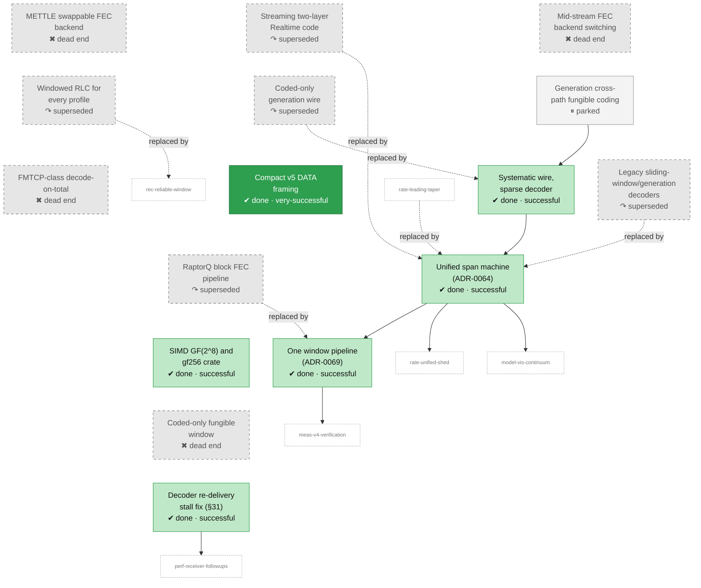
<!-- END GENERATED: track-cod -->

### rec - recovery

<!-- BEGIN GENERATED: track-rec -->
```mermaid
flowchart TB
    rec_early_arq["Early ACK, NACK and<br/>repair<br/>✔ done · successful"]
    rec_plost_sack["P_lost(t) mix and<br/>SACK WindowAck<br/>✔ done · unrated"]
    rec_bulk_arq["Bulk ARQ and batch<br/>acknowledgements<br/>✔ done · successful"]
    rec_reliable_window["Reliable window (RWM<br/>Phase A)<br/>✔ done · successful"]
    rec_fec_vs_arq["Proactive FEC versus<br/>ARQ frontier<br/>✔ done · unrated"]
    rec_proactive_repair["Proactive repair<br/>timing (3 arms)<br/>✖ dead end"]
    rec_per_path_clocks["Per-path recovery<br/>clocks (RECOV_MP)<br/>✔ done · successful ⚠"]
    rec_mp_serial["Global loss serials<br/>under striping<br/>↷ superseded"]
    rec_clock_candidates[/"Derived recovery-<br/>timing candidates (4<br/>arms)<br/>✖ dead end"/]
    rec_goal100["Recovery primitives<br/>and σ (goal #35;100)<br/>✔ done · successful"]
    rec_goal101[/"Recovery clock law<br/>family (4 arms)<br/>✖ dead end"/]
    rec_receiver_law[/"Receiver request law<br/>(Track C)<br/>✖ dead end"/]
    rec_cost_ratio_decision{{"Cost-ratio decision<br/>(owner ruling)<br/>✔ done · n/a"}}
    rec_wire_v9["Wire v9 per-path<br/>sequence<br/>✔ done · successful"]
    rec_gap_horizon["Gap horizon lever B<br/>(#167;52)<br/>▶ in progress"]
    rec_snapver_filter["Stale gap reports,<br/>snapshot filter<br/>(#167;53)<br/>✔ done · successful"]
    rec_snapver_law[/"Snapshot-order<br/>filter as law<br/>▶ in progress"/]
    rec_defect_qclk_clamp>"#91;QCLK#93; w_us pinned<br/>at clamp<br/>▶ in progress"]
    rec_defect_hole_law>"c8 hole law never<br/>measured<br/>▶ in progress"]
    rec_defect_refresh_input>"Hole refresh clock<br/>degenerate input<br/>▶ in progress"]
    rec_p10a_repair_floor["Inner-feedback<br/>repair floor (P10a)<br/>✖ dead end"]
    rec_recov_sp["Singles hole<br/>suppression<br/>(RECOV_SP)<br/>⏸ parked"]
    rec_s54_session["#167;54: filter guard,<br/>store budget<br/>⛔ blocked"]
    rec_leverb_guard["Lever-B guard v2,<br/>then merge<br/>⛔ blocked"]
    rec_early_arq ~~~ rec_fec_vs_arq
    rec_plost_sack ~~~ rec_proactive_repair
    rec_bulk_arq ~~~ rec_per_path_clocks
    rec_reliable_window ~~~ rec_mp_serial
    rec_fec_vs_arq ~~~ rec_clock_candidates
    rec_proactive_repair ~~~ rec_goal100
    rec_per_path_clocks ~~~ rec_receiver_law
    rec_mp_serial ~~~ rec_cost_ratio_decision
    rec_clock_candidates ~~~ rec_wire_v9
    rec_goal100 ~~~ rec_gap_horizon
    rec_receiver_law ~~~ rec_p10a_repair_floor
    rec_cost_ratio_decision ~~~ rec_recov_sp
    x_cc_bbrrs_r1["cc-bbrrs-r1"]
    x_cod_rlc_all_profiles["cod-rlc-all-profiles"]
    x_meas_defect_rtp_floor["meas-defect-rtp-floor"]
    x_meas_guard_41c["meas-guard-41c"]
    x_meas_guard_v2_impl["meas-guard-v2-impl"]
    x_meas_s51_session["meas-s51-session"]
    x_meas_wire_v8["meas-wire-v8"]
    x_place_marginal_cost["place-marginal-cost"]
    x_store_defect_cap_constant["store-defect-cap-constant"]
    x_store_s54_budget["store-s54-budget"]
    x_cod_rlc_all_profiles -.->|replaced by| rec_reliable_window
    rec_per_path_clocks -.->|⚠ qualified by| rec_defect_qclk_clamp
    rec_per_path_clocks -.->|⚠ qualified by| rec_defect_hole_law
    rec_mp_serial -.->|replaced by| rec_wire_v9
    rec_goal100 --> rec_goal101
    x_meas_wire_v8 --> rec_receiver_law
    x_meas_guard_41c --> rec_gap_horizon
    x_cc_bbrrs_r1 --> rec_gap_horizon
    rec_gap_horizon --> rec_snapver_filter
    rec_snapver_filter --> rec_snapver_law
    rec_gap_horizon --> rec_defect_qclk_clamp
    rec_gap_horizon --> rec_defect_hole_law
    rec_snapver_filter --> rec_defect_hole_law
    rec_snapver_filter --> rec_defect_refresh_input
    rec_snapver_filter --> x_store_s54_budget
    rec_snapver_filter --> x_store_defect_cap_constant
    rec_reliable_window --> x_place_marginal_cost
    rec_snapver_filter --> x_meas_defect_rtp_floor
    x_meas_guard_v2_impl --> rec_s54_session
    rec_snapver_law --> rec_s54_session
    x_store_s54_budget --> rec_s54_session
    rec_s54_session --> rec_leverb_guard
    rec_gap_horizon --> rec_leverb_guard
    rec_leverb_guard --> x_meas_s51_session
    linkStyle 13,14 stroke:#e69500,stroke-width:2px,stroke-dasharray:2 3,color:#a86400
    classDef vsucc fill:#2e9e4f,stroke:#1b6b34,color:#fff
    classDef succ fill:#bfe8c8,stroke:#2e9e4f,color:#111
    classDef mixed fill:#ffd37a,stroke:#c98a00,color:#111
    classDef bad fill:#f28b82,stroke:#b3261e,color:#111
    classDef dead fill:#e6e6e6,stroke:#777,stroke-dasharray:5 5,color:#555
    classDef inprog fill:#a8cdf5,stroke:#1f6fc5,color:#111
    classDef next fill:#fff,stroke:#333,color:#111
    classDef blocked fill:#fff,stroke:#b3261e,stroke-dasharray:2 2,color:#111
    classDef parked fill:#f3f3f3,stroke:#999,color:#555
    classDef unrated fill:#fff,stroke:#333,stroke-dasharray:1 3,color:#111
    classDef userdec fill:#d9c2f0,stroke:#7b3fb5,color:#111
    classDef stub fill:#fff,stroke:#aaa,stroke-dasharray:2 2,color:#777,font-size:11px
    class rec_early_arq,rec_bulk_arq,rec_reliable_window,rec_per_path_clocks,rec_goal100,rec_wire_v9,rec_snapver_filter succ
    class rec_plost_sack,rec_fec_vs_arq unrated
    class rec_proactive_repair,rec_mp_serial,rec_clock_candidates,rec_goal101,rec_receiver_law,rec_p10a_repair_floor dead
    class rec_cost_ratio_decision userdec
    class rec_gap_horizon,rec_snapver_law,rec_defect_qclk_clamp,rec_defect_hole_law,rec_defect_refresh_input inprog
    class rec_recov_sp parked
    class rec_s54_session,rec_leverb_guard blocked
    class x_cc_bbrrs_r1,x_cod_rlc_all_profiles,x_meas_defect_rtp_floor,x_meas_guard_41c,x_meas_guard_v2_impl,x_meas_s51_session,x_meas_wire_v8,x_place_marginal_cost,x_store_defect_cap_constant,x_store_s54_budget stub
```
<!-- END GENERATED: track-rec -->

### rate - rate law

<!-- BEGIN GENERATED: track-rate -->
```mermaid
flowchart TB
    rate_ge_hmm[/"Gilbert-Elliott loss<br/>model (ADR-0023)<br/>✔ done · successful"/]
    rate_fec_rate_v1[/"BOCD FEC rate<br/>control (ADR-0050)<br/>✔ done · successful"/]
    rate_saturation_rstar[/"Saturation-aware r*<br/>and window<br/>✔ done · successful ⚠"/]
    rate_rstar_window_mass[/"r* window-mass<br/>provisioning<br/>(ADR-0063)<br/>✔ done · successful"/]
    rate_taper_r[/"Taper emission<br/>budget law<br/>✔ done · successful"/]
    rate_leading_taper["Leading-window taper<br/>emission<br/>↷ superseded"]
    rate_retention_is_rho{{"Retention is the ρ<br/>dial<br/>✔ done · n/a"}}
    rate_unified_shed[/"δ-honest overload<br/>shedding<br/>✔ done · successful"/]
    rate_est_cadence["Batched BOCD<br/>estimator cadence<br/>✔ done · very-successful"]
    rate_sender_truth_loss["Sender-truth loss<br/>estimator<br/>✖ dead end"]
    rate_r_battery["Funded coding at r #gt;<br/>0<br/>✖ dead end"]
    rate_dof_ledger[/"DoF ledger feedback<br/>leg (#167;39)<br/>⏸ parked"/]
    rate_dials_made_real["The dials made real<br/>✔ done · successful"]
    rate_defect_pfec>"P_fec truncation<br/>divergence<br/>▶ in progress"]
    rate_user_rate_law{{"Owner calls on rate<br/>law<br/>○ next"}}
    rate_law_reconcile[/"Rate-law<br/>reconciliation (W22,<br/>W*)<br/>⛔ blocked"/]
    rate_ge_hmm ~~~ rate_leading_taper
    rate_fec_rate_v1 ~~~ rate_retention_is_rho
    rate_saturation_rstar ~~~ rate_sender_truth_loss
    rate_taper_r ~~~ rate_dials_made_real
    rate_leading_taper ~~~ rate_defect_pfec
    rate_rstar_window_mass ~~~ rate_user_rate_law
    x_cod_unified_span["cod-unified-span"]
    x_meas_s51_session["meas-s51-session"]
    x_model_paper_recon["model-paper-recon"]
    x_model_wasm_l0["model-wasm-l0"]
    x_store_pool_anchor_flip["store-pool-anchor-flip"]
    rate_saturation_rstar -.->|⚠ qualified by| rate_defect_pfec
    rate_ge_hmm --> rate_rstar_window_mass
    rate_fec_rate_v1 --> rate_rstar_window_mass
    rate_leading_taper -.->|replaced by| x_cod_unified_span
    x_cod_unified_span --> rate_unified_shed
    rate_retention_is_rho --> rate_unified_shed
    rate_fec_rate_v1 --> rate_est_cadence
    rate_dials_made_real --> rate_r_battery
    rate_r_battery --> rate_dof_ledger
    rate_est_cadence --> x_store_pool_anchor_flip
    x_model_wasm_l0 -.->|⚠ qualified by| rate_defect_pfec
    x_model_paper_recon --> rate_user_rate_law
    rate_defect_pfec --> rate_user_rate_law
    rate_user_rate_law --> rate_law_reconcile
    x_meas_s51_session --> rate_law_reconcile
    linkStyle 6,16 stroke:#e69500,stroke-width:2px,stroke-dasharray:2 3,color:#a86400
    classDef vsucc fill:#2e9e4f,stroke:#1b6b34,color:#fff
    classDef succ fill:#bfe8c8,stroke:#2e9e4f,color:#111
    classDef mixed fill:#ffd37a,stroke:#c98a00,color:#111
    classDef bad fill:#f28b82,stroke:#b3261e,color:#111
    classDef dead fill:#e6e6e6,stroke:#777,stroke-dasharray:5 5,color:#555
    classDef inprog fill:#a8cdf5,stroke:#1f6fc5,color:#111
    classDef next fill:#fff,stroke:#333,color:#111
    classDef blocked fill:#fff,stroke:#b3261e,stroke-dasharray:2 2,color:#111
    classDef parked fill:#f3f3f3,stroke:#999,color:#555
    classDef unrated fill:#fff,stroke:#333,stroke-dasharray:1 3,color:#111
    classDef userdec fill:#d9c2f0,stroke:#7b3fb5,color:#111
    classDef stub fill:#fff,stroke:#aaa,stroke-dasharray:2 2,color:#777,font-size:11px
    class rate_ge_hmm,rate_fec_rate_v1,rate_saturation_rstar,rate_rstar_window_mass,rate_taper_r,rate_unified_shed,rate_dials_made_real succ
    class rate_leading_taper,rate_sender_truth_loss,rate_r_battery dead
    class rate_retention_is_rho,rate_user_rate_law userdec
    class rate_est_cadence vsucc
    class rate_dof_ledger parked
    class rate_defect_pfec inprog
    class rate_law_reconcile blocked
    class x_cod_unified_span,x_meas_s51_session,x_model_paper_recon,x_model_wasm_l0,x_store_pool_anchor_flip stub
```
<!-- END GENERATED: track-rate -->

### store - store law

<!-- BEGIN GENERATED: track-store -->
```mermaid
flowchart TB
    store_xn_pool[/"Path-scaled pool ×N<br/>(STORE_PATHS)<br/>↷ superseded"/]
    store_percap_family["Per-path store<br/>accounts family (4<br/>arms)<br/>✖ dead end"]
    store_honest_cap_family[/"Honest floor-clock<br/>cap family (6 arms)<br/>✖ dead end"/]
    store_pool_anchor_flip["Composed cadence and<br/>pool-anchor flip<br/>✔ done · bad"]
    store_sack_prune["SACK pruning of the<br/>store<br/>↷ superseded"]
    store_sack_release["SACK-clocked store<br/>release (ADR-0060)<br/>✔ done · successful"]
    store_sender_decoupling["Sender decoupling<br/>attempts (4 arms)<br/>✖ dead end"]
    store_anchor_hygiene[/"Anchor hygiene laws<br/>(ADR-0061)<br/>✔ done · successful ⚠"/]
    store_three_term[/"Three-term and<br/>composed caps (5<br/>arms)<br/>✖ dead end"/]
    store_cap_unification[/"Store-cap<br/>unification over<br/>live paths<br/>✔ done · mixed"/]
    store_honest_inputs["Honest inputs and<br/>O(1) anchor<br/>✔ done · successful"]
    store_sum_cap[/"Sum cap: ×N deletion<br/>(SUM_CAP)<br/>✔ done · successful ⚠"/]
    store_delta_cap[/"Derived setpoint 1 +<br/>q(δ)<br/>✔ done · very-successful ⚠"/]
    store_adr72_one_law[/"One store law<br/>(ADR-0072)<br/>✔ done · successful ⚠"/]
    store_input_search["Store-law input<br/>search (8 inputs)<br/>✖ dead end"]
    store_power_law[/"Power-seeking store<br/>law D<br/>✖ dead end"/]
    store_engine_form["Dispersion and<br/>oracle store law<br/>⏸ parked"]
    store_w1_who_limits[/"Who limits at each δ<br/>▶ in progress"/]
    store_s54_budget["Store-budget test<br/>design (#167;54)<br/>▶ in progress"]
    store_defect_cap_constant>"Store cap constant<br/>at c8<br/>▶ in progress"]
    store_maxbw_diag["max_bw over-read<br/>diagnosis<br/>○ next"]
    store_user_u1u3{{"Owner calls U1–U3<br/>○ next"}}
    store_engine_form_impl[/"Store-law engine<br/>form<br/>⛔ blocked"/]
    store_engine_form_guard[/"Store-law engine<br/>form guard<br/>⛔ blocked"/]
    store_delta_seat[/"δ seat on the store<br/>⛔ blocked"/]
    store_xn_pool ~~~ store_sack_prune
    store_percap_family ~~~ store_sack_release
    store_honest_cap_family ~~~ store_sender_decoupling
    store_pool_anchor_flip ~~~ store_anchor_hygiene
    store_sack_prune ~~~ store_three_term
    store_sack_release ~~~ store_cap_unification
    store_sender_decoupling ~~~ store_honest_inputs
    store_anchor_hygiene ~~~ store_s54_budget
    store_three_term ~~~ store_defect_cap_constant
    x_cc_bbrrs_r1["cc-bbrrs-r1"]
    x_cc_defect_copa_minrtt["cc-defect-copa-minrtt"]
    x_cc_quinn_bbr_collapse["cc-quinn-bbr-collapse"]
    x_meas_adversarial_cells["meas-adversarial-cells"]
    x_meas_competitor_battery["meas-competitor-battery"]
    x_meas_formula_first["meas-formula-first"]
    x_meas_guard_v2_impl["meas-guard-v2-impl"]
    x_model_law_ledger["model-law-ledger"]
    x_place_daps["place-daps"]
    x_place_per_leg_impl["place-per-leg-impl"]
    x_rate_est_cadence["rate-est-cadence"]
    x_rec_s54_session["rec-s54-session"]
    x_rec_snapver_filter["rec-snapver-filter"]
    store_xn_pool -.->|replaced by| store_sum_cap
    x_rate_est_cadence --> store_pool_anchor_flip
    store_sack_prune -.->|replaced by| store_sack_release
    store_anchor_hygiene -.->|⚠ qualified by| store_defect_cap_constant
    store_anchor_hygiene -.->|⚠ qualified by| x_cc_defect_copa_minrtt
    store_xn_pool --> store_sum_cap
    store_sum_cap -.->|⚠ qualified by| store_defect_cap_constant
    store_sum_cap --> store_delta_cap
    store_delta_cap -.->|⚠ qualified by| store_defect_cap_constant
    store_delta_cap --> store_adr72_one_law
    x_meas_formula_first --> store_adr72_one_law
    store_adr72_one_law -.->|⚠ qualified by| store_defect_cap_constant
    store_adr72_one_law --> store_input_search
    store_input_search --> store_power_law
    store_input_search --> store_engine_form
    x_cc_bbrrs_r1 --> store_w1_who_limits
    store_engine_form --> store_w1_who_limits
    x_rec_snapver_filter --> store_s54_budget
    x_rec_snapver_filter --> store_defect_cap_constant
    x_place_daps -.->|replaced by| store_anchor_hygiene
    store_engine_form --> x_cc_quinn_bbr_collapse
    store_defect_cap_constant --> store_maxbw_diag
    store_s54_budget --> x_rec_s54_session
    store_w1_who_limits --> store_user_u1u3
    x_place_per_leg_impl --> store_engine_form_impl
    store_user_u1u3 --> store_engine_form_impl
    store_maxbw_diag --> store_engine_form_impl
    x_model_law_ledger --> store_engine_form_impl
    store_engine_form_impl --> store_engine_form_guard
    x_meas_adversarial_cells --> store_engine_form_guard
    x_meas_guard_v2_impl --> store_engine_form_guard
    store_user_u1u3 --> store_delta_seat
    store_engine_form_impl --> store_delta_seat
    store_engine_form_guard --> x_meas_competitor_battery
    linkStyle 12,13,15,17,20 stroke:#e69500,stroke-width:2px,stroke-dasharray:2 3,color:#a86400
    classDef vsucc fill:#2e9e4f,stroke:#1b6b34,color:#fff
    classDef succ fill:#bfe8c8,stroke:#2e9e4f,color:#111
    classDef mixed fill:#ffd37a,stroke:#c98a00,color:#111
    classDef bad fill:#f28b82,stroke:#b3261e,color:#111
    classDef dead fill:#e6e6e6,stroke:#777,stroke-dasharray:5 5,color:#555
    classDef inprog fill:#a8cdf5,stroke:#1f6fc5,color:#111
    classDef next fill:#fff,stroke:#333,color:#111
    classDef blocked fill:#fff,stroke:#b3261e,stroke-dasharray:2 2,color:#111
    classDef parked fill:#f3f3f3,stroke:#999,color:#555
    classDef unrated fill:#fff,stroke:#333,stroke-dasharray:1 3,color:#111
    classDef userdec fill:#d9c2f0,stroke:#7b3fb5,color:#111
    classDef stub fill:#fff,stroke:#aaa,stroke-dasharray:2 2,color:#777,font-size:11px
    class store_xn_pool,store_percap_family,store_honest_cap_family,store_sack_prune,store_sender_decoupling,store_three_term,store_input_search,store_power_law dead
    class store_pool_anchor_flip bad
    class store_sack_release,store_anchor_hygiene,store_honest_inputs,store_sum_cap,store_adr72_one_law succ
    class store_cap_unification mixed
    class store_delta_cap vsucc
    class store_engine_form parked
    class store_w1_who_limits,store_s54_budget,store_defect_cap_constant inprog
    class store_maxbw_diag next
    class store_user_u1u3 userdec
    class store_engine_form_impl,store_engine_form_guard,store_delta_seat blocked
    class x_cc_bbrrs_r1,x_cc_defect_copa_minrtt,x_cc_quinn_bbr_collapse,x_meas_adversarial_cells,x_meas_competitor_battery,x_meas_formula_first,x_meas_guard_v2_impl,x_model_law_ledger,x_place_daps,x_place_per_leg_impl,x_rate_est_cadence,x_rec_s54_session,x_rec_snapver_filter stub
```
<!-- END GENERATED: track-store -->

### place - placement

<!-- BEGIN GENERATED: track-place -->
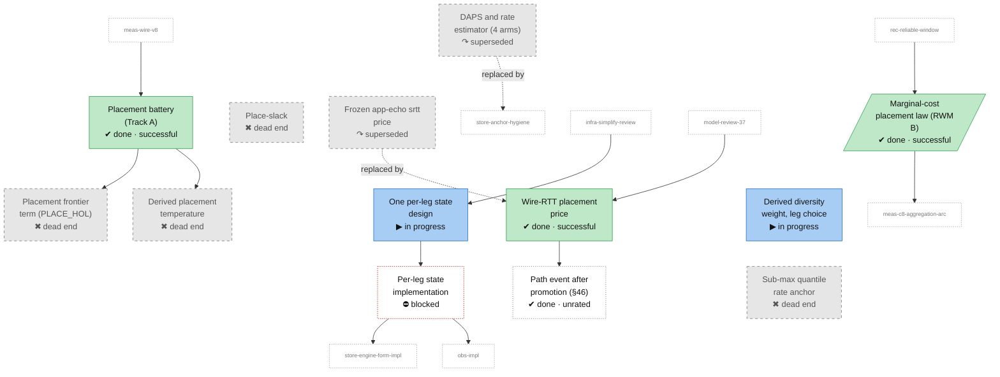
<!-- END GENERATED: track-place -->

### cc - congestion control

<!-- BEGIN GENERATED: track-cc -->
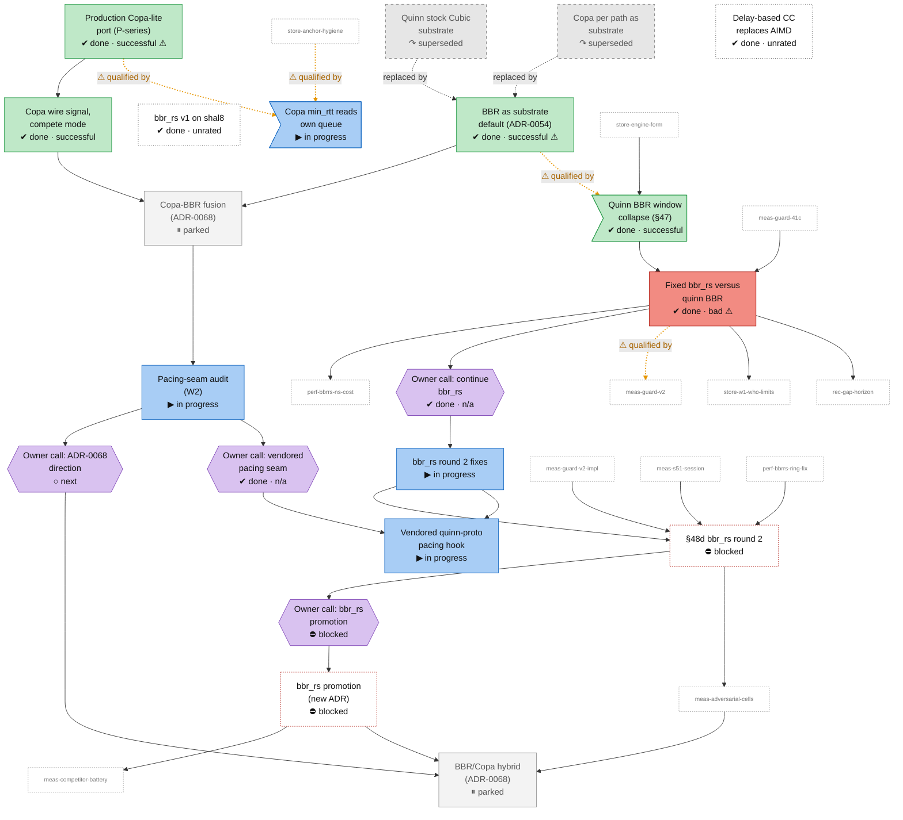
<!-- END GENERATED: track-cc -->

### perf - performance

<!-- BEGIN GENERATED: track-perf -->
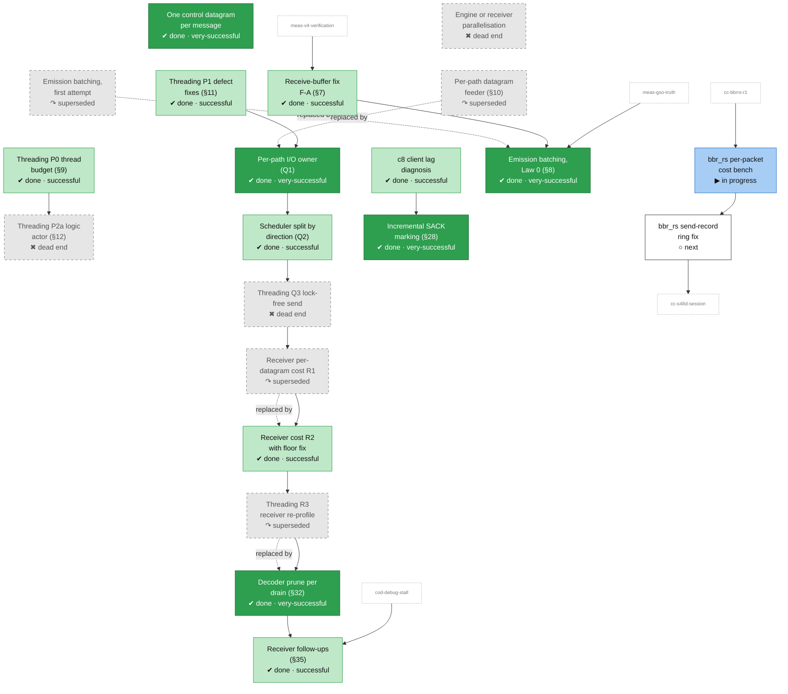
<!-- END GENERATED: track-perf -->

### meas - measurement

<!-- BEGIN GENERATED: track-meas -->
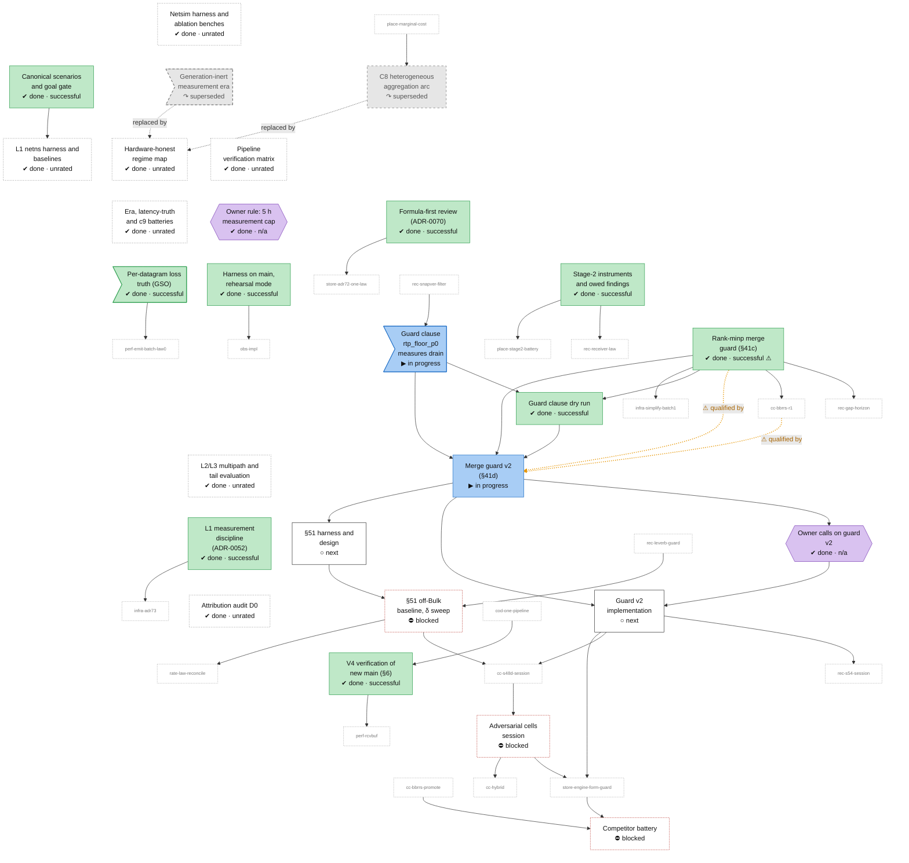
<!-- END GENERATED: track-meas -->

### model - model and paper

<!-- BEGIN GENERATED: track-model -->
```mermaid
flowchart TB
    model_paper_v1["Unified FEC/ARQ<br/>model paper<br/>✔ done · unrated"]
    model_math_verification["Mathematical<br/>verification of the<br/>model<br/>✔ done · unrated"]
    model_wasm_l0["raptorpath-math and<br/>wasm L0 model<br/>✔ done · successful ⚠"]
    model_vis_continuum["Visualizer as one<br/>continuum law<br/>✔ done · successful ⚠"]
    model_mode_switch_debts>"Engine NO-MODE-<br/>SWITCH debts (#167;3.3)<br/>⏸ parked"]
    model_open_constants>"Open-constants<br/>register (#167;3.4)<br/>⏸ parked"]
    model_review_37["Model review (#167;37)<br/>✔ done · successful"]
    model_paper_recon["Paper versus engine<br/>reconciliation<br/>▶ in progress"]
    model_bound_tests["Bounding tests for<br/>divergences<br/>✔ done · unrated ⚠"]
    model_wasm_audit["Wasm mode-switch<br/>audit<br/>▶ in progress"]
    model_defect_tcut>"T_cut give-up law<br/>pinned<br/>▶ in progress"]
    model_defect_dead_machine>"Wasm dead second<br/>machine<br/>▶ in progress"]
    model_bound_tests_unrun>"Erratum: wasm tests<br/>not run<br/>▶ in progress"]
    model_law_ledger["Law ledger<br/>○ next"]
    model_user_wasm_calls{{"Owner calls on wasm<br/>audit<br/>○ next"}}
    model_wasm_fixes["Wasm model fixes<br/>⛔ blocked"]
    model_paper_v1 ~~~ model_open_constants
    model_math_verification ~~~ model_review_37
    model_wasm_l0 ~~~ model_paper_recon
    model_mode_switch_debts ~~~ model_bound_tests_unrun
    model_open_constants ~~~ model_law_ledger
    x_cod_unified_span["cod-unified-span"]
    x_infra_restructure["infra-restructure"]
    x_infra_tech_tree_skill["infra-tech-tree-skill"]
    x_place_wire_price["place-wire-price"]
    x_rate_defect_pfec["rate-defect-pfec"]
    x_rate_user_rate_law["rate-user-rate-law"]
    x_store_engine_form_impl["store-engine-form-impl"]
    model_review_37 --> x_place_wire_price
    model_wasm_l0 -.->|⚠ qualified by| x_rate_defect_pfec
    model_wasm_l0 -.->|⚠ qualified by| model_defect_tcut
    x_cod_unified_span --> model_vis_continuum
    model_wasm_l0 --> model_vis_continuum
    model_vis_continuum -.->|⚠ qualified by| model_defect_dead_machine
    model_vis_continuum -.->|⚠ qualified by| model_defect_tcut
    model_paper_recon --> model_bound_tests
    model_bound_tests -.->|⚠ qualified by| model_bound_tests_unrun
    model_vis_continuum --> model_wasm_audit
    x_infra_restructure --> model_wasm_audit
    model_wasm_audit --> model_defect_tcut
    model_wasm_audit --> model_defect_dead_machine
    model_wasm_audit --> model_user_wasm_calls
    model_paper_recon --> x_rate_user_rate_law
    model_law_ledger --> x_store_engine_form_impl
    model_user_wasm_calls --> model_wasm_fixes
    model_defect_tcut --> model_wasm_fixes
    model_defect_dead_machine --> model_wasm_fixes
    model_law_ledger --> x_infra_tech_tree_skill
    linkStyle 6,7,10,11,13 stroke:#e69500,stroke-width:2px,stroke-dasharray:2 3,color:#a86400
    classDef vsucc fill:#2e9e4f,stroke:#1b6b34,color:#fff
    classDef succ fill:#bfe8c8,stroke:#2e9e4f,color:#111
    classDef mixed fill:#ffd37a,stroke:#c98a00,color:#111
    classDef bad fill:#f28b82,stroke:#b3261e,color:#111
    classDef dead fill:#e6e6e6,stroke:#777,stroke-dasharray:5 5,color:#555
    classDef inprog fill:#a8cdf5,stroke:#1f6fc5,color:#111
    classDef next fill:#fff,stroke:#333,color:#111
    classDef blocked fill:#fff,stroke:#b3261e,stroke-dasharray:2 2,color:#111
    classDef parked fill:#f3f3f3,stroke:#999,color:#555
    classDef unrated fill:#fff,stroke:#333,stroke-dasharray:1 3,color:#111
    classDef userdec fill:#d9c2f0,stroke:#7b3fb5,color:#111
    classDef stub fill:#fff,stroke:#aaa,stroke-dasharray:2 2,color:#777,font-size:11px
    class model_paper_v1,model_math_verification,model_bound_tests unrated
    class model_wasm_l0,model_vis_continuum,model_review_37 succ
    class model_mode_switch_debts,model_open_constants parked
    class model_paper_recon,model_wasm_audit,model_defect_tcut,model_defect_dead_machine,model_bound_tests_unrun inprog
    class model_law_ledger next
    class model_user_wasm_calls userdec
    class model_wasm_fixes blocked
    class x_cod_unified_span,x_infra_restructure,x_infra_tech_tree_skill,x_place_wire_price,x_rate_defect_pfec,x_rate_user_rate_law,x_store_engine_form_impl stub
```
<!-- END GENERATED: track-model -->

### obs - observability

<!-- BEGIN GENERATED: track-obs -->
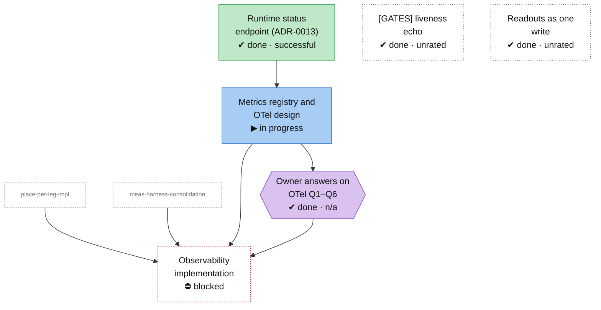
<!-- END GENERATED: track-obs -->

### infra - repo and simplification

<!-- BEGIN GENERATED: track-infra -->
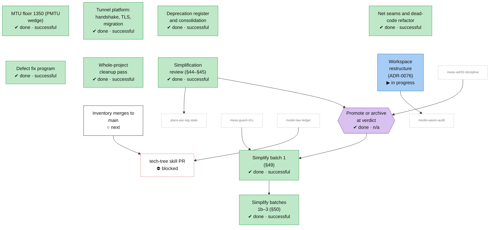
<!-- END GENERATED: track-infra -->

## Node table

<!-- BEGIN GENERATED: table -->
### cod - coding core

| id | title | state | outcome | headline | evidence | depends_on |
|---|---|---|---|---|---|---|
| `cod-block-pipeline` | RaptorQ block FEC pipeline | abandoned | superseded |  | ADR-0002; ADR-0004; ADR-0014; status §4; status §3.7 row 236; status §3.7 row 238 |  |
| `cod-mettle` | METTLE swappable FEC backend | abandoned | dead-end |  | paper §10 row METTLE FEC backend |  |
| `cod-backend-switch` | Mid-stream FEC backend switching | abandoned | dead-end |  | paper §10 row Mid-stream backend switching (loss-threshold selector) |  |
| `cod-streaming-code` | Streaming two-layer Realtime code | abandoned | superseded |  | paper §10 row Streaming two-layer code (Realtime machine) |  |
| `cod-gf256-simd` | SIMD GF(2^8) and gf256 crate | done | successful | ~15-25× speedup on the FEC decode hot path | ADR-0041 |  |
| `cod-rlc-all-profiles` | Windowed RLC for every profile | abandoned | superseded |  | commit 341857ec |  |
| `cod-generation-coding` | Generation cross-path fungible coding | parked | unrated |  | status §3.2 |  |
| `cod-coded-only-wire` | Coded-only generation wire | abandoned | superseded | 70.9 Mbit/s | paper §10 row Coded-only generation wire |  |
| `cod-systematic-wire` | Systematic wire, sparse decoder | done | successful | Gen single-c2 33.9 → 70.9 Mbit/s | ADR-0056 | cod-generation-coding |
| `cod-fungible-window` | Coded-only fungible window | abandoned | dead-end | 3.9 Mbit/s | paper §10 row Coded-only fungible window (coded-object mode) |  |
| `cod-fmtcp` | FMTCP-class decode-on-total | abandoned | dead-end | 0.48× | commit f8417579 |  |
| `cod-legacy-rlc` | Legacy sliding-window/generation decoders | abandoned | superseded |  | paper §10 row Legacy RLC decoders (sliding-window, generation) |  |
| `cod-unified-span` | Unified span machine (ADR-0064) | done | successful |  | ADR-0064 | cod-systematic-wire |
| `cod-one-pipeline` | One window pipeline (ADR-0069) | done | successful |  | ADR-0069; status §5 | cod-unified-span |
| `cod-wire-compact` | Compact v5 DATA framing | done | very-successful | +2.6/+3.6 Mbit/s | commit 078b0ce9 |  |
| `cod-debug-stall` | Decoder re-delivery stall fix (§31) | done | successful | 0 of 40 iterations stalled | status §31 |  |

### rec - recovery

| id | title | state | outcome | headline | evidence | depends_on |
|---|---|---|---|---|---|---|
| `rec-early-arq` | Early ACK, NACK and repair | done | successful |  | ADR-0003; ADR-0005; ADR-0007 |  |
| `rec-plost-sack` | P_lost(t) mix and SACK WindowAck | done | unrated |  | commit 5b9f6def |  |
| `rec-bulk-arq` | Bulk ARQ and batch acknowledgements | done | successful |  | branch P8 |  |
| `rec-reliable-window` | Reliable window (RWM Phase A) | done | successful |  | branch RWM Phase A |  |
| `rec-fec-vs-arq` | Proactive FEC versus ARQ frontier | done | unrated |  | branch proactive-frontier diagnosis |  |
| `rec-proactive-repair` | Proactive repair timing (3 arms) | abandoned | dead-end |  | tag archive/RWM_REPAIR_WAIT; tag archive/RWM_PROACTIVE_PACER |  |
| `rec-per-path-clocks` | Per-path recovery clocks (RECOV_MP) | done | successful | repair share ×2.2–2.5 | ADR-0059 |  |
| `rec-mp-serial` | Global loss serials under striping | abandoned | superseded | 0.1 % | paper §10 row Global loss serials under striping (`RWM_RECOV_MP_SERIAL`) |  |
| `rec-clock-candidates` | Derived recovery-timing candidates (4 arms) | abandoned | dead-end | −23 % | tag archive/RWM_DERIVED_SWEEP |  |
| `rec-goal100` | Recovery primitives and σ (goal #100) | done | successful |  | commit 6e1e356a |  |
| `rec-goal101` | Recovery clock law family (4 arms) | abandoned | dead-end |  | tag archive/RWM_HOLDDOWN_Q; tag archive/RWM_REFRESH_FLOOR_US | rec-goal100 |
| `rec-receiver-law` | Receiver request law (Track C) | abandoned | dead-end |  | status §2 row "Receiver-law battery (Track C)"; status §3.1 item 1 | meas-wire-v8 |
| `rec-cost-ratio-decision` | Cost-ratio decision (owner ruling) | done | n/a |  | commit ca058db4 |  |
| `rec-wire-v9` | Wire v9 per-path sequence | done | successful |  | status §3.5 item 2 |  |
| `rec-gap-horizon` | Gap horizon lever B (§52) | in-progress | mixed | p = 0.2471 | status §52; branch gaphorizon; branch cand52; branch base52 | meas-guard-41c, cc-bbrrs-r1 |
| `rec-snapver-filter` | Stale gap reports, snapshot filter (§53) | done | successful | CANDS duplicates (mean 1 291) | status §53; derivation dup-diag.md (branch dup-diag); branch dup-diag; branch dup-diag-instr; branch cand53; branch base53; branch test-debts | rec-gap-horizon |
| `rec-snapver-law` | Snapshot-order filter as law | in-progress | unrated |  | branch snapver-law (head 8191b3de); paper §7.1 "Snapshot order"; plan Live state 2026-11-13 item 1 | rec-snapver-filter |
| `rec-defect-qclk-clamp` | [QCLK] w_us pinned at clamp | in-progress | unrated | p05 = p95 = 100 000 µs | status §3.10 item 4 | rec-gap-horizon |
| `rec-defect-hole-law` | c8 hole law never measured | in-progress | unrated | 3.7–6.6 k times per run | status §3.10 item 5 | rec-gap-horizon, rec-snapver-filter |
| `rec-defect-refresh-input` | Hole refresh clock degenerate input | in-progress | unrated | srtt = exactly 50 000 µs | status §3.10 item 6 | rec-snapver-filter |
| `rec-p10a-repair-floor` | Inner-feedback repair floor (P10a) | abandoned | dead-end |  | branch P10a |  |
| `rec-recov-sp` | Singles hole suppression (RECOV_SP) | parked | unrated | +0.3 Mbit/s | paper §10 row Singles hole suppression (`RWM_RECOV_SP`) |  |
| `rec-s54-session` | §54: filter guard, store budget | blocked | unrated |  | plan Live state items 1-2; branch p0-dwell-diag §8 | meas-guard-v2-impl, rec-snapver-law, store-s54-budget |
| `rec-leverb-guard` | Lever-B guard v2, then merge | blocked | unrated |  | plan Live state item 4 | rec-s54-session, rec-gap-horizon |

### rate - rate law

| id | title | state | outcome | headline | evidence | depends_on |
|---|---|---|---|---|---|---|
| `rate-ge-hmm` | Gilbert-Elliott loss model (ADR-0023) | done | successful |  | ADR-0023 |  |
| `rate-fec-rate-v1` | BOCD FEC rate control (ADR-0050) | done | successful | DC (ε≈0.1%): 4.3% actual vs 0.1% optimal → 43x | ADR-0050 |  |
| `rate-saturation-rstar` | Saturation-aware r* and window | done | successful |  | branch unified deadline-constrained r* (§8.9) |  |
| `rate-rstar-window-mass` | r* window-mass provisioning (ADR-0063) | done | successful |  | ADR-0063 | rate-ge-hmm, rate-fec-rate-v1 |
| `rate-taper-r` | Taper emission budget law | done | successful |  | commit 33b29f81 |  |
| `rate-leading-taper` | Leading-window taper emission | abandoned | superseded | −22 pp | paper §10 row Leading-window taper emission |  |
| `rate-retention-is-rho` | Retention is the ρ dial | done | n/a |  | commit 49ab700c |  |
| `rate-unified-shed` | δ-honest overload shedding | done | successful |  | commit 6568822c | cod-unified-span, rate-retention-is-rho |
| `rate-est-cadence` | Batched BOCD estimator cadence | done | very-successful | +41 % | status §3.7 row 234 | rate-fec-rate-v1 |
| `rate-sender-truth-loss` | Sender-truth loss estimator | abandoned | dead-end | 20× | paper §10 row Sender-truth loss estimator (`RWM_LOSS_SENT_TRUTH`) |  |
| `rate-r-battery` | Funded coding at r > 0 | abandoned | dead-end |  | status §2 row "r > 0 battery (Track B)"; status §3.1 item 7; status §3.1 note (cod= counter) | rate-dials-made-real |
| `rate-dof-ledger` | DoF ledger feedback leg (§39) | parked | unrated |  | status §39 | rate-r-battery |
| `rate-dials-made-real` | The dials made real | done | successful |  | branch THE DIALS MADE REAL |  |
| `rate-defect-pfec` | P_fec truncation divergence | in-progress | unrated | 0.0267 at c2 and 0.0515 at c3 | status §3.10 item 2 |  |
| `rate-user-rate-law` | Owner calls on rate law | next | n/a |  | plan user decision 11; status §3.10 item 2 (conflict for the owner) | model-paper-recon, rate-defect-pfec |
| `rate-law-reconcile` | Rate-law reconciliation (W22, W*) | blocked | unrated |  | plan W3.5, W3.7 | rate-user-rate-law, meas-s51-session |

### store - store law

| id | title | state | outcome | headline | evidence | depends_on |
|---|---|---|---|---|---|---|
| `store-xn-pool` | Path-scaled pool ×N (STORE_PATHS) | abandoned | superseded |  | paper §10 row ×N pool multiplier `clamp(gain·N·Σ, floor, N·knee)` |  |
| `store-percap-family` | Per-path store accounts family (4 arms) | abandoned | dead-end | 0.89–0.94× | paper §10 row Per-path store accounts (`RWM_STORE_PERCAP`, `RWM_PERCAP_GUARD`) |  |
| `store-honest-cap-family` | Honest floor-clock cap family (6 arms) | abandoned | dead-end |  | tag archive/RWM_HONEST_CAP; tag archive/RWM_HONEST_K; tag archive/RWM_PLAIN_RS; tag archive/RWM_RS_ATTR |  |
| `store-pool-anchor-flip` | Composed cadence and pool-anchor flip | done | bad | 0.959–0.968× | tag archive/RWM_POOL_ANCHOR | rate-est-cadence |
| `store-sack-prune` | SACK pruning of the store | abandoned | superseded |  | paper §10 row SACK pruning of the store (`RWM_SACK_PRUNE`) |  |
| `store-sack-release` | SACK-clocked store release (ADR-0060) | done | successful |  | ADR-0060 |  |
| `store-sender-decoupling` | Sender decoupling attempts (4 arms) | abandoned | dead-end | 27 ms | tag archive/RWM_REASM_BDP |  |
| `store-anchor-hygiene` | Anchor hygiene laws (ADR-0061) | done | successful | +31% | ADR-0061 |  |
| `store-three-term` | Three-term and composed caps (5 arms) | abandoned | dead-end | 2.4× | tag archive/RWM_COMPOSED_CAP |  |
| `store-cap-unification` | Store-cap unification over live paths | done | mixed | +16–25 % | status §3.5 item 3 |  |
| `store-honest-inputs` | Honest inputs and O(1) anchor | done | successful |  | commit 9f6e56ba |  |
| `store-sum-cap` | Sum cap: ×N deletion (SUM_CAP) | done | successful |  | branch RWM_SUM_CAP DEFAULT ON | store-xn-pool |
| `store-delta-cap` | Derived setpoint 1 + q(δ) | done | very-successful | queue −10 to −200 ms | paper §10 row Pool gain 2.0 (N ≥ 2) | store-sum-cap |
| `store-adr72-one-law` | One store law (ADR-0072) | done | successful |  | ADR-0072; status §18; status §19 | store-delta-cap, meas-formula-first |
| `store-input-search` | Store-law input search (8 inputs) | abandoned | dead-end | knee is 1 024 at both cells | status §23; status §24; status §27; status §34 | store-adr72-one-law |
| `store-power-law` | Power-seeking store law D | abandoned | dead-end | ×5–12 | status §29; status §30; tag archive/store-power; branch archive/wt-status29-power | store-input-search |
| `store-engine-form` | Dispersion and oracle store law | parked | successful |  | status §36; status §40; status §42; status §43; branch harness43; branch run43 | store-input-search |
| `store-w1-who-limits` | Who limits at each δ | in-progress | unrated |  | derivation w1-who-limits.md (branch derive-w1); branch derive-w1; branch w1r2 | cc-bbrrs-r1, store-engine-form |
| `store-s54-budget` | Store-budget test design (§54) | in-progress | unrated | from a mean of about 5.3 s to about 1.0 s | derivation p0-dwell-diag.md (branch p0-dwell-diag); branch p0-dwell-diag | rec-snapver-filter |
| `store-defect-cap-constant` | Store cap constant at c8 | in-progress | unrated | N·pool = 4 096 | status §3.10 item 8 | rec-snapver-filter |
| `store-maxbw-diag` | max_bw over-read diagnosis | next | unrated |  | status §3.10 item 8 ("not yet diagnosed"); plan Live state item 5 | store-defect-cap-constant |
| `store-user-u1u3` | Owner calls U1–U3 | next | n/a |  | plan user decision 10 | store-w1-who-limits |
| `store-engine-form-impl` | Store-law engine form | blocked | unrated |  | plan W3.3; CLAUDE.md FORMULA-FIRST | place-per-leg-impl, store-user-u1u3, store-maxbw-diag, model-law-ledger |
| `store-engine-form-guard` | Store-law engine form guard | blocked | unrated |  | plan VM queue 8 | store-engine-form-impl, meas-adversarial-cells, meas-guard-v2-impl |
| `store-delta-seat` | δ seat on the store | blocked | unrated |  | plan W1.2 RESULT, W1 round 2 (iii) | store-user-u1u3, store-engine-form-impl |

### place - placement

| id | title | state | outcome | headline | evidence | depends_on |
|---|---|---|---|---|---|---|
| `place-marginal-cost` | Marginal-cost placement law (RWM B) | done | successful |  | branch RWM Phase B | rec-reliable-window |
| `place-daps` | DAPS and rate estimator (4 arms) | abandoned | superseded | −30 % | paper §10 row DAPS chain, pace-all, per-path rate-sample estimator (`RWM_DAPS*`, `RWM_PACE_ALL`, `RWM_RATE_SAMPLE`, `RWM_PER_PATH_EST`) |  |
| `place-slack` | Place-slack | abandoned | dead-end | 6 % | paper §10 row Place-slack (`RWM_PLACE_SLACK`) |  |
| `place-stage2-battery` | Placement battery (Track A) | done | successful | 6 % of delivered latency | status §2 row "Placement battery (Track A)" | meas-wire-v8 |
| `place-hol` | Placement frontier term (PLACE_HOL) | abandoned | dead-end | 6 % | tag archive/RWM_PLACE_HOL | place-stage2-battery |
| `place-t-derived` | Derived placement temperature | abandoned | dead-end | 0.78–0.85× | tag archive/RWM_PLACE_T_DERIVED | place-stage2-battery |
| `place-wdiv` | Derived diversity weight, leg choice | in-progress | unrated |  | branch wdiv-diag |  |
| `place-frozen-echo` | Frozen app-echo srtt price | abandoned | superseded |  | paper §10 row Frozen app-echo srtt as the placement base, `(½ + ε̂)·s_i` (the pre-§41b base; `RWM_PLACE_WIRE` unset) |  |
| `place-wire-price` | Wire-RTT placement price | done | successful | p = 0.7195 | status §38; status §41; status §41b; status §3.9 | model-review-37 |
| `place-per-leg-state` | One per-leg state design | in-progress | unrated |  | derivation w3-per-leg-state.md (branch perleg-design); branch perleg-design | infra-simplify-review |
| `place-submax-anchor` | Sub-max quantile rate anchor | abandoned | dead-end | 65× | paper §10 row Sub-max quantile rate anchor (`RWM_RATE_WIRE`, `RWM_RATE_Q`) |  |
| `place-path-event` | Path event after promotion (§46) | done | unrated |  | status §46 | place-wire-price |
| `place-per-leg-impl` | Per-leg state implementation | blocked | unrated |  | plan W3.2, W3.6a | place-per-leg-state |

### cc - congestion control

| id | title | state | outcome | headline | evidence | depends_on |
|---|---|---|---|---|---|---|
| `cc-early-delay-cc` | Delay-based CC replaces AIMD | done | unrated |  | commit cbbbfdbd |  |
| `cc-copa-lite` | Production Copa-lite port (P-series) | done | successful |  | branch P7 |  |
| `cc-copa-sole-substrate` | Copa per path as substrate | abandoned | superseded | 0.57–0.97× | paper §10 row Copa per path as the substrate default (the original design) |  |
| `cc-cubic-substrate` | Quinn stock Cubic substrate | abandoned | superseded | 15–17 Mbit/s | paper §10 row Quinn's stock Cubic under the engine |  |
| `cc-copa-wire-signal` | Copa wire signal, compete mode | done | successful | 0.4–0.6× BBR's bulk throughput | ADR-0062 | cc-copa-lite |
| `cc-bbr-default` | BBR as substrate default (ADR-0054) | done | successful | plain 17.5 → plain+BBR 74.5 pooled, ×4.3 | ADR-0054 |  |
| `cc-bbrrs-v1` | bbr_rs v1 on shal8 | done | unrated |  | branch fix/shal8-anchor |  |
| `cc-adr68-fusion` | Copa-BBR fusion (ADR-0068) | parked | unrated |  | ADR-0068 | cc-bbr-default, cc-copa-wire-signal |
| `cc-quinn-bbr-collapse` | Quinn BBR window collapse (§47) | done | successful |  | status §47 | store-engine-form |
| `cc-bbrrs-r1` | Fixed bbr_rs versus quinn BBR | done | bad | wire RTT at c2 112.4 → 21.8 ms | status §48; status §48b; branch bbr48cand; branch bbrfix48-impl; branch bbrfix48b; branch harness48 | cc-quinn-bbr-collapse, meas-guard-41c |
| `cc-user-continue-bbrrs` | Owner call: continue bbr_rs | done | n/a |  | status commit 1425acbd (nm.txt); plan W1 §48b RESULT | cc-bbrrs-r1 |
| `cc-bbrrs-r2` | bbr_rs round 2 fixes | in-progress | unrated |  | branch bbrrs-r2; branch bbrrs-r3 | cc-user-continue-bbrrs |
| `cc-pacing-audit` | Pacing-seam audit (W2) | in-progress | unrated |  | derivation w2-pacing-seam.md (branch adr68-amend); branch adr68-amend | cc-adr68-fusion |
| `cc-user-pacing-s3` | Owner call: vendored pacing seam | done | n/a |  | plan W2.5; ADR-0075 | cc-pacing-audit |
| `cc-pacing-seam` | Vendored quinn-proto pacing hook | in-progress | unrated |  | branch pacing-seam; branch pacing-seam-2 | cc-user-pacing-s3, cc-bbrrs-r2 |
| `cc-defect-copa-minrtt` | Copa min_rtt reads own queue | in-progress | unrated | 95–129 ms on main and 163–319 ms under lever B | status §3.10 item 9 |  |
| `cc-s48d-session` | §48d bbr_rs round 2 | blocked | unrated |  | plan W1 §48b RESULT (round 2 = §48d); status §41d §48b addendum | meas-s51-session, cc-bbrrs-r2, perf-bbrrs-ring-fix, meas-guard-v2-impl |
| `cc-user-adr68-direction` | Owner call: ADR-0068 direction | next | n/a |  | plan user decision 2; branch adr68-amend | cc-pacing-audit |
| `cc-user-bbrrs-promotion` | Owner call: bbr_rs promotion | blocked | n/a |  | plan W1.5, user decision 1 | cc-s48d-session |
| `cc-bbrrs-promote` | bbr_rs promotion (new ADR) | blocked | unrated |  | plan W1.5 | cc-user-bbrrs-promotion |
| `cc-hybrid` | BBR/Copa hybrid (ADR-0068) | parked | unrated |  | plan W2.4 | cc-bbrrs-promote, meas-adversarial-cells, cc-user-adr68-direction |

### perf - performance

| id | title | state | outcome | headline | evidence | depends_on |
|---|---|---|---|---|---|---|
| `perf-parallelisation` | Engine or receiver parallelisation | abandoned | dead-end | 136–188 Mbit/s | paper §10 row Engine or receiver parallelisation |  |
| `perf-emit-batch-v1` | Emission batching, first attempt | abandoned | superseded | +10–16 % | paper §10 row Emission batching as default (`RWM_EMIT_BATCH`), first attempt |  |
| `perf-ack-merge` | One control datagram per message | done | very-successful | +12.7% | commit bdab7deb |  |
| `perf-rcvbuf` | Receive-buffer fix F-A (§7) | done | successful |  | status §7 | meas-v4-verification |
| `perf-emit-batch-law0` | Emission batching, Law 0 (§8) | done | very-successful | +41.1 % | status §8 | perf-rcvbuf, meas-gso-truth |
| `perf-quic-feeder` | Per-path datagram feeder (§10) | abandoned | superseded | c1d-400 goodput 292.4 → 491.4 Mbit/s | status §10; tag archive/quic-feeder; tag archive/quic-feeder-v2 |  |
| `perf-threading-p0` | Threading P0 thread budget (§9) | done | successful | busy median 79.0 % | status §9 |  |
| `perf-threading-p1` | Threading P1 defect fixes (§11) | done | successful |  | status §11 |  |
| `perf-threading-p2a` | Threading P2a logic actor (§12) | abandoned | dead-end | goodput −33.0 % | status §12; tag archive/thread-p2a | perf-threading-p0 |
| `perf-io-owner` | Per-path I/O owner (Q1) | done | very-successful | +48 % | status §13; status §15 | perf-threading-p1 |
| `perf-sched-split` | Scheduler split by direction (Q2) | done | successful |  | status §14 | perf-io-owner |
| `perf-q3-investigation` | Threading Q3 lock-free send | abandoned | dead-end | 0.16–0.19 of wall | status §16 | perf-sched-split |
| `perf-receiver-r1` | Receiver per-datagram cost R1 | abandoned | superseded | c1s goodput −69.6 % | status §17; status §20; tag archive/thread-r1 | perf-q3-investigation |
| `perf-receiver-r2` | Receiver cost R2 with floor fix | done | successful | 717 Mbit/s | status §21 | perf-receiver-r1 |
| `perf-threading-r3` | Threading R3 receiver re-profile | abandoned | superseded |  | status §22; tag archive/thread-r3; branch archive/wt-status22-amend5 | perf-receiver-r2 |
| `perf-c8-lag` | c8 client lag diagnosis | done | successful | 81 % | status §25; status §26; status §33 |  |
| `perf-incremental-sack` | Incremental SACK marking (§28) | done | very-successful | -30 % | status §28 | perf-c8-lag |
| `perf-decoder-prune` | Decoder prune per drain (§32) | done | very-successful | +19.6 % | status §32 | perf-threading-r3 |
| `perf-receiver-followups` | Receiver follow-ups (§35) | done | successful |  | status §35 | perf-decoder-prune, cod-debug-stall |
| `perf-bbrrs-ns-cost` | bbr_rs per-packet cost bench | in-progress | unrated |  | branch nsbench48; branch nsbench48-2 | cc-bbrrs-r1 |
| `perf-bbrrs-ring-fix` | bbr_rs send-record ring fix | next | unrated |  | plan W3.6e | perf-bbrrs-ns-cost |

### meas - measurement

| id | title | state | outcome | headline | evidence | depends_on |
|---|---|---|---|---|---|---|
| `meas-l0-sim-bench` | Netsim harness and ablation benches | done | unrated |  | ADR-0031; ADR-0042 |  |
| `meas-adr51-scenarios` | Canonical scenarios and goal gate | done | successful |  | ADR-0051 |  |
| `meas-l1-harness` | L1 netns harness and baselines | done | unrated |  | commit f73704c2 | meas-adr51-scenarios |
| `meas-l2-multipath` | L2/L3 multipath and tail evaluation | done | unrated |  | commit beae05b1 |  |
| `meas-c8-aggregation-arc` | C8 heterogeneous aggregation arc | abandoned | superseded |  | paper §10 row "Arc concluded" aggregation verdict | place-marginal-cost |
| `meas-gen-inert-era` | Generation-inert measurement era | abandoned | superseded |  | paper §10 row Generation-inert era |  |
| `meas-regime-map` | Hardware-honest regime map | done | unrated |  | commit acefc473 |  |
| `meas-adr52-discipline` | L1 measurement discipline (ADR-0052) | done | successful |  | ADR-0052 |  |
| `meas-formula-first` | Formula-first review (ADR-0070) | done | successful |  | branch ADR-0070 |  |
| `meas-pipeline-verification` | Pipeline verification matrix | done | unrated |  | branch PIPELINE VERIFICATION MATRIX |  |
| `meas-goal-0819` | Era, latency-truth and c9 batteries | done | unrated |  | branch THE ERA LEDGER, SCORED |  |
| `meas-attribution-audit` | Attribution audit D0 | done | unrated | 0.0077 (c1) | status §2 row "Attribution audit (D0)" |  |
| `meas-wire-v8` | Stage-2 instruments and owed findings | done | successful |  | status §2 row "Crown no-regression spot (wire v8 merges)"; status §3.1 item 3; status §3.1 item 4 |  |
| `meas-5h-cap` | Owner rule: 5 h measurement cap | done | n/a |  | commit 3eb28db6 |  |
| `meas-gso-truth` | Per-datagram loss truth (GSO) | done | successful | 5 300 datagrams lost at 5 per skb while dropped read 1 060 | status §3.8 |  |
| `meas-v4-verification` | V4 verification of new main (§6) | done | successful |  | status §6 | cod-one-pipeline |
| `meas-guard-41c` | Rank-minp merge guard (§41c) | done | successful | p = 0.2256 | status §41c; branch archive/nsbench41c |  |
| `meas-harness-consolidation` | Harness on main, rehearsal mode | done | successful |  | branch harness-main |  |
| `meas-defect-rtp-floor` | Guard clause rtp_floor_p0 measures drain | in-progress | successful | 6/12 BASE and 5/12 CAND rows | status §3.10 item 7 | rec-snapver-filter |
| `meas-guard-clause-dry` | Guard clause dry run | done | successful |  | branch guard-clause-dry (5f73fc6b); docs/derivations/guard-clause-dry.md; status §3.10 item 7; status §41d | meas-defect-rtp-floor, meas-guard-41c |
| `meas-guard-v2` | Merge guard v2 (§41d) | in-progress | successful |  | status §41d (github/main 005cf240, f73338f8); docs/derivations/guard-clause-dry.md | meas-guard-clause-dry, meas-defect-rtp-floor, meas-guard-41c |
| `meas-user-guard-v2` | Owner calls on guard v2 | done | n/a |  | status §41d (f73338f8) | meas-guard-v2 |
| `meas-guard-v2-impl` | Guard v2 implementation | next | unrated |  | status §41d implementation prerequisites | meas-guard-v2, meas-user-guard-v2 |
| `meas-s51-design` | §51 harness and design | next | unrated |  | plan W5.1; status §3.10 item 2 (crossing r per cell for §51); status §41d domain note | meas-guard-v2 |
| `meas-s51-session` | §51 off-Bulk baseline, δ sweep | blocked | unrated |  | plan W5.1 and VM queue 4 | rec-leverb-guard, meas-s51-design |
| `meas-adversarial-cells` | Adversarial cells session | blocked | unrated |  | plan W5.3, W2.3 | cc-s48d-session |
| `meas-competitor-battery` | Competitor battery | blocked | unrated |  | plan W5.6 | cc-bbrrs-promote, store-engine-form-guard |

### model - model and paper

| id | title | state | outcome | headline | evidence | depends_on |
|---|---|---|---|---|---|---|
| `model-paper-v1` | Unified FEC/ARQ model paper | done | unrated |  | commit fc5867a3 |  |
| `model-math-verification` | Mathematical verification of the model | done | unrated |  | commit 3a8fdfcb |  |
| `model-wasm-l0` | raptorpath-math and wasm L0 model | done | successful |  | branch multipath visualizer |  |
| `model-vis-continuum` | Visualizer as one continuum law | done | successful |  | commit b0e16638 | cod-unified-span, model-wasm-l0 |
| `model-mode-switch-debts` | Engine NO-MODE-SWITCH debts (§3.3) | parked | unrated |  | status §3.3 row `net/emit_source.rs` (`protocol_hint == Realtime`); status §3.3 row `net/sender_policy.rs` `use_packing`; status §3.3 row `scheduler/copa.rs` `queue_target_mult`; status §3.3 row `gates/scheduler_gates.rs` `copa_compete_active` (`RWM_COPA_COMPETE`); status §3.3 row `reliable` boolean branches in the window sender/receiver |  |
| `model-open-constants` | Open-constants register (§3.4) | parked | unrated |  | status §3.4 |  |
| `model-review-37` | Model review (§37) | done | successful |  | status §37 |  |
| `model-paper-recon` | Paper versus engine reconciliation | in-progress | unrated |  | derivation w3-paper-reconciliation.md (branch paper-recon); branch paper-recon |  |
| `model-bound-tests` | Bounding tests for divergences | done | unrated |  | branch bound-tests | model-paper-recon |
| `model-wasm-audit` | Wasm mode-switch audit | in-progress | successful |  | derivation wasm-modeswitch-audit.md (branch wasm-modeswitch-audit); branch wasm-modeswitch-audit | model-vis-continuum, infra-restructure |
| `model-defect-tcut` | T_cut give-up law pinned | in-progress | unrated |  | status §3.10 item 1 | model-wasm-audit |
| `model-defect-dead-machine` | Wasm dead second machine | in-progress | unrated |  | status §3.10 item 3 | model-wasm-audit |
| `model-bound-tests-unrun` | Erratum: wasm tests not run | in-progress | unrated |  | status §53 Erratum 2 (cbe2be3f) |  |
| `model-law-ledger` | Law ledger | next | unrated |  | plan Live state TECH TREE (Fable's forward plan: correctness first, law ledger); CLAUDE.md FORMULA-FIRST |  |
| `model-user-wasm-calls` | Owner calls on wasm audit | next | n/a |  | status §3.10 items 1 and 3; docs/derivations/wasm-modeswitch-audit.md | model-wasm-audit |
| `model-wasm-fixes` | Wasm model fixes | blocked | unrated |  | CLAUDE.md NO-MODE-SWITCH; plan W7 phase 6 | model-user-wasm-calls, model-defect-tcut, model-defect-dead-machine |

### obs - observability

| id | title | state | outcome | headline | evidence | depends_on |
|---|---|---|---|---|---|---|
| `obs-status-endpoint` | Runtime status endpoint (ADR-0013) | done | successful |  | ADR-0013 |  |
| `obs-gates-echo` | [GATES] liveness echo | done | unrated |  | status §3.1 item 5 |  |
| `obs-readout-macro` | Readouts as one write | done | unrated |  | status §3.1 item 6 |  |
| `obs-otel-design` | Metrics registry and OTel design | in-progress | unrated |  | derivation observability-design.md (branch otel-design); branch otel-design | obs-status-endpoint |
| `obs-user-otel-answers` | Owner answers on OTel Q1–Q6 | done | n/a |  | plan user decision 12; ADR-0074 (otel-design 73130d6d) | obs-otel-design |
| `obs-impl` | Observability implementation | blocked | unrated |  | plan W5.7; ADR-0074 (draft) | place-per-leg-impl, meas-harness-consolidation, obs-otel-design, obs-user-otel-answers |

### infra - repo and simplification

| id | title | state | outcome | headline | evidence | depends_on |
|---|---|---|---|---|---|---|
| `infra-early-platform` | Tunnel platform: handshake, TLS, migration | done | successful |  | ADR-0010; ADR-0011; ADR-0012; ADR-0015; ADR-0017; ADR-0018; ADR-0020 |  |
| `infra-mtu-floor` | MTU floor 1350 (PMTU wedge) | done | successful | 7.6% of historic runs | ADR-0055 |  |
| `infra-consolidation` | Deprecation register and consolidation | done | successful |  | commit be246605 |  |
| `infra-net-seams` | Net seams and dead-code refactor | done | successful |  | commit e9545399 |  |
| `infra-cleanup-0927` | Whole-project cleanup pass | done | successful |  | status §3.5 item 4; status §3.5 item 5 |  |
| `infra-fix-program` | Defect fix program | done | successful |  | status §3.1 item 2; status §3.5 item 1; status §3.6; status §3.7 row 235; status §3.7 row 237 |  |
| `infra-simplify-review` | Simplification review (§44–§45) | done | successful |  | status §44; status §45 |  |
| `infra-adr73` | Promote or archive at verdict | done | n/a |  | ADR-0073 | infra-simplify-review, meas-adr52-discipline |
| `infra-simplify-batch1` | Simplify batch 1 (§49) | done | successful | p = 0.9566 | status §49 | infra-adr73, meas-guard-41c |
| `infra-simplify-batch2` | Simplify batches 1b–3 (§50) | done | successful | p = 0.1716 | status §50 | infra-simplify-batch1 |
| `infra-restructure` | Workspace restructure (ADR-0076) | in-progress | unrated |  | ADR-0076 |  |
| `infra-inventory-merges` | Inventory merges to main | next | unrated |  | git branch -r --no-merged github/main (2026-11-13) |  |
| `infra-tech-tree-skill` | tech-tree skill PR | blocked | unrated |  | plan Live state TECH TREE (AFTERWARDS) | infra-inventory-merges, model-law-ledger |

#### Details per node: cod - coding core

| id | title | notes | evidence |
|---|---|---|---|
| `cod-block-pipeline` | RaptorQ block FEC pipeline | The original design (initial commit 2026-03-12) through its deletion in dacfd7c (2026-10-04); §4 found block better before the window caught up in §5. Dates: ADR end dates in the raw set equal their start (placeholder); ADR-0052..0067 carry the 2026-07-21 migration date; status-section end dates are the section file's last edit, not the verdict date; paper §10 rows carry an end (removal) date only. | ADR-0002; ADR-0004; ADR-0014; status §4; status §3.7 row 236; status §3.7 row 238 |
| `cod-mettle` | METTLE swappable FEC backend | Removal was the owner's call (user 2026-08-07). Dates: paper §10 rows carry an end (removal) date only. | paper §10 row METTLE FEC backend |
| `cod-backend-switch` | Mid-stream FEC backend switching | Dates: paper §10 rows carry an end (removal) date only. | paper §10 row Mid-stream backend switching (loss-threshold selector) |
| `cod-streaming-code` | Streaming two-layer Realtime code | Dates: paper §10 rows carry an end (removal) date only. | paper §10 row Streaming two-layer code (Realtime machine) |
| `cod-gf256-simd` | SIMD GF(2^8) and gf256 crate | Dates: ADR end dates in the raw set equal their start (placeholder); ADR-0052..0067 carry the 2026-07-21 migration date. | ADR-0041 |
| `cod-generation-coding` | Generation cross-path fungible coding | Owner greenlit generation coding 2026-07-06 (user-requests). §3.2: opt-in, never default, no keep-or-remove decision (plan user decision 4). | status §3.2 |
| `cod-coded-only-wire` | Coded-only generation wire | Paper §10 row has an end date only (2026-07-13). Dates: paper §10 rows carry an end (removal) date only. | paper §10 row Coded-only generation wire |
| `cod-systematic-wire` | Systematic wire, sparse decoder | Dates: ADR end dates in the raw set equal their start (placeholder); ADR-0052..0067 carry the 2026-07-21 migration date. | ADR-0056 |
| `cod-fungible-window` | Coded-only fungible window | Dates: paper §10 rows carry an end (removal) date only. | paper §10 row Coded-only fungible window (coded-object mode) |
| `cod-fmtcp` | FMTCP-class decode-on-total | Dates: paper §10 rows carry an end (removal) date only. | commit f8417579 |
| `cod-legacy-rlc` | Legacy sliding-window/generation decoders | Paper §10 row has an end date only; start taken from the sliding-window FEC commit 628fdb1c (2026-03-14). Dates: paper §10 rows carry an end (removal) date only. | paper §10 row Legacy RLC decoders (sliding-window, generation) |
| `cod-unified-span` | Unified span machine (ADR-0064) | Folds paper §11.1 open question 4 (does the span law stay continuous). The NO-MODE-SWITCH machine in the engine. Dates: ADR end dates in the raw set equal their start (placeholder); ADR-0052..0067 carry the 2026-07-21 migration date. | ADR-0064 |
| `cod-one-pipeline` | One window pipeline (ADR-0069) | ADR-0069 deprecated block 2026-08-10 (re-test clause), executed 2026-10-04 on §5 WINDOW-NOT-WORSE. §5 also carries the estimator-cadence flip (rate-est-cadence) and the crown spot. Dates: ADR end dates in the raw set equal their start (placeholder); ADR-0052..0067 carry the 2026-07-21 migration date; status-section end dates are the section file's last edit, not the verdict date. | ADR-0069; status §5 |
| `cod-wire-compact` | Compact v5 DATA framing | Headline is verbatim from the sibling paper row (window decoupling, A69): "Its sibling, compact wire framing, shipped (+2.6/+3.6 Mbit/s)". | commit 078b0ce9 |
| `cod-debug-stall` | Decoder re-delivery stall fix (§31) | Dates: status-section end dates are the section file's last edit, not the verdict date. | status §31 |

#### Details per node: rec - recovery

| id | title | notes | evidence |
|---|---|---|---|
| `rec-early-arq` | Early ACK, NACK and repair | March 2026 direct landings: ACK feedback, echo RTT, NACK retransmit, cross-path repair, tapered repair interleaving (ADR-0003/5/7/29/37/42-47). Dates: ADR end dates in the raw set equal their start (placeholder); ADR-0052..0067 carry the 2026-07-21 migration date. | ADR-0003; ADR-0005; ADR-0007 |
| `rec-plost-sack` | P_lost(t) mix and SACK WindowAck | Direct landings 2026-03-21 to 2026-04-07; no recorded verdict. | commit 5b9f6def |
| `rec-bulk-arq` | Bulk ARQ and batch acknowledgements | P4/P6/P8/P10b of the July wave. P10a is its own node (rec-p10a-repair-floor). | branch P8 |
| `rec-reliable-window` | Reliable window (RWM Phase A) | Paper §16 (fountain multipath aggregation, then Reliable Windowed Multipath) and Phase A: retain-until-acked window, auto-switch removed. | branch RWM Phase A |
| `rec-fec-vs-arq` | Proactive FEC versus ARQ frontier | 2026-07-07/08 arc; folds the FEC recovery bug fix, transport sender fixes, the store-bloat fix and the O(n^2) per-symbol fix found along the way. | branch proactive-frontier diagnosis |
| `rec-proactive-repair` | Proactive repair timing (3 arms) | Three proactive-repair timing arms refuted 2026-07-08 (repair-wait, present-at-stall pacer) and 2026-07-27 (inline/frontier repair); REPAIR_WAIT and PROACTIVE_PACER archived 2026-11-10 (Group A, ADR-0073). Arms (3): repair-wait RWM_REPAIR_WAIT; present-at-stall pacer RWM_PROACTIVE_PACER; inline/frontier repair RWM_INLINE_REPAIR, RWM_FRONTIER*. Dates: paper §10 rows carry an end (removal) date only; archive/RWM_REPAIR_WAIT archived 2026-11-10 (tag date not used for end); archive/RWM_PROACTIVE_PACER archived 2026-11-10 (tag date not used for end). | tag archive/RWM_REPAIR_WAIT; tag archive/RWM_PROACTIVE_PACER |
| `rec-per-path-clocks` | Per-path recovery clocks (RECOV_MP) | ADR-0059 records the 2026-07-21 migration date; the work is G401/G402 (2026-07-21). RWM_RECOV_SP is its own node (rec-recov-sp). Dates: ADR end dates in the raw set equal their start (placeholder); ADR-0052..0067 carry the 2026-07-21 migration date. | ADR-0059 |
| `rec-mp-serial` | Global loss serials under striping | Dates: paper §10 rows carry an end (removal) date only. | paper §10 row Global loss serials under striping (`RWM_RECOV_MP_SERIAL`) |
| `rec-clock-candidates` | Derived recovery-timing candidates (4 arms) | Derived recovery-timing candidates 2026-08-07 to 2026-08-19, each refuted; RWM_DERIVED_SWEEP archived 2026-11-12 (§50). Arms (4): derived patience RWM_PATIENCE_DERIVED; derived recovery sweep RWM_DERIVED_SWEEP; RACK-shaped clocks RWM_RACK_CLOCKS/RWM_RACK_REO_MULT; Cantelli clock RWM_QUANTILE_CLOCKS/RWM_ALPHA_OVERRIDE. Dates: paper §10 rows carry an end (removal) date only; archive/RWM_DERIVED_SWEEP archived 2026-11-12 (tag date not used for end). | tag archive/RWM_DERIVED_SWEEP |
| `rec-goal100` | Recovery primitives and σ (goal #100) | Goal #100 (2026-08-20): primitives re-measured, [RFA] instrument, alpha-sweep, the 287x estimator spread. Closed NEEDS-MORE. | commit 6e1e356a |
| `rec-goal101` | Recovery clock law family (4 arms) | Folds the quantile-native clock, the hold-down clock and the refresh-floor lift (each removed; HOLDDOWN_Q and REFRESH_FLOOR_US archived 2026-11-12) and paper §11.1 open question 7. Terminal closure: the shipped clamp survives on merit. Arms (4): quantile-native clock RWM_W_FORM; hold-down clock RWM_HOLDDOWN_Q; refresh-floor lift RWM_REFRESH_FLOOR_US; the dispersion (σ) estimators, fixed-sample-lag and fixed-time-lag (paper row still "open"). Dates: paper §10 rows carry an end (removal) date only; archive/RWM_HOLDDOWN_Q archived 2026-11-12 (tag date not used for end); archive/RWM_REFRESH_FLOOR_US archived 2026-11-12 (tag date not used for end). | tag archive/RWM_HOLDDOWN_Q; tag archive/RWM_REFRESH_FLOOR_US |
| `rec-receiver-law` | Receiver request law (Track C) | Folds §3.1 item 1 (the self-heal estimator counted retransmits; fixed, battery not re-run). Dates: paper §10 rows carry an end (removal) date only. | status §2 row "Receiver-law battery (Track C)"; status §3.1 item 1 |
| `rec-wire-v9` | Wire v9 per-path sequence | fix/wire-v9 (7825196): per-path path_seq, next_expected, received_above. | status §3.5 item 2 |
| `rec-gap-horizon` | Gap horizon lever B (§52) | §52 guard PASS; c8 600 MB tail 4.19 -> 0.40 s with receiver duplicates x2.1 beyond BASE; the merge went to the owner. Plan 2026-11-13: lever B re-guarded on the new main, cand52 superseded. Dates: status-section end dates are the section file's last edit, not the verdict date. | status §52; branch gaphorizon; branch cand52; branch base52 |
| `rec-snapver-filter` | Stale gap reports, snapshot filter (§53) | dup-diag diagnosis + [SNAPV] instrument + RWM_RECOV_SNAPVER arm measured in §53; CANDS duplicates 4004 -> 1291. Owner approved shipping the filter as a law 2026-11-13 (plan Live state). test-debts fixes the §52 holeclass flake on base53. Dates: status-section end dates are the section file's last edit, not the verdict date. | status §53; derivation dup-diag.md (branch dup-diag); branch dup-diag; branch dup-diag-instr; branch cand53; branch base53; branch test-debts |
| `rec-snapver-law` | Snapshot-order filter as law | No raw record. snapver-law head 8191b3de (2026-11-13): the paper §7.1 + A.6 law first (4d848355), shipped with no env arm (87c2135d), serve_gaps seam extracted so tests drive the shipped code (00a42e38), red-then-green seam tests; derivation status SHIPPED LAW. In progress until its filter-only guard (v2) passes and it merges. | branch snapver-law (head 8191b3de); paper §7.1 "Snapshot order"; plan Live state 2026-11-13 item 1 |
| `rec-p10a-repair-floor` | Inner-feedback repair floor (P10a) | Split from rec-bulk-arq (its parent). The source names no replacement; P10b (window-mode reactive repair, G236) merged the same day. | branch P10a |
| `rec-recov-sp` | Singles hole suppression (RECOV_SP) | Split from rec-per-path-clocks (its parent). Not refuted and not archived: the paper row reads "off (kept; open)" and status §1 keeps RWM_RECOV_SP as an off arm, so it is parked and unrated, not dead-end as the review asked. Dates are placeholders (the RECOV_MP work, 2026-07-21; paper row end 2026-07-27). Dates: paper §10 rows carry an end (removal) date only. | paper §10 row Singles hole suppression (`RWM_RECOV_SP`) |
| `rec-s54-session` | §54: filter guard, store budget | Done when: the §54 Result is in status: the filter-only guard v2 against main PASSes and snapver-law merges, and the store-budget block (reduced RWM_STORE_PATH_POOL on BASE' and CAND', quinn evictions, tail/H0, in-order delay) is reported. | plan Live state items 1-2; branch p0-dwell-diag §8 |
| `rec-leverb-guard` | Lever-B guard v2, then merge | Done when: lever B on the new main (main + the snapshot-order law) passes its own guard v2 and the owner's go merges it (cand52 superseded). | plan Live state item 4 |

#### Details per node: rate - rate law

| id | title | notes | evidence |
|---|---|---|---|
| `rate-ge-hmm` | Gilbert-Elliott loss model (ADR-0023) | Real-trace validation (2026-07-07) found GE inadequate for real loss (G217); the burst multiplier was superseded by ADR-0050. Dates: ADR end dates in the raw set equal their start (placeholder); ADR-0052..0067 carry the 2026-07-21 migration date. | ADR-0023 |
| `rate-fec-rate-v1` | BOCD FEC rate control (ADR-0050) | Headline is the motivating inefficiency, not a gain. Dates: ADR end dates in the raw set equal their start (placeholder); ADR-0052..0067 carry the 2026-07-21 migration date. | ADR-0050 |
| `rate-saturation-rstar` | Saturation-aware r* and window | P5 saturation-aware r*, soft saturation, derive_window (paper 8.8), unified deadline-constrained r* (paper §8.9). | branch unified deadline-constrained r* (§8.9) |
| `rate-rstar-window-mass` | r* window-mass provisioning (ADR-0063) | ADR date is the 2026-07-21 migration; feat/rstar-bursty merged 2026-07-13. Dates: ADR end dates in the raw set equal their start (placeholder); ADR-0052..0067 carry the 2026-07-21 migration date. | ADR-0063 |
| `rate-taper-r` | Taper emission budget law | RWM_TAPER_R is on by default (status §1). | commit 33b29f81 |
| `rate-leading-taper` | Leading-window taper emission | Paper §10 row has no date. Replaced by trailing-span emission, which is the unified span machine's emission policy. Dates: paper §10 rows carry an end (removal) date only. | paper §10 row Leading-window taper emission |
| `rate-retention-is-rho` | Retention is the ρ dial | Owner corrections 2026-07-06 (retention moves to the ARQ layer; retention is the triangle's ρ). Folds paper §11.1 open question 2 (is ρ a runtime dial). | commit 49ab700c |
| `rate-unified-shed` | δ-honest overload shedding | Pre-registered 2026-07-21; RWM_UNIFIED_SHED on by default (status §1). | commit 6568822c |
| `rate-est-cadence` | Batched BOCD estimator cadence | Built 2026-08-06 (default off); first composed flip with the pool anchor reverted 2026-08-07 (store-pool-anchor-flip); shipped alone on status §5 (d), flipped in 83462ae. Folds §3.7 row 234 (BOCD plu floor, not fixed). Dates: paper §10 rows carry an end (removal) date only. | status §3.7 row 234 |
| `rate-sender-truth-loss` | Sender-truth loss estimator | G142 (2026-08-18) shipped "loss estimator rides sender truth"; the paper row and status §3.8 record it refuted (27e36e3) and off. Dates: paper §10 rows carry an end (removal) date only. | paper §10 row Sender-truth loss estimator (`RWM_LOSS_SENT_TRUTH`) |
| `rate-r-battery` | Funded coding at r > 0 | Stage-2 Track B (2026-09-08), truncated at n = 4 by the 5 h cap. Folds §3.1 item 7 and the cod= counter note. Dates: paper §10 rows carry an end (removal) date only. | status §2 row "r > 0 battery (Track B)"; status §3.1 item 7; status §3.1 note (cod= counter) |
| `rate-dof-ledger` | DoF ledger feedback leg (§39) | Dates: status-section end dates are the section file's last edit, not the verdict date. | status §39 |
| `rate-dials-made-real` | The dials made real | RWM_DELTA, the χ arm, EVICT instruments; three invariant repairs bit-exact at every preset. Folds paper §11.1 open question 3. | branch THE DIALS MADE REAL |
| `rate-user-rate-law` | Owner calls on rate law | Done when: the owner rules on the W* budget (b(δ)·SRTT or retabulate the paper), the 200 cap, χ ≡ 0 on the tunnel, one RTTVAR, and P_fec(0) (paper form vs engine pin). | plan user decision 11; status §3.10 item 2 (conflict for the owner) |
| `rate-law-reconcile` | Rate-law reconciliation (W22, W*) | Done when: code and paper agree on P_fec (no 0 -> ½ step) and the W* budget, with a bounding test per remaining divergence. | plan W3.5, W3.7 |

#### Details per node: store - store law

| id | title | notes | evidence |
|---|---|---|---|
| `store-xn-pool` | Path-scaled pool ×N (STORE_PATHS) | RWM_STORE_PATHS stays on; what was superseded is the ×N multiplier in its formula. Dates: paper §10 rows carry an end (removal) date only. | paper §10 row ×N pool multiplier `clamp(gain·N·Σ, floor, N·knee)` |
| `store-percap-family` | Per-path store accounts family (4 arms) | Folds per-path accounts, the delay-aware redirect guard, bounded borrowing, the capacity-weighted pool and paper §11.1 open question 5. Arms (4): per-path store accounts RWM_STORE_PERCAP; delay-aware redirect guard RWM_PERCAP_GUARD; bounded account borrowing RWM_STORE_BORROW; capacity-weighted pool RWM_STORE_CAPW. Dates: paper §10 rows carry an end (removal) date only. | paper §10 row Per-path store accounts (`RWM_STORE_PERCAP`, `RWM_PERCAP_GUARD`) |
| `store-honest-cap-family` | Honest floor-clock cap family (6 arms) | Honest cap, raw echo-ratio floor, plain-mode sampler, flight witness, delivery- and floor-bound anchors (2026-07-19 to 2026-08-07); archived 2026-11-10 (simplify batch 1). Arms (6): honest floor-clock cap RWM_HONEST_CAP; raw-sample echo-ratio floor RWM_HONEST_K; plain-mode send-interval sampler RWM_PLAIN_RS; flight-time witness RWM_RS_ATTR; delivery-clocked anchor RWM_POOL_DELIV; floor-bound anchor RWM_FLOOR_BOUND. Dates: paper §10 rows carry an end (removal) date only; archive/RWM_HONEST_CAP archived 2026-11-10 (tag date not used for end); archive/RWM_HONEST_K archived 2026-11-10 (tag date not used for end); archive/RWM_PLAIN_RS archived 2026-11-10 (tag date not used for end); archive/RWM_RS_ATTR archived 2026-11-10 (tag date not used for end). | tag archive/RWM_HONEST_CAP; tag archive/RWM_HONEST_K; tag archive/RWM_PLAIN_RS; tag archive/RWM_RS_ATTR |
| `store-pool-anchor-flip` | Composed cadence and pool-anchor flip | Paper rows carry the end date only; flip e84ef1c and revert on 2026-08-07; the end date is the RWM_POOL_ANCHOR archive tag (2026-11-10). Dates: paper §10 rows carry an end (removal) date only; archive/RWM_POOL_ANCHOR archived 2026-11-10 (tag date not used for end). | tag archive/RWM_POOL_ANCHOR |
| `store-sack-prune` | SACK pruning of the store | Start date is a placeholder (the 2026-07-08 SACK work); the row carries the removal date only. Dates: paper §10 rows carry an end (removal) date only. | paper §10 row SACK pruning of the store (`RWM_SACK_PRUNE`) |
| `store-sack-release` | SACK-clocked store release (ADR-0060) | Pre-registered 2026-07-21 (discipline 11) and flipped the same day. Dates: ADR end dates in the raw set equal their start (placeholder); ADR-0052..0067 carry the 2026-07-21 migration date. | ADR-0060 |
| `store-sender-decoupling` | Sender decoupling attempts (4 arms) | SACK sender flow control, the reassembly BDP clamp, source backpressure (2026-07-07 to 2026-07-12) and window decoupling (2026-08-06); each refuted. The compact framing sibling shipped (cod-wire-compact). Arms (4): SACK sender flow control; never-evict reassembly clamp RWM_REASM_BDP; source backpressure RWM_SRC_BP; window decoupling RWM_WIN_DECOUPLE. Dates: paper §10 rows carry an end (removal) date only; archive/RWM_REASM_BDP archived 2026-11-10 (tag date not used for end). | tag archive/RWM_REASM_BDP |
| `store-anchor-hygiene` | Anchor hygiene laws (ADR-0061) | A* windowed-max anchor, M* pair, process-clock stall witness (2026-07-19); flips in the 2026-07-21 consolidation battery. Dates: ADR end dates in the raw set equal their start (placeholder); ADR-0052..0067 carry the 2026-07-21 migration date. | ADR-0061 |
| `store-three-term` | Three-term and composed caps (5 arms) | Three-term outstanding law (2026-08-10), its fourth-term coverage verdict, the latency battery, the queue-free slack clock and the composed cap (2026-08-12/13; archived 2026-11-10). Arms (5): three-term outstanding law RWM_THREE_TERM; the fourth (coverage) term; queue-free slack clock; the latency-battery lever (shipped default off); composed cap RWM_COMPOSED_CAP. Dates: paper §10 rows carry an end (removal) date only; archive/RWM_COMPOSED_CAP archived 2026-11-10 (tag date not used for end). | tag archive/RWM_COMPOSED_CAP |
| `store-cap-unification` | Store-cap unification over live paths | Shipped unconditionally; folds the dead-wall and mode-hunt batteries (the paper row places the dead-wall mode in this arm) and the e1ce7e7 live-path fix (§3.5 item 3). Dates: paper §10 rows carry an end (removal) date only. | status §3.5 item 3 |
| `store-honest-inputs` | Honest inputs and O(1) anchor | HONEST INPUTS battery (2026-08-10/11): the -35 % was an O(rate^2) fold under the scheduler lock; RWM_HONEST_ANCHOR shipped. | commit 9f6e56ba |
| `store-sum-cap` | Sum cap: ×N deletion (SUM_CAP) | The 2026-08-18 cap-law sweep and ladder, ADR-0071 (successor candidates, for review). Owner's formula request 2026-08-18 (user-requests). | branch RWM_SUM_CAP DEFAULT ON |
| `store-delta-cap` | Derived setpoint 1 + q(δ) | RWM_DELTA_CAP default on (2026-08-19); CoDel derivation transferred; the literature cross-check and Tier-0/1 re-scores folded in. Dates: paper §10 rows carry an end (removal) date only. | paper §10 row Pool gain 2.0 (N ≥ 2) |
| `store-adr72-one-law` | One store law (ADR-0072) | Dates: ADR end dates in the raw set equal their start (placeholder); ADR-0052..0067 carry the 2026-07-21 migration date; status-section end dates are the section file's last edit, not the verdict date. | ADR-0072; status §18; status §19 |
| `store-input-search` | Store-law input search (8 inputs) | §23 (c1 over-read MECHANISM-CONFIRMED), §24 (no candidate passes), §27 PREMISES-FAIL with the probe-gain row (P), §34 NONE-CLOSES with rows b1-b4. Candidate inputs (8): §23 send-interval anchor; §24 min-filtered loop time; §24 quinn BBR rate; §27 (P) probe gain; §34 (b1) BBR window knee; (b2) cwnd-binding share; (b3) path memory; (b4) receiver-capacity ceiling. Dates: status-section end dates are the section file's last edit, not the verdict date; paper §10 rows carry an end (removal) date only. | status §23; status §24; status §27; status §34 |
| `store-power-law` | Power-seeking store law D | §29 NOT-VIABLE, §30 DOES-NOT-CLOSE; code at archive/store-power. Dates: status-section end dates are the section file's last edit, not the verdict date; paper §10 rows carry an end (removal) date only; archive/store-power archived 2026-10-27 (tag date not used for end). | status §29; status §30; tag archive/store-power; branch archive/wt-status29-power |
| `store-engine-form` | Dispersion and oracle store law | §36/§40 receiver dispersion as link rate (NOT-YET), §42 kernel timestamps FEASIBLE-IN-TREE, §43 oracle law (c2 BISTABLE, c1s UNSTABLE) and §43b (CONVERGES-ONE-POINT, in the §43 file). Continues as plan W3.3. Dates: status-section end dates are the section file's last edit, not the verdict date. | status §36; status §40; status §42; status §43; branch harness43; branch run43 |
| `store-w1-who-limits` | Who limits at each δ | Derivation (derive-w1, w1r2): δ's seat on the store, bbr_rs window δ-free; waits on owner questions U1-U3 (plan user decision 10). | derivation w1-who-limits.md (branch derive-w1); branch derive-w1; branch w1r2 |
| `store-s54-budget` | Store-budget test design (§54) | p0-dwell-diag: lever B triples p0 quinn backlog; §8 holds the §54 store-budget test design (reduced RWM_STORE_PATH_POOL on BASE' and CAND'), plan item 2 of 2026-11-13. | derivation p0-dwell-diag.md (branch p0-dwell-diag); branch p0-dwell-diag |
| `store-defect-cap-constant` | Store cap constant at c8 | Plan 2026-11-13: the store law becomes its own track (items 8-9). | status §3.10 item 8 |
| `store-maxbw-diag` | max_bw over-read diagnosis | Done when: a derivation from the committed §53 ledgers names the mechanism of the 11-24x max_bw over-read at c8 and is Fable-reviewed. | status §3.10 item 8 ("not yet diagnosed"); plan Live state item 5 |
| `store-user-u1u3` | Owner calls U1–U3 | Done when: the owner answers U1 (substrate as controller or safety net), U2 (δ's authority: q's band or A(c) with a c_B source) and U3 (~2 % Bulk goodput for Tp50 19 vs 208 ms), recorded in status or the plan. | plan user decision 10 |
| `store-engine-form-impl` | Store-law engine form | Done when: the store law reads an engine L̂ and time term from the per-leg state (formula and derivation in the paper first), with a bind-fraction gauge on its clamp and red-first law tests. | plan W3.3; CLAUDE.md FORMULA-FIRST |
| `store-engine-form-guard` | Store-law engine form guard | Done when: guard v2 against main PASSes and the c8 clamp bind fraction is reported below 1 (the law is not pinned over its operating range). | plan VM queue 8 |
| `store-delta-seat` | δ seat on the store | Done when: the store time term carries δ (W1.2 candidate A) with absolute tests continuous and monotone through every preset (±2 %), in cc_sim and the VM. | plan W1.2 RESULT, W1 round 2 (iii) |

#### Details per node: place - placement

| id | title | notes | evidence |
|---|---|---|---|
| `place-marginal-cost` | Marginal-cost placement law (RWM B) | Block-granular path affinity (2026-07-04) then one continuous marginal-cost law with striping (2026-07-06). Owner: no equal-weight striping, no hard mode switch (2026-07-06). | branch RWM Phase B |
| `place-daps` | DAPS and rate estimator (4 arms) | 2026-07-12 arc, deleted 2026-07-27. Arms (4): DAPS queue management; DAPS read-ahead depth bound; pace-all at BtlBw_i (RWM_PACE_ALL); per-path rate-sample estimator (RWM_RATE_SAMPLE, RWM_PER_PATH_EST). The sub-max quantile anchor is now its own node (place-submax-anchor). Dates: paper §10 rows carry an end (removal) date only. | paper §10 row DAPS chain, pace-all, per-path rate-sample estimator (`RWM_DAPS*`, `RWM_PACE_ALL`, `RWM_RATE_SAMPLE`, `RWM_PER_PATH_EST`) |
| `place-slack` | Place-slack | G179 (feat/c8-conversion, 2026-08-06) is matched to this row by date and subject (slow-path conversion); uncertain. Dates: paper §10 rows carry an end (removal) date only. | paper §10 row Place-slack (`RWM_PLACE_SLACK`) |
| `place-stage2-battery` | Placement battery (Track A) | Verdict "First readout MIXED" is the battery's own word, not the outcome scale's mixed. | status §2 row "Placement battery (Track A)" |
| `place-hol` | Placement frontier term (PLACE_HOL) | Archived 2026-11-12 (simplify batch 3) on the owner's housekeeping call. The archive tag's quote names another commit; the verdict is the paper row. Dates: paper §10 rows carry an end (removal) date only; archive/RWM_PLACE_HOL archived 2026-11-12 (tag date not used for end). | tag archive/RWM_PLACE_HOL |
| `place-t-derived` | Derived placement temperature | Archived 2026-11-12 on the owner's ruling (archive code, keep formula). Dates: paper §10 rows carry an end (removal) date only; archive/RWM_PLACE_T_DERIVED archived 2026-11-12 (tag date not used for end). | tag archive/RWM_PLACE_T_DERIVED |
| `place-wdiv` | Derived diversity weight, leg choice | Never in a battery; wdiv-diag wires RWM_PLACE_WDIV and the [HOLD] cx_leg field; reported arms in §52; unmerged. Dates: paper §10 rows carry an end (removal) date only. | branch wdiv-diag |
| `place-frozen-echo` | Frozen app-echo srtt price | Paper row is undated: the base dates from the placement law (2026-07-06) and was replaced on 2026-11-10 (§41b, ADR-0073). Dates: paper §10 rows carry an end (removal) date only. | paper §10 row Frozen app-echo srtt as the placement base, `(½ + ε̂)·s_i` (the pre-§41b base; `RWM_PLACE_WIRE` unset) |
| `place-wire-price` | Wire-RTT placement price | Start set to §38 (2026-11-10); the diag36 branch has a 2026-11-09 first commit from §36. §38 REGRESSES (CPU) -> §41 FAIL (gate not A/A-sized) -> §41b GATE PASS -> owner promotion (ADR-0073) -> merged via diag36 (85c2295). The §3.9 lock-out classifier rule is folded in; §46 is its own node. Dates: status-section end dates are the section file's last edit, not the verdict date. | status §38; status §41; status §41b; status §3.9 |
| `place-per-leg-state` | One per-leg state design | Design only (plan W3.2); prerequisite of W3.3/W3.4; open owner questions (plan user decision 9). | derivation w3-per-leg-state.md (branch perleg-design); branch perleg-design |
| `place-submax-anchor` | Sub-max quantile rate anchor | Split from place-daps (its parent). The row says the windowed max is the correct statistic for decode-clocked samples; it names no replacing node. Dates: paper §10 rows carry an end (removal) date only. | paper §10 row Sub-max quantile rate anchor (`RWM_RATE_WIRE`, `RWM_RATE_Q`) |
| `place-path-event` | Path event after promotion (§46) | Own verdict: NO-DIFFERENCE against the registered prediction CAND-RECOVERS-FASTER (result in the §41c file, session 3). Dates: status-section end dates are the section file's last edit, not the verdict date. | status §46 |
| `place-per-leg-impl` | Per-leg state implementation | Done when: one per-leg struct (m̂, b̂, RTT σ, app-echo spread, idle rule) replaces the two srtt copies, with the store-cap units bounding test and migration step A1 tests green in the VM pre-flight. | plan W3.2, W3.6a |

#### Details per node: cc - congestion control

| id | title | notes | evidence |
|---|---|---|---|
| `cc-early-delay-cc` | Delay-based CC replaces AIMD | Direct landings (ADR-0019 not in the raw set); paper §10 recommended Copa. | commit cbbbfdbd |
| `cc-copa-lite` | Production Copa-lite port (P-series) | P1 hint-coupled queue target, P2 honest floor, P7 Copa-lite with fixes, P-CC BtlBw-anchored recovery, the BBR-lessons note (2026-07-02 to 07-04). | branch P7 |
| `cc-copa-sole-substrate` | Copa per path as substrate | Dates: paper §10 rows carry an end (removal) date only. | paper §10 row Copa per path as the substrate default (the original design) |
| `cc-cubic-substrate` | Quinn stock Cubic substrate | Cubic was quinn's default from the start; named as the hidden ceiling 2026-07-13. Dates: paper §10 rows carry an end (removal) date only. | paper §10 row Quinn's stock Cubic under the engine |
| `cc-copa-wire-signal` | Copa wire signal, compete mode | ADR date is the 2026-07-21 migration; built 2026-07-13, compete mode 2026-07-19. RWM_COPA_COMPETE is a §3.3 debt. Dates: ADR end dates in the raw set equal their start (placeholder); ADR-0052..0067 carry the 2026-07-21 migration date. | ADR-0062 |
| `cc-bbr-default` | BBR as substrate default (ADR-0054) | Start 2026-07-13 (the substrate ceiling was named in 0d9f26e7); ADR date is the migration. Dates: ADR end dates in the raw set equal their start (placeholder); ADR-0052..0067 carry the 2026-07-21 migration date. | ADR-0054 |
| `cc-bbrrs-v1` | bbr_rs v1 on shal8 | fix/shal8-anchor merge (2026-08-07). git log 2eb88de3 (not a raw record): "bbr_rs falsified x2 at 21-22 Mbit (gate >=70, NO FLIP, default unchanged)". The raw record has no verdict. | branch fix/shal8-anchor |
| `cc-adr68-fusion` | Copa-BBR fusion (ADR-0068) | Owner asked for a fusion ADR 2026-07-21 ("a better copa would be best"); prerequisite battery (adversarial cells) complete; plan W2 future track. Folds paper §11.1 open question 12. Dates: ADR end dates in the raw set equal their start (placeholder); ADR-0052..0067 carry the 2026-07-21 migration date. | ADR-0068 |
| `cc-quinn-bbr-collapse` | Quinn BBR window collapse (§47) | Dates: status-section end dates are the section file's last edit, not the verdict date. | status §47 |
| `cc-bbrrs-r1` | Fixed bbr_rs versus quinn BBR | §48 host gate STOP-NOT-REPRODUCED (post hoc 10 µs grid holds), §48b VERDICT48 REGRESSION: collapse controlled, cost c8 CPU and 1.5-2.6 % goodput. Code at archive/bbr-rs. Dates: status-section end dates are the section file's last edit, not the verdict date. | status §48; status §48b; branch bbr48cand; branch bbrfix48-impl; branch bbrfix48b; branch harness48 |
| `cc-user-continue-bbrrs` | Owner call: continue bbr_rs | No raw record. nm.txt 1425acbd: "status §48b: user decision - continue bbr_rs (delta-free fixes first, then delta on the store law; same ladder)". | status commit 1425acbd (nm.txt); plan W1 §48b RESULT |
| `cc-bbrrs-r2` | bbr_rs round 2 fixes | Start set to the owner call (2026-11-12); the branches carry 2026-11-10 commits from the bbr48 ancestry. bbrrs-r2 folded into its rebased successor bbrrs-r3 (2026-11-13): one-round δ-free ProbeRtt, cc_sim quinn-dump. Ratchet prediction failed (nm.txt c34d4431). | branch bbrrs-r2; branch bbrrs-r3 |
| `cc-pacing-audit` | Pacing-seam audit (W2) | Input to ADR-0068 Addendum 3 (branch adr68-amend, unmerged). | derivation w2-pacing-seam.md (branch adr68-amend); branch adr68-amend |
| `cc-user-pacing-s3` | Owner call: vendored pacing seam | No raw record. User 2026-11-12: "so the fork is the proper way? do it. should we vendor it?"; plan W2.5 "USER DECISION 2026-11-12, do it (S3, vendored)". | plan W2.5; ADR-0075 |
| `cc-pacing-seam` | Vendored quinn-proto pacing hook | Start set to the owner call (2026-11-12); the branch carries 2026-11-10 commits from its bbrrs-r2 base. pacing-seam folded into its rebased successor pacing-seam-2; ADR-0075 Accepted on the owner's word; stacked on bbrrs-r2. | branch pacing-seam; branch pacing-seam-2 |
| `cc-s48d-session` | §48d bbr_rs round 2 | Done when: the §48d Result is in status with in-order delay registered as a readout and the §48b +46 % c8 in-order-delay cost carried as a known cost; the label goes to the owner. | plan W1 §48b RESULT (round 2 = §48d); status §41d §48b addendum |
| `cc-user-adr68-direction` | Owner call: ADR-0068 direction | Done when: the owner accepts or rejects ADR-0068 Addendum 3 ("grow bbr_rs, don't build a second controller"). | plan user decision 2; branch adr68-amend |
| `cc-user-bbrrs-promotion` | Owner call: bbr_rs promotion | Done when: the owner decides on the §48d label whether bbr_rs replaces quinn BBR as the default (and whether quinn BBR stays as a reference arm). | plan W1.5, user decision 1 |
| `cc-bbrrs-promote` | bbr_rs promotion (new ADR) | Done when: a new ADR supersedes ADR-0054's default and the bbr_rs code, [QCC] gauges and cc_sim merge to main after a guard v2 PASS. | plan W1.5 |
| `cc-hybrid` | BBR/Copa hybrid (ADR-0068) | Done when: a registration with falsifiable per-cell targets (ADR-0068 bars: shal8 >= 75 Mbit, jit0-jit25 >= 0.9x without the standing queue) is committed before any build. | plan W2.4 |

#### Details per node: perf - performance

| id | title | notes | evidence |
|---|---|---|---|
| `perf-parallelisation` | Engine or receiver parallelisation | Refuted, never built (the third threading refutation, 2026-07-21). Dates: paper §10 rows carry an end (removal) date only. | paper §10 row Engine or receiver parallelisation |
| `perf-emit-batch-v1` | Emission batching, first attempt | Dates: paper §10 rows carry an end (removal) date only. | paper §10 row Emission batching as default (`RWM_EMIT_BATCH`), first attempt |
| `perf-ack-merge` | One control datagram per message | First battery NO FLIP (2026-08-07); re-registered and flipped 2026-08-08. | commit bdab7deb |
| `perf-rcvbuf` | Receive-buffer fix F-A (§7) | Dates: status-section end dates are the section file's last edit, not the verdict date. | status §7 |
| `perf-emit-batch-law0` | Emission batching, Law 0 (§8) | Its registered feed clause is "fed loss vs truth unchanged at every leg", read on the per-datagram [TRUTH] counter. Dates: status-section end dates are the section file's last edit, not the verdict date; paper §10 rows carry an end (removal) date only. | status §8 |
| `perf-quic-feeder` | Per-path datagram feeder (§10) | §10 is headed "superseded by the threading redesign"; the per-path I/O owner (Q1) is that redesign's delivered piece. Dates: status-section end dates are the section file's last edit, not the verdict date; archive/quic-feeder archived 2026-10-05 (tag date not used for end); archive/quic-feeder-v2 archived 2026-10-05 (tag date not used for end). | status §10; tag archive/quic-feeder; tag archive/quic-feeder-v2 |
| `perf-threading-p0` | Threading P0 thread budget (§9) | Dates: status-section end dates are the section file's last edit, not the verdict date. | status §9 |
| `perf-threading-p1` | Threading P1 defect fixes (§11) | Dates: status-section end dates are the section file's last edit, not the verdict date. | status §11 |
| `perf-threading-p2a` | Threading P2a logic actor (§12) | Deleted, not patched (coop-budget starvation); code at archive/thread-p2a. Owner 2026-10-05: "i rather think your impl is shit... rethink". Dates: status-section end dates are the section file's last edit, not the verdict date; archive/thread-p2a archived 2026-10-05 (tag date not used for end). | status §12; tag archive/thread-p2a |
| `perf-io-owner` | Per-path I/O owner (Q1) | Folds §15 (D9 attribution, KEEP-D9). Dates: status-section end dates are the section file's last edit, not the verdict date. | status §13; status §15 |
| `perf-sched-split` | Scheduler split by direction (Q2) | Dates: status-section end dates are the section file's last edit, not the verdict date. | status §14 |
| `perf-q3-investigation` | Threading Q3 lock-free send | Dates: status-section end dates are the section file's last edit, not the verdict date. | status §16 |
| `perf-receiver-r1` | Receiver per-datagram cost R1 | §17 REFUTED-WITH-RECORD; §20 traced the collapse to R1's [LAT] pending store; R2 is R1 with that fix. Dates: status-section end dates are the section file's last edit, not the verdict date; archive/thread-r1 archived 2026-10-26 (tag date not used for end). | status §17; status §20; tag archive/thread-r1 |
| `perf-receiver-r2` | Receiver cost R2 with floor fix | Same-session result (§21): c1s goodput WITHIN (720.8 vs 717.3 Mbit/s, +0.5 %), c1d TREND-BETTER (+7.3 %); the larger gap to MAIN 621 in §17 is cross-session. Dates: status-section end dates are the section file's last edit, not the verdict date. | status §21 |
| `perf-threading-r3` | Threading R3 receiver re-profile | Dates: status-section end dates are the section file's last edit, not the verdict date; archive/thread-r3 archived 2026-10-27 (tag date not used for end). | status §22; tag archive/thread-r3; branch archive/wt-status22-amend5 |
| `perf-c8-lag` | c8 client lag diagnosis | §25 UNSETTLED, §26 UNBOUNDED-PER-WAKE(sack) (led to §28), §33 NOT MATERIAL; RWM_RTOBS instruments. Dates: status-section end dates are the section file's last edit, not the verdict date. | status §25; status §26; status §33 |
| `perf-incremental-sack` | Incremental SACK marking (§28) | Dates: status-section end dates are the section file's last edit, not the verdict date. | status §28 |
| `perf-decoder-prune` | Decoder prune per drain (§32) | Dates: status-section end dates are the section file's last edit, not the verdict date. | status §32 |
| `perf-receiver-followups` | Receiver follow-ups (§35) | Dates: status-section end dates are the section file's last edit, not the verdict date. | status §35 |
| `perf-bbrrs-ns-cost` | bbr_rs per-packet cost bench | nsbench48 folded into its rebased successor nsbench48-2. Plan 6e: +417 ns/packet net over quinn BBR (x4.9), fix target <= 2x quinn. | branch nsbench48; branch nsbench48-2 |
| `perf-bbrrs-ring-fix` | bbr_rs send-record ring fix | Done when: the send-record map is a fixed ring (or sampled) and a red-first ns gate holds bbr_rs at <= 2x quinn BBR per packet on the VM release bench. | plan W3.6e |

#### Details per node: meas - measurement

| id | title | notes | evidence |
|---|---|---|---|
| `meas-l0-sim-bench` | Netsim harness and ablation benches | Dates: ADR end dates in the raw set equal their start (placeholder); ADR-0052..0067 carry the 2026-07-21 migration date. | ADR-0031; ADR-0042 |
| `meas-adr51-scenarios` | Canonical scenarios and goal gate | Owner 2026-07-02: "define a goal that we want to surpass tcp and that the model reacts correctly in our defined scenarios". Dates: ADR end dates in the raw set equal their start (placeholder); ADR-0052..0067 carry the 2026-07-21 migration date. | ADR-0051 |
| `meas-l1-harness` | L1 netns harness and baselines | VM access given 2026-07-02. Folds paper §11.1 open question 11 (beat BBR-class stacks; no same-session competitor battery). L1 harness phase 1 is built for ADR-0051's cells (G350). | commit f73704c2 |
| `meas-l2-multipath` | L2/L3 multipath and tail evaluation | C7 validated (23.9 vs MPTCP 15.4), C8 refuted (8.81); tail claim validated at C2; window-mode path-liveness bug fixed. | commit beae05b1 |
| `meas-c8-aggregation-arc` | C8 heterogeneous aggregation arc | RWM Phase C refuted C8 aggregation at L1 (2026-07-06); "final verdict" 2026-07-08 later shown to be measured under three hidden binders. Dates: paper §10 rows carry an end (removal) date only. | paper §10 row "Arc concluded" aggregation verdict |
| `meas-gen-inert-era` | Generation-inert measurement era | The harness never enabled generation coding; the re-baseline with a liveness guard is G372 (2026-07-13). Dates: paper §10 rows carry an end (removal) date only. | paper §10 row Generation-inert era |
| `meas-regime-map` | Hardware-honest regime map | Consolidated verdict and paper §17 (2026-07-19). Folds paper §11.1 open question 0 (do sc3 and c7 still read). | commit acefc473 |
| `meas-adr52-discipline` | L1 measurement discipline (ADR-0052) | Owner 2026-07-21: many changes performed worse and are off by default, "this does not speak for a principled approach". Folds discipline 14 (component benches, 2026-08-08). ADR date is the migration. Dates: ADR end dates in the raw set equal their start (placeholder); ADR-0052..0067 carry the 2026-07-21 migration date. | ADR-0052 |
| `meas-formula-first` | Formula-first review (ADR-0070) | Store-cap law on trial (2026-08-12) after the owner asked for the formula, not the diff; ADR-0070 later deleted in the cleanup, the rules moved to CLAUDE.md (2026-09-27). | branch ADR-0070 |
| `meas-pipeline-verification` | Pipeline verification matrix | Owner 2026-08-11: "back off and re-think... analyze the different stages of our encoder-decoder pipeline". Folds the 2026-08-12 paper refresh. | branch PIPELINE VERIFICATION MATRIX |
| `meas-goal-0819` | Era, latency-truth and c9 batteries | The 2026-08-19 goal (owner: "fix the ping probe in there. we cannot mislead ourselves"): latency truth, era ledger, c9 quad cell, gap battery, cpuprof, span run, σ at c8, Eppen at c8. | branch THE ERA LEDGER, SCORED |
| `meas-attribution-audit` | Attribution audit D0 | §2 row is undated; dates from the 2026-09-07 merges. | status §2 row "Attribution audit (D0)" |
| `meas-wire-v8` | Stage-2 instruments and owed findings | Wire v8 + [LAT]/[ETA]/[LATE]/[RANK], the crown spot (2026-09-08), the Stage-2 close (2026-09-09) and its owed findings §3.1 items 3-4 (item 3 still open). | status §2 row "Crown no-regression spot (wire v8 merges)"; status §3.1 item 3; status §3.1 item 4 |
| `meas-5h-cap` | Owner rule: 5 h measurement cap | Owner 2026-09-08: "continue your measurements but they cannot take over 5 hours". | commit 3eb28db6 |
| `meas-gso-truth` | Per-datagram loss truth (GSO) | §3.8 is undated in the raw record; dates from harness/datagram-truth (2026-09-30). Folds paper §11.1 open question 10. | status §3.8 |
| `meas-v4-verification` | V4 verification of new main (§6) | Verifies the window-only main with the sender allocation/clock cleanup and the cadence on; its finding 1 led to §7. Dates: status-section end dates are the section file's last edit, not the verdict date. | status §6 |
| `meas-guard-41c` | Rank-minp merge guard (§41c) | A/A-calibrated rank-minp guard at 12+12; used by §49, §50, §52. nsbench41c is its ns/stamp bench. Dates: status-section end dates are the section file's last edit, not the verdict date. | status §41c; branch archive/nsbench41c |
| `meas-harness-consolidation` | Harness on main, rehearsal mode | Plan W5.0; LD_REHEARSE and verified LD_PRIOR_TESTS. | branch harness-main |
| `meas-guard-clause-dry` | Guard clause dry run | No raw record. Dry run done (status §3.10 item 7: "the source-phase floor is degenerate on guard rows; in-order delay resolves only on long rows"); feeds §41d. Branch unmerged (inventory merge). | branch guard-clause-dry (5f73fc6b); docs/derivations/guard-clause-dry.md; status §3.10 item 7; status §41d |
| `meas-guard-v2` | Merge guard v2 (§41d) | No raw record (status §41d is newer than the extract). Start-up RTT floor reported only everywhere; in-order delay mean scored on 600 MB c2/c8 rows; splice dry run flips no verdict; §48b addendum: bbr_rs raised c8 in-order delay by 46 %. Implementation pending (forward node meas-guard-v2-impl). | status §41d (github/main 005cf240, f73338f8); docs/derivations/guard-clause-dry.md |
| `meas-user-guard-v2` | Owner calls on guard v2 | No raw record. Status f73338f8: "§41d ACCEPTED: owner calls - start-up floor reported only everywhere; +34 min guard cost accepted". | status §41d (f73338f8) |
| `meas-guard-v2-impl` | Guard v2 implementation | Done when: the clause set is selectable (v1 kept; guard47_checks.py and test_bbr48_parse still pass), the guard-clause-dry functions are merged, the c2/c8 600 MB size and timeout, the void rule and a stub-run path exist and pass, and the 600 MB d80 table is committed. Blocks every later guard. | status §41d implementation prerequisites |
| `meas-s51-design` | §51 harness and design | Done when: the §51 pre-registration is committed (Realtime and Auto rows at c2/c8, a 5-point δ sweep through the presets, an in-order delay definition valid for ρ < 1, reading r per cell for the W22 crossing) and its harness path passes a stub run and LD_REHEARSE. | plan W5.1; status §3.10 item 2 (crossing r per cell for §51); status §41d domain note |
| `meas-s51-session` | §51 off-Bulk baseline, δ sweep | Done when: the §51 Result is in status: behaviour continuous in δ through every preset within the noise floor (or the step named as a defect), and r read per cell to settle which side of the P_fec crossing the engine runs on. | plan W5.1 and VM queue 4 |
| `meas-adversarial-cells` | Adversarial cells session | Done when: jitter dose-response (0/5/15/25 ms), an 8-packet shallow buffer and a 100 Mbit policer are mechanism-validated and measured for BASE, bbr_rs and Copa-sole on the current substrate. | plan W5.3, W2.3 |
| `meas-competitor-battery` | Competitor battery | Done when: kernel BBRv1 and CUBIC are measured in the same session over the same cells and the result answers paper §11.1 open question 11. | plan W5.6 |

#### Details per node: model - model and paper

| id | title | notes | evidence |
|---|---|---|---|
| `model-paper-v1` | Unified FEC/ARQ model paper | Direct landings 2026-03-21 to 2026-04-10. | commit fc5867a3 |
| `model-math-verification` | Mathematical verification of the model | 23 tests, three paper errors found (2026-04-12). | commit 3a8fdfcb |
| `model-wasm-l0` | raptorpath-math and wasm L0 model | Folds paper §11.1 open question 6 (do the three channel implementations agree). | branch multipath visualizer |
| `model-vis-continuum` | Visualizer as one continuum law | 2026-07-28: "kill the mode-switch class - ONE continuum law, executable invariant, standing rule" (G434). | commit b0e16638 |
| `model-mode-switch-debts` | Engine NO-MODE-SWITCH debts (§3.3) | Five hint- or ρ-keyed engine sites; undated in the raw records (status §3 since 2026-09-27). Folds paper §11.1 open question 13. | status §3.3 row `net/emit_source.rs` (`protocol_hint == Realtime`); status §3.3 row `net/sender_policy.rs` `use_packing`; status §3.3 row `scheduler/copa.rs` `queue_target_mult`; status §3.3 row `gates/scheduler_gates.rs` `copa_compete_active` (`RWM_COPA_COMPETE`); status §3.3 row `reliable` boolean branches in the window sender/receiver |
| `model-open-constants` | Open-constants register (§3.4) | 21 unprovenanced constants (FORMULA-FIRST); undated raw record. Folds paper §11.1 open questions 8 and 9. | status §3.4 |
| `model-review-37` | Model review (§37) | Found the idle-leg stale-price lock-out (-> §38). Dates: status-section end dates are the section file's last edit, not the verdict date. | status §37 |
| `model-paper-recon` | Paper versus engine reconciliation | Plan W3.7 marks it done (18 true, 8 stale, 3 fixed); the branch is unmerged and the rate-law questions wait on the owner (plan user decision 11). | derivation w3-paper-reconciliation.md (branch paper-recon); branch paper-recon |
| `model-wasm-audit` | Wasm mode-switch audit | Audit before ADR-0076 phase 6; 27 hint-keyed sites; fixes wait on owner calls. | derivation wasm-modeswitch-audit.md (branch wasm-modeswitch-audit); branch wasm-modeswitch-audit |
| `model-bound-tests-unrun` | Erratum: wasm tests not run | No raw record. Status cbe2be3f: "visualizer build, golden test and bound-tests wasm pool test were registered for the pre-flight but not run; moved to the next session". Qualifies model-bound-tests. | status §53 Erratum 2 (cbe2be3f) |
| `model-law-ledger` | Law ledger | Done when: one row per kind: law node (formula in the paper, derivation, measured in regime, clamp bind fraction, honest inputs) is committed, Fable-reviewed, and the owner confirms the order of the store, rate and recovery fixes it implies. | plan Live state TECH TREE (Fable's forward plan: correctness first, law ledger); CLAUDE.md FORMULA-FIRST |
| `model-user-wasm-calls` | Owner calls on wasm audit | Done when: the owner rules on the audit's five calls (including removal or cfg(test) of the dead second machine and the T_cut floor), recorded in status. | status §3.10 items 1 and 3; docs/derivations/wasm-modeswitch-audit.md |
| `model-wasm-fixes` | Wasm model fixes | Done when: the dead second machine and the T_cut steps are resolved per the owner calls, with continuity tests through every preset in test_visualizer.mjs and a deliberate golden re-capture if the model changes. | CLAUDE.md NO-MODE-SWITCH; plan W7 phase 6 |

#### Details per node: obs - observability

| id | title | notes | evidence |
|---|---|---|---|
| `obs-status-endpoint` | Runtime status endpoint (ADR-0013) | Dates: ADR end dates in the raw set equal their start (placeholder); ADR-0052..0067 carry the 2026-07-21 migration date. | ADR-0013 |
| `obs-readout-macro` | Readouts as one write | §3.1 item 6 is undated; fixed in the cleanup (5bad678). | status §3.1 item 6 |
| `obs-otel-design` | Metrics registry and OTel design | ADR-0074 draft (supersedes ADR-0013 Layer 4); owner widened the scope to the flight recorder and the analysis stack 2026-11-12. | derivation observability-design.md (branch otel-design); branch otel-design |
| `obs-user-otel-answers` | Owner answers on OTel Q1–Q6 | No raw record. User 2026-11-12: "Q1 remove. Q2 http/protobuf for now. Q3 configurable like probabilistic tracing... Q6 prometheus through a collector." | plan user decision 12; ADR-0074 (otel-design 73130d6d) |
| `obs-impl` | Observability implementation | Done when: the metrics registry renders /status and the log tags from one source with the OTLP exporter feature-gated, verified by an ns bench, a guard (metrics on vs off) and a single-source rendering test. | plan W5.7; ADR-0074 (draft) |

#### Details per node: infra - repo and simplification

| id | title | notes | evidence |
|---|---|---|---|
| `infra-early-platform` | Tunnel platform: handshake, TLS, migration | Dates: ADR end dates in the raw set equal their start (placeholder); ADR-0052..0067 carry the 2026-07-21 migration date. | ADR-0010; ADR-0011; ADR-0012; ADR-0015; ADR-0017; ADR-0018; ADR-0020 |
| `infra-mtu-floor` | MTU floor 1350 (PMTU wedge) | Root-caused 2026-07-13 (0/68 fix-arm collapses); ADR date is the migration. Dates: ADR end dates in the raw set equal their start (placeholder); ADR-0052..0067 carry the 2026-07-21 migration date. | ADR-0055 |
| `infra-consolidation` | Deprecation register and consolidation | Owner 2026-07-21: move the experiments into ADRs and decide what to keep. Two-stage deprecation register, ADR migration (ADR-0052..0067), gates.rs, consolidations 1 and 2. | commit be246605 |
| `infra-net-seams` | Net seams and dead-code refactor | 2026-08-08 to 2026-08-10; recovery-plane pure functions, SchedSnapshot deleted unmeasured. | commit e9545399 |
| `infra-cleanup-0927` | Whole-project cleanup pass | Owner 2026-09-26: review and clean up duplication, dead code, complexity and "yapping". Folds §3.5 items 4-5 (still open). | status §3.5 item 4; status §3.5 item 5 |
| `infra-fix-program` | Defect fix program | Owner 2026-09-29: "finding self-caused issues is not uncomfortable. analyze and find the cause". §3.6 table, §3.7 rows 235/237 (recorded, not fixed). §3.6 and §3.7 rows are undated; dates from the 2026-09-29/30 merges. | status §3.1 item 2; status §3.5 item 1; status §3.6; status §3.7 row 235; status §3.7 row 237 |
| `infra-simplify-review` | Simplification review (§44–§45) | Dates: status-section end dates are the section file's last edit, not the verdict date. | status §44; status §45 |
| `infra-adr73` | Promote or archive at verdict | ADR-0073 supersedes ADR-0052's two-stage retirement (cites it as premise). Dates: ADR end dates in the raw set equal their start (placeholder); ADR-0052..0067 carry the 2026-07-21 migration date. | ADR-0073 |
| `infra-simplify-batch1` | Simplify batch 1 (§49) | -2 665 lines; archive tags for Groups A/B sit on their design nodes. Dates: status-section end dates are the section file's last edit, not the verdict date. | status §49 |
| `infra-simplify-batch2` | Simplify batches 1b–3 (§50) | Dates: status-section end dates are the section file's last edit, not the verdict date. | status §50 |
| `infra-restructure` | Workspace restructure (ADR-0076) | Owner request 2026-11-12; decisions the same day. Phases 0, 1, 2, 3, 4 merged; phases 5-6 open (phase 6 moves wasm closed forms into raptorpath-math). Dates: ADR end dates in the raw set equal their start (placeholder); ADR-0052..0067 carry the 2026-07-21 migration date. | ADR-0076 |
| `infra-inventory-merges` | Inventory merges to main | Done when: the docs-only derivation branches (derive-w1, w1r2, perleg-design, paper-recon, otel-design, adr68-amend, wasm-modeswitch-audit, p0-dwell-diag, guard-clause-dry, dup-diag docs), test-debts and roadmap-tool are merged into main or recorded as kept-unmerged with a reason. | git branch -r --no-merged github/main (2026-11-13) |
| `infra-tech-tree-skill` | tech-tree skill PR | Done when: a project-neutral tech-tree skill is opened as a PR to the design-skills repo (no direct commit to its main, no link in ~/.claude/skills) and tested with skill-creator on a fixture or a second project. | plan Live state TECH TREE (AFTERWARDS) |
<!-- END GENERATED: table -->

## Details per node

_Hand-written section, to be filled in later._
