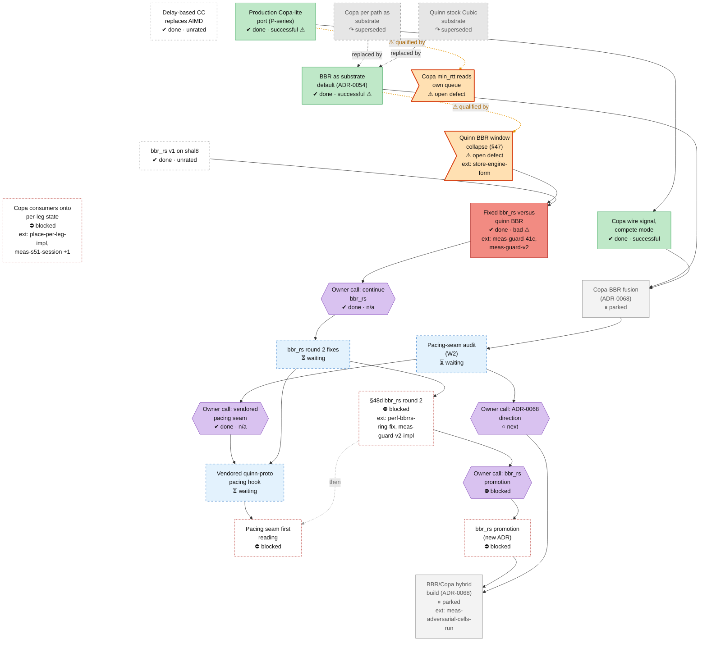

<!-- Generated by tools/roadmap/build.py from docs/roadmap/nodes.yaml. Do not edit. -->

# cc - congestion control

Scope: substrate congestion control: quinn BBR, bbr_rs, Copa, the BBR/Copa hybrid (ADR-0068), the pacing seam.

[Back to the roadmap](../../roadmap.md)

<!-- BEGIN GENERATED: track-cc -->

<!-- END GENERATED: track-cc -->

## Node table

<!-- BEGIN GENERATED: table-cc -->
| id | title | state | outcome | headline | evidence | depends_on |
|---|---|---|---|---|---|---|
| `cc-early-delay-cc` | Delay-based CC replaces AIMD | done | unrated |  | commit cbbbfdbd |  |
| `cc-copa-lite` | Production Copa-lite port (P-series) | done | successful |  | branch P7 |  |
| `cc-copa-sole-substrate` | Copa per path as substrate | abandoned | superseded | 0.57–0.97× | paper §10 row Copa per path as the substrate default (the original design) |  |
| `cc-cubic-substrate` | Quinn stock Cubic substrate | abandoned | superseded | 15–17 Mbit/s | paper §10 row Quinn's stock Cubic under the engine |  |
| `cc-copa-wire-signal` | Copa wire signal, compete mode | done | successful | 0.4–0.6× BBR's bulk throughput | ADR-0062 | cc-copa-lite |
| `cc-bbr-default` | BBR as substrate default (ADR-0054) | done | successful | plain 17.5 → plain+BBR 74.5 pooled, ×4.3 | ADR-0054 |  |
| `cc-bbrrs-v1` | bbr_rs v1 on shal8 | done | unrated |  | branch fix/shal8-anchor |  |
| `cc-adr68-fusion` | Copa-BBR fusion (ADR-0068) | parked | unrated |  | ADR-0068 | cc-bbr-default, cc-copa-wire-signal |
| `cc-quinn-bbr-collapse` | Quinn BBR window collapse (§47) | in-progress | unrated |  | status §47 | store-engine-form |
| `cc-bbrrs-r1` | Fixed bbr_rs versus quinn BBR | done | bad | wire RTT at c2 112.4 → 21.8 ms | status §48; status §48b; branch bbr48cand; branch bbrfix48-impl; branch bbrfix48b; branch harness48 | cc-quinn-bbr-collapse, meas-guard-41c, cc-bbrrs-v1 |
| `cc-user-continue-bbrrs` | Owner call: continue bbr_rs | done | n/a |  | status commit 1425acbd (nm.txt); plan W1 §48b RESULT | cc-bbrrs-r1 |
| `cc-bbrrs-r2` | bbr_rs round 2 fixes | in-progress | unrated |  | branch bbrrs-r2; branch bbrrs-r3 | cc-user-continue-bbrrs |
| `cc-pacing-audit` | Pacing-seam audit (W2) | in-progress | unrated |  | derivation w2-pacing-seam.md (branch adr68-amend); branch adr68-amend | cc-adr68-fusion |
| `cc-user-pacing-s3` | Owner call: vendored pacing seam | done | n/a |  | plan W2.5; ADR-0075 | cc-pacing-audit |
| `cc-pacing-seam` | Vendored quinn-proto pacing hook | in-progress | unrated |  | branch pacing-seam; branch pacing-seam-2 | cc-user-pacing-s3, cc-bbrrs-r2 |
| `cc-defect-copa-minrtt` | Copa min_rtt reads own queue | in-progress | unrated | 95–129 ms on main and 163–319 ms under lever B | status §3.10 item 9 |  |
| `cc-s48d-session` | §48d bbr_rs round 2 | blocked | unrated |  | plan W1 §48b RESULT (round 2 = §48d); status §41d §48b addendum | cc-bbrrs-r2, perf-bbrrs-ring-fix, meas-guard-v2-impl |
| `cc-pacing-seam-reading` | Pacing seam first reading | blocked | unrated |  | plan W2.5 (first reading after §48d) | cc-pacing-seam |
| `cc-user-adr68-direction` | Owner call: ADR-0068 direction | next | n/a |  | plan user decision 2; branch adr68-amend | cc-pacing-audit |
| `cc-user-bbrrs-promotion` | Owner call: bbr_rs promotion | blocked | n/a |  | plan W1.5, user decision 1 | cc-s48d-session |
| `cc-copa-consumers` | Copa consumers onto per-leg state | blocked | unrated |  | plan W3.4, W3.6a; status §3.3 | place-per-leg-impl, meas-s51-session, store-fix-maxbw-minrtt |
| `cc-bbrrs-promote` | bbr_rs promotion (new ADR) | blocked | unrated |  | plan W1.5 | cc-user-bbrrs-promotion |
| `cc-hybrid` | BBR/Copa hybrid build (ADR-0068) | parked | unrated |  | plan W2.4 | cc-adr68-fusion, cc-bbrrs-promote, meas-adversarial-cells-run, cc-user-adr68-direction |

### Details per node

| id | title | notes | evidence |
|---|---|---|---|
| `cc-early-delay-cc` | Delay-based CC replaces AIMD | Direct landings (ADR-0019 not in the raw set); paper §10 recommended Copa. | commit cbbbfdbd |
| `cc-copa-lite` | Production Copa-lite port (P-series) | P1 hint-coupled queue target, P2 honest floor, P7 Copa-lite with fixes, P-CC BtlBw-anchored recovery, the BBR-lessons note (2026-07-02 to 07-04). | branch P7 |
| `cc-copa-sole-substrate` | Copa per path as substrate | Dates: paper §10 rows carry an end (removal) date only. | paper §10 row Copa per path as the substrate default (the original design) |
| `cc-cubic-substrate` | Quinn stock Cubic substrate | Cubic was quinn's default from the start; named as the hidden ceiling 2026-07-13. Dates: paper §10 rows carry an end (removal) date only. | paper §10 row Quinn's stock Cubic under the engine |
| `cc-copa-wire-signal` | Copa wire signal, compete mode | ADR date is the 2026-07-21 migration; built 2026-07-13, compete mode 2026-07-19. RWM_COPA_COMPETE is a §3.3 debt. Dates: ADR end dates in the raw set equal their start (placeholder); ADR-0052..0067 carry the 2026-07-21 migration date. | ADR-0062 |
| `cc-bbr-default` | BBR as substrate default (ADR-0054) | Start 2026-07-13 (the substrate ceiling was named in 0d9f26e7); ADR date is the migration. Dates: ADR end dates in the raw set equal their start (placeholder); ADR-0052..0067 carry the 2026-07-21 migration date. | ADR-0054 |
| `cc-bbrrs-v1` | bbr_rs v1 on shal8 | fix/shal8-anchor merge (2026-08-07). git log 2eb88de3 (not a raw record): "bbr_rs falsified x2 at 21-22 Mbit (gate >=70, NO FLIP, default unchanged)". The raw record has no verdict. | branch fix/shal8-anchor |
| `cc-adr68-fusion` | Copa-BBR fusion (ADR-0068) | Owner asked for a fusion ADR 2026-07-21 ("a better copa would be best"); prerequisite battery (adversarial cells) complete; plan W2 future track. Folds paper §11.1 open question 12. Dates: ADR end dates in the raw set equal their start (placeholder); ADR-0052..0067 carry the 2026-07-21 migration date. | ADR-0068 |
| `cc-quinn-bbr-collapse` | Quinn BBR window collapse (§47) | Still live: quinn BBR is main's default controller (status §1), and bbr_rs, the fix, is not promoted. Dates: status-section end dates are the section file's last edit, not the verdict date. | status §47 |
| `cc-bbrrs-r1` | Fixed bbr_rs versus quinn BBR | §48 host gate STOP-NOT-REPRODUCED (post hoc 10 µs grid holds), §48b VERDICT48 REGRESSION: collapse controlled, cost c8 CPU and 1.5-2.6 % goodput. Code at archive/bbr-rs. Builds on the in-tree bbr_rs first written for the shal8 cell on 2026-08-07 (git 51bc04bd). Dates: status-section end dates are the section file's last edit, not the verdict date. | status §48; status §48b; branch bbr48cand; branch bbrfix48-impl; branch bbrfix48b; branch harness48 |
| `cc-user-continue-bbrrs` | Owner call: continue bbr_rs | No raw record. nm.txt 1425acbd: "status §48b: user decision - continue bbr_rs (delta-free fixes first, then delta on the store law; same ladder)". | status commit 1425acbd (nm.txt); plan W1 §48b RESULT |
| `cc-bbrrs-r2` | bbr_rs round 2 fixes | Start set to the owner call (2026-11-12); the branches carry 2026-11-10 commits from the bbr48 ancestry. bbrrs-r2 folded into its rebased successor bbrrs-r3 (2026-11-13): one-round δ-free ProbeRtt, cc_sim quinn-dump. Ratchet prediction failed (nm.txt c34d4431). | branch bbrrs-r2; branch bbrrs-r3 |
| `cc-pacing-audit` | Pacing-seam audit (W2) | Input to ADR-0068 Addendum 3 (branch adr68-amend, unmerged). | derivation w2-pacing-seam.md (branch adr68-amend); branch adr68-amend |
| `cc-user-pacing-s3` | Owner call: vendored pacing seam | No raw record. User 2026-11-12: "so the fork is the proper way? do it. should we vendor it?"; plan W2.5 "USER DECISION 2026-11-12, do it (S3, vendored)". | plan W2.5; ADR-0075 |
| `cc-pacing-seam` | Vendored quinn-proto pacing hook | Start set to the owner call (2026-11-12); the branch carries 2026-11-10 commits from its bbrrs-r2 base. pacing-seam folded into its rebased successor pacing-seam-2; ADR-0075 Accepted on the owner's word; stacked on bbrrs-r2. | branch pacing-seam; branch pacing-seam-2 |
| `cc-s48d-session` | §48d bbr_rs round 2 | Done when: the §48d Result is in status with in-order delay registered as a readout and the §48b +46 % c8 in-order-delay cost carried as a known cost; the label goes to the owner. | plan W1 §48b RESULT (round 2 = §48d); status §41d §48b addendum |
| `cc-pacing-seam-reading` | Pacing seam first reading | Done when: a reported-only c2/c8 diagnostic of RWM_BBR_PACE is in status with quinn's send-buffer backlog registered as a readout. | plan W2.5 (first reading after §48d) |
| `cc-user-adr68-direction` | Owner call: ADR-0068 direction | Done when: the owner accepts or rejects ADR-0068 Addendum 3 ("grow bbr_rs, don't build a second controller"). | plan user decision 2; branch adr68-amend |
| `cc-user-bbrrs-promotion` | Owner call: bbr_rs promotion | Done when: the owner decides on the §48d label whether bbr_rs replaces quinn BBR as the default (and whether quinn BBR stays as a reference arm). | plan W1.5, user decision 1 |
| `cc-copa-consumers` | Copa consumers onto per-leg state | Law ledger: K01, K02, K03, K04, K08, E02 (P3): Copa's legacy controller and its readers, deleted or reduced; one clock. Done when: the four Copa cwnd consumers read the per-leg state and queue_target_mult is one continuous function of δ (no hint table), with continuity tests through every preset. | plan W3.4, W3.6a; status §3.3 |
| `cc-bbrrs-promote` | bbr_rs promotion (new ADR) | Law ledger: K09 (rank 6, P1): replace quinn BBR as the default substrate. Done when: a new ADR supersedes ADR-0054's default and the bbr_rs code, [QCC] gauges and cc_sim merge to main after a guard v2 PASS. | plan W1.5 |
| `cc-hybrid` | BBR/Copa hybrid build (ADR-0068) | The forward build of the cc-adr68-fusion design. Done when: a registration with falsifiable per-cell targets (ADR-0068 bars: shal8 >= 75 Mbit, jit0-jit25 >= 0.9x without the standing queue) is committed before any build. | plan W2.4 |
<!-- END GENERATED: table-cc -->
