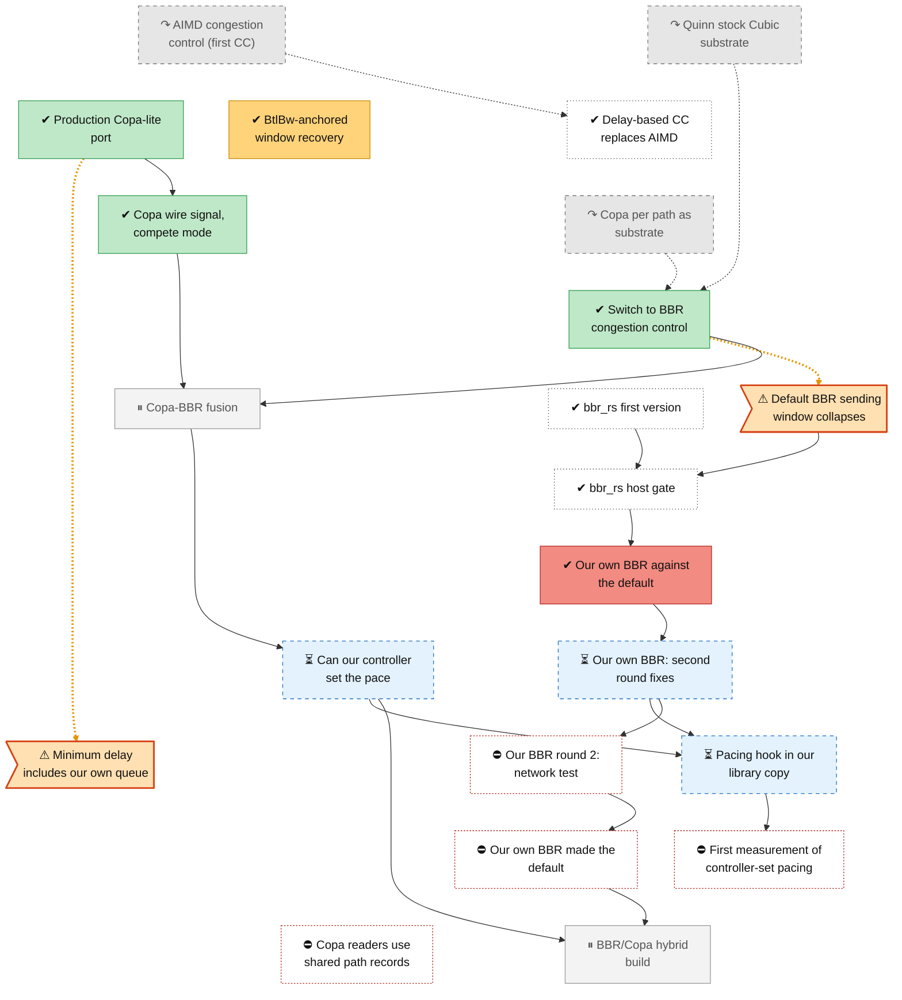

<!-- Generated by tools/roadmap/build.py from docs/roadmap/nodes.yaml. Do not edit. -->

# cc - congestion control

Scope: substrate congestion control: quinn BBR, bbr_rs, Copa, the BBR/Copa hybrid (ADR-0068), the pacing seam.

[Back to the roadmap](../../roadmap.md) · [legend](../../roadmap.md#legend)

<!-- BEGIN GENERATED: track-cc -->

<!-- END GENERATED: track-cc -->

## Node table

<!-- BEGIN GENERATED: table-cc -->
| id | title | state | outcome | headline | evidence | depends_on |
|---|---|---|---|---|---|---|
| `cc-early-delay-cc` | Delay-based CC replaces AIMD | done | unrated |  | commit cbbbfdbd; ADR-0024 |  |
| `cc-copa-lite` | Production Copa-lite port | done | successful |  | branch P7 |  |
| `cc-copa-sole-substrate` | Copa per path as substrate | abandoned | superseded | 0.57–0.97× | paper §10 row Copa per path as the substrate default (the original design) |  |
| `cc-cubic-substrate` | Quinn stock Cubic substrate | abandoned | superseded | 15–17 Mbit/s | paper §10 row Quinn's stock Cubic under the engine |  |
| `cc-copa-wire-signal` | Copa wire signal, compete mode | done | successful | 0.4–0.6× BBR's bulk throughput | ADR-0062 | cc-copa-lite |
| `cc-bbr-default` | Switch to BBR congestion control | done | successful | plain 17.5 → plain+BBR 74.5 pooled, ×4.3 | ADR-0054 |  |
| `cc-bbrrs-v1` | bbr_rs first version | done | unrated |  | branch fix/shal8-anchor |  |
| `cc-adr68-fusion` | Copa-BBR fusion | parked | unrated |  | ADR-0068 | cc-bbr-default, cc-copa-wire-signal |
| `cc-quinn-bbr-collapse` | Default BBR sending window collapses | in-progress | unrated |  | status §47 | store-engine-form |
| `cc-s48-host-gate` | bbr_rs host gate | done | unrated |  | status §48; commit d7142623; branch bbrfix48-impl | cc-quinn-bbr-collapse, cc-bbrrs-v1 |
| `cc-bbrrs-r1` | Our own BBR against the default | done | bad | wire RTT at c2 112.4 → 21.8 ms | status §48b; branch bbr48cand; branch bbrfix48b; branch harness48 | cc-s48-host-gate, meas-guard-41c |
| `cc-user-continue-bbrrs` | Owner call: continue bbr_rs | done | n/a |  | status commit 1425acbd (nm.txt); plan W1 §48b RESULT | cc-bbrrs-r1 |
| `cc-bbrrs-r2` | Our own BBR: second round fixes | in-progress | unrated |  | branch bbrrs-r2; branch bbrrs-r3 | cc-user-continue-bbrrs |
| `cc-pacing-audit` | Can our controller set the pace | in-progress | unrated |  | derivation w2-pacing-seam.md (branch adr68-amend); branch adr68-amend | cc-adr68-fusion |
| `cc-user-pacing-s3` | Owner call: vendored pacing seam | done | n/a |  | plan W2.5; ADR-0075 | cc-pacing-audit |
| `cc-pacing-seam` | Pacing hook in our library copy | in-progress | unrated |  | branch pacing-seam; branch pacing-seam-2 | cc-user-pacing-s3, cc-bbrrs-r2 |
| `cc-defect-copa-minrtt` | Minimum delay includes our own queue | in-progress | unrated | 95–129 ms on main and 163–319 ms under lever B | status §3.10 item 9 |  |
| `cc-s48d-session` | Our BBR round 2: network test | blocked | unrated |  | plan W1 §48b RESULT (round 2 = §48d); status §41d §48b addendum | cc-bbrrs-r2, perf-bbrrs-ring-fix, meas-guard-v2-impl |
| `cc-pacing-seam-reading` | First measurement of controller-set pacing | blocked | unrated |  | plan W2.5 (first reading after §48d) | cc-pacing-seam |
| `cc-user-adr68-direction` | Owner call: hybrid controller direction | done | n/a |  | plan user decision 2; branch adr68-amend; status Owner decisions (2026-11-16) item 3 | cc-pacing-audit |
| `cc-user-bbrrs-promotion` | Owner call: make our BBR default | blocked | n/a |  | plan W1.5, user decision 1 | cc-s48d-session |
| `cc-copa-consumers` | Copa readers use shared path records | blocked | unrated |  | plan W3.4, W3.6a; status §3.3 | place-per-leg-impl, meas-s51-session, store-fix-maxbw-minrtt |
| `cc-bbrrs-promote` | Our own BBR made the default | blocked | unrated |  | plan W1.5 | cc-user-bbrrs-promotion |
| `cc-hybrid` | BBR/Copa hybrid build | parked | unrated |  | plan W2.4 | cc-adr68-fusion, cc-bbrrs-promote, meas-adversarial-cells-run, cc-user-adr68-direction |
| `cc-aimd-v1` | AIMD congestion control (first CC) | abandoned | superseded |  | ADR-0009 |  |
| `cc-btlbw-recovery` | BtlBw-anchored window recovery | done | mixed |  | commit fa433ac7; paper §12.6; commit 2fd9ab6f |  |

### Details per node

| id | title | notes | evidence |
|---|---|---|---|
| `cc-early-delay-cc` | Delay-based CC replaces AIMD | Direct landings (ADR-0019 not in the raw set); paper §10 recommended Copa. | commit cbbbfdbd; ADR-0024 |
| `cc-copa-lite` | Production Copa-lite port | P1 hint-coupled queue target, P2 honest floor, P7 Copa-lite with fixes, P-CC BtlBw-anchored recovery, the BBR-lessons note (2026-07-02 to 07-04). P-CC is its own node since 2026-11-20 (cc-btlbw-recovery). | branch P7 |
| `cc-copa-sole-substrate` | Copa per path as substrate | Dates: paper §10 rows carry an end (removal) date only. | paper §10 row Copa per path as the substrate default (the original design) |
| `cc-cubic-substrate` | Quinn stock Cubic substrate | Cubic was quinn's default from the start; named as the hidden ceiling 2026-07-13. Dates: paper §10 rows carry an end (removal) date only. | paper §10 row Quinn's stock Cubic under the engine |
| `cc-copa-wire-signal` | Copa wire signal, compete mode | ADR date is the 2026-07-21 migration; built 2026-07-13, compete mode 2026-07-19. RWM_COPA_COMPETE is a §3.3 debt. Dates: ADR end dates in the raw set equal their start (placeholder); ADR-0052..0067 carry the 2026-07-21 migration date. | ADR-0062 |
| `cc-bbr-default` | Switch to BBR congestion control | Start 2026-07-13 (the substrate ceiling was named in 0d9f26e7); ADR date is the migration. Dates: ADR end dates in the raw set equal their start (placeholder); ADR-0052..0067 carry the 2026-07-21 migration date. Was titled 'BBR as substrate default'. | ADR-0054 |
| `cc-bbrrs-v1` | bbr_rs first version | fix/shal8-anchor merge (2026-08-07). git log 2eb88de3 (not a raw record): "bbr_rs falsified x2 at 21-22 Mbit (gate >=70, NO FLIP, default unchanged)". The raw record has no verdict. Folded Ship The Wins 2 (shal8 anchor): pre-registration c319ef91, RESULTS 2eb88de3 (STRUCTURAL BOUND, NO FLIP). | branch fix/shal8-anchor |
| `cc-adr68-fusion` | Copa-BBR fusion | Owner asked for a fusion ADR 2026-07-21 (an improved Copa would be best); prerequisite battery (adversarial cells) complete; plan W2 future track. Folds paper §11.1 open question 12. Dates: ADR end dates in the raw set equal their start (placeholder); ADR-0052..0067 carry the 2026-07-21 migration date. Folded the Adversarial cells B1 commits (2026-08 audit; mapped outcome there: unrated). | ADR-0068 |
| `cc-quinn-bbr-collapse` | Default BBR sending window collapses | Still live: quinn BBR is main's default controller (status §1), and bbr_rs, the fix, is not promoted. Dates: status-section end dates are the section file's last edit, not the verdict date. Was titled 'Quinn BBR window collapse'. | status §47 |
| `cc-s48-host-gate` | bbr_rs host gate | Split 2026-11-16 from 'Fixed bbr_rs versus quinn BBR': cc_sim red/green tests of quinn's BBR against the fixed bbr_rs, no VM. | status §48; commit d7142623; branch bbrfix48-impl |
| `cc-bbrrs-r1` | Our own BBR against the default | §48b VERDICT48 REGRESSION: collapse controlled, cost c8 CPU and 1.5-2.6 % goodput. Code at archive/bbr-rs. The §48 host gate is its own node (cc-s48-host-gate). Builds on the in-tree bbr_rs first written for the shal8 cell on 2026-08-07 (git 51bc04bd). Was titled 'Fixed bbr_rs versus quinn BBR'. | status §48b; branch bbr48cand; branch bbrfix48b; branch harness48 |
| `cc-user-continue-bbrrs` | Owner call: continue bbr_rs | No raw record. nm.txt 1425acbd: "status §48b: user decision - continue bbr_rs (delta-free fixes first, then delta on the store law; same ladder)". | status commit 1425acbd (nm.txt); plan W1 §48b RESULT |
| `cc-bbrrs-r2` | Our own BBR: second round fixes | Start set to the owner call (2026-11-12); the branches carry 2026-11-10 commits from the bbr48 ancestry. bbrrs-r2 folded into its rebased successor bbrrs-r3 (2026-11-13): one-round δ-free ProbeRtt, cc_sim quinn-dump. Ratchet prediction failed (nm.txt c34d4431). Was titled 'bbr_rs round 2 fixes'. | branch bbrrs-r2; branch bbrrs-r3 |
| `cc-pacing-audit` | Can our controller set the pace | Input to ADR-0068 Addendum 3 (branch adr68-amend, unmerged). Was titled 'Pacing-seam audit (W2)'. Was titled 'Pacing-seam audit'. | derivation w2-pacing-seam.md (branch adr68-amend); branch adr68-amend |
| `cc-user-pacing-s3` | Owner call: vendored pacing seam | No raw record. Owner 2026-11-12: agreed the fork is the proper way and asked whether to vendor it; plan W2.5 "USER DECISION 2026-11-12, do it (S3, vendored)". | plan W2.5; ADR-0075 |
| `cc-pacing-seam` | Pacing hook in our library copy | Start set to the owner call (2026-11-12); the branch carries 2026-11-10 commits from its bbrrs-r2 base. pacing-seam folded into its rebased successor pacing-seam-2; ADR-0075 Accepted on the owner's word; stacked on bbrrs-r2. Was titled 'Vendored quinn-proto pacing hook'. | branch pacing-seam; branch pacing-seam-2 |
| `cc-defect-copa-minrtt` | Minimum delay includes our own queue | Was titled 'Copa min_rtt reads own queue'. | status §3.10 item 9 |
| `cc-s48d-session` | Our BBR round 2: network test | Done when: the §48d Result is in status with in-order delay registered as a readout and the §48b +46 % c8 in-order-delay cost carried as a known cost; the label goes to the owner. Was titled 'bbr_rs controller, round 2'. | plan W1 §48b RESULT (round 2 = §48d); status §41d §48b addendum |
| `cc-pacing-seam-reading` | First measurement of controller-set pacing | Done when: a reported-only c2/c8 diagnostic of RWM_BBR_PACE is in status with quinn's send-buffer backlog registered as a readout. Was titled 'Pacing seam first reading'. | plan W2.5 (first reading after §48d) |
| `cc-user-adr68-direction` | Owner call: hybrid controller direction | Accepted 2026-11-16, conditional on §48d: the hybrid grows out of bbr_rs (status Owner decisions (2026-11-16), item 3). Was titled 'Owner call: ADR-0068 direction'. | plan user decision 2; branch adr68-amend; status Owner decisions (2026-11-16) item 3 |
| `cc-user-bbrrs-promotion` | Owner call: make our BBR default | Done when: the owner decides on the §48d label whether bbr_rs replaces quinn BBR as the default (and whether quinn BBR stays as a reference arm). Was titled 'Owner call: bbr_rs promotion'. | plan W1.5, user decision 1 |
| `cc-copa-consumers` | Copa readers use shared path records | Law ledger: K01, K02, K03, K04, K08, E02 (P3): Copa's legacy controller and its readers, deleted or reduced; one clock. Done when: the four Copa cwnd consumers read the per-leg state and queue_target_mult is one continuous function of δ (no hint table), with continuity tests through every preset. Was titled 'Copa consumers onto per-leg state'. | plan W3.4, W3.6a; status §3.3 |
| `cc-bbrrs-promote` | Our own BBR made the default | Law ledger: K09 (rank 9, P1): replace quinn BBR as the default substrate. Done when: a new ADR supersedes ADR-0054's default and the bbr_rs code, [QCC] gauges and cc_sim merge to main after a guard v2 PASS. Was titled 'bbr_rs promotion'. | plan W1.5 |
| `cc-hybrid` | BBR/Copa hybrid build | The forward build of the cc-adr68-fusion design. Done when: a registration with falsifiable per-cell targets (ADR-0068 bars: shal8 >= 75 Mbit, jit0-jit25 >= 0.9x without the standing queue) is committed before any build. | plan W2.4 |
| `cc-aimd-v1` | AIMD congestion control (first CC) | ADR-0009 closed the missing-CC gap with AIMD on 2026-03-12; replaced by BBR-style delay-based CC (ADR-0019) on 2026-03-13. End date is the replacement's start. | ADR-0009 |
| `cc-btlbw-recovery` | BtlBw-anchored window recovery | Split 2026-11-20 from cc-copa-lite, where it was folded as branch P-CC (own refuted verdict). Mixed (review 2026-11-20): the window reaches the bandwidth-delay product and was kept for sustained throughput, but completion did not move. | commit fa433ac7; paper §12.6; commit 2fd9ab6f |

### Folded items per node

- `cc-early-delay-cc`: Delay-based CC replaces AIMD
  - commit 78aa7d4a
  - commit 628fdb1c
  - BBR-style delay-based congestion control (2026-03-13, commit cbbbfdbda9)
  - Copa recommended over BBR for the paper; ECN and L4S set aside (2026-03-22, commit 78aa7d4a)
- `cc-copa-lite`: Production Copa-lite port
  - branch feat/p1-hint-delay-target
  - branch feat/p2-estimated-floor
  - branch P7 follow-up
  - branch P7 fix
  - commit b000e443
  - Jitter-robust Copa queue signal and window-level jitter headroom (2026-07-04, commit d5f89ce2, commit a7c20d72)
- `cc-copa-sole-substrate`: Copa per path as substrate
  - branch feat/copa-sole-cc
  - branch feat/copa-sole-clean
  - Copa-sole on the clean substrate (2026-07-27, commit 7652ccb8)
- `cc-cubic-substrate`: Quinn stock Cubic substrate
  - commit 0d9f26e7
- `cc-copa-wire-signal`: Copa wire signal, compete mode
  - commit f203d6e7
  - commit 386979d8
  - branch feat/copa-compete
  - branch meas/competitive-baseline
  - Copa wire-signal fixes (2026-07-13, commit 9f4fa450, commit aaabd5c5, commit d7eac012, commit 4d9927bf, commit c9f73e0d, commit 7b224ad6)
- `cc-bbr-default`: Switch to BBR congestion control
  - commit 519467e0
- `cc-bbrrs-v1`: bbr_rs first version
  - commit c319ef91
  - commit 2eb88de3
- `cc-adr68-fusion`: Copa-BBR fusion
  - branch meas/adversarial-cells
  - paper §11.1 open question 12
  - commit 6c8c3d38
  - commit 754139c3
  - commit 9840854b
  - ADR-0068 Copa-BBR fusion proposal (2026-07-22, commit 2ce25d14)
- `cc-s48-host-gate`: bbr_rs host gate
  - commit 0daf1452
  - commit 35c24444
- `cc-aimd-v1`: AIMD congestion control (first CC)
  - commit dc672631
  - commit cbbbfdbd
  - ACK delivery, AIMD congestion control and channel backpressure (2026-03-12, commit 8857788d)
- `cc-btlbw-recovery`: BtlBw-anchored window recovery
  - branch P-CC
<!-- END GENERATED: table-cc -->
