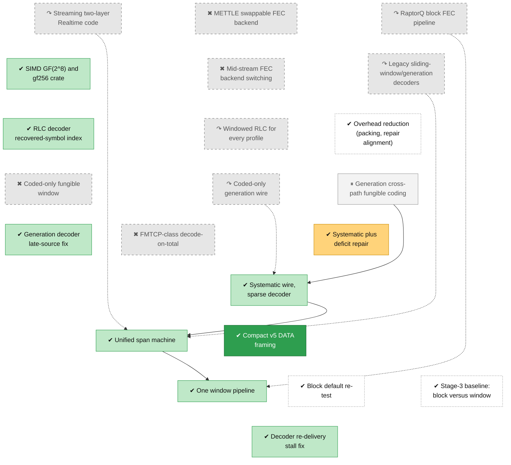

<!-- Generated by tools/roadmap/build.py from docs/roadmap/nodes.yaml. Do not edit. -->

# cod - coding core

Scope: RaptorQ/FEC encoder and decoder, gf256, symbol framing, the generation seat.

[Back to the roadmap](../../roadmap.md) · [legend](../../roadmap.md#legend)

<!-- BEGIN GENERATED: track-cod -->

<!-- END GENERATED: track-cod -->

## Node table

<!-- BEGIN GENERATED: table-cod -->
| id | title | state | outcome | headline | evidence | depends_on |
|---|---|---|---|---|---|---|
| `cod-block-pipeline` | RaptorQ block FEC pipeline | abandoned | superseded |  | ADR-0002; ADR-0004; ADR-0014; status §3.7 row 236; status §3.7 row 238; ADR-0001; ADR-0006; ADR-0008; ADR-0016; paper §10 row Block-FEC pipeline (RaptorQ/RS/block-RLC with batch-ACK ARQ) |  |
| `cod-s4-block-retest` | Block default re-test | done | unrated |  | status §4; commit 566e0f89; branch cleanup/a4-block-retest |  |
| `cod-mettle` | METTLE swappable FEC backend | abandoned | dead-end |  | paper §10 row METTLE FEC backend; ADR-0021; ADR-0028 |  |
| `cod-backend-switch` | Mid-stream FEC backend switching | abandoned | dead-end |  | paper §10 row Mid-stream backend switching (loss-threshold selector); ADR-0030 |  |
| `cod-streaming-code` | Streaming two-layer Realtime code | abandoned | superseded |  | paper §10 row Streaming two-layer code (Realtime machine); ADR-0027 |  |
| `cod-gf256-simd` | SIMD GF(2^8) and gf256 crate | done | successful | ~15-25× speedup on the FEC decode hot path | ADR-0041 |  |
| `cod-rlc-all-profiles` | Windowed RLC for every profile | abandoned | superseded |  | commit 341857ec |  |
| `cod-generation-coding` | Generation cross-path fungible coding | parked | unrated |  | status §3.2 |  |
| `cod-coded-only-wire` | Coded-only generation wire | abandoned | superseded | 70.9 Mbit/s | paper §10 row Coded-only generation wire |  |
| `cod-systematic-wire` | Systematic wire, sparse decoder | done | successful | Gen single-c2 33.9 → 70.9 Mbit/s | ADR-0056 | cod-generation-coding |
| `cod-fungible-window` | Coded-only fungible window | abandoned | dead-end | 3.9 Mbit/s | paper §10 row Coded-only fungible window (coded-object mode) |  |
| `cod-fmtcp` | FMTCP-class decode-on-total | abandoned | dead-end | 0.48× | commit f8417579; paper §10 row FMTCP-class decode-on-total [Cui2015] |  |
| `cod-legacy-rlc` | Legacy sliding-window/generation decoders | abandoned | superseded |  | paper §10 row Legacy RLC decoders (sliding-window, generation); ADR-0022 |  |
| `cod-unified-span` | Unified span machine | done | successful |  | ADR-0064 | cod-systematic-wire |
| `cod-one-pipeline` | One window pipeline | done | successful |  | ADR-0069; status §5 | cod-unified-span |
| `cod-wire-compact` | Compact v5 DATA framing | done | very-successful | +2.6/+3.6 Mbit/s | commit 078b0ce9 |  |
| `cod-debug-stall` | Decoder re-delivery stall fix | done | successful | 0 of 40 iterations stalled | status §31 |  |
| `cod-user-generation-seat` | Owner call: keep generation coding | parked | n/a |  | plan user decision 4, W4.4; status §3.2 | cod-generation-coding |
| `cod-overhead-reduction` | Overhead reduction (packing, repair alignment) | done | unrated |  | ADR-0039; ADR-0040; ADR-0047; ADR-0048 | meas-transport-comparison |
| `cod-gen-decoder-fix` | Generation decoder late-source fix | done | successful | repairs_useful 0.15%→66% | commit 3701e10d; commit 88852b4f |  |
| `cod-rlc-index` | RLC decoder recovered-symbol index | done | successful | 4.6-5.7x faster decode | commit 7f6d1057; commit 28cd99a4 |  |
| `cod-systematic-deficit` | Systematic plus deficit repair | done | mixed |  | commit 704ae730; commit 4f12d4b0; commit e4bdfa63; commit 715ed4d9; commit 35cb17aa |  |
| `cod-s5-stage3-baseline` | Stage-3 baseline: block versus window | done | unrated |  | commit b3c6923b; commit 32578b43; status §5 |  |

### Details per node

| id | title | notes | evidence |
|---|---|---|---|
| `cod-block-pipeline` | RaptorQ block FEC pipeline | The original design (initial commit 2026-03-12) through its deletion in dacfd7c (2026-10-04); the §4 re-test (cod-s4-block-retest) found block better before the window caught up in §5. Dates: ADR end dates in the raw set equal their start (placeholder); ADR-0052..0067 carry the 2026-07-21 migration date; status-section end dates are the section file's last edit, not the verdict date; paper §10 rows carry an end (removal) date only. Block-era fixes cited by ADR-0001 (flush timeout), 0006 (protocol hint sets block size), 0008 (BlockStart), 0016 (block interleaving), 2026-03-12..13. | ADR-0002; ADR-0004; ADR-0014; status §3.7 row 236; status §3.7 row 238; ADR-0001; ADR-0006; ADR-0008; ADR-0016; paper §10 row Block-FEC pipeline (RaptorQ/RS/block-RLC with batch-ACK ARQ) |
| `cod-s4-block-retest` | Block default re-test | Split 2026-11-16 from the block pipeline node (own status section and verdict). Discharges ADR-0069's re-test clause; the Stage-3 baseline (§5) then read WINDOW-NOT-WORSE and the window became the only pipeline (cod-one-pipeline). | status §4; commit 566e0f89; branch cleanup/a4-block-retest |
| `cod-mettle` | METTLE swappable FEC backend | Removal was the owner's call (user 2026-08-07). Dates: paper §10 rows carry an end (removal) date only. | paper §10 row METTLE FEC backend; ADR-0021; ADR-0028 |
| `cod-backend-switch` | Mid-stream FEC backend switching | Dates: paper §10 rows carry an end (removal) date only. | paper §10 row Mid-stream backend switching (loss-threshold selector); ADR-0030 |
| `cod-streaming-code` | Streaming two-layer Realtime code | Dates: paper §10 rows carry an end (removal) date only. | paper §10 row Streaming two-layer code (Realtime machine); ADR-0027 |
| `cod-gf256-simd` | SIMD GF(2^8) and gf256 crate | Dates: ADR end dates in the raw set equal their start (placeholder); ADR-0052..0067 carry the 2026-07-21 migration date. | ADR-0041 |
| `cod-generation-coding` | Generation cross-path fungible coding | Owner greenlit generation coding 2026-07-06 (user-requests). §3.2: opt-in, never default, no keep-or-remove decision (plan user decision 4). The systematic plus deficit-repair submode is its own node since 2026-11-20 (cod-systematic-deficit). | status §3.2 |
| `cod-coded-only-wire` | Coded-only generation wire | Paper §10 row has an end date only (2026-07-13). Dates: paper §10 rows carry an end (removal) date only. | paper §10 row Coded-only generation wire |
| `cod-systematic-wire` | Systematic wire, sparse decoder | End 2026-07-21 was a placeholder (ADR-0056: last edit or migration date); date from merge 2122481b. Dates: ADR end dates in the raw set equal their start (placeholder); ADR-0052..0067 carry the 2026-07-21 migration date. | ADR-0056 |
| `cod-fungible-window` | Coded-only fungible window | Dates: paper §10 rows carry an end (removal) date only. | paper §10 row Coded-only fungible window (coded-object mode) |
| `cod-fmtcp` | FMTCP-class decode-on-total | Dates: paper §10 rows carry an end (removal) date only. | commit f8417579; paper §10 row FMTCP-class decode-on-total [Cui2015] |
| `cod-legacy-rlc` | Legacy sliding-window/generation decoders | Paper §10 row has an end date only; start taken from the sliding-window FEC commit 628fdb1c (2026-03-14). Dates: paper §10 rows carry an end (removal) date only. | paper §10 row Legacy RLC decoders (sliding-window, generation); ADR-0022 |
| `cod-unified-span` | Unified span machine | Folds paper §11.1 open question 4 (does the span law stay continuous). The NO-MODE-SWITCH machine in the engine. Dates: ADR end dates in the raw set equal their start (placeholder); ADR-0052..0067 carry the 2026-07-21 migration date. | ADR-0064 |
| `cod-one-pipeline` | One window pipeline | ADR-0069 deprecated block 2026-08-10 (re-test clause), executed 2026-10-04 on §5 WINDOW-NOT-WORSE. §5 also carries the estimator-cadence flip (rate-est-cadence) and the crown spot. Dates: ADR end dates in the raw set equal their start (placeholder); ADR-0052..0067 carry the 2026-07-21 migration date; status-section end dates are the section file's last edit, not the verdict date. The §5 Stage-3 baseline is its own node since 2026-11-20 (cod-s5-stage3-baseline). | ADR-0069; status §5 |
| `cod-wire-compact` | Compact v5 DATA framing | Headline is verbatim from the sibling paper row (window decoupling, A69): "Its sibling, compact wire framing, shipped (+2.6/+3.6 Mbit/s)". | commit 078b0ce9 |
| `cod-debug-stall` | Decoder re-delivery stall fix | Dates: status-section end dates are the section file's last edit, not the verdict date. | status §31 |
| `cod-user-generation-seat` | Owner call: keep generation coding | 2026-11-16: stays parked with no disposition; it unblocks nothing in the current chain (Owner decisions 2026-11-16, item 7). Law ledger F05, R09 (P3) wait on it. | plan user decision 4, W4.4; status §3.2 |
| `cod-overhead-reduction` | Overhead reduction (packing, repair alignment) | ADR-0047 raised timer resolution and fixed LTE recovery (1% to 100%) and WiFi overhead (39.6% to 21.4%); ADR-0048 reduced window-backend overhead further. | ADR-0039; ADR-0040; ADR-0047; ADR-0048 |
| `cod-gen-decoder-fix` | Generation decoder late-source fix | The five earlier aggregation refutations were measured on the broken decoder (2026-07-08). | commit 3701e10d; commit 88852b4f |
| `cod-systematic-deficit` | Systematic plus deficit repair | Split 2026-11-20 from cod-generation-coding: the oracle BUILD verdict and the build with its measured result are one pre-registered piece. | commit 704ae730; commit 4f12d4b0; commit e4bdfa63; commit 715ed4d9; commit 35cb17aa |
| `cod-s5-stage3-baseline` | Stage-3 baseline: block versus window | Split 2026-11-20 from cod-one-pipeline, as cod-s4-block-retest was for §4. | commit b3c6923b; commit 32578b43; status §5 |

### Folded items per node

- `cod-block-pipeline`: RaptorQ block FEC pipeline
  - commit dc672631
  - commit e2de447d
  - Block sizing, handshake and graceful shutdown (2026-03-12, commit 6f2852f1)
  - Block interleaving for burst loss resilience (2026-03-13, commit c1a39caf)
  - Block-mode in-order delivery and interleave depth 1 (2026-07-04, commit a72151eb)
- `cod-s4-block-retest`: Block default re-test
  - Block re-test arm switch in the benchmark script (2026-09-27, commit 4e5c3af0)
- `cod-mettle`: METTLE swappable FEC backend
  - commit 10ac80fc
  - Projected real-world scenarios in benchmark results (2026-03-13, commit ae66266b)
  - METTLE swappable FEC backend and its edge-probability fix (2026-03-13, commit 65d7b1b8, commit 375708ff)
- `cod-backend-switch`: Mid-stream FEC backend switching
  - Runtime FEC backend switching on loss (2026-03-16, commit cb99955d)
- `cod-streaming-code`: Streaming two-layer Realtime code
  - commit cf164aa9
  - Streaming backend auto-selection and multipath window scheduling (2026-03-14, commit 86e1f0f3, commit cad99bf0)
  - Streaming crown re-test (2026-07-27, commit bf748653)
  - Crown re-test harness hardening (2026-07-27, commit 7f200577, commit 8cf2b6f5)
  - Delete streaming machine (2026-07-28, commit bccb32a2)
- `cod-gf256-simd`: SIMD GF(2^8) and gf256 crate
  - commit e43e87b2
  - SIMD GF(2^8) multiply-accumulate kernels (2026-03-18, commit 544f4d82)
- `cod-rlc-all-profiles`: Windowed RLC for every profile
  - commit c8fcc910
  - Reliable windowed RLC for bulk breaks: 10 of 10 to 0 of 10 (2026-07-05, commit 341857ec)
  - Windowed RLC for all hints: bulk single-path fails (2026-07-05, commit 59fc7c03)
  - RLC encode and decode throughput against bulk needs (2026-07-06, commit 4663c38c)
  - Measured RLC decode throughput at three window sizes (2026-07-06, commit 4663c38c)
- `cod-generation-coding`: Generation cross-path fungible coding
  - branch generation-coding foundation (codec verified; multi-gen pending deficit feedback)
  - branch generation deficit feedback
  - branch dense generation decoder (27x); C8 aggregation still unrealized
  - branch C8-final
  - branch feat/gen-on-ablation
  - Stable-anchor generation coding build (2026-07-07, commit 95bc2a0f, commit f5a097a7)
  - Dense GF(256) generation decoder (2026-07-07, commit 8e1c4f1f, commit 9d642b41)
- `cod-systematic-wire`: Systematic wire, sparse decoder
  - commit 2122481b
  - Sparse-aware generation decoder with reference oracle (2026-07-13, commit da926a5f)
- `cod-fungible-window`: Coded-only fungible window
  - branch fungible coded window
  - Coded-only fungible window refuted (2026-07-07, commit a0bcd4ae, commit bb18de13)
- `cod-fmtcp`: FMTCP-class decode-on-total
  - branch FMTCP-class aggregation
  - Literature map for the recovery-latency findings (2026-07-08, commit 56353d25)
  - FMTCP-class decode-on-total aggregation (2026-07-08, commit 3145c15c, commit 2e01e534, commit 0ce6cd34, commit 4220aa06)
  - Literature map of FEC transport findings (2026-07-08, commit 56353d25)
  - FMTCP re-test and deletion (2026-07-27, commit 4fb5b156, commit f8417579)
- `cod-unified-span`: Unified span machine
  - commit 206b90ca
  - commit 1eec34d5
  - commit 28138b98
  - commit 8ef5ff18
  - commit a54cbf53
  - commit eb9fae43
  - commit b849acbf
  - commit c3a9d768
  - branch diag/unified-collapse
  - paper §11.1 open question 4
  - Paper section 15 unified sliding-window model (2026-07-04, commit c8fcc910, commit 961e23d4)
  - Window advance derived from the latency budget (planned) (2026-07-08, session record)
- `cod-one-pipeline`: One window pipeline
  - branch exec/adr-0069-window-default
  - ADR-0069: block mode deprecated, default kept pinned (2026-08-10, commit 17f7fa91)
  - Window pipeline only, block pipeline deleted (2026-10-04, commit b074267a, commit d091e8a8, commit bc049ce5, commit 37d3f06c, commit 78ca2ae5, commit 140e3a9f)
- `cod-debug-stall`: Decoder re-delivery stall fix
  - branch §31 debug-suite 300 s stall FIXED
  - Decoder re-delivery stall in debug suite (2026-10-28, commit 686aadf1)
- `cod-overhead-reduction`: Overhead reduction (packing, repair alignment)
  - commit 544f4d82
  - Overhead taxonomy and symbol packing for small packets (2026-03-18, commit e508adf4)
  - FEC overhead reduction: budget cap, NACK age gate, fractional repair (2026-03-20, commit 05b576a7, commit b255271c)
- `cod-gen-decoder-fix`: Generation decoder late-source fix
  - branch FEC recovery bug fix
- `cod-systematic-deficit`: Systematic plus deficit repair
  - branch oracle validation
  - branch systematic+repair build
- `cod-s5-stage3-baseline`: Stage-3 baseline: block versus window
  - branch meas/stage3-baseline
<!-- END GENERATED: table-cod -->
