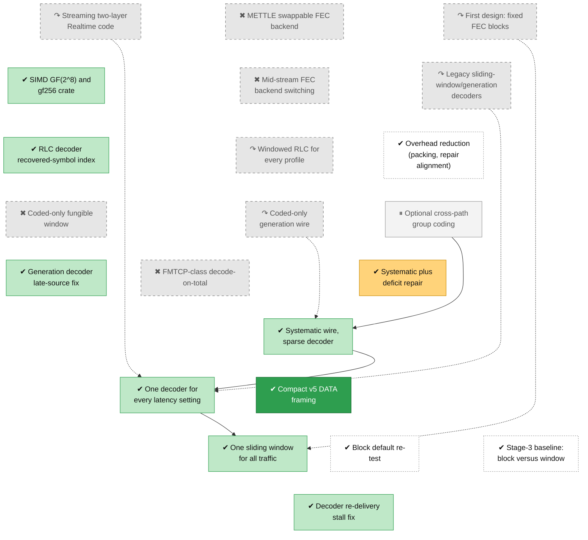

<!-- Generated by build.py from roadmap/nodes.yaml. Do not edit. -->

# cod - coding core

Scope: RaptorQ/FEC encoder and decoder, gf256, symbol framing, the generation seat.

[Back to the page](../../roadmap.md) · [legend](../../roadmap.md#legend)

<!-- BEGIN GENERATED: track-cod -->

<!-- END GENERATED: track-cod -->

## Node table

<!-- BEGIN GENERATED: table-cod -->
| id | title | kind | lane | state | outcome | start | end | depends_on | replaced_by | qualified_by | headline | evidence |
|---|---|---|---|---|---|---|---|---|---|---|---|---|
| `cod-block-pipeline` | First design: fixed FEC blocks | mechanism | host-cargo | abandoned | superseded | 2026-03-12 | 2026-10-04 |  | cod-one-pipeline |  |  | ADR-0002; ADR-0004; ADR-0014; status §3.7 row 236; status §3.7 row 238; ADR-0001; ADR-0006; ADR-0008; ADR-0016; paper §10 row Block-FEC pipeline (RaptorQ/RS/block-RLC with batch-ACK ARQ) |
| `cod-s4-block-retest` | Block default re-test | research | vm | done | unrated | 2026-09-27 | 2026-09-27 |  |  |  |  | status §4; commit 566e0f89; branch cleanup/a4-block-retest |
| `cod-mettle` | METTLE swappable FEC backend | mechanism | host-cargo | abandoned | dead-end | 2026-03-13 | 2026-08-07 |  |  |  |  | paper §10 row METTLE FEC backend; ADR-0021; ADR-0028 |
| `cod-backend-switch` | Mid-stream FEC backend switching | mechanism | host-cargo | abandoned | dead-end | 2026-03-16 | 2026-08-08 |  |  |  |  | paper §10 row Mid-stream backend switching (loss-threshold selector); ADR-0030 |
| `cod-streaming-code` | Streaming two-layer Realtime code | mechanism | vm | abandoned | superseded | 2026-03-14 | 2026-07-28 |  | cod-unified-span |  |  | paper §10 row Streaming two-layer code (Realtime machine); ADR-0027 |
| `cod-gf256-simd` | SIMD GF(2^8) and gf256 crate | infra | host-cargo | done | successful | 2026-03-17 | 2026-03-18 |  |  |  | ~15-25× speedup on the FEC decode hot path | ADR-0041 |
| `cod-rlc-all-profiles` | Windowed RLC for every profile | research | vm | abandoned | superseded | 2026-07-04 | 2026-07-06 |  | rec-reliable-window |  |  | commit 341857ec |
| `cod-generation-coding` | Optional cross-path group coding | mechanism | vm | parked | unrated | 2026-07-07 | 2026-07-13 |  |  |  |  | status §3.2 |
| `cod-coded-only-wire` | Coded-only generation wire | mechanism | vm | abandoned | superseded | 2026-07-07 | 2026-07-13 |  | cod-systematic-wire |  | 70.9 Mbit/s | paper §10 row Coded-only generation wire |
| `cod-systematic-wire` | Systematic wire, sparse decoder | mechanism | vm | done | successful | 2026-07-13 | 2026-07-13 | cod-generation-coding |  |  | Gen single-c2 33.9 → 70.9 Mbit/s | ADR-0056 |
| `cod-fungible-window` | Coded-only fungible window | mechanism | vm | abandoned | dead-end | 2026-07-07 | 2026-07-07 |  |  |  | 3.9 Mbit/s | paper §10 row Coded-only fungible window (coded-object mode) |
| `cod-fmtcp` | FMTCP-class decode-on-total | mechanism | vm | abandoned | dead-end | 2026-07-08 | 2026-07-28 |  |  |  | 0.48× | commit f8417579; paper §10 row FMTCP-class decode-on-total [Cui2015] |
| `cod-legacy-rlc` | Legacy sliding-window/generation decoders | mechanism | host-cargo | abandoned | superseded | 2026-03-14 | 2026-07-21 |  | cod-unified-span |  |  | paper §10 row Legacy RLC decoders (sliding-window, generation); ADR-0022 |
| `cod-unified-span` | One decoder for every latency setting | mechanism | vm | done | successful | 2026-07-18 | 2026-07-21 | cod-systematic-wire, model-user-no-mode-switch |  |  |  | ADR-0064 |
| `cod-one-pipeline` | One sliding window for all traffic | simplification | vm | done | successful | 2026-08-10 | 2026-10-04 | cod-unified-span |  |  |  | ADR-0069; status §5 |
| `cod-wire-compact` | Compact v5 DATA framing | mechanism | vm | done | very-successful | 2026-08-06 | 2026-08-06 |  |  |  | +2.6/+3.6 Mbit/s | commit 078b0ce9 |
| `cod-debug-stall` | Decoder re-delivery stall fix | mechanism | vm | done | successful | 2026-10-28 | 2026-10-28 |  |  |  | 0 of 40 iterations stalled | status §31 |
| `cod-user-generation-seat` | Owner call: keep cross-path coding | user-decision | user | parked | n/a |  |  | cod-generation-coding |  |  |  | plan user decision 4, W4.4; status §3.2 |
| `cod-overhead-reduction` | Overhead reduction (packing, repair alignment) | mechanism | host-cargo | done | unrated | 2026-03-18 | 2026-03-20 | meas-transport-comparison |  |  |  | ADR-0039; ADR-0040; ADR-0047; ADR-0048 |
| `cod-gen-decoder-fix` | Generation decoder late-source fix | mechanism | vm | done | successful | 2026-07-08 | 2026-07-08 |  |  |  | repairs_useful 0.15%→66% | commit 3701e10d; commit 88852b4f |
| `cod-rlc-index` | RLC decoder recovered-symbol index | mechanism | host-cargo | done | successful | 2026-07-04 | 2026-07-04 |  |  |  | 4.6-5.7x faster decode | commit 7f6d1057; commit 28cd99a4 |
| `cod-systematic-deficit` | Systematic plus deficit repair | mechanism | vm | done | mixed | 2026-07-07 | 2026-07-07 |  |  |  |  | commit 704ae730; commit 4f12d4b0; commit e4bdfa63; commit 715ed4d9; commit 35cb17aa |
| `cod-s5-stage3-baseline` | Stage-3 baseline: block versus window | research | vm | done | unrated | 2026-09-30 | 2026-09-30 |  |  |  |  | commit b3c6923b; commit 32578b43; status §5 |

### Details per node

| id | title | verdict | headline | in plain words | notes | confirmed | waiting on | queue order | order reason |
|---|---|---|---|---|---|---|---|---|---|
| `cod-block-pipeline` | First design: fixed FEC blocks | displaced: the Stage-3 re-test found the window not worse at every cell and hint and ahead beyond MDE at 7 of 10 (every Auto cell); a construction-time mode switch |  | The original design sent data in fixed blocks protected by forward error correction (FEC: extra coded packets from which the receiver rebuilds lost ones); it was replaced by one sliding window for every kind of traffic. | The original design (initial commit 2026-03-12) through its deletion in dacfd7c (2026-10-04); the §4 re-test (cod-s4-block-retest) found block better before the window caught up in §5. Dates: ADR end dates in the raw set equal their start (placeholder); ADR-0052..0067 carry the 2026-07-21 migration date; status-section end dates are the section file's last edit, not the verdict date; paper §10 rows carry an end (removal) date only. Block-era fixes cited by ADR-0001 (flush timeout), 0006 (protocol hint sets block size), 0008 (BlockStart), 0016 (block interleaving), 2026-03-12..13. Was titled 'RaptorQ block FEC pipeline'. |  |  |  |  |
| `cod-s4-block-retest` | Block default re-test | `BLOCK-BETTER-AT-c1,c2,c3,c7,c8`; crown spot `REPAIRS-INERT-ON-CROWN`. Block stays the default; nothing is flipped. |  | Re-tested whether the old block coding should remain the default; block was better at five test links and repairs were inert on the crown spot check, so it stayed the default and nothing flipped. | Split 2026-11-16 from the block pipeline node (own status section and verdict). Discharges ADR-0069's re-test clause; the Stage-3 baseline (§5) then read WINDOW-NOT-WORSE and the window became the only pipeline (cod-one-pipeline). |  |  |  |  |
| `cod-mettle` | METTLE swappable FEC backend | a sparse streaming code needing ~15 % decode overhead; reachable only by explicit opt-in, with the loss-threshold backend selector's high-loss tier routed to RLC |  | An experimental lighter error-correcting code that needed more spare data than the standard one, so it was dropped. | Removal was the owner's call (user 2026-08-07). Dates: paper §10 rows carry an end (removal) date only. |  |  |  |  |
| `cod-backend-switch` | Mid-stream FEC backend switching | no cross-code algebra: a switch strands every in-flight symbol or forces a drain; a threshold on ε̂ oscillates |  | Switching the error-correcting code in the middle of a transfer, which strands the data already in flight. | Dates: paper §10 rows carry an end (removal) date only. |  |  |  |  |
| `cod-streaming-code` | Streaming two-layer Realtime code | displaced, not refuted: the unified span machine was at or below its p99 at all five historic crown cells on both seeds, 163/163 delivery-complete |  | A two-layer code built for real-time traffic, made unnecessary by the single unified design. | Dates: paper §10 rows carry an end (removal) date only. |  |  |  |  |
| `cod-gf256-simd` | SIMD GF(2^8) and gf256 crate | Accepted | ~15-25× speedup on the FEC decode hot path | Rewrote the finite-field arithmetic behind repair-data decoding with fast SIMD routines in a separate crate, making the decode hot path roughly 15 to 25 times faster; the change was accepted. | Dates: ADR end dates in the raw set equal their start (placeholder); ADR-0052..0067 carry the 2026-07-21 migration date. |  |  |  |  |
| `cod-rlc-all-profiles` | Windowed RLC for every profile | Record windowed-RLC-all-profiles experiment: it BREAKS bulk (negative result) |  | An experiment applying windowed random linear coding to every traffic type was recorded as a negative result: it broke bulk transfers, taking one test from 10 of 10 successes to 0 of 10. |  |  |  |  |  |
| `cod-generation-coding` | Optional cross-path group coding | is opt-in, never default, and has no keep-or-remove decision. |  | An optional feature that codes data across paths in groups has never been switched on by default, and nobody has yet decided whether to keep it. | Owner greenlit generation coding 2026-07-06 (user-requests). §3.2: opt-in, never default, no keep-or-remove decision (plan user decision 4). The systematic plus deficit-repair submode is its own node since 2026-11-20 (cod-systematic-deficit). Was titled 'Generation cross-path fungible coding'. |  |  |  |  |
| `cod-coded-only-wire` | Coded-only generation wire | the O(G²·S) "decode ceiling" was the wire mode, not the solver; systematic-repair wire doubled single-path goodput (33.9 → 70.9 Mbit/s) | 70.9 Mbit/s | The coded-only wire format was dropped after the so-called decode ceiling turned out to come from that format, not the solver; a wire carrying plain data plus repairs doubled single-path speed from 33.9 to 70.9 Mbit/s. | Paper §10 row has an end date only (2026-07-13). Dates: paper §10 rows carry an end (removal) date only. |  |  |  |  |
| `cod-systematic-wire` | Systematic wire, sparse decoder | Accepted (the sparse-aware decoder; the generation arm itself is opt-in with no disposition, see `docs/status.md`) | Gen single-c2 33.9 → 70.9 Mbit/s | Switched to sending plain data with repairs on top and added a decoder that exploits sparse repairs, doubling single-path speed from 33.9 to 70.9 Mbit/s; accepted, though the grouped-coding option stays opt-in. | End 2026-07-21 was a placeholder (ADR-0056: last edit or migration date); date from merge 2122481b. Dates: ADR end dates in the raw set equal their start (placeholder); ADR-0052..0067 carry the 2026-07-21 migration date. |  |  |  |  |
| `cod-fungible-window` | Coded-only fungible window | correct but slower on the real stack: 3.9 Mbit/s at the heterogeneous dual against 15.7 for the fast path alone; a striped combination lands after the window has moved | 3.9 Mbit/s | A window that sent only coded data, interchangeable across paths, was correct but slower on the real stack: 3.9 Mbit/s on two unequal paths against 15.7 for the fast path alone, so it was dropped. | Dates: paper §10 rows carry an end (removal) date only. |  |  |  |  |
| `cod-fmtcp` | FMTCP-class decode-on-total | Consolidation 2: DELETE the FMTCP chain (register: RE-TESTED -> CONFIRMED-REFUTED on the clean substrate) | 0.48× | A design from the literature that decodes only once enough total data has arrived was tested twice on a clean base, confirmed refuted at 0.48 times the baseline, and its code was deleted. | Dates: paper §10 rows carry an end (removal) date only. |  |  |  |  |
| `cod-legacy-rlc` | Legacy sliding-window/generation decoders | replaced by the unified global-RREF decoder; the keyed generation machine strands 2-loss bursts on a moving-span wire |  | The older decoders for the sliding-window code, replaced by one decoder that handles every case. | Paper §10 row has an end date only; start taken from the sliding-window FEC commit 628fdb1c (2026-03-14). Dates: paper §10 rows carry an end (removal) date only. |  |  |  |  |
| `cod-unified-span` | One decoder for every latency setting | FLIP: RWM_UNIFIED default ON (pre-registered gate met both seeds) — one machine across the delta axis ships |  | Merged two separate decoders into one machine that slides smoothly from low-delay to bulk traffic, with no switch between modes. | Folds paper §11.1 open question 4 (does the span law stay continuous). The NO-MODE-SWITCH machine in the engine. Dates: ADR end dates in the raw set equal their start (placeholder); ADR-0052..0067 carry the 2026-07-21 migration date. Was titled 'Unified span machine'. |  |  |  |  |
| `cod-one-pipeline` | One sliding window for all traffic | Accepted, executed — the window pipeline is the default for every hint and the block pipeline is deleted (`dacfd7c`, 2026-10-04), on the Stage-3 re-test's `WINDOW-NOT-WORSE` (`docs/status.md` §5) |  | Deleted the old block path so that every kind of traffic now goes through the same window, which was at least as fast everywhere. | ADR-0069 deprecated block 2026-08-10 (re-test clause), executed 2026-10-04 on §5 WINDOW-NOT-WORSE. §5 also carries the estimator-cadence flip (rate-est-cadence) and the crown spot. Dates: ADR end dates in the raw set equal their start (placeholder); ADR-0052..0067 carry the 2026-07-21 migration date; status-section end dates are the section file's last edit, not the verdict date. The §5 Stage-3 baseline is its own node since 2026-11-20 (cod-s5-stage3-baseline). Was titled 'One window pipeline'. |  |  |  |  |
| `cod-wire-compact` | Compact v5 DATA framing | FLIP: RWM_WIRE_COMPACT default ON — the v5 compact DATA framing earns its pre-registered gate on both seeds | +2.6/+3.6 Mbit/s | Switched to a compact framing for data packets, which earned its preset bar on both test seeds with gains of 2.6 and 3.6 Mbit/s, and made it the default. | Headline is verbatim from the sibling paper row (window decoupling, A69): "Its sibling, compact wire framing, shipped (+2.6/+3.6 Mbit/s)". |  |  |  |  |
| `cod-debug-stall` | Decoder re-delivery stall fix | FIX 17824f7: 0 of 40 iterations stalled, 0 floor panics (8–11 s each). | 0 of 40 iterations stalled | Fixed a decoder stall in the debug test suite where redelivery hung for 300 seconds; after the fix, none of 40 repeated runs stalled and none hit a floor panic. | Dates: status-section end dates are the section file's last edit, not the verdict date. |  |  |  |  |
| `cod-user-generation-seat` | Owner call: keep cross-path coding |  |  | Owner decision on whether to keep or archive the optional cross-path coding feature that has never been switched on by default. | 2026-11-16: stays parked with no disposition; it unblocks nothing in the current chain (Owner decisions 2026-11-16, item 7). Law ledger F05, R09 (P3) wait on it. Was titled 'Owner call: keep generation coding'. |  |  |  |  |
| `cod-overhead-reduction` | Overhead reduction (packing, repair alignment) | ### Round 1: Budget cap + hint reduction + recovered-set NACKs |  | Cutting the extra data the protocol sent: a benchmark fix, packing symbols tighter, and a per-batch repair cap. | ADR-0047 raised timer resolution and fixed LTE recovery (1% to 100%) and WiFi overhead (39.6% to 21.4%); ADR-0048 reduced window-backend overhead further. |  |  |  |  |
| `cod-gen-decoder-fix` | Generation decoder late-source fix | THE bug behind all 5 refutations, found + fixed in the receiver decoder | repairs_useful 0.15%→66% | The receiver ignored source packets that arrived after the first repair, so the sender kept sending useless repair; fixing it made proactive repair useful again. | The five earlier aggregation refutations were measured on the broken decoder (2026-07-08). |  |  |  |  |
| `cod-rlc-index` | RLC decoder recovered-symbol index | Measured on 2000 sym + 6000 repairs: W=64 486->85ms | 4.6-5.7x faster decode | The sliding-window decoder found recovered symbols by linear scan; a hash index made decoding about five times faster and removed the visualizer slowdown at high load. |  |  |  |  |  |
| `cod-systematic-deficit` | Systematic plus deficit repair | Merge systematic+repair build: FEC design validated+landed; blocker isolated to TRANSPORT |  | Source packets went out as-is with coded repair only for holes; the oracle predicted aggregation and the build completed every run without drag, but two unequal paths still did not beat the fast path. | Split 2026-11-20 from cod-generation-coding: the oracle BUILD verdict and the build with its measured result are one pre-registered piece. |  |  |  |  |
| `cod-s5-stage3-baseline` | Stage-3 baseline: block versus window | status §5: Stage-3 baseline result - MDE committed; WINDOW-NOT-WORSE; crown held |  | A pre-registered noise floor and block-versus-window comparison found the window pipeline not worse, which licensed deleting the block pipeline. | Split 2026-11-20 from cod-one-pipeline, as cod-s4-block-retest was for §4. |  |  |  |  |

### Folded items per node

- `cod-block-pipeline`: First design: fixed FEC blocks
  - commit dc672631
  - commit e2de447d
  - Block sizing, handshake and graceful shutdown (2026-03-12, commit 6f2852f1)
  - Block interleaving for burst loss resilience (2026-03-13, commit c1a39caf)
  - Block-mode in-order delivery and interleave depth 1 (2026-07-04, commit a72151eb)
- `cod-s4-block-retest`: Block default re-test
  - Block re-test arm switch in the benchmark script (2026-09-27, commit 4e5c3af0)
- `cod-mettle`: METTLE swappable FEC backend
  - commit 10ac80fc
  - Projected real-world scenarios in benchmark results (2026-03-13, commit ae66266b)
  - METTLE swappable FEC backend and its edge-probability fix (2026-03-13, commit 65d7b1b8, commit 375708ff)
- `cod-backend-switch`: Mid-stream FEC backend switching
  - Runtime FEC backend switching on loss (2026-03-16, commit cb99955d)
- `cod-streaming-code`: Streaming two-layer Realtime code
  - commit cf164aa9
  - Streaming backend auto-selection and multipath window scheduling (2026-03-14, commit 86e1f0f3, commit cad99bf0)
  - Streaming crown re-test (2026-07-27, commit bf748653)
  - Crown re-test harness hardening (2026-07-27, commit 7f200577, commit 8cf2b6f5)
  - Delete streaming machine (2026-07-28, commit bccb32a2)
- `cod-gf256-simd`: SIMD GF(2^8) and gf256 crate
  - commit e43e87b2
  - SIMD GF(2^8) multiply-accumulate kernels (2026-03-18, commit 544f4d82)
- `cod-rlc-all-profiles`: Windowed RLC for every profile
  - commit c8fcc910
  - Reliable windowed RLC for bulk breaks: 10 of 10 to 0 of 10 (2026-07-05, commit 341857ec)
  - Windowed RLC for all hints: bulk single-path fails (2026-07-05, commit 341857ec)
  - RLC encode and decode throughput against bulk needs (2026-07-06, commit 4663c38c)
  - Measured RLC decode throughput at three window sizes (2026-07-06, commit 4663c38c)
- `cod-generation-coding`: Optional cross-path group coding
  - branch generation-coding foundation (codec verified; multi-gen pending deficit feedback)
  - branch generation deficit feedback
  - branch dense generation decoder (27x); C8 aggregation still unrealized
  - branch C8-final
  - branch feat/gen-on-ablation
  - Stable-anchor generation coding build (2026-07-07, commit 95bc2a0f, commit f5a097a7)
  - Dense GF(256) generation decoder (2026-07-07, commit 8e1c4f1f, commit 9d642b41)
- `cod-systematic-wire`: Systematic wire, sparse decoder
  - commit 2122481b
  - Sparse-aware generation decoder with reference oracle (2026-07-13, commit da926a5f)
- `cod-fungible-window`: Coded-only fungible window
  - branch fungible coded window
  - Coded-only fungible window refuted (2026-07-07, commit a0bcd4ae, commit bb18de13)
- `cod-fmtcp`: FMTCP-class decode-on-total
  - branch FMTCP-class aggregation
  - Literature map for the recovery-latency findings (2026-07-08, commit 56353d25)
  - FMTCP-class decode-on-total aggregation (2026-07-08, commit 3145c15c, commit 2e01e534, commit 0ce6cd34, commit 4220aa06)
  - Literature map of FEC transport findings (2026-07-08, commit 56353d25)
  - FMTCP re-test and deletion (2026-07-27, commit 4fb5b156, commit f8417579)
- `cod-unified-span`: One decoder for every latency setting
  - commit 206b90ca
  - commit 1eec34d5
  - commit 28138b98
  - commit 8ef5ff18
  - commit a54cbf53
  - commit eb9fae43
  - commit b849acbf
  - commit c3a9d768
  - branch diag/unified-collapse
  - paper §11.1 open question 4
  - Paper section 15 unified sliding-window model (2026-07-04, commit c8fcc910, commit 961e23d4)
  - Window advance derived from the latency budget (planned) (2026-07-08, session record)
- `cod-one-pipeline`: One sliding window for all traffic
  - branch exec/adr-0069-window-default
  - ADR-0069: block mode deprecated, default kept pinned (2026-08-10, commit 17f7fa91)
  - Window pipeline only, block pipeline deleted (2026-10-04, commit b074267a, commit d091e8a8, commit bc049ce5, commit 37d3f06c, commit 78ca2ae5, commit 140e3a9f)
- `cod-debug-stall`: Decoder re-delivery stall fix
  - branch §31 debug-suite 300 s stall FIXED
  - Decoder re-delivery stall in debug suite (2026-10-28, commit 686aadf1)
- `cod-overhead-reduction`: Overhead reduction (packing, repair alignment)
  - commit 544f4d82
  - Overhead taxonomy and symbol packing for small packets (2026-03-18, commit e508adf4)
  - FEC overhead reduction: budget cap, NACK age gate, fractional repair (2026-03-20, commit 05b576a7, commit b255271c)
- `cod-gen-decoder-fix`: Generation decoder late-source fix
  - branch FEC recovery bug fix
- `cod-systematic-deficit`: Systematic plus deficit repair
  - branch oracle validation
  - branch systematic+repair build
- `cod-s5-stage3-baseline`: Stage-3 baseline: block versus window
  - branch meas/stage3-baseline
<!-- END GENERATED: table-cod -->
