<!-- Generated by tools/roadmap/build.py from docs/roadmap/nodes.yaml. Do not edit. -->

# cod - coding core

Scope: RaptorQ/FEC encoder and decoder, gf256, symbol framing, the generation seat.

[Back to the roadmap](../../roadmap.md)

```mermaid
flowchart TB
    cod_block_pipeline["RaptorQ block FEC<br/>pipeline<br/>↷ superseded"]
    cod_mettle["METTLE swappable FEC<br/>backend<br/>✖ dead end"]
    cod_backend_switch["Mid-stream FEC<br/>backend switching<br/>✖ dead end"]
    cod_streaming_code["Streaming two-layer<br/>Realtime code<br/>↷ superseded"]
    cod_gf256_simd["SIMD GF(2^8) and<br/>gf256 crate<br/>✔ done · successful"]
    cod_rlc_all_profiles["Windowed RLC for<br/>every profile<br/>↷ superseded<br/>ext: rec-reliable-<br/>window"]
    cod_generation_coding["Generation cross-<br/>path fungible coding<br/>⏸ parked"]
    cod_coded_only_wire["Coded-only<br/>generation wire<br/>↷ superseded"]
    cod_systematic_wire["Systematic wire,<br/>sparse decoder<br/>✔ done · successful"]
    cod_fungible_window["Coded-only fungible<br/>window<br/>✖ dead end"]
    cod_fmtcp["FMTCP-class decode-<br/>on-total<br/>✖ dead end"]
    cod_legacy_rlc["Legacy sliding-<br/>window/generation<br/>decoders<br/>↷ superseded"]
    cod_unified_span["Unified span machine<br/>(ADR-0064)<br/>✔ done · successful"]
    cod_one_pipeline["One window pipeline<br/>(ADR-0069)<br/>✔ done · successful"]
    cod_wire_compact["Compact v5 DATA<br/>framing<br/>✔ done · very-successful"]
    cod_debug_stall["Decoder re-delivery<br/>stall fix (#167;31)<br/>✔ done · successful"]
    cod_user_generation_seat{{"Owner call: keep<br/>generation coding<br/>○ next"}}
    cod_block_pipeline ~~~ cod_gf256_simd
    cod_block_pipeline ~~~ cod_rlc_all_profiles
    cod_block_pipeline ~~~ cod_generation_coding
    cod_block_pipeline ~~~ cod_coded_only_wire
    cod_mettle ~~~ cod_gf256_simd
    cod_mettle ~~~ cod_rlc_all_profiles
    cod_mettle ~~~ cod_generation_coding
    cod_mettle ~~~ cod_coded_only_wire
    cod_backend_switch ~~~ cod_gf256_simd
    cod_backend_switch ~~~ cod_rlc_all_profiles
    cod_backend_switch ~~~ cod_generation_coding
    cod_backend_switch ~~~ cod_coded_only_wire
    cod_streaming_code ~~~ cod_gf256_simd
    cod_streaming_code ~~~ cod_rlc_all_profiles
    cod_streaming_code ~~~ cod_generation_coding
    cod_streaming_code ~~~ cod_coded_only_wire
    cod_gf256_simd ~~~ cod_fungible_window
    cod_gf256_simd ~~~ cod_fmtcp
    cod_gf256_simd ~~~ cod_legacy_rlc
    cod_gf256_simd ~~~ cod_wire_compact
    cod_rlc_all_profiles ~~~ cod_fungible_window
    cod_rlc_all_profiles ~~~ cod_fmtcp
    cod_rlc_all_profiles ~~~ cod_legacy_rlc
    cod_rlc_all_profiles ~~~ cod_wire_compact
    cod_generation_coding ~~~ cod_fungible_window
    cod_generation_coding ~~~ cod_fmtcp
    cod_generation_coding ~~~ cod_legacy_rlc
    cod_generation_coding ~~~ cod_wire_compact
    cod_coded_only_wire ~~~ cod_fungible_window
    cod_coded_only_wire ~~~ cod_fmtcp
    cod_coded_only_wire ~~~ cod_legacy_rlc
    cod_coded_only_wire ~~~ cod_wire_compact
    cod_fungible_window ~~~ cod_debug_stall
    cod_fungible_window ~~~ cod_systematic_wire
    cod_fungible_window ~~~ cod_user_generation_seat
    cod_fmtcp ~~~ cod_debug_stall
    cod_fmtcp ~~~ cod_systematic_wire
    cod_fmtcp ~~~ cod_user_generation_seat
    cod_legacy_rlc ~~~ cod_debug_stall
    cod_legacy_rlc ~~~ cod_systematic_wire
    cod_legacy_rlc ~~~ cod_user_generation_seat
    cod_wire_compact ~~~ cod_debug_stall
    cod_wire_compact ~~~ cod_systematic_wire
    cod_wire_compact ~~~ cod_user_generation_seat
    cod_debug_stall ~~~ cod_unified_span
    cod_systematic_wire ~~~ cod_unified_span
    cod_user_generation_seat ~~~ cod_unified_span
    cod_unified_span ~~~ cod_one_pipeline
    cod_block_pipeline -.->|replaced by| cod_one_pipeline
    cod_streaming_code -.->|replaced by| cod_unified_span
    cod_coded_only_wire -.->|replaced by| cod_systematic_wire
    cod_generation_coding --> cod_systematic_wire
    cod_legacy_rlc -.->|replaced by| cod_unified_span
    cod_systematic_wire --> cod_unified_span
    cod_unified_span --> cod_one_pipeline
    cod_generation_coding --> cod_user_generation_seat
    classDef vsucc fill:#2e9e4f,stroke:#1b6b34,color:#fff
    classDef succ fill:#bfe8c8,stroke:#2e9e4f,color:#111
    classDef mixed fill:#ffd37a,stroke:#c98a00,color:#111
    classDef bad fill:#f28b82,stroke:#b3261e,color:#111
    classDef dead fill:#e6e6e6,stroke:#777,stroke-dasharray:5 5,color:#555
    classDef inprog fill:#a8cdf5,stroke:#1f6fc5,color:#111
    classDef next fill:#fff,stroke:#333,color:#111
    classDef blocked fill:#fff,stroke:#b3261e,stroke-dasharray:2 2,color:#111
    classDef parked fill:#f3f3f3,stroke:#999,color:#555
    classDef unrated fill:#fff,stroke:#333,stroke-dasharray:1 3,color:#111
    classDef userdec fill:#d9c2f0,stroke:#7b3fb5,color:#111
    classDef defect fill:#ffe0b2,stroke:#d84315,stroke-width:2px,color:#111
    classDef waiting fill:#e3f2fd,stroke:#1f6fc5,stroke-dasharray:5 5,color:#111
    class cod_block_pipeline,cod_mettle,cod_backend_switch,cod_streaming_code,cod_rlc_all_profiles,cod_coded_only_wire,cod_fungible_window,cod_fmtcp,cod_legacy_rlc dead
    class cod_gf256_simd,cod_systematic_wire,cod_unified_span,cod_one_pipeline,cod_debug_stall succ
    class cod_generation_coding parked
    class cod_wire_compact vsucc
    class cod_user_generation_seat userdec
```

<!-- BEGIN GENERATED: track-cod -->

<!-- END GENERATED: track-cod -->

## Node table

<!-- BEGIN GENERATED: table-cod -->
| id | title | state | outcome | headline | evidence | depends_on |
|---|---|---|---|---|---|---|
| `cod-block-pipeline` | RaptorQ block FEC pipeline | abandoned | superseded |  | ADR-0002; ADR-0004; ADR-0014; status §4; status §3.7 row 236; status §3.7 row 238 |  |
| `cod-mettle` | METTLE swappable FEC backend | abandoned | dead-end |  | paper §10 row METTLE FEC backend |  |
| `cod-backend-switch` | Mid-stream FEC backend switching | abandoned | dead-end |  | paper §10 row Mid-stream backend switching (loss-threshold selector) |  |
| `cod-streaming-code` | Streaming two-layer Realtime code | abandoned | superseded |  | paper §10 row Streaming two-layer code (Realtime machine) |  |
| `cod-gf256-simd` | SIMD GF(2^8) and gf256 crate | done | successful | ~15-25× speedup on the FEC decode hot path | ADR-0041 |  |
| `cod-rlc-all-profiles` | Windowed RLC for every profile | abandoned | superseded |  | commit 341857ec |  |
| `cod-generation-coding` | Generation cross-path fungible coding | parked | unrated |  | status §3.2 |  |
| `cod-coded-only-wire` | Coded-only generation wire | abandoned | superseded | 70.9 Mbit/s | paper §10 row Coded-only generation wire |  |
| `cod-systematic-wire` | Systematic wire, sparse decoder | done | successful | Gen single-c2 33.9 → 70.9 Mbit/s | ADR-0056 | cod-generation-coding |
| `cod-fungible-window` | Coded-only fungible window | abandoned | dead-end | 3.9 Mbit/s | paper §10 row Coded-only fungible window (coded-object mode) |  |
| `cod-fmtcp` | FMTCP-class decode-on-total | abandoned | dead-end | 0.48× | commit f8417579 |  |
| `cod-legacy-rlc` | Legacy sliding-window/generation decoders | abandoned | superseded |  | paper §10 row Legacy RLC decoders (sliding-window, generation) |  |
| `cod-unified-span` | Unified span machine (ADR-0064) | done | successful |  | ADR-0064 | cod-systematic-wire |
| `cod-one-pipeline` | One window pipeline (ADR-0069) | done | successful |  | ADR-0069; status §5 | cod-unified-span |
| `cod-wire-compact` | Compact v5 DATA framing | done | very-successful | +2.6/+3.6 Mbit/s | commit 078b0ce9 |  |
| `cod-debug-stall` | Decoder re-delivery stall fix (§31) | done | successful | 0 of 40 iterations stalled | status §31 |  |
| `cod-user-generation-seat` | Owner call: keep generation coding | next | n/a |  | plan user decision 4, W4.4; status §3.2 | cod-generation-coding |

### Details per node

| id | title | notes | evidence |
|---|---|---|---|
| `cod-block-pipeline` | RaptorQ block FEC pipeline | The original design (initial commit 2026-03-12) through its deletion in dacfd7c (2026-10-04); §4 found block better before the window caught up in §5. Dates: ADR end dates in the raw set equal their start (placeholder); ADR-0052..0067 carry the 2026-07-21 migration date; status-section end dates are the section file's last edit, not the verdict date; paper §10 rows carry an end (removal) date only. | ADR-0002; ADR-0004; ADR-0014; status §4; status §3.7 row 236; status §3.7 row 238 |
| `cod-mettle` | METTLE swappable FEC backend | Removal was the owner's call (user 2026-08-07). Dates: paper §10 rows carry an end (removal) date only. | paper §10 row METTLE FEC backend |
| `cod-backend-switch` | Mid-stream FEC backend switching | Dates: paper §10 rows carry an end (removal) date only. | paper §10 row Mid-stream backend switching (loss-threshold selector) |
| `cod-streaming-code` | Streaming two-layer Realtime code | Dates: paper §10 rows carry an end (removal) date only. | paper §10 row Streaming two-layer code (Realtime machine) |
| `cod-gf256-simd` | SIMD GF(2^8) and gf256 crate | Dates: ADR end dates in the raw set equal their start (placeholder); ADR-0052..0067 carry the 2026-07-21 migration date. | ADR-0041 |
| `cod-generation-coding` | Generation cross-path fungible coding | Owner greenlit generation coding 2026-07-06 (user-requests). §3.2: opt-in, never default, no keep-or-remove decision (plan user decision 4). | status §3.2 |
| `cod-coded-only-wire` | Coded-only generation wire | Paper §10 row has an end date only (2026-07-13). Dates: paper §10 rows carry an end (removal) date only. | paper §10 row Coded-only generation wire |
| `cod-systematic-wire` | Systematic wire, sparse decoder | End 2026-07-21 was a placeholder (ADR-0056: last edit or migration date); date from merge 2122481b. Dates: ADR end dates in the raw set equal their start (placeholder); ADR-0052..0067 carry the 2026-07-21 migration date. | ADR-0056 |
| `cod-fungible-window` | Coded-only fungible window | Dates: paper §10 rows carry an end (removal) date only. | paper §10 row Coded-only fungible window (coded-object mode) |
| `cod-fmtcp` | FMTCP-class decode-on-total | Dates: paper §10 rows carry an end (removal) date only. | commit f8417579 |
| `cod-legacy-rlc` | Legacy sliding-window/generation decoders | Paper §10 row has an end date only; start taken from the sliding-window FEC commit 628fdb1c (2026-03-14). Dates: paper §10 rows carry an end (removal) date only. | paper §10 row Legacy RLC decoders (sliding-window, generation) |
| `cod-unified-span` | Unified span machine (ADR-0064) | Folds paper §11.1 open question 4 (does the span law stay continuous). The NO-MODE-SWITCH machine in the engine. Dates: ADR end dates in the raw set equal their start (placeholder); ADR-0052..0067 carry the 2026-07-21 migration date. | ADR-0064 |
| `cod-one-pipeline` | One window pipeline (ADR-0069) | ADR-0069 deprecated block 2026-08-10 (re-test clause), executed 2026-10-04 on §5 WINDOW-NOT-WORSE. §5 also carries the estimator-cadence flip (rate-est-cadence) and the crown spot. Dates: ADR end dates in the raw set equal their start (placeholder); ADR-0052..0067 carry the 2026-07-21 migration date; status-section end dates are the section file's last edit, not the verdict date. | ADR-0069; status §5 |
| `cod-wire-compact` | Compact v5 DATA framing | Headline is verbatim from the sibling paper row (window decoupling, A69): "Its sibling, compact wire framing, shipped (+2.6/+3.6 Mbit/s)". | commit 078b0ce9 |
| `cod-debug-stall` | Decoder re-delivery stall fix (§31) | Dates: status-section end dates are the section file's last edit, not the verdict date. | status §31 |
| `cod-user-generation-seat` | Owner call: keep generation coding | Law ledger: F05, R09 (P3): the opt-in seat's constants wait for this disposition. Done when: the owner decides to keep or archive the opt-in generation-coding stack (DAPS, the rate-sample estimator, RWM_GEN*, RWM_OOO_RETAIN), with its record. | plan user decision 4, W4.4; status §3.2 |
<!-- END GENERATED: table-cod -->
