<!-- Generated by tools/roadmap/build.py from docs/roadmap/nodes.yaml. Do not edit. -->

# infra - repo and simplification

Scope: restructure, simplify batches, archived arms, early platform work (handshake, TLS, MTU, migration).

[Back to the roadmap](../../roadmap.md)

```mermaid
flowchart TB
    infra_early_platform["✔ Tunnel platform:<br/>handshake, TLS,<br/>migration"]
    infra_mtu_floor["✔ MTU floor 1350 (PMTU<br/>wedge)"]
    infra_consolidation["✔ Deprecation register<br/>and consolidation"]
    infra_net_seams["✔ Net seams and dead-<br/>code refactor"]
    infra_cleanup_0927["✔ Whole-project<br/>cleanup pass"]
    infra_fix_program["✔ Defect fix program"]
    infra_defect_recorded_not_fixed>"⚠ Recorded, not fixed<br/>(#167;3.7)"]
    infra_simplify_review["✔ Simplification<br/>review (#167;44–#167;45)"]
    infra_simplify_batch1["✔ Simplify batch 1<br/>(#167;49)"]
    infra_simplify_batch2["✔ Simplify batches<br/>1b–3 (#167;50)"]
    infra_restructure["⏳ Workspace<br/>restructure (ADR-0076)"]
    infra_inventory_merges["✔ Inventory merges<br/>(first batch)"]
    infra_derivation_merges["○ Derivation branch<br/>merges"]
    infra_tech_tree_skill["⛔ tech-tree skill PR"]
    infra_early_platform ~~~ infra_net_seams
    infra_mtu_floor ~~~ infra_cleanup_0927
    infra_consolidation ~~~ infra_fix_program
    infra_net_seams ~~~ infra_defect_recorded_not_fixed
    infra_cleanup_0927 ~~~ infra_simplify_review
    infra_fix_program ~~~ infra_simplify_review
    infra_defect_recorded_not_fixed ~~~ infra_simplify_batch1
    infra_simplify_review ~~~ infra_simplify_batch1
    infra_simplify_batch1 ~~~ infra_simplify_batch2
    infra_simplify_batch1 ~~~ infra_restructure
    infra_simplify_batch1 ~~~ infra_inventory_merges
    infra_simplify_batch2 ~~~ infra_derivation_merges
    infra_restructure ~~~ infra_tech_tree_skill
    infra_inventory_merges ~~~ infra_tech_tree_skill
    infra_fix_program -.-> infra_defect_recorded_not_fixed
    infra_simplify_review --> infra_simplify_batch1
    infra_simplify_batch1 --> infra_simplify_batch2
    infra_inventory_merges --> infra_tech_tree_skill
    linkStyle 14 stroke:#e69500,stroke-width:3px,stroke-dasharray:2 3
    classDef vsucc fill:#2e9e4f,stroke:#1b6b34,color:#fff
    classDef succ fill:#bfe8c8,stroke:#2e9e4f,color:#111
    classDef mixed fill:#ffd37a,stroke:#c98a00,color:#111
    classDef bad fill:#f28b82,stroke:#b3261e,color:#111
    classDef dead fill:#e6e6e6,stroke:#777,stroke-dasharray:5 5,color:#555
    classDef inprog fill:#a8cdf5,stroke:#1f6fc5,color:#111
    classDef next fill:#fff,stroke:#333,color:#111
    classDef blocked fill:#fff,stroke:#b3261e,stroke-dasharray:2 2,color:#111
    classDef parked fill:#f3f3f3,stroke:#999,color:#555
    classDef unrated fill:#fff,stroke:#333,stroke-dasharray:1 3,color:#111
    classDef userdec fill:#d9c2f0,stroke:#7b3fb5,color:#111
    classDef defect fill:#ffe0b2,stroke:#d84315,stroke-width:2px,color:#111
    classDef waiting fill:#e3f2fd,stroke:#1f6fc5,stroke-dasharray:5 5,color:#111
    class infra_early_platform,infra_mtu_floor,infra_consolidation,infra_net_seams,infra_cleanup_0927,infra_fix_program,infra_simplify_review,infra_simplify_batch1,infra_simplify_batch2 succ
    class infra_defect_recorded_not_fixed defect
    class infra_restructure waiting
    class infra_inventory_merges unrated
    class infra_derivation_merges next
    class infra_tech_tree_skill blocked
```

<!-- BEGIN GENERATED: track-infra -->

<!-- END GENERATED: track-infra -->

## Node table

<!-- BEGIN GENERATED: table-infra -->
| id | title | state | outcome | headline | evidence | depends_on |
|---|---|---|---|---|---|---|
| `infra-early-platform` | Tunnel platform: handshake, TLS, migration | done | successful |  | ADR-0010; ADR-0011; ADR-0012; ADR-0015; ADR-0017; ADR-0018; ADR-0020 |  |
| `infra-mtu-floor` | MTU floor 1350 (PMTU wedge) | done | successful | 7.6% of historic runs | ADR-0055 |  |
| `infra-consolidation` | Deprecation register and consolidation | done | successful |  | commit be246605 |  |
| `infra-net-seams` | Net seams and dead-code refactor | done | successful |  | commit e9545399 |  |
| `infra-cleanup-0927` | Whole-project cleanup pass | done | successful |  | branch cleanup/final |  |
| `infra-fix-program` | Defect fix program | done | successful |  | status §3.1 item 2; status §3.5 item 1; status §3.6 |  |
| `infra-simplify-review` | Simplification review (§44–§45) | done | successful |  | status §44; status §45 |  |
| `infra-adr73` | Promote or archive at verdict | done | n/a |  | ADR-0073 | infra-simplify-review, meas-adr52-discipline |
| `infra-simplify-batch1` | Simplify batch 1 (§49) | done | successful | p = 0.9566 | status §49 | infra-adr73, meas-guard-41c |
| `infra-simplify-batch2` | Simplify batches 1b–3 (§50) | done | successful | p = 0.1716 | status §50 | infra-simplify-batch1 |
| `infra-restructure` | Workspace restructure (ADR-0076) | in-progress | unrated |  | ADR-0076 |  |
| `infra-defect-recorded-not-fixed` | Recorded, not fixed (§3.7) | in-progress | unrated | ≈ 0.0354 | status §3.7 row 234; status §3.7 row 235; status §3.7 row 237 |  |
| `infra-inventory-merges` | Inventory merges (first batch) | done | unrated |  | merges 40464d2d guard-v2, 9e3764c9 law-ledger, 6e2b2915 p0-dwell-diag, c4df0142 roadmap-layout, 0ed6d383 test-debts |  |
| `infra-derivation-merges` | Derivation branch merges | next | unrated |  |  |  |
| `infra-tech-tree-skill` | tech-tree skill PR | blocked | unrated |  | plan Live state TECH TREE (AFTERWARDS) | infra-inventory-merges, model-law-ledger |

### Details per node

| id | title | notes | evidence |
|---|---|---|---|
| `infra-early-platform` | Tunnel platform: handshake, TLS, migration | Dates: ADR end dates in the raw set equal their start (placeholder); ADR-0052..0067 carry the 2026-07-21 migration date. | ADR-0010; ADR-0011; ADR-0012; ADR-0015; ADR-0017; ADR-0018; ADR-0020 |
| `infra-mtu-floor` | MTU floor 1350 (PMTU wedge) | Root-caused 2026-07-13 (0/68 fix-arm collapses). End 2026-07-21 was a placeholder (ADR-0055: last edit or migration date); date from merge ea746b83. Dates: ADR end dates in the raw set equal their start (placeholder); ADR-0052..0067 carry the 2026-07-21 migration date. | ADR-0055 |
| `infra-consolidation` | Deprecation register and consolidation | Owner 2026-07-21: move the experiments into ADRs and decide what to keep. Two-stage deprecation register, ADR migration (ADR-0052..0067), gates.rs, consolidations 1 and 2. | commit be246605 |
| `infra-net-seams` | Net seams and dead-code refactor | 2026-08-08 to 2026-08-10; recovery-plane pure functions, SchedSnapshot deleted unmeasured. | commit e9545399 |
| `infra-cleanup-0927` | Whole-project cleanup pass | Owner 2026-09-26: review and clean up duplication, dead code, complexity and "yapping". Its two open known issues are their own nodes. | branch cleanup/final |
| `infra-fix-program` | Defect fix program | Owner 2026-09-29: "finding self-caused issues is not uncomfortable. analyze and find the cause". §3.6 table, §3.7 rows 235/237 (recorded, not fixed). §3.6 and §3.7 rows are undated; dates from the 2026-09-29/30 merges. | status §3.1 item 2; status §3.5 item 1; status §3.6 |
| `infra-simplify-review` | Simplification review (§44–§45) | Dates: status-section end dates are the section file's last edit, not the verdict date. | status §44; status §45 |
| `infra-adr73` | Promote or archive at verdict | ADR-0073 supersedes ADR-0052's two-stage retirement (cites it as premise). Dates: ADR end dates in the raw set equal their start (placeholder); ADR-0052..0067 carry the 2026-07-21 migration date. | ADR-0073 |
| `infra-simplify-batch1` | Simplify batch 1 (§49) | -2 665 lines; archive tags for Groups A/B sit on their design nodes. Dates: status-section end dates are the section file's last edit, not the verdict date. | status §49 |
| `infra-simplify-batch2` | Simplify batches 1b–3 (§50) | Dates: status-section end dates are the section file's last edit, not the verdict date. | status §50 |
| `infra-restructure` | Workspace restructure (ADR-0076) | Owner request 2026-11-12; decisions the same day. Phases 0, 1, 2, 3, 4 merged; phases 5-6 open (phase 6 moves wasm closed forms into raptorpath-math). Dates: ADR end dates in the raw set equal their start (placeholder); ADR-0052..0067 carry the 2026-07-21 migration date. | ADR-0076 |
| `infra-defect-recorded-not-fixed` | Recorded, not fixed (§3.7) | Status §3.7 rows: the BOCD predictive_loss_upper floor (≈ 0.0354 on clean links, unverified), balanced v9 striping at ≈ 1.34x sender kernel CPU at the dual c1 cell, and the per-batch Ack arm releasing more than was sent under reorder. Undated raw records; date approximate (fix-program VM runs). | status §3.7 row 234; status §3.7 row 235; status §3.7 row 237 |
| `infra-inventory-merges` | Inventory merges (first batch) | Merged to main 2026-11-13: guard-v2, law-ledger, p0-dwell-diag, roadmap, test-debts (docs/tools/tests only). The derivation-branch merges are infra-derivation-merges. | merges 40464d2d guard-v2, 9e3764c9 law-ledger, 6e2b2915 p0-dwell-diag, c4df0142 roadmap-layout, 0ed6d383 test-debts |
| `infra-derivation-merges` | Derivation branch merges | Done when: the docs-only derivation branches (derive-w1, w1r2, perleg-design, paper-recon, otel-design, adr68-amend, wasm-modeswitch-audit, dup-diag docs, guard-clause-dry, wire-clock-derive, s51-design) are merged into main or recorded as kept-unmerged with a reason. |  |
| `infra-tech-tree-skill` | tech-tree skill PR | Done when: a project-neutral tech-tree skill is opened as a PR to the design-skills repo (no direct commit to its main, no link in ~/.claude/skills) and tested with skill-creator on a fixture or a second project. | plan Live state TECH TREE (AFTERWARDS) |
<!-- END GENERATED: table-infra -->
