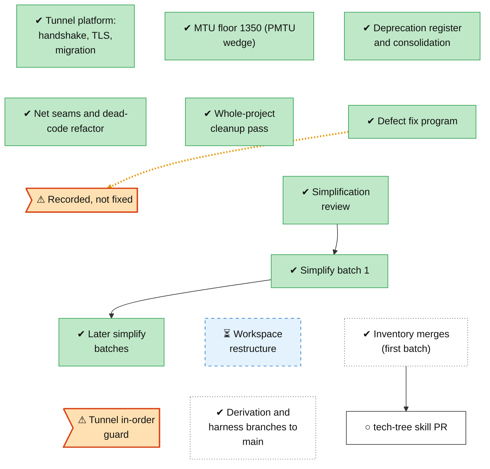

<!-- Generated by tools/roadmap/build.py from docs/roadmap/nodes.yaml. Do not edit. -->

# infra - repo and simplification

Scope: restructure, simplify batches, archived arms, early platform work (handshake, TLS, MTU, migration).

[Back to the roadmap](../../roadmap.md) · [legend](../../roadmap.md#legend)

<!-- BEGIN GENERATED: track-infra -->

<!-- END GENERATED: track-infra -->

## Node table

<!-- BEGIN GENERATED: table-infra -->
| id | title | state | outcome | headline | evidence | depends_on |
|---|---|---|---|---|---|---|
| `infra-early-platform` | Tunnel platform: handshake, TLS, migration | done | successful |  | ADR-0010; ADR-0011; ADR-0012; ADR-0015; ADR-0017; ADR-0018; ADR-0020 |  |
| `infra-mtu-floor` | MTU floor 1350 (PMTU wedge) | done | successful | 7.6% of historic runs | ADR-0055 |  |
| `infra-consolidation` | Deprecation register and consolidation | done | successful |  | commit be246605; ADR-0066; ADR-0067 |  |
| `infra-net-seams` | Net seams and dead-code refactor | done | successful |  | commit e9545399 |  |
| `infra-cleanup-0927` | Whole-project cleanup pass | done | successful |  | branch cleanup/final |  |
| `infra-fix-program` | Defect fix program | done | successful |  | status §3.1 item 2; status §3.5 item 1; status §3.6 |  |
| `infra-simplify-review` | Simplification review | done | successful |  | status §44; status §45 |  |
| `infra-adr73` | Promote or archive at verdict | done | n/a |  | ADR-0073 | infra-simplify-review, meas-adr52-discipline |
| `infra-simplify-batch1` | Simplify batch 1 | done | successful | p = 0.9566 | status §49 | infra-adr73, meas-guard-41c |
| `infra-simplify-batch2` | Later simplify batches | done | successful | p = 0.1716 | status §50 | infra-simplify-batch1 |
| `infra-restructure` | Workspace restructure | in-progress | unrated |  | ADR-0076; status §58 Amendment 3 |  |
| `infra-defect-recorded-not-fixed` | Recorded, not fixed | in-progress | unrated | ≈ 0.0354 | status §3.7 row 234; status §3.7 row 235; status §3.7 row 237 |  |
| `infra-tunnel-inorder-guard` | Tunnel in-order guard | in-progress | unrated |  | docs/derivations/liveness-audit.md item 3; branch tunnel-inorder-guard 987b0360 |  |
| `infra-inventory-merges` | Inventory merges (first batch) | done | unrated |  | merges 40464d2d guard-v2, 9e3764c9 law-ledger, 6e2b2915 p0-dwell-diag, c4df0142 roadmap-layout, 0ed6d383 test-debts |  |
| `infra-derivation-merges` | Derivation and harness branches to main | done | unrated |  | branch tools-to-main 49343157; status §61 (s61-c3-design, harness61); status §62 (s62-design) and Amendment 1 (harness62); status §63 Amendment 1 (harness63); status §64 (f2-guard-design) and Result (harness64); status "The count-rule derivation" (count-rule); status "The knee-margin re-derivation, closed post hoc" |  |
| `infra-tech-tree-skill` | tech-tree skill PR | next | unrated |  | plan Live state TECH TREE (AFTERWARDS) | infra-inventory-merges, model-law-ledger |

### Details per node

| id | title | notes | evidence |
|---|---|---|---|
| `infra-early-platform` | Tunnel platform: handshake, TLS, migration | Dates: ADR end dates in the raw set equal their start (placeholder); ADR-0052..0067 carry the 2026-07-21 migration date. | ADR-0010; ADR-0011; ADR-0012; ADR-0015; ADR-0017; ADR-0018; ADR-0020 |
| `infra-mtu-floor` | MTU floor 1350 (PMTU wedge) | Root-caused 2026-07-13 (0/68 fix-arm collapses). End 2026-07-21 was a placeholder (ADR-0055: last edit or migration date); date from merge ea746b83. Dates: ADR end dates in the raw set equal their start (placeholder); ADR-0052..0067 carry the 2026-07-21 migration date. | ADR-0055 |
| `infra-consolidation` | Deprecation register and consolidation | Owner 2026-07-21: move the experiments into ADRs and decide what to keep. Two-stage deprecation register, ADR migration (ADR-0052..0067), gates.rs, consolidations 1 and 2. | commit be246605; ADR-0066; ADR-0067 |
| `infra-net-seams` | Net seams and dead-code refactor | 2026-08-08 to 2026-08-10; recovery-plane pure functions, SchedSnapshot deleted unmeasured. | commit e9545399 |
| `infra-cleanup-0927` | Whole-project cleanup pass | Owner 2026-09-26: review and clean up duplication, dead code, complexity and "yapping". Its two open known issues are their own nodes. | branch cleanup/final |
| `infra-fix-program` | Defect fix program | Owner 2026-09-29: "finding self-caused issues is not uncomfortable. analyze and find the cause". §3.6 table, §3.7 rows 235/237 (recorded, not fixed). §3.6 and §3.7 rows are undated; dates from the 2026-09-29/30 merges. | status §3.1 item 2; status §3.5 item 1; status §3.6 |
| `infra-simplify-review` | Simplification review | Dates: status-section end dates are the section file's last edit, not the verdict date. | status §44; status §45 |
| `infra-adr73` | Promote or archive at verdict | ADR-0073 supersedes ADR-0052's two-stage retirement (cites it as premise). Dates: ADR end dates in the raw set equal their start (placeholder); ADR-0052..0067 carry the 2026-07-21 migration date. | ADR-0073 |
| `infra-simplify-batch1` | Simplify batch 1 | -2 665 lines; archive tags for Groups A/B sit on their design nodes. Dates: status-section end dates are the section file's last edit, not the verdict date. | status §49 |
| `infra-simplify-batch2` | Later simplify batches | Dates: status-section end dates are the section file's last edit, not the verdict date. Was titled 'Simplify batches 1b–3'. | status §50 |
| `infra-restructure` | Workspace restructure | Owner request 2026-11-12; decisions the same day. Phases 0, 1, 2, 3, 4 merged; phase 6's five closed forms moved to raptorpath-math with endspeed-relaid (status §58 Amendment 3, model-endspeed), after ADR-0076's status line (dated 2026-11-14) was last updated, so that line still reads 'not executed'; phase 5 open. | ADR-0076; status §58 Amendment 3 |
| `infra-defect-recorded-not-fixed` | Recorded, not fixed | Status §3.7 rows: the BOCD predictive_loss_upper floor (≈ 0.0354 on clean links, unverified), balanced v9 striping at ≈ 1.34x sender kernel CPU at the dual c1 cell, and the per-batch Ack arm releasing more than was sent under reorder. Undated raw records; date approximate (fix-program VM runs). | status §3.7 row 234; status §3.7 row 235; status §3.7 row 237 |
| `infra-tunnel-inorder-guard` | Tunnel in-order guard | Liveness audit item 3 (coordinator-verified): main.rs:387-396 sets window_out_of_order / coded_only / generation_coding / systematic_repair to None, merge takes overlay.or(base) (config.rs:204), so a TOML value reaches the tunnel. Product-path correctness, conditional on a config file. Done when: the tunnel path cannot be configured out of in-order delivery, with a red-first test. Branch tunnel-inorder-guard 987b0360: run and check reject the four object modes from a config file and pin them false; --lib config:: 17/17, red then green. Waits for the VM pre-flight suites (binary changes; startup validation only), or an owner waiver. | docs/derivations/liveness-audit.md item 3; branch tunnel-inorder-guard 987b0360 |
| `infra-inventory-merges` | Inventory merges (first batch) | Merged to main 2026-11-13: guard-v2, law-ledger, p0-dwell-diag, roadmap, test-debts (docs/tools/tests only). The derivation-branch merges are infra-derivation-merges. | merges 40464d2d guard-v2, 9e3764c9 law-ledger, 6e2b2915 p0-dwell-diag, c4df0142 roadmap-layout, 0ed6d383 test-debts |
| `infra-derivation-merges` | Derivation and harness branches to main | harness64 merged to main 2026-11-18 (after the regression test's Result; its [SYMSZ] table fix included). Checked by content against github/main 93f29d77 (tools merge by path, so ancestry is not the test). Registered verbatim or run from, not on main: harness61 3cdc4470 (plan61, s61_score), harness62 95dafa59 (plan62, s62_score; owed first: the full unfiltered test_stubrun), harness63 16a6ed17 (plan63 and the set -e fix), harness64 4feeb8fd (plan64; owed first: keep [SYMSZ] in KEEP_PAT and fail closed on its absence, with a stub test; §64 Result: 'harness64's tools to main with it'), s62-design 0f40a59d (s62-registration.md, s62pred), f2-guard-design 39269746 (f2-guard-registration.md, the framing_ns pre-reads), count-rule 2d557191 (count-rule.md, crdump/crfollow/crrule), knee-margin-rederive 399407f4 (knee-margin-rederive.md, kmr). harness51 waits for the §51 Result by design; s64-lean waits for its review (rec-s64-delay-lean). Older docs-only branches, still unmerged: derive-w1, w1r2, perleg-design, paper-recon, otel-design, adr68-amend, wire-clock-derive (wasm-modeswitch-audit, guard-clause-dry and s51-design's doc are on main). Done when: each branch is merged to main by path or recorded as kept-unmerged with a reason. | branch tools-to-main 49343157; status §61 (s61-c3-design, harness61); status §62 (s62-design) and Amendment 1 (harness62); status §63 Amendment 1 (harness63); status §64 (f2-guard-design) and Result (harness64); status "The count-rule derivation" (count-rule); status "The knee-margin re-derivation, closed post hoc" |
| `infra-tech-tree-skill` | tech-tree skill PR | Done when: a project-neutral tech-tree skill is opened as a PR to the design-skills repo (no direct commit to its main, no link in ~/.claude/skills) and tested with skill-creator on a fixture or a second project. | plan Live state TECH TREE (AFTERWARDS) |
<!-- END GENERATED: table-infra -->
