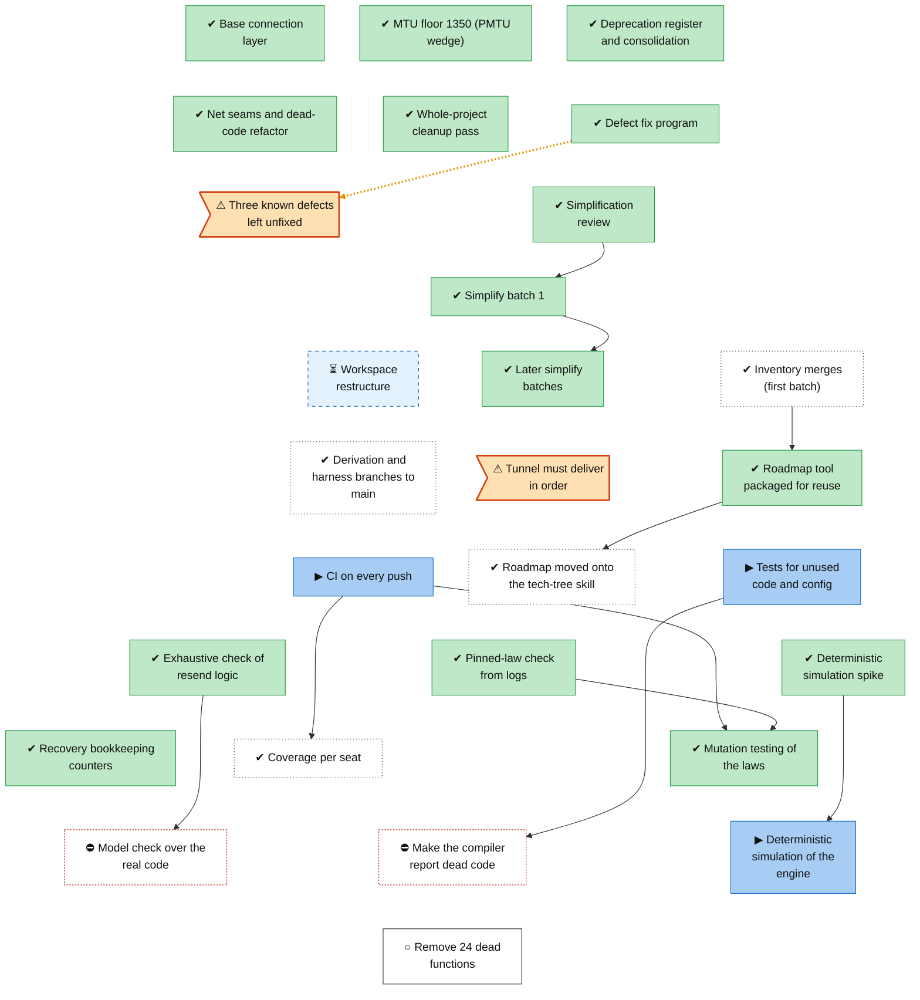

<!-- Generated by build.py from roadmap/nodes.yaml. Do not edit. -->

# infra - repo and simplification

Scope: restructure, simplify batches, archived arms, early platform work (handshake, TLS, MTU, migration).

[Back to the page](../../roadmap.md) · [legend](../../roadmap.md#legend)

<!-- BEGIN GENERATED: track-infra -->

<!-- END GENERATED: track-infra -->

## Node table

<!-- BEGIN GENERATED: table-infra -->
| id | title | kind | lane | state | outcome | start | end | depends_on | replaced_by | qualified_by | headline | evidence |
|---|---|---|---|---|---|---|---|---|---|---|---|---|
| `infra-early-platform` | Base connection layer | infra | host-cargo | done | successful | 2026-03-12 | 2026-03-13 |  |  |  |  | ADR-0010; ADR-0011; ADR-0012; ADR-0015; ADR-0017; ADR-0018; ADR-0020 |
| `infra-mtu-floor` | MTU floor 1350 (PMTU wedge) | mechanism | vm | done | successful | 2026-07-13 | 2026-07-13 |  |  |  | 7.6% of historic runs | ADR-0055 |
| `infra-consolidation` | Deprecation register and consolidation | simplification | host-cargo | done | successful | 2026-07-21 | 2026-07-28 |  |  |  |  | commit be246605; ADR-0066; ADR-0067 |
| `infra-net-seams` | Net seams and dead-code refactor | simplification | host-cargo | done | successful | 2026-08-08 | 2026-08-10 |  |  |  |  | commit e9545399 |
| `infra-cleanup-0927` | Whole-project cleanup pass | simplification | host-cargo | done | successful | 2026-09-27 | 2026-09-27 |  |  |  |  | branch cleanup/final |
| `infra-fix-program` | Defect fix program | mechanism | vm | done | successful | 2026-09-29 | 2026-09-30 |  |  | infra-defect-recorded-not-fixed |  | status §3.1 item 2; status §3.5 item 1; status §3.6 |
| `infra-simplify-review` | Simplification review | simplification | no-cargo | done | successful | 2026-11-10 | 2026-11-10 |  |  |  |  | status §44; status §45 |
| `infra-adr73` | Promote or archive at verdict | user-decision | user | done | n/a | 2026-11-10 | 2026-11-10 | infra-simplify-review, meas-adr52-discipline |  |  |  | ADR-0073 |
| `infra-simplify-batch1` | Simplify batch 1 | simplification | vm | done | successful | 2026-11-10 | 2026-11-12 | infra-adr73, meas-guard-41c |  |  | p = 0.9566 | status §49 |
| `infra-simplify-batch2` | Later simplify batches | simplification | vm | done | successful | 2026-11-12 | 2026-11-12 | infra-simplify-batch1 |  |  | p = 0.1716 | status §50 |
| `infra-restructure` | Workspace restructure | simplification | host-cargo | in-progress | unrated | 2026-11-12 |  |  |  |  |  | ADR-0076; status §58 Amendment 3 |
| `infra-defect-recorded-not-fixed` | Three known defects left unfixed | defect-verdict | none | in-progress | unrated | 2026-09-30 |  |  |  |  | ≈ 0.0354 | status §3.7 row 234; status §3.7 row 235; status §3.7 row 237 |
| `infra-tunnel-inorder-guard` | Tunnel must deliver in order | defect-verdict | vm | in-progress | unrated | 2026-11-19 |  |  |  |  |  | docs/derivations/liveness-audit.md item 3; branch tunnel-inorder-guard 987b0360 |
| `infra-inventory-merges` | Inventory merges (first batch) | infra | no-cargo | done | unrated | 2026-11-13 | 2026-11-13 |  |  |  |  | merges 40464d2d guard-v2, 9e3764c9 law-ledger, 6e2b2915 p0-dwell-diag, c4df0142 roadmap-layout, 0ed6d383 test-debts |
| `infra-derivation-merges` | Derivation and harness branches to main | infra | no-cargo | done | unrated | 2026-11-19 | 2026-11-19 |  |  |  |  | branch tools-to-main 49343157; status §61 (s61-c3-design, harness61); status §62 (s62-design) and Amendment 1 (harness62); status §63 Amendment 1 (harness63); status §64 (f2-guard-design) and Result (harness64); status "The count-rule derivation" (count-rule); status "The knee-margin re-derivation, closed post hoc" |
| `infra-tech-tree-skill` | Roadmap tool packaged for reuse | infra | no-cargo | done | successful | 2026-11-20 | 2026-11-20 | infra-inventory-merges, model-law-ledger |  |  |  | https://github.com/lhns/design-skills/pull/2 (merged ea48dcf9); plan Live state TECH TREE (AFTERWARDS) |
| `infra-roadmap-on-skill` | Roadmap moved onto the tech-tree skill | infra | no-cargo | done | unrated | 2026-11-20 | 2026-11-21 | infra-tech-tree-skill |  |  |  | docs/roadmap/migration-parity.md |
| `infra-test-ci-gate` | CI on every push | instrument | none | in-progress | unrated | 2026-11-20 |  |  |  |  |  | docs/derivations/test-detection-plan.md; .github/workflows/ci.yml |
| `infra-test-static-audits` | Tests for unused code and config | instrument | host-cargo | in-progress | unrated | 2026-11-20 |  |  |  |  |  | docs/derivations/test-detection-plan.md; branch static-audits 86b5208f |
| `infra-test-pinned-law-check` | Pinned-law check from logs | instrument | no-cargo | done | successful | 2026-11-20 | 2026-11-20 |  |  |  |  | docs/derivations/test-detection-plan.md; tools/l1/test_pinned_law_check.py |
| `infra-test-recovery-model` | Exhaustive check of resend logic | instrument | host-cargo | done | successful | 2026-11-20 | 2026-11-20 |  |  |  |  | docs/derivations/test-detection-plan.md |
| `infra-test-sim-spike` | Deterministic simulation spike | instrument | host-cargo | done | successful | 2026-11-20 | 2026-11-20 |  |  |  |  | docs/derivations/test-detection-plan.md; branch sim-spike ed8405fb (docs/derivations/sim-spike.md) |
| `infra-test-recovery-counters` | Recovery bookkeeping counters | instrument | host-cargo | done | successful | 2026-11-20 | 2026-11-20 |  |  |  |  | docs/derivations/test-detection-plan.md |
| `infra-test-seat-coverage` | Coverage per seat | instrument | none | done | unrated | 2026-11-20 | 2026-11-20 | infra-test-ci-gate |  |  |  | docs/derivations/test-detection-plan.md; docs/derivations/coverage-by-seat.md |
| `infra-test-mutation` | Mutation testing of the laws | instrument | none | done | successful | 2026-11-20 | 2026-11-20 | infra-test-ci-gate, infra-test-pinned-law-check |  |  |  | docs/derivations/test-detection-plan.md |
| `infra-test-model-real-decisions` | Model check over the real code | instrument | host-cargo | blocked | unrated | 2026-11-20 |  | infra-test-recovery-model |  |  |  | docs/derivations/test-detection-plan.md |
| `infra-test-pub-narrowing` | Make the compiler report dead code | instrument | host-cargo | blocked | unrated | 2026-11-20 |  | infra-test-static-audits |  |  |  | docs/derivations/test-detection-plan.md |
| `infra-dead-code-batch` | Remove 24 dead functions | simplification | host-cargo | next | unrated |  |  |  |  |  |  | branch static-audits 86b5208f (raptorpath/src/audits.rs, config_round_trip.rs) |
| `infra-test-sim-engine` | Deterministic simulation of the engine | instrument | host-cargo | in-progress | unrated | 2026-11-20 |  | infra-test-sim-spike |  |  |  | docs/derivations/sim-engine.md; raptorpath/tests/sim_lost_tail.rs |

### Details per node

| id | title | verdict | headline | in plain words | notes | confirmed | waiting on | queue order | order reason |
|---|---|---|---|---|---|---|---|---|---|
| `infra-early-platform` | Base connection layer | Implemented: 8-byte magic+version header (`RPTQ` + `PROTOCOL_VERSION`, currently 8; `transport/protocol.rs`) on all WireMessages and the handshake. Handshake exchanged on bidi stream after QUIC connect/accept with version/capability negotiation. Version mismatch rejected at deserialization. |  | The base connection layer the engine runs on: handshake and versioning, TLS certificate pinning, moving a live connection between paths, packet sizes fitted to each path (MTU), keepalive and dead-path detection, and routing set-up through the Windows tunnel driver (wintun). | Dates: ADR end dates in the raw set equal their start (placeholder); ADR-0052..0067 carry the 2026-07-21 migration date. Was titled 'Tunnel platform: handshake, TLS, migration'. |  |  |  |  |
| `infra-mtu-floor` | MTU floor 1350 (PMTU wedge) | Accepted (ships default ON) | 7.6% of historic runs | Set a minimum packet size of 1350 bytes to stop a path-size discovery stall that hit 7.6 percent of historic runs; none of the 68 runs with the fix collapsed, and it ships on by default. | Root-caused 2026-07-13 (0/68 fix-arm collapses). End 2026-07-21 was a placeholder (ADR-0055: last edit or migration date); date from merge ea746b83. Dates: ADR end dates in the raw set equal their start (placeholder); ADR-0052..0067 carry the 2026-07-21 migration date. |  |  |  |  |
| `infra-consolidation` | Deprecation register and consolidation | Ledger + docs: DEPRECATION REGISTER executed - Code Consolidation (2026-07-27) note, per-row REMOVED commits, VISION-TRIAGE execution status, paper 17.8 code-status line |  | A cleanup that retired refuted features and made the best-measured settings the default. | Owner 2026-07-21: move the experiments into ADRs and decide what to keep. Two-stage deprecation register, ADR migration (ADR-0052..0067), gates.rs, consolidations 1 and 2. |  |  |  |  |
| `infra-net-seams` | Net seams and dead-code refactor | sched-snapshot: DELETE RWM_SCHED_SNAPSHOT unmeasured — the hazard it claimed to fix is not reachable from the sites it served |  | Cleaned up the networking code by splitting handlers into functions and deleting dead code, including a scheduler snapshot removed unmeasured because the problem it claimed to fix could not occur. | 2026-08-08 to 2026-08-10; recovery-plane pure functions, SchedSnapshot deleted unmeasured. |  |  |  |  |
| `infra-cleanup-0927` | Whole-project cleanup pass | Merge branch 'cleanup/final' |  | A whole-project cleanup: refuted options and dead code removed, large files split, the paper cut from about 22,600 to 3,000 lines, and the running ledger replaced by a status document. | Owner 2026-09-26: review and clean up duplication, dead code, complexity and wordy narration. Its two open known issues are their own nodes. |  |  |  |  |
| `infra-fix-program` | Defect fix program | Fixed (1b890e0, 5af2687). sc2 (clean 100 Mbit single path) did not finish 100 MB in 300 s on the shipped window machine. |  | A two-day program fixed self-caused defects, including a clean single path that could not finish a transfer, truncated loss reports and wrong loss-estimator feeds; two findings were recorded but not fixed. | Owner 2026-09-29: finding self-caused issues is fine; analyse and find the cause. §3.6 table, §3.7 rows 235/237 (recorded, not fixed). §3.6 and §3.7 rows are undated; dates from the 2026-09-29/30 merges. |  |  |  |  |
| `infra-simplify-review` | Simplification review | Groups A, B and C are approved for deletion. |  |  | Dates: status-section end dates are the section file's last edit, not the verdict date. |  |  |  |  |
| `infra-adr73` | Promote or archive at verdict | Accepted (user, 2026-11-10). Supersedes ADR-0052's two-stage retirement. |  | The owner ruled that every experiment is either promoted or archived once its result is in, instead of lingering switched off. | ADR-0073 supersedes ADR-0052's two-stage retirement (cites it as premise). Dates: ADR end dates in the raw set equal their start (placeholder); ADR-0052..0067 carry the 2026-07-21 migration date. |  |  |  |  |
| `infra-simplify-batch1` | Simplify batch 1 | §49 Result (session 6, CAND 54600e5d, BASE b3000701, launched 2026-11-12T08:32Z, LD-ALL-DONE 08:46:51Z): GATE-41c PASS, p = 0.9566. | p = 0.9566 | A first cleanup that removed about 2 700 lines of code; the guard confirmed that behaviour did not change (p = 0.9566). | -2 665 lines; archive tags for Groups A/B sit on their design nodes. Dates: status-section end dates are the section file's last edit, not the verdict date. |  |  |  |  |
| `infra-simplify-batch2` | Later simplify batches | Result — GATE-41c PASS, p = 0.1716; merged | p = 0.1716 | Later cleanup rounds, merged after the same guard confirmed that behaviour did not change (p = 0.1716). | Dates: status-section end dates are the section file's last edit, not the verdict date. Was titled 'Simplify batches 1b–3'. |  |  |  |  |
| `infra-restructure` | Workspace restructure | Proposed (2026-11-12); open questions decided by the user the same day (see "Decisions"). Phase 0: done. Phase 2: lines committed on `restructure` (not yet merged). Phases 1, 3–6: Proposed, not executed. |  | Reorganising the repository layout in stages; the documentation and tools moves are done and the code splits are still open. | Owner request 2026-11-12; decisions the same day. Phases 0, 1, 2, 3, 4 merged; phase 6's five closed forms moved to raptorpath-math with endspeed-relaid (status §58 Amendment 3, model-endspeed), after ADR-0076's status line (dated 2026-11-14) was last updated, so that line still reads 'not executed'; phase 5 open. |  | the open branches merging before the code splits |  |  |
| `infra-defect-recorded-not-fixed` | Three known defects left unfixed | BOCD predictive_loss_upper (plu=) reads ≈ 0.0354 on clean links: a floor from the prior and the run-length mix, unverified | ≈ 0.0354 | Open problems recorded but not fixed: a loss estimate that never drops below a small floor, extra sender CPU when spreading over two paths, and an old acknowledgement option that releases too much. | Status §3.7 rows: the BOCD predictive_loss_upper floor (≈ 0.0354 on clean links, unverified), balanced v9 striping at ≈ 1.34x sender kernel CPU at the dual c1 cell, and the per-batch Ack arm releasing more than was sent under reorder. Undated raw records; date approximate (fix-program VM runs). Was titled 'Recorded, not fixed'. |  |  |  |  |
| `infra-tunnel-inorder-guard` | Tunnel must deliver in order |  |  | Stop a config file from switching the TCP tunnel to out-of-order or bulk-object delivery; today the command line leaves the setting unset and the file value wins. | Liveness audit item 3 (coordinator-verified): main.rs:387-396 sets window_out_of_order / coded_only / generation_coding / systematic_repair to None, merge takes overlay.or(base) (config.rs:204), so a TOML value reaches the tunnel. Product-path correctness, conditional on a config file. Done when: the tunnel path cannot be configured out of in-order delivery, with a red-first test. Branch tunnel-inorder-guard 987b0360: run and check reject the four object modes from a config file and pin them false; --lib config:: 17/17, red then green. Waits for the VM pre-flight suites (binary changes; startup validation only), or an owner waiver. 2026-11-20: updated to main (df5ffa08, CI green). Engine change: waits on the VM guard. Was titled 'Tunnel in-order guard'. |  |  | 2 | VM batch 1, guard 1 (with the gauges). Correctness fix on the product path: a config file can no longer switch the tunnel to out-of-order or object delivery; nothing changes for the default file. |
| `infra-inventory-merges` | Inventory merges (first batch) |  |  | Merged the first batch of finished design documents and small test fixes that were sitting on side branches. | Merged to main 2026-11-13: guard-v2, law-ledger, p0-dwell-diag, roadmap, test-debts (docs/tools/tests only). The derivation-branch merges are infra-derivation-merges. |  |  |  |  |
| `infra-derivation-merges` | Derivation and harness branches to main |  |  | Merging to main the finished design documents and test scripts that sessions were registered from but that still sit on side branches. | harness64 merged to main 2026-11-18 (after the regression test's Result; its [SYMSZ] table fix included). Checked by content against github/main 93f29d77 (tools merge by path, so ancestry is not the test). Registered verbatim or run from, not on main: harness61 3cdc4470 (plan61, s61_score), harness62 95dafa59 (plan62, s62_score; owed first: the full unfiltered test_stubrun), harness63 16a6ed17 (plan63 and the set -e fix), harness64 4feeb8fd (plan64; owed first: keep [SYMSZ] in KEEP_PAT and fail closed on its absence, with a stub test; §64 Result: 'harness64's tools to main with it'), s62-design 0f40a59d (s62-registration.md, s62pred), f2-guard-design 39269746 (f2-guard-registration.md, the framing_ns pre-reads), count-rule 2d557191 (count-rule.md, crdump/crfollow/crrule), knee-margin-rederive 399407f4 (knee-margin-rederive.md, kmr). harness51 waits for the §51 Result by design; s64-lean waits for its review (rec-s64-delay-lean). Older docs-only branches, still unmerged: derive-w1, w1r2, perleg-design, paper-recon, otel-design, adr68-amend, wire-clock-derive (wasm-modeswitch-audit, guard-clause-dry and s51-design's doc are on main). Done when: each branch is merged to main by path or recorded as kept-unmerged with a reason. |  |  |  |  |
| `infra-tech-tree-skill` | Roadmap tool packaged for reuse | Adds the tech-tree skill: one node per verdict, ratings only from quoted verdicts, derived ready/running/waiting lists, a page builder and checker, a history gap scan and record validator for backfilling, with clean, library and broken fixtures. 148 tests pass on Windows and Linux. |  | Packaging this roadmap tool so other projects can use it, offered as a proposal to the shared skills repository. | Done when: a project-neutral tech-tree skill is opened as a PR to the design-skills repo (no direct commit to its main, no link in ~/.claude/skills) and tested with skill-creator on a fixture or a second project. Was titled 'tech-tree skill PR'. Merged 2026-11-20 as design-skills ea48dcf9 (squash of PR 2): project-neutral, reviewed by Fable three times, 148 tests green on Windows and Linux; skill-creator smoke run 100 % vs 82 % without the skill. |  |  |  |  |
| `infra-roadmap-on-skill` | Roadmap moved onto the tech-tree skill |  |  | The roadmap pages, checker and history scan now run on the shared tech-tree skill, with all 412 nodes kept and the old scripts reduced to thin wrappers. | Merged from roadmap-on-skill with main's nodes carried; tools/roadmap/build.py and check.py keep their paths and CI runs the skill's tests. Differences from the old pages are listed in docs/roadmap/migration-parity.md. |  |  |  |  |
| `infra-test-ci-gate` | CI on every push |  |  | Run the gate tests, the math and core tests and the harness tests on GitHub Actions for every push, plus a nightly full run with a repeat job for flaky tests. | Plan S1, ADR-0080 (Proposed). Done when the workflow is red on a branch at 0bf43c11 (main's two failing gate tests) and green at e304921b. The flake-rule change in suites_run.sh waits until the repeat job has seeded the quarantine list. Merged ci-gate 1a785728: tier A about 5 min (gates, math+core, lib release, tools, visualizer), red on 0bf43c11 (run 44656256273), green on ci-gate (run 44658344625); nightly about 18 min with release 1151 and debug 1003 passing. Follow-ups merged 13042538: the full stub run is green on Linux (its stub binaries lacked the execute bit, invisible on Windows), plans 61-63's frozen-base witnesses run only at their launch (HARNESS_FROZEN_BASE=1), quarantine list empty. Owed: the flake-rule change in suites_run.sh, after the nightly repeat job has run. 2026-11-20: the sim-engine repeat job ran green (run 44677402957); ci-gates merged: (1) the ADR-0080 flake rule (a failure outside raptorpath/tests/quarantine.txt fails the job; the nightly repeat records per-test pass counts; the 30-run repeat found no flaky test, but it covers tier A only, not the loopback tests); (2) the shed-site coverage rule (a named site missed in every seat fails unless it has a miss_reason; a stale reason fails too); (3) the expected-failure job for ignored defect tests (finds none on main yet; the completion-based liveness test is excluded); (4) binid on push for sim, clock, seam, account and manifest changes, with a binid: expected-change opt-out. Each shown red and green in CI. Open: the old flake rule in four per-plan harness scripts; quarantine auto-exit. |  |  |  |  |
| `infra-test-static-audits` | Tests for unused code and config |  |  | Tests that fail when a function has no production caller, a passed parameter is ignored, or a config key does not reach the entry point that should read it. | Plan S2. Done when red on proactive_rate, set_protocol_hint, enable_pi_feedback and the tunnel config leak. The config round trip builds on tunnel-inorder-guard. Built and triaged on static-audits 86b5208f: 69 uncalled pub fns (43 test-only, 22 dead, 4 unwired) and 12 ignored params (9 intended, 2 dead, 1 unwired); unwired list: ADR-0050 Phase 3 proactive_rate, ADR-0017 MTU sizing (repair_wire_overhead, min_mtu), Scheduler::on_loss (paper 8.1), set_protocol_hint (Auto detection documented, never built), enable_pi_feedback. Red on main's tunnel leak with the fix removed. Waits for tunnel-inorder-guard and a release-binary hash check of the main.rs refactor 4bbb2f96. 2026-11-20: updated to main (93232f8a, CI green; sim.rs helpers allowlisted, audits.rs prints moved to readout!). Merges after a release-binary identity check against main. Was titled 'Unwired-code and config audits'. 2026-11-20: updated to main (35ba4fff, CI green; audit scanner fixed for inline test-seams gates). It changes the release binary because it carries the tunnel guard's config refactor (resolve_perf, resolve_tunnel, reject_tunnel_object_modes), so it merges after VM batch 1 guard 1, or split into audits-only plus the config change. |  |  |  |  |
| `infra-test-pinned-law-check` | Pinned-law check from logs | GREEN, committed ledger and owed list: `python -I tools/l1/pinned_law_check.py` ends `pinned-law check: green`. |  | A test over the committed logs that fails when a law reads pinned or never runs at a seat and the ledger has no verdict for it. | Plan S3. Done when red on the store-cap row with its ledger verdict removed. Existing unverdicted cells become a named owed list; the check fails on new ones. Merged 33ef7ff6: green on the committed ledger, red on F01 with its verdict removed and on a stale owed line; 122 unverdicted cells owed at the ledger threshold 0.5 (92 at 0.9); 32 of 65 rows have a gauge spec, the rest owed. Part 3 (cargo law-moves sweep) not started. |  |  |  |  |
| `infra-test-recovery-model` | Exhaustive check of resend logic | merge: recovery-model - stateright model of the hole lifecycle with a CI job (plan S7, ADR-0083; red on the rho < 1 lost tail, green at rho = 1; CI 44764141961) |  | A small model of the resend and drop logic, checked over every loss pattern at tiny sizes, so stuck states show up without a run. | Plan S7, ADR-0083 (Proposed). Done when red on the lost tail at rho < 1 and green at rho = 1. Kept outside the workspace lockfile. 2026-11-20: branch recovery-model pushed to github (82eb7a24, 2c81e8c2), not merged; CI has not run on it. Was titled 'Model check of hole recovery'. Merged 2026-11-20 with a CI job (model, about 49 s): the evicting seat has the lost-tail counterexample at L = 1 (1.7 M states), the rho = 1 seat passes every property (1.5 M states). It checks today's behaviour; ADR-0084 changes the intended law. Owed: raptorpath-model in src_manifest and the harness path tests; Kani not built. |  |  |  |  |
| `infra-test-sim-spike` | Deterministic simulation spike | Feasible, with the changes listed below. |  | Try running both ends in one process on a virtual clock and check that two runs with the same seed match exactly. | Plan S8 spike, throwaway branch. Decides whether the full simulation (ADR-0082, Proposed) is feasible. No clock change goes to main from the spike. Verdict FEASIBLE with changes: both peers in one process on paused tokio time over an in-memory socket under quinn; same seed gives identical traces (20/20 one path, 32/32 two paths, 10/10 three paths, 2/2 for 140 MB); a 30 s stall runs in 0.7 s wall, a saturated bulk transfer only ~1.9x faster than real time. Blockers that bit: 114 Instant::now plus 44 elapsed sites, select! branch order (needs the runtime rng seed, --cfg tokio_unstable), hash order with 2+ paths (4 sites), engine rand (3 sites), quinn rng seed (1). The lost-tail stall reproduces deterministically. Costs: virtual time quantised to 1 ms (srtt variance exactly 0 on a fixed-delay link), no CPU-cost model for unbacked senders, Linux not run. |  |  |  |  |
| `infra-test-recovery-counters` | Recovery bookkeeping counters | merge: recovery-counters - the sender account and stuck witnesses (plan S4, option B; ADR-0081); release binary identical (binid 44742087564) |  | Counters that prove every sent packet ends acked, dropped or still owed, and flag sweeps that do nothing. | Plan S4, ADR-0081 (Proposed). Owner 2026-11-20: decision 4 = option B now (debug and test-seams builds, release bytes unchanged), A on the next guard batch; decision 5 = an evicted seq is legal, counted in its own E term, with H + E bounded by 1 - rho. Shares files with the S06 deletion and the gauges, so it merges in sequence with them. Merged 2026-11-20 (recovery-counters fd1b392c; release binary identical, binid 44742087564): net/account.rs, the [ACCT] exit line and stuck and execution witnesses, asserted by every loopback test through assert_no_dnf. Red on the rho < 1 lost tail (O_strand, O with oldest_unchanged, inert sweeps, O_hwm above the cap), green on the rho = 1 controls. E is reported as an upper bound on abandonment and not gated; a receiver [ACCT-RX] frontier line separates acks in flight from stuck seqs. First clean-link rho < 1 loopback test added. Open: rx_frontier 5030 against S_sent 8099 on that test, not explained. |  |  |  |  |
| `infra-test-seat-coverage` | Coverage per seat |  |  | Line coverage per hint and per seat on CI, mapped to ledger rows, so code no test runs shows up. | Plan S5, report-only baseline (seat-coverage run 44678200818, 57 min, nightly and on dispatch). The NACK and slot shed sites are MISS in every seat, the evicting seat included: its two tests run clean links, and the heavier shed tests are ignored. Auto has one test, the evicting seat two. Row hits mean the function ran, not the law branch; branch sites exist only for S08 and R05. Open: no lib unit-test column (no lcov from a --lib run); some ledger loc lines have drifted from main. |  |  |  |  |
| `infra-test-mutation` | Mutation testing of the laws | merge mutation-ci 27202e2d: weekly cargo-mutants on raptorpath-math (1721 mutants, 20 shards, ~27 min), fails only on new or stale survivors against a 486-survivor baseline (plan S6) |  | Weekly mutation runs on the maths crates on CI, to find laws no test pins. | Plan S6. Merged mutation-ci 27202e2d: 1721 mutants, all in raptorpath-math (core is empty), ~7 s each, ~27 min over 20 shards; 486 survive (baseline, deterministic over two runs); the job fails only on new or stale survivors. Red: bulkness_of_delta (the dial's shaping law) has no test in the math crate, so replacing its body survives (it is tested only from the engine crate). Owed: survivor triage; engine law files not yet in scope. 2026-11-20 rate-law triage (docs/derivations/mutation-triage-rate.md): 137 survivors in the rate-law functions, 105 killed by 28 absolute tests in raptorpath-math/tests/mutation_triage_rate.rs, 32 equivalent; baseline 486 -> 380. Seven class-(c) findings, among them r_saturation's C_DILUTION = 0.5 with no derivation and three clamps that never bind (no bind gauges). Not yet triaged: find_t_cut, p_recovered_within, boost_params, derive_window, compute_buffer_max, beta_quantile, the estimators. |  |  |  |  |
| `infra-test-model-real-decisions` | Model check over the real code |  |  | Point the recovery model at the engine's own decision functions, once those are extracted. | Plan S9. Owner 2026-11-20 (plan decision 7): the extraction grows to the gap clamp, the tail-sweep target and the intake pause, with reliable as a clamp bound; at the next quiet point, through the proof ladder and a guard batch. Design merged: docs/derivations/core-extraction-recovery.md (Fable-reviewed). Steps 0-1 (decision pin digest, core functions) can land now; steps 2-4 need the VM guard and go after s06-delete, c8-gauges and recovery-counters merge. The intake pause keeps its seat mapping in the engine until the evicting-seat fix is chosen. Still blocked on infra-test-recovery-model. |  |  |  |  |
| `infra-test-pub-narrowing` | Make the compiler report dead code |  |  | Make most of the engine's items crate-private so the compiler reports dead code. | Plan S10, at a quiet point. Was titled 'Narrow pub so dead code warns'. |  |  |  |  |
| `infra-dead-code-batch` | Remove 24 dead functions |  |  | Delete code the audit found dead (22 functions, 2 parameters) and the tests that only test those dead copies. | D list in audits.rs on static-audits 86b5208f (callers deleted in dacfd7cc / ADR-0069 and others). Tests that exercise a dead copy instead of the live path: compute_repair_rate_capped, get_or_eval, pooled_recovery_srtt_of, Scheduler::schedule, compute_repair_count, compute_gap_ranges. Release-binary hash check; guard only if bytes change. Stale docs to fix with it: net/tests.rs:3807, fec_rate.rs:46, paper 8.1, loss_clamp_witness doc. |  |  |  |  |
| `infra-test-sim-engine` | Deterministic simulation of the engine |  |  | Run both ends of a transfer in one process on a virtual clock, so a stall or timeout test replays exactly and runs in a fraction of a second. | Plan S8, ADR-0082 (Accepted 2026-11-20, owner on Fable's review). Phase 1 merged (squash of sim-engine c907d207): release binary byte-identical to main on Linux; same-seed traces identical on 1 and 2 paths; lost tail at rho < 1 stalls (known defect), rho = 1 recovers; 0.1-0.3 s per scenario. Phase 2 owed: Gilbert-Elliott and Weibull links, a CPU-cost model for senders with no backpressure, porting the flaky timing tests, the 3 SystemTime reads. Branches carrying their own test_seams.rs (s06-delete, wedge-diag) must switch to the main copy: s06-delete's copy uses eprintln! and likely fails the no_eprintln gate; merging it also leaves a duplicate pub mod test_seams line that git merges silently. 2026-11-20: the seed-fixes-the-run claim is in doubt: tests/sim_shed_reach.rs saw the shed count change with the port, and a 30 MB scenario shed 17 on Windows and 0 on Linux. Diagnosed: (1) the port was hashed into the link RNG streams (sim.rs:214), fixed and merged with a red-first two-port test; (2) the OS is still an input: shutdown_signal (net/mod.rs:3838-3855) runs a select! over two signal listeners on unix and one on Windows, which shifts tokio's per-thread RNG and so every later unbiased select! (proved by CI runs 44726235078 and 44727373869: with unix running the Windows body under sim, all 7 scenarios match across OSes and Linux reproduces the 17 sheds). Fixed and merged (sim-cross-os): shutdown_signal runs one body under sim on every OS; connection ids, reset key, initial dcid and certificate are seeded; a CI job compares 7 cells byte for byte on Linux and Windows (red control on the reverted change); release binary identical. Still unseeded: rustls randomness and the NEW_TOKEN key (content only, never a length), 3 diagnostic SystemTime reads; platform float differences not ruled out beyond the 7 cells. ADR-0082 scope: a seed fixes the run for a given tokio version, on Linux and Windows. |  |  |  |  |

### Folded items per node

- `infra-early-platform`: Base connection layer
  - commit 6f2852f1
  - Optional TLS certificate pinning (2026-03-13, commit 3c9f1ae8)
  - Runtime connection migration with path management API (2026-03-13, commit 8d9e272a)
  - MTU-aware symbol sizing from path discovery (2026-03-13, commit 8e541e7b)
  - Production-grade test suite for FEC, pipeline, shutdown and congestion (2026-03-13, commit bf539e65)
  - RTCP-style keepalive, jitter tracking and dead path detection (2026-03-13, commit 4aca529a)
  - Automatic routing, DNS management and wintun setup (2026-03-13, commit d9bcc70c)
- `infra-mtu-floor`: MTU floor 1350 (PMTU wedge)
  - commit ea746b83
  - commit 049e7463
- `infra-consolidation`: Deprecation register and consolidation
  - commit 3bcf8690
  - commit be878cc6
  - ADR migration and vision triage (2026-07-21, commit 7387ad9d)
  - Scar cleanup after deletions (2026-07-27, commit 04d25177)
  - Consolidation 2 wrap-up (2026-07-28, commit 7a3aff69)
  - Deprecation register: removal schedule for three closed A/B arms (2026-08-09, commit a993629d)
  - Scheduler snapshot adjudication and its register row (2026-08-10, commit dd53215d)
- `infra-net-seams`: Net seams and dead-code refactor
  - branch refactor/net-seams-3
  - branch refactor/dead-code-2
  - branch refactor/net-seams-1
  - branch refactor/dead-code-1
  - commit 125844f4
  - commit 814b0152
  - commit dd53215d
  - Net seams 3/3: control-message handler split (2026-08-08, commit 6fd97d4e)
  - Dead-code batch 1: delete unused accessors and BackendSelector (2026-08-08, commit 6948a645, commit f3db9f63)
  - Shared-worktree collision: net-seams-3 work-in-progress rescued (2026-08-09, commit 0109ecc6)
  - Net seams 2: send macro and resolve-once policy become functions (2026-08-09, commit 6dc90cfc, commit 9d75ceda)
- `infra-cleanup-0927`: Whole-project cleanup pass
  - branch cleanup/wasm-tidy
  - branch cleanup/paper-pass2
  - branch cleanup/a7-comments
  - branch cleanup/a3-structure
  - branch cleanup/a5b-tests
  - branch cleanup/a2-refuted-arms
  - branch cleanup/docrefs
  - branch cleanup/a1-engine-bugs
  - branch cleanup/a5a-tools
  - branch cleanup/a0-hygiene
  - branch cleanup/a6b-paper
  - branch cleanup/a6c-adr
  - branch cleanup/a6a-docs
  - Cleanup: DESIGN, README, status and discipline docs, CLAUDE.md (2026-09-27, commit 1639ea28, commit 22b56d9f, commit cddb43aa, commit 1f8be7cf)
  - Cleanup: re-point comments and research docs to the renumbered paper (2026-09-27, commit 8f3fd7c5, commit 3a6b1627, commit 792914b6, commit 79ccafae, commit e9afdfa0, commit 2a52e84f)
- `infra-fix-program`: Defect fix program
  - branch fix/loss-feed
  - branch fix/v9-dual-cpu
  - branch fix/small-items
  - branch fix/block-retention-backpressure
  - branch fix/cpu-rate-hotpath
  - branch fix/sack-truncation
  - branch fix/block-retention-bytes
  - branch fix/reliable-delivery-drop
  - Loss-estimator feed: receiver incoming loss and its laws (2026-09-30, commit 487ca7b6, commit 7362745e)
  - Chi feed remaining-drain count (reachability flake) (2026-09-30, commit f16faad8)
- `infra-simplify-batch1`: Simplify batch 1
  - branch simplify-2
- `infra-simplify-batch2`: Later simplify batches
  - branch simplify-5
- `infra-restructure`: Workspace restructure
  - branch restructure-3
  - branch restructure phase 0+2
- `infra-defect-recorded-not-fixed`: Three known defects left unfixed
  - Fix-program status: fixed items and recorded-not-fixed findings (2026-09-30, commit 46f53904)
<!-- END GENERATED: table-infra -->
