<!-- Generated by build.py from roadmap/nodes.yaml. Do not edit. -->

# meas - measurement

Scope: measurement and harness: the L1 harness, guards, stub run, instruments, measurement discipline.

[Back to the page](../../roadmap.md) · [legend](../../roadmap.md#legend)

```mermaid
flowchart TB
    meas_l0_sim_bench["✔ Netsim harness and<br/>ablation benches"]
    meas_transport_comparison["✔ QUIC/MPTCP<br/>comparison and<br/>overhead taxonomy"]
    meas_matrix_bench["✔ Matrix benchmark,<br/>audit and dashboard"]
    meas_adr51_scenarios["✔ Standard test<br/>scenarios and pass<br/>criteria"]
    meas_l1_harness["✔ Emulated-network<br/>test rig and baselines"]
    meas_l2_multipath["✔ Multipath and tail<br/>evaluation"]
    meas_c8_aggregation_arc["↷ Combining a fast and<br/>slow path"]
    meas_gen_inert_era>"✔ Tests ran with<br/>cross-path coding off"]
    meas_rerun_0708["✔ Full benchmark re-<br/>run (8 July)"]
    meas_regime_map["✔ What works where, on<br/>real hardware"]
    meas_adr52_discipline["✔ Measurement<br/>discipline"]
    meas_adversarial_b1["✔ Adversarial policer<br/>map"]
    meas_gate_audit["✔ Gate-forwarding<br/>audit"]
    meas_pipeline_verification["✔ Pipeline<br/>verification matrix"]
    meas_coupling_model["✔ Coupling model<br/>(frontier span)"]
    meas_sf_accounting["✔ SF accounting axis"]
    meas_anchor_era_suspect["✔ Anchor-era suspect<br/>ruled out"]
    meas_ack_cadence["✔ Ack-cadence over-<br/>read checks"]
    meas_formula_first["✔ Formula-first review"]
    meas_goal_0819["✔ Era battery:<br/>cumulative shipped<br/>effect"]
    meas_latency_truth["✔ Latency Truth<br/>battery"]
    meas_c9_battery["✔ Four-path validation<br/>battery"]
    meas_gap_phases["✔ Gap battery phases 1<br/>and 2"]
    meas_cpuprof["✔ cpuprof: the<br/>sender's CPU ceiling"]
    meas_span_run["✔ Span run: span<br/>instrument, anchors"]
    meas_sigma_c8["✔ Measured σ on<br/>unequal paths"]
    meas_eppen_c8["✔ Eppen's condition on<br/>unequal paths"]
    meas_defect_shared_seed>"✔ Shared loss seed<br/>across legs"]
    meas_defect_31mbit>"✔ 31 Mbit/s cap:<br/>generation coding on"]
    meas_attribution_audit["✔ What actually fills<br/>each gap"]
    meas_wire_v8["✔ Wire v8 instruments<br/>and owed findings"]
    meas_crown_spot_v8["✔ Crown no-regression<br/>spot (wire v8)"]
    meas_defect_eta_witness>"⚠ Finish-time check<br/>uses the wrong delay"]
    meas_defect_c8_bimodal>"⚠ Two-path baseline<br/>runs sometimes<br/>collapse"]
    meas_defect_diag_rtp_ms>"⚠ Delay readout prints<br/>whole milliseconds"]
    meas_gso_truth>"✔ Per-datagram loss<br/>truth (GSO)"]
    meas_v4_verification["✔ Verification of the<br/>new main"]
    meas_guard_41c["✔ Statistical merge<br/>check"]
    meas_harness_consolidation["✔ Harness on main,<br/>rehearsal mode"]
    meas_defect_rtp_floor>"⚠ Merge check misreads<br/>start and end"]
    meas_guard_clause_dry["✔ Guard clause dry run"]
    meas_guard_v2_impl["✔ Guard v2<br/>implementation"]
    meas_s51_design["✔ Off-Bulk benchmark<br/>design"]
    meas_s58_session["✔ Dial-pin fix suites,<br/>binary identity"]
    meas_s51_harness["✔ Off-Bulk sweep<br/>harness and scorer"]
    meas_harness_reuse["✔ Cheaper sessions by<br/>reuse"]
    meas_s51_session["✔ First measurements<br/>away from bulk setting"]
    meas_blocke_pacing_gate>"✔ Pacer late-send<br/>check replaced"]
    meas_blocke_steady_rule>"✔ Steady-window check<br/>passed untested<br/>windows"]
    meas_w1_bracket_fix["▶ Repair-share bound<br/>counts every slot"]
    meas_defect_cr61_large_pool>"⚠ Collapse detector<br/>misfires on large<br/>limits"]
    meas_s51b_rho["⛔ Measurements with<br/>droppable data"]
    meas_guard_bulk_blind["○ Merge check only<br/>tests bulk"]
    meas_vm_batch_1["▶ VM batch 1: S06<br/>merge guard"]
    meas_s51_c8_gauges["○ Per-path readouts<br/>for two-path runs"]
    meas_adversarial_cells_build["✔ Adversarial cells:<br/>build and validate"]
    meas_harness_robustness["○ Every test plan<br/>rehearsable offline"]
    meas_guard_resolution["○ Merge check sees<br/>smaller changes"]
    meas_test_hygiene["○ Test hygiene fixes"]
    meas_adversarial_cells_run["⛔ Harder network<br/>conditions measured"]
    meas_competitor_battery["⛔ Outside protocols on<br/>the same tests"]
    meas_progress_baseline["○ Cumulative progress<br/>benchmark"]
    meas_fix_gauges_p3["⛔ Readouts for the<br/>last hand-set numbers"]
    meas_disorder_price["⛔ Measure the price of<br/>disorder ω on a TCP-<br/>in-tunnel test"]
    meas_l0_sim_bench ~~~ meas_transport_comparison
    meas_l0_sim_bench ~~~ meas_matrix_bench
    meas_l0_sim_bench ~~~ meas_adr51_scenarios
    meas_transport_comparison ~~~ meas_l1_harness
    meas_matrix_bench ~~~ meas_l2_multipath
    meas_adr51_scenarios ~~~ meas_c8_aggregation_arc
    meas_l1_harness ~~~ meas_gen_inert_era
    meas_l2_multipath ~~~ meas_rerun_0708
    meas_c8_aggregation_arc ~~~ meas_regime_map
    meas_gen_inert_era ~~~ meas_adr52_discipline
    meas_rerun_0708 ~~~ meas_adversarial_b1
    meas_regime_map ~~~ meas_gate_audit
    meas_adr52_discipline ~~~ meas_pipeline_verification
    meas_adversarial_b1 ~~~ meas_pipeline_verification
    meas_gate_audit ~~~ meas_pipeline_verification
    meas_pipeline_verification ~~~ meas_coupling_model
    meas_pipeline_verification ~~~ meas_sf_accounting
    meas_pipeline_verification ~~~ meas_anchor_era_suspect
    meas_coupling_model ~~~ meas_ack_cadence
    meas_sf_accounting ~~~ meas_formula_first
    meas_anchor_era_suspect ~~~ meas_goal_0819
    meas_ack_cadence ~~~ meas_latency_truth
    meas_formula_first ~~~ meas_c9_battery
    meas_goal_0819 ~~~ meas_gap_phases
    meas_latency_truth ~~~ meas_cpuprof
    meas_c9_battery ~~~ meas_span_run
    meas_gap_phases ~~~ meas_sigma_c8
    meas_cpuprof ~~~ meas_eppen_c8
    meas_span_run ~~~ meas_defect_shared_seed
    meas_sigma_c8 ~~~ meas_defect_31mbit
    meas_eppen_c8 ~~~ meas_attribution_audit
    meas_defect_shared_seed ~~~ meas_wire_v8
    meas_defect_31mbit ~~~ meas_crown_spot_v8
    meas_attribution_audit ~~~ meas_defect_eta_witness
    meas_wire_v8 ~~~ meas_defect_c8_bimodal
    meas_crown_spot_v8 ~~~ meas_defect_diag_rtp_ms
    meas_defect_eta_witness ~~~ meas_gso_truth
    meas_defect_c8_bimodal ~~~ meas_v4_verification
    meas_defect_diag_rtp_ms ~~~ meas_guard_41c
    meas_gso_truth ~~~ meas_harness_consolidation
    meas_v4_verification ~~~ meas_defect_rtp_floor
    meas_guard_41c ~~~ meas_defect_rtp_floor
    meas_harness_consolidation ~~~ meas_guard_clause_dry
    meas_defect_rtp_floor ~~~ meas_guard_clause_dry
    meas_guard_clause_dry ~~~ meas_guard_v2_impl
    meas_guard_clause_dry ~~~ meas_s51_design
    meas_guard_clause_dry ~~~ meas_s58_session
    meas_guard_v2_impl ~~~ meas_s51_harness
    meas_s51_design ~~~ meas_harness_reuse
    meas_s58_session ~~~ meas_harness_reuse
    meas_s51_harness ~~~ meas_s51_session
    meas_harness_reuse ~~~ meas_blocke_pacing_gate
    meas_s51_session ~~~ meas_blocke_steady_rule
    meas_blocke_pacing_gate ~~~ meas_w1_bracket_fix
    meas_blocke_pacing_gate ~~~ meas_defect_cr61_large_pool
    meas_blocke_steady_rule ~~~ meas_s51b_rho
    meas_w1_bracket_fix ~~~ meas_guard_bulk_blind
    meas_defect_cr61_large_pool ~~~ meas_guard_bulk_blind
    meas_s51b_rho ~~~ meas_vm_batch_1
    meas_guard_bulk_blind ~~~ meas_s51_c8_gauges
    meas_guard_bulk_blind ~~~ meas_adversarial_cells_build
    meas_vm_batch_1 ~~~ meas_harness_robustness
    meas_s51_c8_gauges ~~~ meas_guard_resolution
    meas_adversarial_cells_build ~~~ meas_test_hygiene
    meas_harness_robustness ~~~ meas_adversarial_cells_run
    meas_guard_resolution ~~~ meas_competitor_battery
    meas_test_hygiene ~~~ meas_progress_baseline
    meas_adversarial_cells_run ~~~ meas_fix_gauges_p3
    meas_competitor_battery ~~~ meas_disorder_price
    meas_progress_baseline ~~~ meas_disorder_price
    meas_l0_sim_bench --> meas_transport_comparison
    meas_l0_sim_bench --> meas_matrix_bench
    meas_adr51_scenarios --> meas_l1_harness
    meas_c8_aggregation_arc -.-> meas_regime_map
    meas_c8_aggregation_arc --> meas_regime_map
    meas_pipeline_verification --> meas_coupling_model
    meas_pipeline_verification --> meas_sf_accounting
    meas_wire_v8 -.-> meas_defect_eta_witness
    meas_defect_rtp_floor --> meas_guard_clause_dry
    meas_guard_clause_dry --> meas_guard_v2_impl
    meas_guard_clause_dry --> meas_s51_design
    meas_s51_design --> meas_s51_session
    meas_s51_harness --> meas_s51_session
    meas_blocke_pacing_gate --> meas_blocke_steady_rule
    meas_s51_session --> meas_s51b_rho
    meas_guard_bulk_blind --> meas_vm_batch_1
    meas_s51_session --> meas_s51_c8_gauges
    meas_adversarial_cells_build --> meas_adversarial_cells_run
    meas_s51_session --> meas_fix_gauges_p3
    linkStyle 77 stroke:#e69500,stroke-width:3px,stroke-dasharray:2 3
    classDef vsucc fill:#2e9e4f,stroke:#1b6b34,color:#fff
    classDef succ fill:#bfe8c8,stroke:#2e9e4f,color:#111
    classDef mixed fill:#ffd37a,stroke:#c98a00,color:#111
    classDef bad fill:#f28b82,stroke:#b3261e,color:#111
    classDef dead fill:#e6e6e6,stroke:#777,stroke-dasharray:5 5,color:#555
    classDef inprog fill:#a8cdf5,stroke:#1f6fc5,color:#111
    classDef next fill:#fff,stroke:#333,color:#111
    classDef blocked fill:#fff,stroke:#b3261e,stroke-dasharray:2 2,color:#111
    classDef parked fill:#f3f3f3,stroke:#999,color:#555
    classDef unrated fill:#fff,stroke:#333,stroke-dasharray:1 3,color:#111
    classDef gate fill:#d9c2f0,stroke:#7b3fb5,color:#111
    classDef decided fill:#ece0f7,stroke:#7b3fb5,stroke-dasharray:2 2,color:#111
    classDef finding fill:#ffe0b2,stroke:#d84315,stroke-width:2px,color:#111
    classDef waiting fill:#e3f2fd,stroke:#1f6fc5,stroke-dasharray:5 5,color:#111
    class meas_l0_sim_bench,meas_transport_comparison,meas_matrix_bench,meas_l1_harness,meas_l2_multipath,meas_rerun_0708,meas_regime_map,meas_adversarial_b1,meas_gate_audit,meas_pipeline_verification,meas_ack_cadence,meas_goal_0819,meas_latency_truth,meas_c9_battery,meas_gap_phases,meas_cpuprof,meas_span_run,meas_sigma_c8,meas_eppen_c8,meas_attribution_audit,meas_crown_spot_v8,meas_guard_v2_impl,meas_s51_design,meas_s51_harness,meas_adversarial_cells_build unrated
    class meas_adr51_scenarios,meas_gen_inert_era,meas_adr52_discipline,meas_formula_first,meas_defect_shared_seed,meas_defect_31mbit,meas_wire_v8,meas_gso_truth,meas_v4_verification,meas_guard_41c,meas_harness_consolidation,meas_guard_clause_dry,meas_s58_session,meas_harness_reuse,meas_s51_session,meas_blocke_pacing_gate,meas_blocke_steady_rule succ
    class meas_c8_aggregation_arc,meas_coupling_model,meas_anchor_era_suspect dead
    class meas_sf_accounting mixed
    class meas_defect_eta_witness,meas_defect_c8_bimodal,meas_defect_diag_rtp_ms,meas_defect_rtp_floor,meas_defect_cr61_large_pool finding
    class meas_w1_bracket_fix,meas_vm_batch_1 inprog
    class meas_s51b_rho,meas_adversarial_cells_run,meas_competitor_battery,meas_fix_gauges_p3,meas_disorder_price blocked
    class meas_guard_bulk_blind,meas_s51_c8_gauges,meas_harness_robustness,meas_guard_resolution,meas_test_hygiene,meas_progress_baseline next
```

<!-- BEGIN GENERATED: track-meas -->

<!-- END GENERATED: track-meas -->

## Node table

<!-- BEGIN GENERATED: table-meas -->
| id | title | kind | lane | state | outcome | start | end | depends_on | replaced_by | qualified_by | headline | evidence |
|---|---|---|---|---|---|---|---|---|---|---|---|---|
| `meas-w1-bracket-fix` | Repair-share bound counts every slot | infra | no-cargo | in-progress | unrated | 2026-11-19 |  | rate-k4-input-checks |  |  |  | status "The two K4 input checks, post hoc" |
| `meas-blocke-pacing-gate` | Pacer late-send check replaced | defect-verdict | no-cargo | done | unrated |  |  | rec-f2-merge-guard |  |  | 1 % late limit replaced by a 250 ms stall check; lateness reported | status §63 Result; status §51 Amendment 4; branch e-tree-f2-pace 61852b6c |
| `meas-blocke-steady-rule` | Steady-window check passed untested windows | defect-verdict | no-cargo | done | unrated | 2026-11-18 | 2026-11-18 | meas-blocke-pacing-gate |  |  | Fixed: PM 114 -> 0 steady, PL 149 -> 40 | status §51 Amendment 5; branch e-tree-f2-pace 8899fef8 |
| `meas-harness-reuse` | Cheaper sessions by reuse | infra | none | done | successful | 2026-11-18 | 2026-11-18 |  |  |  | guard ran no suites and no builds | status §64 Amendments 1-2; status owner decision 14 |
| `meas-user-test-cost` | Owner call on test cost | user-decision | user | done | n/a | 2026-11-18 | 2026-11-18 |  |  |  | compiler cache yes, reduced guard no | status Owner decisions (2026-11-18) item 14 |
| `meas-defect-cr61-large-pool` | Collapse detector misfires on large limits | defect-verdict | no-cargo | next | unrated |  |  | store-s61a |  |  | CR61 ratio 1.51-1.90 on healthy c3 controls | status §61a Result |
| `meas-l0-sim-bench` | Netsim harness and ablation benches | instrument | host-cargo | done | unrated | 2026-03-17 | 2026-03-20 |  |  |  |  | ADR-0031; ADR-0042; ADR-0032; ADR-0033; ADR-0034; ADR-0035 |
| `meas-adr51-scenarios` | Standard test scenarios and pass criteria | instrument | host-cargo | done | successful | 2026-07-02 | 2026-07-02 |  |  |  |  | ADR-0051 |
| `meas-l1-harness` | Emulated-network test rig and baselines | instrument | vm | done | unrated | 2026-07-03 | 2026-07-04 | meas-adr51-scenarios |  |  |  | commit f73704c2 |
| `meas-l2-multipath` | Multipath and tail evaluation | research | vm | done | unrated | 2026-07-04 | 2026-07-04 |  |  |  |  | commit beae05b1 |
| `meas-c8-aggregation-arc` | Combining a fast and slow path | research | vm | abandoned | superseded | 2026-07-06 | 2026-07-19 | place-marginal-cost | meas-regime-map |  |  | paper §10 row "Arc concluded" aggregation verdict |
| `meas-gen-inert-era` | Tests ran with cross-path coding off | defect-verdict | vm | done | unrated | 2026-07-07 | 2026-07-13 |  |  |  |  | paper §10 row Generation-inert era; ADR-0053 |
| `meas-regime-map` | What works where, on real hardware | research | vm | done | unrated | 2026-07-19 | 2026-07-27 | meas-user-consolidate-arc |  |  |  | commit acefc473 |
| `meas-adr52-discipline` | Measurement discipline | instrument | no-cargo | done | successful | 2026-07-21 | 2026-08-08 |  |  |  |  | ADR-0052 |
| `meas-adversarial-b1` | Adversarial policer map | research | vm | done | unrated | 2026-08-06 | 2026-08-06 |  |  |  |  | commit 754139c3 |
| `meas-formula-first` | Formula-first review | instrument | no-cargo | done | successful | 2026-08-12 | 2026-09-27 |  |  |  |  | branch ADR-0070 |
| `meas-pipeline-verification` | Pipeline verification matrix | research | vm | done | unrated | 2026-08-11 | 2026-08-12 |  |  |  |  | branch PIPELINE VERIFICATION MATRIX |
| `meas-coupling-model` | Coupling model (frontier span) | research | vm | done | dead-end | 2026-08-11 | 2026-08-12 | meas-pipeline-verification |  |  |  | commit 7ad65ef1; commit cb422e2d |
| `meas-sf-accounting` | SF accounting axis | research | vm | done | mixed | 2026-08-11 | 2026-08-11 | meas-pipeline-verification |  |  |  | commit 4f67ba7d; commit 4131d254 |
| `meas-goal-0819` | Era battery: cumulative shipped effect | research | vm | done | unrated | 2026-08-19 | 2026-08-19 |  |  |  |  | commit f605f925; branch THE ERA LEDGER, SCORED |
| `meas-latency-truth` | Latency Truth battery | research | vm | done | unrated | 2026-08-19 | 2026-08-19 |  |  |  |  | commit e57f3655; commit cb288631 |
| `meas-c9-battery` | Four-path validation battery | research | vm | done | unrated | 2026-08-19 | 2026-08-19 |  |  |  |  | commit 9a060daa; commit 7f2b0096 |
| `meas-gap-phases` | Gap battery phases 1 and 2 | research | vm | done | unrated | 2026-08-19 | 2026-08-19 |  |  |  |  | commit 5bf1a346; commit b4be2489; commit decf67a8; commit 4323b2c7 |
| `meas-cpuprof` | cpuprof: the sender's CPU ceiling | research | vm | done | unrated | 2026-08-19 | 2026-08-19 |  |  |  |  | commit 4eb2306c; commit 4e52a318 |
| `meas-span-run` | Span run: span instrument, anchors | research | vm | done | unrated | 2026-08-19 | 2026-08-19 |  |  |  |  | commit 0d30724a |
| `meas-sigma-c8` | Measured σ on unequal paths | research | vm | done | unrated | 2026-08-19 | 2026-08-19 |  |  |  |  | commit d20b0863; commit b5d8a14c |
| `meas-eppen-c8` | Eppen's condition on unequal paths | research | vm | done | unrated | 2026-08-19 | 2026-08-19 |  |  |  |  | commit 33528562 |
| `meas-attribution-audit` | What actually fills each gap | research | vm | done | unrated | 2026-09-07 | 2026-09-07 |  |  |  | 0.0077 (c1) | status §2 row "Attribution audit (D0)" |
| `meas-wire-v8` | Wire v8 instruments and owed findings | instrument | vm | done | successful | 2026-09-08 | 2026-09-09 |  |  | meas-defect-eta-witness |  | status §2 row "Crown no-regression spot (wire v8 merges)" |
| `meas-5h-cap` | Owner rule: 5 h measurement cap | user-decision | user | done | n/a | 2026-09-08 | 2026-09-08 |  |  |  |  | commit 3eb28db6 |
| `meas-gso-truth` | Per-datagram loss truth (GSO) | defect-verdict | vm | done | unrated | 2026-09-30 | 2026-09-30 |  |  |  | 5 300 datagrams lost at 5 per skb while dropped read 1 060 | status §3.8 |
| `meas-v4-verification` | Verification of the new main | research | vm | done | successful | 2026-10-04 | 2026-10-05 | cod-one-pipeline |  |  |  | status §6 |
| `meas-guard-41c` | Statistical merge check | instrument | vm | done | successful | 2026-11-10 | 2026-11-11 |  |  | meas-guard-v2 | p = 0.2256 | status §41c; branch archive/nsbench41c |
| `meas-harness-consolidation` | Harness on main, rehearsal mode | infra | no-cargo | done | successful | 2026-11-12 | 2026-11-12 |  |  |  |  | branch harness-main |
| `meas-defect-rtp-floor` | Merge check misreads start and end | defect-verdict | none | in-progress | unrated | 2026-11-13 |  | rec-snapver-filter |  |  | 6/12 BASE and 5/12 CAND rows | status §3.10 item 7 |
| `meas-guard-clause-dry` | Guard clause dry run | instrument | no-cargo | done | successful | 2026-11-13 | 2026-11-13 | meas-defect-rtp-floor, meas-guard-41c |  |  |  | branch guard-clause-dry (5f73fc6b); docs/derivations/guard-clause-dry.md; status §3.10 item 7; status §41d |
| `meas-s58-session` | Dial-pin fix suites, binary identity | instrument | vm | done | successful | 2026-11-14 | 2026-11-14 | store-defect-delta-nan, model-shared-core-0 |  |  | tree X = control 8f313616… | status §58; status §58 Amendment 2; status §58 Amendment 3; commit ba6637d7; commit f5bbb7c7; commit 504c4ea6; commit e7d7228e; branch s58-tools; branch phase6-forms; branch viz-endspeed |
| `meas-guard-v2` | Merge guard v2 accepted | user-decision | no-cargo | done | n/a | 2026-11-13 | 2026-11-13 | meas-guard-clause-dry, meas-defect-rtp-floor, meas-guard-41c |  |  |  | status §41d (github/main 005cf240, f73338f8); docs/derivations/guard-clause-dry.md |
| `meas-defect-eta-witness` | Finish-time check uses the wrong delay | defect-verdict | none | in-progress | unrated | 2026-09-09 |  |  |  |  |  | status §3.1 item 3 |
| `meas-defect-c8-bimodal` | Two-path baseline runs sometimes collapse | defect-verdict | none | in-progress | unrated | 2026-09-09 |  |  |  |  | 4/8 reps | status §3.1 item 4 |
| `meas-defect-diag-rtp-ms` | Delay readout prints whole milliseconds | defect-verdict | none | in-progress | unrated | 2026-09-27 |  |  |  |  |  | status §3.5 item 4 |
| `meas-guard-v2-impl` | Guard v2 implementation | instrument | no-cargo | done | unrated | 2026-11-13 | 2026-11-13 | meas-guard-v2 |  |  |  | status §41d implementation prerequisites; merge 9e687938 (guard v2), main 0ed6d383 |
| `meas-s51-design` | Off-Bulk benchmark design | research | no-cargo | done | unrated | 2026-11-13 | 2026-11-13 | meas-guard-v2 |  |  |  | branch s51-design (5a9dc401); docs/derivations/s51-design.md; status §3.3 additions (github/main 695c7f4f) |
| `meas-s51-harness` | Off-Bulk sweep harness and scorer | instrument | no-cargo | done | unrated | 2026-11-16 | 2026-11-17 | rec-s54-session |  |  |  | docs/derivations/s51-design.md §8 P1; status §51 "Host checks so far"; status §51 Amendment 1; branch harness51 a59efa60 |
| `meas-s51b-rho` | Measurements with droppable data | research | vm | blocked | unrated |  |  | meas-s51-session |  |  |  | docs/derivations/s51-design.md §2.3, §8 P4 |
| `meas-guard-bulk-blind` | Merge check only tests bulk | instrument | no-cargo | next | unrated |  |  |  |  |  |  | docs/derivations/s06-delete-plan.md (merge gate) |
| `meas-s51-c8-gauges` | Per-path readouts for two-path runs | instrument | vm | next | unrated |  |  | meas-s51-session |  |  |  | status §51 block 51 Result, gauge defects; status §51 block 51 rehearsal (crlf_guard) |
| `meas-adversarial-cells-build` | Adversarial cells: build and validate | instrument | no-cargo | done | unrated |  |  |  |  |  |  | plan W5.3; branch adv-cells |
| `meas-harness-robustness` | Every test plan rehearsable offline | instrument | no-cargo | next | unrated |  |  |  |  |  |  | plan W5.2 |
| `meas-guard-resolution` | Merge check sees smaller changes | instrument | host-cargo | next | unrated |  |  |  |  |  |  | plan W5.4 |
| `meas-test-hygiene` | Test hygiene fixes | instrument | host-cargo | next | unrated |  |  |  |  |  |  | plan W5.5 |
| `meas-s51-session` | First measurements away from bulk setting | research | vm | done | successful | 2026-11-19 | 2026-11-19 | meas-s51-design, meas-s51-harness, store-defect-delta-nan, rec-f2-merge-guard |  |  | 152 of 152 rows live; δ-continuous at every preset in both cells; named Realtime steps, as predicted | status §51; status §51 Amendment 2; status §63 Result; status §51 Amendment 6; status §51 block 51 rehearsal; status §51 block 51 Result; docs/l1-raw/s51b; plan W5.1 |
| `meas-adversarial-cells-run` | Harder network conditions measured | research | vm | blocked | unrated |  |  | meas-adversarial-cells-build, cc-s48d-session |  |  |  | plan W5.3, W2.3 |
| `meas-competitor-battery` | Outside protocols on the same tests | research | vm | blocked | unrated |  |  | cc-bbrrs-promote |  |  |  | plan W5.6 (at the W1 milestone) |
| `meas-progress-baseline` | Cumulative progress benchmark | research | vm | next | unrated |  |  |  |  |  |  | user-requests 2026-08-19 (asked which attributes improved, and by how much); user-requests 2026-11-11 (asked whether the performance gains show yet) |
| `meas-fix-gauges-p3` | Readouts for the last hand-set numbers | instrument | host-cargo | blocked | unrated |  |  | rate-fix-estimators, model-fix-paper-p2, meas-s51-session, store-engine-form-impl |  |  |  | law ledger rows S03, S07, R06, K06, K07, C11, F04 |
| `meas-transport-comparison` | QUIC/MPTCP comparison and overhead taxonomy | instrument | host-cargo | done | unrated | 2026-03-17 | 2026-03-18 | meas-l0-sim-bench |  |  |  | ADR-0036; ADR-0038 |
| `meas-matrix-bench` | Matrix benchmark, audit and dashboard | instrument | host-cargo | done | unrated | 2026-03-20 | 2026-03-20 | meas-l0-sim-bench |  |  |  | ADR-0044; ADR-0045; ADR-0049 |
| `meas-user-consolidate-arc` | Owner call: stop, consolidate two-path results | user-decision | user | done | n/a | 2026-07-08 | 2026-07-08 | meas-c8-aggregation-arc |  |  |  | commit a8dd8675 |
| `meas-defect-shared-seed` | Shared loss seed across legs | defect-verdict | vm | done | unrated | 2026-08-19 | 2026-08-19 |  |  |  |  | commit e1fb2f64 |
| `meas-anchor-era-suspect` | Anchor-era suspect ruled out | research | vm | done | dead-end | 2026-08-11 | 2026-08-11 |  |  |  |  | commit cc8e3c01 |
| `meas-ack-cadence` | Ack-cadence over-read checks | research | vm | done | unrated | 2026-08-11 | 2026-08-11 |  |  |  |  | commit c0d93050; commit f1dc8ac5 |
| `meas-defect-31mbit` | 31 Mbit/s cap: generation coding on | defect-verdict | no-cargo | done | unrated | 2026-08-20 | 2026-08-20 |  |  |  |  | commit 38050959 |
| `meas-crown-spot-v8` | Crown no-regression spot (wire v8) | research | vm | done | unrated | 2026-09-08 | 2026-09-08 |  |  |  |  | commit b5e94b32; commit f671f61d |
| `meas-rerun-0708` | Full benchmark re-run (8 July) | research | vm | done | unrated | 2026-07-08 | 2026-07-08 |  |  |  |  | commit bfc71e8e |
| `meas-gate-audit` | Gate-forwarding audit | research | vm | done | unrated | 2026-08-09 | 2026-08-09 |  |  |  |  | commit 2aeea9d7; commit 689f9e89; commit 7014ba19; commit 451ecfa6 |
| `meas-vm-batch-1` | VM batch 1: S06 merge guard | research | vm | in-progress | unrated | 2026-11-21 |  | meas-guard-bulk-blind, rate-s06-plost-derivation |  |  |  | docs/derivations/vm-batch-1-registration.md; branch harness67c; branch vmb-amend2 |
| `meas-disorder-price` | Measure the price of disorder ω on a TCP-in-tunnel test | research | vm | blocked | unrated |  |  | model-ordering-hold |  |  |  | docs/derivations/ordering-hold.md; docs/derivations/disorder-price-registration.md |

### Details per node

| id | title | verdict | headline | in plain words | notes | confirmed | waiting on | queue order | order reason |
|---|---|---|---|---|---|---|---|---|---|
| `meas-w1-bracket-fix` | Repair-share bound counts every slot |  |  | The check on the measured repair share forgot that some repair slots are spent re-sending old data instead of new repair symbols. The fix adds them, and the model's definition is checked to mean the same thing. | mbar59_score w1_hi in count form (Δcod + Δplost)/Σdbt_acc, red-first on the block E rows; then one W1 definition for K4 on both sides (pfec-oracle-spec §6.2 uses cod/(rr*src)). Scorer half merged 39096c9f (stub run ALL OK): block E PM W1 0.856-0.860 under the new bound 0.863-0.868 (old bound 0.738-0.788 sat below W1 on every PM row); PL 0.511-0.521 under 0.536-0.544. Thin margin; the window starts after t=4.76. Owed: one W1 definition on both sides of K4. |  |  |  |  |
| `meas-blocke-pacing-gate` | Pacer late-send check replaced |  | 1 % late limit replaced by a 250 ms stall check; lateness reported | The planned test of loss repair on a low-latency link required its rate pacer to send almost nothing late, against a limit set without data. Lateness turned out to be ordinary timer delay on both programs, so the limit was replaced by a check for gross stalls, and lateness is now reported instead of voiding runs. | Old binary late share too (2.06 / 2.60 / 1.04 %): the fix did not cause it. §51 Amendment 4: pace-stall iff late_max_ms > 250; enqueue lateness and the engine-side off-load window share reported; off-load steady windows excluded from K4. On §63's seven paced rows off-load is 0/220 everywhere. The legacy steady rule's PM count (114 against a predicted < 30) was the rule's defect, not a missed prediction (meas-blocke-steady-rule). |  |  |  |  |
| `meas-blocke-steady-rule` | Steady-window check passed untested windows |  | Fixed: PM 114 -> 0 steady, PL 149 -> 40 | The evicting-seat test only scores windows where the pacing value stayed put. The check passed any window holding a single sample, about half of them, so it saw no change where there was one. It now compares each window with the samples on both sides. | A_star is sampled every 0.5 s against a 0.75 s window. The fixed rule is stricter than the design sentence (a change up to 0.5 s outside the span fails). PL on the fixed binary clears the 30-window floor at 40; the old binary read 23 and 38. |  |  |  |  |
| `meas-harness-reuse` | Cheaper sessions by reuse | TOOLS-TESTS-REUSED | guard ran no suites and no builds | VM sessions now reuse test runs and builds already done on the same source, and host builds use a compiler cache, so a session spends its time on the measurement. | Suites reused via a wider source manifest (ref64, Cargo.* and every engine crate); the launch takes its rehearsal binaries (sha-checked) and tools-test result; s62 used a prebuilt binary; sccache on host builds as a trial (owner decision 14). Measured: compile is 60-70 % of a suite run (release 16.6 of ~24 min). Also fixed: the harness63 F2 grep under set -e that marked every row VOID-RC; owed: harness64 keeps [SYMSZ] (KEEP_PAT) before its tools reach main. |  |  |  |  |
| `meas-user-test-cost` | Owner call on test cost |  | compiler cache yes, reduced guard no | The owner approved a compiler cache for host builds as a trial; a reduced regression test was not taken. | Decision 14: sccache on host builds only; the reduced guard is not suggested by Fable (reuse already halves guard wall time). |  |  |  |  |
| `meas-defect-cr61-large-pool` | Collapse detector misfires on large limits | At this pool the ratio does not separate, and c1s G r1's 1.82 lies inside c3's healthy range. | CR61 ratio 1.51-1.90 on healthy c3 controls | The rule that tells a collapsed run from a healthy one wrongly flags healthy comparison runs with a large in-flight limit on the slower test link; the wide delay tail there is not yet explained. | Amendment 2 routes around it (W 512 control) and does not fix it. Needed before any reading uses a >= 2048 control at c3. Candidate cause, undiagnosed: netem's 1000-packet limit under a ~1.1 s standing queue. c2 controls read 0.97-1.04 (§60) and 0.99-1.06 (61b). Was titled 'Collapse rule blind at large pools'. |  |  |  |  |
| `meas-l0-sim-bench` | Netsim harness and ablation benches | Accepted |  | A simulated network and benchmarks that switch each feature off in turn to see what it is worth. | Dates: ADR end dates in the raw set equal their start (placeholder); ADR-0052..0067 carry the 2026-07-21 migration date. |  |  |  |  |
| `meas-adr51-scenarios` | Standard test scenarios and pass criteria | Accepted |  | Fixed a set of standard test scenarios with falsifiable win conditions, and got the simulated gate suite to pass them. | Owner 2026-07-02: set the goal of beating TCP and of the model reacting correctly in the defined scenarios. Dates: ADR end dates in the raw set equal their start (placeholder); ADR-0052..0067 carry the 2026-07-21 migration date. Was titled 'Canonical scenarios and goal gate'. |  |  |  |  |
| `meas-l1-harness` | Emulated-network test rig and baselines |  |  | A test rig with emulated links gave the first real-network numbers, with QUIC, MPTCP and CUBIC as baselines; over the first improvement loop the standard lossy transfer went from 7.97 s to 1.05 s. | VM access given 2026-07-02. Folds paper §11.1 open question 11 (beat BBR-class stacks; no same-session competitor battery). L1 harness phase 1 is built for ADR-0051's cells (G350). Was titled 'Network-namespace harness and baselines'. |  |  |  |  |
| `meas-l2-multipath` | Multipath and tail evaluation |  |  | Evaluated multipath and tail behaviour: one multipath claim held, beating MPTCP at 23.9 against 15.4, another was refuted at 8.81, the tail claim held on two paths, and a path-liveness bug was fixed. | C7 validated (23.9 vs MPTCP 15.4), C8 refuted (8.81); tail claim validated at C2; window-mode path-liveness bug fixed. Was titled 'L2/L3 multipath and tail evaluation'. The window-liveness defect is its own node since 2026-11-20 (perf-realtime-path-death). |  |  |  |  |
| `meas-c8-aggregation-arc` | Combining a fast and slow path | measured under three hidden binders (substrate Cubic, the PMTU wedge, the 1024-symbol pool); replaced by the measured regime map |  | Early attempts to add up the speed of a fast and a slow path were judged a failure, but the tests were later shown to be blocked by three hidden problems. | RWM Phase C refuted C8 aggregation at L1 (2026-07-06); "final verdict" 2026-07-08 later shown to be measured under three hidden binders. Dates: paper §10 rows carry an end (removal) date only. Was titled 'Unequal two-path aggregation arc'. |  |  |  |  |
| `meas-gen-inert-era` | Tests ran with cross-path coding off | the harness never enabled generation coding, so the coded path was dead during a whole series of measurements; superseded by a re-baseline with a liveness guard |  | A period when the test rig never switched on cross-path group coding, so results that were meant to measure it cannot be trusted; fixed by a new baseline with a check that the feature is live. | The harness never enabled generation coding; the re-baseline with a liveness guard is G372 (2026-07-13). Fixed by the 2026-07-13 re-baseline with a liveness guard (G372); the measurement era it voided is superseded by the regime map. Dates: paper §10 rows carry an end (removal) date only. Was titled 'Generation-inert measurement era'. |  |  |  |  |
| `meas-regime-map` | What works where, on real hardware |  |  | After the picture of what works where had been overturned three times, the settled real-hardware evidence was consolidated into one verdict; its recommendation became the default settings. | Consolidated verdict and paper §17 (2026-07-19). Folds paper §11.1 open question 0 (do sc3 and c7 still read). Was titled 'Hardware-honest regime map'. |  |  |  |  |
| `meas-adr52-discipline` | Measurement discipline | Accepted (binding for every L1 verdict) |  | Wrote down the measurement rules every real-network result must follow, such as fixing predictions before a run. | Owner 2026-07-21: many changes performed worse and are off by default, which in the owner's view did not show a principled approach. Folds discipline 14 (component benches, 2026-08-08). ADR date is the migration. Start date from commit 3bcf8690 (the deprecation register and discipline item 11, 2026-07-21), not from the ADR migration. Dates: ADR end dates in the raw set equal their start (placeholder); ADR-0052..0067 carry the 2026-07-21 migration date. |  |  |  |  |
| `meas-adversarial-b1` | Adversarial policer map | Adversarial Cells (B1): RESULTS + verdicts (both seeds) - the breakage map inverts the shallow-buffer story and de-scopes the policer off the CC surface |  | Mapped how the transport breaks against a hostile rate limiter and shallow buffers; the map inverts the earlier shallow-buffer story and shows the limiter sits outside what the congestion controller can affect. | Added 2026-11-16 (uncited 2026-08 cluster 'adversarial cells'). Pre-registration 6c8c3d38. The November adversarial cells (meas-adversarial-cells-build/-run) are a separate, later design. |  |  |  |  |
| `meas-formula-first` | Formula-first review | merge: ADR-0070 - the store-cap law on trial; formula-first rule; discipline 17/18 |  | After a limit rule turned out to be wrong in shape despite passing every test, every rule must now be written as a formula and derived before it is coded. | Store-cap law on trial (2026-08-12) after the owner asked for the formula, not the diff; ADR-0070 later deleted in the cleanup, the rules moved to CLAUDE.md (2026-09-27). |  |  |  |  |
| `meas-pipeline-verification` | Pipeline verification matrix | merge: PIPELINE VERIFICATION MATRIX - 24 stages, the suspect list, and the one recommended next verification |  | Walked through the whole encoder-to-decoder pipeline stage by stage, scoring 24 stages, ranking the suspects and recommending the single next check to run. | Owner 2026-08-11: step back and analyse each stage of the encoder-decoder pipeline. PIPELINE VERIFICATION MATRIX (df52dc90): 24 stages scored, the suspect list ranked. Folds the 2026-08-12 paper refresh, the queue fix, the anchor-era suspect and the SF bench on measured inputs. The coupling model and the SF accounting axis are their own nodes since 2026-11-16. Split 2026-11-20: the anchor-era suspect, the queue fix and the ack-cadence checks are their own nodes; the latency-feedback merge moved to store-sf-latency-feedback. |  |  |  |  |
| `meas-coupling-model` | Coupling model (frontier span) | coupling model: RESULTS — NOT VALIDATED, and the refutation is arithmetic |  | Tested a model of how the frontier span couples to behaviour; the span is real but the earlier in-flight fix already neutralizes it, and the refutation is plain arithmetic, so it was not validated. | Split 2026-11-16 from the pipeline verification node (2026-08 audit outcome: dead-end). cb422e2d: 'frontier span REAL but NEUTRALIZED at the gate by ADR-0060'. |  |  |  |  |
| `meas-sf-accounting` | SF accounting axis | SF accounting axis (2/2): RESULTS — the U-fold's CELL reproduces (c7 10.0x -> 1.0x, c8 2.7x -> 7.1x), the LEVEL at c7 does not; verdict NOT REPRODUCED, fallback triggered |  | Re-ran the store-and-forward accounting measurement; the pattern at one test cell reproduced but the level at another did not, so the verdict was not reproduced and the fallback plan took over. | Split 2026-11-16 from the pipeline verification node (2026-08 audit outcome: mixed): the cell reproduces, the level at c7 does not. |  |  |  |  |
| `meas-goal-0819` | Era battery: cumulative shipped effect | Era Battery: THE SCORED RESULT — ERA LEDGER item 1 closed, scored against the pre-registration and nothing else |  | Measured the combined effect of everything shipped so far by running two program versions against a pre-registered plan, and closed the first item of the era ledger with the scored result. | Era ledger item 1 (2026-08-19; owner: 'fix the ping probe in there. we cannot mislead ourselves'): the arc's cumulative shipped effect on two binaries (pre-registration 1d7094ef). The day's other items are their own nodes since 2026-11-16: meas-latency-truth, meas-c9-battery, meas-gap-phases, meas-cpuprof, meas-span-run, meas-sigma-c8, meas-eppen-c8. |  |  |  |  |
| `meas-latency-truth` | Latency Truth battery | Latency Truth: THE SCORED RESULT — the era battery's delivered-latency reading is WITHDRAWN, and the win it was thought to contradict does not survive re-measurement either |  | Re-checked the delivered-latency numbers and withdrew the earlier reading from the era battery; the win it seemed to contradict also did not survive re-measurement. | Era ledger item, 2026-08-19 (split 2026-11-16 from the era-battery node). Item 1's delivered-latency reading withdrawn. |  |  |  |  |
| `meas-c9-battery` | Four-path validation battery | c9 VALIDATION BATTERY, SCORED: ERA LEDGER item 5 CLOSED - 24/24 invocations, ZERO aborts, and a THIRD specification failure (the [CCAP] span field the contract scores C9-L1/L3 on has never existed) |  | Ran a four-path validation battery with all 24 runs completing and none aborting, and found a third specification failure, since the span field it was scored on never existed. | Era ledger item, 2026-08-19 (split 2026-11-16 from the era-battery node). 07028110: every abort now says why. |  |  |  |  |
| `meas-gap-phases` | Gap battery phases 1 and 2 | merge: gap phase 2 SCORED - no interaction to name; item 3 closes NEEDS-MORE-named |  | Ran two phases of a gap battery; the first showed the drift is real but the measured ratio survived it, and the second found no interaction worth naming. | Era ledger item, 2026-08-19 (split 2026-11-16 from the era-battery node). Measurement-truth item 3: phase 1 'the drift is real, the ratio SURVIVED it' (decf67a8), phase 2 'no interaction to name' (4323b2c7). |  |  |  |  |
| `meas-cpuprof` | cpuprof: the sender's CPU ceiling | merge: cpuprof SCORED - the ceiling is DIFFUSE; item 2 phase 1 closed, phase 2 does not run |  | Profiled the sender's CPU limit and found it spread thinly across many places, not one hot spot, so the planned second phase of profiling was not run. | Era ledger item, 2026-08-19 (split 2026-11-16 from the era-battery node). Measurement-truth item 2, phase 1: 'the biggest thing in the sender is not on the wire path' (4eb2306c). |  |  |  |  |
| `meas-span-run` | Span run: span instrument, anchors | Span Run: THE SCORED RESULT - the instrument WORKS, the ANCHORS DO NOT |  | Ran the span instrument for the first time; the instrument itself works, but the anchor values it was meant to check did not hold, so span-based forms were left unadopted. | Era ledger item, 2026-08-19 (split 2026-11-16 from the era-battery node). The [CCAP] span field the c9 battery missed, closed locally (6d4c3548). |  |  |  |  |
| `meas-sigma-c8` | Measured σ on unequal paths | Measured sigma at c8: SCORED - S1 FAILS by 75x, and delta = 0.4838 is retired |  | Measured the delay spread on two unequal paths; the check failed by a factor of 75, and the previously assumed delta value of 0.4838 was retired. | Era ledger item, 2026-08-19 (split 2026-11-16 from the era-battery node). Item 5's measurement clause: 'the delta agreement is DEAD by 75x' (b5d8a14c). |  |  |  |  |
| `meas-eppen-c8` | Eppen's condition on unequal paths | Eppen's Condition at c8: VERDICT PARTIAL -- the ordering predicts, the cross-check's named referent is refuted, and the harness has been setting rho_loss = +1 by construction at every symmetric cell in this tree |  | Checked a known inventory-style condition on unequal paths; the ordering it predicts holds partly, its named reference was refuted, and the test harness had been fixing the loss correlation by construction. | Era ledger item, 2026-08-19 (split 2026-11-16 from the era-battery node). Verdict PARTIAL. |  |  |  |  |
| `meas-attribution-audit` | What actually fills each gap | orig_frac averages two mechanisms: true-heal share π0 is 0.0077 (c1) and 0.0054 (sc2) at single paths, 0.96 (c7) and 0.92 (c8) at duals | 0.0077 (c1) | An audit of what actually fills each gap left by a missing packet showed that a headline counter averaged two different cases: on one path under 1 % of gaps fill by themselves, on two paths over 92 % do. | §2 row is undated; dates from the 2026-09-07 merges. The §16.80 law is its own node since 2026-11-20 (rec-seqclass-law). Was titled 'Attribution audit'. |  |  |  |  |
| `meas-wire-v8` | Wire v8 instruments and owed findings | merge: wire v8 + the Track A/C instruments - [LAT], [ETA], [LATE], [RANK], the pinned cost table |  | Shipped a new wire version with extra readouts for latency, timing, lateness and ranking plus a pinned cost table, and closed the stage that needed them, leaving two findings tracked separately. | Wire v8 + [LAT]/[ETA]/[LATE]/[RANK], the crown spot (2026-09-08) and the Stage-2 close (2026-09-09). Its two open owed findings are their own defect nodes. The crown spot is its own node since 2026-11-20 (meas-crown-spot-v8). |  |  |  |  |
| `meas-5h-cap` | Owner rule: 5 h measurement cap | goal-gate: operator amendment - every measurement capped at 5 h; r-battery truncated at rep 4 (n=4), recvlaw one seed first, placement n=4 |  | The owner ruled that every measurement run be capped at five hours, so several batteries were truncated to fewer repetitions or a single seed to fit. | Owner 2026-09-08: measurements continue, each capped at 5 hours. |  |  |  |  |
| `meas-gso-truth` | Per-datagram loss truth (GSO) | So dropped / Sent read datagram loss low by the datagrams-per-skb factor | 5 300 datagrams lost at 5 per skb while dropped read 1 060 | Found that the network emulator undercounted lost packets several times over, and changed the harness to count every packet. | §3.8 is undated in the raw record; dates from harness/datagram-truth (2026-09-30). Folds paper §11.1 open question 10. Fixed: the harness measures per-datagram truth ([TRUTH]). |  |  |  |  |
| `meas-v4-verification` | Verification of the new main | (A) BETTER at all six cells; (B) BETTER at c2-100 and c3-25, with HIST-BETTER at both; (C) FLIP-RECOMMENDED (on sender CPU at c1s-400 and c2-100; qualified as pre-registered) |  | Verified the new main build against the old one on six cells; it was better at all six in one check, better at two cells in another, and a flip was recommended on sender CPU. | Verifies the window-only main with the sender allocation/clock cleanup and the cadence on; its finding 1 led to §7. Dates: status-section end dates are the section file's last edit, not the verdict date. Was titled 'V4 verification of new main'. |  |  |  |  |
| `meas-guard-41c` | Statistical merge check | Guard (GATE-41c[rank-minp]): PASS, p = 0.2256. | p = 0.2256 | Built the statistical check that every change must pass before merging, calibrated against identical runs. | A/A-calibrated rank-minp guard at 12+12; used by §49, §50, §52. nsbench41c is its ns/stamp bench. End 2026-11-12 was a placeholder (status §41c: last edit or migration date); date from merge ?. Dates: status-section end dates are the section file's last edit, not the verdict date. Was titled 'Rank-minp merge guard'. |  |  |  |  |
| `meas-harness-consolidation` | Harness on main, rehearsal mode | merge: harness-main - plan 48 harness on main; LD_REHEARSE for 41c/46/47/48; verified LD_PRIOR_TESTS (manifest incl. Cargo.* and vendor/); stub-run path coverage (fast mode, excluded from VM suites); HARNESS_PATHS table |  |  | Plan W5.0; LD_REHEARSE and verified LD_PRIOR_TESTS. |  |  |  |  |
| `meas-defect-rtp-floor` | Merge check misreads start and end | The guard clause rtp_floor_p0 measures the end-of-run drain, not the path (§53 Erratum 1). | 6/12 BASE and 5/12 CAND rows | Open problem: one reading in the merge check measured the start or the end of a run rather than the network path, so it scored good fixes as worse. | Open until guard v2 is implemented (meas-guard-v2-impl). Was titled 'Start-up floor clause measures drain'. |  |  |  |  |
| `meas-guard-clause-dry` | Guard clause dry run | Dry run done (`guard-clause-dry`): the source-phase floor is degenerate on guard rows (the same start-up sample); in-order delay resolves only on long rows. |  |  | No raw record. Dry run done (status §3.10 item 7: "the source-phase floor is degenerate on guard rows; in-order delay resolves only on long rows"); feeds §41d. Branch unmerged (inventory merge). |  |  |  |  |
| `meas-s58-session` | Dial-pin fix suites, binary identity | So main's engine is byte-identical to the control apart from the line numbers that shift below that declaration. | tree X = control 8f313616… | Checked on Linux that the delay-dial fix passes every engine test, and that model-only changes leave the engine binary byte-identical. | Part A (suites on the F1 tree): PASS, F1 merged (store-defect-delta-nan). Part B (Linux release-binary identity, binid_run.sh): run 1 not read (control mismatch: the runner built from the workspace root; fixed, and a test pins it); run 2: control = known answer, base ≠ control diagnosed as the two-line cfg(test) mod declaration shifting line numbers (tree X builds the control's sha). Amendment 3: the re-laid endspeed candidate equals main's sha and merges (model-endspeed); tree Y confirms raptorpath-core does not touch the engine binary. phase6-forms and viz-endspeed are superseded by endspeed-relaid. §58 closed. |  |  |  |  |
| `meas-guard-v2` | Merge guard v2 accepted | **Status: ACCEPTED (owner, 2026-11-13).** |  |  | No raw record (status §41d is newer than the extract). The owner accepted the v2 spec on 2026-11-13 with two calls: the start-up RTT floor is reported only everywhere, and the +34 min guard cost is accepted (f73338f8). The spec: in-order delay mean scored on 600 MB c2/c8 rows; splice dry run flips no verdict; §48b addendum: bbr_rs raised c8 in-order delay by 46 %. Merged with the former meas-user-guard-v2 node. Implementation: meas-guard-v2-impl. |  |  |  |  |
| `meas-defect-eta-witness` | Finish-time check uses the wrong delay | Open: eta_s4.py uses RTprop where the law uses SRTT (routes disagree 3–4×); the σ̂ witness fails at c7/sc3. |  | Open problem: the script that checks the finish-time prediction uses a different delay than the formula itself, and one of its checks fails. | Status §3.1 item 3: exit flush fixed, but eta_s4.py uses RTprop where the law uses SRTT and the σ̂ witness fails at c7/sc3. Undated raw record; date approximate (Stage-2 close). Was titled 'ETA route and σ witness mismatch'. |  |  |  |  |
| `meas-defect-c8-bimodal` | Two-path baseline runs sometimes collapse | c8 control shows a bimodal fast-path-alone collapse (4/8 reps), outside every pre-registered set; the likely source of c8's 75 % CV. | 4/8 reps | Open problem: on the hardest two-path test, the control runs sometimes fall back to using only the fast path, which makes results very noisy. | Status §3.1 item 4; not re-checked on the current stack. Undated raw record; date approximate (Stage-2 close). Was titled 'Two-path control bimodal collapse'. |  |  |  |  |
| `meas-defect-diag-rtp-ms` | Delay readout prints whole milliseconds | [DIAG] rtp prints whole milliseconds. |  | Open problem: one diagnostic line rounds the delay to whole milliseconds, which hides small delays on fast links. | Status §3.5 item 4. Undated raw record; date approximate (the cleanup). |  |  |  |  |
| `meas-guard-v2-impl` | Guard v2 implementation |  |  | Built the new merge check, which drops a misleading delay reading and adds a proper measure of how long data waits before delivery. | Merged to main (9e687938 "Merge guard v2 (status 41d)", batch ending 0ed6d383): selectable clause set, plan 41d, v1 bit-identical, VOID rule, 600 MB d80 table. Unrated by the non-merge rule until a done node builds on it. Done when: the clause set is selectable (v1 kept; guard47_checks.py and test_bbr48_parse still pass), the guard-clause-dry functions are merged, the c2/c8 600 MB size and timeout, the void rule and a stub-run path exist and pass, and the 600 MB d80 table is committed. Every later guard needs it. |  |  |  |  |
| `meas-s51-design` | Off-Bulk benchmark design | Five behaviours stay keyed on the hint *string*, so a sweep on one carrier hint cannot see a step at a preset. |  | Planned the first real-network test of the low-latency and default settings, to check the system behaves smoothly across the latency dial. | No raw record. Design only: 76 rows per cell (c2-100, c8-100 at 600 MB), named hints against the same δ as a number (T2), ±2 % nudges at each preset, four interior points; ρ < 1 excluded with reasons (a follow-on block). Its prerequisites became meas-s51-harness, rate-fix-rate-readout, meas-s51b-rho; the hint-keyed paths it found are model-fix-hint-keyed-paths. Unrated by the non-merge rule (recorded in status §3.3, but only forward nodes build on it). |  |  |  |  |
| `meas-s51-harness` | Off-Bulk sweep harness and scorer |  |  | Built the scripts that run and score the off-Bulk test; they pass their offline tests, and the session's rehearsal is their first live run. | Built on harness51 a59efa60 (plans 51 and 51e, parser, scorers, the d80 table, stub paths): unfiltered test_stubrun 722 ok, plan and scorer tests pass (status §51 'Host checks'); the Linux shell tests passed in E-pre (§51 Amendment 1). Merged into b51-tree and e-tree, not into main: main takes the harness only after the §51 Result. The rehearsal is part of the session (meas-s51-session, schema rule 1). Done when (met): plan 51, its parser, score51, the d80 table and a stub-run path exist and pass (design §6 items 1-7). |  |  |  |  |
| `meas-s51b-rho` | Measurements with droppable data |  |  | A follow-up test at retention settings where some data may be dropped (ρ below 1), which first needs ρ to be adjustable by itself. | This is where the P_fec step (R03) becomes visible in δ (the shed budget). Lane: host-cargo for the CLI and perf changes, then the VM session. Done when: a numeric (or at least carrier-independent) ρ is settable on the CLI, the perf driver completes with declared loss (delivered fraction), chunks carry a send stamp, and a reported session measures ρ < 1 rows with resolution delay and the abandoned fraction. Was titled 'Partial-reliability measurement block'. |  |  |  |  |
| `meas-guard-bulk-blind` | Merge check only tests bulk |  |  | The standard merge check runs only at the bulk setting, which sends no repair, so it cannot see any change to the repair path; it gets stages at the other settings, and until then no engine change merges on it alone. | Found by the S06 deletion plan: the 41d guard rows run hint=bulk (no proactive slots), so Stage G only checks Bulk did not regress. The plan adds Stage A (Auto at c2 / c8 with per-row execution witnesses) and Stage R (paced evicting seat). Process rule (2026-11-19, Fable review): no engine merge on a Bulk-only guard; an inert / never-fires reading needs a witness that its precondition held; an accepted ADR needs a non-test call site or a not-implemented status. The repair half of the engine first ran in scored rows this week. Done when: the guard has off-Bulk stages with witnesses as a reusable plan, not per-change additions. Was titled 'Merge guard blind off Bulk'. |  |  |  |  |
| `meas-s51-c8-gauges` | Per-path readouts for two-path runs |  |  | Fix the measurements that only work on one path, so the next two-path run can read the congestion-window clamp and saturation per path. | s51_score compares the sum over paths of [DIAG] cwnd= against the per-path MAX_CWND (MAX_CWND bind reads 0.000 on every c8 row) and tau_x is aggregate tau_sat; the design definition (s51-evict-design.md :81) has the same single-path assumption. Needs a per-leg cwnd / in-flight print under RWM_DIAG (engine, diagnostic only), the live r_sat printed, a per-leg scorer, the "minus the H-B coded share" label fixed (it subtracts consumed r), and the crlf_guard continuation in loopdiag_run_all.sh restored. Done when: the gauges read per leg, red-first on the committed s51b c8 rows. Tools half on main (scorer per-leg gauges fae17588, crlf continuation 2c6d8690, cherry-picked). Engine half (scw=, plx=, shed_slot/shed_nack, rsat=, rlaw=) on c8-gauges 311f8284, stub run ALL OK; joins the measurement build by cherry-pick, behind a guard. 2026-11-20: branch c8-gauges updated to main (697eeb73, CI green; shed counters kept beside main's test-seams hooks). Engine change: waits on the VM guard. Was titled 'Per-leg clamp and saturation gauges'. |  |  | 1 | VM batch 1, guard 1. No product gain of its own (print sites only); it makes the repair rate readable (which term wins, live r_sat), which splits the audit's top cost (c2 Auto -15 % goodput, +39 % client CPU/GB) between the copies and r itself. |
| `meas-adversarial-cells-build` | Adversarial cells: build and validate | l1 adv cells: review fixes - queue-depth check independent of burst speed, aw_ping + truth counter in up, EXIT-trap teardown in check, machinery-only loopback asserts |  | Built harder network test conditions (variable delay, very small router buffers and a rate limiter) and checked offline that each behaves as intended. | Done when: the netem cells (jitter 0/5/15/25 ms, an 8-packet shallow buffer, a 100 Mbit policer) exist in the harness, each mechanism-validated by a stub run and a check that the shaper does what it claims. Built on branch adv-cells (106 checks off the VM, 2026-11-13); still waiting on the VM check of the 7 cells (a waiting_on field would warn on a done node, so it is kept here). |  |  |  |  |
| `meas-harness-robustness` | Every test plan rehearsable offline |  |  | Making sure every test plan can be rehearsed end to end without the real network, so a long test session does not die on a script bug. | Done when: LD_REHEARSE covers every plan, each plan path has an end-to-end stub-run test, the sudo env-propagation contract is pinned by a test, and one HARNESS_PATHS table ties plans to tested paths. Was titled 'Harness robustness for every plan'. |  |  |  |  |
| `meas-guard-resolution` | Merge check sees smaller changes |  |  | Making the merge check sensitive to smaller CPU and delay changes, which it currently cannot see. | Done when: a per-row CPU instrument over the measured window only (per-thread getrusage or perf task-clock) with lower variance is in the harness, and lag questions are either raised in n or reported only, written into the guard rules. Was titled 'Guard CPU and lag resolution'. |  |  |  |  |
| `meas-test-hygiene` | Test hygiene fixes |  |  | Fixing tests that pass for the wrong reason or depend on which machine they run on. | Done when: recv_alloc_bound uses a per-platform measured baseline (or is VM-only with a named reason), every reachability test asserts the regime it needs, and sigma_candidates/tlag are audited in a VM pre-flight. |  |  |  |  |
| `meas-s51-session` | First measurements away from bulk setting | The engine's behaviour is continuous in δ through all three presets in both cells (T1 PASS ×6), the first engine measurement of the no-mode-switch claim. The named Realtime hint is a measured step at its preset (T2 Realtime FAIL in both cells), as predicted. | 152 of 152 rows live; δ-continuous at every preset in both cells; named Realtime steps, as predicted | First real-network measurement of the system away from the bulk setting, checking that behaviour changes smoothly as the latency dial moves. | Before the launch: rebuild its tree (b51-tree) on main with the merged framing fix and re-pin it; the old tree predates the merge. Law ledger: R01 (rank 17, P1): the rate mix has never run off the Bulk corner; this session is that measurement, on main with no engine change. It reads r per cell, which the rate-law owner call needs; the term-win gauge (rate-fix-term-gauge) sharpens a later re-run but does not gate this one. Done when: the §51 Result is in status: behaviour continuous in δ through every preset within the noise floor (or the step named as a defect), and r read per cell to settle which side of the P_fec crossing the engine runs on. Registered as status §51's block 51 (s51-design.md at 2aaac8e8): 51 rehearsal, then 51-c2 and 51-c8 (≈ 5 h each), unpaced, on b51-tree b19c4be9 (main 14954df7 + harness51 a59efa60). §51 Amendment 2: its Realtime rows packed on the old binary, so it waits for F2 and its tree is re-based on the merged main by amendment; §63 Result: block 51 needs the merged binary (merged f36d9172). No 51 rule reads an E result. Every prerequisite is done; its place after the evicting-seat test is queue order only (vm_order). §51 Amendment 6 (2026-11-19) re-bases it on b51-tree-v11 6306959 (engine identical to main d9dd18dd, LD_BASE_SHA pinned there for all three launches), adds a stop rule on each cell's block 1 (every arm's first real row), a c2-to-c8 chain rule and a host quiet check; next is the 51 rehearsal. Result (2026-11-19): REPORTED-WITH-SCORED, T1 PASS at all three presets in both cells, T2 Auto / Bulk PASS, T2 Realtime FAIL in both (predicted); δ* 0.0158 in both (consistent with both predictions at the grid's resolution). Two unpredicted c8 findings went to rate-c8-frontier-recopy and model-fix-hint-keyed-paths; the c8 gauge defects to meas-s51-c8-gauges. Was titled 'Off-Bulk baseline and δ sweep'. |  |  |  |  |
| `meas-adversarial-cells-run` | Harder network conditions measured |  |  | Measuring the current system, our BBR controller and the Copa controller on the harder network conditions. | Done when: BASE, bbr_rs and Copa-sole are measured on the jitter, shallow-buffer and policer cells on the current substrate, results in status. Waits for the controller's round-two session (cc-s48d-session): it measures the controllers after those changes (its former queue reason, 'after the controller changes it is meant to measure'). Was titled 'Adversarial cells measured'. |  |  |  |  |
| `meas-competitor-battery` | Outside protocols on the same tests |  |  | Measuring standard Linux BBR and CUBIC on the same tests, to compare against outside protocols. | Done when: kernel BBRv1 and CUBIC are measured in the same session over the same cells and the result answers paper §11.1 open question 11. Was titled 'Competitor battery'. |  |  |  |  |
| `meas-progress-baseline` | Cumulative progress benchmark |  |  | One measurement of the current system against the early-July version, showing how much each result has improved since. | Owner request with no node; asked twice, answered only in conversation. Done when: one same-session battery of current main against an early-July baseline on the canonical cells reports, per readout (goodput, CPU per byte, delivered delay), how much each improved, written into status. |  |  |  |  |
| `meas-fix-gauges-p3` | Readouts for the last hand-set numbers |  |  | Adding readouts or derivations for the last hand-set numbers, so none hides inside a formula. | Law ledger: S03, S07, R06, K06, K07, C11, F04. Done when: each listed constant has a gauge or a derivation: the trailing offset, the taper-cache staleness, the burst-tail provisioning bind, the placement temperature, the diversity weight, the repair-debt reduction, and the store-cap control arm (deleted once the store-law fix lands). Was titled 'Gauges for the remaining constants'. |  |  |  |  |
| `meas-transport-comparison` | QUIC/MPTCP comparison and overhead taxonomy | Introduce a `ReliableSimChannel` that models retransmission-based reliable transport (QUIC-like) by re-enqueuing dropped packets with an additional RTT delay instead of discarding them. |  | A benchmark comparing the system with reliable QUIC and MPTCP, and a breakdown of where its 38-50% overhead came from. | ADR-0036 (Accepted) benchmark; ADR-0038 (Accepted) overhead taxonomy: five layers behind the 38-50% overhead. |  |  |  |  |
| `meas-matrix-bench` | Matrix benchmark, audit and dashboard | ### Replace Tables 3/4/5 with a single matrix |  | One benchmark grid covering every backend and scenario, an audit of its methods, and a page to browse the results. | ADR-0044 methodology audit (LinkModel, CorrelatedFading); ADR-0045 matrix of 189 cells x 30 trials; ADR-0049 single-file HTML dashboard. Outcome unrated: no later node clearly replaced it. |  |  |  |  |
| `meas-user-consolidate-arc` | Owner call: stop, consolidate two-path results | docs: final consolidated verdict for the aggregation/throughput arc |  | The owner stopped the chase for aggregating two unequal paths and asked for the results to be consolidated into one verdict. | Owner 2026-07-08 (session record): stop and consolidate the arc; the consolidated verdict is a8dd8675, folded in meas-c8-aggregation-arc. Was titled 'Owner call: consolidate aggregation arc'. |  |  |  |  |
| `meas-defect-shared-seed` | Shared loss seed across legs | One is a DEFECT that silently pinned a correlation at +1 for a whole harness |  | Both paths of the test harness drew packet loss from the same random seed, so their losses were perfectly correlated for a whole era of runs; each path now has its own seed. |  |  |  |  |  |
| `meas-anchor-era-suspect` | Anchor-era suspect ruled out | merge: anchor-era suspect REFUTED - the anchor cancels on both sides of the saturation ratio |  | A suspect from the pipeline review, that the rate-anchor change caused the regression, was checked and ruled out: the anchor cancels out of the saturation ratio. | Split 2026-11-20 from meas-pipeline-verification (one of its suspects, with its own refuted verdict). |  |  |  |  |
| `meas-ack-cadence` | Ack-cadence over-read checks | merge: ack-cadence measurement - NO aggregation on the wire (drecv=1, 857k acks); the 4.6-7.4 band is one cell's property |  | Two checks on acknowledgement timing found that the rate over-read comes from the estimator's floor clocking, not from acknowledgements bunching on the wire. | Split 2026-11-20 from meas-pipeline-verification: the gauge (c0d93050) and the wire measurement (f1dc8ac5), one suspect with its own verdict. |  |  |  |  |
| `meas-defect-31mbit` | 31 Mbit/s cap: generation coding on | merge: the 31 Mbit/s cap DIAGNOSED - generation coding was ON; zero VM runs needed |  | Two measurement passes capped at about 31 Mbit/s on every cell because a missing setting left generation coding on; they measured a different machine and were set aside. | Split 2026-11-20 from rec-goal100 (a measurement defect, not a goal item). |  |  |  |  |
| `meas-crown-spot-v8` | Crown no-regression spot (wire v8) | crown spot v8: THE SCORED RESULT — the repairs are INERT on the crown |  | A pre-registered check confirmed that the newly merged repair changes left the best historic single-path results unchanged. | Split 2026-11-20 from meas-wire-v8 (pre-registration b5e94b32 and scored result f671f61d). |  |  |  |  |
| `meas-rerun-0708` | Full benchmark re-run (8 July) | C4 regresses to DNF. |  | A full re-run showed the CPU fix held for clean throughput and tail latency, but lossy completion did not improve and the high-delay lossy cell now stalled. | Read from the session record; the re-run itself is commit bfc71e8e (also folded in meas-c8-aggregation-arc). |  |  |  |  |
| `meas-gate-audit` | Gate-forwarding audit | It voids nothing, |  | An audit of which engine gates reached the test binary only by accident found twelve missing from the harness list, but no recorded result was voided; the list became one shared source. | Was folded in obs-gates-echo, which is the echo it added. |  |  |  |  |
| `meas-vm-batch-1` | VM batch 1: S06 merge guard |  |  | The VM test sessions that must pass before the S06 change and its test branches merge into main; every later engine build starts from that merge. | Plan 67, sessions 0 to 3. 2026-11-22: harness fixes on branch harness67c (4e673410: S06-FAIL above infra labels, live-row minimum counts live rows only, crashes not replaceable, truncated runs never read PASS, missing slots read incomplete, R2 blind check, no default pins, test-seam marker, session 0 envelope LD_PLAN=67pre); ci and nightly stub run green. Fable review round 1: nine more fixes (candidate crashes read as a finding, truncation on every scorer, R1 incomplete under LD_DROP_S2, lock inheritance probe, binid inner-test rule, block 1 on all 8 G rows, G mechanism precondition, seam list, small checks) with the harness worker. Then Amendment 2 (draft vmb-amend2 33b2f876) is regenerated against the final head, Fable sees the crash rule and the amendment text, the seats are re-merged and the new seats cut, then pin, rehearsal, sessions 0 to 3. Seat vmb-s2: missing sim_s06_nack test manifest entry fixed (1ea78c26), test now runs in CI, release binary unchanged. Binid old against new: both seats byte-identical across the main merge. Round 2 done (harness67c 3092dc96, ci and nightly green): G2 seat rule restored and read over every row, A1 minimum on S1 and B0 only, P2T candidate-crash rule at R2, LD-PLAN67 line on G and T ledgers, stub-only path seams, truncated sessions end TRUNCATED-ALL with exit 7 (default, awaiting owner confirmation). Amendment 2 synced (vmb-amend2 fa7615fd, draft), with sample rows checked against the code for Fable. Round 3 on harness67c (6a6cf2c6 and follow-ups): a candidate crash is named even when other voids also short a cell, crashes without a shortfall are reported, a cut stage lists its non-pass verdicts, empty sets print a named outcome (the G2 DNF rule, no S2 rows, G2 run with S2 dropped), and a failed R2 rehearsal smoke reads R2 VOID (LD-ALL-REHEARSAL-R2-VOID, exit 7) so guard 1 keeps its rehearsal record. |  |  |  |  |
| `meas-disorder-price` | Measure the price of disorder ω on a TCP-in-tunnel test |  |  | Force late, out-of-order deliveries in the tunnel and measure what each one costs an inner TCP flow, so the receiver's ordering hold has a measured price instead of a guess. Runs after VM batch 1. 2026-11-22: the measurement harness is being built on branch omega-harness (new files only, stub-run tested, no VM contact), so it is ready when the VM is free during the sender build. | ordering-hold.md par. 1: per released-then-filled hole, inner goodput deficit and retransmits against a matched no-release run, per inner stack (Linux Cubic with RACK and DSACK undo; RACK off). Warning carried to the owner: modern TCP tolerates reordering, so omega may be small and Auto/Bulk would then reorder in normal operation. Owner 2026-11-21: measure omega on this test and follow its result. Pre-registered in disorder-price-registration.md (round 4): netem reorderer in rp-* namespaces, no engine code; REL - CLEAN and HOLD - CLEAN scored, omega derived; Linux stack first, 8 flows, standing queue measured through the tunnel, holds split within/beyond the standing delay; about 20 h of VM at n = 8, up to about 27 h after cuts at the n = 24 clamp, more than 20 h goes back to the owner. Size default (2026-11-21, Fable, awaiting owner confirmation): session R first (about 2.5 h, measures the tunnel queue and noise, settling the 14 h or 20 h+ case), then the Linux-defaults phase with the registered cut order capped at 20 h; anything above 20 h returns to the owner before launch; the classic stack (about 8 h) is decided with the first result. Runs after VM batch 1. Owner 2026-11-22: the three declared choices (Linux defaults, one inner byte = one wire byte, 8 flows) and the size default (session R first, Linux phase capped at 20 h, second stack deferred) confirmed. Harness on branch omega-harness (0bf6fff5, CI green); review round: score a capped session at the n reached (registration 9.3), rehearse the tunnel bring-up and R0, a netem seed reproducibility check, the interpretations as a draft amendment. |  |  |  |  |

### Folded items per node

- `meas-l0-sim-bench`: Netsim harness and ablation benches
  - commit ec62d02e
  - commit 98d02dfb
  - Network simulation harness with Gilbert-Elliott channel and ablation benches (2026-03-17, commit 9cefef2c, commit bb623de0, commit d0fa7b00)
- `meas-adr51-scenarios`: Standard test scenarios and pass criteria
  - commit 344714c3
  - branch feat/p3-simquic
  - ADR-0051 evaluation scenarios, win conditions and SimQuic class (2026-07-02, commit 3fc7baa3, commit 5ae9f04d)
  - L0 goal gate suite green, production bugs fixed (2026-07-02, commit 70a45c31)
  - Quality sweep and per-improvement ablation table (2026-07-02, commit 3180d4ab)
  - quality_hint_sweep diagnostic across the hints (2026-07-02, commit 389d570e)
  - LinkModel timeline made purely virtual (2026-07-02, commit 09c1940d)
- `meas-l1-harness`: Emulated-network test rig and baselines
  - commit 7851659b
  - commit bcec1fb2
  - commit 7228bf87
  - commit 86ad98fc
  - branch rp-native perf
  - paper §11.1 open question 11
  - C5 CUBIC median measured at 131 s (2026-07-03, commit 6da3c2ba)
  - Detached phase-2 sweep: quinn and MPTCP runs (2026-07-03, commit c2d366cb, commit 13337b6f)
  - rp-native object mode without inner TCP (2026-07-04, commit 02edf367, commit beda623b, commit 4f97f858)
  - In-memory TUN seam for native perf mode (2026-07-04, commit 83fb81fd)
  - L1 convergence assessment of the P6-P10 loop (2026-07-04, commit 47d2af18)
  - Realtime window-mode L1 numbers and root causes (2026-07-04, commit e96f1810)
  - Realtime window-mode tunnel bring-up fixes (2026-07-04, commit 3a32ffa0)
  - L1 harness bring-up log, pre-P8 baseline and unified sweep driver (2026-07-04, commit 2607a5d8, commit 2bac6cd9)
  - Harness per-invocation CPU accounting (2026-07-13, commit ef41dd2c)
  - Harness plumbing for queued batteries (2026-07-19, commit bd139857, commit dada6eca, commit b317983b)
- `meas-l2-multipath`: Multipath and tail evaluation
  - commit 2283169c
  - commit 651f93cb
  - commit b0f039c9
  - quinn message-tail benchmark vs raptorpath (2026-07-04, commit e168fcc5)
  - Latency-percentile harness and warm-flow object mode (2026-07-04, commit 6868180726629986c, commit 9814d79c)
  - Warm-geometry diagnostics and re-issued L2 claim table (2026-07-04, commit 6f7cb6fa, commit 4cf5697d)
- `meas-c8-aggregation-arc`: Combining a fast and slow path
  - branch verification oracle + aggregation verdict + ADR-0046 fix
  - branch corrected temporal oracle + FINAL aggregation verdict
  - Paper section 16 rewritten as reliable windowed multipath (2026-07-06, commit 1412f280, commit 5930083a)
  - Corrected temporal multipath oracle (2026-07-07, commit 18ee6606, commit caa22760)
- `meas-gen-inert-era`: Tests ran with cross-path coding off
  - commit 7387ad9d
  - Audit corrections to voided verdicts (2026-07-13, commit 02d240c8, commit 50071d80, commit d82600ef)
  - Generation-ON re-baseline (2026-07-13, commit 161aff14)
- `meas-regime-map`: What works where, on real hardware
  - branch diag/lossy-residual
  - paper §11.1 open question 0
  - Default-stack smoke and paper 17.7 (2026-07-21, commit 1e2cb9e5, commit 14d69271)
- `meas-adr52-discipline`: Measurement discipline
  - commit dd1319b4
  - Discipline checklist: CRLF sync item (2026-07-19, commit 729327e7)
  - Discipline item 12: VM lock covers all VM activity (2026-08-06, commit a8dfbf9d)
  - Measurement discipline item 13: lock holder's own polling is co-tenancy (2026-08-07, commit 17c52efe)
  - Measurement runs moved to in-memory storage (2026-10-26, commit db8221d1)
- `meas-adversarial-b1`: Adversarial policer map
  - commit 6c8c3d38
  - commit 9840854b
- `meas-formula-first`: Formula-first review
  - branch the law-shape prevention kit
  - commit 1f8be7cf
  - Law-shape prevention kit: shape tests, bind-fraction readout, four-path bench (2026-08-12, commit 2f01dafa, commit 77cde4ac, commit 6a3f3b87)
- `meas-pipeline-verification`: Pipeline verification matrix
  - branch SF bench on measured inputs
  - branch cap-refresh warmth
  - branch paper refresh
- `meas-coupling-model`: Coupling model (frontier span)
  - branch the coupling model
  - commit 82d84637
  - commit 11db2992
- `meas-sf-accounting`: SF accounting axis
  - branch SF accounting axis
  - commit 4b3910e3
  - commit 8beb7ad1
- `meas-goal-0819`: Era battery: cumulative shipped effect
  - branch era battery launched
  - branch era-battery prep
  - commit 1d7094ef
  - commit f605f925
  - commit 6460ae73
  - commit a24d5a48
  - commit 97bd690e
  - Measurement truth item 3: driver for the missing fast-path half (2026-08-19, commit 9f41591b)
- `meas-latency-truth`: Latency Truth battery
  - branch LATENCY TRUTH scored
  - branch LATENCY TRUTH launch
  - commit 4b094d26
  - Latency probe fixed: one probe per leg, loss-accounted, gated (2026-08-19, commit 446852f5)
- `meas-c9-battery`: Four-path validation battery
  - branch c9 SCORED
  - branch the topo-ping repair + the c9 battery's launch step
  - branch the c9 quad cell
  - commit 07028110
  - c9 quad-cell pre-registration: contract skeleton and corrected rebase (2026-08-19, commit de7189d6, commit b0316e82)
- `meas-gap-phases`: Gap battery phases 1 and 2
  - branch gap phase 2 SCORED
  - branch gap phase 2 launched
  - branch gap phase 1 SCORED
  - branch gap battery phase 1 launched
  - commit c2e20beb
  - Era ledger P1 reading bounded; gap phase 1 scored ledgers committed (2026-08-19, commit 77c95efe, commit 99193218450f)
- `meas-cpuprof`: cpuprof: the sender's CPU ceiling
  - branch cpuprof SCORED
  - branch cpuprof battery launched
  - branch items 2+3 local prep
  - Measurement truth item 2: instrument pair for the sender CPU ceiling (2026-08-19, commit c7bb09c9)
- `meas-span-run`: Span run: span instrument, anchors
  - branch the span run
  - branch the span field + the clock prerequisites (items 4+5 local halves)
  - commit 6d4c3548
  - Span run: anchor falsifier fired, span forms left unadopted (2026-08-19, commit 01c2d388)
- `meas-sigma-c8`: Measured σ on unequal paths
  - branch sigma at c8 MEASURED
- `meas-eppen-c8`: Eppen's condition on unequal paths
  - branch Eppen at c8
  - Eppen at c8: ordering confirmed, partially; loss correlation partly an output (2026-08-19, commit b98d5377)
  - Eppen condition at the c8 cell (2026-08-19, commit 335285622890c)
- `meas-attribution-audit`: What actually fills each gap
  - branch THE ATTRIBUTION AUDIT
  - branch 16.80 on measured pi0
- `meas-wire-v8`: Wire v8 instruments and owed findings
  - branch wire v8 + the Track A/C instruments
  - commit ac1aed10
- `meas-gso-truth`: Per-datagram loss truth (GSO)
  - branch harness/datagram-truth
  - paper §11.1 open question 10
- `meas-v4-verification`: Verification of the new main
  - branch meas/verify4
  - branch perf/sender-alloc-clock
  - branch fix/tick-sampling-tests
  - V4 verification of the new main (2026-10-04, commit 602ac563, commit d32146db, commit 7d8cec2b, commit 82366b29)
- `meas-s58-session`: Dial-pin fix suites, binary identity
  - commit 17eb3c87
  - commit a7c93722
- `meas-defect-eta-witness`: Finish-time check uses the wrong delay
  - Sender ETA exit flush (2026-09-30, commit d6c1c414)
- `meas-transport-comparison`: QUIC/MPTCP comparison and overhead taxonomy
  - commit e508adf4
  - Transport comparison benchmark: RaptorQ FEC against QUIC and MPTCP (2026-03-17, commit ec62d02e, commit cf002bbf)
- `meas-matrix-bench`: Matrix benchmark, audit and dashboard
  - commit f2cba2b7
  - Benchmark dashboard: Trend tab, Plotly performance and shadow DOM fixes (2026-03-20, commit 7019be4d, commit 24db6085, commit 98d02dfb)
- `meas-user-consolidate-arc`: Owner call: stop, consolidate two-path results
  - Owner decision to consolidate the aggregation arc (2026-07-08, commit a8dd8675)
- `meas-anchor-era-suspect`: Anchor-era suspect ruled out
  - branch anchor-era suspect REFUTED
- `meas-ack-cadence`: Ack-cadence over-read checks
  - branch the ack-cadence gauge
  - branch ack-cadence measurement
- `meas-defect-31mbit`: 31 Mbit/s cap: generation coding on
  - branch the 31 Mbit/s cap DIAGNOSED
  - 31 Mbit/s throughput anomaly: generation coding left on (2026-08-20, commit 38050959)
- `meas-crown-spot-v8`: Crown no-regression spot (wire v8)
  - branch THE CROWN SPOT
  - Crown spot: invariant repairs inert at the presets (2026-09-08, commit f671f61d)
- `meas-rerun-0708`: Full benchmark re-run (8 July)
  - Full benchmark re-run, 2026-07-08 (2026-07-08, commit bfc71e8e)
  - branch bench/full-rerun-20260708
<!-- END GENERATED: table-meas -->
