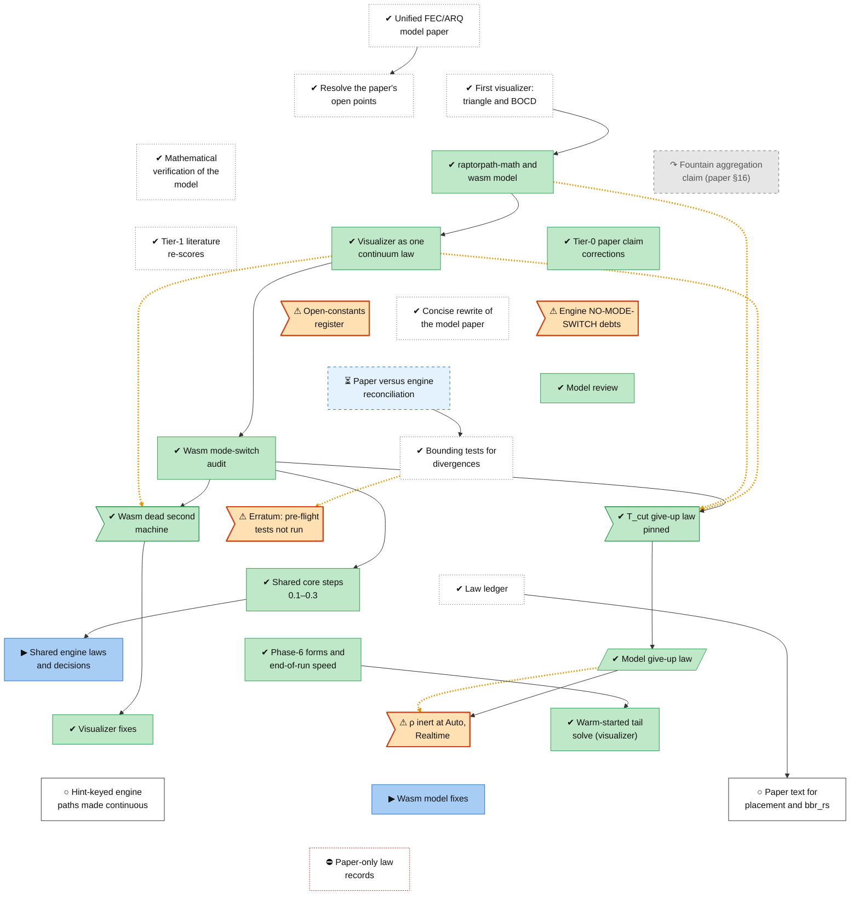

<!-- Generated by tools/roadmap/build.py from docs/roadmap/nodes.yaml. Do not edit. -->

# model - model and paper

Scope: the model, paper and visualizer: paper, wasm L0 model, NO-MODE-SWITCH audits, model-vs-engine bounds.

[Back to the roadmap](../../roadmap.md) · [legend](../../roadmap.md#legend)

<!-- BEGIN GENERATED: track-model -->

<!-- END GENERATED: track-model -->

## Node table

<!-- BEGIN GENERATED: table-model -->
| id | title | state | outcome | headline | evidence | depends_on |
|---|---|---|---|---|---|---|
| `model-shared-core` | Shared engine laws and decisions | in-progress | unrated | steps 0.1-0.3 merged; core moves ride guard α | ADR-0077; derivation shared-core-design.md; derivation visualizer-drift-2026-11.md; status §58 | model-wasm-audit, infra-restructure, model-shared-core-0 |
| `model-shared-core-0` | Shared core steps 0.1–0.3 | done | successful |  | status "Owner decisions (2026-11-14)" erratum; commit e9188e01; branch shared-core-0; ADR-0077 | model-user-wasm-calls |
| `model-endspeed` | Phase-6 forms and end-of-run speed | done | successful |  | status §58 Amendment 3; commit e5cef8ce; branch endspeed-relaid | meas-s58-session |
| `model-warm-start` | Warm-started tail solve (visualizer) | done | successful |  | commit e614ec64; commit 95e926d4; commit aefe6d97; branch warm-start-2; branch warm-scan; branch warm-scan-clean | model-endspeed |
| `model-paper-v1` | Unified FEC/ARQ model paper | done | unrated |  | commit fc5867a3 |  |
| `model-open-points` | Resolve the paper's open points | done | unrated |  | commit adf7674c; commit bcda035a; commit c25e36e6; commit 82fa398f; commit bdf796ea; commit 298e1c00 | model-paper-v1 |
| `model-math-verification` | Mathematical verification of the model | done | unrated |  | commit 3a8fdfcb |  |
| `model-visualizer-v1` | First visualizer: triangle and BOCD | done | unrated |  | commit 4cd3abc3; commit 468b7580; commit aa56ef51 |  |
| `model-wasm-l0` | raptorpath-math and wasm model | done | successful |  | branch multipath visualizer | model-visualizer-v1 |
| `model-vis-continuum` | Visualizer as one continuum law | done | successful |  | commit b0e16638 | cod-unified-span, model-wasm-l0 |
| `model-mode-switch-debts` | Engine NO-MODE-SWITCH debts | in-progress | unrated |  | status §3.3 row `net/emit_source.rs` (`protocol_hint == Realtime`); status §3.3 row `net/sender_policy.rs` `use_packing`; status §3.3 row `scheduler/copa.rs` `queue_target_mult`; status §3.3 row `gates/scheduler_gates.rs` `copa_compete_active` (`RWM_COPA_COMPETE`); status §3.3 row `reliable` boolean branches in the window sender/receiver; status §3.3 row `symbol_size_for_hint`; status §3.3 row the CLI's ρ; ADR-0078 decision 2 |  |
| `model-open-constants` | Open-constants register | in-progress | unrated |  | status §3.4 |  |
| `model-review-37` | Model review | done | successful |  | status §37 |  |
| `model-paper-recon` | Paper versus engine reconciliation | in-progress | unrated |  | derivation w3-paper-reconciliation.md (branch paper-recon); branch paper-recon |  |
| `model-bound-tests` | Bounding tests for divergences | done | unrated |  | branch bound-tests | model-paper-recon |
| `model-wasm-audit` | Wasm mode-switch audit | done | successful |  | derivation wasm-modeswitch-audit.md (branch wasm-modeswitch-audit); branch wasm-modeswitch-audit | model-vis-continuum, infra-restructure |
| `model-defect-tcut` | T_cut give-up law pinned | done | unrated |  | status §3.10 item 1; commit 56388aee | model-wasm-audit |
| `model-defect-dead-machine` | Wasm dead second machine | done | unrated |  | status §3.10 item 3; status "Owner decisions (2026-11-14)" erratum; commit 0857a0cd | model-wasm-audit |
| `model-bound-tests-unrun` | Erratum: pre-flight tests not run | in-progress | unrated |  | status §53 Erratum 2 (cbe2be3f) |  |
| `model-law-ledger` | Law ledger | done | unrated |  | branch law-ledger (head 4f84ce63); docs/derivations/law-ledger.md; docs/derivations/law-ledger.yaml; status §55 |  |
| `model-fix-hint-keyed-paths` | Hint-keyed engine paths made continuous | next | unrated |  | status §3.3 additions (695c7f4f); docs/derivations/s51-design.md §1.2; status §51 block 51 Result (T2 Realtime FAIL; finding 2, S08 at c8) | meas-s51-session |
| `model-user-wasm-calls` | Owner calls on wasm audit | done | n/a |  | status "Owner decisions (2026-11-14)"; status §3.10 items 1 and 3; docs/derivations/wasm-modeswitch-audit.md | model-wasm-audit |
| `model-giveup-law` | Model give-up law | done | successful |  | status "Owner decisions (2026-11-14)" item 3; commit 56388aee; derivation giveup-law-model.md; paper §5.6 | model-user-wasm-calls, model-defect-tcut |
| `model-viz-fix` | Visualizer fixes | done | successful |  | status "Owner decisions (2026-11-14)" erratum; commit 0857a0cd; branch viz-fix | model-user-wasm-calls, model-defect-dead-machine |
| `model-defect-rho-inert` | ρ inert at Auto, Realtime | in-progress | unrated |  | law ledger M04; commit 8aeb0254; status "Owner decisions (2026-11-14)" item 3 | model-giveup-law |
| `model-user-weak-identity` | Owner call: weaker binary identity | done | n/a |  | status §58 Part B result | meas-s58-session |
| `model-wasm-fixes` | Wasm model fixes | in-progress | unrated |  | CLAUDE.md NO-MODE-SWITCH; plan W7 phase 6 | model-user-wasm-calls, rate-law-reconcile, store-engine-form-impl |
| `model-fix-paper-p2` | Paper text for placement and bbr_rs | next | unrated |  | law ledger rows K05, K10 | model-law-ledger |
| `model-fix-paper-p3` | Paper-only law records | blocked | unrated |  | law ledger rows S10, C08, C10, E12 | meas-s51-session, store-fix-maxbw-minrtt |
| `model-user-three-dials` | Owner call: three dials | done | n/a |  | commit 0a55b65c |  |
| `model-user-no-mode-switch` | Owner rule: no mode switches | done | n/a |  | commit ee51b9c4; commit f2f1c782; CLAUDE.md |  |
| `model-s16-fountain` | Fountain aggregation claim (paper §16) | abandoned | superseded |  | commit 065ccbdd; commit e24541c6; commit 88b7432f; paper §16; commit 1412f280 |  |
| `model-tier1-rescores` | Tier-1 literature re-scores | done | unrated |  | commit 80376c63 |  |
| `model-tier0-corrections` | Tier-0 paper claim corrections | done | successful |  | commit 46c3e6a6; commit 515e4143 |  |
| `model-paper-rewrite` | Concise rewrite of the model paper | done | unrated |  | commit e22920d5; docs/fec-arq-model.md |  |

### Details per node

| id | title | notes | evidence |
|---|---|---|---|
| `model-shared-core` | Shared engine laws and decisions | Owner decision 2026-11-14. Engine moves are zero-behaviour-change (pins, ns bench, guard). Store, recovery and placement stay unshared until the model has a queue and gap reports. Steps 0.1-0.3 are model-shared-core-0. §58 Part B: only edits that move no existing line meet the identical-sha waiver, so step 1.2, the span-seat extraction and every move into raptorpath-core ride guard α; a weaker identity rule is an owner call (model-user-weak-identity). | ADR-0077; derivation shared-core-design.md; derivation visualizer-drift-2026-11.md; status §58 |
| `model-shared-core-0` | Shared core steps 0.1–0.3 | Step 0.1 the empty raptorpath-core crate with its deny-list test (e20ef491), 0.2 non-vacuous source walks (c47274c2), 0.3 decision_trace_pin captured on the untouched tree (5c933677). Its first Linux run, in §58: 7/7. | status "Owner decisions (2026-11-14)" erratum; commit e9188e01; branch shared-core-0; ADR-0077 |
| `model-endspeed` | Phase-6 forms and end-of-run speed | ADR-0076 phase 6's five span-law closed forms move from the wasm model to raptorpath-math (span_forms.rs, declared below the engine code so no existing line shifts), with the visualizer's end-of-run speed fix (memoised r* DP over the live deficit band, memoised tail solve, 12 ms frame budget); outputs bit-identical against cfg(test) copies of the old functions, goldens unchanged. Supersedes the branches phase6-forms and viz-endspeed. | status §58 Amendment 3; commit e5cef8ce; branch endspeed-relaid |
| `model-warm-start` | Warm-started tail solve (visualizer) | Visualizer only, no engine bytes, not in status. e614ec64: the tail solve is warm-started, bit-identical to compute_r_star_exact; 95e926d4: the no-hint solve gallops up from k = 0 and the step budget is predictive. The branches warm-scan and warm-scan-clean (not merged) hold the evidence tests (fail(k) monotonicity scan, bit-equality harness; long tests #[ignore]). | commit e614ec64; commit 95e926d4; commit aefe6d97; branch warm-start-2; branch warm-scan; branch warm-scan-clean |
| `model-paper-v1` | Unified FEC/ARQ model paper | Direct landings 2026-03-21 to 2026-04-12: the rewrite (fc5867a3), multipath scheduling (Section 11), the taper function, PDF build and Section 14 (future directions). The open-points audit and its resolutions (2026-04-01..02) are their own node (model-open-points). | commit fc5867a3 |
| `model-open-points` | Resolve the paper's open points | Split 2026-11-16 from 'Unified FEC/ARQ model paper'. Appendix D audit (adf7674c), the 12 LOW-difficulty points (bcda035a), then the numbered resolutions, e.g. 'Resolve #11 (T_cut algorithm) and #12 (Mode 3 convergence)' (bdf796ea); C.4 and C.5 marked not applicable. | commit adf7674c; commit bcda035a; commit c25e36e6; commit 82fa398f; commit bdf796ea; commit 298e1c00 |
| `model-math-verification` | Mathematical verification of the model | 23 tests, three paper errors found (2026-04-12). Folded the remaining April commits (2026-04-01..12), no separate development. | commit 3a8fdfcb |
| `model-visualizer-v1` | First visualizer: triangle and BOCD | Split 2026-11-16 from 'raptorpath-math and wasm L0 model': the first interactive visualizer (2026-04-07..10), connected to the triangle (4cd3abc3), with per-symbol P_lost mixing and T_cut stop (4a0890ac), adaptive r (BOCD) and the real RLC codec in wasm (468b7580), a calibrated channel (aa56ef51). | commit 4cd3abc3; commit 468b7580; commit aa56ef51 |
| `model-wasm-l0` | raptorpath-math and wasm model | Folds paper §11.1 open question 6 (do the three channel implementations agree). raptorpath-math and raptorpath-wasm crates (da837ee9, 2026-04-08) so the visualizer runs the real Rust code; the April visualizer itself is model-visualizer-v1. | branch multipath visualizer |
| `model-vis-continuum` | Visualizer as one continuum law | 2026-07-28: "kill the mode-switch class - ONE continuum law, executable invariant, standing rule" (G434). | commit b0e16638 |
| `model-mode-switch-debts` | Engine NO-MODE-SWITCH debts | Status §3.3 lists seven hint- or ρ-keyed sites: the Realtime duplicate source send, use_packing (now a sender-only choice: ADR-0078 removed the receive-side packing bit), Copa's queue_target_mult, copa_compete_active, the reliable branches, symbol_size_for_hint (from the §51 design) and the CLI's ρ that follows the hint. Undated in the raw records (status §3 since 2026-09-27). Folds paper §11.1 open question 13. Open: none of the seven is fixed. | status §3.3 row `net/emit_source.rs` (`protocol_hint == Realtime`); status §3.3 row `net/sender_policy.rs` `use_packing`; status §3.3 row `scheduler/copa.rs` `queue_target_mult`; status §3.3 row `gates/scheduler_gates.rs` `copa_compete_active` (`RWM_COPA_COMPETE`); status §3.3 row `reliable` boolean branches in the window sender/receiver; status §3.3 row `symbol_size_for_hint`; status §3.3 row the CLI's ρ; ADR-0078 decision 2 |
| `model-open-constants` | Open-constants register | 21 unprovenanced constants (FORMULA-FIRST); undated raw record. Folds paper §11.1 open questions 8 and 9. Open: no constant is provenanced yet. | status §3.4 |
| `model-review-37` | Model review | Found the idle-leg stale-price lock-out (-> §38). Dates: status-section end dates are the section file's last edit, not the verdict date. | status §37 |
| `model-paper-recon` | Paper versus engine reconciliation | Plan W3.7 marks it done (18 true, 8 stale, 3 fixed); the branch is unmerged and the rate-law questions wait on the owner (plan user decision 11). | derivation w3-paper-reconciliation.md (branch paper-recon); branch paper-recon |
| `model-wasm-audit` | Wasm mode-switch audit | Audit before ADR-0076 phase 6; 27 hint-keyed sites; fixes wait on owner calls. | derivation wasm-modeswitch-audit.md (branch wasm-modeswitch-audit); branch wasm-modeswitch-audit |
| `model-defect-tcut` | T_cut give-up law pinned | Fixed in the model by the give-up law (ii) (model-giveup-law, merge 56388aee): the sim's give-up horizon is D(δ) with the budget min(1 − ρ, R), and nothing in raptorpath-wasm's sim or the page calls find_t_cut any more (the exported wasm wrapper and the page's JS wrapper remain, unused). find_t_cut's search cap stays as known raptorpath-math debt (W14) with its bounding test (CLAUDE.md); law ledger C13 has not been re-labelled. | status §3.10 item 1; commit 56388aee |
| `model-defect-dead-machine` | Wasm dead second machine | Fixed by viz-fix (model-viz-fix): the classic-hint machine is removed and the named hints are an alias table onto the one continuum constructor. Law ledger M03 has not been re-labelled. | status §3.10 item 3; status "Owner decisions (2026-11-14)" erratum; commit 0857a0cd |
| `model-bound-tests-unrun` | Erratum: pre-flight tests not run | No raw record. Status §53 Erratum 2 (cbe2be3f): the visualizer build, the native golden test and the bound-tests wasm pool test were registered for the pre-flight but not run; they move to the next VM session's pre-flight. | status §53 Erratum 2 (cbe2be3f) |
| `model-law-ledger` | Law ledger | Recorded in status §55. The correctness audit of every shipped law (70 rows, ranked fix order). Merged to main (9e3764c9). Qualified by §55 Erratum 1: its item 7 (swap the recovery clocks to a wire RTT) is withdrawn. Rows owing no fix (rank 64-73 and C12): E05, E06, F06, R08, D01, D02, D03, D04, D05, D06, and C12 (an off arm, re-run or retire). | branch law-ledger (head 4f84ce63); docs/derivations/law-ledger.md; docs/derivations/law-ledger.yaml; status §55 |
| `model-fix-hint-keyed-paths` | Hint-keyed engine paths made continuous | Law ledger: S08, S09 (moved from rate-fix-rho-realtime). queue_target_mult is K01's, which cc-copa-consumers deletes or reduces; whichever lands first removes the table. The symbol-size row has no ledger row yet (s51-design P6). Covers model-mode-switch-debts. Done when: the five hint-keyed behaviours (source-symbol size, the Realtime duplicate send, packing and batching scope, queue_target_mult, the default ρ) are each one formula continuous in δ (or ρ an independent dial), with continuity tests through every preset (±2 %), after §51 has measured the step. | status §3.3 additions (695c7f4f); docs/derivations/s51-design.md §1.2; status §51 block 51 Result (T2 Realtime FAIL; finding 2, S08 at c8) |
| `model-user-wasm-calls` | Owner calls on wasm audit | Done when: the owner rules on the audit's five calls (including removal or cfg(test) of the dead second machine and the T_cut floor), recorded in status. | status "Owner decisions (2026-11-14)"; status §3.10 items 1 and 3; docs/derivations/wasm-modeswitch-audit.md |
| `model-giveup-law` | Model give-up law | Replaces V5/V6 (the cartoon's budget choice) and W14 (the sim's T_cut horizon); the sim stops calling find_t_cut. The 1 − ρ cap is a model law the engine lacks, so it has its paper §5.6 line, a §11.3 row and a bounding test; dropping T_cut diverges at harsh Bulk (8–26 of 100 slider positions), also bounded by a test. Goldens unchanged. | status "Owner decisions (2026-11-14)" item 3; commit 56388aee; derivation giveup-law-model.md; paper §5.6 |
| `model-viz-fix` | Visualizer fixes | Also: the W11 β = 0 guard is gone, a W22 bounding test is added, the store text is per cell (2048 is a clamp measured pinned; 512·N an underived constant), the model-vs-engine table rows C04 and S05 are fixed. Goldens unchanged; 39 native wasm tests and both mjs gates pass. | status "Owner decisions (2026-11-14)" erratum; commit 0857a0cd; branch viz-fix |
| `model-defect-rho-inert` | ρ inert at Auto, Realtime | Ledger M04: DEGENERATE (ρ inert at Auto and Realtime under the shipped R). The same-day erratum: this holds under the shipped (cut) R only; under the block-exact candidate C6, ρ would act on 1–4 of 100 positions. It waits on the P_fec work (rate-pfec-continuous, rate-pfec-oracle). | law ledger M04; commit 8aeb0254; status "Owner decisions (2026-11-14)" item 3 |
| `model-user-weak-identity` | Owner call: weaker binary identity | Declined 2026-11-16: ADR-0077's identical-sha waiver stays; zero-behaviour steps are stacked into one guard run instead (Owner decisions 2026-11-16, item 5). | status §58 Part B result |
| `model-wasm-fixes` | Wasm model fixes | Law ledger: M01, M02, M03, M04, C13 (P3): the 512 pool waits for F01 (M01); the cartoon shed and T_cut wait for R03. Done when: the dead second machine and the T_cut steps are resolved per the owner calls, with continuity tests through every preset in test_visualizer.mjs and a deliberate golden re-capture if the model changes. Progress 2026-11-14: viz-fix (model-viz-fix) removed the dead machine and the W11 guard; the give-up law (ii) (model-giveup-law) replaced the cartoon shed choice and T_cut. | CLAUDE.md NO-MODE-SWITCH; plan W7 phase 6 |
| `model-fix-paper-p2` | Paper text for placement and bbr_rs | Law ledger: K05, K10. Done when: the paper carries the placement cost lines (A.4) and the bbr_rs minimum-filter sign, checked against the code. | law ledger rows K05, K10 |
| `model-fix-paper-p3` | Paper-only law records | Law ledger: S10, C08, C10, E12. Done when: the taper grant law, the gap-report minimum interval, the reactive repair margin and the send-rate anchor each have a paper line with provenance. | law ledger rows S10, C08, C10, E12 |
| `model-user-three-dials` | Owner call: three dials | Owner decision 2026-03-21 (session record): fix any two of the three, and the channel determines the third. Written into the paper the same day as a new §6.10 with worked examples. | commit 0a55b65c |
| `model-user-no-mode-switch` | Owner rule: no mode switches | Owner statements 2026-07-02 (the protocol should have no hard cutoffs) and 2026-07-06 (no more switching between codes or between window and block mode), from the session record. Codified in CLAUDE.md; its provenance text was corrected on 2026-07-28 and a wrong attribution reverted on 2026-08-06 (the two commits in evidence). | commit ee51b9c4; commit f2f1c782; CLAUDE.md |
| `model-s16-fountain` | Fountain aggregation claim (paper §16) | The 2026-07-06 rewrite as reliable windowed multipath is folded in meas-c8-aggregation-arc. | commit 065ccbdd; commit e24541c6; commit 88b7432f; paper §16; commit 1412f280 |
| `model-tier1-rescores` | Tier-1 literature re-scores | Split 2026-11-20 from store-delta-cap. Unrated: one reading supported, one refuted. | commit 80376c63 |
| `model-tier0-corrections` | Tier-0 paper claim corrections | Split 2026-11-20 from store-delta-cap. | commit 46c3e6a6; commit 515e4143 |

### Folded items per node

- `model-shared-core-0`: Shared core steps 0.1–0.3
  - commit e20ef491
  - commit c47274c2
  - commit 5c933677
- `model-endspeed`: Phase-6 forms and end-of-run speed
  - commit e5d04df4
  - commit cca84f53
  - commit 71ad6b72
- `model-warm-start`: Warm-started tail solve (visualizer)
  - branch warm-start
  - branch viz-frame
  - commit 6c782567
- `model-paper-v1`: Unified FEC/ARQ model paper
  - commit 749112b9
  - commit 482f1ee0
  - commit a7a965f3
  - commit d1296d19
  - commit 3ae61464
  - commit 4d1962d6
  - commit 27b4e83c
  - commit 09650e2d
  - commit fd4dab99
  - commit 55e9b19d
  - commit 8a5fe92f
  - commit ff873e13
  - commit 34e9a3bb
  - commit 828d3f7c
  - commit ac8b3e60
  - Research approaches for reliability and performance (2026-03-13, commit b6e2c6c3)
  - ASCII packet-flow visualization document (2026-03-17, commit d6c77ae8)
  - Finite encoder window truncation resolved by retransmit buffer (2026-03-21, commit 529e4066)
  - Progressive explanation of FEC and ARQ in the model paper (2026-03-21, commit 1cd108b6)
  - Related work and model extensions in the paper (2026-03-21, commit fe711ff7)
  - Extract conversation transcripts tool (2026-03-22, commit 6a1be38e)
  - Three-stream conceptual view of the paper model (2026-03-22, commit d7903a4d)
  - Paper abstract and Gilbert-Elliott channel rationale (2026-03-22, commit cefdc94b, commit 9f68c477)
- `model-open-points`: Resolve the paper's open points
  - commit 2339db61
  - commit 8ad3609e
  - commit 2b0622cf
  - commit f6e0c4b2
  - commit 62977a39
  - commit 2f3fe69c
  - Poisson per-symbol repair-rate model superseded by the binomial/normal one (2026-04-02, commit 298e1c00)
- `model-math-verification`: Mathematical verification of the model
  - commit 1d29f454
  - commit 9381d945
  - commit 9a30f408
  - Paper model errors and arithmetic fixed (2026-07-02, commit 43951807d)
- `model-visualizer-v1`: First visualizer: triangle and BOCD
  - commit ec547074
  - commit e49fbc80
  - commit 4a0890ac
  - commit 9b922b5f
  - Visualizer moved into raptorpath-visualizer/ with camelCase wasm wrappers (2026-04-10, commit 72258063a, commit 96145766c)
- `model-wasm-l0`: raptorpath-math and wasm model
  - commit da837ee9
  - branch vis UI polish
  - branch vis-semantics
  - paper §11.1 open question 6
  - commit 3d786986
  - commit 61f47e22
  - commit 8f18b907
  - commit 21d44b4c
  - commit 96145766
  - Visualizer runs the shared production controller (2026-07-02, commit 3fcb2c45, commit bc94478d)
  - Sim ARQ driven by P_lost so Bulk beats Realtime (2026-07-02, commit 9edc5493)
  - Visualizer v2 custom delta-rho mode and build-time engine tests (2026-07-02, commit b09158ca)
  - Per-symbol delivery latency and jitter in the engine (2026-07-02, commit c328d222)
  - Visualizer latency readouts and hover explanations (2026-07-02, commit 74301e83)
  - Visualizer overhead split into channel floor and excess (2026-07-03, commit 15674b37)
  - Visualizer Auto window slider and saturation-pressure gauge (2026-07-04, commit 5426274e, commit aa87d818)
- `model-vis-continuum`: Visualizer as one continuum law
  - commit 149a0e48
  - commit 61dc8a18
  - commit 867d1976
  - Visualizer refresh to the unified machine (2026-07-28, commit 6ae44967, commit c84c10f8, commit addb23e2, commit 9b527041)
- `model-mode-switch-debts`: Engine NO-MODE-SWITCH debts
  - paper §11.1 open question 13
- `model-open-constants`: Open-constants register
  - paper §11.1 open question 8
  - paper §11.1 open question 9
  - Open-constants register rows for 16.81 to 16.83 (2026-09-08, commit de9b91e3)
- `model-giveup-law`: Model give-up law
  - branch giveup-ii
  - commit 72c42721
  - commit b6b57764
  - commit c42331e9
  - commit e0a2f777
  - commit 82aeca41
- `model-viz-fix`: Visualizer fixes
  - commit d9a2a3d4
  - commit ac3ecd13
  - commit 7472ba31
  - commit bcdc7a9d
  - commit 08909b7e
  - commit 3bdc4cb5
- `model-user-no-mode-switch`: Owner rule: no mode switches
  - Owner rule: no hard cutoffs (2026-07-02, session record)
  - Owner rule: no mid-stream protocol switch (2026-07-06, session record)
- `model-s16-fountain`: Fountain aggregation claim (paper §16)
  - branch §16 Fountain Multipath Aggregation
- `model-tier1-rescores`: Tier-1 literature re-scores
  - branch Tier-1 re-scores
- `model-tier0-corrections`: Tier-0 paper claim corrections
  - branch Tier-0 corrections
<!-- END GENERATED: table-model -->
