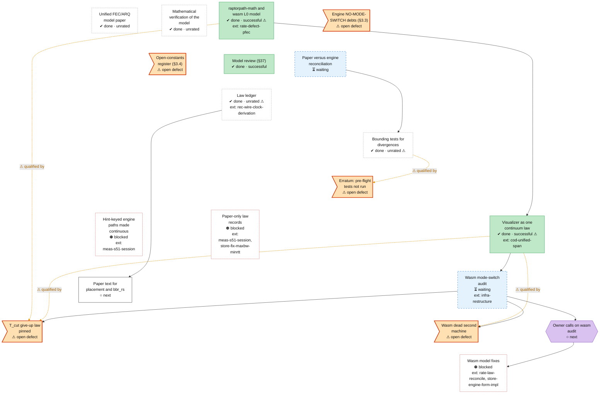

<!-- Generated by tools/roadmap/build.py from docs/roadmap/nodes.yaml. Do not edit. -->

# model - model and paper

Scope: the model, paper and visualizer: paper, wasm L0 model, NO-MODE-SWITCH audits, model-vs-engine bounds.

[Back to the roadmap](../../roadmap.md)

<!-- BEGIN GENERATED: track-model -->

<!-- END GENERATED: track-model -->

## Node table

<!-- BEGIN GENERATED: table-model -->
| id | title | state | outcome | headline | evidence | depends_on |
|---|---|---|---|---|---|---|
| `model-paper-v1` | Unified FEC/ARQ model paper | done | unrated |  | commit fc5867a3 |  |
| `model-math-verification` | Mathematical verification of the model | done | unrated |  | commit 3a8fdfcb |  |
| `model-wasm-l0` | raptorpath-math and wasm L0 model | done | successful |  | branch multipath visualizer |  |
| `model-vis-continuum` | Visualizer as one continuum law | done | successful |  | commit b0e16638 | cod-unified-span, model-wasm-l0 |
| `model-mode-switch-debts` | Engine NO-MODE-SWITCH debts (§3.3) | in-progress | unrated |  | status §3.3 row `net/emit_source.rs` (`protocol_hint == Realtime`); status §3.3 row `net/sender_policy.rs` `use_packing`; status §3.3 row `scheduler/copa.rs` `queue_target_mult`; status §3.3 row `gates/scheduler_gates.rs` `copa_compete_active` (`RWM_COPA_COMPETE`); status §3.3 row `reliable` boolean branches in the window sender/receiver |  |
| `model-open-constants` | Open-constants register (§3.4) | in-progress | unrated |  | status §3.4 |  |
| `model-review-37` | Model review (§37) | done | successful |  | status §37 |  |
| `model-paper-recon` | Paper versus engine reconciliation | in-progress | unrated |  | derivation w3-paper-reconciliation.md (branch paper-recon); branch paper-recon |  |
| `model-bound-tests` | Bounding tests for divergences | done | unrated |  | branch bound-tests | model-paper-recon |
| `model-wasm-audit` | Wasm mode-switch audit | in-progress | successful |  | derivation wasm-modeswitch-audit.md (branch wasm-modeswitch-audit); branch wasm-modeswitch-audit | model-vis-continuum, infra-restructure |
| `model-defect-tcut` | T_cut give-up law pinned | in-progress | unrated |  | status §3.10 item 1 | model-wasm-audit |
| `model-defect-dead-machine` | Wasm dead second machine | in-progress | unrated |  | status §3.10 item 3 | model-wasm-audit |
| `model-bound-tests-unrun` | Erratum: pre-flight tests not run | in-progress | unrated |  | status §53 Erratum 2 (cbe2be3f) |  |
| `model-law-ledger` | Law ledger | done | unrated |  | branch law-ledger (head 4f84ce63); docs/derivations/law-ledger.md; docs/derivations/law-ledger.yaml; status §55 |  |
| `model-fix-hint-keyed-paths` | Hint-keyed engine paths made continuous | blocked | unrated |  | status §3.3 additions (695c7f4f); docs/derivations/s51-design.md §1.2 | meas-s51-session |
| `model-user-wasm-calls` | Owner calls on wasm audit | next | n/a |  | status §3.10 items 1 and 3; docs/derivations/wasm-modeswitch-audit.md | model-wasm-audit |
| `model-wasm-fixes` | Wasm model fixes | blocked | unrated |  | CLAUDE.md NO-MODE-SWITCH; plan W7 phase 6 | model-user-wasm-calls, rate-law-reconcile, store-engine-form-impl |
| `model-fix-paper-p2` | Paper text for placement and bbr_rs | next | unrated |  | law ledger rows K05, K10 | model-law-ledger |
| `model-fix-paper-p3` | Paper-only law records | blocked | unrated |  | law ledger rows S10, C08, C10, E12 | meas-s51-session, store-fix-maxbw-minrtt |

### Details per node

| id | title | notes | evidence |
|---|---|---|---|
| `model-paper-v1` | Unified FEC/ARQ model paper | Direct landings 2026-03-21 to 2026-04-10. | commit fc5867a3 |
| `model-math-verification` | Mathematical verification of the model | 23 tests, three paper errors found (2026-04-12). | commit 3a8fdfcb |
| `model-wasm-l0` | raptorpath-math and wasm L0 model | Folds paper §11.1 open question 6 (do the three channel implementations agree). | branch multipath visualizer |
| `model-vis-continuum` | Visualizer as one continuum law | 2026-07-28: "kill the mode-switch class - ONE continuum law, executable invariant, standing rule" (G434). | commit b0e16638 |
| `model-mode-switch-debts` | Engine NO-MODE-SWITCH debts (§3.3) | Five hint- or ρ-keyed engine sites; undated in the raw records (status §3 since 2026-09-27). Folds paper §11.1 open question 13. Open: none of the five sites is fixed. | status §3.3 row `net/emit_source.rs` (`protocol_hint == Realtime`); status §3.3 row `net/sender_policy.rs` `use_packing`; status §3.3 row `scheduler/copa.rs` `queue_target_mult`; status §3.3 row `gates/scheduler_gates.rs` `copa_compete_active` (`RWM_COPA_COMPETE`); status §3.3 row `reliable` boolean branches in the window sender/receiver |
| `model-open-constants` | Open-constants register (§3.4) | 21 unprovenanced constants (FORMULA-FIRST); undated raw record. Folds paper §11.1 open questions 8 and 9. Open: no constant is provenanced yet. | status §3.4 |
| `model-review-37` | Model review (§37) | Found the idle-leg stale-price lock-out (-> §38). Dates: status-section end dates are the section file's last edit, not the verdict date. | status §37 |
| `model-paper-recon` | Paper versus engine reconciliation | Plan W3.7 marks it done (18 true, 8 stale, 3 fixed); the branch is unmerged and the rate-law questions wait on the owner (plan user decision 11). | derivation w3-paper-reconciliation.md (branch paper-recon); branch paper-recon |
| `model-wasm-audit` | Wasm mode-switch audit | Audit before ADR-0076 phase 6; 27 hint-keyed sites; fixes wait on owner calls. | derivation wasm-modeswitch-audit.md (branch wasm-modeswitch-audit); branch wasm-modeswitch-audit |
| `model-bound-tests-unrun` | Erratum: pre-flight tests not run | No raw record. Status §53 Erratum 2 (cbe2be3f): the visualizer build, the native golden test and the bound-tests wasm pool test were registered for the pre-flight but not run; they move to the next VM session's pre-flight. | status §53 Erratum 2 (cbe2be3f) |
| `model-law-ledger` | Law ledger | Recorded in status §55. The correctness audit of every shipped law (70 rows, ranked fix order). Merged to main (9e3764c9). Qualified by §55 Erratum 1: its item 7 (swap the recovery clocks to a wire RTT) is withdrawn. Rows owing no fix (rank 61-70 and C12): E05, E06, F06, R08, D01, D02, D03, D04, D05, D06, and C12 (an off arm, re-run or retire). | branch law-ledger (head 4f84ce63); docs/derivations/law-ledger.md; docs/derivations/law-ledger.yaml; status §55 |
| `model-fix-hint-keyed-paths` | Hint-keyed engine paths made continuous | Law ledger: S08, S09 (moved from rate-fix-rho-realtime). queue_target_mult is K01's, which cc-copa-consumers deletes or reduces; whichever lands first removes the table. The symbol-size row has no ledger row yet (s51-design P6). Covers model-mode-switch-debts. Done when: the five hint-keyed behaviours (source-symbol size, the Realtime duplicate send, packing and batching scope, queue_target_mult, the default ρ) are each one formula continuous in δ (or ρ an independent dial), with continuity tests through every preset (±2 %), after §51 has measured the step. | status §3.3 additions (695c7f4f); docs/derivations/s51-design.md §1.2 |
| `model-user-wasm-calls` | Owner calls on wasm audit | Done when: the owner rules on the audit's five calls (including removal or cfg(test) of the dead second machine and the T_cut floor), recorded in status. | status §3.10 items 1 and 3; docs/derivations/wasm-modeswitch-audit.md |
| `model-wasm-fixes` | Wasm model fixes | Law ledger: M01, M02, M03, M04, C13 (P3): the 512 pool waits for F01 (M01); the cartoon shed and T_cut wait for R03. Done when: the dead second machine and the T_cut steps are resolved per the owner calls, with continuity tests through every preset in test_visualizer.mjs and a deliberate golden re-capture if the model changes. | CLAUDE.md NO-MODE-SWITCH; plan W7 phase 6 |
| `model-fix-paper-p2` | Paper text for placement and bbr_rs | Law ledger: K05, K10. Done when: the paper carries the placement cost lines (A.4) and the bbr_rs minimum-filter sign, checked against the code. | law ledger rows K05, K10 |
| `model-fix-paper-p3` | Paper-only law records | Law ledger: S10, C08, C10, E12. Done when: the taper grant law, the gap-report minimum interval, the reactive repair margin and the send-rate anchor each have a paper line with provenance. | law ledger rows S10, C08, C10, E12 |
<!-- END GENERATED: table-model -->
