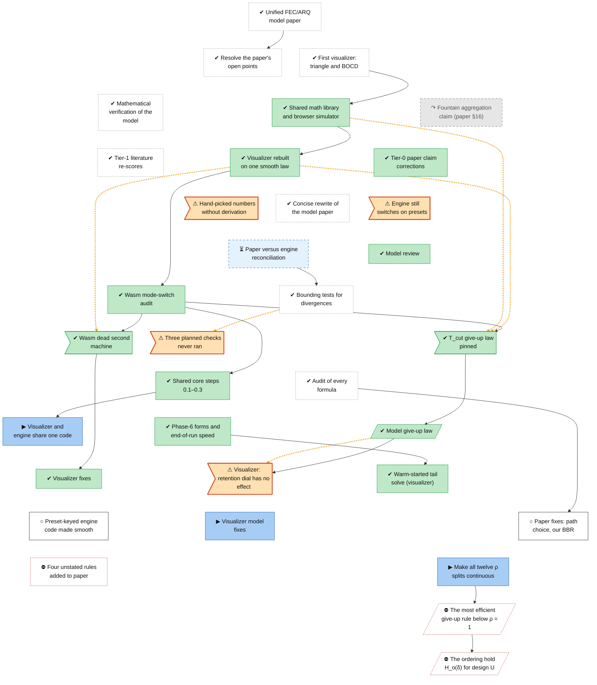

<!-- Generated by build.py from roadmap/nodes.yaml. Do not edit. -->

# model - model and paper

Scope: the model, paper and visualizer: paper, wasm L0 model, NO-MODE-SWITCH audits, model-vs-engine bounds.

[Back to the page](../../roadmap.md) · [legend](../../roadmap.md#legend)

<!-- BEGIN GENERATED: track-model -->

<!-- END GENERATED: track-model -->

## Node table

<!-- BEGIN GENERATED: table-model -->
| id | title | kind | lane | state | outcome | start | end | depends_on | replaced_by | qualified_by | headline | evidence |
|---|---|---|---|---|---|---|---|---|---|---|---|---|
| `model-shared-core` | Visualizer and engine share one code | infra | host-cargo | in-progress | unrated | 2026-11-14 |  | model-wasm-audit, infra-restructure, model-shared-core-0 |  |  | steps 0.1-0.3 merged; core moves ride guard α | ADR-0077; derivation shared-core-design.md; derivation visualizer-drift-2026-11.md; status §58 |
| `model-shared-core-0` | Shared core steps 0.1–0.3 | infra | host-cargo | done | successful | 2026-11-14 | 2026-11-14 | model-user-wasm-calls |  |  |  | status "Owner decisions (2026-11-14)" erratum; commit e9188e01; branch shared-core-0; ADR-0077 |
| `model-endspeed` | Phase-6 forms and end-of-run speed | mechanism | host-cargo | done | successful | 2026-11-14 | 2026-11-14 | meas-s58-session |  |  |  | status §58 Amendment 3; commit e5cef8ce; branch endspeed-relaid |
| `model-warm-start` | Warm-started tail solve (visualizer) | mechanism | host-cargo | done | successful | 2026-11-15 | 2026-11-15 | model-endspeed |  |  |  | commit e614ec64; commit 95e926d4; commit aefe6d97; branch warm-start-2; branch warm-scan; branch warm-scan-clean |
| `model-paper-v1` | Unified FEC/ARQ model paper | research | no-cargo | done | unrated | 2026-03-21 | 2026-04-12 |  |  |  |  | commit fc5867a3 |
| `model-open-points` | Resolve the paper's open points | research | no-cargo | done | unrated | 2026-04-01 | 2026-04-02 | model-paper-v1 |  |  |  | commit adf7674c; commit bcda035a; commit c25e36e6; commit 82fa398f; commit bdf796ea; commit 298e1c00 |
| `model-math-verification` | Mathematical verification of the model | research | host-cargo | done | unrated | 2026-04-12 | 2026-04-12 |  |  |  |  | commit 3a8fdfcb |
| `model-visualizer-v1` | First visualizer: triangle and BOCD | mechanism | host-cargo | done | unrated | 2026-04-07 | 2026-04-10 |  |  |  |  | commit 4cd3abc3; commit 468b7580; commit aa56ef51 |
| `model-wasm-l0` | Shared math library and browser simulator | infra | host-cargo | done | successful | 2026-04-08 | 2026-07-06 | model-visualizer-v1 |  | rate-defect-pfec, model-defect-tcut |  | branch multipath visualizer |
| `model-vis-continuum` | Visualizer rebuilt on one smooth law | mechanism | host-cargo | done | successful | 2026-07-28 | 2026-07-28 | cod-unified-span, model-wasm-l0 |  | model-defect-dead-machine, model-defect-tcut |  | commit b0e16638 |
| `model-mode-switch-debts` | Engine still switches on presets | defect-verdict | none | in-progress | unrated | 2026-09-27 |  |  |  |  |  | status §3.3 row `net/emit_source.rs` (`protocol_hint == Realtime`); status §3.3 row `net/sender_policy.rs` `use_packing`; status §3.3 row `scheduler/copa.rs` `queue_target_mult`; status §3.3 row `gates/scheduler_gates.rs` `copa_compete_active` (`RWM_COPA_COMPETE`); status §3.3 row `reliable` boolean branches in the window sender/receiver; status §3.3 row `symbol_size_for_hint`; status §3.3 row the CLI's ρ; ADR-0078 decision 2 |
| `model-open-constants` | Hand-picked numbers without derivation | defect-verdict | none | in-progress | unrated | 2026-09-27 |  |  |  |  |  | status §3.4 |
| `model-review-37` | Model review | research | no-cargo | done | successful | 2026-11-10 | 2026-11-10 |  |  |  |  | status §37 |
| `model-paper-recon` | Paper versus engine reconciliation | research | no-cargo | in-progress | unrated | 2026-11-12 |  |  |  |  |  | derivation w3-paper-reconciliation.md (branch paper-recon); branch paper-recon |
| `model-bound-tests` | Bounding tests for divergences | instrument | host-cargo | done | unrated | 2026-11-12 | 2026-11-12 | model-paper-recon |  | model-bound-tests-unrun |  | branch bound-tests |
| `model-wasm-audit` | Wasm mode-switch audit | research | no-cargo | done | successful | 2026-11-13 | 2026-11-14 | model-vis-continuum, infra-restructure |  |  |  | derivation wasm-modeswitch-audit.md (branch wasm-modeswitch-audit); branch wasm-modeswitch-audit |
| `model-defect-tcut` | T_cut give-up law pinned | defect-verdict | none | done | unrated | 2026-11-13 | 2026-11-14 | model-wasm-audit |  |  |  | status §3.10 item 1; commit 56388aee |
| `model-defect-dead-machine` | Wasm dead second machine | defect-verdict | none | done | unrated | 2026-11-13 | 2026-11-14 | model-wasm-audit |  |  |  | status §3.10 item 3; status "Owner decisions (2026-11-14)" erratum; commit 0857a0cd |
| `model-bound-tests-unrun` | Three planned checks never ran | defect-verdict | none | in-progress | unrated | 2026-11-13 |  |  |  |  |  | status §53 Erratum 2 (cbe2be3f) |
| `model-law-ledger` | Audit of every formula | research | no-cargo | done | unrated | 2026-11-13 | 2026-11-13 |  |  | rec-wire-clock-derivation |  | branch law-ledger (head 4f84ce63); docs/derivations/law-ledger.md; docs/derivations/law-ledger.yaml; status §55 |
| `model-fix-hint-keyed-paths` | Preset-keyed engine code made smooth | mechanism | host-cargo | next | unrated |  |  | meas-s51-session |  |  |  | status §3.3 additions (695c7f4f); docs/derivations/s51-design.md §1.2; status §51 block 51 Result (T2 Realtime FAIL; finding 2, S08 at c8) |
| `model-user-wasm-calls` | Owner calls on wasm audit | user-decision | user | done | n/a | 2026-11-14 | 2026-11-14 | model-wasm-audit |  |  |  | status "Owner decisions (2026-11-14)"; status §3.10 items 1 and 3; docs/derivations/wasm-modeswitch-audit.md |
| `model-giveup-law` | Model give-up law | law | host-cargo | done | successful | 2026-11-14 | 2026-11-14 | model-user-wasm-calls, model-defect-tcut |  | model-defect-rho-inert |  | status "Owner decisions (2026-11-14)" item 3; commit 56388aee; derivation giveup-law-model.md; paper §5.6 |
| `model-viz-fix` | Visualizer fixes | mechanism | host-cargo | done | successful | 2026-11-14 | 2026-11-14 | model-user-wasm-calls, model-defect-dead-machine |  |  |  | status "Owner decisions (2026-11-14)" erratum; commit 0857a0cd; branch viz-fix |
| `model-defect-rho-inert` | Visualizer: retention dial has no effect | defect-verdict | none | in-progress | unrated | 2026-11-14 |  | model-giveup-law |  |  |  | law ledger M04; commit 8aeb0254; status "Owner decisions (2026-11-14)" item 3 |
| `model-user-weak-identity` | Owner call: weaker binary identity | user-decision | user | done | n/a |  |  | meas-s58-session |  |  |  | status §58 Part B result |
| `model-wasm-fixes` | Visualizer model fixes | mechanism | host-cargo | in-progress | unrated |  |  | model-user-wasm-calls, rate-law-reconcile, store-engine-form-impl |  |  |  | CLAUDE.md NO-MODE-SWITCH; plan W7 phase 6 |
| `model-fix-paper-p2` | Paper fixes: path choice, our BBR | research | no-cargo | next | unrated |  |  | model-law-ledger |  |  |  | law ledger rows K05, K10 |
| `model-fix-paper-p3` | Four unstated rules added to paper | research | no-cargo | blocked | unrated |  |  | meas-s51-session, store-fix-maxbw-minrtt |  |  |  | law ledger rows S10, C08, C10, E12 |
| `model-user-three-dials` | Owner call: three dials | user-decision | user | done | n/a | 2026-03-21 | 2026-03-21 |  |  |  |  | commit 0a55b65c |
| `model-user-no-mode-switch` | Owner rule: no mode switches | user-decision | user | done | n/a | 2026-07-02 | 2026-08-06 |  |  |  |  | commit ee51b9c4; commit f2f1c782; CLAUDE.md |
| `model-s16-fountain` | Fountain aggregation claim (paper §16) | research | no-cargo | abandoned | superseded | 2026-07-04 | 2026-07-06 |  | rec-reliable-window |  |  | commit 065ccbdd; commit e24541c6; commit 88b7432f; paper §16; commit 1412f280 |
| `model-tier1-rescores` | Tier-1 literature re-scores | research | no-cargo | done | unrated | 2026-08-19 | 2026-08-19 |  |  |  |  | commit 80376c63 |
| `model-tier0-corrections` | Tier-0 paper claim corrections | research | no-cargo | done | successful | 2026-08-19 | 2026-08-19 |  |  |  |  | commit 46c3e6a6; commit 515e4143 |
| `model-paper-rewrite` | Concise rewrite of the model paper | simplification | no-cargo | done | unrated | 2026-09-27 | 2026-09-27 |  |  |  |  | commit e22920d5; docs/fec-arq-model.md |
| `model-rho-step-sites` | Make all twelve ρ splits continuous | mechanism | no-cargo | in-progress | unrated | 2026-11-20 |  | rec-evict-blocker-unresolved |  |  |  | ADR-0084 Amendment 1; docs/derivations/rho-step-sites.md |
| `model-skip-rule-efficiency` | The most efficient give-up rule below ρ = 1 | law | no-cargo | blocked | unrated | 2026-11-21 |  | rec-evict-blocker-unresolved, model-rho-step-sites |  |  |  | docs/derivations/skip-rule-efficiency.md |
| `model-adr84-amend2` | Owner call: last copy, ack pairs | user-decision | user | done | n/a | 2026-11-21 | 2026-11-21 | model-skip-rule-efficiency |  |  |  | ADR-0084 Amendment 2; docs/derivations/skip-rule-efficiency.md; paper §5.6 |
| `model-ordering-hold` | The ordering hold H_o(δ) for design U | law | no-cargo | blocked | unrated | 2026-11-21 |  | model-skip-rule-efficiency |  |  |  | docs/derivations/ordering-hold.md |

### Details per node

| id | title | verdict | headline | in plain words | notes | confirmed | waiting on | queue order | order reason |
|---|---|---|---|---|---|---|---|---|---|
| `model-shared-core` | Visualizer and engine share one code | Formulas move to raptorpath-math, decisions to raptorpath-core. | steps 0.1-0.3 merged; core moves ride guard α | Letting the visualizer call the same code as the engine, so the model cannot drift from it. | Owner decision 2026-11-14. Engine moves are zero-behaviour-change (pins, ns bench, guard). Store, recovery and placement stay unshared until the model has a queue and gap reports. Steps 0.1-0.3 are model-shared-core-0. §58 Part B: only edits that move no existing line meet the identical-sha waiver, so step 1.2, the span-seat extraction and every move into raptorpath-core ride guard α; a weaker identity rule is an owner call (model-user-weak-identity). Was titled 'Shared engine laws and decisions'. |  |  |  |  |
| `model-shared-core-0` | Shared core steps 0.1–0.3 | The shared-core steps 0.1–0.3 are merged (main `e9188e01`). The engine edits are test-only. |  |  | Step 0.1 the empty raptorpath-core crate with its deny-list test (e20ef491), 0.2 non-vacuous source walks (c47274c2), 0.3 decision_trace_pin captured on the untouched tree (5c933677). Its first Linux run, in §58: 7/7. |  |  |  |  |
| `model-endspeed` | Phase-6 forms and end-of-run speed | It merges on ADR-0077's literal waiver. The line-shift explanation holds for the math crate too. |  |  | ADR-0076 phase 6's five span-law closed forms move from the wasm model to raptorpath-math (span_forms.rs, declared below the engine code so no existing line shifts), with the visualizer's end-of-run speed fix (memoised r* DP over the live deficit band, memoised tail solve, 12 ms frame budget); outputs bit-identical against cfg(test) copies of the old functions, goldens unchanged. Supersedes the branches phase6-forms and viz-endspeed. |  |  |  |  |
| `model-warm-start` | Warm-started tail solve (visualizer) | viz: step budget back to 12 ms (predictive check kept); the 4 ms budget cut tail playback 8-20 % without reducing missed frames (browser acceptance: misses come from software rendering) |  |  | Visualizer only, no engine bytes, not in status. e614ec64: the tail solve is warm-started, bit-identical to compute_r_star_exact; 95e926d4: the no-hint solve gallops up from k = 0 and the step budget is predictive. The branches warm-scan and warm-scan-clean (not merged) hold the evidence tests (fail(k) monotonicity scan, bit-equality harness; long tests #[ignore]). |  |  |  |  |
| `model-paper-v1` | Unified FEC/ARQ model paper |  |  | The first full write-up of the model that combines forward error correction (FEC, repair data sent ahead) with ARQ (re-sending what was lost). | Direct landings 2026-03-21 to 2026-04-12: the rewrite (fc5867a3), multipath scheduling (Section 11), the taper function, PDF build and Section 14 (future directions). The open-points audit and its resolutions (2026-04-01..02) are their own node (model-open-points). |  |  |  |  |
| `model-open-points` | Resolve the paper's open points | Add full open points audit to Appendix D (21 items, rated by difficulty) |  | Worked through the paper's list of open questions, auditing 21 items by difficulty, resolving the easy ones first, then the numbered rest, and replacing the Poisson repair-rate model with a binomial one. | Split 2026-11-16 from 'Unified FEC/ARQ model paper'. Appendix D audit (adf7674c), the 12 LOW-difficulty points (bcda035a), then the numbered resolutions, e.g. 'Resolve #11 (T_cut algorithm) and #12 (Mode 3 convergence)' (bdf796ea); C.4 and C.5 marked not applicable. |  |  |  |  |
| `model-math-verification` | Mathematical verification of the model |  |  | Checked the model mathematically with 23 tests, which found three errors in the paper; the remaining April commits were folded in with no separate development. | 23 tests, three paper errors found (2026-04-12). Folded the remaining April commits (2026-04-01..12), no separate development. |  |  |  |  |
| `model-visualizer-v1` | First visualizer: triangle and BOCD | Visualizer: adaptive r (BOCD) + real RLC codec in wasm |  | Built the first interactive visualizer in April, linked to the main trade-off triangle, with adaptive repair rate using change-point detection, the real repair codec compiled to wasm, and a calibrated channel. | Split 2026-11-16 from 'raptorpath-math and wasm L0 model': the first interactive visualizer (2026-04-07..10), connected to the triangle (4cd3abc3), with per-symbol P_lost mixing and T_cut stop (4a0890ac), adaptive r (BOCD) and the real RLC codec in wasm (468b7580), a calibrated channel (aa56ef51). |  |  |  |  |
| `model-wasm-l0` | Shared math library and browser simulator | Merge multipath visualizer — L0 validates the RWM aggregation prediction |  | A browser simulator that runs the same math as the real code. | Folds paper §11.1 open question 6 (do the three channel implementations agree). raptorpath-math and raptorpath-wasm crates (da837ee9, 2026-04-08) so the visualizer runs the real Rust code; the April visualizer itself is model-visualizer-v1. Was titled 'raptorpath-math and wasm model'. |  |  |  |  |
| `model-vis-continuum` | Visualizer rebuilt on one smooth law | Visualizer: kill the mode-switch class - ONE continuum law, executable invariant, standing rule |  | Rebuilt the visualizer around one smooth law across the latency dial, with an automatic test that forbids any mode switch. | 2026-07-28: "kill the mode-switch class - ONE continuum law, executable invariant, standing rule" (G434). Was titled 'Visualizer as one continuum law'. |  |  |  |  |
| `model-mode-switch-debts` | Engine still switches on presets | ρ = 1 vs ρ < 1 selecting code paths instead of composing with δ |  | Open problem: seven places in the engine still switch behaviour on the chosen preset instead of following one smooth rule. | Status §3.3 lists seven hint- or ρ-keyed sites: the Realtime duplicate source send, use_packing (now a sender-only choice: ADR-0078 removed the receive-side packing bit), Copa's queue_target_mult, copa_compete_active, the reliable branches, symbol_size_for_hint (from the §51 design) and the CLI's ρ that follows the hint. Undated in the raw records (status §3 since 2026-09-27). Folds paper §11.1 open question 13. Open: none of the seven is fixed. Was titled 'Engine NO-MODE-SWITCH debts'. |  |  |  |  |
| `model-open-constants` | Hand-picked numbers without derivation | All unprovenanced and uncorrected (correct value unknown). |  | Open problem: about twenty numbers in the code were picked by hand and have no derivation behind them. | 21 unprovenanced constants (FORMULA-FIRST); undated raw record. Folds paper §11.1 open questions 8 and 9. Open: no constant is provenanced yet. Was titled 'Open-constants register'. |  |  |  |  |
| `model-review-37` | Model review | The architecture holds, but the paper as written does not. |  |  | Found the idle-leg stale-price lock-out (-> §38). Dates: status-section end dates are the section file's last edit, not the verdict date. |  |  |  |  |
| `model-paper-recon` | Paper versus engine reconciliation | The proposed tests in §6 are specifications only. |  | Compared every claim in the paper with what the code actually does and listed the mismatches; a few questions wait on the owner. | Plan W3.7 marks it done (18 true, 8 stale, 3 fixed); the branch is unmerged and the rate-law questions wait on the owner (plan user decision 11). |  | the owner's calls on the rate law, then merge to main |  |  |
| `model-bound-tests` | Bounding tests for divergences | merge: bound-tests - 14 bounding tests for documented model-vs-engine divergences (W3.7); VM pre-flight green (wasm pool, paper_bounds 7/0, derive_window 10/0) |  |  |  |  |  |  |  |
| `model-wasm-audit` | Wasm mode-switch audit | The wasm model carries a dead second machine. |  | Checked the visualizer's model for hidden mode switches before its formulas move into the shared library. | Audit before ADR-0076 phase 6; 27 hint-keyed sites; fixes wait on owner calls. |  | the owner's five calls |  |  |
| `model-defect-tcut` | T_cut give-up law pinned | The T_cut give-up law is PINNED (model only). |  | Fixed: the visualizer's give-up rule no longer uses the two-valued cut-off time. | Fixed in the model by the give-up law (ii) (model-giveup-law, merge 56388aee): the sim's give-up horizon is D(δ) with the budget min(1 − ρ, R), and nothing in raptorpath-wasm's sim or the page calls find_t_cut any more (the exported wasm wrapper and the page's JS wrapper remain, unused). find_t_cut's search cap stays as known raptorpath-math debt (W14) with its bounding test (CLAUDE.md); law ledger C13 has not been re-labelled. |  |  |  |  |
| `model-defect-dead-machine` | Wasm dead second machine | The wasm model carries a dead second machine. |  | Fixed: the visualizer's unused second copy of the machine is removed. | Fixed by viz-fix (model-viz-fix): the classic-hint machine is removed and the named hints are an alias table onto the one continuum constructor. Law ledger M03 has not been re-labelled. |  |  |  |  |
| `model-bound-tests-unrun` | Three planned checks never ran |  |  | Open problem: three checks planned for the last test session, including the visualizer build, were never run and move to the next session. | No raw record. Status §53 Erratum 2 (cbe2be3f): the visualizer build, the native golden test and the bound-tests wasm pool test were registered for the pre-flight but not run; they move to the next VM session's pre-flight. Was titled 'Erratum: pre-flight tests not run'. |  |  |  |  |
| `model-law-ledger` | Audit of every formula | rows: 70; verdict tags (a row may carry several): OK 13, DIVERGENT 17, UNDERIVED 30, PINNED 4, DEGENERATE 9, DISHONEST-INPUT 17, MODE-SWITCH 8; priorities: P0 5, P1 10, P2 19, P3 36 |  | Audited every formula in the system for where it comes from and whether it has been checked in real conditions, and ranked the fixes. | Recorded in status §55. The correctness audit of every shipped law (70 rows, ranked fix order). Merged to main (9e3764c9). Qualified by §55 Erratum 1: its item 7 (swap the recovery clocks to a wire RTT) is withdrawn. Rows owing no fix (rank 64-73 and C12): E05, E06, F06, R08, D01, D02, D03, D04, D05, D06, and C12 (an off arm, re-run or retire). Was titled 'Law ledger'. |  |  |  |  |
| `model-fix-hint-keyed-paths` | Preset-keyed engine code made smooth |  |  | Removing the five places where the engine still changes behaviour by the name of the preset instead of following the latency dial smoothly. | Law ledger: S08, S09 (moved from rate-fix-rho-realtime). queue_target_mult is K01's, which cc-copa-consumers deletes or reduces; whichever lands first removes the table. The symbol-size row has no ledger row yet (s51-design P6). Covers model-mode-switch-debts. Done when: the five hint-keyed behaviours (source-symbol size, the Realtime duplicate send, packing and batching scope, queue_target_mult, the default ρ) are each one formula continuous in δ (or ρ an independent dial), with continuity tests through every preset (±2 %), after §51 has measured the step. Was titled 'Hint-keyed engine paths made continuous'. |  |  |  |  |
| `model-user-wasm-calls` | Owner calls on wasm audit | All three were decided as recommended after Fable's review. |  | The owner ruled on how to clean up the visualizer's model, including the second, unused copy of the machine. | Done when: the owner rules on the audit's five calls (including removal or cfg(test) of the dead second machine and the T_cut floor), recorded in status. |  |  |  |  |
| `model-giveup-law` | Model give-up law | Rule: give up a hole iff age > D(δ) and given_up + 1 ≤ min(1 − ρ, R)·src_total. |  |  | Replaces V5/V6 (the cartoon's budget choice) and W14 (the sim's T_cut horizon); the sim stops calling find_t_cut. The 1 − ρ cap is a model law the engine lacks, so it has its paper §5.6 line, a §11.3 row and a bounding test; dropping T_cut diverges at harsh Bulk (8–26 of 100 slider positions), also bounded by a test. Goldens unchanged. |  |  |  |  |
| `model-viz-fix` | Visualizer fixes | the dead classic-hint machine is removed, and the named hints are now an alias table onto the one continuum constructor; |  |  | Also: the W11 β = 0 guard is gone, a W22 bounding test is added, the store text is per cell (2048 is a clamp measured pinned; 512·N an underived constant), the model-vs-engine table rows C04 and S05 are fixed. Goldens unchanged; 39 native wasm tests and both mjs gates pass. |  |  |  |  |
| `model-defect-rho-inert` | Visualizer: retention dial has no effect | At Auto and Realtime, R is below the ρ slider's step, so ρ is inert over the slider there. |  | Open problem: in the visualizer's give-up rule the retention dial has no effect at the Auto and Realtime settings, because the other limit is always smaller. | Ledger M04: DEGENERATE (ρ inert at Auto and Realtime under the shipped R). The same-day erratum: this holds under the shipped (cut) R only; under the block-exact candidate C6, ρ would act on 1–4 of 100 positions. It waits on the P_fec work (rate-pfec-continuous, rate-pfec-oracle). Was titled 'ρ inert at Auto, Realtime'. |  |  |  |  |
| `model-user-weak-identity` | Owner call: weaker binary identity | A weaker identity (the same code section, with differences confined to location data) would change ADR-0077, so it is the owner's call. |  | The owner declined to let a model-only change skip the merge check when its engine build differs only in embedded line numbers. | Declined 2026-11-16: ADR-0077's identical-sha waiver stays; zero-behaviour steps are stacked into one guard run instead (Owner decisions 2026-11-16, item 5). |  |  |  |  |
| `model-wasm-fixes` | Visualizer model fixes |  |  | Applying the owner's calls to the visualizer's model and proving it stays smooth across the dial. | Law ledger: M01, M02, M03, M04, C13 (P3): the 512 pool waits for F01 (M01); the cartoon shed and T_cut wait for R03. Done when: the dead second machine and the T_cut steps are resolved per the owner calls, with continuity tests through every preset in test_visualizer.mjs and a deliberate golden re-capture if the model changes. Progress 2026-11-14: viz-fix (model-viz-fix) removed the dead machine and the W11 guard; the give-up law (ii) (model-giveup-law) replaced the cartoon shed choice and T_cut. Was titled 'Wasm model fixes'. |  |  |  |  |
| `model-fix-paper-p2` | Paper fixes: path choice, our BBR |  |  | Correcting two places where the paper does not match the code. | Law ledger: K05, K10. Done when: the paper carries the placement cost lines (A.4) and the bbr_rs minimum-filter sign, checked against the code. Was titled 'Paper text for placement and bbr_rs'. |  |  |  |  |
| `model-fix-paper-p3` | Four unstated rules added to paper |  |  | Writing four small rules into the paper that the code uses but the paper never states. | Law ledger: S10, C08, C10, E12. Done when: the taper grant law, the gap-report minimum interval, the reactive repair margin and the send-rate anchor each have a paper line with provenance. Was titled 'Paper-only law records'. |  |  |  |  |
| `model-user-three-dials` | Owner call: three dials |  |  | The owner made reliability a third dial beside bandwidth and tail latency: the use case fixes two of them and the channel decides the third. | Owner decision 2026-03-21 (session record): fix any two of the three, and the channel determines the third. Written into the paper the same day as a new §6.10 with worked examples. |  |  |  |  |
| `model-user-no-mode-switch` | Owner rule: no mode switches |  |  | The owner ruled out hard cutoffs and any switch between codes or pipeline modes in mid-stream: behaviour has to change smoothly out of one set of formulas. This became the standing no-mode-switch rule. | Owner statements 2026-07-02 (the protocol should have no hard cutoffs) and 2026-07-06 (no more switching between codes or between window and block mode), from the session record. Codified in CLAUDE.md; its provenance text was corrected on 2026-07-28 and a wrong attribution reverted on 2026-08-06 (the two commits in evidence). |  |  |  |  |
| `model-s16-fountain` | Fountain aggregation claim (paper §16) | Supersedes the "Fountain Multipath Aggregation (Out-of-Order is the Unlock)" framing |  | The first multipath section of the paper claimed out-of-order delivery was the key to combining unequal paths; the owner challenged it, per-path affinity turned out to be the real limit, and the section was rewritten two days later. | The 2026-07-06 rewrite as reliable windowed multipath is folded in meas-c8-aggregation-arc. |  |  |  |  |
| `model-tier1-rescores` | Tier-1 literature re-scores | merge: Tier-1 re-scores - the CoDel rung SUPPORTED by every clean contrast; the RFC 6675 hypothesis REFUTED on the code; the rectifier clamp named |  | Two readings suggested by the literature were re-scored on existing data: the CoDel-derived setpoint was supported but reached in no arm, and an explanation for the loss estimator's error failed on the code. | Split 2026-11-20 from store-delta-cap. Unrated: one reading supported, one refuted. |  |  |  |  |
| `model-tier0-corrections` | Tier-0 paper claim corrections | merge: Tier-0 corrections - three over-strong claims weakened to their sources; the span decomposition claimed as ours |  | Three paper claims that were stronger than their sources were weakened, as dated corrections at every place they appeared. | Split 2026-11-20 from store-delta-cap. |  |  |  |  |
| `model-paper-rewrite` | Concise rewrite of the model paper | paper: concise rewrite of fec-arq-model.md (22 656 -> ~3 000 lines) |  | The paper was rewritten from about 22,600 lines of dated narrative to about 3,000 lines that state each law once; the earlier text stays in git. |  |  |  |  |  |
| `model-rho-step-sites` | Make all twelve ρ splits continuous |  |  | Twelve places in the engine behave one way when no data may be dropped (ρ = 1) and another way below it. Each is checked for a reason; each split is replaced by one formula continuous in ρ that keeps today's ρ = 1 behaviour, and the reliable flag is deleted. | Owner decision 2026-11-20: option B (rewrite all twelve), not grandfathered; framing: ask whether each split has a reason, work only on behaviour we can derive. Derivation on branch rho-step-sites (docs/derivations/rho-step-sites.md), then one commit per site stacked on the ADR-0084 fix. Done when: the reader count of the derived bit is 0, the field is deleted, and the acceptance test (one seed at rho = 1, 0.9999, 0.999, 0.99; runs below 1 differ only by give-ups within (1 - rho) S) is green. 2026-11-20 derivation merged: of the twelve splits, ten have no recorded reason (rollout scope or a copied store test) and two had reasons that ADR-0084 voids (C5 store headroom, C8 store backstop). Shapes: eight keep one arm at every rho, C7 is gated by a verdict set, C2 is made valid at every rho, C6 is an owner question. No Bulk or Auto default changes; six sites change Realtime behaviour. Receiver recommendation: floor-only (no rho at the receiver). Acceptance test sim_rho_dial::rho_dial_is_one_machine. Owner answers 2026-11-21 (rho-step-sites.md par. 8): C6 = option (a), requests judged by the same per-seq verdict rule; the Realtime N >= 2 changes (C1 placement law, C3 per-flight hole law, gap-report coalescing at every N) accepted. Still open: R1 floor-only as final (sender-only R1 is the staging point only), the floor-cadence reversal, the C10 hold at Realtime, the R1 serialize cost. The Bulk/Auto line is amended: no default change from the twelve sites, but design U's release rule, once it ships, may deliver late and out of order at Bulk after a long outage (accepted). C9/C11/C12 release arm lands once with the release rule, after omega is measured. |  |  |  |  |
| `model-skip-rule-efficiency` | The most efficient give-up rule below ρ = 1 |  |  | Which lost packets a ρ < 1 stream should give up on, when, and on which side. Every give-up should still send one last copy; whether the receiver may stop waiting on its own depends on whether a packet that arrives after its successors counts as delivered; the owner decided it does (2026-11-21). | Owner 2026-11-21: O3 = yes, design U chosen, RX not pursued (O4 moot); O2 cumulative count accepted, no run-length window, largest single-episode spend gauged; the last copy and the pair-merge rule accepted as ADR-0084 Amendment 2 (node model-adr84-amend2). Still waiting: O1; run-atomic spending and T_rho (toy simulation); the release arm, H_o and the new H (omega measurement). Earlier: Derivation on branch skip-law-derivation (paper-first, no code). Awaiting owner: O3 (does a late out-of-order fill count as delivered; yes gives design U, a receiver release on its own hold with no wire field, after an H_o(delta) ordering derivation; no gives design RX, a receiver that spends a cumulative allowance sent by the sender, one wire field after v11), O2 (one outage may skip about 2 000 consecutive packets after a long clean run), O1, O4. Proposed now for ADR-0084 step 7: the last copy with every verdict (a copy-less shed is H slower than a resend) and the (next_expected, G_rx) pair-merge rule (G_rx falls on late fills). v11 stays as approved. Run-atomic spending and the time-domain T_rho (T_cut re-derived in seconds) wait for the pre-registered toy simulation (LP lower bound, H swept). H is UNDERIVED and carries every headline number. |  |  |  |  |
| `model-adr84-amend2` | Owner call: last copy, ack pairs |  |  | The owner accepted two changes to the verdict rule: every give-up sends one last copy of the packet with the floor (a give-up forced by eviction has no copy and sends the floor alone), and the sender pairs the receiver's frontier and loss count from the ack that reached furthest, because acks arrive reordered on two paths. | Owner 2026-11-21. Recorded in ADR-0084 Amendment 2, paper par. 5.6 and the engine brief (adr84-engine-brief.md steps 4 and 6-7, with four owed red-first tests: last copy with each verdict, forced verdict sends floor alone, G_rx-based assertions, pair merge at N = 2 with reordered acks). Consequences: C7's feed subtracts passed verdicts, not V; tests assert on G_rx, not ev=shed. Wire v11 unchanged. Engine change pending with ADR-0084. |  |  |  |  |
| `model-ordering-hold` | The ordering hold H_o(δ) for design U |  |  | How long the receiver should wait for a missing packet before delivering the ones behind it out of order, as one smooth function of the latency price. Whether Bulk and Auto keep strict order depends on a new number, the price of one out-of-order delivery, to be measured. | Derivation on branch ordering-hold-derivation (paper-first, no code), revised after Fable review. Rule on the paper's own frontier pricing (par. 7.3): release hole s when (delta/d)*(t - t_detect) reaches omega, so H_o = omega*d/delta, continuous, exactly 1/delta, no rho, no hint; rent-or-buy (Karlin et al. 1988), 2x offline optimum for isolated holes. Per-held-packet pricing carried only as an alternative (a paper extension). Hazard rule refuted. N = 1: Bulk keeps order for omega > 0.03, Auto needs omega about 3. N = 2 with skew: every slow-path packet starts a hole and is released and reordered unless omega >= delta*skew/d (Realtime always; Auto when d is small), coupled to the C1 owner decision. H proposed as a path support bound (about 0 at N = 1), reconciled in skip-rule-efficiency (F1 per H). window_out_of_order delivery half = omega 0. Owner 2026-11-21: design U chosen; omega set by measurement and followed (meas-disorder-price); at Bulk after a long outage late out-of-order delivery instead of a stall is acceptable once the release rule ships (the first Bulk default change). Not decided: adopting H_o (the release arm), the new H, retiring window_out_of_order; they wait on the toy and omega. C1's coupling to U is read with the omega measurement. |  |  |  |  |

### Folded items per node

- `model-shared-core-0`: Shared core steps 0.1–0.3
  - commit e20ef491
  - commit c47274c2
  - commit 5c933677
- `model-endspeed`: Phase-6 forms and end-of-run speed
  - commit e5d04df4
  - commit cca84f53
  - commit 71ad6b72
- `model-warm-start`: Warm-started tail solve (visualizer)
  - branch warm-start
  - branch viz-frame
  - commit 6c782567
- `model-paper-v1`: Unified FEC/ARQ model paper
  - commit 749112b9
  - commit 482f1ee0
  - commit a7a965f3
  - commit d1296d19
  - commit 3ae61464
  - commit 4d1962d6
  - commit 27b4e83c
  - commit 09650e2d
  - commit fd4dab99
  - commit 55e9b19d
  - commit 8a5fe92f
  - commit ff873e13
  - commit 34e9a3bb
  - commit 828d3f7c
  - commit ac8b3e60
  - Research approaches for reliability and performance (2026-03-13, commit b6e2c6c3)
  - ASCII packet-flow visualization document (2026-03-17, commit d6c77ae8)
  - Finite encoder window truncation resolved by retransmit buffer (2026-03-21, commit 529e4066)
  - Progressive explanation of FEC and ARQ in the model paper (2026-03-21, commit 1cd108b6)
  - Related work and model extensions in the paper (2026-03-21, commit fe711ff7)
  - Extract conversation transcripts tool (2026-03-22, commit 6a1be38e)
  - Three-stream conceptual view of the paper model (2026-03-22, commit d7903a4d)
  - Paper abstract and Gilbert-Elliott channel rationale (2026-03-22, commit cefdc94b, commit 9f68c477)
- `model-open-points`: Resolve the paper's open points
  - commit 2339db61
  - commit 8ad3609e
  - commit 2b0622cf
  - commit f6e0c4b2
  - commit 62977a39
  - commit 2f3fe69c
  - Poisson per-symbol repair-rate model superseded by the binomial/normal one (2026-04-02, commit 298e1c00)
- `model-math-verification`: Mathematical verification of the model
  - commit 1d29f454
  - commit 9381d945
  - commit 9a30f408
  - Paper model errors and arithmetic fixed (2026-07-02, commit 43951807d)
- `model-visualizer-v1`: First visualizer: triangle and BOCD
  - commit ec547074
  - commit e49fbc80
  - commit 4a0890ac
  - commit 9b922b5f
  - Visualizer moved into raptorpath-visualizer/ with camelCase wasm wrappers (2026-04-10, commit 72258063a, commit 96145766c)
- `model-wasm-l0`: Shared math library and browser simulator
  - commit da837ee9
  - branch vis UI polish
  - branch vis-semantics
  - paper §11.1 open question 6
  - commit 3d786986
  - commit 61f47e22
  - commit 8f18b907
  - commit 21d44b4c
  - commit 96145766
  - Visualizer runs the shared production controller (2026-07-02, commit 3fcb2c45, commit bc94478d)
  - Sim ARQ driven by P_lost so Bulk beats Realtime (2026-07-02, commit 9edc5493)
  - Visualizer v2 custom delta-rho mode and build-time engine tests (2026-07-02, commit b09158ca)
  - Per-symbol delivery latency and jitter in the engine (2026-07-02, commit c328d222)
  - Visualizer latency readouts and hover explanations (2026-07-02, commit 74301e83)
  - Visualizer overhead split into channel floor and excess (2026-07-03, commit 15674b37)
  - Visualizer Auto window slider and saturation-pressure gauge (2026-07-04, commit 5426274e, commit aa87d818)
- `model-vis-continuum`: Visualizer rebuilt on one smooth law
  - commit 149a0e48
  - commit 61dc8a18
  - commit 867d1976
  - Visualizer refresh to the unified machine (2026-07-28, commit 6ae44967, commit c84c10f8, commit addb23e2, commit 9b527041)
- `model-mode-switch-debts`: Engine still switches on presets
  - paper §11.1 open question 13
- `model-open-constants`: Hand-picked numbers without derivation
  - paper §11.1 open question 8
  - paper §11.1 open question 9
  - Open-constants register rows for 16.81 to 16.83 (2026-09-08, commit de9b91e3)
- `model-giveup-law`: Model give-up law
  - branch giveup-ii
  - commit 72c42721
  - commit b6b57764
  - commit c42331e9
  - commit e0a2f777
  - commit 82aeca41
- `model-viz-fix`: Visualizer fixes
  - commit d9a2a3d4
  - commit ac3ecd13
  - commit 7472ba31
  - commit bcdc7a9d
  - commit 08909b7e
  - commit 3bdc4cb5
- `model-user-no-mode-switch`: Owner rule: no mode switches
  - Owner rule: no hard cutoffs (2026-07-02, session record)
  - Owner rule: no mid-stream protocol switch (2026-07-06, session record)
- `model-s16-fountain`: Fountain aggregation claim (paper §16)
  - branch §16 Fountain Multipath Aggregation
- `model-tier1-rescores`: Tier-1 literature re-scores
  - branch Tier-1 re-scores
- `model-tier0-corrections`: Tier-0 paper claim corrections
  - branch Tier-0 corrections
<!-- END GENERATED: table-model -->
