<!-- Generated by build.py from roadmap/nodes.yaml. Do not edit. -->

# model - model and paper

Scope: the model, paper and visualizer: paper, wasm L0 model, NO-MODE-SWITCH audits, model-vs-engine bounds.

[Back to the page](../../roadmap.md) · [legend](../../roadmap.md#legend)

```mermaid
flowchart TB
    model_paper_v1["✔ Unified FEC/ARQ<br/>model paper"]
    model_open_points["✔ Resolve the paper's<br/>open points"]
    model_visualizer_v1["✔ First visualizer:<br/>triangle and BOCD"]
    model_wasm_l0["✔ Shared math library<br/>and browser simulator"]
    model_math_verification["✔ Mathematical<br/>verification of the<br/>model"]
    model_s16_fountain["↷ Fountain aggregation<br/>claim (paper #167;16)"]
    model_vis_continuum["✔ Visualizer rebuilt<br/>on one smooth law"]
    model_tier1_rescores["✔ Tier-1 literature<br/>re-scores"]
    model_tier0_corrections["✔ Tier-0 paper claim<br/>corrections"]
    model_mode_switch_debts>"⚠ Engine still<br/>switches on presets"]
    model_open_constants>"⚠ Hand-picked numbers<br/>without derivation"]
    model_paper_rewrite["✔ Concise rewrite of<br/>the model paper"]
    model_review_37["✔ Model review"]
    model_paper_recon["⏳ Paper versus engine<br/>reconciliation"]
    model_bound_tests["✔ Bounding tests for<br/>divergences"]
    model_wasm_audit["✔ Wasm mode-switch<br/>audit"]
    model_defect_tcut>"✔ T_cut give-up law<br/>pinned"]
    model_defect_dead_machine>"✔ Wasm dead second<br/>machine"]
    model_bound_tests_unrun>"⚠ Three planned checks<br/>never ran"]
    model_law_ledger["✔ Audit of every<br/>formula"]
    model_shared_core_0["✔ Shared core steps<br/>0.1–0.3"]
    model_shared_core["▶ Visualizer and<br/>engine share one code"]
    model_endspeed["✔ Phase-6 forms and<br/>end-of-run speed"]
    model_giveup_law[/"✔ Model give-up law"/]
    model_viz_fix["✔ Visualizer fixes"]
    model_defect_rho_inert>"⚠ Visualizer:<br/>retention dial has no<br/>effect"]
    model_warm_start["✔ Warm-started tail<br/>solve (visualizer)"]
    model_floor_hold[/"▶ How long the floor<br/>pass waits"/]
    model_three_knobs[/"▶ Three application<br/>knobs (lifetime T,<br/>delay price, order<br/>hold H)"/]
    model_defect_rate_vs_span>"⚠ Repair rate sized<br/>for a wider window<br/>than each repair<br/>covers"]
    model_viz_three_knobs["▶ The interactive<br/>simulator on the<br/>three-knob model"]
    model_defect_ge_after_outage>"⚠ Burst estimate<br/>explodes after a long<br/>outage"]
    model_defect_store_law_constant>"⚠ Store law sits at<br/>its clamp"]
    model_defect_inflight_count>"⚠ Engine in-flight<br/>count reads low"]
    model_defect_quinn_queue>"⚠ Network library<br/>queue unmanaged"]
    model_defect_placement_blind>"⚠ Placement blind to<br/>the send queue"]
    model_sender_queue_law[/"▶ Sender hand-off gate"/]
    model_fix_hint_keyed_paths["○ Preset-keyed engine<br/>code made smooth"]
    model_wasm_fixes["▶ Visualizer model<br/>fixes"]
    model_fix_paper_p2["○ Paper fixes: path<br/>choice, our BBR"]
    model_fix_paper_p3["⛔ Four unstated rules<br/>added to paper"]
    model_rho_step_sites["▶ Make all twelve ρ<br/>splits continuous"]
    model_skip_rule_efficiency[/"⛔ The most efficient<br/>give-up rule below ρ =<br/>1"/]
    model_toy_stage1["✔ Toy stage 1: sender<br/>give-up rules"]
    model_toy_stage2_plan["▶ Offline simulation<br/>stage 2: plan"]
    model_ordering_hold[/"⛔ The ordering hold<br/>H_o(δ) for design U"/]
    model_tail_and_hold[/"▶ Fix the lost tail;<br/>re-derive the hold"/]
    model_paper_v1 ~~~ model_open_points
    model_paper_v1 ~~~ model_visualizer_v1
    model_open_points ~~~ model_wasm_l0
    model_visualizer_v1 ~~~ model_math_verification
    model_visualizer_v1 ~~~ model_s16_fountain
    model_wasm_l0 ~~~ model_vis_continuum
    model_math_verification ~~~ model_tier1_rescores
    model_s16_fountain ~~~ model_tier0_corrections
    model_vis_continuum ~~~ model_mode_switch_debts
    model_tier1_rescores ~~~ model_open_constants
    model_tier0_corrections ~~~ model_paper_rewrite
    model_mode_switch_debts ~~~ model_review_37
    model_open_constants ~~~ model_paper_recon
    model_paper_rewrite ~~~ model_paper_recon
    model_review_37 ~~~ model_bound_tests
    model_paper_recon ~~~ model_wasm_audit
    model_bound_tests ~~~ model_defect_tcut
    model_wasm_audit ~~~ model_defect_dead_machine
    model_wasm_audit ~~~ model_bound_tests_unrun
    model_defect_tcut ~~~ model_law_ledger
    model_defect_dead_machine ~~~ model_shared_core_0
    model_bound_tests_unrun ~~~ model_shared_core_0
    model_law_ledger ~~~ model_shared_core
    model_shared_core_0 ~~~ model_endspeed
    model_shared_core_0 ~~~ model_giveup_law
    model_shared_core ~~~ model_viz_fix
    model_endspeed ~~~ model_defect_rho_inert
    model_giveup_law ~~~ model_warm_start
    model_viz_fix ~~~ model_floor_hold
    model_defect_rho_inert ~~~ model_three_knobs
    model_warm_start ~~~ model_three_knobs
    model_floor_hold ~~~ model_defect_rate_vs_span
    model_three_knobs ~~~ model_viz_three_knobs
    model_three_knobs ~~~ model_defect_ge_after_outage
    model_defect_rate_vs_span ~~~ model_defect_store_law_constant
    model_viz_three_knobs ~~~ model_defect_inflight_count
    model_defect_ge_after_outage ~~~ model_defect_quinn_queue
    model_defect_store_law_constant ~~~ model_defect_placement_blind
    model_defect_inflight_count ~~~ model_sender_queue_law
    model_defect_quinn_queue ~~~ model_fix_hint_keyed_paths
    model_defect_placement_blind ~~~ model_wasm_fixes
    model_sender_queue_law ~~~ model_fix_paper_p2
    model_fix_hint_keyed_paths ~~~ model_fix_paper_p3
    model_wasm_fixes ~~~ model_rho_step_sites
    model_fix_paper_p2 ~~~ model_rho_step_sites
    model_fix_paper_p3 ~~~ model_rho_step_sites
    model_rho_step_sites ~~~ model_skip_rule_efficiency
    model_skip_rule_efficiency ~~~ model_toy_stage1
    model_toy_stage1 ~~~ model_toy_stage2_plan
    model_toy_stage1 ~~~ model_ordering_hold
    model_toy_stage2_plan ~~~ model_tail_and_hold
    model_ordering_hold ~~~ model_tail_and_hold
    model_paper_v1 --> model_open_points
    model_visualizer_v1 --> model_wasm_l0
    model_wasm_l0 -.-> model_defect_tcut
    model_wasm_l0 --> model_vis_continuum
    model_vis_continuum -.-> model_defect_dead_machine
    model_vis_continuum -.-> model_defect_tcut
    model_paper_recon --> model_bound_tests
    model_bound_tests -.-> model_bound_tests_unrun
    model_vis_continuum --> model_wasm_audit
    model_wasm_audit --> model_defect_tcut
    model_wasm_audit --> model_defect_dead_machine
    model_wasm_audit --> model_shared_core_0
    model_shared_core_0 --> model_shared_core
    model_defect_tcut --> model_giveup_law
    model_giveup_law -.-> model_defect_rho_inert
    model_defect_dead_machine --> model_viz_fix
    model_giveup_law --> model_defect_rho_inert
    model_endspeed --> model_warm_start
    model_three_knobs --> model_defect_rate_vs_span
    model_three_knobs --> model_viz_three_knobs
    model_law_ledger --> model_fix_paper_p2
    model_rho_step_sites --> model_skip_rule_efficiency
    model_skip_rule_efficiency --> model_toy_stage1
    model_toy_stage1 --> model_toy_stage2_plan
    model_skip_rule_efficiency --> model_ordering_hold
    model_ordering_hold --> model_tail_and_hold
    linkStyle 54,56,57,59,66 stroke:#e69500,stroke-width:3px,stroke-dasharray:2 3
    classDef vsucc fill:#2e9e4f,stroke:#1b6b34,color:#fff
    classDef succ fill:#bfe8c8,stroke:#2e9e4f,color:#111
    classDef mixed fill:#ffd37a,stroke:#c98a00,color:#111
    classDef bad fill:#f28b82,stroke:#b3261e,color:#111
    classDef dead fill:#e6e6e6,stroke:#777,stroke-dasharray:5 5,color:#555
    classDef inprog fill:#a8cdf5,stroke:#1f6fc5,color:#111
    classDef next fill:#fff,stroke:#333,color:#111
    classDef blocked fill:#fff,stroke:#b3261e,stroke-dasharray:2 2,color:#111
    classDef parked fill:#f3f3f3,stroke:#999,color:#555
    classDef unrated fill:#fff,stroke:#333,stroke-dasharray:1 3,color:#111
    classDef gate fill:#d9c2f0,stroke:#7b3fb5,color:#111
    classDef decided fill:#ece0f7,stroke:#7b3fb5,stroke-dasharray:2 2,color:#111
    classDef finding fill:#ffe0b2,stroke:#d84315,stroke-width:2px,color:#111
    classDef waiting fill:#e3f2fd,stroke:#1f6fc5,stroke-dasharray:5 5,color:#111
    class model_paper_v1,model_open_points,model_visualizer_v1,model_math_verification,model_tier1_rescores,model_paper_rewrite,model_bound_tests,model_law_ledger unrated
    class model_wasm_l0,model_vis_continuum,model_tier0_corrections,model_review_37,model_wasm_audit,model_defect_tcut,model_defect_dead_machine,model_shared_core_0,model_endspeed,model_giveup_law,model_viz_fix,model_warm_start succ
    class model_s16_fountain,model_toy_stage1 dead
    class model_mode_switch_debts,model_open_constants,model_bound_tests_unrun,model_defect_rho_inert,model_defect_rate_vs_span,model_defect_ge_after_outage,model_defect_store_law_constant,model_defect_inflight_count,model_defect_quinn_queue,model_defect_placement_blind finding
    class model_paper_recon waiting
    class model_shared_core,model_floor_hold,model_three_knobs,model_viz_three_knobs,model_sender_queue_law,model_wasm_fixes,model_rho_step_sites,model_toy_stage2_plan,model_tail_and_hold inprog
    class model_fix_hint_keyed_paths,model_fix_paper_p2 next
    class model_fix_paper_p3,model_skip_rule_efficiency,model_ordering_hold blocked
```

<!-- BEGIN GENERATED: track-model -->

<!-- END GENERATED: track-model -->

## Node table

<!-- BEGIN GENERATED: table-model -->
| id | title | kind | lane | state | outcome | start | end | depends_on | replaced_by | qualified_by | headline | evidence |
|---|---|---|---|---|---|---|---|---|---|---|---|---|
| `model-shared-core` | Visualizer and engine share one code | infra | host-cargo | in-progress | unrated | 2026-11-14 |  | model-wasm-audit, infra-restructure, model-shared-core-0 |  |  | steps 0.1-0.3 merged; core moves ride guard α | ADR-0077; derivation shared-core-design.md; derivation visualizer-drift-2026-11.md; status §58 |
| `model-shared-core-0` | Shared core steps 0.1–0.3 | infra | host-cargo | done | successful | 2026-11-14 | 2026-11-14 | model-user-wasm-calls |  |  |  | status "Owner decisions (2026-11-14)" erratum; commit e9188e01; branch shared-core-0; ADR-0077 |
| `model-endspeed` | Phase-6 forms and end-of-run speed | mechanism | host-cargo | done | successful | 2026-11-14 | 2026-11-14 | meas-s58-session |  |  |  | status §58 Amendment 3; commit e5cef8ce; branch endspeed-relaid |
| `model-warm-start` | Warm-started tail solve (visualizer) | mechanism | host-cargo | done | successful | 2026-11-15 | 2026-11-15 | model-endspeed |  |  |  | commit e614ec64; commit 95e926d4; commit aefe6d97; branch warm-start-2; branch warm-scan; branch warm-scan-clean |
| `model-paper-v1` | Unified FEC/ARQ model paper | research | no-cargo | done | unrated | 2026-03-21 | 2026-04-12 |  |  |  |  | commit fc5867a3 |
| `model-open-points` | Resolve the paper's open points | research | no-cargo | done | unrated | 2026-04-01 | 2026-04-02 | model-paper-v1 |  |  |  | commit adf7674c; commit bcda035a; commit c25e36e6; commit 82fa398f; commit bdf796ea; commit 298e1c00 |
| `model-math-verification` | Mathematical verification of the model | research | host-cargo | done | unrated | 2026-04-12 | 2026-04-12 |  |  |  |  | commit 3a8fdfcb |
| `model-visualizer-v1` | First visualizer: triangle and BOCD | mechanism | host-cargo | done | unrated | 2026-04-07 | 2026-04-10 |  |  |  |  | commit 4cd3abc3; commit 468b7580; commit aa56ef51 |
| `model-wasm-l0` | Shared math library and browser simulator | infra | host-cargo | done | successful | 2026-04-08 | 2026-07-06 | model-visualizer-v1 |  | rate-defect-pfec, model-defect-tcut |  | branch multipath visualizer |
| `model-vis-continuum` | Visualizer rebuilt on one smooth law | mechanism | host-cargo | done | successful | 2026-07-28 | 2026-07-28 | cod-unified-span, model-wasm-l0 |  | model-defect-dead-machine, model-defect-tcut |  | commit b0e16638 |
| `model-mode-switch-debts` | Engine still switches on presets | defect-verdict | none | in-progress | unrated | 2026-09-27 |  |  |  |  |  | status §3.3 row `net/emit_source.rs` (`protocol_hint == Realtime`); status §3.3 row `net/sender_policy.rs` `use_packing`; status §3.3 row `scheduler/copa.rs` `queue_target_mult`; status §3.3 row `gates/scheduler_gates.rs` `copa_compete_active` (`RWM_COPA_COMPETE`); status §3.3 row `reliable` boolean branches in the window sender/receiver; status §3.3 row `symbol_size_for_hint`; status §3.3 row the CLI's ρ; ADR-0078 decision 2 |
| `model-open-constants` | Hand-picked numbers without derivation | defect-verdict | none | in-progress | unrated | 2026-09-27 |  |  |  |  |  | status §3.4 |
| `model-review-37` | Model review | research | no-cargo | done | successful | 2026-11-10 | 2026-11-10 |  |  |  |  | status §37 |
| `model-paper-recon` | Paper versus engine reconciliation | research | no-cargo | in-progress | unrated | 2026-11-12 |  |  |  |  |  | derivation w3-paper-reconciliation.md (branch paper-recon); branch paper-recon |
| `model-bound-tests` | Bounding tests for divergences | instrument | host-cargo | done | unrated | 2026-11-12 | 2026-11-12 | model-paper-recon |  | model-bound-tests-unrun |  | branch bound-tests |
| `model-wasm-audit` | Wasm mode-switch audit | research | no-cargo | done | successful | 2026-11-13 | 2026-11-14 | model-vis-continuum, infra-restructure |  |  |  | derivation wasm-modeswitch-audit.md (branch wasm-modeswitch-audit); branch wasm-modeswitch-audit |
| `model-defect-tcut` | T_cut give-up law pinned | defect-verdict | none | done | unrated | 2026-11-13 | 2026-11-14 | model-wasm-audit |  |  |  | status §3.10 item 1; commit 56388aee |
| `model-defect-dead-machine` | Wasm dead second machine | defect-verdict | none | done | unrated | 2026-11-13 | 2026-11-14 | model-wasm-audit |  |  |  | status §3.10 item 3; status "Owner decisions (2026-11-14)" erratum; commit 0857a0cd |
| `model-bound-tests-unrun` | Three planned checks never ran | defect-verdict | none | in-progress | unrated | 2026-11-13 |  |  |  |  |  | status §53 Erratum 2 (cbe2be3f) |
| `model-law-ledger` | Audit of every formula | research | no-cargo | done | unrated | 2026-11-13 | 2026-11-13 |  |  | rec-wire-clock-derivation |  | branch law-ledger (head 4f84ce63); docs/derivations/law-ledger.md; docs/derivations/law-ledger.yaml; status §55 |
| `model-fix-hint-keyed-paths` | Preset-keyed engine code made smooth | mechanism | host-cargo | next | unrated |  |  | meas-s51-session |  |  |  | status §3.3 additions (695c7f4f); docs/derivations/s51-design.md §1.2; status §51 block 51 Result (T2 Realtime FAIL; finding 2, S08 at c8) |
| `model-user-wasm-calls` | Owner calls on wasm audit | user-decision | user | done | n/a | 2026-11-14 | 2026-11-14 | model-wasm-audit |  |  |  | status "Owner decisions (2026-11-14)"; status §3.10 items 1 and 3; docs/derivations/wasm-modeswitch-audit.md |
| `model-giveup-law` | Model give-up law | law | host-cargo | done | successful | 2026-11-14 | 2026-11-14 | model-user-wasm-calls, model-defect-tcut |  | model-defect-rho-inert |  | status "Owner decisions (2026-11-14)" item 3; commit 56388aee; derivation giveup-law-model.md; paper §5.6 |
| `model-viz-fix` | Visualizer fixes | mechanism | host-cargo | done | successful | 2026-11-14 | 2026-11-14 | model-user-wasm-calls, model-defect-dead-machine |  |  |  | status "Owner decisions (2026-11-14)" erratum; commit 0857a0cd; branch viz-fix |
| `model-defect-rho-inert` | Visualizer: retention dial has no effect | defect-verdict | none | in-progress | unrated | 2026-11-14 |  | model-giveup-law |  |  |  | law ledger M04; commit 8aeb0254; status "Owner decisions (2026-11-14)" item 3 |
| `model-user-weak-identity` | Owner call: weaker binary identity | user-decision | user | done | n/a |  |  | meas-s58-session |  |  |  | status §58 Part B result |
| `model-wasm-fixes` | Visualizer model fixes | mechanism | host-cargo | in-progress | unrated |  |  | model-user-wasm-calls, rate-law-reconcile, store-engine-form-impl |  |  |  | CLAUDE.md NO-MODE-SWITCH; plan W7 phase 6 |
| `model-fix-paper-p2` | Paper fixes: path choice, our BBR | research | no-cargo | next | unrated |  |  | model-law-ledger |  |  |  | law ledger rows K05, K10 |
| `model-fix-paper-p3` | Four unstated rules added to paper | research | no-cargo | blocked | unrated |  |  | meas-s51-session, store-fix-maxbw-minrtt |  |  |  | law ledger rows S10, C08, C10, E12 |
| `model-user-three-dials` | Owner call: three dials | user-decision | user | done | n/a | 2026-03-21 | 2026-03-21 |  |  |  |  | commit 0a55b65c |
| `model-user-no-mode-switch` | Owner rule: no mode switches | user-decision | user | done | n/a | 2026-07-02 | 2026-08-06 |  |  |  |  | commit ee51b9c4; commit f2f1c782; CLAUDE.md |
| `model-s16-fountain` | Fountain aggregation claim (paper §16) | research | no-cargo | abandoned | superseded | 2026-07-04 | 2026-07-06 |  | rec-reliable-window |  |  | commit 065ccbdd; commit e24541c6; commit 88b7432f; paper §16; commit 1412f280 |
| `model-tier1-rescores` | Tier-1 literature re-scores | research | no-cargo | done | unrated | 2026-08-19 | 2026-08-19 |  |  |  |  | commit 80376c63 |
| `model-tier0-corrections` | Tier-0 paper claim corrections | research | no-cargo | done | successful | 2026-08-19 | 2026-08-19 |  |  |  |  | commit 46c3e6a6; commit 515e4143 |
| `model-paper-rewrite` | Concise rewrite of the model paper | simplification | no-cargo | done | unrated | 2026-09-27 | 2026-09-27 |  |  |  |  | commit e22920d5; docs/fec-arq-model.md |
| `model-rho-step-sites` | Make all twelve ρ splits continuous | mechanism | no-cargo | in-progress | unrated | 2026-11-20 |  | rec-evict-blocker-unresolved |  |  |  | ADR-0084 Amendment 1; docs/derivations/rho-step-sites.md |
| `model-skip-rule-efficiency` | The most efficient give-up rule below ρ = 1 | law | no-cargo | blocked | unrated | 2026-11-21 |  | rec-evict-blocker-unresolved, model-rho-step-sites |  |  |  | docs/derivations/skip-rule-efficiency.md |
| `model-toy-stage1` | Toy stage 1: sender give-up rules | research | no-cargo | done | dead-end | 2026-11-21 | 2026-11-21 | model-skip-rule-efficiency |  |  | Neither extra sender rule helps; the sender rule stays the ADR-0084 verdict plus the last copy (Amendment 2) | tools/toy/results-stage1.md; docs/derivations/skip-rule-efficiency.md |
| `model-toy-stage2-plan` | Offline simulation stage 2: plan | research | no-cargo | in-progress | unrated | 2026-11-21 |  | model-toy-stage1, model-floor-hold |  |  |  | docs/derivations/skip-rule-efficiency.md (branch toy-plan-v3, new par. 7) |
| `model-tail-and-hold` | Fix the lost tail; re-derive the hold | law | no-cargo | in-progress | unrated | 2026-11-22 |  | model-adr84-sender-first, model-floor-hold |  |  |  | docs/derivations/tail-and-hold.md (branch tail-fix-derivation) |
| `model-adr84-amend2` | Owner call: last copy, ack pairs | user-decision | user | done | n/a | 2026-11-21 | 2026-11-21 | model-skip-rule-efficiency |  |  |  | ADR-0084 Amendment 2; docs/derivations/skip-rule-efficiency.md; paper §5.6 |
| `model-adr84-sender-first` | Owner call: sender side first | user-decision | user | done | n/a | 2026-11-21 | 2026-11-21 | model-rho-step-sites, model-ordering-hold |  |  |  | ADR-0084 Amendment 3; docs/derivations/adr84-engine-brief.md; docs/derivations/rho-step-sites.md |
| `model-defect-store-law-constant` | Store law sits at its clamp | defect-verdict | no-cargo | next | unrated | 2026-11-26 |  |  |  |  |  | docs/derivations/sender-queue-law.md (branch sender-queue-law 0ef6fee6) |
| `model-defect-inflight-count` | Engine in-flight count reads low | defect-verdict | no-cargo | next | unrated | 2026-11-26 |  |  |  |  |  | docs/derivations/sender-queue-law.md (branch sender-queue-law 0ef6fee6) |
| `model-defect-quinn-queue` | Network library queue unmanaged | defect-verdict | no-cargo | next | unrated | 2026-11-26 |  |  |  |  |  | docs/derivations/sender-queue-law.md (branch sender-queue-law 0ef6fee6) |
| `model-defect-placement-blind` | Placement blind to the send queue | defect-verdict | no-cargo | next | unrated | 2026-11-26 |  |  |  |  |  | docs/derivations/sender-queue-law.md (branch sender-queue-law 0ef6fee6) |
| `model-sender-queue-law` | Sender hand-off gate | law | no-cargo | in-progress | unrated | 2026-11-26 |  |  |  |  |  | docs/derivations/sender-queue-law.md (branch sender-queue-law 4357245d) |
| `model-three-knobs` | Three application knobs (lifetime T, delay price, order hold H) | law | no-cargo | in-progress | unrated | 2026-11-23 |  |  |  |  |  | docs/derivations/three-knobs.md |
| `model-defect-ge-after-outage` | Burst estimate explodes after a long outage | defect-verdict | no-cargo | next | unrated | 2026-11-25 |  |  |  |  | B-hat about 1.1e8 after a 1.5 s outage at 10 000/s | raptorpath-math/src/gilbert_elliott.rs (per-symbol decay 0.999, p_bg); raptorpath-wasm report_outage_aftermath_against_the_send_rate (branch viz-three-knobs 5be0de5c) |
| `model-defect-rate-vs-span` | Repair rate sized for a wider window than each repair covers | defect-verdict | no-cargo | next | unrated | 2026-11-24 |  | model-three-knobs |  |  | promised 0.997 against 0.80 recovered (A* = 3, W = 16) | docs/derivations/three-knobs-stage3e-registration.md (branch reg-stage3e, section 11); raptorpath-math/src/lib.rs:99-117, :885, :948, :1046-1047; raptorpath/src/net/emit_source.rs:619-622, :835-843 |
| `model-viz-three-knobs` | The interactive simulator on the three-knob model | instrument | no-cargo | in-progress | unrated | 2026-11-24 |  | model-three-knobs |  |  | Built and verified on branch viz-three-knobs (4cd376a6): 99 tests and every page gate pass, the laws match the offline simulation stage 3d bit for bit, the old page is unchanged, and the new panels render in a browser. Awaiting owner confirmation: R stays on a fixed rttvar (the offline simulation measures it), the link controls stay hidden (no preset sets a link). A CL-long preset shows recovery 4.9 s against 5.6 to 7.8 s in the offline simulation, explained: the on-time law with loss on every send predicts 4.78 s (full drain 7.06 s). A fine lifetime sweep near 0.4 s in the offline simulation shows no step, so the stage 3d call results stand; the step is the simulator's own (derivation section 19). Next: register a stage with repair. | docs/derivations/visualizer-three-knobs-plan.md |
| `model-ordering-hold` | The ordering hold H_o(δ) for design U | law | no-cargo | blocked | unrated | 2026-11-21 |  | model-skip-rule-efficiency |  |  |  | docs/derivations/ordering-hold.md |
| `model-floor-hold` | How long the floor pass waits | law | no-cargo | in-progress | unrated | 2026-11-21 |  |  |  |  |  | ADR-0084 Amendment 3; docs/derivations/floor-hold.md |

### Details per node

| id | title | verdict | headline | in plain words | notes | confirmed | waiting on | queue order | order reason |
|---|---|---|---|---|---|---|---|---|---|
| `model-shared-core` | Visualizer and engine share one code | Formulas move to raptorpath-math, decisions to raptorpath-core. | steps 0.1-0.3 merged; core moves ride guard α | Letting the visualizer call the same code as the engine, so the model cannot drift from it. | Owner decision 2026-11-14. Engine moves are zero-behaviour-change (pins, ns bench, guard). Store, recovery and placement stay unshared until the model has a queue and gap reports. Steps 0.1-0.3 are model-shared-core-0. §58 Part B: only edits that move no existing line meet the identical-sha waiver, so step 1.2, the span-seat extraction and every move into raptorpath-core ride guard α; a weaker identity rule is an owner call (model-user-weak-identity). Was titled 'Shared engine laws and decisions'. |  |  |  |  |
| `model-shared-core-0` | Shared core steps 0.1–0.3 | The shared-core steps 0.1–0.3 are merged (main `e9188e01`). The engine edits are test-only. |  |  | Step 0.1 the empty raptorpath-core crate with its deny-list test (e20ef491), 0.2 non-vacuous source walks (c47274c2), 0.3 decision_trace_pin captured on the untouched tree (5c933677). Its first Linux run, in §58: 7/7. |  |  |  |  |
| `model-endspeed` | Phase-6 forms and end-of-run speed | It merges on ADR-0077's literal waiver. The line-shift explanation holds for the math crate too. |  |  | ADR-0076 phase 6's five span-law closed forms move from the wasm model to raptorpath-math (span_forms.rs, declared below the engine code so no existing line shifts), with the visualizer's end-of-run speed fix (memoised r* DP over the live deficit band, memoised tail solve, 12 ms frame budget); outputs bit-identical against cfg(test) copies of the old functions, goldens unchanged. Supersedes the branches phase6-forms and viz-endspeed. |  |  |  |  |
| `model-warm-start` | Warm-started tail solve (visualizer) | viz: step budget back to 12 ms (predictive check kept); the 4 ms budget cut tail playback 8-20 % without reducing missed frames (browser acceptance: misses come from software rendering) |  |  | Visualizer only, no engine bytes, not in status. e614ec64: the tail solve is warm-started, bit-identical to compute_r_star_exact; 95e926d4: the no-hint solve gallops up from k = 0 and the step budget is predictive. The branches warm-scan and warm-scan-clean (not merged) hold the evidence tests (fail(k) monotonicity scan, bit-equality harness; long tests #[ignore]). |  |  |  |  |
| `model-paper-v1` | Unified FEC/ARQ model paper |  |  | The first full write-up of the model that combines forward error correction (FEC, repair data sent ahead) with ARQ (re-sending what was lost). | Direct landings 2026-03-21 to 2026-04-12: the rewrite (fc5867a3), multipath scheduling (Section 11), the taper function, PDF build and Section 14 (future directions). The open-points audit and its resolutions (2026-04-01..02) are their own node (model-open-points). |  |  |  |  |
| `model-open-points` | Resolve the paper's open points | Add full open points audit to Appendix D (21 items, rated by difficulty) |  | Worked through the paper's list of open questions, auditing 21 items by difficulty, resolving the easy ones first, then the numbered rest, and replacing the Poisson repair-rate model with a binomial one. | Split 2026-11-16 from 'Unified FEC/ARQ model paper'. Appendix D audit (adf7674c), the 12 LOW-difficulty points (bcda035a), then the numbered resolutions, e.g. 'Resolve #11 (T_cut algorithm) and #12 (Mode 3 convergence)' (bdf796ea); C.4 and C.5 marked not applicable. |  |  |  |  |
| `model-math-verification` | Mathematical verification of the model |  |  | Checked the model mathematically with 23 tests, which found three errors in the paper; the remaining April commits were folded in with no separate development. | 23 tests, three paper errors found (2026-04-12). Folded the remaining April commits (2026-04-01..12), no separate development. |  |  |  |  |
| `model-visualizer-v1` | First visualizer: triangle and BOCD | Visualizer: adaptive r (BOCD) + real RLC codec in wasm |  | Built the first interactive visualizer in April, linked to the main trade-off triangle, with adaptive repair rate using change-point detection, the real repair codec compiled to wasm, and a calibrated channel. | Split 2026-11-16 from 'raptorpath-math and wasm L0 model': the first interactive visualizer (2026-04-07..10), connected to the triangle (4cd3abc3), with per-symbol P_lost mixing and T_cut stop (4a0890ac), adaptive r (BOCD) and the real RLC codec in wasm (468b7580), a calibrated channel (aa56ef51). |  |  |  |  |
| `model-wasm-l0` | Shared math library and browser simulator | Merge multipath visualizer — L0 validates the RWM aggregation prediction |  | A browser simulator that runs the same math as the real code. | Folds paper §11.1 open question 6 (do the three channel implementations agree). raptorpath-math and raptorpath-wasm crates (da837ee9, 2026-04-08) so the visualizer runs the real Rust code; the April visualizer itself is model-visualizer-v1. Was titled 'raptorpath-math and wasm model'. |  |  |  |  |
| `model-vis-continuum` | Visualizer rebuilt on one smooth law | Visualizer: kill the mode-switch class - ONE continuum law, executable invariant, standing rule |  | Rebuilt the visualizer around one smooth law across the latency dial, with an automatic test that forbids any mode switch. | 2026-07-28: "kill the mode-switch class - ONE continuum law, executable invariant, standing rule" (G434). Was titled 'Visualizer as one continuum law'. |  |  |  |  |
| `model-mode-switch-debts` | Engine still switches on presets | ρ = 1 vs ρ < 1 selecting code paths instead of composing with δ |  | Open problem: seven places in the engine still switch behaviour on the chosen preset instead of following one smooth rule. | Status §3.3 lists seven hint- or ρ-keyed sites: the Realtime duplicate source send, use_packing (now a sender-only choice: ADR-0078 removed the receive-side packing bit), Copa's queue_target_mult, copa_compete_active, the reliable branches, symbol_size_for_hint (from the §51 design) and the CLI's ρ that follows the hint. Undated in the raw records (status §3 since 2026-09-27). Folds paper §11.1 open question 13. Open: none of the seven is fixed. Was titled 'Engine NO-MODE-SWITCH debts'. |  |  |  |  |
| `model-open-constants` | Hand-picked numbers without derivation | All unprovenanced and uncorrected (correct value unknown). |  | Open problem: about twenty numbers in the code were picked by hand and have no derivation behind them. | 21 unprovenanced constants (FORMULA-FIRST); undated raw record. Folds paper §11.1 open questions 8 and 9. Open: no constant is provenanced yet. Was titled 'Open-constants register'. |  |  |  |  |
| `model-review-37` | Model review | The architecture holds, but the paper as written does not. |  |  | Found the idle-leg stale-price lock-out (-> §38). Dates: status-section end dates are the section file's last edit, not the verdict date. |  |  |  |  |
| `model-paper-recon` | Paper versus engine reconciliation | The proposed tests in §6 are specifications only. |  | Compared every claim in the paper with what the code actually does and listed the mismatches; a few questions wait on the owner. | Plan W3.7 marks it done (18 true, 8 stale, 3 fixed); the branch is unmerged and the rate-law questions wait on the owner (plan user decision 11). |  | the owner's calls on the rate law, then merge to main |  |  |
| `model-bound-tests` | Bounding tests for divergences | merge: bound-tests - 14 bounding tests for documented model-vs-engine divergences (W3.7); VM pre-flight green (wasm pool, paper_bounds 7/0, derive_window 10/0) |  |  |  |  |  |  |  |
| `model-wasm-audit` | Wasm mode-switch audit | The wasm model carries a dead second machine. |  | Checked the visualizer's model for hidden mode switches before its formulas move into the shared library. | Audit before ADR-0076 phase 6; 27 hint-keyed sites; fixes wait on owner calls. |  | the owner's five calls |  |  |
| `model-defect-tcut` | T_cut give-up law pinned | The T_cut give-up law is PINNED (model only). |  | Fixed: the visualizer's give-up rule no longer uses the two-valued cut-off time. | Fixed in the model by the give-up law (ii) (model-giveup-law, merge 56388aee): the sim's give-up horizon is D(δ) with the budget min(1 − ρ, R), and nothing in raptorpath-wasm's sim or the page calls find_t_cut any more (the exported wasm wrapper and the page's JS wrapper remain, unused). find_t_cut's search cap stays as known raptorpath-math debt (W14) with its bounding test (CLAUDE.md); law ledger C13 has not been re-labelled. |  |  |  |  |
| `model-defect-dead-machine` | Wasm dead second machine | The wasm model carries a dead second machine. |  | Fixed: the visualizer's unused second copy of the machine is removed. | Fixed by viz-fix (model-viz-fix): the classic-hint machine is removed and the named hints are an alias table onto the one continuum constructor. Law ledger M03 has not been re-labelled. |  |  |  |  |
| `model-bound-tests-unrun` | Three planned checks never ran |  |  | Open problem: three checks planned for the last test session, including the visualizer build, were never run and move to the next session. | No raw record. Status §53 Erratum 2 (cbe2be3f): the visualizer build, the native golden test and the bound-tests wasm pool test were registered for the pre-flight but not run; they move to the next VM session's pre-flight. Was titled 'Erratum: pre-flight tests not run'. |  |  |  |  |
| `model-law-ledger` | Audit of every formula | rows: 70; verdict tags (a row may carry several): OK 13, DIVERGENT 17, UNDERIVED 30, PINNED 4, DEGENERATE 9, DISHONEST-INPUT 17, MODE-SWITCH 8; priorities: P0 5, P1 10, P2 19, P3 36 |  | Audited every formula in the system for where it comes from and whether it has been checked in real conditions, and ranked the fixes. | Recorded in status §55. The correctness audit of every shipped law (70 rows, ranked fix order). Merged to main (9e3764c9). Qualified by §55 Erratum 1: its item 7 (swap the recovery clocks to a wire RTT) is withdrawn. Rows owing no fix (rank 64-73 and C12): E05, E06, F06, R08, D01, D02, D03, D04, D05, D06, and C12 (an off arm, re-run or retire). Was titled 'Law ledger'. |  |  |  |  |
| `model-fix-hint-keyed-paths` | Preset-keyed engine code made smooth |  |  | Removing the five places where the engine still changes behaviour by the name of the preset instead of following the latency dial smoothly. | Law ledger: S08, S09 (moved from rate-fix-rho-realtime). queue_target_mult is K01's, which cc-copa-consumers deletes or reduces; whichever lands first removes the table. The symbol-size row has no ledger row yet (s51-design P6). Covers model-mode-switch-debts. Done when: the five hint-keyed behaviours (source-symbol size, the Realtime duplicate send, packing and batching scope, queue_target_mult, the default ρ) are each one formula continuous in δ (or ρ an independent dial), with continuity tests through every preset (±2 %), after §51 has measured the step. Was titled 'Hint-keyed engine paths made continuous'. |  |  |  |  |
| `model-user-wasm-calls` | Owner calls on wasm audit | All three were decided as recommended after Fable's review. |  | The owner ruled on how to clean up the visualizer's model, including the second, unused copy of the machine. | Done when: the owner rules on the audit's five calls (including removal or cfg(test) of the dead second machine and the T_cut floor), recorded in status. |  |  |  |  |
| `model-giveup-law` | Model give-up law | Rule: give up a hole iff age > D(δ) and given_up + 1 ≤ min(1 − ρ, R)·src_total. |  |  | Replaces V5/V6 (the cartoon's budget choice) and W14 (the sim's T_cut horizon); the sim stops calling find_t_cut. The 1 − ρ cap is a model law the engine lacks, so it has its paper §5.6 line, a §11.3 row and a bounding test; dropping T_cut diverges at harsh Bulk (8–26 of 100 slider positions), also bounded by a test. Goldens unchanged. |  |  |  |  |
| `model-viz-fix` | Visualizer fixes | the dead classic-hint machine is removed, and the named hints are now an alias table onto the one continuum constructor; |  |  | Also: the W11 β = 0 guard is gone, a W22 bounding test is added, the store text is per cell (2048 is a clamp measured pinned; 512·N an underived constant), the model-vs-engine table rows C04 and S05 are fixed. Goldens unchanged; 39 native wasm tests and both mjs gates pass. |  |  |  |  |
| `model-defect-rho-inert` | Visualizer: retention dial has no effect | At Auto and Realtime, R is below the ρ slider's step, so ρ is inert over the slider there. |  | Open problem: in the visualizer's give-up rule the retention dial has no effect at the Auto and Realtime settings, because the other limit is always smaller. | Ledger M04: DEGENERATE (ρ inert at Auto and Realtime under the shipped R). The same-day erratum: this holds under the shipped (cut) R only; under the block-exact candidate C6, ρ would act on 1–4 of 100 positions. It waits on the P_fec work (rate-pfec-continuous, rate-pfec-oracle). Was titled 'ρ inert at Auto, Realtime'. |  |  |  |  |
| `model-user-weak-identity` | Owner call: weaker binary identity | A weaker identity (the same code section, with differences confined to location data) would change ADR-0077, so it is the owner's call. |  | The owner declined to let a model-only change skip the merge check when its engine build differs only in embedded line numbers. | Declined 2026-11-16: ADR-0077's identical-sha waiver stays; zero-behaviour steps are stacked into one guard run instead (Owner decisions 2026-11-16, item 5). |  |  |  |  |
| `model-wasm-fixes` | Visualizer model fixes |  |  | Applying the owner's calls to the visualizer's model and proving it stays smooth across the dial. | Law ledger: M01, M02, M03, M04, C13 (P3): the 512 pool waits for F01 (M01); the cartoon shed and T_cut wait for R03. Done when: the dead second machine and the T_cut steps are resolved per the owner calls, with continuity tests through every preset in test_visualizer.mjs and a deliberate golden re-capture if the model changes. Progress 2026-11-14: viz-fix (model-viz-fix) removed the dead machine and the W11 guard; the give-up law (ii) (model-giveup-law) replaced the cartoon shed choice and T_cut. Was titled 'Wasm model fixes'. |  |  |  |  |
| `model-fix-paper-p2` | Paper fixes: path choice, our BBR |  |  | Correcting two places where the paper does not match the code. | Law ledger: K05, K10. Done when: the paper carries the placement cost lines (A.4) and the bbr_rs minimum-filter sign, checked against the code. Was titled 'Paper text for placement and bbr_rs'. |  |  |  |  |
| `model-fix-paper-p3` | Four unstated rules added to paper |  |  | Writing four small rules into the paper that the code uses but the paper never states. | Law ledger: S10, C08, C10, E12. Done when: the taper grant law, the gap-report minimum interval, the reactive repair margin and the send-rate anchor each have a paper line with provenance. Was titled 'Paper-only law records'. |  |  |  |  |
| `model-user-three-dials` | Owner call: three dials |  |  | The owner made reliability a third dial beside bandwidth and tail latency: the use case fixes two of them and the channel decides the third. | Owner decision 2026-03-21 (session record): fix any two of the three, and the channel determines the third. Written into the paper the same day as a new §6.10 with worked examples. |  |  |  |  |
| `model-user-no-mode-switch` | Owner rule: no mode switches |  |  | The owner ruled out hard cutoffs and any switch between codes or pipeline modes in mid-stream: behaviour has to change smoothly out of one set of formulas. This became the standing no-mode-switch rule. | Owner statements 2026-07-02 (the protocol should have no hard cutoffs) and 2026-07-06 (no more switching between codes or between window and block mode), from the session record. Codified in CLAUDE.md; its provenance text was corrected on 2026-07-28 and a wrong attribution reverted on 2026-08-06 (the two commits in evidence). |  |  |  |  |
| `model-s16-fountain` | Fountain aggregation claim (paper §16) | Supersedes the "Fountain Multipath Aggregation (Out-of-Order is the Unlock)" framing |  | The first multipath section of the paper claimed out-of-order delivery was the key to combining unequal paths; the owner challenged it, per-path affinity turned out to be the real limit, and the section was rewritten two days later. | The 2026-07-06 rewrite as reliable windowed multipath is folded in meas-c8-aggregation-arc. |  |  |  |  |
| `model-tier1-rescores` | Tier-1 literature re-scores | merge: Tier-1 re-scores - the CoDel rung SUPPORTED by every clean contrast; the RFC 6675 hypothesis REFUTED on the code; the rectifier clamp named |  | Two readings suggested by the literature were re-scored on existing data: the CoDel-derived setpoint was supported but reached in no arm, and an explanation for the loss estimator's error failed on the code. | Split 2026-11-20 from store-delta-cap. Unrated: one reading supported, one refuted. |  |  |  |  |
| `model-tier0-corrections` | Tier-0 paper claim corrections | merge: Tier-0 corrections - three over-strong claims weakened to their sources; the span decomposition claimed as ours |  | Three paper claims that were stronger than their sources were weakened, as dated corrections at every place they appeared. | Split 2026-11-20 from store-delta-cap. |  |  |  |  |
| `model-paper-rewrite` | Concise rewrite of the model paper | paper: concise rewrite of fec-arq-model.md (22 656 -> ~3 000 lines) |  | The paper was rewritten from about 22,600 lines of dated narrative to about 3,000 lines that state each law once; the earlier text stays in git. |  |  |  |  |  |
| `model-rho-step-sites` | Make all twelve ρ splits continuous |  |  | Twelve places in the engine behave one way when no data may be dropped (ρ = 1) and another way below it. Each is checked for a reason; each split is replaced by one formula continuous in ρ that keeps today's ρ = 1 behaviour, and the reliable flag is deleted. | Owner decision 2026-11-20: option B (rewrite all twelve), not grandfathered; framing: ask whether each split has a reason, work only on behaviour we can derive. Derivation on branch rho-step-sites (docs/derivations/rho-step-sites.md), then one commit per site stacked on the ADR-0084 fix. Done when: the reader count of the derived bit is 0, the field is deleted, and the acceptance test (one seed at rho = 1, 0.9999, 0.999, 0.99; runs below 1 differ only by give-ups within (1 - rho) S) is green. 2026-11-20 derivation merged: of the twelve splits, ten have no recorded reason (rollout scope or a copied store test) and two had reasons that ADR-0084 voids (C5 store headroom, C8 store backstop). Shapes: eight keep one arm at every rho, C7 is gated by a verdict set, C2 is made valid at every rho, C6 is an owner question. No Bulk or Auto default changes; six sites change Realtime behaviour. Receiver recommendation: floor-only (no rho at the receiver). Acceptance test sim_rho_dial::rho_dial_is_one_machine. Owner answers 2026-11-21 (rho-step-sites.md par. 8): C6 = option (a), requests judged by the same per-seq verdict rule; the Realtime N >= 2 changes (C1 placement law, C3 per-flight hole law, gap-report coalescing at every N) accepted. Still open: R1 floor-only as final (sender-only R1 is the staging point only), the floor-cadence reversal, the C10 hold at Realtime, the R1 serialize cost. The Bulk/Auto line is amended: no default change from the twelve sites, but design U's release rule, once it ships, may deliver late and out of order at Bulk after a long outage (accepted). C9/C11/C12 release arm lands once with the release rule, after omega is measured. 2026-11-21 re-cut (owner yes, ADR-0084 Amendment 3): sender sites C1-C7 and C12 refresh half ship in the ADR-0084 build; C8, C9, C10, C11 and C12 expiry ship once with design U in the release-rule build (model-ordering-hold), where the bit and the exception block are deleted and sim_rho_dial and rho1_debt_is_gone are un-ignored. The interim 1 - rho promise is not kept at Realtime: old-arm passes are counted in G_rx but not told or bounded; C10 drops are uncounted. 2026-11-21 owner (Amendment 3): Q-a accepted with its fallback (expires with the exception at the release-rule build); Q-b answered (iii), H derived first (model-floor-hold); rho-step-sites par. 8 records both. |  |  |  |  |
| `model-skip-rule-efficiency` | The most efficient give-up rule below ρ = 1 |  |  | Which lost packets a ρ < 1 stream should give up on, when, and on which side. Every give-up should still send one last copy; whether the receiver may stop waiting on its own depends on whether a packet that arrives after its successors counts as delivered; the owner decided it does (2026-11-21). | Owner 2026-11-21: O3 = yes, design U chosen, RX not pursued (O4 moot); O2 cumulative count accepted, no run-length window, largest single-episode spend gauged; the last copy and the pair-merge rule accepted as ADR-0084 Amendment 2 (node model-adr84-amend2). Still waiting: O1; 2026-11-21 toy stage 1 (node model-toy-stage1): run-atomic spending and T_rho dropped, the sender rule stays verdict plus last copy; the release arm, H_o and the new H (omega measurement). Earlier: Derivation on branch skip-law-derivation (paper-first, no code). Awaiting owner: O3 (does a late out-of-order fill count as delivered; yes gives design U, a receiver release on its own hold with no wire field, after an H_o(delta) ordering derivation; no gives design RX, a receiver that spends a cumulative allowance sent by the sender, one wire field after v11), O2 (one outage may skip about 2 000 consecutive packets after a long clean run), O1, O4. Proposed now for ADR-0084 step 7: the last copy with every verdict (a copy-less shed is H slower than a resend) and the (next_expected, G_rx) pair-merge rule (G_rx falls on late fills). v11 stays as approved. Run-atomic spending and the time-domain T_rho (T_cut re-derived in seconds) wait for the pre-registered toy simulation (LP lower bound, H swept). H is UNDERIVED and carries every headline number. 2026-11-21 toy plan v2 (branch toy-plan-v2, §6): U is scored against its own exact offline optimum U* (a totally unimodular LP, or a DP for a pluggable rent with c_H), not against the passing-rule LP; presets Bulk, Auto and Realtime with ±2 % nudges; P3 on paired per-seed midpoint deviations, with the jumping hazard rule as a positive control that must fail; a base cell plus one-factor sweeps, 9 240 runs, about 24 h sequential; RX dropped; H§8 added to the H sweep; phi_slow swept; jitter is its own out-of-order class. Finding for ordering-hold: the engine's d counts skew self-heals, so H_o = omega d/delta shortens where reordering is highest (the toy runs d_all and d_rep). |  |  |  |  |
| `model-toy-stage1` | Toy stage 1: sender give-up rules | run-atomic DROP as registered; T_rho DROP | Neither extra sender rule helps; the sender rule stays the ADR-0084 verdict plus the last copy (Amendment 2) | A small offline simulation tested two extra sender rules for giving up on lost packets. Giving up on a whole run of missing packets at once saved budget in outages but never cut delay; a time-based give-up deadline cut one worst case but doubled repair traffic and made bursty loss worse. Both are dropped, so the accepted rule stays. | Fable-reviewed. 12 seeds (registered 20), LP on 3-6 seeds in some cells, MILP on 3; the H = 5 ms, separate-floor and N=2 outage cells were added after registration and are reported only. Run-atomic: largest-episode spend falls at B10 (-191) but HOL p99 worsens beyond the CI at B10n2f/B10n2a (+0.025 ms), so DROP under the registered bar; recorded as not shown to help, its designed case (a closed run longer than the bank) was never produced. Instrument defect: with common random numbers the paired CI collapses, so later bars need a stated minimum size. T_rho: G p99 +0.37 ms, B60 unmoved; T_rho = max(D, S^-1 - L) falls with H, so it is inert for H above about 3 ms; inert at N=2 under the derived H on a one-seed 8 s check only (not a full run). Carried to the guard registration review: with the floor as its own datagram at H = 0 the floor overtakes its copy about half the time (487 transient passes per run at I1 against 65 shared). Findings carried forward: the age gate (age > D) refused nothing in any cell, N=2 included, so the next stage (skew and U) needs a cell where reports can be younger than D; the toy shared-fate floor (floor inside the copy) is an artefact, since the engine sends WindowFloor as its own datagram and repeats it, and the separate-floor model resolves isolated holes faster (I1 p99 11.5 against S0 14.4 ms), slightly slower in bursts (G 12.5 against 12.0 shared) because one floor datagram has one loss draw; the LP gap is not a distance to the optimum where the count binds. Correction 2026-11-22: the separate-floor numbers (including I1 11.5 ms and the 487 transient floor-before-copy passes) are unreliable: the simulation kept FIFO for originals only and let copies and floors draw independent jitter, so floors overtook copies on a FIFO path. No decision rests on them; plan v3 makes every path FIFO for every datagram. 2026-11-22 plan v3 review: one-path parts (A/A calibration, a new first part pricing the floor-only receiver against today's early-skip receiver with a lost-tail cell, and part B for U at one path) to be built on branch toy-sim-stage2; D gets an EWMA-RTT arm like the engine; continuity test gets planted step, preset-override and kink controls; two-path, window and floor parts wait for model-tail-and-hold. The age-gate zero is proven only for the simulation, where D = b*RTprop exactly. The engine takes age from the original send (emit_source.rs:505) but sets D from the smoothed EWMA RTT (shed.rs:31, emit_source.rs:631), which sits above fast round trips and includes queueing, so in the engine the gate may refuse at Auto; not shown either way (corrected 2026-11-22). |  |  |  |  |
| `model-toy-stage2-plan` | Offline simulation stage 2: plan |  |  | Rewrite the plan for the second run of the offline simulation, which compares receiver rules (how long to hold out-of-order packets), fixing the weak spots stage 1 exposed before anything runs. | Paper only, then Fable before any build. Registers: a minimum effect size per bar with an A/A calibration; a cell where the age gate refuses; the separate-datagram floor only, staged after the copy, repeated per path; replacements for the failed two-path positive control and the meaningless two-path stall metric; which bound each comparison uses; an explicit staged wall-clock budget; the two-path T_rho inertness as a registered check. 2026-11-22: stage 2 Parts A, T and B (one path) built and run, branch toy-sim-stage2 e34ce03e, results in tools/toy/results-stage2.md; reviewed by the coordinator and Fable over four fix rounds (the early-skip receiver now uses an engine-like per-datagram loss estimate and the engine's single re-read hold, both checked against the engine source; the A/A self-check failure did not replicate). Parts C and D (two paths, the hold rules) not built. |  |  |  |  |
| `model-tail-and-hold` | Fix the lost tail; re-derive the hold |  |  | The owner rejected two parts of the sender-first plan: a lost packet at the end of a transfer may wait without limit once the receiver's old early skips have used up the allowance, and the receiver waits a fixed-window delay before honouring the sender's skip message. This derivation prices the ways to fix the first before the sender build ships, and re-derives the second without the borrowed 10 s window. | Owner 2026-11-22: L-TAIL fix first (reverses or amends ADR-0084 Amendment 3's order; recorded as a Proposed Amendment 4 once a fix is chosen); W = 10 s not confirmed. Options priced: (a) Amendment 3's fallback now (floor-only receiver), (b) the full receiver build after the disorder measurement, (c) counting only the sender's own give-ups against the allowance, and any simpler correct option; for the hold: whether per-path order alone suffices, else a window derived from measured quantities. Also records: the verdict age runs from the original send and D uses the smoothed EWMA RTT, so whether the age gate refuses at N = 1 depends on how far the EWMA sits above the report round trip (dead in the simulation, open in the engine); main's D at two paths reads the highest-loss path's EWMA RTT, not the paper's largest RTprop (divergence, bounding test owed). The sender build and its guard wait on this node. 2026-11-22 derivation (branch tail-fix-derivation f1851c4c, Fable-reviewed, revision round open): the lost tail is extra resend rounds on a live link (about 11 ms mean, 0.2 s p99 on the 10 %-loss link; a dead link stalls the end in every design); the defect is that the receiver's old early skip spends the sender's allowance. Working default for the fix: option (c), the allowance counts only the holes the sender's floor passed (one ack field riding v11, no Realtime latency change, total interim skipping up to the receiver's own plus 1 %; the two-path D fix becomes a precondition). Working default for the hold: event rule E0, act once the skip message (or later data) has arrived on every path it was sent on, else after that path's loss timeout; no 10 s memory; on two paths the wait stays about the delay difference. Both await the owner after the offline simulation measures (c) against the interim and the floor-only receiver, and E0 against the windowed maximum including in-path reordering. Guard registration and floor-hold.md untouched until then. Revision 3d98ec09: tail cost per cell with the sweep period (c2 0.7 ms mean / 25 ms p99; XE 11 ms / 100-200 ms); last copies about 90-630/s and floors at most 0.15-0.6 % of data bytes; the lost-tail stage can witness the refusal path without a test seam at rho = 0.9999 (power check open: pending verdicts may fill the 4-unit budget alone); E0 needs only a path count and one timeout (no path ids), timeout from the engine's own per-path srtt and sigma. Finding: on a path that reorders packets, E0 releases about half of the skips whose last copy got through before the copy arrives; the engine then delivers the late copy at once, out of order (reorder.rs:267), so it is disorder, not loss. No guard cell reorders inside a path (every cell sets rate). Two remedies (a per-path measured lateness; the floor inside the copy) are being measured in the offline simulation beside the windowed hold and E0, so E0 is the default only for order-keeping paths until then. 2026-11-22 offline simulation stage 2, Part T (one path, Realtime, rho 0.99, one 1.5 s outage, 12 seeds): no design leaves a lost tail stuck. Today's receiver ends inside the promise (0.99 % abandoned) with brief overshoots (worst 2-3 packets at 1-3 % loss, 41 at 10 % loss with 100 ms RTT). Option (c) abandons about 29 more packets per object (ends at 1.24 %), passing them 8 ms sooner (43 ms at 10 %/100 ms) and not resending them into the outage; its shown mean-wait gain is those packets leaving the average, not faster delivery. The floor-only receiver (a) is equivalent to today at 3 % loss and 38 ms slower on mean wait at 10 %/100 ms, never above the promise. Prediction miss: the derivation expected about one sweep round per affected packet (25/100 ms); measured 8/43 ms. Tail completion time cannot separate the designs in these cells. Two-path (c) untested. Decision (c) against (a) goes to the owner; the hold rule waits on Parts C and D. Mid-stream outage cell (reported only, toy-sim-stage2 c0f33f8e): today's receiver ends at 1.08 % abandoned at 10 % loss / 100 ms RTT against the 1 % setting (its own skip is capped by the measured loss rate, not by 1 - rho); (c) 1.52 %; floor-only (a) 0.60 % with mean wait 597 ms against 423 ms. Owner 2026-11-23, on learning that Realtime's rho = 0.99 is a declared default (ADR-0084 decision 6), not derived: rejects ADR-0084 as it stands and will review it. No fix is chosen; nothing built on ADR-0084 until the owner's review. |  |  |  |  |
| `model-adr84-amend2` | Owner call: last copy, ack pairs |  |  | The owner accepted two changes to the verdict rule: every give-up sends one last copy of the packet with the floor (a give-up forced by eviction has no copy and sends the floor alone), and the sender pairs the receiver's frontier and loss count from the ack that reached furthest, because acks arrive reordered on two paths. | Owner 2026-11-21. Recorded in ADR-0084 Amendment 2, paper par. 5.6 and the engine brief (adr84-engine-brief.md steps 4 and 6-7, with four owed red-first tests: last copy with each verdict, forced verdict sends floor alone, G_rx-based assertions, pair merge at N = 2 with reordered acks). Consequences: C7's feed subtracts passed verdicts, not V; tests assert on G_rx, not ev=shed. Wire v11 unchanged. Engine change pending with ADR-0084. |  |  |  |  |
| `model-adr84-sender-first` | Owner call: sender side first |  |  | The owner chose to build the sender half of the lost-packet fix right after VM batch 1, and the receiver half once, together with the out-of-order release rule, after the disorder price is measured. Until then a Realtime receiver keeps its old local give-up, so its 1 % promise is still not kept. | Owner 2026-11-21. The yes covers the order of work only. Recorded in ADR-0084 Amendment 3 (Proposed), which asks two further owner questions: Q-a, a named temporary exception rho1-debt-exception for the receiver sites C9, C10, C11; Q-b, the floor pass H: (i) shed_recv_hold as is (bit-selected: 60 ms at a rho = 1 receiver, 5 ms matched Realtime), (ii) SRTT/2 at every receiver (recommended; step-1 bounds hold), (iii) derive first. Q-a carries a fallback: floor-only R1 lands if the release-rule build is not in within 8 weeks of the omega Result or that Result is OMEGA-VARIES or RENT-UNDERPRICED. Also the engine brief and rho-step-sites par. 5 and 8. Sender-only R1 is not shipped as an interim Realtime receiver. Removal trigger: the release-rule build (model-ordering-hold). 2026-11-21 owner answers to ADR-0084 Amendment 3: Q-a accepted (the closed rho1-debt-exception list for the receiver sites, with its fallback; the release-rule build removes the list and the fallback clause together, so the fallback expires with the exception). Q-b answered (iii): derive H first (reviewed with Fable); the floor-pass step (brief step 8) waits on the H derivation (node model-floor-hold); options (i) shed_recv_hold as is and (ii) SRTT/2 are not adopted. Amendment 3 is Accepted. 2026-11-21, later: owner option (a), C1 (Realtime N >= 2 striping) stays in the sender build and the interim Realtime two-path frontier-delay rise (up to the path skew, about 20 ms) is accepted and measured by the guard (XK); moving C1 would have added three rho-keyed sender rows to the exception list. C3 stays too. |  |  |  |  |
| `model-defect-store-law-constant` | Store law sits at its clamp | The shipped cap sits at its N x P clamp on 100 % of c1s, 80-82 % of c2 and 71-72 % of c8 lines in 48b, under both controllers. |  | The store law's cap is pinned at its resource bound most of the time, because its inputs over-read 7 to 15 times, so its delay-price term has no effect. | Found by the sender hand-off derivation from the bbr48b ledgers; owes a ledger verdict. |  |  |  |  |
| `model-defect-inflight-count` | Engine in-flight count reads low | The per-path in_flight reads 33-37 at c2 while about 2 000 seqs are outstanding. |  | The engine's per-path in-flight count, read by the send gate, the repair clamp and placement, is about 60 times below what is actually outstanding, so those three never see the real load. | Found by the sender hand-off derivation from the bbr48b ledgers; owes a ledger verdict. |  |  |  |  |
| `model-defect-quinn-queue` | Network library queue unmanaged | One 4 MiB drop-oldest FIFO per path, no priority or deadline, holds the store's surplus: 840 datagrams under quinn BBR and 1 800 under bbr_rs at c2. |  | Everything the sender hands over waits in one first-in first-out queue in the network library, with no priority and no deadline, so resends and control messages wait behind hundreds of new datagrams. | Found by the sender hand-off derivation from the bbr48b ledgers; owes a ledger verdict. |  |  |  |  |
| `model-defect-placement-blind` | Placement blind to the send queue | Placement prices legs on wire RTT plus an in-flight ratio that reads near zero; bursts wait 0.24-0.49 s on c8's slow leg. |  | Placement chooses a path by its network round trip and an in-flight count that reads near zero, so it cannot see data already waiting in the send queue and overloads the slow path. | Found by the sender hand-off derivation from the bbr48b ledgers; owes a ledger verdict. |  |  |  |  |
| `model-sender-queue-law` | Sender hand-off gate |  |  | Everything the sender hands to the network waits in one unmanaged first-in first-out queue in the network library, so with our own BBR controller the waiting data moved from the link into the sender instead of going away. A hand-off gate keeps only a few milliseconds staged per path, so data waits in the sender's own queue where the lifetime and delay price can act on it. | Derivation and paper section 6.8 (proposed) on branch sender-queue-law 0ef6fee6, Fable-reviewed. Evidence from the bbr48b ledgers: first sends, resends, repair and control share one per-path quinn queue (FIFO, drops oldest at 4 MiB); delivered delay = wire RTT + queue/rate within 2-15 %; the ~900 datagrams on leg 1 at c8 are store-cap step bursts. Law: hand a first send or proactive repair to path i only while staged B_i < beta_i = R_i x L_i / s_i, R_i = 1.25 cwnd/srtt (quinn's pacer, RFC 9002 7.7), L_i the worst-case reopen latency (owner republish timer + producer 1 ms poll as realized + p99 work; silence cannot raise it); resends and control exempt but counted; repair refused only on a path that refused a first send in the last turn; while it holds unsent data the owner republishes every 1 ms, so a closed gate reopens within L (about 4-6 ms). beta about 54 at c2, 61 and 12 on c8's legs. The bbr_rs window stays delta-free; delta seat open (Q-S4, Q-S5); cwnd read for R only, behind a diagnostic arm until the paper section 8.4 amendment is accepted (Q-S10); rho < 1 blocked on the three-knob lifetime (Q-S11). Known limit: bursty sources with headroom can exceed beta (registered bursty row). Plan: reported-only gauges ([HOFF], branch handoff-gauges, building), then the gate, then a 54-row reported diagnostic (BASE, bbrrs-r4, gate), then a scored guard v2 session gate against main (PASS predicted about 0.35 before the diagnostic). Section 48d as drafted is not run. The three-knob engine build depends on this. Gate built 2026-11-26 on branch handoff-gate (80e9e945, on the 18 bbrrs-r4 commits plus the [HOFF] gauges): RWM_HOFF_GATE default off, 16 red-first host tests green (pure functions and a virtual-time model, not the engine). Not yet run: the armed loop itself, the arm-off decision-trace identity check, transport:: on the final build, the post-outage drain witness (needs an outage knob in the L0 shim). Open at review: repair is exempt from B < beta and clamped only by the predicate (as in 6.8); quinn drop-oldest and MTU-shrink discards leak +1 on B_i each, which could close c8's slow leg (beta about 12) for good. Before step 1: review, a leak counter or fix, the identity check, the VM pre-flight; step 1 carries a refusal-count witness under gate=on and off-Bulk rows. |  |  |  |  |
| `model-three-knobs` | Three application knobs (lifetime T, delay price, order hold H) |  |  | Replace the delivery share as a setting with three numbers the application states: how long data stays worth sending (lifetime, in seconds), how much each millisecond costs, and how long the receiver may hold data behind a gap. The share delivered becomes a reported result, never a promise. | Owner 2026-11-23, after rejecting ADR-0084 as it stands: "i think this is actually good"; asked for a detailed draft and a build to see how it fares. Derivation on branch three-knobs (0e027fb1, registration amendment 1 at 674311a5), reviewed with Fable: L1 nothing sent at age >= T (intake included), L2 resend only while age + SRTT/2 < T with a per-seq verdict timer, L6 receiver release at min(t_detect + H, t_floor + H_f), T = inf identical to rho = 1. Order knob in seconds (owner suggested a fraction of T; fails at T = inf). Deletes the 1 - rho budget, D as a give-up age, shed_recv_hold, recv_shed_on and its exception rows. Would amend ADR-0064, ADR-0084 (dec 3, 5, 6, Am. 1-3) and CLAUDE.md (rho an independent dial): owner decision. Open questions Q1-Q11 in the derivation section 7 and 11 (Realtime T for object transfers, overload at finite T). Offline simulation stage 3 (branch toy-stage3-knobs 39efa6a3, findings in the derivation section 12): T = inf is float-identical to rho = 1 and both ends of H work; outage shares as predicted (40 % mid-stream at T = 0.4 s). The lifetime adds almost nothing to on-time delivery in these cells (the gain over today comes from the sender not giving up early); the simulation has no link capacity, so its expected benefit is untested. Positive control, crossover shift and overload cell failed or were invalid; new defect D1 (verdict timer fires on in-flight data and, with given-up seqs out of the count, releases the pause). Follow-ups to register: control at the fill age, capacity-limited cell, D1 fix. Owner 2026-11-24: "let fable make a revised design that improves these things". Revision 1 (three-knobs b502ca8e, section 13, Fable-reviewed): one ack timeout R = srtt + max(4 rttvar, g) + max ack delay (RFC 6298/9002) drives all fixes; a verdict needs the lifetime test failed AND evidence of loss after the last send (RACK time test or overdue by R); the pause releases on receiver feedback only (Q6 no, ADR-0084 decision 3 unamended); under overload the oldest unit is dropped at dequeue when a + R >= T and a younger one waits; T belongs to the hand-over kind (objects T = inf at every hint, datagrams and tunnel packets 0.4 s at Realtime); the capped sweep is replaced by a probe at last send + R (Q13, changes T = inf resend timing, its own engine change). Not fixable: delay pinned near T - R under sustained overload (Q12), the strict-order stall beyond the outage, timeout verdicts when an ack is slower than R (gauge vta); open Q14 (engine source of the newest-received send stamp). The sweep cap clamp(2 srtt, 25, 100 ms) bound 100 % in stage 3 (ledger verdict owed). Stage 3b (toy-stage3-knobs d0ce4f9d, findings in derivation section 14): D1 fixed (0 verdicts on delivered data in 1 326 runs); the new arm meets its own bands (overload 0.815 on time at any order, capacity cell 0.848); crossover follows the path under the R probe. Never-give-up baselines in the link cells invalid: the simulation brakes only fresh data, so resends storm the queue (the engine gates every send by cwnd); the lifetime's gain is not established. Overload at strict order 0.087, same as never giving up. New defect D2: the R probe recovers an outage tail one seq per R, so T = inf (Bulk, Auto) never finishes at 50 ms; the old sweep also shifts with the path, so the probe has no remaining motivation. Next, registered first: resend brake on every arm, non-serial tail recovery at T = inf, valid pause readout. Owner 2026-11-24 approved the next step with Fable. Revision 2 (three-knobs c3616d96, section 15, Fable-reviewed): the R probe is withdrawn and the old sweep kept; verdict evidence from receiver feedback only. Diagnosis of the strict-order overload collapse: each given-up hole blocks one round trip of the tell (floor queued behind data), about 30 holes open at once, so the strict frontier never catches up. Fix: the floor becomes the lowest seq the sender still means to deliver (protected while a resend could still arrive in time), carried on every data datagram, inert at T = inf (Q15 wire form). Correction: the engine does not brake resends by cwnd; it budgets them (10 per 5 ms times a multiplier); the simulation now models that budget for every arm. Stage 3c (toy-stage3-knobs 02eda90b, derivation section 16): T = inf equals full delivery in all 12 cells and every run finishes; no queue drops; strict-order overload collapse fixed (0.801 on time against 0.087); crossover follows the path. The +65-point capacity-cell gain is the run geometry (full delivery is not on time again until near the end of the 10 s run), so recovery time after the outage is the readout to register. Failed: the floor commitment (143 copies below the floor in 28 runs, a contradiction in section 15); the feedback-only verdict never fired; smoothness control not placed a third time (use the planted STEP/KINK control). Untested: two paths (a floor on every datagram could pass slow-path data still in flight). Next, registered first: the seam fix, engine-like blocker-only sweep, recovery-time readout, planted control, floor-law ablation, two-path cell. Owner 2026-11-24: "yes Start the run"; Revision 3 (three-knobs bd64f394, section 17, Fable-reviewed): the floor law uses each seq's real trigger delay and the one-way term srtt - RTprop/2 (queueing assumed on the data direction, Q18), with a re-check before each copy; the feedback-only verdict is deleted (it cannot fire under the floor) and survives only as the ablation S5v; an engine-like blocker-only sweep for every arm; recovery time after the outage as the capacity-cell headline (CL-long, 20 s); the planted STEP/SPIKE/KINK control routed through T; a two-path cell P2 (10 and 60 ms). K-L10b's extra resends are a separate cause: the capped sweep resends before acks return (Q17, sweep eligibility max(P, R)). Stage 3d (toy-stage3-knobs e17b4c64, derivation section 18): one path established in simulation. Floor commitment held in all 5 628 runs. Recovery after a 1.5 s outage on the capacity-limited link: full delivery 6.7 to 7.8 s (outage x rate / headroom), any order alone saves about 1.1 s, a 0.4 s lifetime recovers within 0.1 s at the cost of 7.6 % never delivered. The floor law fixes strict order under overload (82.8 % on time against 6.8 % without it). Two paths open: at a 75 ms lifetime strict order gives 2 % on time with the measured floor hold, or 91.5 % with 6.5 % filled late without it; the late-fill risk is probably masked. Ablation liveness gap (spec error). Next: two-path cells at the call rate and with a loss-free fast path, cold-start RTT seed, repair. Reshapes model-ordering-hold, meas-disorder-price and the ADR-0084 sender build (Q9: decide before its shed step). 2026-11-24: a fine lifetime sweep near 0.4 s shows no step (the simulator's step is its own, derivation section 19). A sampling bug in the offline simulation (RTT taken on a seq the floor passed, never arrived; 0.036 % of samples) understated CL-long at 0.4 s: 94.1 % delivered with the fix against 92.4 %; all never-give-up, 2 s and two-path arms unchanged (section 18 amendment); re-baseline running on branch toy-stage3d-rttfix. Stage 3e (repair) registered on reg-stage3e abe2981c, 684 runs, awaiting the advisor's final review and the owner's go. Owner 2026-11-25: plan to prove it better or fix it so it is, "make sure that the comparison is fair". Plan on three-knobs-proof-plan c2d005f8 (Fable-reviewed): fairness rules first (same trade as curves, same machinery, same code and seeds, the shipped sender as baseline, locked in advance); no existing old-against-new row meets them. No arm models today's Realtime sender (a new arm is specified). The 1 s gap at matched share is mostly the early-skip receiver giving up in-flight units; a fine lifetime sweep over 1.2 to 1.6 s decides it first (648 runs), Revision 4 only if it fails. About 9 600 runs in total; Owner 2026-11-25: "i wont sign off anything. ask fable if you have questions. just go ahead and do it": the plan runs on its defaults (OQ1 to OQ10), open questions go to the advisor. viz-path-fix merged to main (home path removed from the page's embedded wasm, no behaviour change). Re-baseline done (toy-stage3d-rttfix c155f7f7): identity check clean, all 397 changed reference runs had the bug counter above 0, none without it; stage 3d 190 of 475 configurations touched; CL-long at 0.4 s 94.1 % (was 92.4 %), every other headline unchanged at table precision; stages 3b and 3c carry counter notes. Owner 2026-11-25: a 5 day benchmark is unreasonable; stage 3e cut to about 6 000 runs (measured about 5 to 12 h, a timing step stops it above 24 h), reuse of re-baselined rows, smoothness and robustness only after a passing verdict (reg-stage3e dd0a941f). Deciding row (proof-s1 ba3cf31c) released 12:40, repair-off on both sides against ADR-0084's curve; stage 3e code on toy-stage3e 44c8f09a. Deciding row passed (proof-s1 f42d4b4e, results-proof-s1.md): at the old sender's one share (99.2 %), the new model at a lifetime of about 1.4 s is on time within 0.4 s 71 % against 68.6 % and recovers in 4.4 s against 4.8 s; repair off, one path, one cell. ADR-0084's rho does not move its share (today's early-skip receiver gives up 1 583 units at every rho and exceeds the sender's allowance, up to 1 586 over at rho = 1), so the old side is one point, not a curve. The plan predicted 0 to 0.4 s behind; the gain is read from counts, not isolated (the matched point sits where the new sender's intake expiries end), recorded as a misprediction. Merged to main 2026-11-25 (40f481a1, CI green): the derivation, the proof plan, the stage 3e registration, the offline simulation with the fix, and the proposal page knobs-visualizer.html (labelled PROPOSAL); main's page behaves identically (66 cells, 0 mismatches) and its goldens are unchanged. Stage 3e amendment 3 (reg-stage3e 30c77ca9): the engine's spare-capacity clamp removes repair while a backlog drains, so the engine sits between repair off (passed) and the law fed the true loss; a bracket arm holding r at its cap after an outage is reported only. Stage 3e (toy-stage3e fd77697a, results-stage3e.md), repair on: the deciding case CL-long is UNDETERMINED (better than ADR-0084 at rho 0.95 and 0.98, equivalent at its best settings, one comparison undetermined after doubling; the registered FAILS was a spec error, two baselines are the new model itself and now read by identity); the call cell RT passes (vacuous at 0.4 s); the overload cell OV FAILS against today's Realtime (0.817 delivered, 0.814 on time, delay p50 0.172 s) because the new sender holds its backlog and delivers at its lifetime (0.39 s at T = 0.4); today's repairs die in its own link queue (96 %), the new model's repairs work but displace first sends one for one. K-OV's baselines cannot finish in its time limit (held). New-model rows held for Revision 4 (branch three-knobs-rev4): a sender wait limit under sustained overload plus the engine's spare-capacity clamp on repair for every design; predicted to cut OV delay to about 0.1 s at level steady share; not yet built; its horizon step (Q24) is open and blocks shipping; today's Realtime baseline behind the engine's send gate being read from the engine. 2026-11-26 sizing (reported only, toy-stage3e results-stage3e.md; derivation three-knobs-rev4 sections 9 and 10): the engine queues a Realtime first send in quinn's 4 MiB datagram queue, evicting the oldest, with no deadline, so a faithful today's-Realtime arm reads 16 % on time under overload (p50 0.72 s) against the new model's 80 % (p50 0.09 s); delivered is level in the steady window. With the engine's spare-capacity clamp on repair, the long-outage case recovers close to repair off. A floor-repeat rule (standalone floor only when an evidenced hole's covering floor is not shown received) lifts the call-rate overload cell K-OV from 0.54 to 0.715 (carryable 0.72), all other cells identical; two paths not yet checked. Open: the wait limit costs share in K-OV (0.644 against 0.715), the send gate at a window of one bandwidth-delay product starves that cell, and Q24 (the wait limit's horizon) blocks the engine. Two more fixes (derivation sections 10.7 and 11.2; toy-stage3e 8c743f0f): a floor repeat only once its newest carrier is overdue, and no resend younger than the ack timeout since its last send (RACK, Q17); with both, K-OV reads 0.716 for Revision 3 and 0.720 for Revision 4 at half the delay (0.17 s against 0.32 s), every other cell within noise, two paths unchanged. Next: a registered confirmation run on unread cells with two builds (Revision 3 plus the clamp and both fixes; and that plus the wait limit). 2026-11-26 confirmation (derivation three-knobs-rev4 section 12, 2 208 runs; toy-stage3e eee0d664, results-confirm3e.md): seven of eight cases pass. In every outage and no-outage case the new model is equivalent to or better than ADR-0084's sender (better at rho 0.95 and 0.98 in the long outage, on time +0.03 to +0.05, recovery 0.5 to 0.8 s sooner), better on time than both arms of today's Realtime, and identical to Bulk. One video-outage recovery line compared unequal points (the sweep started at T = 1); a supplementary set at T = 0.4 to 0.8, its prediction written first, reads equivalent. In the long overload the wait limit (Revision 4) dominates both arms of today's Realtime, as predicted. Failed: in the video overload (delta 0.005) the wait limit delivers 2.35 points fewer on time than today's Realtime, against a prediction of equivalent; the units lost are the standing queue it sheds (about link rate x 0.9 s), and its own derivation's refund premise does not hold under the policy. Without the wait limit the new model is equivalent there but 0.22 s slower than today's stored Realtime arm in the long overload, as predicted. So neither build passes all eight; the wait limit is being re-derived (section 13), then the two overload cells rerun. Reader fixes by re-read only: Bulk by identity; worse on a readout and better on none reads worse, not a trade. Not covered: two paths, the send-gate window (Q31), CL's delay comparison (empty steady window). Wait limit re-derived (three-knobs-rev4 fbfbc954, derivation section 13, Fable-reviewed): the old derivation's refund premise is refuted (under the policy the queue never regrows to the margin, so shed units are never paid back); the cost is set by the cap when hand-over ends, and that bill matches the measured loss within 2 to 6 %. New law: under overload the queue wait is capped at c/x (lifetime margin over the overload ratio), free at every delay price; below that it sheds only after the overload has lasted (c + x o)/delta (200 to 600 s at video price, milliseconds at call price), by a smooth ramp (Q33 default R1). Predicted, before any run: the video overload equivalent to today's Realtime; the long overload still dominates it; headroom cases identical; a new mid-price overload cell (delta 0.1) at the bar, with a locked reading of worse. Open, blocking the engine only: Q34 (a long false overload reading could shed; margin about 3x in every stored case), Q24 (utility read as a rate), Q33, Q32. Build and its registered run (about 254 runs) next. 2026-11-26 run of the re-derived wait limit (toy-stage3e cf22cb43, results-confirm13.md; 263 runs, mostly on the Docker host, three stored rows reproduced key for key across OS): headroom identity holds in every pair; the video overload is now equivalent to both arms of today's Realtime (the 2.35-point loss is gone, bill about 700 units); the long overload dominates both arms; the call-rate overload K-OV 0.719 delivered at p50 0.166 s, in band. Failed its locked test: the new mid-price cell (delta 0.1) is 26 ms slower than today's stored Realtime arm, share inside the bar, so by the registered rule a law finding; being checked on stored gauges (two shape bars may have been mis-set). Bracket on the whole verdict (sender-queue-law 4357245d): the engine's repair clamp never binds at c2 or c8 under either controller (Bulk steady rows, no post-outage drain), so for the engine as built stage 3e's unclamped reading applies (undetermined against ADR-0084's best setting); the section 12 outage results apply once the window binds, after the sender hand-off gate. Mid-price check on stored gauges (three-knobs-rev4 05722d35, section 13.9): the law runs exactly as written (cap within 1e-4); two shape bars and the delay prediction used the wrong statistic or convention, so most of the finding was prediction error; remaining limit: at delta 0.1 the smooth ramp stays above today's stored Realtime delay for about the first 21 s of an overload; about 7 % of the extra resends fill no hole (the bill's unexplained few percent); a small pre-onset loss at delta 0.1 is unexplained (defect, owes a gauge). Fresh row at delta 0.118 with corrected tests and a per-resend outcome gauge being built. Mid-price check 2026-11-26 (OV-long-q, delta = 0.118, Docker run, toy-stage3e a3a83c13): onsets, p50, the bill and items 1, 3, 4 of 13.9.5 hold at all four T, but the cell does not confirm: item 2 (deficit before the onset) is refuted at T = 1 and 2 (+0.0031 and +0.0060 against 0.0018 registered), undetermined at T = 0.4 and 0.6, and the T = 2 steady share is outside its band. The loss sits earlier than section 13 puts it; that derivation is owed (13.9.5). Against the old design at the middle price, build B' is worse than the stored Realtime arm (share -0.009, p50 +12 ms, as registered) and a trade against the engine-queue arm. The resend-outcome gauge measured the class split (fill fraction 0.93 confirmed) but did not locate the excess. Standing verdict: 7 of 8 cells equivalent or better; mid-price overload worse by a predicted amount. The proposal (derivation, simulation, results) can merge; no 'at least as good' claim. Adopting it in the engine is the owner's yes/no. |  |  |  |  |
| `model-defect-ge-after-outage` | Burst estimate explodes after a long outage | The 15 000 consecutive losses decay the Good-after-Bad counter to about 0; when the first Good arrives the mean-burst estimate peaks at about 1.1e8 and sigma2 at about 2 000. | B-hat about 1.1e8 after a 1.5 s outage at 10 000/s | Open problem, found in the simulator, which uses the engine's shared burst estimator: after a long total outage at a high send rate the estimator's memory of good-after-bad transitions decays to nearly zero, so the first good packet makes the estimated burst length about a hundred million and the loss variance about 2 000. The repair rate then sits at its cap until the estimate settles (about 3 s at 1 000/s, 0.1 s at 10 000/s). Whether the engine reaches this state depends on how it feeds the estimator after an outage (one lump on the first ack). | Not fixed; needs an engine read of record_batch on the post-outage lump and a ledger verdict. |  |  |  |  |
| `model-defect-rate-vs-span` | Repair rate sized for a wider window than each repair covers | In the paper, the math crate and the engine, r is sized for W, but each repair is coded over A* = rate*RTT/2 at Realtime. | promised 0.997 against 0.80 recovered (A* = 3, W = 16) | Open problem, found while planning the repair stage and confirmed by an independent read: the repair rate is sized as if each repair protects a whole window, but each repair only covers about half of it (3 units against a window floor of 16 at call rates), so the promised protection (99.7 %) is far above what the coding delivers (about 80 %). The window floor of 16 and the saturation knee also bind over the operating range; each needs a ledger verdict. | Main's model and engine, not only the three-knob proposal. Awaiting owner verdict; no fix designed yet. |  |  |  |  |
| `model-viz-three-knobs` | The interactive simulator on the three-knob model |  | Built and verified on branch viz-three-knobs (4cd376a6): 99 tests and every page gate pass, the laws match the offline simulation stage 3d bit for bit, the old page is unchanged, and the new panels render in a browser. Awaiting owner confirmation: R stays on a fixed rttvar (the offline simulation measures it), the link controls stay hidden (no preset sets a link). A CL-long preset shows recovery 4.9 s against 5.6 to 7.8 s in the offline simulation, explained: the on-time law with loss on every send predicts 4.78 s (full drain 7.06 s). A fine lifetime sweep near 0.4 s in the offline simulation shows no step, so the stage 3d call results stand; the step is the simulator's own (derivation section 19). Next: register a stage with repair. | Adjust or rebuild the interactive simulator so it shows the proposed knobs (lifetime, delay price, order hold) and reports the delivered share as a result, on its own branch while the proposal is not accepted. | Owner 2026-11-24: "start a worker where you plan with fable how the interactuve simulator has to be adjusted or redone with this new model and then let an opus worker do it". Plan (Opus with Fable) on branch viz-three-knobs-plan; implementation by an Opus worker after the plan is reviewed. Main's model stays unchanged until the owner accepts the proposal; NO-MODE-SWITCH gates extend to T and H. Plan done (viz-three-knobs-plan 0fb791fc, Fable-reviewed): adjust, not rewrite (the coupling to rho is one give-up block, one clamp, one finish term; what is missing is state: hand-over stamps, intake and source rate, outage, floor, a consumer stage for H, all inert at T = H = inf so the six goldens and both page gates pass unmodified). Two pages from one wasm: main's page unchanged, a new knobs page with rho as a readout. Laws in raptorpath-wasm/src/knobs.rs, checked against vectors from the offline simulation; nothing moves to raptorpath-core or raptorpath-math before the owner accepts. Open owner questions Q-V1 to Q-V9 with defaults. The model cannot express gap reports, RTT noise, cross-path reordering, a link queue or the resend brake. Implementation by an Opus worker on viz-three-knobs. Owner 2026-11-24: "of course it can show out of order percentage or show the out of order packets in a different color in the graph. also queue and budget. ask fable, how". Addendum 1 (viz-three-knobs-plan c9ca7b08, section 10, Fable-reviewed): P9 out-of-order, late and undelivered units in their own colours on a delay chart; P10 one seq-keyed deliver step plus a default (inert) link; P11 a measured per-path RTT estimator; P12 the link queue (queue length, drops, one-way delay, cross-path reordering), checked bit for bit against the offline simulation's link; P13 the engine's resend budget (10 per 5 ms), headline distinct units held back; P14 two-path display blocked on stage 3d P2. Defaults awaiting owner confirmation: the sender learns a resend's arrival at the arrival tick (measured against feedback in P10); the link's page controls wait for stage 3d P2 (option b). |  |  |  |  |
| `model-ordering-hold` | The ordering hold H_o(δ) for design U |  |  | How long the receiver should wait for a missing packet before delivering the ones behind it out of order, as one smooth function of the latency price. Whether Bulk and Auto keep strict order depends on a new number, the price of one out-of-order delivery, to be measured. | Derivation on branch ordering-hold-derivation (paper-first, no code), revised after Fable review. Rule on the paper's own frontier pricing (par. 7.3): release hole s when (delta/d)*(t - t_detect) reaches omega, so H_o = omega*d/delta, continuous, exactly 1/delta, no rho, no hint; rent-or-buy (Karlin et al. 1988), 2x offline optimum for isolated holes. Per-held-packet pricing carried only as an alternative (a paper extension). Hazard rule refuted. N = 1: Bulk keeps order for omega > 0.03, Auto needs omega about 3. N = 2 with skew: every slow-path packet starts a hole and is released and reordered unless omega >= delta*skew/d (Realtime always; Auto when d is small), coupled to the C1 owner decision. H proposed as a path support bound (about 0 at N = 1), reconciled in skip-rule-efficiency (F1 per H). window_out_of_order delivery half = omega 0. Owner 2026-11-21: design U chosen; omega set by measurement and followed (meas-disorder-price); at Bulk after a long outage late out-of-order delivery instead of a stall is acceptable once the release rule ships (the first Bulk default change). Not decided: adopting H_o (the release arm), the new H, retiring window_out_of_order; they wait on the toy and omega. C1's coupling to U is read with the omega measurement. 2026-11-21 owner (ADR-0084 Amendment 3): the release-rule build carries the whole receiver side of ADR-0084: C9 and C11 release arm by H_o(delta), C10 hold, C12 expiry rewrite, C8 corners, floor-on-raise cadence, reorder tombstones, the new H (replacing shed_recv_hold, proposed UNDERIVED debt), deleting rho1_debt_bit and the exception block; un-ignore sim_rho_dial, rho1_debt_is_gone and the reverse mixed pairing. It lands once, after omega is measured. 2026-11-21 owner (Amendment 3): Q-a accepted; the release-rule build removes the exception list and its fallback clause together. Q-b answered (iii): the floor pass's H is derived on its own first (model-floor-hold), not deferred to this build; this build's new H for the release arm reads that derivation. |  |  |  |  |
| `model-floor-hold` | How long the floor pass waits |  |  | How long a receiver waits after the sender's skip message before passing the holes below it. | Reads the last-copy rule (model-adr84-amend2: the copy travels with the floor, which is what H waits for); no depends_on edge, because the sender build (rec-evict-blocker-unresolved, upstream of every ADR-0084 model node) depends on this node. Owner 2026-11-21 (ADR-0084 Amendment 3, Q-b (iii), node model-adr84-sender-first): derive the floor pass hold H properly before the floor-pass step (brief step 8) is built; options (i) shed_recv_hold as is (bit-selected) and (ii) SRTT/2 are not adopted. Today shed_recv_hold is UNDERIVED (paper par. 11.3, rho-step-sites C11); ordering-hold par. 8 path-support H not adopted (the receiver has no per-seq path map; an observed maximum never comes down). Derivation on branch floor-hold-derivation (docs/derivations/floor-hold.md), reviewed by Fable before merge. Done when: H is one expression from receiver-observable quantities with provenance per symbol and its bind gauges, accepted, and the step-1 test bounds H_max are restated from it. 2026-11-21 derivation on branch floor-hold-derivation: H = windowed max over W = 10 s of the RFC 4737 reordering late time offset, any path, with send order taken from send_timestamp_us; no wire field, no rho/delta/hint; H = 0 at N = 1 FIFO (so H_max = 0 in T1, T2, T1prime), about the skew at N = 2. Fable-reviewed twice and merged to main. W = 10 s and the max (not a quantile) are defaults awaiting owner confirmation before the floor-pass step is built; the toy W sweep informs W. Owner 2026-11-22: W = 10 s is NOT confirmed (the owner: the fixed delay sounds wrong). H is being re-derived without the borrowed window, including whether the receiver can act on the floor from per-path order alone (node model-tail-and-hold). |  |  |  |  |

### Folded items per node

- `model-shared-core-0`: Shared core steps 0.1–0.3
  - commit e20ef491
  - commit c47274c2
  - commit 5c933677
- `model-endspeed`: Phase-6 forms and end-of-run speed
  - commit e5d04df4
  - commit cca84f53
  - commit 71ad6b72
- `model-warm-start`: Warm-started tail solve (visualizer)
  - branch warm-start
  - branch viz-frame
  - commit 6c782567
- `model-paper-v1`: Unified FEC/ARQ model paper
  - commit 749112b9
  - commit 482f1ee0
  - commit a7a965f3
  - commit d1296d19
  - commit 3ae61464
  - commit 4d1962d6
  - commit 27b4e83c
  - commit 09650e2d
  - commit fd4dab99
  - commit 55e9b19d
  - commit 8a5fe92f
  - commit ff873e13
  - commit 34e9a3bb
  - commit 828d3f7c
  - commit ac8b3e60
  - Research approaches for reliability and performance (2026-03-13, commit b6e2c6c3)
  - ASCII packet-flow visualization document (2026-03-17, commit d6c77ae8)
  - Finite encoder window truncation resolved by retransmit buffer (2026-03-21, commit 529e4066)
  - Progressive explanation of FEC and ARQ in the model paper (2026-03-21, commit 1cd108b6)
  - Related work and model extensions in the paper (2026-03-21, commit fe711ff7)
  - Extract conversation transcripts tool (2026-03-22, commit 6a1be38e)
  - Three-stream conceptual view of the paper model (2026-03-22, commit d7903a4d)
  - Paper abstract and Gilbert-Elliott channel rationale (2026-03-22, commit cefdc94b, commit 9f68c477)
- `model-open-points`: Resolve the paper's open points
  - commit 2339db61
  - commit 8ad3609e
  - commit 2b0622cf
  - commit f6e0c4b2
  - commit 62977a39
  - commit 2f3fe69c
  - Poisson per-symbol repair-rate model superseded by the binomial/normal one (2026-04-02, commit 298e1c00)
- `model-math-verification`: Mathematical verification of the model
  - commit 1d29f454
  - commit 9381d945
  - commit 9a30f408
  - Paper model errors and arithmetic fixed (2026-07-02, commit 43951807d)
- `model-visualizer-v1`: First visualizer: triangle and BOCD
  - commit ec547074
  - commit e49fbc80
  - commit 4a0890ac
  - commit 9b922b5f
  - Visualizer moved into raptorpath-visualizer/ with camelCase wasm wrappers (2026-04-10, commit 72258063a, commit 96145766c)
- `model-wasm-l0`: Shared math library and browser simulator
  - commit da837ee9
  - branch vis UI polish
  - branch vis-semantics
  - paper §11.1 open question 6
  - commit 3d786986
  - commit 61f47e22
  - commit 8f18b907
  - commit 21d44b4c
  - commit 96145766
  - Visualizer runs the shared production controller (2026-07-02, commit 3fcb2c45, commit bc94478d)
  - Sim ARQ driven by P_lost so Bulk beats Realtime (2026-07-02, commit 9edc5493)
  - Visualizer v2 custom delta-rho mode and build-time engine tests (2026-07-02, commit b09158ca)
  - Per-symbol delivery latency and jitter in the engine (2026-07-02, commit c328d222)
  - Visualizer latency readouts and hover explanations (2026-07-02, commit 74301e83)
  - Visualizer overhead split into channel floor and excess (2026-07-03, commit 15674b37)
  - Visualizer Auto window slider and saturation-pressure gauge (2026-07-04, commit 5426274e, commit aa87d818)
- `model-vis-continuum`: Visualizer rebuilt on one smooth law
  - commit 149a0e48
  - commit 61dc8a18
  - commit 867d1976
  - Visualizer refresh to the unified machine (2026-07-28, commit 6ae44967, commit c84c10f8, commit addb23e2, commit 9b527041)
- `model-mode-switch-debts`: Engine still switches on presets
  - paper §11.1 open question 13
- `model-open-constants`: Hand-picked numbers without derivation
  - paper §11.1 open question 8
  - paper §11.1 open question 9
  - Open-constants register rows for 16.81 to 16.83 (2026-09-08, commit de9b91e3)
- `model-giveup-law`: Model give-up law
  - branch giveup-ii
  - commit 72c42721
  - commit b6b57764
  - commit c42331e9
  - commit e0a2f777
  - commit 82aeca41
- `model-viz-fix`: Visualizer fixes
  - commit d9a2a3d4
  - commit ac3ecd13
  - commit 7472ba31
  - commit bcdc7a9d
  - commit 08909b7e
  - commit 3bdc4cb5
- `model-user-no-mode-switch`: Owner rule: no mode switches
  - Owner rule: no hard cutoffs (2026-07-02, session record)
  - Owner rule: no mid-stream protocol switch (2026-07-06, session record)
- `model-s16-fountain`: Fountain aggregation claim (paper §16)
  - branch §16 Fountain Multipath Aggregation
- `model-tier1-rescores`: Tier-1 literature re-scores
  - branch Tier-1 re-scores
- `model-tier0-corrections`: Tier-0 paper claim corrections
  - branch Tier-0 corrections
<!-- END GENERATED: table-model -->
