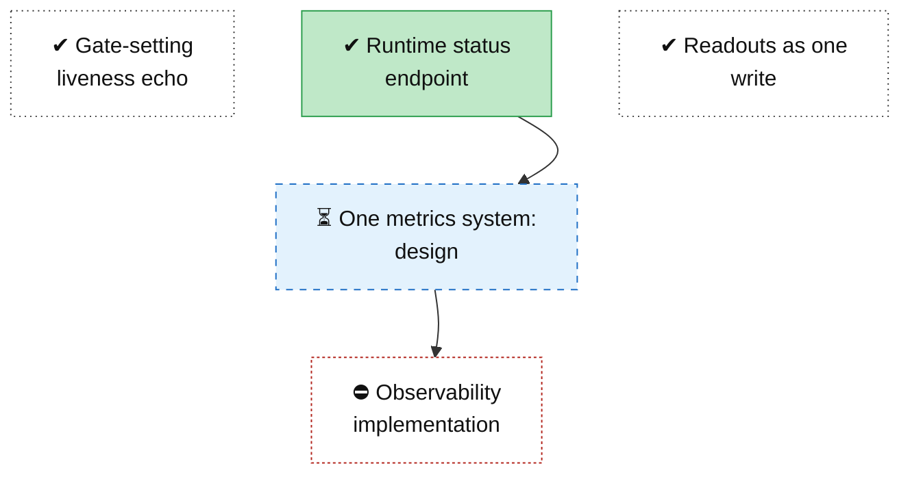

<!-- Generated by build.py from roadmap/nodes.yaml. Do not edit. -->

# obs - observability

Scope: the metrics registry, OTel, the flight recorder.

[Back to the page](../../roadmap.md) · [legend](../../roadmap.md#legend)

<!-- BEGIN GENERATED: track-obs -->

<!-- END GENERATED: track-obs -->

## Node table

<!-- BEGIN GENERATED: table-obs -->
| id | title | kind | lane | state | outcome | start | end | depends_on | replaced_by | qualified_by | headline | evidence |
|---|---|---|---|---|---|---|---|---|---|---|---|---|
| `obs-status-endpoint` | Runtime status endpoint | instrument | host-cargo | done | successful | 2026-03-12 | 2026-03-12 |  |  |  |  | ADR-0013 |
| `obs-gates-echo` | Gate-setting liveness echo | instrument | host-cargo | done | unrated | 2026-08-09 | 2026-08-09 |  |  |  |  | status §3.1 item 5 |
| `obs-readout-macro` | Readouts as one write | instrument | host-cargo | done | unrated | 2026-09-27 | 2026-09-27 |  |  |  |  | status §3.1 item 6 |
| `obs-otel-design` | One metrics system: design | instrument | no-cargo | in-progress | unrated | 2026-11-12 |  | obs-status-endpoint |  |  |  | derivation observability-design.md (branch otel-design); branch otel-design |
| `obs-user-otel-answers` | Owner answers on OTel design | user-decision | user | done | n/a | 2026-11-12 | 2026-11-12 | obs-otel-design |  |  |  | plan user decision 12; ADR-0074 (otel-design 73130d6d) |
| `obs-impl` | Observability implementation | instrument | host-cargo | blocked | unrated |  |  | place-per-leg-impl, meas-harness-consolidation, obs-otel-design, obs-user-otel-answers |  |  |  | plan W5.7; ADR-0074 (draft) |

### Details per node

| id | title | verdict | headline | in plain words | notes | confirmed | waiting on | queue order | order reason |
|---|---|---|---|---|---|---|---|---|---|
| `obs-status-endpoint` | Runtime status endpoint | Implemented: SharedStats with atomics for per-path/FEC/block metrics. HTTP status endpoint (axum) on configurable port. `raptorpath status` CLI subcommand with pretty-print and --json mode. |  | Added a runtime status endpoint with shared counters for per-path, repair and block metrics, an HTTP server on a configurable port, and a status command that prints readable or JSON output. | Dates: ADR end dates in the raw set equal their start (placeholder); ADR-0052..0067 carry the 2026-07-21 migration date. |  |  |  |  |
| `obs-gates-echo` | Gate-setting liveness echo | Fixed (50b17af). RWM_COPA_DELTA has an engine echo in [GATES], from the one resolution the CC reads. |  | Fixed a readout so the delay setting the controller actually uses now shows up in the engine's printed settings, making it possible to confirm the setting took effect. |  |  |  |  |  |
| `obs-readout-macro` | Readouts as one write | Fixed (5bad678). Every readout is one write (crate::readout!); tracing no longer glues onto readout lines. |  | Fixed the readouts so that each one is written in a single piece, which stops logging output from getting glued onto readout lines. | §3.1 item 6 is undated; fixed in the cleanup (5bad678). |  |  |  |  |
| `obs-otel-design` | One metrics system: design |  |  | A design for one metrics system that feeds the status page, the logs and standard monitoring tools, including a packet-level recorder. | ADR-0074 draft (supersedes ADR-0013 Layer 4); owner widened the scope to the flight recorder and the analysis stack 2026-11-12. Was titled 'Metrics registry and OTel design'. |  | merge to main, then the per-path state work it builds on |  |  |
| `obs-user-otel-answers` | Owner answers on OTel design |  |  |  | No raw record. Owner 2026-11-12: remove Q1; HTTP/protobuf for now (Q2); configurable sampling like probabilistic tracing (Q3); Prometheus through a collector (Q6). Was titled 'Owner answers on OTel Q1–Q6'. |  |  |  |  |
| `obs-impl` | Observability implementation |  |  | Building one metrics system that feeds the status page, the logs and standard monitoring tools. | Done when: the metrics registry renders /status and the log tags from one source with the OTLP exporter feature-gated, verified by an ns bench, a guard (metrics on vs off) and a single-source rendering test. |  |  |  |  |

### Folded items per node

- `obs-status-endpoint`: Runtime status endpoint
  - Platform setup UX and runtime status endpoint (2026-03-12, commit 1534da9a)
- `obs-gates-echo`: Gate-setting liveness echo
  - commit b30bf932
<!-- END GENERATED: table-obs -->
