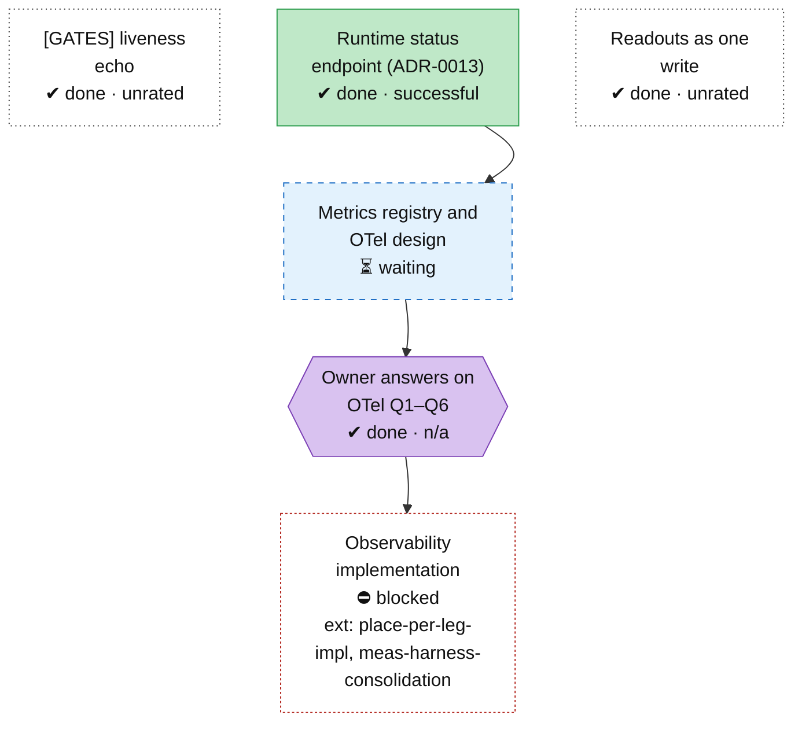

<!-- Generated by tools/roadmap/build.py from docs/roadmap/nodes.yaml. Do not edit. -->

# obs - observability

Scope: the metrics registry, OTel, the flight recorder.

[Back to the roadmap](../../roadmap.md)

<!-- BEGIN GENERATED: track-obs -->

<!-- END GENERATED: track-obs -->

## Node table

<!-- BEGIN GENERATED: table-obs -->
| id | title | state | outcome | headline | evidence | depends_on |
|---|---|---|---|---|---|---|
| `obs-status-endpoint` | Runtime status endpoint (ADR-0013) | done | successful |  | ADR-0013 |  |
| `obs-gates-echo` | [GATES] liveness echo | done | unrated |  | status §3.1 item 5 |  |
| `obs-readout-macro` | Readouts as one write | done | unrated |  | status §3.1 item 6 |  |
| `obs-otel-design` | Metrics registry and OTel design | in-progress | unrated |  | derivation observability-design.md (branch otel-design); branch otel-design | obs-status-endpoint |
| `obs-user-otel-answers` | Owner answers on OTel Q1–Q6 | done | n/a |  | plan user decision 12; ADR-0074 (otel-design 73130d6d) | obs-otel-design |
| `obs-impl` | Observability implementation | blocked | unrated |  | plan W5.7; ADR-0074 (draft) | place-per-leg-impl, meas-harness-consolidation, obs-otel-design, obs-user-otel-answers |

### Details per node

| id | title | notes | evidence |
|---|---|---|---|
| `obs-status-endpoint` | Runtime status endpoint (ADR-0013) | Dates: ADR end dates in the raw set equal their start (placeholder); ADR-0052..0067 carry the 2026-07-21 migration date. | ADR-0013 |
| `obs-readout-macro` | Readouts as one write | §3.1 item 6 is undated; fixed in the cleanup (5bad678). | status §3.1 item 6 |
| `obs-otel-design` | Metrics registry and OTel design | ADR-0074 draft (supersedes ADR-0013 Layer 4); owner widened the scope to the flight recorder and the analysis stack 2026-11-12. | derivation observability-design.md (branch otel-design); branch otel-design |
| `obs-user-otel-answers` | Owner answers on OTel Q1–Q6 | No raw record. User 2026-11-12: "Q1 remove. Q2 http/protobuf for now. Q3 configurable like probabilistic tracing... Q6 prometheus through a collector." | plan user decision 12; ADR-0074 (otel-design 73130d6d) |
| `obs-impl` | Observability implementation | Done when: the metrics registry renders /status and the log tags from one source with the OTLP exporter feature-gated, verified by an ns bench, a guard (metrics on vs off) and a single-source rendering test. | plan W5.7; ADR-0074 (draft) |
<!-- END GENERATED: table-obs -->
