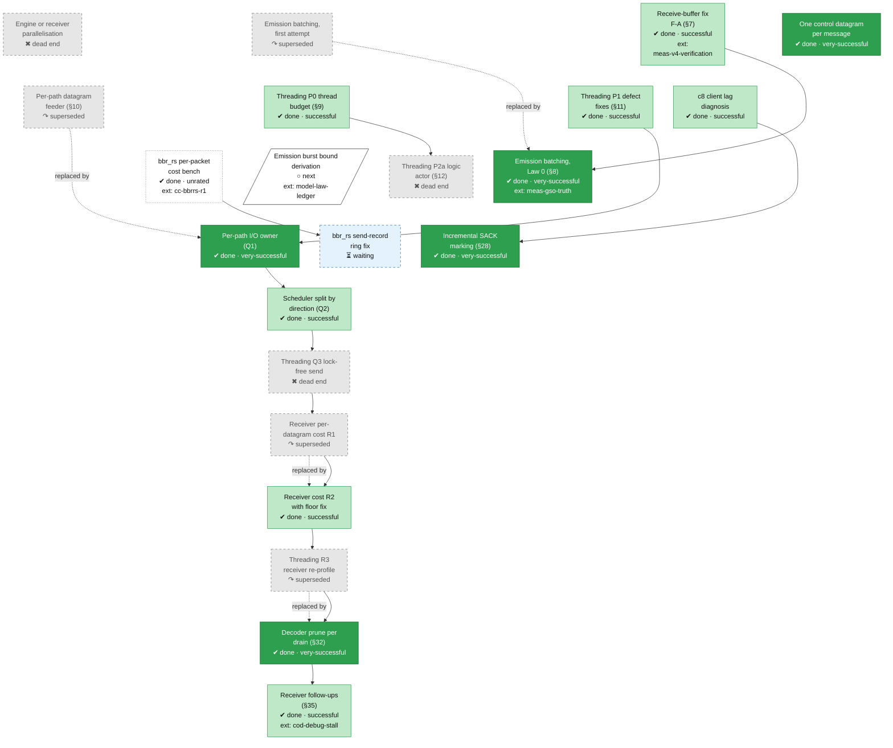

<!-- Generated by tools/roadmap/build.py from docs/roadmap/nodes.yaml. Do not edit. -->

# perf - performance

Scope: threading and per-packet cost: threading redesign, I/O owner, receiver cost, allocation bounds.

[Back to the roadmap](../../roadmap.md)

<!-- BEGIN GENERATED: track-perf -->

<!-- END GENERATED: track-perf -->

## Node table

<!-- BEGIN GENERATED: table-perf -->
| id | title | state | outcome | headline | evidence | depends_on |
|---|---|---|---|---|---|---|
| `perf-parallelisation` | Engine or receiver parallelisation | abandoned | dead-end | 136–188 Mbit/s | paper §10 row Engine or receiver parallelisation |  |
| `perf-emit-batch-v1` | Emission batching, first attempt | abandoned | superseded | +10–16 % | paper §10 row Emission batching as default (`RWM_EMIT_BATCH`), first attempt |  |
| `perf-ack-merge` | One control datagram per message | done | very-successful | +12.7% | commit bdab7deb |  |
| `perf-rcvbuf` | Receive-buffer fix F-A (§7) | done | successful |  | status §7 | meas-v4-verification |
| `perf-emit-batch-law0` | Emission batching, Law 0 (§8) | done | very-successful | +41.1 % | status §8 | perf-rcvbuf, meas-gso-truth |
| `perf-quic-feeder` | Per-path datagram feeder (§10) | abandoned | superseded | c1d-400 goodput 292.4 → 491.4 Mbit/s | status §10; tag archive/quic-feeder; tag archive/quic-feeder-v2 |  |
| `perf-threading-p0` | Threading P0 thread budget (§9) | done | successful | busy median 79.0 % | status §9 |  |
| `perf-threading-p1` | Threading P1 defect fixes (§11) | done | successful |  | status §11 |  |
| `perf-threading-p2a` | Threading P2a logic actor (§12) | abandoned | dead-end | goodput −33.0 % | status §12; tag archive/thread-p2a | perf-threading-p0 |
| `perf-io-owner` | Per-path I/O owner (Q1) | done | very-successful | +48 % | status §13; status §15 | perf-threading-p1 |
| `perf-sched-split` | Scheduler split by direction (Q2) | done | successful |  | status §14 | perf-io-owner |
| `perf-q3-investigation` | Threading Q3 lock-free send | abandoned | dead-end | 0.16–0.19 of wall | status §16 | perf-sched-split |
| `perf-receiver-r1` | Receiver per-datagram cost R1 | abandoned | superseded | c1s goodput −69.6 % | status §17; status §20; tag archive/thread-r1 | perf-q3-investigation |
| `perf-receiver-r2` | Receiver cost R2 with floor fix | done | successful | 717 Mbit/s | status §21 | perf-receiver-r1 |
| `perf-threading-r3` | Threading R3 receiver re-profile | abandoned | superseded |  | status §22; tag archive/thread-r3; branch archive/wt-status22-amend5 | perf-receiver-r2 |
| `perf-c8-lag` | c8 client lag diagnosis | done | successful | 81 % | status §25; status §26; status §33 |  |
| `perf-incremental-sack` | Incremental SACK marking (§28) | done | very-successful | -30 % | status §28 | perf-c8-lag |
| `perf-decoder-prune` | Decoder prune per drain (§32) | done | very-successful | +19.6 % | status §32 | perf-threading-r3 |
| `perf-receiver-followups` | Receiver follow-ups (§35) | done | successful |  | status §35 | perf-decoder-prune, cod-debug-stall |
| `perf-bbrrs-ns-cost` | bbr_rs per-packet cost bench | done | unrated |  | branch nsbench48; branch nsbench48-2 | cc-bbrrs-r1 |
| `perf-bbrrs-ring-fix` | bbr_rs send-record ring fix | in-progress | unrated |  | plan W3.6e; branch bbrrs-r4 (fa9947dd) | perf-bbrrs-ns-cost |
| `perf-fix-burst-bound` | Emission burst bound derivation | next | unrated |  | law ledger rows F03 | model-law-ledger |

### Details per node

| id | title | notes | evidence |
|---|---|---|---|
| `perf-parallelisation` | Engine or receiver parallelisation | Refuted, never built (the third threading refutation, 2026-07-21). Dates: paper §10 rows carry an end (removal) date only. | paper §10 row Engine or receiver parallelisation |
| `perf-emit-batch-v1` | Emission batching, first attempt | Dates: paper §10 rows carry an end (removal) date only. | paper §10 row Emission batching as default (`RWM_EMIT_BATCH`), first attempt |
| `perf-ack-merge` | One control datagram per message | First battery NO FLIP (2026-08-07); re-registered and flipped 2026-08-08. | commit bdab7deb |
| `perf-rcvbuf` | Receive-buffer fix F-A (§7) | Dates: status-section end dates are the section file's last edit, not the verdict date. | status §7 |
| `perf-emit-batch-law0` | Emission batching, Law 0 (§8) | Its registered feed clause is "fed loss vs truth unchanged at every leg", read on the per-datagram [TRUTH] counter. Dates: status-section end dates are the section file's last edit, not the verdict date; paper §10 rows carry an end (removal) date only. | status §8 |
| `perf-quic-feeder` | Per-path datagram feeder (§10) | §10 is headed "superseded by the threading redesign"; the per-path I/O owner (Q1) is that redesign's delivered piece. Dates: status-section end dates are the section file's last edit, not the verdict date; archive/quic-feeder archived 2026-10-05 (tag date not used for end); archive/quic-feeder-v2 archived 2026-10-05 (tag date not used for end). | status §10; tag archive/quic-feeder; tag archive/quic-feeder-v2 |
| `perf-threading-p0` | Threading P0 thread budget (§9) | Dates: status-section end dates are the section file's last edit, not the verdict date. | status §9 |
| `perf-threading-p1` | Threading P1 defect fixes (§11) | Dates: status-section end dates are the section file's last edit, not the verdict date. | status §11 |
| `perf-threading-p2a` | Threading P2a logic actor (§12) | Deleted, not patched (coop-budget starvation); code at archive/thread-p2a. Owner 2026-10-05: "i rather think your impl is shit... rethink". Dates: status-section end dates are the section file's last edit, not the verdict date; archive/thread-p2a archived 2026-10-05 (tag date not used for end). | status §12; tag archive/thread-p2a |
| `perf-io-owner` | Per-path I/O owner (Q1) | Folds §15 (D9 attribution, KEEP-D9). Dates: status-section end dates are the section file's last edit, not the verdict date. | status §13; status §15 |
| `perf-sched-split` | Scheduler split by direction (Q2) | Dates: status-section end dates are the section file's last edit, not the verdict date. | status §14 |
| `perf-q3-investigation` | Threading Q3 lock-free send | End 2026-10-26 was a placeholder (status §16: last edit or migration date); date from merge ce600796. Dates: status-section end dates are the section file's last edit, not the verdict date. | status §16 |
| `perf-receiver-r1` | Receiver per-datagram cost R1 | §17 REFUTED-WITH-RECORD; §20 traced the collapse to R1's [LAT] pending store; R2 is R1 with that fix. Dates: status-section end dates are the section file's last edit, not the verdict date; archive/thread-r1 archived 2026-10-26 (tag date not used for end). | status §17; status §20; tag archive/thread-r1 |
| `perf-receiver-r2` | Receiver cost R2 with floor fix | Same-session result (§21): c1s goodput WITHIN (720.8 vs 717.3 Mbit/s, +0.5 %), c1d TREND-BETTER (+7.3 %); the larger gap to MAIN 621 in §17 is cross-session. End 2026-10-27 was a placeholder (status §21: last edit or migration date); date from merge 0972c3c4. Dates: status-section end dates are the section file's last edit, not the verdict date. | status §21 |
| `perf-threading-r3` | Threading R3 receiver re-profile | Dates: status-section end dates are the section file's last edit, not the verdict date; archive/thread-r3 archived 2026-10-27 (tag date not used for end). | status §22; tag archive/thread-r3; branch archive/wt-status22-amend5 |
| `perf-c8-lag` | c8 client lag diagnosis | §25 UNSETTLED, §26 UNBOUNDED-PER-WAKE(sack) (led to §28), §33 NOT MATERIAL; RWM_RTOBS instruments. Dates: status-section end dates are the section file's last edit, not the verdict date. | status §25; status §26; status §33 |
| `perf-incremental-sack` | Incremental SACK marking (§28) | Dates: status-section end dates are the section file's last edit, not the verdict date. | status §28 |
| `perf-decoder-prune` | Decoder prune per drain (§32) | End 2026-11-01 was a placeholder (status §32: last edit or migration date); date from merge bb29595e. Dates: status-section end dates are the section file's last edit, not the verdict date. | status §32 |
| `perf-receiver-followups` | Receiver follow-ups (§35) | End 2026-11-09 was a placeholder (status §35: last edit or migration date); date from merge 4926822a. Dates: status-section end dates are the section file's last edit, not the verdict date. | status §35 |
| `perf-bbrrs-ns-cost` | bbr_rs per-packet cost bench | nsbench48 folded into its rebased successor nsbench48-2 (unmerged). Result recorded in status §48b (nm.txt fee4f580, 78156b46): bbr_rs +417 ns/packet net over quinn BBR (x4.9), +339 ns at 200 in flight, a fixed per-packet cost. | branch nsbench48; branch nsbench48-2 |
| `perf-bbrrs-ring-fix` | bbr_rs send-record ring fix | Built on branch bbrrs-r4 (fa9947dd): the send-record map is a fixed-bound ring; the ns gate (db2cb4f4) went red at baseline (7.72x) and green after the fix (net ratio 7.7x -> 1.3-1.7x). Kept in-progress, not done, because it merges with the round-2 session. Done when: the send-record map is a fixed ring (or sampled) and a red-first ns gate holds bbr_rs at <= 2x quinn BBR per packet on the VM release bench. | plan W3.6e; branch bbrrs-r4 (fa9947dd) |
| `perf-fix-burst-bound` | Emission burst bound derivation | Law ledger: F03. Done when: the 64-symbol burst bound is derived as a CPU/latency quantum in the paper, or swept and recorded as a declared constant with its bind fraction. | law ledger rows F03 |
<!-- END GENERATED: table-perf -->
