<!-- Generated by build.py from roadmap/nodes.yaml. Do not edit. -->

# perf - performance

Scope: threading and per-packet cost: threading redesign, I/O owner, receiver cost, allocation bounds.

[Back to the page](../../roadmap.md) · [legend](../../roadmap.md#legend)

```mermaid
flowchart TB
    perf_liveness_split["✔ Path liveness split<br/>from capacity"]
    perf_native_geometry["✔ Inner-TCP geometry<br/>hypothesis"]
    perf_realtime_path_death>"✔ Realtime path deaths<br/>in window mode"]
    perf_rtt_rescan["✔ Per-ACK RTT minimum<br/>rescan removed"]
    perf_parallelisation["✖ Engine or receiver<br/>parallelisation"]
    perf_emit_batch_v1["↷ Emission batching,<br/>first attempt"]
    perf_recv_msg_wall["✔ Receiver per-message<br/>wall battery"]
    perf_ack_merge["✔ One control datagram<br/>per message"]
    perf_rcvbuf["✔ Receive-buffer fix<br/>F-A"]
    perf_emit_batch_law0["✔ Packets sent in<br/>small bursts"]
    perf_quic_feeder["↷ Per-path datagram<br/>feeder"]
    perf_threading_p0["✔ Named runtime and<br/>thread budget"]
    perf_threading_p1["✔ Threading lock and<br/>wake fixes"]
    perf_threading_p2a["✖ All control logic on<br/>one task"]
    perf_io_owner["✔ One I/O task per<br/>path"]
    perf_d9_attribution["✔ Attribution of one<br/>sender change"]
    perf_sched_split["✔ Scheduler split by<br/>direction"]
    perf_q3_investigation["✖ Lock-free send<br/>investigation"]
    perf_receiver_r1["↷ Receiver per-<br/>datagram cost, first<br/>try"]
    perf_s20_r1_collapse["✔ First receiver<br/>rewrite collapse<br/>diagnosis"]
    perf_receiver_r2["✔ Receiver cost with<br/>floor fix"]
    perf_threading_r3["↷ Receiver re-profile<br/>for threading"]
    perf_c8_lag["✔ Two-path client lag<br/>spread"]
    perf_s26_long_polls["✔ Lag tail and long<br/>polls"]
    perf_incremental_sack["✔ Incremental SACK<br/>marking"]
    perf_decoder_prune["✔ Receiver clears<br/>decoder work more<br/>often"]
    perf_s33_timer["✔ Lag tail timer hand-<br/>off"]
    perf_receiver_followups["✔ Receiver follow-ups"]
    perf_bbrrs_ns_cost["✔ bbr_rs per-packet<br/>cost bench"]
    perf_bbrrs_ring_fix["⏳ Cheaper bookkeeping<br/>in our BBR"]
    perf_handoff_gate_cpu["○ Gate costs CPU<br/>through a timer"]
    perf_fix_burst_bound[/"○ Deriving the send-<br/>burst size"/]
    perf_config_dropped>"⚠ Benchmark tool<br/>ignores the config<br/>file"]
    perf_liveness_split ~~~ perf_rtt_rescan
    perf_native_geometry ~~~ perf_parallelisation
    perf_realtime_path_death ~~~ perf_emit_batch_v1
    perf_rtt_rescan ~~~ perf_recv_msg_wall
    perf_parallelisation ~~~ perf_ack_merge
    perf_emit_batch_v1 ~~~ perf_rcvbuf
    perf_recv_msg_wall ~~~ perf_emit_batch_law0
    perf_ack_merge ~~~ perf_quic_feeder
    perf_rcvbuf ~~~ perf_threading_p0
    perf_emit_batch_law0 ~~~ perf_threading_p1
    perf_quic_feeder ~~~ perf_threading_p2a
    perf_threading_p0 ~~~ perf_threading_p2a
    perf_threading_p1 ~~~ perf_io_owner
    perf_threading_p2a ~~~ perf_io_owner
    perf_io_owner ~~~ perf_d9_attribution
    perf_io_owner ~~~ perf_sched_split
    perf_d9_attribution ~~~ perf_q3_investigation
    perf_sched_split ~~~ perf_q3_investigation
    perf_q3_investigation ~~~ perf_receiver_r1
    perf_receiver_r1 ~~~ perf_s20_r1_collapse
    perf_s20_r1_collapse ~~~ perf_receiver_r2
    perf_receiver_r2 ~~~ perf_threading_r3
    perf_receiver_r2 ~~~ perf_c8_lag
    perf_threading_r3 ~~~ perf_s26_long_polls
    perf_c8_lag ~~~ perf_s26_long_polls
    perf_s26_long_polls ~~~ perf_incremental_sack
    perf_s26_long_polls ~~~ perf_decoder_prune
    perf_incremental_sack ~~~ perf_s33_timer
    perf_decoder_prune ~~~ perf_receiver_followups
    perf_decoder_prune ~~~ perf_bbrrs_ns_cost
    perf_s33_timer ~~~ perf_bbrrs_ring_fix
    perf_receiver_followups ~~~ perf_handoff_gate_cpu
    perf_bbrrs_ns_cost ~~~ perf_fix_burst_bound
    perf_bbrrs_ring_fix ~~~ perf_config_dropped
    perf_handoff_gate_cpu ~~~ perf_config_dropped
    perf_fix_burst_bound ~~~ perf_config_dropped
    perf_emit_batch_v1 -.-> perf_emit_batch_law0
    perf_rcvbuf --> perf_emit_batch_law0
    perf_quic_feeder -.-> perf_io_owner
    perf_threading_p0 --> perf_threading_p2a
    perf_threading_p1 --> perf_io_owner
    perf_io_owner --> perf_d9_attribution
    perf_io_owner --> perf_sched_split
    perf_sched_split --> perf_q3_investigation
    perf_q3_investigation --> perf_receiver_r1
    perf_receiver_r1 -.-> perf_receiver_r2
    perf_receiver_r1 --> perf_s20_r1_collapse
    perf_s20_r1_collapse --> perf_receiver_r2
    perf_receiver_r2 --> perf_threading_r3
    perf_threading_r3 -.-> perf_decoder_prune
    perf_c8_lag --> perf_s26_long_polls
    perf_s26_long_polls --> perf_incremental_sack
    perf_threading_r3 --> perf_decoder_prune
    perf_incremental_sack --> perf_s33_timer
    perf_decoder_prune --> perf_receiver_followups
    perf_bbrrs_ns_cost --> perf_bbrrs_ring_fix
    classDef vsucc fill:#2e9e4f,stroke:#1b6b34,color:#fff
    classDef succ fill:#bfe8c8,stroke:#2e9e4f,color:#111
    classDef mixed fill:#ffd37a,stroke:#c98a00,color:#111
    classDef bad fill:#f28b82,stroke:#b3261e,color:#111
    classDef dead fill:#e6e6e6,stroke:#777,stroke-dasharray:5 5,color:#555
    classDef inprog fill:#a8cdf5,stroke:#1f6fc5,color:#111
    classDef next fill:#fff,stroke:#333,color:#111
    classDef blocked fill:#fff,stroke:#b3261e,stroke-dasharray:2 2,color:#111
    classDef parked fill:#f3f3f3,stroke:#999,color:#555
    classDef unrated fill:#fff,stroke:#333,stroke-dasharray:1 3,color:#111
    classDef gate fill:#d9c2f0,stroke:#7b3fb5,color:#111
    classDef decided fill:#ece0f7,stroke:#7b3fb5,stroke-dasharray:2 2,color:#111
    classDef finding fill:#ffe0b2,stroke:#d84315,stroke-width:2px,color:#111
    classDef waiting fill:#e3f2fd,stroke:#1f6fc5,stroke-dasharray:5 5,color:#111
    class perf_liveness_split,perf_realtime_path_death,perf_rtt_rescan,perf_rcvbuf,perf_threading_p0,perf_threading_p1,perf_d9_attribution,perf_sched_split,perf_s20_r1_collapse,perf_receiver_r2,perf_s26_long_polls,perf_receiver_followups succ
    class perf_native_geometry,perf_parallelisation,perf_emit_batch_v1,perf_quic_feeder,perf_threading_p2a,perf_q3_investigation,perf_receiver_r1,perf_threading_r3 dead
    class perf_recv_msg_wall mixed
    class perf_ack_merge,perf_emit_batch_law0,perf_io_owner,perf_incremental_sack,perf_decoder_prune vsucc
    class perf_c8_lag,perf_s33_timer,perf_bbrrs_ns_cost unrated
    class perf_bbrrs_ring_fix waiting
    class perf_handoff_gate_cpu,perf_fix_burst_bound next
    class perf_config_dropped finding
```

<!-- BEGIN GENERATED: track-perf -->

<!-- END GENERATED: track-perf -->

## Node table

<!-- BEGIN GENERATED: table-perf -->
| id | title | kind | lane | state | outcome | start | end | depends_on | replaced_by | qualified_by | headline | evidence |
|---|---|---|---|---|---|---|---|---|---|---|---|---|
| `perf-parallelisation` | Engine or receiver parallelisation | research | vm | abandoned | dead-end | 2026-07-08 | 2026-07-21 |  |  |  | 136–188 Mbit/s | paper §10 row Engine or receiver parallelisation; ADR-0057 |
| `perf-emit-batch-v1` | Emission batching, first attempt | mechanism | vm | abandoned | superseded | 2026-07-27 | 2026-07-27 |  | perf-emit-batch-law0 |  | +10–16 % | paper §10 row Emission batching as default (`RWM_EMIT_BATCH`), first attempt |
| `perf-ack-merge` | One control datagram per message | mechanism | vm | done | very-successful | 2026-08-07 | 2026-08-08 |  |  |  | +12.7% | commit bdab7deb |
| `perf-recv-msg-wall` | Receiver per-message wall battery | research | vm | done | mixed | 2026-08-06 | 2026-08-07 |  |  |  |  | commit dc4fb783; paper §16.35 |
| `perf-rcvbuf` | Receive-buffer fix F-A | mechanism | vm | done | successful | 2026-10-05 | 2026-10-05 | meas-v4-verification |  |  |  | status §7 |
| `perf-emit-batch-law0` | Packets sent in small bursts | mechanism | vm | done | very-successful | 2026-10-05 | 2026-10-05 | perf-rcvbuf, meas-gso-truth |  |  | +41.1 % | status §8 |
| `perf-quic-feeder` | Per-path datagram feeder | mechanism | vm | abandoned | superseded | 2026-10-05 | 2026-10-05 |  | perf-io-owner |  | c1d-400 goodput 292.4 → 491.4 Mbit/s | status §10; tag archive/quic-feeder; tag archive/quic-feeder-v2 |
| `perf-threading-p0` | Named runtime and thread budget | instrument | vm | done | successful | 2026-10-05 | 2026-10-05 |  |  |  | busy median 79.0 % | status §9 |
| `perf-threading-p1` | Threading lock and wake fixes | mechanism | vm | done | successful | 2026-10-05 | 2026-10-05 |  |  |  |  | status §11 |
| `perf-threading-p2a` | All control logic on one task | mechanism | vm | abandoned | dead-end | 2026-10-05 | 2026-10-06 | perf-threading-p0 |  |  | goodput −33.0 % | status §12; tag archive/thread-p2a |
| `perf-io-owner` | One I/O task per path | mechanism | vm | done | very-successful | 2026-10-06 | 2026-10-06 | perf-threading-p1 |  |  | +48 % | status §13 |
| `perf-d9-attribution` | Attribution of one sender change | research | vm | done | successful | 2026-10-06 | 2026-10-06 | perf-io-owner |  |  |  | status §15; commit 62deacba |
| `perf-sched-split` | Scheduler split by direction | mechanism | vm | done | successful | 2026-10-06 | 2026-10-06 | perf-io-owner |  |  |  | status §14 |
| `perf-q3-investigation` | Lock-free send investigation | research | vm | abandoned | dead-end | 2026-10-06 | 2026-10-06 | perf-sched-split |  |  | 0.16–0.19 of wall | status §16 |
| `perf-receiver-r1` | Receiver per-datagram cost, first try | mechanism | vm | abandoned | superseded | 2026-10-26 | 2026-10-26 | perf-q3-investigation | perf-receiver-r2 |  | c1s goodput −69.6 % | status §17; tag archive/thread-r1 |
| `perf-s20-r1-collapse` | First receiver rewrite collapse diagnosis | research | vm | done | successful | 2026-10-26 | 2026-10-26 | perf-receiver-r1 |  |  |  | status §20; commit 25c9bed5 |
| `perf-receiver-r2` | Receiver cost with floor fix | mechanism | vm | done | successful | 2026-10-26 | 2026-10-26 | perf-receiver-r1, perf-s20-r1-collapse |  |  | 717 Mbit/s | status §21 |
| `perf-threading-r3` | Receiver re-profile for threading | research | vm | abandoned | superseded | 2026-10-26 | 2026-10-27 | perf-receiver-r2 | perf-decoder-prune |  |  | status §22; tag archive/thread-r3; branch archive/wt-status22-amend5 |
| `perf-c8-lag` | Two-path client lag spread | research | vm | done | unrated | 2026-10-26 | 2026-10-26 |  |  |  | 81 % | status §25; commit d8abe709 |
| `perf-s26-long-polls` | Lag tail and long polls | research | vm | done | successful | 2026-10-26 | 2026-10-27 | perf-c8-lag |  |  | 81 % | status §26; commit 92934a7a |
| `perf-incremental-sack` | Incremental SACK marking | mechanism | vm | done | very-successful | 2026-10-27 | 2026-10-27 | perf-s26-long-polls |  |  | -30 % | status §28 |
| `perf-decoder-prune` | Receiver clears decoder work more often | mechanism | vm | done | very-successful | 2026-10-28 | 2026-10-29 | perf-threading-r3 |  |  | +19.6 % | status §32 |
| `perf-s33-timer` | Lag tail timer hand-off | research | vm | done | unrated | 2026-11-01 | 2026-11-01 | perf-incremental-sack |  |  |  | status §33; commit 61128b84 |
| `perf-receiver-followups` | Receiver follow-ups | mechanism | vm | done | successful | 2026-11-01 | 2026-11-02 | perf-decoder-prune, cod-debug-stall |  |  |  | status §35 |
| `perf-bbrrs-ns-cost` | bbr_rs per-packet cost bench | instrument | vm | done | unrated | 2026-11-10 | 2026-11-12 | cc-bbrrs-r1 |  |  |  | branch nsbench48; branch nsbench48-2 |
| `perf-bbrrs-ring-fix` | Cheaper bookkeeping in our BBR | mechanism | host-cargo | in-progress | unrated | 2026-11-13 |  | perf-bbrrs-ns-cost |  |  |  | plan W3.6e; branch bbrrs-r4 (fa9947dd) |
| `perf-fix-burst-bound` | Deriving the send-burst size | law | no-cargo | next | unrated |  |  | model-law-ledger |  |  |  | law ledger rows F03 |
| `perf-config-dropped` | Benchmark tool ignores the config file | defect-verdict | host-cargo | next | unrated |  |  |  |  |  |  | branch static-audits 86b5208f (raptorpath/src/audits.rs, config_round_trip.rs) |
| `perf-liveness-split` | Path liveness split from capacity | mechanism | vm | done | successful | 2026-07-03 | 2026-07-03 |  |  |  |  | commit becc6121; commit b57a202b |
| `perf-rtt-rescan` | Per-ACK RTT minimum rescan removed | mechanism | vm | done | successful | 2026-07-07 | 2026-07-07 |  |  |  | clean single-path 3–5.6× faster | commit 6302798c; commit 99926477 |
| `perf-native-geometry` | Inner-TCP geometry hypothesis | research | vm | done | dead-end | 2026-07-04 | 2026-07-04 |  |  |  |  | commit 020d34d5 |
| `perf-realtime-path-death` | Realtime path deaths in window mode | defect-verdict | vm | done | unrated | 2026-07-04 | 2026-07-04 |  |  |  |  | commit dff2d7a3; commit bc2d118e; commit 33d5a79c |
| `perf-handoff-gate-cpu` | Gate costs CPU through a timer | mechanism | host-cargo | next | unrated | 2026-11-27 |  |  |  |  |  | docs/derivations/reg-handoff-gate.md section 12 (branch sender-queue-law ff0cd203) |

### Details per node

| id | title | verdict | headline | in plain words | notes | confirmed | waiting on | queue order | order reason |
|---|---|---|---|---|---|---|---|---|---|
| `perf-parallelisation` | Engine or receiver parallelisation | one core per side sustains 136–188 Mbit/s with an empty queue; the walls are per-symbol service time and recovery waste | 136–188 Mbit/s | Trying more threads to go faster; measurement showed the limit was elsewhere. | Refuted, never built (the third threading refutation, 2026-07-21). Dates: paper §10 rows carry an end (removal) date only. |  |  |  |  |
| `perf-emit-batch-v1` | Emission batching, first attempt | +10–16 % at c1, below the pre-registered bar; receiver-side batching arms raised echo RTT 11 → 76 ms and were removed | +10–16 % | A first attempt at sending packets in batches gained 10 to 16 percent but missed its preset bar, and the receiver-side versions raised echo delay from 11 to 76 ms, so they were removed. | Dates: paper §10 rows carry an end (removal) date only. |  |  |  |  |
| `perf-ack-merge` | One control datagram per message | FLIP: RWM_ACK_MERGE ships DEFAULT ON — c1 +12.7%/+13.0%, receiver CPU/bit -9% | +12.7% | Sending one control datagram per message became the default after a full test: single-path throughput rose about 13 % and receiver CPU per bit fell about 9 %. | First battery NO FLIP (2026-08-07); re-registered and flipped 2026-08-08. |  |  |  |  |
| `perf-recv-msg-wall` | Receiver per-message wall battery | Receiver Per-Message Wall: RESULTS + verdicts (both seeds) — c1 est +62/+63% and eb+est 446-505 (wall 22-23k -> 46-62k msgs/s), NO FLIP on the c7 anchor-interaction clause |  | Measured the receiver's per-message speed limit; one test link gained about 62 percent and throughput roughly doubled, but the interaction with the anchor on the unequal-path link did not flip, so results were mixed. | Split 2026-11-16 from 'Batched BOCD estimator cadence' (2026-08 audit outcome: mixed). Its pre-build amendment pre-registered RWM_EST_CADENCE (774e28a3). |  |  |  |  |
| `perf-rcvbuf` | Receive-buffer fix F-A | c1s-400: FIXED. Clause (1) holds in 16/16 rows, clause (2) at 1.03, clause (3) at +1.7 %. |  | Fixed the receive buffer size on every endpoint socket; on the fast single path it now holds in all 16 rows with goodput up about 1.7 percent, so the problem is fixed. | Dates: status-section end dates are the section file's last edit, not the verdict date. |  |  |  |  |
| `perf-emit-batch-law0` | Packets sent in small bursts | FLIP-RECOMMENDED. EB0 is BETTER at every cell (c1s-400 CPU, c1d-400 goodput + completion + CPU, c2-100 CPU, c8-100 CPU), WORSE on no clause anywhere | +41.1 % | Sent packets in small bursts instead of one at a time, which raised throughput by about 40 percent on the fast two-path test and cut CPU everywhere. | Its registered feed clause is "fed loss vs truth unchanged at every leg", read on the per-datagram [TRUTH] counter. Dates: status-section end dates are the section file's last edit, not the verdict date; paper §10 rows carry an end (removal) date only. Was titled 'Emission batching law'. |  |  |  |  |
| `perf-quic-feeder` | Per-path datagram feeder | The feeder code is not merged: neither battery recommended a flip | c1d-400 goodput 292.4 → 491.4 Mbit/s | A per-path packet feeder queue raised one test from 292.4 to 491.4 Mbit/s, but neither test battery recommended switching it on, so it was never merged and the threading redesign replaced it. | §10 is headed "superseded by the threading redesign"; the per-path I/O owner (Q1) is that redesign's delivered piece. Dates: status-section end dates are the section file's last edit, not the verdict date; archive/quic-feeder archived 2026-10-05 (tag date not used for end); archive/quic-feeder-v2 archived 2026-10-05 (tag date not used for end). |  |  |  |  |
| `perf-threading-p0` | Named runtime and thread budget | D3 D3-REFUTED-WITH-RECORD at c1s-400 (server receiver task [RDIAG] busy median 79.0 %, hottest server thread 0.355 core; both below their thresholds). | busy median 79.0 % | Added named runtime threads and per-thread usage readouts, then used them to refute a suspected receiver bottleneck, since the receiver task was only 79 percent busy and no thread was saturated. | Dates: status-section end dates are the section file's last edit, not the verdict date. |  |  |  |  |
| `perf-threading-p1` | Threading lock and wake fixes | DELIVERED (SAME everywhere): no cell WORSE, every cell scoreable, every witness held. |  | Fixed lock and wake-up problems in the threading code; the result was the same everywhere, with no test cell worse and every check holding, so it counts as delivered. | Dates: status-section end dates are the section file's last edit, not the verdict date. |  |  |  |  |
| `perf-threading-p2a` | All control logic on one task | REFUTED-WITH-RECORD (WORSE-AT-c1s-400): at c1s-400 goodput −33.0 %, CPUCLI per GB +86.7 % and CPUSRV per GB +54.8 %, every one with disjoint ranges (n = 6 each). | goodput −33.0 % | Tried moving all control logic onto one task; the sender then spun far more often and lost a third of its speed, so it was deleted. | Deleted, not patched (coop-budget starvation); code at archive/thread-p2a. Owner 2026-10-05: judged the implementation poor and asked for a rethink. Dates: status-section end dates are the section file's last edit, not the verdict date; archive/thread-p2a archived 2026-10-05 (tag date not used for end). Was titled 'Threading P2a logic actor'. Was titled 'Single logic-actor threading'. |  |  |  |  |
| `perf-io-owner` | One I/O task per path | DELIVERED (SHIP-SHARED): the shared placement (IOS) passes at every cell; the own placement (IOO) fails at c1d-400 | +48 % | Gave each network path its own input and output task, which raised single-path throughput by about half. | §13 DELIVERED (SHIP-SHARED); the D9 attribution (§15) is its own node (perf-d9-attribution). Was titled 'Per-path I/O owner'. |  |  |  |  |
| `perf-d9-attribution` | Attribution of one sender change | `KEEP-D9 (MAIN better)`: NOD9 FAIL at c1s (goodput −11.4 %, CPUCLI/GB +4.9 %, both WORSE), WITHIN at c1d/c2/c8, BETTER nowhere; D9 stays |  | Tested one sender change alone to see what it caused; removing it made the fast single path worse, with goodput down 11.4 percent, and it was better nowhere, so the change stays. | Split 2026-11-16 from 'Per-path I/O owner (Q1)': §13 re-scoped §12's c1s collapse to D9, and §15 tested D9 alone. |  |  |  |  |
| `perf-sched-split` | Scheduler split by direction | DELIVERED: Q2 passes at every cell (no clause WORSE, the feed unmoved, no DNF). |  | Split the scheduler by direction; the change passed at every test cell with nothing worse, the feed unmoved and no run failing to finish, so it is delivered. | Dates: status-section end dates are the section file's last edit, not the verdict date. |  |  |  |  |
| `perf-q3-investigation` | Lock-free send investigation | No lock-free send is built: neither pre-registered critical-path condition holds. | 0.16–0.19 of wall | Looked into a lock-free send path and decided against building it, because neither of the pre-registered conditions for a critical-path problem held; lock waiting was only 0.16 to 0.19 of elapsed time. | End 2026-10-26 was a placeholder (status §16: last edit or migration date); date from merge ce600796. Dates: status-section end dates are the section file's last edit, not the verdict date. |  |  |  |  |
| `perf-receiver-r1` | Receiver per-datagram cost, first try | Outcome: REFUTED-WITH-RECORD (R1 FAIL-AT-c1s-400): nothing ships. | c1s goodput −69.6 % | A first rewrite of the receiver's per-packet work collapsed fast single-path speed by 69.6 percent and was refuted, with nothing shipped; the cause was later traced and fixed in the second attempt. | §17 REFUTED-WITH-RECORD; §20 (perf-s20-r1-collapse) traced the collapse to R1's [LAT] pending store; R2 is R1 with that fix. Tag archive/thread-r1 archived 2026-10-26. |  |  |  |  |
| `perf-s20-r1-collapse` | First receiver rewrite collapse diagnosis | `H1-CONFIRMED` + `FIX-VALIDATED`: the collapse is R1's `[LAT]` pending store (`net/lat.rs`); swapping that one file decides it both ways |  | Diagnosed why the first receiver rewrite collapsed on the fast single path; the cause is its pending latency store, and swapping that one file proved it both ways, with the fix in the next version. | Split 2026-11-16 from 'Receiver per-datagram cost R1'. Five arms, 10 rows, 3 profiles; its fix is R2. |  |  |  |  |
| `perf-receiver-r2` | Receiver cost with floor fix | Outcome: DELIVERED (R2 passes at every cell: ships). | 717 Mbit/s | The second receiver rewrite, with the latency-floor fix, passed every test cell and shipped; fast single-path speed held at 717 Mbit/s, level with before, and two paths improved by 7.3 percent. | Same-session result (§21): c1s goodput WITHIN (720.8 vs 717.3 Mbit/s, +0.5 %), c1d TREND-BETTER (+7.3 %); the larger gap to MAIN 621 in §17 is cross-session. End 2026-10-27 was a placeholder (status §21: last edit or migration date); date from merge 0972c3c4. Dates: status-section end dates are the section file's last edit, not the verdict date. |  |  |  |  |
| `perf-threading-r3` | Receiver re-profile for threading | H-alloc (a): UNREAD (ABORT-TEXT). Per the operator's limit there is no fourth attempt, and the §22 decision rule selects no design |  | Tried to re-profile the receiver for a threading redesign; the key reading failed to come back in three attempts, the operator allowed no fourth, and no design was selected, so it was superseded. | Dates: status-section end dates are the section file's last edit, not the verdict date; archive/thread-r3 archived 2026-10-27 (tag date not used for end). Was titled 'Threading R3 receiver re-profile'. |  |  |  |  |
| `perf-c8-lag` | Two-path client lag spread | `UNSETTLED`: long task polls cover a third of late ticks (F = 0.33 < 0.5), no steal at the late ticks; placement ruled out; nothing ships | 81 % | A diagnosis of why the two-path client lags found that long task polls cover about a third of late ticks and placement is not the cause, leaving the question unsettled with nothing to ship. | Split 2026-11-16 from 'c8 client lag diagnosis' (§25, §26, §33; rated successful as a family, a rating that now sits on §26, perf-s26-long-polls). Diagnostic, 30 rows, placement step 1. |  |  |  |  |
| `perf-s26-long-polls` | Lag tail and long polls | (a) `MIXED` (an OS part and a larger runtime part); (b) `UNBOUNDED-PER-WAKE(sack)`: 81 % of the wall of polls ≥ 10 ms is the SACK drain; bound designed in §28 | 81 % | Traced the client lag tail to long polls, partly from the operating system and mostly from the runtime, finding that 81 percent of long-poll time was draining acknowledgements, which led to a bounded fix. | Split 2026-11-16 from 'c8 client lag diagnosis'. The RWM_RTOBS instruments ([LAG] min_us, [OSLAG], [TXSEC], [LPOLL]) merged with it; its SACK-drain finding is what §28 bounded. |  |  |  |  |
| `perf-incremental-sack` | Incremental SACK marking | SHIP: NEW (incremental SACK marking) is PASS-EVERYWHERE. | -30 % | Marking acknowledged packets incrementally instead of all at once passed every test cell, cut the cost by about 30 percent, and shipped. | Dates: status-section end dates are the section file's last edit, not the verdict date. |  |  |  |  |
| `perf-decoder-prune` | Receiver clears decoder work more often | merge: §32 per-drain receiver prune SHIPS - PASS-EVERYWHERE vs b30044b; c1d goodput +19.6 % (751 vs 628 Mbit/s, ranges disjoint), c1s +12.2 %, server CPU/GB -14..-17 % at c1; prune stall 63-90 ms -> <=10.6 ms; source dedup on SeqBits (no per-symbol alloc). Suites release 1137/0, debug 996/0, doc, wa | +19.6 % | Made the receiver clean up finished decoding work more often, which raised fast two-path throughput by about a fifth. | End 2026-11-01 was a placeholder (status §32: last edit or migration date); date from merge bb29595e. Dates: status-section end dates are the section file's last edit, not the verdict date. Was titled 'Decoder prune per drain'. |  |  |  |  |
| `perf-s33-timer` | Lag tail timer hand-off | `NOT MATERIAL`: no fix designed, nothing pre-registered, nothing ships |  |  | Split 2026-11-16 from 'c8 client lag diagnosis'. Offline reading of the §28 step-0 and §26 ledgers, no VM. |  |  |  |  |
| `perf-receiver-followups` | Receiver follow-ups | merge: §35 receiver follow-ups - client fails fast on a dead peer (every path's QUIC connection lost -> 'peer lost' within the idle timeout); [LAT] asserts exactly-once with declared late fills; legacy decoders prune by removal; one-prune size left as is (paper §5.2); recv_alloc_bound gated on the m |  |  | End 2026-11-09 was a placeholder (status §35: last edit or migration date); date from merge 4926822a. Dates: status-section end dates are the section file's last edit, not the verdict date. |  |  |  |  |
| `perf-bbrrs-ns-cost` | bbr_rs per-packet cost bench |  |  |  | nsbench48 folded into its rebased successor nsbench48-2 (unmerged). Result recorded in status §48b (nm.txt fee4f580, 78156b46): bbr_rs +417 ns/packet net over quinn BBR (x4.9), +339 ns at 200 in flight, a fixed per-packet cost. |  |  |  |  |
| `perf-bbrrs-ring-fix` | Cheaper bookkeeping in our BBR |  |  | Cutting the per-packet bookkeeping cost of our own BBR controller to at most twice that of the standard one. | Built on branch bbrrs-r4 (fa9947dd): the send-record map is a fixed-bound ring; the ns gate (db2cb4f4) went red at baseline (7.72x) and green after the fix (net ratio 7.7x -> 1.3-1.7x). Kept in-progress, not done, because it merges with the round-2 session. Done when: the send-record map is a fixed ring (or sampled) and a red-first ns gate holds bbr_rs at <= 2x quinn BBR per packet on the VM release bench. Was titled 'bbr_rs send-record ring fix'. |  | the bbr_rs round-2 session on the VM |  |  |
| `perf-fix-burst-bound` | Deriving the send-burst size |  |  | Working out how many packets the sender should send in one burst instead of using a hand-picked sixty-four. | Law ledger: F03. Done when: the 64-symbol burst bound is derived as a CPU/latency quantum in the paper, or swept and recorded as a declared constant with its bind fraction. Was titled 'Emission burst bound derivation'. |  |  |  |  |
| `perf-config-dropped` | Benchmark tool ignores the config file |  |  | The built-in benchmark client and server never read the config file, so the tail target, the repair overhead cap, certificate pinning and the retention dial ρ cannot be set for a benchmark run. | main.rs:263 cmd_perf gets no config though --config is global (main.rs:12) and the README documents it. Blocks the tail-target flag sweep (VM queue 4) and rho < 1 at Bulk/Auto in perf. Also: ge_burst_factor and realtime_burst_extra have no consumer anywhere (config.rs:64-67). Done when: the S2c round-trip cells for perf move, red first. Was titled 'Perf ignores the config file'. |  |  |  |  |
| `perf-liveness-split` | Path liveness split from capacity | Result: zero path deaths. |  | A saturated path stopped sending its heartbeats and was declared dead; heartbeats now go out whatever the spare capacity, which ended the path deaths on the real link. | L1 phase 3 (2026-07-03); the ack-path debug logging added while diagnosing it is folded in. |  |  |  |  |
| `perf-rtt-rescan` | Per-ACK RTT minimum rescan removed | Merge per-symbol perf fix: O(n²) RTT-min rescan — clean single-path 3–5.6× faster | clean single-path 3–5.6× faster | The sender rescanned its whole window of round-trip samples on every acknowledgement; keeping the minimum incrementally removed a large per-packet CPU cost. | The fix is commit 6302798c and its merge 99926477; rated like cod-rlc-index (merged, measured gain, no registered readout). First found in the session record. |  |  |  |  |
| `perf-native-geometry` | Inner-TCP geometry hypothesis | the remaining ~4.5x to quinn (0.20s) is the rp pipeline itself. |  | Removing the inner TCP connection moved completion time only about 13 percent, so the gap to native QUIC lies in the pipeline itself, not in the tunnel geometry. | L2 workstream 3 (2026-07-04); measured with the native object mode folded in meas-l1-harness. |  |  |  |  |
| `perf-realtime-path-death` | Realtime path deaths in window mode | Merge window-liveness fix: a malformed inner packet no longer kills the tunnel |  | A tail matrix showed the 513 ms realtime tail came from the realtime path dying under low-rate traffic; one malformed inner packet tore the tunnel down, and the write loop now drops it and continues. | Split 2026-11-20 from meas-l2-multipath (own defect verdict and fix branch). |  |  |  |  |
| `perf-handoff-gate-cpu` | Gate costs CPU through a timer |  |  | The hand-off gate costs about 7 % more client CPU per gigabyte; about a third is reading each path state twice per packet, and most of the rest is a 1 ms timer that keeps firing even when the gate is open, on the server too. | Priced in reg-handoff-gate section 12 (within-session GATE against R4; plan 68 K cells +6.8/+7.0 % against BASE; the +11-14 % in section 11 was partly session drift). Producer view reads 32-38 % of the delta (about 1 us per first send, read twice at 9b3b30b3; the fs_over fix a47da148 removed one read). The rest: the owner republish timer arms on every publish that reads quinn tx short, including control datagrams, and its deadline never moves (io_owner.rs:1231-1240, :1490). Fixes: F1 arm the timer only while the gate is closed (changes tau_o samples, a law input: decision owed), F2 recompute the deadline from the last publish (needs an owner_timer_idle counter), F3 decision reads load 5 inputs instead of 22. Rejected: minimum batch. Blocks step 2 registration (the guard scores CPU). |  |  |  |  |

### Folded items per node

- `perf-parallelisation`: Engine or receiver parallelisation
  - branch receiver-tail parallelization
  - commit cee499ce
  - commit 7387ad9d
- `perf-emit-batch-v1`: Emission batching, first attempt
  - commit 4bd18c78
  - commit 75cbd012
  - commit 1313841b
  - commit 52b4fff6
  - Sender-side emission burst (2026-07-27, commit aa2fcbfa, commit 2367a519, commit c639d56f)
  - Receiver-side emission batching arms (2026-07-27, commit 8a71ed89, commit bc500aff, commit 47b04ed6, commit 97bc6eaf)
  - Dual-path emission bursting (2026-07-27, session record)
- `perf-ack-merge`: One control datagram per message
  - commit 37c594a4
  - commit bb8ab286
  - commit ea037575
  - commit 38e533b5
  - ack-merge: density premise refuted; first battery no flip (2026-08-07, commit 8e0c866c, commit 3169b248, commit 43ccb40e, commit 1c1867f1)
  - ack-merge flip: default ON after full battery (2026-08-08, commit 4171b584, commit c2bfab73, commit 06f0b3e0, commit b505fdba)
- `perf-recv-msg-wall`: Receiver per-message wall battery
  - commit 1ce8ba25
  - commit 774e28a3
  - Engine-receiver saturation probe (2026-07-19, commit d27ce30d)
- `perf-rcvbuf`: Receive-buffer fix F-A
  - branch fix/rcvbuf
  - Receive-buffer fix on every endpoint socket (2026-10-05, commit 927bb00d, commit 3100c53a, commit 13d8ecd5, commit b52dc861, commit 31d5a522, commit 10b9d78d)
- `perf-emit-batch-law0`: Packets sent in small bursts
  - paper §10 row Emission batching, Law 0 (`RWM_EMIT_BATCH`, burst bound 64 at every path count)
  - branch flip/emit-batch
  - branch meas/emit-rerun
  - branch feat/emit-batch-scope
  - Batched emission scope battery before the buffer fix (2026-10-05, commit 788d2efb, commit 1671cae0, commit 5e954dbd)
  - Batched emission re-run after the buffer fix (2026-10-05, commit c3e80db4, commit 3d552c12, commit 06ee1fb9)
  - Batched emission on by default (2026-10-05, commit aa1aafb5, commit bf3a6365)
- `perf-quic-feeder`: Per-path datagram feeder
  - QUIC feeder queue per path (2026-10-05, commit dc388014)
- `perf-threading-p0`: Named runtime and thread budget
  - branch threading P0
  - Threading P0 per-thread instruments (2026-10-05, commit 08d93e5e, commit a50fa033, commit a37ccee8, commit d465adcf, commit f7180092)
- `perf-threading-p1`: Threading lock and wake fixes
  - branch threading P1
- `perf-threading-p2a`: All control logic on one task
  - Single scheduler-owning task (P2a) (2026-10-05, commit 3fb277ae, commit a27625fd, commit 0c91753c, commit 39a97f3e, commit 52da7db0, commit 69fd846b)
- `perf-io-owner`: One I/O task per path
  - branch threading Q1
  - Per-path I/O owner for quinn (2026-10-06, commit 881cca2a, commit 272d0012, commit 0e2c0516, commit e76b11a9)
- `perf-d9-attribution`: Attribution of one sender change
  - branch §15 D9 attribution
  - Perf generator attribution (D9) (2026-10-06, commit 602a1147, commit fe4ee50b, commit e059e304)
- `perf-sched-split`: Scheduler split by direction
  - branch threading Q2
  - Scheduler split by direction (2026-10-06, commit 84f6c90c, commit dbdfefb5, commit bc6429a3, commit e9e315aa)
- `perf-q3-investigation`: Lock-free send investigation
  - branch §16 Q3 investigation
  - Quinn lock wait and the c1d receiver ceiling (2026-10-06, commit 81b53352, commit 18d6ad51)
- `perf-receiver-r1`: Receiver per-datagram cost, first try
  - Receiver per-datagram rewrite (R1) (2026-10-26, commit a2625113, commit ae54b9f7)
- `perf-s20-r1-collapse`: First receiver rewrite collapse diagnosis
  - branch §20 R1 c1s collapse diagnosed
  - R1 c1s collapse diagnosis (section 20) (2026-10-26, commit 4e505046, commit af0fc86c)
- `perf-receiver-r2`: Receiver cost with floor fix
  - branch threading R2 DELIVERED (status §21)
  - Receiver rewrite with latency floor fix (R2) (2026-10-26, commit b30d80f9, commit acc0ed03)
- `perf-threading-r3`: Receiver re-profile for threading
  - Receiver re-profile for threading (R3) (2026-10-26, commit 42b074c1, commit 25d913c0)
- `perf-c8-lag`: Two-path client lag spread
  - branch §25/§26 c8 lag diagnosis + RWM_RTOBS instruments ([LAG] min_us, [OSLAG], [TXSEC], [LPOLL])
  - Two-path client lag spread diagnosis (2026-10-26, commit ef614d69, commit adb48f8a, commit e0062407, commit b4b64748)
- `perf-incremental-sack`: Incremental SACK marking
  - branch §28 incremental SACK marking SHIPS
  - Incremental SACK marking (2026-10-27, commit 320668ce)
- `perf-decoder-prune`: Receiver clears decoder work more often
  - branch §32 per-drain receiver prune SHIPS
- `perf-s33-timer`: Lag tail timer hand-off
  - branch §33 c8 lag timer hand-off NOT MATERIAL on current main
- `perf-receiver-followups`: Receiver follow-ups
  - branch §35 receiver follow-ups
- `perf-rtt-rescan`: Per-ACK RTT minimum rescan removed
  - branch per-symbol perf fix
- `perf-realtime-path-death`: Realtime path deaths in window mode
  - branch window-liveness fix
<!-- END GENERATED: table-perf -->
