<!-- Generated by tools/roadmap/build.py from docs/roadmap/nodes.yaml. Do not edit. -->

# perf - performance

Scope: threading and per-packet cost: threading redesign, I/O owner, receiver cost, allocation bounds.

[Back to the roadmap](../../roadmap.md) · [legend](../../roadmap.md#legend)

```mermaid
flowchart TB
    perf_parallelisation["✖ Engine or receiver<br/>parallelisation"]
    perf_emit_batch_v1["↷ Emission batching,<br/>first attempt"]
    perf_recv_msg_wall["✔ Receiver per-message<br/>wall battery"]
    perf_ack_merge["✔ One control datagram<br/>per message"]
    perf_rcvbuf["✔ Receive-buffer fix<br/>F-A"]
    perf_emit_batch_law0["✔ Emission batching<br/>law"]
    perf_quic_feeder["↷ Per-path datagram<br/>feeder"]
    perf_threading_p0["✔ Named runtime and<br/>thread budget"]
    perf_threading_p1["✔ Threading lock and<br/>wake fixes"]
    perf_threading_p2a["✖ Single logic-actor<br/>threading"]
    perf_io_owner["✔ Per-path I/O owner"]
    perf_d9_attribution["✔ Attribution of one<br/>sender change"]
    perf_sched_split["✔ Scheduler split by<br/>direction"]
    perf_q3_investigation["✖ Lock-free send<br/>investigation"]
    perf_receiver_r1["↷ Receiver per-<br/>datagram cost, first<br/>try"]
    perf_s20_r1_collapse["✔ First receiver<br/>rewrite collapse<br/>diagnosis"]
    perf_receiver_r2["✔ Receiver cost with<br/>floor fix"]
    perf_threading_r3["↷ Receiver re-profile<br/>for threading"]
    perf_c8_lag["✔ Two-path client lag<br/>spread"]
    perf_s26_long_polls["✔ Lag tail and long<br/>polls"]
    perf_incremental_sack["✔ Incremental SACK<br/>marking"]
    perf_decoder_prune["✔ Decoder prune per<br/>drain"]
    perf_s33_timer["✔ Lag tail timer hand-<br/>off"]
    perf_receiver_followups["✔ Receiver follow-ups"]
    perf_bbrrs_ns_cost["✔ bbr_rs per-packet<br/>cost bench"]
    perf_bbrrs_ring_fix["⏳ bbr_rs send-record<br/>ring fix"]
    perf_fix_burst_bound[/"○ Emission burst bound<br/>derivation"/]
    perf_config_dropped>"⚠ Perf ignores the<br/>config file"]
    perf_parallelisation ~~~ perf_ack_merge
    perf_emit_batch_v1 ~~~ perf_rcvbuf
    perf_recv_msg_wall ~~~ perf_rcvbuf
    perf_ack_merge ~~~ perf_emit_batch_law0
    perf_rcvbuf ~~~ perf_quic_feeder
    perf_rcvbuf ~~~ perf_threading_p0
    perf_emit_batch_law0 ~~~ perf_threading_p1
    perf_quic_feeder ~~~ perf_threading_p2a
    perf_threading_p0 ~~~ perf_threading_p2a
    perf_threading_p1 ~~~ perf_io_owner
    perf_threading_p2a ~~~ perf_io_owner
    perf_io_owner ~~~ perf_d9_attribution
    perf_io_owner ~~~ perf_sched_split
    perf_d9_attribution ~~~ perf_q3_investigation
    perf_sched_split ~~~ perf_q3_investigation
    perf_q3_investigation ~~~ perf_receiver_r1
    perf_receiver_r1 ~~~ perf_s20_r1_collapse
    perf_s20_r1_collapse ~~~ perf_receiver_r2
    perf_receiver_r2 ~~~ perf_threading_r3
    perf_receiver_r2 ~~~ perf_c8_lag
    perf_threading_r3 ~~~ perf_s26_long_polls
    perf_c8_lag ~~~ perf_s26_long_polls
    perf_s26_long_polls ~~~ perf_incremental_sack
    perf_s26_long_polls ~~~ perf_decoder_prune
    perf_incremental_sack ~~~ perf_s33_timer
    perf_decoder_prune ~~~ perf_receiver_followups
    perf_decoder_prune ~~~ perf_bbrrs_ns_cost
    perf_s33_timer ~~~ perf_bbrrs_ring_fix
    perf_receiver_followups ~~~ perf_fix_burst_bound
    perf_bbrrs_ns_cost ~~~ perf_config_dropped
    perf_emit_batch_v1 -.-> perf_emit_batch_law0
    perf_rcvbuf --> perf_emit_batch_law0
    perf_quic_feeder -.-> perf_io_owner
    perf_threading_p0 --> perf_threading_p2a
    perf_threading_p1 --> perf_io_owner
    perf_io_owner --> perf_d9_attribution
    perf_io_owner --> perf_sched_split
    perf_sched_split --> perf_q3_investigation
    perf_q3_investigation --> perf_receiver_r1
    perf_receiver_r1 -.-> perf_receiver_r2
    perf_receiver_r1 --> perf_s20_r1_collapse
    perf_s20_r1_collapse --> perf_receiver_r2
    perf_receiver_r2 --> perf_threading_r3
    perf_threading_r3 -.-> perf_decoder_prune
    perf_c8_lag --> perf_s26_long_polls
    perf_s26_long_polls --> perf_incremental_sack
    perf_threading_r3 --> perf_decoder_prune
    perf_incremental_sack --> perf_s33_timer
    perf_decoder_prune --> perf_receiver_followups
    perf_bbrrs_ns_cost --> perf_bbrrs_ring_fix
    classDef vsucc fill:#2e9e4f,stroke:#1b6b34,color:#fff
    classDef succ fill:#bfe8c8,stroke:#2e9e4f,color:#111
    classDef mixed fill:#ffd37a,stroke:#c98a00,color:#111
    classDef bad fill:#f28b82,stroke:#b3261e,color:#111
    classDef dead fill:#e6e6e6,stroke:#777,stroke-dasharray:5 5,color:#555
    classDef inprog fill:#a8cdf5,stroke:#1f6fc5,color:#111
    classDef next fill:#fff,stroke:#333,color:#111
    classDef blocked fill:#fff,stroke:#b3261e,stroke-dasharray:2 2,color:#111
    classDef parked fill:#f3f3f3,stroke:#999,color:#555
    classDef unrated fill:#fff,stroke:#333,stroke-dasharray:1 3,color:#111
    classDef userdec fill:#d9c2f0,stroke:#7b3fb5,color:#111
    classDef defect fill:#ffe0b2,stroke:#d84315,stroke-width:2px,color:#111
    classDef waiting fill:#e3f2fd,stroke:#1f6fc5,stroke-dasharray:5 5,color:#111
    class perf_parallelisation,perf_emit_batch_v1,perf_quic_feeder,perf_threading_p2a,perf_q3_investigation,perf_receiver_r1,perf_threading_r3 dead
    class perf_recv_msg_wall mixed
    class perf_ack_merge,perf_emit_batch_law0,perf_io_owner,perf_incremental_sack,perf_decoder_prune vsucc
    class perf_rcvbuf,perf_threading_p0,perf_threading_p1,perf_d9_attribution,perf_sched_split,perf_s20_r1_collapse,perf_receiver_r2,perf_s26_long_polls,perf_receiver_followups succ
    class perf_c8_lag,perf_s33_timer,perf_bbrrs_ns_cost unrated
    class perf_bbrrs_ring_fix waiting
    class perf_fix_burst_bound next
    class perf_config_dropped defect
```

<!-- BEGIN GENERATED: track-perf -->

<!-- END GENERATED: track-perf -->

## Node table

<!-- BEGIN GENERATED: table-perf -->
| id | title | state | outcome | headline | evidence | depends_on |
|---|---|---|---|---|---|---|
| `perf-parallelisation` | Engine or receiver parallelisation | abandoned | dead-end | 136–188 Mbit/s | paper §10 row Engine or receiver parallelisation; ADR-0057 |  |
| `perf-emit-batch-v1` | Emission batching, first attempt | abandoned | superseded | +10–16 % | paper §10 row Emission batching as default (`RWM_EMIT_BATCH`), first attempt |  |
| `perf-ack-merge` | One control datagram per message | done | very-successful | +12.7% | commit bdab7deb |  |
| `perf-recv-msg-wall` | Receiver per-message wall battery | done | mixed |  | commit dc4fb783; paper §16.35 |  |
| `perf-rcvbuf` | Receive-buffer fix F-A | done | successful |  | status §7 | meas-v4-verification |
| `perf-emit-batch-law0` | Emission batching law | done | very-successful | +41.1 % | status §8 | perf-rcvbuf, meas-gso-truth |
| `perf-quic-feeder` | Per-path datagram feeder | abandoned | superseded | c1d-400 goodput 292.4 → 491.4 Mbit/s | status §10; tag archive/quic-feeder; tag archive/quic-feeder-v2 |  |
| `perf-threading-p0` | Named runtime and thread budget | done | successful | busy median 79.0 % | status §9 |  |
| `perf-threading-p1` | Threading lock and wake fixes | done | successful |  | status §11 |  |
| `perf-threading-p2a` | Single logic-actor threading | abandoned | dead-end | goodput −33.0 % | status §12; tag archive/thread-p2a | perf-threading-p0 |
| `perf-io-owner` | Per-path I/O owner | done | very-successful | +48 % | status §13 | perf-threading-p1 |
| `perf-d9-attribution` | Attribution of one sender change | done | successful |  | status §15; commit 62deacba | perf-io-owner |
| `perf-sched-split` | Scheduler split by direction | done | successful |  | status §14 | perf-io-owner |
| `perf-q3-investigation` | Lock-free send investigation | abandoned | dead-end | 0.16–0.19 of wall | status §16 | perf-sched-split |
| `perf-receiver-r1` | Receiver per-datagram cost, first try | abandoned | superseded | c1s goodput −69.6 % | status §17; tag archive/thread-r1 | perf-q3-investigation |
| `perf-s20-r1-collapse` | First receiver rewrite collapse diagnosis | done | successful |  | status §20; commit 25c9bed5 | perf-receiver-r1 |
| `perf-receiver-r2` | Receiver cost with floor fix | done | successful | 717 Mbit/s | status §21 | perf-receiver-r1, perf-s20-r1-collapse |
| `perf-threading-r3` | Receiver re-profile for threading | abandoned | superseded |  | status §22; tag archive/thread-r3; branch archive/wt-status22-amend5 | perf-receiver-r2 |
| `perf-c8-lag` | Two-path client lag spread | done | unrated | 81 % | status §25; commit d8abe709 |  |
| `perf-s26-long-polls` | Lag tail and long polls | done | successful | 81 % | status §26; commit 92934a7a | perf-c8-lag |
| `perf-incremental-sack` | Incremental SACK marking | done | very-successful | -30 % | status §28 | perf-s26-long-polls |
| `perf-decoder-prune` | Decoder prune per drain | done | very-successful | +19.6 % | status §32 | perf-threading-r3 |
| `perf-s33-timer` | Lag tail timer hand-off | done | unrated |  | status §33; commit 61128b84 | perf-incremental-sack |
| `perf-receiver-followups` | Receiver follow-ups | done | successful |  | status §35 | perf-decoder-prune, cod-debug-stall |
| `perf-bbrrs-ns-cost` | bbr_rs per-packet cost bench | done | unrated |  | branch nsbench48; branch nsbench48-2 | cc-bbrrs-r1 |
| `perf-bbrrs-ring-fix` | bbr_rs send-record ring fix | in-progress | unrated |  | plan W3.6e; branch bbrrs-r4 (fa9947dd) | perf-bbrrs-ns-cost |
| `perf-fix-burst-bound` | Emission burst bound derivation | next | unrated |  | law ledger rows F03 | model-law-ledger |
| `perf-config-dropped` | Perf ignores the config file | next | unrated |  | branch static-audits 86b5208f (raptorpath/src/audits.rs, config_round_trip.rs) |  |

### Details per node

| id | title | notes | evidence |
|---|---|---|---|
| `perf-parallelisation` | Engine or receiver parallelisation | Refuted, never built (the third threading refutation, 2026-07-21). Dates: paper §10 rows carry an end (removal) date only. | paper §10 row Engine or receiver parallelisation; ADR-0057 |
| `perf-emit-batch-v1` | Emission batching, first attempt | Dates: paper §10 rows carry an end (removal) date only. | paper §10 row Emission batching as default (`RWM_EMIT_BATCH`), first attempt |
| `perf-ack-merge` | One control datagram per message | First battery NO FLIP (2026-08-07); re-registered and flipped 2026-08-08. | commit bdab7deb |
| `perf-recv-msg-wall` | Receiver per-message wall battery | Split 2026-11-16 from 'Batched BOCD estimator cadence' (2026-08 audit outcome: mixed). Its pre-build amendment pre-registered RWM_EST_CADENCE (774e28a3). | commit dc4fb783; paper §16.35 |
| `perf-rcvbuf` | Receive-buffer fix F-A | Dates: status-section end dates are the section file's last edit, not the verdict date. | status §7 |
| `perf-emit-batch-law0` | Emission batching law | Its registered feed clause is "fed loss vs truth unchanged at every leg", read on the per-datagram [TRUTH] counter. Dates: status-section end dates are the section file's last edit, not the verdict date; paper §10 rows carry an end (removal) date only. | status §8 |
| `perf-quic-feeder` | Per-path datagram feeder | §10 is headed "superseded by the threading redesign"; the per-path I/O owner (Q1) is that redesign's delivered piece. Dates: status-section end dates are the section file's last edit, not the verdict date; archive/quic-feeder archived 2026-10-05 (tag date not used for end); archive/quic-feeder-v2 archived 2026-10-05 (tag date not used for end). | status §10; tag archive/quic-feeder; tag archive/quic-feeder-v2 |
| `perf-threading-p0` | Named runtime and thread budget | Dates: status-section end dates are the section file's last edit, not the verdict date. | status §9 |
| `perf-threading-p1` | Threading lock and wake fixes | Dates: status-section end dates are the section file's last edit, not the verdict date. | status §11 |
| `perf-threading-p2a` | Single logic-actor threading | Deleted, not patched (coop-budget starvation); code at archive/thread-p2a. Owner 2026-10-05: "i rather think your impl is shit... rethink". Dates: status-section end dates are the section file's last edit, not the verdict date; archive/thread-p2a archived 2026-10-05 (tag date not used for end). Was titled 'Threading P2a logic actor'. | status §12; tag archive/thread-p2a |
| `perf-io-owner` | Per-path I/O owner | §13 DELIVERED (SHIP-SHARED); the D9 attribution (§15) is its own node (perf-d9-attribution). | status §13 |
| `perf-d9-attribution` | Attribution of one sender change | Split 2026-11-16 from 'Per-path I/O owner (Q1)': §13 re-scoped §12's c1s collapse to D9, and §15 tested D9 alone. | status §15; commit 62deacba |
| `perf-sched-split` | Scheduler split by direction | Dates: status-section end dates are the section file's last edit, not the verdict date. | status §14 |
| `perf-q3-investigation` | Lock-free send investigation | End 2026-10-26 was a placeholder (status §16: last edit or migration date); date from merge ce600796. Dates: status-section end dates are the section file's last edit, not the verdict date. | status §16 |
| `perf-receiver-r1` | Receiver per-datagram cost, first try | §17 REFUTED-WITH-RECORD; §20 (perf-s20-r1-collapse) traced the collapse to R1's [LAT] pending store; R2 is R1 with that fix. Tag archive/thread-r1 archived 2026-10-26. | status §17; tag archive/thread-r1 |
| `perf-s20-r1-collapse` | First receiver rewrite collapse diagnosis | Split 2026-11-16 from 'Receiver per-datagram cost R1'. Five arms, 10 rows, 3 profiles; its fix is R2. | status §20; commit 25c9bed5 |
| `perf-receiver-r2` | Receiver cost with floor fix | Same-session result (§21): c1s goodput WITHIN (720.8 vs 717.3 Mbit/s, +0.5 %), c1d TREND-BETTER (+7.3 %); the larger gap to MAIN 621 in §17 is cross-session. End 2026-10-27 was a placeholder (status §21: last edit or migration date); date from merge 0972c3c4. Dates: status-section end dates are the section file's last edit, not the verdict date. | status §21 |
| `perf-threading-r3` | Receiver re-profile for threading | Dates: status-section end dates are the section file's last edit, not the verdict date; archive/thread-r3 archived 2026-10-27 (tag date not used for end). Was titled 'Threading R3 receiver re-profile'. | status §22; tag archive/thread-r3; branch archive/wt-status22-amend5 |
| `perf-c8-lag` | Two-path client lag spread | Split 2026-11-16 from 'c8 client lag diagnosis' (§25, §26, §33; rated successful as a family, a rating that now sits on §26, perf-s26-long-polls). Diagnostic, 30 rows, placement step 1. | status §25; commit d8abe709 |
| `perf-s26-long-polls` | Lag tail and long polls | Split 2026-11-16 from 'c8 client lag diagnosis'. The RWM_RTOBS instruments ([LAG] min_us, [OSLAG], [TXSEC], [LPOLL]) merged with it; its SACK-drain finding is what §28 bounded. | status §26; commit 92934a7a |
| `perf-incremental-sack` | Incremental SACK marking | Dates: status-section end dates are the section file's last edit, not the verdict date. | status §28 |
| `perf-decoder-prune` | Decoder prune per drain | End 2026-11-01 was a placeholder (status §32: last edit or migration date); date from merge bb29595e. Dates: status-section end dates are the section file's last edit, not the verdict date. | status §32 |
| `perf-s33-timer` | Lag tail timer hand-off | Split 2026-11-16 from 'c8 client lag diagnosis'. Offline reading of the §28 step-0 and §26 ledgers, no VM. | status §33; commit 61128b84 |
| `perf-receiver-followups` | Receiver follow-ups | End 2026-11-09 was a placeholder (status §35: last edit or migration date); date from merge 4926822a. Dates: status-section end dates are the section file's last edit, not the verdict date. | status §35 |
| `perf-bbrrs-ns-cost` | bbr_rs per-packet cost bench | nsbench48 folded into its rebased successor nsbench48-2 (unmerged). Result recorded in status §48b (nm.txt fee4f580, 78156b46): bbr_rs +417 ns/packet net over quinn BBR (x4.9), +339 ns at 200 in flight, a fixed per-packet cost. | branch nsbench48; branch nsbench48-2 |
| `perf-bbrrs-ring-fix` | bbr_rs send-record ring fix | Built on branch bbrrs-r4 (fa9947dd): the send-record map is a fixed-bound ring; the ns gate (db2cb4f4) went red at baseline (7.72x) and green after the fix (net ratio 7.7x -> 1.3-1.7x). Kept in-progress, not done, because it merges with the round-2 session. Done when: the send-record map is a fixed ring (or sampled) and a red-first ns gate holds bbr_rs at <= 2x quinn BBR per packet on the VM release bench. | plan W3.6e; branch bbrrs-r4 (fa9947dd) |
| `perf-fix-burst-bound` | Emission burst bound derivation | Law ledger: F03. Done when: the 64-symbol burst bound is derived as a CPU/latency quantum in the paper, or swept and recorded as a declared constant with its bind fraction. | law ledger rows F03 |
| `perf-config-dropped` | Perf ignores the config file | main.rs:263 cmd_perf gets no config though --config is global (main.rs:12) and the README documents it. Blocks the tail-target flag sweep (VM queue 4) and rho < 1 at Bulk/Auto in perf. Also: ge_burst_factor and realtime_burst_extra have no consumer anywhere (config.rs:64-67). Done when: the S2c round-trip cells for perf move, red first. | branch static-audits 86b5208f (raptorpath/src/audits.rs, config_round_trip.rs) |
<!-- END GENERATED: table-perf -->
