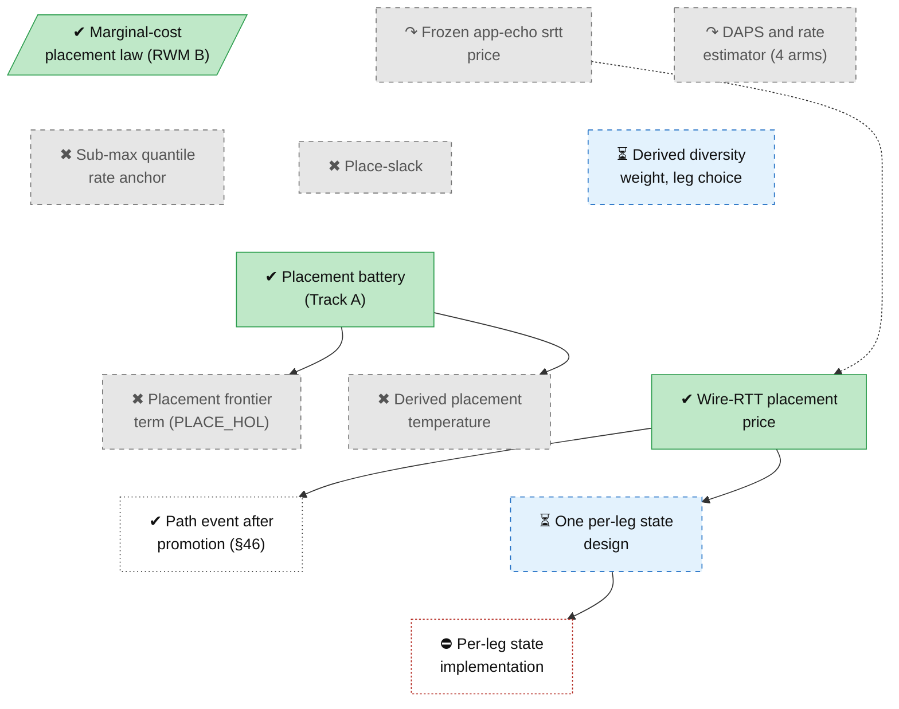

<!-- Generated by tools/roadmap/build.py from docs/roadmap/nodes.yaml. Do not edit. -->

# place - placement

Scope: multipath placement: placement price, idle-leg lock-out, diversity weight, per-leg state.

[Back to the roadmap](../../roadmap.md)

<!-- BEGIN GENERATED: track-place -->

<!-- END GENERATED: track-place -->

## Node table

<!-- BEGIN GENERATED: table-place -->
| id | title | state | outcome | headline | evidence | depends_on |
|---|---|---|---|---|---|---|
| `place-marginal-cost` | Marginal-cost placement law (RWM B) | done | successful |  | branch RWM Phase B | rec-reliable-window |
| `place-daps` | DAPS and rate estimator (4 arms) | abandoned | superseded | −30 % | paper §10 row DAPS chain, pace-all, per-path rate-sample estimator (`RWM_DAPS*`, `RWM_PACE_ALL`, `RWM_RATE_SAMPLE`, `RWM_PER_PATH_EST`) |  |
| `place-slack` | Place-slack | abandoned | dead-end | 6 % | paper §10 row Place-slack (`RWM_PLACE_SLACK`) |  |
| `place-stage2-battery` | Placement battery (Track A) | done | successful | 6 % of delivered latency | status §2 row "Placement battery (Track A)" | meas-wire-v8 |
| `place-hol` | Placement frontier term (PLACE_HOL) | abandoned | dead-end | 6 % | tag archive/RWM_PLACE_HOL | place-stage2-battery |
| `place-t-derived` | Derived placement temperature | abandoned | dead-end | 0.78–0.85× | tag archive/RWM_PLACE_T_DERIVED | place-stage2-battery |
| `place-wdiv` | Derived diversity weight, leg choice | in-progress | unrated |  | branch wdiv-diag |  |
| `place-frozen-echo` | Frozen app-echo srtt price | abandoned | superseded |  | paper §10 row Frozen app-echo srtt as the placement base, `(½ + ε̂)·s_i` (the pre-§41b base; `RWM_PLACE_WIRE` unset) |  |
| `place-wire-price` | Wire-RTT placement price | done | successful | p = 0.7195 | status §38; status §41; status §41b; status §3.9 | model-review-37 |
| `place-per-leg-state` | One per-leg state design | in-progress | unrated |  | derivation w3-per-leg-state.md (branch perleg-design); branch perleg-design | infra-simplify-review, place-wire-price |
| `place-submax-anchor` | Sub-max quantile rate anchor | abandoned | dead-end | 65× | paper §10 row Sub-max quantile rate anchor (`RWM_RATE_WIRE`, `RWM_RATE_Q`) |  |
| `place-path-event` | Path event after promotion (§46) | done | unrated |  | status §46 | place-wire-price |
| `place-user-perleg-questions` | Owner calls on per-leg design | next | n/a |  | plan user decision 9 | place-per-leg-state |
| `place-per-leg-impl` | Per-leg state implementation | blocked | unrated |  | plan W3.2, W3.6a | place-per-leg-state, place-user-perleg-questions |

### Details per node

| id | title | notes | evidence |
|---|---|---|---|
| `place-marginal-cost` | Marginal-cost placement law (RWM B) | Block-granular path affinity (2026-07-04) then one continuous marginal-cost law with striping (2026-07-06). Owner: no equal-weight striping, no hard mode switch (2026-07-06). | branch RWM Phase B |
| `place-daps` | DAPS and rate estimator (4 arms) | 2026-07-12 arc, deleted 2026-07-27. Arms (4): DAPS queue management; DAPS read-ahead depth bound; pace-all at BtlBw_i (RWM_PACE_ALL); per-path rate-sample estimator (RWM_RATE_SAMPLE, RWM_PER_PATH_EST). The sub-max quantile anchor is now its own node (place-submax-anchor). Dates: paper §10 rows carry an end (removal) date only. | paper §10 row DAPS chain, pace-all, per-path rate-sample estimator (`RWM_DAPS*`, `RWM_PACE_ALL`, `RWM_RATE_SAMPLE`, `RWM_PER_PATH_EST`) |
| `place-slack` | Place-slack | G179 (feat/c8-conversion, 2026-08-06) is matched to this row by date and subject (slow-path conversion); uncertain. Dates: paper §10 rows carry an end (removal) date only. | paper §10 row Place-slack (`RWM_PLACE_SLACK`) |
| `place-stage2-battery` | Placement battery (Track A) | Verdict "First readout MIXED" is the battery's own word, not the outcome scale's mixed. | status §2 row "Placement battery (Track A)" |
| `place-hol` | Placement frontier term (PLACE_HOL) | Archived 2026-11-12 (simplify batch 3) on the owner's housekeeping call. The archive tag's quote names another commit; the verdict is the paper row. Dates: paper §10 rows carry an end (removal) date only; archive/RWM_PLACE_HOL archived 2026-11-12 (tag date not used for end). | tag archive/RWM_PLACE_HOL |
| `place-t-derived` | Derived placement temperature | Archived 2026-11-12 on the owner's ruling (archive code, keep formula). Dates: paper §10 rows carry an end (removal) date only; archive/RWM_PLACE_T_DERIVED archived 2026-11-12 (tag date not used for end). | tag archive/RWM_PLACE_T_DERIVED |
| `place-wdiv` | Derived diversity weight, leg choice | Never in a battery; wdiv-diag wires RWM_PLACE_WDIV and the [HOLD] cx_leg field; reported arms in §52; unmerged. Dates: paper §10 rows carry an end (removal) date only. | branch wdiv-diag |
| `place-frozen-echo` | Frozen app-echo srtt price | Paper row is undated: the base dates from the placement law (2026-07-06) and was replaced on 2026-11-10 (§41b, ADR-0073). Dates: paper §10 rows carry an end (removal) date only. | paper §10 row Frozen app-echo srtt as the placement base, `(½ + ε̂)·s_i` (the pre-§41b base; `RWM_PLACE_WIRE` unset) |
| `place-wire-price` | Wire-RTT placement price | Start set to §38 (2026-11-10); the diag36 branch has a 2026-11-09 first commit from §36. §38 REGRESSES (CPU) -> §41 FAIL (gate not A/A-sized) -> §41b GATE PASS -> owner promotion (ADR-0073) -> merged via diag36 (85c2295). The §3.9 lock-out classifier rule is folded in; §46 is its own node. Dates: status-section end dates are the section file's last edit, not the verdict date. | status §38; status §41; status §41b; status §3.9 |
| `place-per-leg-state` | One per-leg state design | Design only (plan W3.2); prerequisite of W3.3/W3.4; open owner questions (plan user decision 9). The per-leg state takes over the wire price's inputs. | derivation w3-per-leg-state.md (branch perleg-design); branch perleg-design |
| `place-submax-anchor` | Sub-max quantile rate anchor | Split from place-daps (its parent). The row says the windowed max is the correct statistic for decode-clocked samples; it names no replacing node. Dates: paper §10 rows carry an end (removal) date only. | paper §10 row Sub-max quantile rate anchor (`RWM_RATE_WIRE`, `RWM_RATE_Q`) |
| `place-path-event` | Path event after promotion (§46) | Own verdict: NO-DIFFERENCE against the registered prediction CAND-RECOVERS-FASTER (result in the §41c file, session 3). Dates: status-section end dates are the section file's last edit, not the verdict date. | status §46 |
| `place-user-perleg-questions` | Owner calls on per-leg design | Done when: the owner answers the per-leg design questions (queue_target_mult for a kept Copa arm, the L sampler switch, S's horizon, revival reseed, the leak backstop). | plan user decision 9 |
| `place-per-leg-impl` | Per-leg state implementation | Done when: one per-leg struct (m̂, b̂, RTT σ, app-echo spread, idle rule) replaces the two srtt copies, with the store-cap units bounding test and migration step A1 tests green in the VM pre-flight. | plan W3.2, W3.6a |
<!-- END GENERATED: table-place -->
