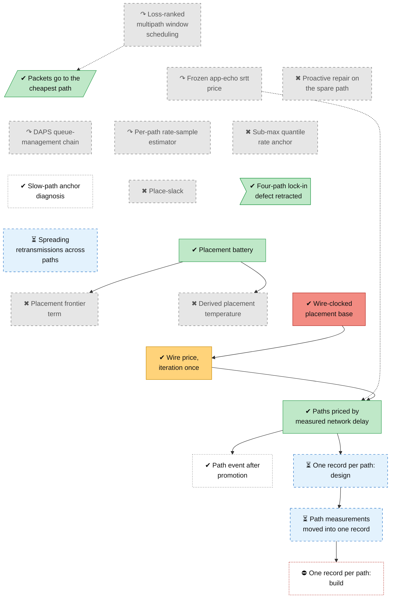

<!-- Generated by build.py from roadmap/nodes.yaml. Do not edit. -->

# place - placement

Scope: multipath placement: placement price, idle-leg lock-out, diversity weight, per-leg state.

[Back to the page](../../roadmap.md) · [legend](../../roadmap.md#legend)

<!-- BEGIN GENERATED: track-place -->

<!-- END GENERATED: track-place -->

## Node table

<!-- BEGIN GENERATED: table-place -->
| id | title | kind | lane | state | outcome | start | end | depends_on | replaced_by | qualified_by | headline | evidence |
|---|---|---|---|---|---|---|---|---|---|---|---|---|
| `place-marginal-cost` | Packets go to the cheapest path | law | vm | done | successful | 2026-07-04 | 2026-07-06 | rec-reliable-window |  |  |  | branch RWM Phase B |
| `place-daps` | DAPS queue-management chain | mechanism | vm | abandoned | superseded | 2026-07-12 | 2026-07-27 |  | store-anchor-hygiene |  | −30 % | paper §10 row DAPS chain, pace-all, per-path rate-sample estimator (`RWM_DAPS*`, `RWM_PACE_ALL`, `RWM_RATE_SAMPLE`, `RWM_PER_PATH_EST`); ADR-0065 |
| `place-rate-sample` | Per-path rate-sample estimator | mechanism | vm | abandoned | superseded | 2026-07-12 | 2026-07-27 |  | store-anchor-hygiene |  |  | paper §10 row DAPS chain, pace-all, per-path rate-sample estimator (`RWM_DAPS*`, `RWM_PACE_ALL`, `RWM_RATE_SAMPLE`, `RWM_PER_PATH_EST`); commit 11e0f5eb |
| `place-slack` | Place-slack | mechanism | vm | abandoned | dead-end | 2026-08-06 | 2026-08-06 |  |  |  | 6 % | paper §10 row Place-slack (`RWM_PLACE_SLACK`) |
| `place-stage2-battery` | Placement battery | research | vm | done | successful | 2026-09-08 | 2026-09-09 | meas-wire-v8 |  |  | 6 % of delivered latency | status §2 row "Placement battery (Track A)" |
| `place-hol` | Placement frontier term | mechanism | vm | abandoned | dead-end | 2026-09-08 | 2026-09-09 | place-stage2-battery |  |  | 6 % | tag archive/RWM_PLACE_HOL |
| `place-t-derived` | Derived placement temperature | mechanism | vm | abandoned | dead-end | 2026-09-08 | 2026-09-09 | place-stage2-battery |  |  | 0.78–0.85× | tag archive/RWM_PLACE_T_DERIVED |
| `place-wdiv` | Spreading retransmissions across paths | mechanism | host-cargo | in-progress | unrated | 2026-09-08 |  |  |  |  |  | branch wdiv-diag; paper §10 row Derived diversity weight (`RWM_PLACE_WDIV_DERIVED`) |
| `place-frozen-echo` | Frozen app-echo srtt price | mechanism | vm | abandoned | superseded | 2026-07-06 | 2026-11-10 |  | place-wire-price |  |  | paper §10 row Frozen app-echo srtt as the placement base, `(½ + ε̂)·s_i` (the pre-§41b base; `RWM_PLACE_WIRE` unset) |
| `place-s38-wire` | Wire-clocked placement base | mechanism | vm | done | bad | 2026-11-10 | 2026-11-10 | model-review-37 |  |  | +2.5 % | status §38; commit ac133b31 |
| `place-s41-iteration` | Wire price, iteration once | mechanism | vm | done | mixed | 2026-11-10 | 2026-11-10 | place-s38-wire |  |  |  | status §41; commit 85be32ac |
| `place-wire-price` | Paths priced by measured network delay | mechanism | vm | done | successful | 2026-11-10 | 2026-11-12 | place-s41-iteration |  |  | p = 0.7195 | status §41b; status §3.9; ADR-0073; commit fc5edd2d |
| `place-per-leg-state` | One record per path: design | mechanism | no-cargo | in-progress | unrated | 2026-11-12 |  | infra-simplify-review, place-wire-price |  |  |  | derivation w3-per-leg-state.md (branch perleg-design); branch perleg-design |
| `place-per-leg-relocate` | Path measurements moved into one record | simplification | host-cargo | in-progress | unrated | 2026-11-16 |  | place-per-leg-state |  |  |  | status Owner decisions (2026-11-16) items 4-5; branch perleg-phase-a e5246d7f; derivation w3-per-leg-state.md (branch perleg-design) |
| `place-submax-anchor` | Sub-max quantile rate anchor | mechanism | vm | abandoned | dead-end | 2026-07-12 | 2026-07-27 |  |  |  | 65× | paper §10 row Sub-max quantile rate anchor (`RWM_RATE_WIRE`, `RWM_RATE_Q`) |
| `place-path-event` | Path event after promotion | research | vm | done | unrated | 2026-11-10 | 2026-11-10 | place-wire-price |  |  |  | status §46 |
| `place-user-perleg-questions` | Owner calls on per-path record design | user-decision | user | next | n/a |  |  | place-per-leg-state |  |  |  | plan user decision 9; status Owner decisions (2026-11-16) item 4; status Owner decisions (2026-11-17) item 10 |
| `place-per-leg-impl` | One record per path: build | mechanism | host-cargo | blocked | unrated |  |  | place-per-leg-relocate, place-per-leg-state, place-user-perleg-questions |  |  |  | plan W3.2, W3.6a |
| `place-early-window-sched` | Loss-ranked multipath window scheduling | mechanism | host-cargo | abandoned | superseded | 2026-03-14 | 2026-07-04 |  | place-marginal-cost |  |  | ADR-0026 |
| `place-spare-repair` | Proactive repair on the spare path | mechanism | vm | abandoned | dead-end | 2026-07-08 | 2026-07-08 |  |  |  |  | commit ea20927f; commit 6c938427 |
| `place-quad-lockin` | Four-path lock-in defect retracted | defect-verdict | host-cargo | done | unrated | 2026-08-17 | 2026-08-18 |  |  |  |  | commit 0128bb5c |
| `place-anchor-consolidate` | Slow-path anchor diagnosis | research | vm | done | unrated | 2026-07-13 | 2026-07-13 |  |  |  |  | commit d63ffce7 |

### Details per node

| id | title | verdict | headline | in plain words | notes | confirmed | waiting on | queue order | order reason |
|---|---|---|---|---|---|---|---|---|---|
| `place-marginal-cost` | Packets go to the cheapest path | Merge RWM Phase B: marginal-cost placement law + striping window sender |  | One continuous rule decides which path carries each packet, the one where adding it costs least, instead of equal striping or switching between load regimes. | Block-granular path affinity (2026-07-04) then one continuous marginal-cost law with striping (2026-07-06). Owner: no equal-weight striping, no hard mode switch (2026-07-06). Was titled 'Marginal-cost placement law'. |  |  |  |  |
| `place-daps` | DAPS queue-management chain | their wins were measured in an era where the coded path was dead; the live ablation measured −17 to −30 % at the symmetric dual; the surviving ideas became the M* law and the anchor-hygiene laws | −30 % | A delay-aware way of picking which path carries each packet, which failed when retested. | 2026-07-12 arc, deleted 2026-07-27 (9b48286e). The DAPS queue management, its read-ahead depth bound (68d6b6c5: 'correct lever, but bulk C8 aggregation is BOUNDED') and pace-all at BtlBw_i (34449977) share one paper row; the per-path rate-sample estimator is its own node (place-rate-sample, split 2026-11-16), and so is the sub-max quantile anchor (place-submax-anchor). |  |  |  |  |
| `place-rate-sample` | Per-path rate-sample estimator | BtlBw rate-sample anchor: fix the per-path over-read (fast ×158→×1); C8 does NOT rise under DAPS — honest negative |  | A per-path rate-sample estimator fixed the fast path over-reading its rate by 158 times, but two unequal paths did not speed up under the scheduling scheme, an honest negative; its useful ideas lived on in later laws. | Split 2026-11-16 from 'DAPS and rate estimator (4 arms)' (its own branch). Deleted with the DAPS chain 2026-07-27; the paper row: the surviving ideas became the M* law and the anchor-hygiene laws. |  |  |  |  |
| `place-slack` | Place-slack | at the heterogeneous dual goodput falls monotonically as slow-path source share rises (6 % → 88.6 Mbit/s, 16–18 % → 70–83); the symmetric-dual clause failed (0.86–0.90×Σ) | 6 % | Letting slower paths take extra slack in packet placement was refuted: on two unequal paths speed fell as the slow path's share grew, and on two equal paths it reached only 0.86 to 0.90 of the sum. | G179 (feat/c8-conversion, 2026-08-06) is matched to this row by date and subject (slow-path conversion); uncertain. Dates: paper §10 rows carry an end (removal) date only. |  |  |  |  |
| `place-stage2-battery` | Placement battery | First readout MIXED: cross-path wait ≈ 6 % of delivered latency, queueing above the path floor the largest term; all arms INERT-AS-DERIVED on latency, goodput regressions under the guard; 0.15 is not a stable quantile | 6 % of delivered latency | A placement test battery found cross-path waiting is only about 6 percent of delivered latency, mostly queueing, and the new placement options changed nothing on latency while costing speed under the merge check. | Verdict "First readout MIXED" is the battery's own word, not the outcome scale's mixed. |  |  |  |  |
| `place-hol` | Placement frontier term | inert on delivered latency, with goodput regressions under the guard; placement-manufactured wait is only ~6 % of delivered latency | 6 % | A placement term for the sending frontier changed nothing on delivered latency and cost speed under the merge check, since placement-caused waiting is only about 6 percent of latency; it was dropped and archived. | Archived 2026-11-12 (simplify batch 3) on the owner's housekeeping call. The archive tag's quote names another commit; the verdict is the paper row. Dates: paper §10 rows carry an end (removal) date only; archive/RWM_PLACE_HOL archived 2026-11-12 (tag date not used for end). |  |  |  |  |
| `place-t-derived` | Derived placement temperature | not refuted: INERT-AS-DERIVED at c7/c8 (`5e6e3f5`, 2026-09-08, pre-ADR-0073 substrate; ledger at `faa54afd^:raptorpath/docs/l1-raw/place/`); expensive as implemented: σ̂_e re-sorted per leg per placement, 0.78–0.85× goodput at c1 where N = 1 makes it the identity; | 0.78–0.85× | A placement temperature derived from first principles was not wrong but did nothing useful and was costly to compute, cutting speed to 0.78 to 0.85 times on one path; the code was archived and the formula kept. | Archived 2026-11-12 on the owner's ruling (archive code, keep formula). Dates: paper §10 rows carry an end (removal) date only; archive/RWM_PLACE_T_DERIVED archived 2026-11-12 (tag date not used for end). |  |  |  |  |
| `place-wdiv` | Spreading retransmissions across paths | never in a battery (all 166 Track-A rows ran it =0); no verdict |  | A wiring change that lets retransmissions be spread across paths differently has been built but never fully measured. | Never in a battery; wdiv-diag wires RWM_PLACE_WDIV and the [HOLD] cx_leg field; reported arms in §52; unmerged. Dates: paper §10 rows carry an end (removal) date only. Was titled 'Derived diversity weight, leg choice'. |  | the leg-choice row in a VM session, then merge to main |  |  |
| `place-frozen-echo` | Frozen app-echo srtt price | on an idle leg the echo srtt freezes with the leg's own dwell, so its price stays +17 to +116 nats above the loaded leg's on 11 locked rows and the one-leg state is absorbing (10 of 24 static-cap rows locked, against 0 with the wire base); |  |  | Paper row is undated: the base dates from the placement law (2026-07-06) and was replaced on 2026-11-10 (§41b, ADR-0073). Dates: paper §10 rows carry an end (removal) date only. |  |  |  |  |
| `place-s38-wire` | Wire-clocked placement base | `REGRESSES-AT(c1s-400@def)`: client CPU/GB +2.5 % against a 2.4 % tolerance, ranges disjoint; every other clause passes (without it, `CURED`); no WIRE row locked, against 10 of 24 MAIN rows at the static cells | +2.5 % | Tried placing traffic by the measured wire delay; it used about 2.5 % more client CPU per gigabyte than the 2.4 % allowed, so it was not shipped. | Split 2026-11-16 from 'Wire-RTT placement price'. The arm did not ship; iteration once in §41. |  |  |  |  |
| `place-s41-iteration` | Wire price, iteration once | ladder `CURED` (WIRE vs MAIN); BASE gate `FAIL` on one c1d client-lag clause on the better side (the gate was not A/A-sized), so §41b |  |  | Split 2026-11-16 from 'Wire-RTT placement price'. Allocation-free witness, host gate, then the §38 battery. |  |  |  |  |
| `place-wire-price` | Paths priced by measured network delay | GATE PASS, p = 0.7195. | p = 0.7195 | Fixed a bug where an idle path could stay priced too high and never be used again, by pricing each path on its measured network delay. | §41b GATE PASS (p = 0.72) -> owner promotion (ADR-0073) -> merged via diag36 (85c2295). §38 and §41 are their own nodes since 2026-11-16 (place-s38-wire, place-s41-iteration). The §3.9 lock-out classifier rule is folded in; §46 is its own node. Was titled 'Wire-RTT placement price'. |  |  |  |  |
| `place-per-leg-state` | One record per path: design |  |  | A design for keeping all of each path's measurements in one place instead of in several slightly different copies. | Design only (plan W3.2); prerequisite of W3.3/W3.4; open owner questions (plan user decision 9). The per-leg state takes over the wire price's inputs. Answered: question 4 (decision 4, 2026-11-16) and question 1 (decision 10, 2026-11-17). Was titled 'One per-leg state design'. Docs from perleg-design merged to main 2026-11-27. |  | the owner's answers to the remaining per-path questions, then merge to main |  |  |
| `place-per-leg-relocate` | Path measurements moved into one record |  |  | Moving each path's measurements into one per-path record with no change in behaviour; it is built and waits for its merge check. | Phase A of the per-leg design (A0-A4 on perleg-phase-a e5246d7f, 2026-11-16..17): leg_state_trace_pin captured at main and the leak-backstop bind gauge; one s (LegState.s) replaces Copa's srtt and the estimator's ewma_rtt; m, b, the rate sampler, J1-J3 and the wire RTT move into LegState; the [LEG] gauge (observation only). Owner decision 4 answered the only question it needs (reseed s on revival). It changes no behaviour, so per owner decision 5 it rides one stacked merge guard with the other zero-behaviour steps (the shared-core moves), bisected only on failure. Done when: that guard passes and the branch merges. Was titled 'Per-leg state relocation step'. Docs from perleg-design merged to main 2026-11-27. |  | one merge guard shared by the steps that change no behaviour |  |  |
| `place-submax-anchor` | Sub-max quantile rate anchor | decode-clocked samples make the windowed max the correct statistic; any sub-max quantile under-reads about 65× (heterogeneous dual 3–6× worse) | 65× | Using a lower percentile instead of the maximum for the path rate estimate was refuted: with decode-paced samples it under-reads by about 65 times, so the windowed maximum stayed and the switches were deleted. | Split from place-daps (its parent). The row says the windowed max is the correct statistic for decode-clocked samples; it names no replacing node. Dates: paper §10 rows carry an end (removal) date only. |  |  |  |  |
| `place-path-event` | Path event after promotion | VERDICT NO-DIFFERENCE. |  |  | Own verdict: NO-DIFFERENCE against the registered prediction CAND-RECOVERS-FASTER (result in the §41c file, session 3). Dates: status-section end dates are the section file's last edit, not the verdict date. |  |  |  |  |
| `place-user-perleg-questions` | Owner calls on per-path record design |  |  | Owner decision on five open design questions for keeping each path's measurements in one place. | Q4 reseed (2026-11-16); Q1 queue_target_mult = 1 + q(delta) (2026-11-17). Q2-3 and 5-8 belong to Phase B / W3.3. Done when: those are answered. Was titled 'Owner calls on per-leg design'. |  |  |  |  |
| `place-per-leg-impl` | One record per path: build |  |  | Keeping all of each path's measurements in one place instead of in several slightly different copies. | Done when: one per-leg struct (m̂, b̂, RTT σ, app-echo spread, idle rule) replaces the two srtt copies, with the store-cap units bounding test and migration step A1 tests green in the VM pre-flight. The relocation (Phase A) is its own node, place-per-leg-relocate; this node is Phase B and W3.3, which wait on the remaining per-leg questions (2-3, 5-8). Was titled 'Per-leg state implementation'. |  |  |  |  |
| `place-early-window-sched` | Loss-ranked multipath window scheduling | Replace the single `select_window_paths()` call (which returned a fixed source/repair pair |  | An early way of picking paths that ranked them by loss rate, later replaced by pricing each path's marginal cost. | ADR-0026 (status Resolved) replaced loss-only path selection by per-symbol RTT/goodput-aware selection. End date is the start of place-marginal-cost, which replaced it. |  |  |  |  |
| `place-spare-repair` | Proactive repair on the spare path | Verdict: C8 bar (>15.7, factor>1) NOT met by any arm. |  | Proactive repair was sent on the slower spare path to keep the fast path for new data; it lowered throughput in every arm and stayed off by default. | Its merge ea20927f carries the aggregation arc's 2026-07-08 "final verdict" (meas-c8-aggregation-arc). |  |  |  |  |
| `place-quad-lockin` | Four-path lock-in defect retracted | merge: sweep item 6 REFUTED - the quad lock-in was the bench's own pid<2 gauge guards; placement is fine; RWM_COLD_PLACE kept gated for the unmeasured late-join regime |  | A suspected placement lock-in on four-path links turned out to be the bench's own gauge guards; placement was fine, and the cold-start gate stays off for the unmeasured late-join case. | Split 2026-11-20 from store-cap-law-cluster (sweep item 6, a placement verdict). |  |  |  |  |
| `place-anchor-consolidate` | Slow-path anchor diagnosis | §16.14 CONSOLIDATE refuted, FIXABLE |  | A diagnostic traced the slow path's rate anchor end to end: contrary to the paper's reading the anchor does establish, but its bandwidth estimate swings about 4000-fold because it is clocked by decoding; the consolidation proposal was refuted and the anchor judged fixable. | Was folded in place-submax-anchor (2026-07-13). |  |  |  |  |

### Folded items per node

- `place-marginal-cost`: Packets go to the cheapest path
  - branch L2-ws1
  - Owner rule: no equal-weight striping (2026-07-06, commit 8c6c7e2d)
  - RWM Phase B: multipath striping with the placement law (2026-07-06, commit 4cf6b9b1, commit dfba099e)
  - Placement as one marginal-cost law, not regimes (2026-07-06, commit 8c6c7e2d, commit ee1ae3e0)
- `place-daps`: DAPS queue-management chain
  - branch DAPS queue-mgmt
  - branch feat/daps-rightsized-fec
  - commit 68d6b6c5
  - commit 9b48286e
  - commit 7387ad9d
  - Pace all per-path traffic at BtlBw (2026-07-12, commit 344499771756689d)
  - DAPS queue management with per-path cap and pacing (2026-07-12, commit cd2882e1, commit dfc7fbe3)
  - DAPS and BDP glossary entries (2026-07-12, commit f3112dc6, commit 707015c8)
- `place-rate-sample`: Per-path rate-sample estimator
  - branch per-path rate estimator
- `place-slack`: Place-slack
  - branch feat/c8-conversion
- `place-stage2-battery`: Placement battery
  - branch the placement arms
  - branch meas/place-score
  - branch meas/place-run
  - branch meas/place-prep
  - Placement battery: four default-absent placement arms (2026-09-08, commit c8c1a774, commit 6d76c7e4, commit 6bdd8c3a, commit dc05dc73, commit ad69d1e3)
- `place-hol`: Placement frontier term
  - paper §10 row Placement frontier term (`RWM_PLACE_HOL`)
- `place-t-derived`: Derived placement temperature
  - paper §10 row Derived placement temperature (`RWM_PLACE_T_DERIVED`)
- `place-s38-wire`: Wire-clocked placement base
  - commit 432b4740
- `place-wire-price`: Paths priced by measured network delay
  - branch diag36
- `place-submax-anchor`: Sub-max quantile rate anchor
  - Delete RATE_WIRE and RATE_Q (2026-07-27, commit f1f32c5b)
- `place-early-window-sched`: Loss-ranked multipath window scheduling
  - commit 86e1f0f3
  - commit 628fdb1c
  - Multipath simulation test suite with dynamic paths (2026-03-13, commit 5e6074ee)
  - Multipath: per-path correction mix tilted by the scheduler, not symbols moved between paths (2026-03-21, session record)
- `place-spare-repair`: Proactive repair on the spare path
  - branch C8 cross-path repair
- `place-quad-lockin`: Four-path lock-in defect retracted
  - branch sweep item 6 REFUTED
  - Placement cold-start defect does not exist (retracted) (2026-08-18, commit 0128bb5c)
<!-- END GENERATED: table-place -->
