<!-- Generated by build.py from roadmap/nodes.yaml. Do not edit. -->

# rate - rate law

Scope: the rate law and the (δ, ρ, r) triangle: FEC rate, P_fec, W*, hints as named points.

[Back to the page](../../roadmap.md) · [legend](../../roadmap.md#legend)

```mermaid
flowchart TB
    rate_ge_hmm[/"✔ Gilbert-Elliott loss<br/>model"/]
    rate_fec_rate_v1[/"✔ First automatic<br/>repair-rate control"/]
    rate_saturation_rstar[/"✔ Saturation-aware r*<br/>and window"/]
    rate_pfec_exact[/"✔ Exact P_fec by<br/>transfer matrix"/]
    rate_deadline_rstar[/"✔ Deadline-constrained<br/>r* for N paths"/]
    rate_ge_real_trace["✔ Real-trace check of<br/>the loss model"]
    rate_rstar_window_mass[/"✔ r* window-mass<br/>provisioning"/]
    rate_taper_r[/"✔ Taper emission<br/>budget law"/]
    rate_leading_taper["↷ Leading-window taper<br/>emission"]
    rate_unified_shed[/"✔ δ-honest overload<br/>shedding"/]
    rate_est_cadence["✔ Loss estimator<br/>updates in batches"]
    rate_sender_truth_loss["✖ Sender-truth loss<br/>estimator"]
    rate_rho_not_input>"✔ ρ not an engine<br/>input"]
    rate_dials_made_real["✔ Latency dial becomes<br/>a formula"]
    rate_r_battery["✖ Sending repair ahead<br/>of losses"]
    rate_dof_ledger[/"⏸ Repair-result<br/>feedback into repair<br/>rate"/]
    rate_defect_pfec>"⚠ Repair-success<br/>estimate jumps, not<br/>curves"]
    rate_pfec_continuous["✔ Continuous P_fec<br/>derivation"]
    rate_pfec_oracle["⏳ Reference test of<br/>repair success"]
    rate_defect_taper_inert>"⚠ Repair-timing shape<br/>has no effect"]
    rate_evict_registration["✔ Evicting-seat m̄<br/>registration"]
    rate_spare_cwnd["✔ Is spare's cwnd<br/>enforced?"]
    rate_evict_epre["✔ Evicting-seat test<br/>suites and binary"]
    rate_c8_frontier_recopy["✔ c8 repair budget re-<br/>copies"]
    rate_overprovision_verdict>"⚠ Too much repair<br/>sent: verdict"]
    rate_defect_lowrate_cancel>"⚠ Low-rate repair<br/>cancelled by acks"]
    rate_evict_session["✔ Repair test with<br/>droppable late data"]
    rate_k4_input_checks>"⚠ Two repair-test<br/>readings explained"]
    rate_spare_clamp_verdict[/"○ Full-path repair<br/>cap: verdict"/]
    rate_delta_jitter_fix["○ Jitter margin reads<br/>wrong direction"]
    rate_fix_rate_readout["○ Repair-rate readout"]
    rate_s06_plost_derivation["○ Repair slots send<br/>only coded repair"]
    rate_shed_budget_rho>"⚠ Late-data drop<br/>budget ignores ρ"]
    rate_adr50_split_unwired>"⚠ Decided repair-<br/>budget split never<br/>wired"]
    rate_law_reconcile[/"⛔ Repair rate: paper<br/>and code agree"/]
    rate_fix_estimators[/"⛔ Loss estimator<br/>approximations"/]
    rate_fix_term_gauge["⛔ Readout: which<br/>repair-rate term<br/>controls"]
    rate_fix_rho_realtime[/"⛔ Rules for droppable<br/>data made smooth"/]
    rate_ge_hmm ~~~ rate_pfec_exact
    rate_fec_rate_v1 ~~~ rate_deadline_rstar
    rate_saturation_rstar ~~~ rate_ge_real_trace
    rate_pfec_exact ~~~ rate_rstar_window_mass
    rate_deadline_rstar ~~~ rate_taper_r
    rate_ge_real_trace ~~~ rate_leading_taper
    rate_rstar_window_mass ~~~ rate_unified_shed
    rate_taper_r ~~~ rate_est_cadence
    rate_leading_taper ~~~ rate_sender_truth_loss
    rate_unified_shed ~~~ rate_rho_not_input
    rate_est_cadence ~~~ rate_dials_made_real
    rate_sender_truth_loss ~~~ rate_dials_made_real
    rate_rho_not_input ~~~ rate_r_battery
    rate_dials_made_real ~~~ rate_r_battery
    rate_r_battery ~~~ rate_dof_ledger
    rate_r_battery ~~~ rate_defect_pfec
    rate_dof_ledger ~~~ rate_pfec_continuous
    rate_defect_pfec ~~~ rate_pfec_continuous
    rate_pfec_continuous ~~~ rate_pfec_oracle
    rate_pfec_continuous ~~~ rate_defect_taper_inert
    rate_pfec_continuous ~~~ rate_evict_registration
    rate_pfec_oracle ~~~ rate_spare_cwnd
    rate_defect_taper_inert ~~~ rate_evict_epre
    rate_evict_registration ~~~ rate_c8_frontier_recopy
    rate_spare_cwnd ~~~ rate_overprovision_verdict
    rate_evict_epre ~~~ rate_defect_lowrate_cancel
    rate_c8_frontier_recopy ~~~ rate_evict_session
    rate_overprovision_verdict ~~~ rate_k4_input_checks
    rate_defect_lowrate_cancel ~~~ rate_spare_clamp_verdict
    rate_evict_session ~~~ rate_spare_clamp_verdict
    rate_k4_input_checks ~~~ rate_delta_jitter_fix
    rate_spare_clamp_verdict ~~~ rate_fix_rate_readout
    rate_spare_clamp_verdict ~~~ rate_s06_plost_derivation
    rate_delta_jitter_fix ~~~ rate_shed_budget_rho
    rate_fix_rate_readout ~~~ rate_adr50_split_unwired
    rate_s06_plost_derivation ~~~ rate_law_reconcile
    rate_shed_budget_rho ~~~ rate_fix_estimators
    rate_adr50_split_unwired ~~~ rate_fix_estimators
    rate_law_reconcile ~~~ rate_fix_estimators
    rate_fix_estimators ~~~ rate_fix_term_gauge
    rate_fix_estimators ~~~ rate_fix_rho_realtime
    rate_ge_hmm -.-> rate_ge_real_trace
    rate_saturation_rstar -.-> rate_defect_pfec
    rate_ge_hmm --> rate_rstar_window_mass
    rate_fec_rate_v1 --> rate_rstar_window_mass
    rate_taper_r -.-> rate_defect_taper_inert
    rate_fec_rate_v1 --> rate_est_cadence
    rate_dials_made_real --> rate_r_battery
    rate_r_battery --> rate_dof_ledger
    rate_defect_pfec --> rate_pfec_continuous
    rate_pfec_continuous --> rate_pfec_oracle
    rate_evict_registration --> rate_evict_epre
    rate_evict_epre --> rate_evict_session
    rate_evict_session --> rate_k4_input_checks
    rate_evict_session --> rate_spare_clamp_verdict
    rate_k4_input_checks --> rate_delta_jitter_fix
    rate_c8_frontier_recopy --> rate_s06_plost_derivation
    rate_pfec_oracle --> rate_law_reconcile
    rate_fix_estimators --> rate_fix_term_gauge
    rate_law_reconcile --> rate_fix_rho_realtime
    rate_fix_estimators --> rate_fix_rho_realtime
    linkStyle 41,42,45 stroke:#e69500,stroke-width:3px,stroke-dasharray:2 3
    classDef vsucc fill:#2e9e4f,stroke:#1b6b34,color:#fff
    classDef succ fill:#bfe8c8,stroke:#2e9e4f,color:#111
    classDef mixed fill:#ffd37a,stroke:#c98a00,color:#111
    classDef bad fill:#f28b82,stroke:#b3261e,color:#111
    classDef dead fill:#e6e6e6,stroke:#777,stroke-dasharray:5 5,color:#555
    classDef inprog fill:#a8cdf5,stroke:#1f6fc5,color:#111
    classDef next fill:#fff,stroke:#333,color:#111
    classDef blocked fill:#fff,stroke:#b3261e,stroke-dasharray:2 2,color:#111
    classDef parked fill:#f3f3f3,stroke:#999,color:#555
    classDef unrated fill:#fff,stroke:#333,stroke-dasharray:1 3,color:#111
    classDef gate fill:#d9c2f0,stroke:#7b3fb5,color:#111
    classDef decided fill:#ece0f7,stroke:#7b3fb5,stroke-dasharray:2 2,color:#111
    classDef finding fill:#ffe0b2,stroke:#d84315,stroke-width:2px,color:#111
    classDef waiting fill:#e3f2fd,stroke:#1f6fc5,stroke-dasharray:5 5,color:#111
    class rate_ge_hmm,rate_fec_rate_v1,rate_saturation_rstar,rate_deadline_rstar,rate_rstar_window_mass,rate_taper_r,rate_unified_shed,rate_rho_not_input,rate_dials_made_real,rate_c8_frontier_recopy succ
    class rate_pfec_exact,rate_ge_real_trace,rate_pfec_continuous,rate_evict_registration,rate_spare_cwnd,rate_evict_epre,rate_evict_session unrated
    class rate_leading_taper,rate_sender_truth_loss,rate_r_battery dead
    class rate_est_cadence vsucc
    class rate_dof_ledger parked
    class rate_defect_pfec,rate_defect_taper_inert,rate_overprovision_verdict,rate_defect_lowrate_cancel,rate_k4_input_checks,rate_shed_budget_rho,rate_adr50_split_unwired finding
    class rate_pfec_oracle waiting
    class rate_spare_clamp_verdict,rate_delta_jitter_fix,rate_fix_rate_readout,rate_s06_plost_derivation next
    class rate_law_reconcile,rate_fix_estimators,rate_fix_term_gauge,rate_fix_rho_realtime blocked
```

<!-- BEGIN GENERATED: track-rate -->

<!-- END GENERATED: track-rate -->

## Node table

<!-- BEGIN GENERATED: table-rate -->
| id | title | kind | lane | state | outcome | start | end | depends_on | replaced_by | qualified_by | headline | evidence |
|---|---|---|---|---|---|---|---|---|---|---|---|---|
| `rate-ge-hmm` | Gilbert-Elliott loss model | law | host-cargo | done | successful | 2026-03-14 | 2026-07-07 |  |  | rate-ge-real-trace |  | ADR-0023 |
| `rate-fec-rate-v1` | First automatic repair-rate control | law | host-cargo | done | successful | 2026-03-18 | 2026-03-21 |  |  |  | DC (ε≈0.1%): 4.3% actual vs 0.1% optimal → 43x | ADR-0050; ADR-0043 |
| `rate-saturation-rstar` | Saturation-aware r* and window | law | vm | done | successful | 2026-07-02 | 2026-07-07 |  |  | rate-defect-pfec |  | commit 55013af4; branch feat/p5-saturation-cap |
| `rate-rstar-window-mass` | r* window-mass provisioning | law | vm | done | successful | 2026-07-13 | 2026-07-13 | rate-ge-hmm, rate-fec-rate-v1 |  |  |  | ADR-0063 |
| `rate-taper-r` | Taper emission budget law | law | vm | done | successful | 2026-07-18 | 2026-07-18 |  |  | rate-defect-taper-inert |  | commit 33b29f81 |
| `rate-leading-taper` | Leading-window taper emission | mechanism | vm | abandoned | superseded | 2026-07-18 | 2026-07-19 |  | cod-unified-span |  | −22 pp | paper §10 row Leading-window taper emission |
| `rate-retention-is-rho` | Owner call: retention is ρ | user-decision | user | done | n/a | 2026-07-06 | 2026-07-06 | model-user-three-dials |  |  |  | commit 49ab700c |
| `rate-unified-shed` | δ-honest overload shedding | law | vm | done | successful | 2026-07-21 | 2026-07-21 | cod-unified-span, rate-retention-is-rho |  |  |  | commit 6568822c |
| `rate-est-cadence` | Loss estimator updates in batches | mechanism | vm | done | very-successful | 2026-08-06 | 2026-10-04 | rate-fec-rate-v1, perf-recv-msg-wall |  | infra-defect-recorded-not-fixed | +41 % | paper §10 row Estimator cadence alone (`RWM_EST_CADENCE`, pool anchor decoupled) |
| `rate-sender-truth-loss` | Sender-truth loss estimator | mechanism | vm | abandoned | dead-end | 2026-08-18 | 2026-08-19 |  |  |  | 20× | paper §10 row Sender-truth loss estimator (`RWM_LOSS_SENT_TRUTH`) |
| `rate-r-battery` | Sending repair ahead of losses | research | vm | abandoned | dead-end | 2026-09-08 | 2026-09-08 | rate-dials-made-real |  |  |  | status §2 row "r > 0 battery (Track B)"; status §3.1 item 7; status §3.1 note (cod= counter); paper §10 row Funded proactive coding at r > 0 (the r > 0 battery) |
| `rate-dof-ledger` | Repair-result feedback into repair rate | law | no-cargo | parked | unrated | 2026-11-10 | 2026-11-10 | rate-r-battery |  |  |  | status §39 |
| `rate-dials-made-real` | Latency dial becomes a formula | mechanism | vm | done | successful | 2026-09-08 | 2026-09-08 |  |  |  |  | branch THE DIALS MADE REAL |
| `rate-defect-pfec` | Repair-success estimate jumps, not curves | defect-verdict | none | in-progress | unrated | 2026-11-13 |  |  |  |  | 0.0267 at c2 and 0.0515 at c3 | status §3.10 item 2 |
| `rate-pfec-continuous` | Continuous P_fec derivation | research | no-cargo | done | unrated | 2026-11-14 | 2026-11-14 | rate-defect-pfec, model-user-wasm-calls |  |  |  | status "Owner decisions (2026-11-14)" item 2; status "Owner decisions (2026-11-14)" erratum; derivation pfec-continuous.md; commit b252933b |
| `rate-pfec-oracle` | Reference test of repair success | instrument | host-cargo | in-progress | unrated | 2026-11-14 |  | rate-pfec-continuous |  |  | K0–K3 test-only on pfec-oracle | status "Owner decisions (2026-11-14)" erratum, second correction; derivation pfec-oracle-spec.md; commit 11abce17; branch pfec-oracle-design; branch pfec-oracle |
| `rate-defect-taper-inert` | Repair-timing shape has no effect | defect-verdict | none | in-progress | unrated | 2026-11-14 |  |  |  |  |  | status "Owner decisions (2026-11-14)" erratum, second correction; commit 2a622525 |
| `rate-evict-registration` | Evicting-seat m̄ registration | research | no-cargo | done | unrated | 2026-11-16 | 2026-11-17 |  |  |  |  | status §60 Amendment 2; status §58; branch harness59; derivation pfec-oracle-spec.md; status §51; docs/derivations/s51-evict-design.md |
| `rate-evict-epre` | Evicting-seat test suites and binary | infra | vm | done | unrated | 2026-11-18 | 2026-11-18 | rate-evict-registration, rec-f2-merge-guard |  |  |  | status §51 (E-pre, its failure rule); status §51 Amendment 1; status §51 Amendment 2; status §63 Result ("Next"); status §64 Result (the limit at ρ < 1); branch e-tree-f2 11213363 |
| `rate-evict-session` | Repair test with droppable late data | research | vm | done | unrated | 2026-11-19 | 2026-11-19 | rate-evict-epre, meas-blocke-pacing-gate, meas-blocke-steady-rule |  |  | Repair cap never binds at paced loads; overload cwnd not enforced | status §51 block E Result; docs/l1-raw/s51e; status §51; status §51 Amendment 2; status §63 Result; docs/derivations/s51-evict-design.md |
| `rate-spare-clamp-verdict` | Full-path repair cap: verdict | law | no-cargo | next | unrated |  |  | rate-evict-session |  |  |  | status §51 block E Result; status §60 Amendment 2 |
| `rate-k4-input-checks` | Two repair-test readings explained | defect-verdict | no-cargo | in-progress | unrated | 2026-11-19 |  | rate-evict-session |  |  | Jitter input reads the wrong direction; the bound was miscounted | status §51 block E Result; status "The two K4 input checks, post hoc" |
| `rate-delta-jitter-fix` | Jitter margin reads wrong direction | mechanism | host-cargo | next | unrated |  |  | rate-k4-input-checks |  |  |  | status "The two K4 input checks, post hoc"; law ledger S03 |
| `rate-spare-cwnd` | Is spare's cwnd enforced? | research | no-cargo | done | unrated | 2026-11-16 | 2026-11-19 |  |  |  | Not enforced: 0.81 and 0.89 of the overload rows | status §51 block E Result; status §60 Amendment 2; status §51 (choice 5; design §7); status §51 Amendment 2 |
| `rate-fix-rate-readout` | Repair-rate readout | instrument | host-cargo | next | unrated |  |  |  |  |  |  | docs/derivations/s51-design.md §8 P2 |
| `rate-c8-frontier-recopy` | c8 repair budget re-copies | research | no-cargo | done | successful | 2026-11-19 | 2026-11-19 | meas-s51-session |  |  | S06 copies the cum-ack blocker on every slot; 4–7× losses, mostly already received | status §51 block 51 Result, finding 1; status §51 block 51 Result, Addendum 2; docs/l1-raw/s51b/recopy |
| `rate-overprovision-verdict` | Too much repair sent: verdict | defect-verdict | no-cargo | in-progress | unrated | 2026-11-19 |  | meas-s51-session |  |  |  | status §51 block 51 Result (r(δ) table, goodput against δ); status §51 block 51 Result, Addendum 2 (goodput arithmetic); owner decision 2026-11-19 (chose option b); status §51 block 51 Result, Addendum 3 |
| `rate-s06-plost-derivation` | Repair slots send only coded repair | mechanism | vm | next | unrated |  |  | rate-c8-frontier-recopy |  |  |  | status §51 block 51 Result, Addendum 2; law ledger S06; owner decision 2026-11-19 (delete the copy branch); status §51 block 51 Result, Addendum 3; ADR-0079; docs/derivations/s06-delete-plan.md |
| `rate-shed-budget-rho` | Late-data drop budget ignores ρ | defect-verdict | no-cargo | next | unrated |  |  |  |  |  |  | docs/derivations/liveness-audit.md item 4 |
| `rate-adr50-split-unwired` | Decided repair-budget split never wired | defect-verdict | no-cargo | next | unrated |  |  |  |  |  |  | status §51 Addendum 4 |
| `rate-user-rate-law` | Owner calls on repair-rate mismatches | user-decision | user | blocked | n/a |  |  | model-paper-recon, rate-defect-pfec, meas-s51-session |  |  |  | plan user decision 11; status §3.10 item 2 (conflict for the owner) |
| `rate-law-reconcile` | Repair rate: paper and code agree | law | host-cargo | blocked | unrated |  |  | rate-user-rate-law, meas-s51-session, rate-pfec-oracle |  |  |  | plan W3.5, W3.7 |
| `rate-fix-term-gauge` | Readout: which repair-rate term controls | instrument | host-cargo | blocked | unrated |  |  | rate-fix-estimators |  |  |  | law ledger rows R02 |
| `rate-fix-estimators` | Loss estimator approximations | law | host-cargo | blocked | unrated |  |  | place-per-leg-impl |  |  |  | law ledger rows E07, E08, E09 |
| `rate-fix-rho-realtime` | Rules for droppable data made smooth | law | host-cargo | blocked | unrated |  |  | store-engine-form-impl, rate-law-reconcile, rec-fix-refresh-clock, rate-fix-estimators, store-fix-maxbw-minrtt |  |  |  | law ledger rows F02, S01, S02, S04, S05, S06, S08, S09 |
| `rate-deadline-rstar` | Deadline-constrained r* for N paths | law | host-cargo | done | successful | 2026-07-07 | 2026-07-07 |  |  |  |  | commit fcae9c05; commit addf9eff; paper §4.11 |
| `rate-rho-not-input` | ρ not an engine input | defect-verdict | no-cargo | done | unrated | 2026-08-20 | 2026-08-21 |  |  |  |  | commit b181fa54; commit 5d14dd53 |
| `rate-pfec-exact` | Exact P_fec by transfer matrix | law | host-cargo | done | unrated | 2026-07-02 | 2026-07-02 |  |  |  |  | commit c4daf2bb; commit b6170b77; paper §8.7 |
| `rate-ge-real-trace` | Real-trace check of the loss model | research | host-cargo | done | unrated | 2026-07-07 | 2026-07-07 |  |  |  |  | commit 1ee87fa1; commit 229917fb |
| `rate-defect-lowrate-cancel` | Low-rate repair cancelled by acks | defect-verdict | no-cargo | next | unrated | 2026-11-27 |  |  |  |  |  | docs/derivations/reg-handoff-gate.md section 9 (branch sender-queue-law 4fa7e583) |

### Details per node

| id | title | verdict | headline | in plain words | notes | confirmed | waiting on | queue order | order reason |
|---|---|---|---|---|---|---|---|---|---|
| `rate-ge-hmm` | Gilbert-Elliott loss model | Accepted (the burst multiplier was later superseded by ADR-0050) |  | Adopted the Gilbert-Elliott burst-loss model for loss estimation; it was accepted, but real-trace tests in July found it inadequate for real loss, and a later decision replaced its burst multiplier. | Real-trace validation (2026-07-07) found GE inadequate for real loss (G217); the burst multiplier was superseded by ADR-0050. Dates: ADR end dates in the raw set equal their start (placeholder); ADR-0052..0067 carry the 2026-07-21 migration date. |  |  |  |  |
| `rate-fec-rate-v1` | First automatic repair-rate control | Accepted | DC (ε≈0.1%): 4.3% actual vs 0.1% optimal → 43x | The first automatic way to decide how much error-correcting (FEC) data to send, driven by an estimator that detects changes in the loss rate (BOCD). | Headline is the motivating inefficiency, not a gain. Dates: ADR end dates in the raw set equal their start (placeholder); ADR-0052..0067 carry the 2026-07-21 migration date. Was titled 'BOCD FEC rate control'. |  |  |  |  |
| `rate-saturation-rstar` | Saturation-aware r* and window | Merge feat/p5-saturation-cap: saturation-aware r* (P5) |  | Made the repair-rate and window choices aware of link saturation, with a soft saturation cap and a derived window, and merged it as a working improvement. | P5 saturation-aware r*, soft saturation, derive_window (paper 8.8), unified deadline-constrained r* (paper §8.9). |  |  |  |  |
| `rate-rstar-window-mass` | r* window-mass provisioning | Accepted (`RWM_RSTAR_TAIL` default ON; realized at the wire through the unified machine) |  | Sized the amount of repair data to cover the tail of the loss window, tested it on bursty links, accepted it and turned it on by default, where it now drives the real wire. | Feat/rstar-bursty merged 2026-07-13; RWM_RSTAR_TAIL on by default since (status §1). End 2026-07-21 was a placeholder (ADR-0063: last edit or migration date); date from merge aba1a523. Dates: ADR end dates in the raw set equal their start (placeholder); ADR-0052..0067 carry the 2026-07-21 migration date. |  |  |  |  |
| `rate-taper-r` | Taper emission budget law | Taper emission budget law (RWM_TAPER_R): the wire consumes r as computed — built + L0 2x2 measured; the honest verdict names the next binders |  | Built a law that tapers how much repair data is sent and checked that the wire really sends what the law computes; it works and is on by default, and the write-up names what limits it next. | RWM_TAPER_R is on by default (status §1). |  |  |  |  |
| `rate-leading-taper` | Leading-window taper emission | repairs coded over in-flight members are unsolvable on arrival: −22 pp delivered reliability; replaced by trailing-span emission | −22 pp | Sending repairs over data still in flight at the window front was dropped because they cannot be decoded on arrival, cutting delivered reliability by 22 points; sending them over the trailing span replaced it. | Paper §10 row is undated; dates from git (not raw records): 8ef5ff18 (2026-07-18) rescoped the -22 pp to the streaming family and 4b8e5384 (2026-07-19) kept the RWM_TAPER_R flip closed on it. Replaced by trailing-span emission, the unified span machine's emission policy. Dates: paper §10 rows carry an end (removal) date only. |  |  |  |  |
| `rate-retention-is-rho` | Owner call: retention is ρ | §15.7/§16: retention is the triangle's rho, not a new axis |  | The owner decided that how long data is kept for resending is the reliability dial ρ, one of the three main dials, not a separate setting. | Owner corrections 2026-07-06 (retention moves to the ARQ layer; retention is the triangle's ρ). Folds paper §11.1 open question 2 (is ρ a runtime dial). Was titled 'Retention is the ρ dial'. |  |  |  |  |
| `rate-unified-shed` | δ-honest overload shedding | delta-honest overload shedding (fix C): derived D(delta) + 1-rho budget, sender ARQ-shed + receiver delta-hold; A* anchor default ON under RWM_UNIFIED |  | Made overload shedding honest about the delay target by deriving it from the delay dial and the retention budget, with the sender dropping re-sends and the receiver holding; it passed and is on by default. | Pre-registered 2026-07-21; RWM_UNIFIED_SHED on by default (status §1). |  |  |  |  |
| `rate-est-cadence` | Loss estimator updates in batches | Stage 3 (d): not worse at any of five cells; dual c1 +41 % (193.9 → 274.1 Mbit/s), sender CPU −12 to −32 %, fed loss vs truth unchanged at every leg | +41 % | Made the loss estimator update in batches instead of on every packet, which raised two-path throughput by about 40 percent and cut sender CPU. | Built 2026-08-06 (default off) and pre-registered in the receiver per-message wall battery (perf-recv-msg-wall); first composed flip with the pool anchor reverted 2026-08-07 (store-pool-anchor-flip); shipped alone on status §5 (d), flipped in 83462ae. Folds §3.7 row 234 (BOCD plu floor, not fixed). Was titled 'Batched BOCD estimator cadence'. |  |  |  |  |
| `rate-sender-truth-loss` | Sender-truth loss estimator | moves ε̂ 20× in the wrong direction, including at N = 1 | 20× | A loss estimate based on what the sender knows moved the loss figure about 20 times in the wrong direction, even on a single path, so it was refuted and left off. | G142 (2026-08-18) shipped "loss estimator rides sender truth"; the paper row and status §3.8 record it refuted (27e36e3) and off. Dates: paper §10 rows carry an end (removal) date only. |  |  |  |  |
| `rate-r-battery` | Sending repair ahead of losses | at the lossy single path funding coding made the transfer slower (one seed, n = 4, direction only), and decode-resolved holes were slower than retransmit-resolved ones; the control confirmed the r* = 0 corner; |  | Tested sending extra repair data ahead of losses; in one small run it made the lossy single-path transfer slower, so the system keeps repairing on demand. | Stage-2 Track B (2026-09-08), truncated at n = 4 by the 5 h cap. Folds §3.1 item 7 and the cod= counter note. Dates: paper §10 rows carry an end (removal) date only. Was titled 'Funded coding at r > 0'. |  |  |  |  |
| `rate-dof-ledger` | Repair-result feedback into repair rate | Verdict: CONTINUOUS-BUT-CANNOT-HELP-MEASURABLY. No battery is pre-registered. |  | An analysis found that feeding repair results back into the repair rate is sound in principle but cannot help measurably today, so it is on hold. | Dates: status-section end dates are the section file's last edit, not the verdict date. Was titled 'DoF ledger feedback leg'. |  |  |  |  |
| `rate-dials-made-real` | Latency dial becomes a formula | merge: THE DIALS MADE REAL - three invariant repairs bit-exact at every preset; SchedulingWeights too; RWM_DELTA; the chi arm; the EVICT instruments |  | The engine's latency dial became a formula instead of a three-way switch on the preset, and the repair rate a blend of two always-computed terms; the three presets behave as before, and every setting between them is now defined. | RWM_DELTA, the χ arm, EVICT instruments; three invariant repairs bit-exact at every preset. Folds paper §11.1 open question 3. Was titled 'The dials made real'. |  |  |  |  |
| `rate-defect-pfec` | Repair-success estimate jumps, not curves | P_fec truncation: a code-vs-paper divergence, degenerate over the engine's measured range. | 0.0267 at c2 and 0.0515 at c3 | Open problem: the code that estimates how often extra repair data helps jumps from zero to one half at one point, where the paper describes a smooth curve. | Owner decision 2026-11-14 opened a derivation (rate-pfec-continuous): no form ships; next the executed sliding oracle (rate-pfec-oracle). §51 must still read r per cell. Was titled 'P_fec truncation divergence'. |  |  |  |  |
| `rate-pfec-continuous` | Continuous P_fec derivation | So no form ships. The path is to derive the sliding per-loss law against an executed decoder, with Fable. |  |  | Root cause: the paper defines P_fec per lost symbol but §4.2 derives the window event (a paper erratum). C6 is the exact per-loss law for a block window, but the engine and the sim decode a sliding window. Correction (round 6, b252933b): the Python sliding decode is only an upper bound; under its premises the shipped form over-predicts recovery at A* 3–7 in 20 of 20 cells, and the engine's r* adequacy at Auto and Realtime is unknown either way. Next: the executed sliding oracle (rate-pfec-oracle). Was titled 'Continuous P_fec derivation (W22)'. |  |  |  |  |
| `rate-pfec-oracle` | Reference test of repair success |  | K0–K3 test-only on pfec-oracle | A test that runs the engine's real encoder and decoder to measure how often repair data recovers a loss, to settle the repair-rate formula. | Spec (rounds 7–8 with Fable): it calls the engine's RLC encoder/decoder, TaperBudget, D(δ) and the span seat; the debt loop is copied and K4 witnesses it against engine W1 on a recorded row; known answers K0–K4 before any reading; decidable at A* 3–7, report-only in the W 201 body. The branch pfec-oracle (08bdfa96, not merged) holds the test-only oracle with K0–K3. Done when: K0–K4 pass and the oracle's P_fec at the audit cells is recorded, with its registration before the run. Was titled 'Executed sliding P_fec oracle'. |  | the evicting-seat test's measured rows |  |  |
| `rate-defect-taper-inert` | Repair-timing shape has no effect | `TaperBudget::accrue` has one production call site (`emit_source.rs:543–549`). It is passed `flat_rate = window_rate.min(spare)` and the same `spare`, so grant == rate on every call; the taper shape is inert as wired. |  | Open problem: the law that shapes when repairs are sent has no effect as the code calls it, so repairs go out at the flat rate. | Checked by reading and a 10⁵-call Python port; taper_emission_l0.rs asserts nothing. The ledger verdict (a degenerate law as wired) waits for the oracle's K0 in Rust (rate-pfec-oracle). Was titled 'TaperBudget shape inert as wired'. Was titled 'Repair taper shape inert as wired'. |  |  |  |  |
| `rate-evict-registration` | Evicting-seat m̄ registration |  |  | Wrote down, before any run, how to measure the repair loop on a link that may drop late data, this time with the sender paced below the link rate so that sending lasts through the measured window. | Plan 59, the evicting-seat m̄ readout. There is no status §59: §60 first carried five such rows, and §60 Amendment 2 moved them to their own registration after the 60b rehearsal's evicting row was overdriven (emission ended at ≈ 13 s, rr = 0 from the spare clamp on 46 of 53 windows). Registered 2026-11-17 as status §51's block E (docs/derivations/s51-evict-design.md at main 2aaac8e8, verbatim; reviewed twice by Fable): pacing by the app-side RWM_PERF_RATE_MBIT, arms PL / PM / U, the spare-clamp bind fraction as a gauge, its own rehearsal as go/no-go. Was titled 'Evicting-seat m̄ registration (plan 59)'. Done when (met): a registration is in status with an offered load paced below the link rate, an object size and timeout so that emission covers the LATE window, the spare-clamp bind fraction as a reported gauge, and its own rehearsal with rr > 0 as go/no-go. |  |  |  |  |
| `rate-evict-epre` | Evicting-seat test suites and binary |  |  | Running the engine's full test suites on the fixed test tree and recording the exact program build that every later step of the evicting-seat test must use. | Block E's E-pre on e-tree-f2 11213363 (e-tree plus F2 commits 1-8 and harness63 16a6ed17, the set -e fix that every E-pre must take): suites_run.sh and binid_run.sh on one git archive under both locks, then the Linux shell tests (the §51 Amendment 1 pattern; §51 Amendment 2: the E tree is rebuilt on the fix, then a new E-pre, then the rehearsal; §63 Result 'Next'). E-pre's failure rule is §51's. It is also the first VM run of F2 commit 8's rewritten evicting branch, which the merge guard did not cover (§64 Result, the limit at ρ < 1). The pacer late-send finding (meas-blocke-pacing-gate) does not touch it. Done when: the suites read TESTS-OK and the bin_sha and reference manifest are pinned by a §51 amendment. |  |  |  | First: the engine's tests and the build identity on the fixed tree; the pacer decision does not affect it. |
| `rate-evict-session` | Repair test with droppable late data | VERDICT51E REPORTED-ONLY slots=12/12 live=12 void=0 replaced=0 dnf=12 outcome=DEGENERATE-AS-WIRED rate_spare_cwnd=NOT-ENFORCED | Repair cap never binds at paced loads; overload cwnd not enforced | Measuring the repair loop on a low-latency path that may drop late data, with the sender paced below the link rate: a rehearsal, then the measured runs, to feed the reference test of repair success. | Status §51 block E: the E rehearsal (LD_HARD + 1 h), then the E battery (+ 1.5 h), on the tree and bin_sha that rate-evict-epre pins. The first rehearsal (§51 Amendment 2, e-tree a271e0bb) was NO-GO from engine defect F2: U passed its gates, PL and PM died in the warm-up; per §10 those rows are not re-run. PL and PM's gates (b)-(h) have never been read (§63 Result). Paced rows DNF by design (timeout = emission + 15 s). The pacer and the spare-clamp gauge stay on the measurement tree (§51 choice 4). Done when: the registered rows run after a rehearsal GO, and m̄ (adv), W1 (dbt_share) and K4's inputs (fec=) are recorded for rate-pfec-oracle, with the spare-clamp bind fraction for rate-spare-clamp-verdict. Was titled 'Evicting-seat test, rehearsal and runs'. |  |  |  | Second: the rehearsal, then the measured runs, on the build the suites step pins, once the pacer's late-send rule is decided. |
| `rate-spare-clamp-verdict` | Full-path repair cap: verdict |  |  | Deciding, from a run that does not overload the link, whether the cap that zeroes the repair rate on a full path is a defect. | §60 Amendment 2 (one rehearsal row, n = 1, an observation): flat_rate = window_rate.min(spare) read r = 0 in 46 of 53 sending windows, with spare = 0 on every saturated tick; the unclamped window_rate is not printed. FORMULA-FIRST: every clamp gets a bind-fraction gauge. Done when: the bind fraction is reported on a row that is not overdriven and the clamp's ledger verdict is recorded. Was titled 'Spare clamp on Realtime: verdict'. |  |  |  |  |
| `rate-k4-input-checks` | Two repair-test readings explained |  | Jitter input reads the wrong direction; the bound was miscounted | Two readings from the paced repair test needed explaining before the comparison with the model. The jitter allowance reads the jitter of the wrong direction, so it always sits at its minimum (an engine defect to fix). The repair share only looked too high because the bound it was checked against forgot one kind of repair slot. | Delta: J is the sender endpoint's own receive-side jitter (reverse direction); the forward jitter from WindowAck reaches only the monitor stat; every committed SPAN line reads Delta 1, including §61's 5 ms-jitter c3 rows (law ledger S03). W1: debt slots are counted emitted before being spent as a coded repair or a P_lost retransmit; cod counts only the first. With plost added, in count form (Δcod + Δplost)/Σdbt_acc, the bound holds on all ten rows; the rate form with the SPAN rr median still fails three PM rows. The oracle spec's K4 target cod/(rr*src) needs reconciling. Was titled 'Two checks before the repair-share comparison'. Open (2026-11-20): the jitter-direction defect it found is not fixed; the fix is rate-delta-jitter-fix. |  |  |  |  |
| `rate-delta-jitter-fix` | Jitter margin reads wrong direction |  |  | The sender sizes a jitter safety margin from the jitter of traffic coming back to it, not of the traffic it sends, so the margin is always at its minimum. The fix reads the jitter the receiver reports, with a derivation and a guard. | Engine change: read the peer-reported forward jitter (WindowAck.jitter_us, today stored only in ps.jitter_us) into the estimator Delta reads; fix the WindowAck builds that send 0; print J. Paper derivation first (FORMULA-FIRST), then a guard. |  |  |  |  |
| `rate-spare-cwnd` | Is spare's cwnd enforced? |  | Not enforced: 0.81 and 0.89 of the overload rows | Checked whether the congestion window that the repair cap reads is enforced on the path that may drop late data: it is not, by reading the code and on both measured overload runs. | §60 Amendment 2, pending item 3: on the rehearsal row cwnd jumped from 1 159 to 10 000 at t ≈ 10.3 s and the source was not held to it. Done when: it is settled, by reading or a test, whether the cwnd that Scheduler::spare_capacity reads is enforced on the evicting seat under quinn's BBR. Settled: the s51-evict design read the code and found the clamp's cwnd enforced at neither seat (design §7, status §51 choice 5), and the E rehearsal's U row read NOT-ENFORCED (§51 Amendment 2, one row, reported only). The clamp's verdict (DEGENERATE-AS-WIRED is a defect finding) is rate-spare-clamp-verdict. |  |  |  |  |
| `rate-fix-rate-readout` | Repair-rate readout |  |  | Adding a readout of how much repair data the formula asks for and which limit is in control, without changing behaviour. | Without it §51 reads only the granted r and reports the law's r, the clamps and the channel split as missing. rate-fix-term-gauge (R02) can merge into it if controller_rate returns its argmax bit-identically. Done when: a behaviour-neutral [RATE] readout on the [DIAG] cadence carries the law's r (mean, p50), r_anchor, r_late and β, the tail target, the spare-clamped rate with a per-leg bind fraction, the soft-saturation, overhead and W* clip bind fractions, the fraction of evaluations on the P_fec > 0 side, cod split by channel (proactive, margin, request), and a one-time echo of the resolved dial on both ends; a bit-identical test shows behaviour unchanged. Docs from s51-design merged to main 2026-11-27. |  |  |  |  |
| `rate-c8-frontier-recopy` | c8 repair budget re-copies | the proactive copies are a defect in the taper copy decision (law ledger S06). Every proactive slot between two cumulative-ack advances copies the same blocking seq on its original send age, so copies run at 4–7× the true losses and mostly land at a receiver that already has the seq. | S06 copies the cum-ack blocker on every slot; 4–7× losses, mostly already received | Most repair slots re-send old data instead of sending a coded repair symbol (about two thirds on one path, nearly all on two); find out why and whether it is a defect. | c8 HA s42 r1: src 507 616, cod 2 124, taper = plost 119 684. Code-read lead (inference, ages unprinted): a taper copy neither removes nor re-stamps its retransmit_buffer entry, so an old unacked seq keeps its first send time and p_lost goes to 1; the cumulative ack lags the window by 20k-74k symbols at c8. Against repeated copies of one seq: rx_dup is about 24k against about 120k copies at c8. Which seqs are copied is the first question. First step: read the raw c8 diag-ld logs (kept on the VM in ~/b51c8/run) and, if needed, a host test that counts copies per seq. Law ledger S06 (P_lost retransmit) is the row it reports to. Done when: the mechanism is named with evidence and either a defect verdict is in the ledger or the reading is explained. |  |  |  |  |
| `rate-overprovision-verdict` | Too much repair sent: verdict |  |  | The repair rate spends about a fifth of the link on repair where real loss is about 3 %; decide whether that is a defect and derive the fix, in parallel with the re-send fix, since this is where the lost throughput is. | Owner decision 2026-11-19: treat the over-provisioned rate as a defect now, in parallel with rate-s06-plost-derivation (option b). Consumed r 0.19-0.21 (c2) and 0.24-0.26 (c8) from Auto up against wire loss 0.026-0.039; goodput c2 90 to 76, c8 98 to 83 Mbit/s, wire-bound. Fixing S06 alone changes what fills the slots, not how many. Diagnosis on branch rate-overprovision (docs/derivations/rate-overprovision.md); law-ledger rows R01, R02, R04. Done when: a ledger verdict is recorded and a derived fix direction is reviewed. Was titled 'Repair rate over-provision verdict'. Docs from rate-overprovision merged to main 2026-11-27. |  |  |  |  |
| `rate-s06-plost-derivation` | Repair slots send only coded repair |  |  | Some repair slots re-send a copy of an old packet instead of coded repair data. This removes that re-send path so every repair slot carries coded repair, after an ADR and the paper change, with tests that no copies go out and that dropping past-deadline packets still works. | Derivation on branch s06-derivation (docs/derivations/s06-plost-resend.md), Fable review, then the paper §3.2 amendment, then the engine law with a red-first host loopback test counting copies per seq (ptgt / pmax from c8-gauges) and the ±2 % δ continuity test. Goes before rate-delta-jitter-fix; rate-spare-clamp-verdict and the S08 fix wait for it (all edit the proactive-slot path). Getting goodput back also needs the rate law's r (R02 / R04) to come down; fixing S06 alone turns copies into coded repair. Done when: the law is in the paper, merged through a guard, and the copy count per seq is bounded by the test. 2026-11-20: ADR-0079 Amendment 1 accepted by the owner (superset claim false at rho < 1); branch s06-delete updated to main (a930a72b, CI green); merge held: tests/sim_shed_reach.rs (merged) reaches only the NACK site, identically on both trees, so a test reaching the slot site is owed before the comparison means anything. Slot site reached (slot-reach, merged): it judges only at a source emission, and the sim emitted the whole object at one instant; a paced sim client reaches it. Main vs a local merge into s06-delete, paced: the slot sheds go to 0 and the NACK site absorbs them (245/90 vs 250/0 at a forced 0.05 budget; 54/4 vs 38/0 derived); the final cumulative ack is 12147/12147 on both trees in every paced cell, so the failure shape is the same. The forced budget confounds two of three cells. The recovery model (slot site on, off, copies without shed) changes no property verdict. Same-shape evidence for the deletion; owner to decide whether the hold becomes merges with or after the verdict fix. Was titled 'Delete the taper copy branch'. Docs from s06-derivation merged to main 2026-11-27. |  |  | 3 | VM batch 1, guard 2; merges on its own PASS (owner 2026-11-20). Turns the 64 % (c2) and 98 % (c8) of proactive slots that are copies into coded repair; goodput expected unchanged; first copy-free reading of r, the prerequisite for the rate fix (up to 15 % goodput, 39 % CPU). |
| `rate-shed-budget-rho` | Late-data drop budget ignores ρ |  |  | The budget for dropping late data when retention is partial (ρ below 1) is computed from a flawed loss estimate and does not use ρ at all; decide whether that is a defect and derive the budget from ρ. | Liveness audit item 4 (coordinator-verified): budget = residual_loss_after_fec(est.loss_rate(), r, A*, sigma2) (emit_source.rs:635), contract_rho is a literal 1.0 (sender_policy.rs:616); loss_rate() is the unweighted per-ack EWMA (Addendum 4). Block E PM s42 r1: bud=0.0000 on 351 of 366 ticks while shed rises to 1 934 (0.36 % of source). Done when: a ledger verdict and a derived budget in the paper. Was titled 'Shed budget ignores ρ'. |  |  |  |  |
| `rate-adr50-split-unwired` | Decided repair-budget split never wired |  |  | An earlier architecture decision (ADR-0050) set the repair sent ahead of losses to the total budget minus the expected re-sends; that code is called only from tests, and a re-send is not cancelled when decoding has already recovered its packet. | Candidate causes of the r cost (audit item 1): BudgetAllocator::proactive_rate called only from tests (fec_rate.rs tests 629-650); the NACK serve loop has no decoder-state check (sender_phases.rs:790-880, coordinator-read). Sized only after the rate-law gauges (c8-gauges) and a no-copy reading. Done when: ledger verdicts and either wiring or a superseding ADR. Was titled 'ADR-0050 budget split unwired'. |  |  |  |  |
| `rate-user-rate-law` | Owner calls on repair-rate mismatches |  |  | Owner decision on five mismatches between the paper and the code in how much repair data to send. | Needs the off-Bulk session's reading of r per cell (which side of the P_fec crossing the engine runs on). Done when: the owner rules on the W* budget (b(δ)·SRTT or retabulate the paper), the 200 cap, χ ≡ 0 on the tunnel, one RTTVAR, and P_fec(0) (paper form vs engine pin). 2026-11-19: target_tail_loss is a declared dial (CLI flag, Home / Datacenter profiles, ADR-0050) that the engine does not deliver and no gauge reads; kept unchanged pending a superseding ADR (owner); the deciding test is a flag sweep at fixed δ in the no-copy VM session, registered two-sided (status §51 Addendum 3). Was titled 'Owner calls on rate law'. |  |  |  |  |
| `rate-law-reconcile` | Repair rate: paper and code agree |  |  | Making the paper and the code agree on how much repair data to send, with a test for every remaining difference. | Law ledger: R07, R03, R04, R05 (ranks 20-22, 26, P2): owner calls on file, then the law fixes; they wait on the off-Bulk measurement. Done when: code and paper agree on P_fec (no 0 -> ½ step) and the W* budget, with a bounding test per remaining divergence. Was titled 'Rate-law reconciliation (W22, W*)'. Was titled 'Rate-law reconciliation'. |  |  |  |  |
| `rate-fix-term-gauge` | Readout: which repair-rate term controls |  |  | Adding a readout that shows which part of the repair-rate formula is actually in control. | Law ledger: R02. Done when: an engine gauge reports which term or clamp of controller_rate wins, per tick, so the off-Bulk session can read it. Was titled 'Rate-law term-win gauge'. |  |  |  |  |
| `rate-fix-estimators` | Loss estimator approximations |  |  | Checking and tightening three approximations inside the loss and delay estimators. | Law ledger: E07, E08, E09. The measured RTTVAR per leg (E09) lives in the per-leg state, hence that prerequisite (the wire-clock node it used to wait on is dissolved). Done when: the BOCD quantile floor is explained in the paper or bounded, the Gilbert-Elliott batch lumping gets the bounding test paper-recon specified, and one measured RTTVAR per leg replaces the two stand-ins. |  |  |  |  |
| `rate-fix-rho-realtime` | Rules for droppable data made smooth |  |  | Fixing the rules that only act when data may be dropped, so they follow the dials smoothly and read honest delays. | Law ledger: F02, S01, S02, S04, S05, S06. S01 and S02 read RTprop, which waits on the honest-input fix (E03), not on a recovery clock. The two hint equalities (S08, S09) moved to model-fix-hint-keyed-paths. Done when: the store gate carries the ρ term derived in the paper, the span deadline and shed budget read a wire clock, the receiver hold is b(δ)·SRTT, the taper-copy decision is diagnosed, each with continuity tests through every preset. Was titled 'Low-latency and partial-reliability laws'. |  |  |  |  |
| `rate-deadline-rstar` | Deadline-constrained r* for N paths | N=1→§8.4 reduction, oracle-verified |  | One repair-rate formula covers one or many paths and reduces exactly to the single-path formula when there is one path. | Paper §4.11 in the rewritten paper (§8.9 before the 2026-09-27 rewrite). |  |  |  |  |
| `rate-rho-not-input` | ρ not an engine input | merge: item 1 CLOSED UNREADABLE - rho is not an input anywhere in the shipped engine |  | The retention dial turned out to be an input nowhere in the shipped engine, so the recovery goals could not read it; wiring it in was left to the owner. | Split 2026-11-20 from rec-goal100 (item 1). Goal #101 recorded the same impasse on 2026-08-21. Later finding on the same dial: model-defect-rho-inert (2026-11-14). |  |  |  |  |
| `rate-pfec-exact` | Exact P_fec by transfer matrix | Merge feature/exact-pfec: exact transfer-matrix P_fec (paper 8.7) |  | An exact calculation of how often repair data recovers a loss on a bursty link; it showed the closed form under-provisions the tail by 30–50 %. | The session-record finding that the normal approximation under-provisions on bursty channels (2026-07-06) is folded here. |  |  |  |  |
| `rate-ge-real-trace` | Real-trace check of the loss model | Merge real-trace validation: GE inadequate for real loss; aggregation robust |  | On five real cellular traces the loss model under-provisioned repair by up to 12.8 times the target; a better channel model was recommended and not built. |  |  |  |  |  |
| `rate-defect-lowrate-cancel` | Low-rate repair cancelled by acks |  |  | At a low sending rate each packet is acknowledged before the next one goes out, and every acknowledgement cancels the repair it owed, so Realtime at 36 packets a second sends about 2.5 % repair where its own law asks for about 45 %, on every design. | Found in plan 68r cell LR, all arms (BASE, R4, GATE). Each source adds r to the repair debt (emit_source.rs:767), repair goes out only at debt >= 1 (:770), each ack advance subtracts newly_acked x r (sender_phases.rs:1328-1329); at 27.8 ms between sources against an 11 ms RTT the debt never reaches 1 (p50 0.03, max 0.21-0.33). The 2.4 % sent is reactive repair; the margin ceil(retransmitted x eps) (sender_phases.rs:1113) always binds. Proactive law degenerate over this range: a defect finding owing a ledger verdict (CLAUDE.md). The registered LR rule (repairs per source = r +- 5 %) compares accrual with emission after cancellation and cannot pass; step 2's stage-L rule must be rewritten. |  |  |  |  |

### Folded items per node

- `rate-fec-rate-v1`: First automatic repair-rate control
  - commit 05b576a7
  - commit e508adf4
  - commit f2cba2b7
  - Principled FEC rate control: BOCD estimator, budget allocator, taper model (2026-03-21, commit 1e07bf79)
- `rate-saturation-rstar`: Saturation-aware r* and window
  - branch soft saturation + end-of-stream taper completion
  - branch window derivation
  - Soft saturation cap and continuous end-of-stream taper (2026-07-04, commit 0e27a4af, commit 3a823943)
  - Encoder window derived from the channel instead of hand-set (2026-07-04, commit 38c3428e, commit 0a67497c)
- `rate-rstar-window-mass`: r* window-mass provisioning
  - branch feat/rstar-bursty
- `rate-retention-is-rho`: Owner call: retention is ρ
  - paper §11.1 open question 2
  - Retention moves to the ARQ layer (2026-07-06, commit 62ffbb76)
- `rate-unified-shed`: δ-honest overload shedding
  - commit 120d8f89
  - Shed law as built and consolidation battery (2026-07-21, commit 8e77ba67, commit 5daceabf)
- `rate-est-cadence`: Loss estimator updates in batches
  - commit 224b9159
  - branch flip/est-cadence
  - Sender CPU profile with call graphs (2026-10-02, session record)
  - AVX and SIMD for the sender judged not worth it (2026-10-02, session record)
  - Batched estimator updates on by default (2026-10-04, commit 116753b5)
- `rate-sender-truth-loss`: Sender-truth loss estimator
  - branch sweep item 3 FIXED
  - Per-path loss estimate stated as a formula, then fixed (paper 16.58) (2026-08-18, commit 58b77962)
- `rate-r-battery`: Sending repair ahead of losses
  - branch meas/r-battery-score
  - commit 2e2db5a7
  - commit 259ebbc0
  - r greater than zero battery: pre-registration, harness, calibration and launch (2026-09-08, commit b0ade0b4, commit 48d0cf9f, commit fa3368f9, commit 51edcd46)
  - S4 first field point (single-path crown cells) (2026-09-08, commit 35c843fd)
  - r-battery report: W7 void propagation (2026-09-30, commit 8f484be8)
- `rate-dials-made-real`: Latency dial becomes a formula
  - branch paper 16.81-16.83
  - paper §11.1 open question 3
  - Where bulk and auto sit for r above zero (2026-09-08, commit 1dd546f1)
- `rate-pfec-continuous`: Continuous P_fec derivation
  - branch pfec-derive
  - commit 95820ef1
  - commit f1243e4a
  - commit 59a65af8
  - commit ab9c6246
- `rate-pfec-oracle`: Reference test of repair success
  - commit 7fd9dd25
  - commit 2aa40a98
  - commit 2a622525
  - commit 08bdfa96
- `rate-evict-registration`: Evicting-seat m̄ registration
  - commit 4d200885
  - commit b1af3fa4
- `rate-deadline-rstar`: Deadline-constrained r* for N paths
  - branch unified deadline-constrained r* (§8.9)
- `rate-rho-not-input`: ρ not an engine input
  - branch item 1 CLOSED UNREADABLE
- `rate-pfec-exact`: Exact P_fec by transfer matrix
  - Normal-approximation r* under-provisions on bursty channels (2026-07-06, commit a0484dab)
- `rate-ge-real-trace`: Real-trace check of the loss model
  - branch real-trace validation
<!-- END GENERATED: table-rate -->
