<!-- Generated by tools/roadmap/build.py from docs/roadmap/nodes.yaml. Do not edit. -->

# rate - rate law

Scope: the rate law and the (δ, ρ, r) triangle: FEC rate, P_fec, W*, hints as named points.

[Back to the roadmap](../../roadmap.md)

```mermaid
flowchart TB
    rate_ge_hmm[/"Gilbert-Elliott loss<br/>model (ADR-0023)<br/>✔ done · successful"/]
    rate_fec_rate_v1[/"BOCD FEC rate<br/>control (ADR-0050)<br/>✔ done · successful"/]
    rate_saturation_rstar[/"Saturation-aware r*<br/>and window<br/>✔ done · successful ⚠"/]
    rate_rstar_window_mass[/"r* window-mass<br/>provisioning<br/>(ADR-0063)<br/>✔ done · successful"/]
    rate_taper_r[/"Taper emission<br/>budget law<br/>✔ done · successful"/]
    rate_leading_taper["Leading-window taper<br/>emission<br/>↷ superseded<br/>ext: cod-unified-<br/>span"]
    rate_retention_is_rho{{"Retention is the ρ<br/>dial<br/>✔ done · n/a"}}
    rate_unified_shed[/"δ-honest overload<br/>shedding<br/>✔ done · successful<br/>ext: cod-unified-<br/>span"/]
    rate_est_cadence["Batched BOCD<br/>estimator cadence<br/>✔ done · very-successful ⚠<br/>ext: infra-defect-<br/>recorded-not-fixed"]
    rate_sender_truth_loss["Sender-truth loss<br/>estimator<br/>✖ dead end"]
    rate_r_battery["Funded coding at r #gt;<br/>0<br/>✖ dead end"]
    rate_dof_ledger[/"DoF ledger feedback<br/>leg (#167;39)<br/>⏸ parked"/]
    rate_dials_made_real["The dials made real<br/>✔ done · successful"]
    rate_defect_pfec>"P_fec truncation<br/>divergence<br/>⚠ open defect"]
    rate_fix_rate_readout["Repair-rate readout<br/>○ next"]
    rate_user_rate_law{{"Owner calls on rate<br/>law<br/>⛔ blocked<br/>ext: model-paper-<br/>recon,<br/>meas-s51-session"}}
    rate_law_reconcile[/"Rate-law<br/>reconciliation (W22,<br/>W*)<br/>⛔ blocked<br/>ext:<br/>meas-s51-session"/]
    rate_fix_term_gauge["Rate-law term-win<br/>gauge<br/>⛔ blocked"]
    rate_fix_estimators[/"Loss estimator<br/>approximations<br/>⛔ blocked<br/>ext: place-per-leg-<br/>impl"/]
    rate_fix_rho_realtime[/"Low-latency and<br/>partial-reliability<br/>laws<br/>⛔ blocked<br/>ext: store-engine-<br/>form-impl, rec-fix-<br/>refresh-clock +1"/]
    rate_ge_hmm ~~~ rate_leading_taper
    rate_ge_hmm ~~~ rate_retention_is_rho
    rate_ge_hmm ~~~ rate_sender_truth_loss
    rate_ge_hmm ~~~ rate_dials_made_real
    rate_fec_rate_v1 ~~~ rate_leading_taper
    rate_fec_rate_v1 ~~~ rate_retention_is_rho
    rate_fec_rate_v1 ~~~ rate_sender_truth_loss
    rate_fec_rate_v1 ~~~ rate_dials_made_real
    rate_saturation_rstar ~~~ rate_leading_taper
    rate_saturation_rstar ~~~ rate_retention_is_rho
    rate_saturation_rstar ~~~ rate_sender_truth_loss
    rate_saturation_rstar ~~~ rate_dials_made_real
    rate_taper_r ~~~ rate_leading_taper
    rate_taper_r ~~~ rate_retention_is_rho
    rate_taper_r ~~~ rate_sender_truth_loss
    rate_taper_r ~~~ rate_dials_made_real
    rate_leading_taper ~~~ rate_defect_pfec
    rate_leading_taper ~~~ rate_fix_rate_readout
    rate_leading_taper ~~~ rate_fix_estimators
    rate_leading_taper ~~~ rate_rstar_window_mass
    rate_retention_is_rho ~~~ rate_defect_pfec
    rate_retention_is_rho ~~~ rate_fix_rate_readout
    rate_retention_is_rho ~~~ rate_fix_estimators
    rate_retention_is_rho ~~~ rate_rstar_window_mass
    rate_sender_truth_loss ~~~ rate_defect_pfec
    rate_sender_truth_loss ~~~ rate_fix_rate_readout
    rate_sender_truth_loss ~~~ rate_fix_estimators
    rate_sender_truth_loss ~~~ rate_rstar_window_mass
    rate_dials_made_real ~~~ rate_defect_pfec
    rate_dials_made_real ~~~ rate_fix_rate_readout
    rate_dials_made_real ~~~ rate_fix_estimators
    rate_dials_made_real ~~~ rate_rstar_window_mass
    rate_defect_pfec ~~~ rate_unified_shed
    rate_defect_pfec ~~~ rate_est_cadence
    rate_defect_pfec ~~~ rate_r_battery
    rate_defect_pfec ~~~ rate_user_rate_law
    rate_fix_rate_readout ~~~ rate_unified_shed
    rate_fix_rate_readout ~~~ rate_est_cadence
    rate_fix_rate_readout ~~~ rate_r_battery
    rate_fix_rate_readout ~~~ rate_user_rate_law
    rate_fix_estimators ~~~ rate_unified_shed
    rate_fix_estimators ~~~ rate_est_cadence
    rate_fix_estimators ~~~ rate_r_battery
    rate_fix_estimators ~~~ rate_user_rate_law
    rate_rstar_window_mass ~~~ rate_unified_shed
    rate_rstar_window_mass ~~~ rate_est_cadence
    rate_rstar_window_mass ~~~ rate_r_battery
    rate_rstar_window_mass ~~~ rate_user_rate_law
    rate_unified_shed ~~~ rate_fix_term_gauge
    rate_unified_shed ~~~ rate_dof_ledger
    rate_unified_shed ~~~ rate_law_reconcile
    rate_est_cadence ~~~ rate_fix_term_gauge
    rate_est_cadence ~~~ rate_dof_ledger
    rate_est_cadence ~~~ rate_law_reconcile
    rate_r_battery ~~~ rate_fix_term_gauge
    rate_r_battery ~~~ rate_dof_ledger
    rate_r_battery ~~~ rate_law_reconcile
    rate_user_rate_law ~~~ rate_fix_term_gauge
    rate_user_rate_law ~~~ rate_dof_ledger
    rate_user_rate_law ~~~ rate_law_reconcile
    rate_fix_term_gauge ~~~ rate_fix_rho_realtime
    rate_dof_ledger ~~~ rate_fix_rho_realtime
    rate_law_reconcile ~~~ rate_fix_rho_realtime
    rate_saturation_rstar -.->|⚠ qualified by| rate_defect_pfec
    rate_ge_hmm --> rate_rstar_window_mass
    rate_fec_rate_v1 --> rate_rstar_window_mass
    rate_retention_is_rho --> rate_unified_shed
    rate_fec_rate_v1 --> rate_est_cadence
    rate_dials_made_real --> rate_r_battery
    rate_r_battery --> rate_dof_ledger
    rate_defect_pfec --> rate_user_rate_law
    rate_user_rate_law --> rate_law_reconcile
    rate_fix_estimators --> rate_fix_term_gauge
    rate_law_reconcile --> rate_fix_rho_realtime
    rate_fix_estimators --> rate_fix_rho_realtime
    linkStyle 63 stroke:#e69500,stroke-width:2px,stroke-dasharray:2 3,color:#a86400
    classDef vsucc fill:#2e9e4f,stroke:#1b6b34,color:#fff
    classDef succ fill:#bfe8c8,stroke:#2e9e4f,color:#111
    classDef mixed fill:#ffd37a,stroke:#c98a00,color:#111
    classDef bad fill:#f28b82,stroke:#b3261e,color:#111
    classDef dead fill:#e6e6e6,stroke:#777,stroke-dasharray:5 5,color:#555
    classDef inprog fill:#a8cdf5,stroke:#1f6fc5,color:#111
    classDef next fill:#fff,stroke:#333,color:#111
    classDef blocked fill:#fff,stroke:#b3261e,stroke-dasharray:2 2,color:#111
    classDef parked fill:#f3f3f3,stroke:#999,color:#555
    classDef unrated fill:#fff,stroke:#333,stroke-dasharray:1 3,color:#111
    classDef userdec fill:#d9c2f0,stroke:#7b3fb5,color:#111
    classDef defect fill:#ffe0b2,stroke:#d84315,stroke-width:2px,color:#111
    classDef waiting fill:#e3f2fd,stroke:#1f6fc5,stroke-dasharray:5 5,color:#111
    class rate_ge_hmm,rate_fec_rate_v1,rate_saturation_rstar,rate_rstar_window_mass,rate_taper_r,rate_unified_shed,rate_dials_made_real succ
    class rate_leading_taper,rate_sender_truth_loss,rate_r_battery dead
    class rate_retention_is_rho,rate_user_rate_law userdec
    class rate_est_cadence vsucc
    class rate_dof_ledger parked
    class rate_defect_pfec defect
    class rate_fix_rate_readout next
    class rate_law_reconcile,rate_fix_term_gauge,rate_fix_estimators,rate_fix_rho_realtime blocked
```

<!-- BEGIN GENERATED: track-rate -->

<!-- END GENERATED: track-rate -->

## Node table

<!-- BEGIN GENERATED: table-rate -->
| id | title | state | outcome | headline | evidence | depends_on |
|---|---|---|---|---|---|---|
| `rate-ge-hmm` | Gilbert-Elliott loss model (ADR-0023) | done | successful |  | ADR-0023 |  |
| `rate-fec-rate-v1` | BOCD FEC rate control (ADR-0050) | done | successful | DC (ε≈0.1%): 4.3% actual vs 0.1% optimal → 43x | ADR-0050 |  |
| `rate-saturation-rstar` | Saturation-aware r* and window | done | successful |  | branch unified deadline-constrained r* (§8.9) |  |
| `rate-rstar-window-mass` | r* window-mass provisioning (ADR-0063) | done | successful |  | ADR-0063 | rate-ge-hmm, rate-fec-rate-v1 |
| `rate-taper-r` | Taper emission budget law | done | successful |  | commit 33b29f81 |  |
| `rate-leading-taper` | Leading-window taper emission | abandoned | superseded | −22 pp | paper §10 row Leading-window taper emission |  |
| `rate-retention-is-rho` | Retention is the ρ dial | done | n/a |  | commit 49ab700c |  |
| `rate-unified-shed` | δ-honest overload shedding | done | successful |  | commit 6568822c | cod-unified-span, rate-retention-is-rho |
| `rate-est-cadence` | Batched BOCD estimator cadence | done | very-successful | +41 % | paper §10 row Estimator cadence alone (`RWM_EST_CADENCE`, pool anchor decoupled) | rate-fec-rate-v1 |
| `rate-sender-truth-loss` | Sender-truth loss estimator | abandoned | dead-end | 20× | paper §10 row Sender-truth loss estimator (`RWM_LOSS_SENT_TRUTH`) |  |
| `rate-r-battery` | Funded coding at r > 0 | abandoned | dead-end |  | status §2 row "r > 0 battery (Track B)"; status §3.1 item 7; status §3.1 note (cod= counter) | rate-dials-made-real |
| `rate-dof-ledger` | DoF ledger feedback leg (§39) | parked | unrated |  | status §39 | rate-r-battery |
| `rate-dials-made-real` | The dials made real | done | successful |  | branch THE DIALS MADE REAL |  |
| `rate-defect-pfec` | P_fec truncation divergence | in-progress | unrated | 0.0267 at c2 and 0.0515 at c3 | status §3.10 item 2 |  |
| `rate-fix-rate-readout` | Repair-rate readout | next | unrated |  | docs/derivations/s51-design.md §8 P2 |  |
| `rate-user-rate-law` | Owner calls on rate law | blocked | n/a |  | plan user decision 11; status §3.10 item 2 (conflict for the owner) | model-paper-recon, rate-defect-pfec, meas-s51-session |
| `rate-law-reconcile` | Rate-law reconciliation (W22, W*) | blocked | unrated |  | plan W3.5, W3.7 | rate-user-rate-law, meas-s51-session |
| `rate-fix-term-gauge` | Rate-law term-win gauge | blocked | unrated |  | law ledger rows R02 | rate-fix-estimators |
| `rate-fix-estimators` | Loss estimator approximations | blocked | unrated |  | law ledger rows E07, E08, E09 | place-per-leg-impl |
| `rate-fix-rho-realtime` | Low-latency and partial-reliability laws | blocked | unrated |  | law ledger rows F02, S01, S02, S04, S05, S06, S08, S09 | store-engine-form-impl, rate-law-reconcile, rec-fix-refresh-clock, rate-fix-estimators, store-fix-maxbw-minrtt |

### Details per node

| id | title | notes | evidence |
|---|---|---|---|
| `rate-ge-hmm` | Gilbert-Elliott loss model (ADR-0023) | Real-trace validation (2026-07-07) found GE inadequate for real loss (G217); the burst multiplier was superseded by ADR-0050. Dates: ADR end dates in the raw set equal their start (placeholder); ADR-0052..0067 carry the 2026-07-21 migration date. | ADR-0023 |
| `rate-fec-rate-v1` | BOCD FEC rate control (ADR-0050) | Headline is the motivating inefficiency, not a gain. Dates: ADR end dates in the raw set equal their start (placeholder); ADR-0052..0067 carry the 2026-07-21 migration date. | ADR-0050 |
| `rate-saturation-rstar` | Saturation-aware r* and window | P5 saturation-aware r*, soft saturation, derive_window (paper 8.8), unified deadline-constrained r* (paper §8.9). | branch unified deadline-constrained r* (§8.9) |
| `rate-rstar-window-mass` | r* window-mass provisioning (ADR-0063) | Feat/rstar-bursty merged 2026-07-13; RWM_RSTAR_TAIL on by default since (status §1). End 2026-07-21 was a placeholder (ADR-0063: last edit or migration date); date from merge aba1a523. Dates: ADR end dates in the raw set equal their start (placeholder); ADR-0052..0067 carry the 2026-07-21 migration date. | ADR-0063 |
| `rate-taper-r` | Taper emission budget law | RWM_TAPER_R is on by default (status §1). | commit 33b29f81 |
| `rate-leading-taper` | Leading-window taper emission | Paper §10 row is undated; dates from git (not raw records): 8ef5ff18 (2026-07-18) rescoped the -22 pp to the streaming family and 4b8e5384 (2026-07-19) kept the RWM_TAPER_R flip closed on it. Replaced by trailing-span emission, the unified span machine's emission policy. Dates: paper §10 rows carry an end (removal) date only. | paper §10 row Leading-window taper emission |
| `rate-retention-is-rho` | Retention is the ρ dial | Owner corrections 2026-07-06 (retention moves to the ARQ layer; retention is the triangle's ρ). Folds paper §11.1 open question 2 (is ρ a runtime dial). | commit 49ab700c |
| `rate-unified-shed` | δ-honest overload shedding | Pre-registered 2026-07-21; RWM_UNIFIED_SHED on by default (status §1). | commit 6568822c |
| `rate-est-cadence` | Batched BOCD estimator cadence | Built 2026-08-06 (default off); first composed flip with the pool anchor reverted 2026-08-07 (store-pool-anchor-flip); shipped alone on status §5 (d), flipped in 83462ae. Folds §3.7 row 234 (BOCD plu floor, not fixed). Dates: paper §10 rows carry an end (removal) date only. | paper §10 row Estimator cadence alone (`RWM_EST_CADENCE`, pool anchor decoupled) |
| `rate-sender-truth-loss` | Sender-truth loss estimator | G142 (2026-08-18) shipped "loss estimator rides sender truth"; the paper row and status §3.8 record it refuted (27e36e3) and off. Dates: paper §10 rows carry an end (removal) date only. | paper §10 row Sender-truth loss estimator (`RWM_LOSS_SENT_TRUTH`) |
| `rate-r-battery` | Funded coding at r > 0 | Stage-2 Track B (2026-09-08), truncated at n = 4 by the 5 h cap. Folds §3.1 item 7 and the cod= counter note. Dates: paper §10 rows carry an end (removal) date only. | status §2 row "r > 0 battery (Track B)"; status §3.1 item 7; status §3.1 note (cod= counter) |
| `rate-dof-ledger` | DoF ledger feedback leg (§39) | Dates: status-section end dates are the section file's last edit, not the verdict date. | status §39 |
| `rate-dials-made-real` | The dials made real | RWM_DELTA, the χ arm, EVICT instruments; three invariant repairs bit-exact at every preset. Folds paper §11.1 open question 3. | branch THE DIALS MADE REAL |
| `rate-fix-rate-readout` | Repair-rate readout | Without it §51 reads only the granted r and reports the law's r, the clamps and the channel split as missing. rate-fix-term-gauge (R02) can merge into it if controller_rate returns its argmax bit-identically. Done when: a behaviour-neutral [RATE] readout on the [DIAG] cadence carries the law's r (mean, p50), r_anchor, r_late and β, the tail target, the spare-clamped rate with a per-leg bind fraction, the soft-saturation, overhead and W* clip bind fractions, the fraction of evaluations on the P_fec > 0 side, cod split by channel (proactive, margin, request), and a one-time echo of the resolved dial on both ends; a bit-identical test shows behaviour unchanged. | docs/derivations/s51-design.md §8 P2 |
| `rate-user-rate-law` | Owner calls on rate law | Needs the off-Bulk session's reading of r per cell (which side of the P_fec crossing the engine runs on). Done when: the owner rules on the W* budget (b(δ)·SRTT or retabulate the paper), the 200 cap, χ ≡ 0 on the tunnel, one RTTVAR, and P_fec(0) (paper form vs engine pin). | plan user decision 11; status §3.10 item 2 (conflict for the owner) |
| `rate-law-reconcile` | Rate-law reconciliation (W22, W*) | Law ledger: R07, R03, R04, R05 (ranks 18-20, 24, P2): owner calls on file, then the law fixes; they wait on the off-Bulk measurement. Done when: code and paper agree on P_fec (no 0 -> ½ step) and the W* budget, with a bounding test per remaining divergence. | plan W3.5, W3.7 |
| `rate-fix-term-gauge` | Rate-law term-win gauge | Law ledger: R02. Done when: an engine gauge reports which term or clamp of controller_rate wins, per tick, so the off-Bulk session can read it. | law ledger rows R02 |
| `rate-fix-estimators` | Loss estimator approximations | Law ledger: E07, E08, E09. The measured RTTVAR per leg (E09) lives in the per-leg state, hence that prerequisite (the wire-clock node it used to wait on is dissolved). Done when: the BOCD quantile floor is explained in the paper or bounded, the Gilbert-Elliott batch lumping gets the bounding test paper-recon specified, and one measured RTTVAR per leg replaces the two stand-ins. | law ledger rows E07, E08, E09 |
| `rate-fix-rho-realtime` | Low-latency and partial-reliability laws | Law ledger: F02, S01, S02, S04, S05, S06. S01 and S02 read RTprop, which waits on the honest-input fix (E03), not on a recovery clock. The two hint equalities (S08, S09) moved to model-fix-hint-keyed-paths. Done when: the store gate carries the ρ term derived in the paper, the span deadline and shed budget read a wire clock, the receiver hold is b(δ)·SRTT, the taper-copy decision is diagnosed, each with continuity tests through every preset. | law ledger rows F02, S01, S02, S04, S05, S06, S08, S09 |
<!-- END GENERATED: table-rate -->
