<!-- Generated by tools/roadmap/build.py from docs/roadmap/nodes.yaml. Do not edit. -->

# rate - rate law

Scope: the rate law and the (δ, ρ, r) triangle: FEC rate, P_fec, W*, hints as named points.

[Back to the roadmap](../../roadmap.md) · [legend](../../roadmap.md#legend)

```mermaid
flowchart TB
    rate_ge_hmm[/"✔ Gilbert-Elliott loss<br/>model"/]
    rate_fec_rate_v1[/"✔ BOCD FEC rate<br/>control"/]
    rate_saturation_rstar[/"✔ Saturation-aware r*<br/>and window"/]
    rate_rstar_window_mass[/"✔ r* window-mass<br/>provisioning"/]
    rate_taper_r[/"✔ Taper emission<br/>budget law"/]
    rate_leading_taper["↷ Leading-window taper<br/>emission"]
    rate_unified_shed[/"✔ δ-honest overload<br/>shedding"/]
    rate_est_cadence["✔ Batched BOCD<br/>estimator cadence"]
    rate_sender_truth_loss["✖ Sender-truth loss<br/>estimator"]
    rate_dials_made_real["✔ The dials made real"]
    rate_r_battery["✖ Funded coding at r #gt;<br/>0"]
    rate_dof_ledger[/"⏸ DoF ledger feedback<br/>leg"/]
    rate_defect_pfec>"⚠ P_fec truncation<br/>divergence"]
    rate_pfec_continuous["✔ Continuous P_fec<br/>derivation"]
    rate_pfec_oracle["⏳ Executed sliding<br/>P_fec oracle"]
    rate_defect_taper_inert>"⚠ Repair taper shape<br/>inert as wired"]
    rate_evict_registration["✔ Evicting-seat m̄<br/>registration"]
    rate_spare_cwnd["✔ Is spare's cwnd<br/>enforced?"]
    rate_evict_epre["✔ Evicting-seat test<br/>suites and binary"]
    rate_c8_frontier_recopy["✔ c8 repair budget re-<br/>copies"]
    rate_overprovision_verdict>"⚠ Repair rate over-<br/>provision verdict"]
    rate_evict_session["✔ Evicting-seat test,<br/>rehearsal and runs"]
    rate_k4_input_checks>"✔ Two checks before<br/>the repair-share<br/>comparison"]
    rate_spare_clamp_verdict[/"○ Spare clamp on<br/>Realtime: verdict"/]
    rate_delta_jitter_fix["○ Jitter margin reads<br/>wrong direction"]
    rate_fix_rate_readout["○ Repair-rate readout"]
    rate_s06_plost_derivation["○ Delete the taper<br/>copy branch"]
    rate_shed_budget_rho>"⚠ Shed budget ignores<br/>ρ"]
    rate_adr50_split_unwired>"⚠ ADR-0050 budget<br/>split unwired"]
    rate_law_reconcile[/"⛔ Rate-law<br/>reconciliation"/]
    rate_fix_estimators[/"⛔ Loss estimator<br/>approximations"/]
    rate_fix_term_gauge["⛔ Rate-law term-win<br/>gauge"]
    rate_fix_rho_realtime[/"⛔ Low-latency and<br/>partial-reliability<br/>laws"/]
    rate_ge_hmm ~~~ rate_rstar_window_mass
    rate_fec_rate_v1 ~~~ rate_taper_r
    rate_saturation_rstar ~~~ rate_leading_taper
    rate_rstar_window_mass ~~~ rate_unified_shed
    rate_taper_r ~~~ rate_est_cadence
    rate_leading_taper ~~~ rate_sender_truth_loss
    rate_unified_shed ~~~ rate_dials_made_real
    rate_est_cadence ~~~ rate_dials_made_real
    rate_sender_truth_loss ~~~ rate_dials_made_real
    rate_dials_made_real ~~~ rate_r_battery
    rate_r_battery ~~~ rate_dof_ledger
    rate_r_battery ~~~ rate_defect_pfec
    rate_dof_ledger ~~~ rate_pfec_continuous
    rate_defect_pfec ~~~ rate_pfec_continuous
    rate_pfec_continuous ~~~ rate_pfec_oracle
    rate_pfec_continuous ~~~ rate_defect_taper_inert
    rate_pfec_continuous ~~~ rate_evict_registration
    rate_pfec_oracle ~~~ rate_spare_cwnd
    rate_defect_taper_inert ~~~ rate_evict_epre
    rate_evict_registration ~~~ rate_c8_frontier_recopy
    rate_spare_cwnd ~~~ rate_overprovision_verdict
    rate_evict_epre ~~~ rate_evict_session
    rate_c8_frontier_recopy ~~~ rate_evict_session
    rate_overprovision_verdict ~~~ rate_k4_input_checks
    rate_evict_session ~~~ rate_spare_clamp_verdict
    rate_k4_input_checks ~~~ rate_delta_jitter_fix
    rate_spare_clamp_verdict ~~~ rate_fix_rate_readout
    rate_spare_clamp_verdict ~~~ rate_s06_plost_derivation
    rate_delta_jitter_fix ~~~ rate_shed_budget_rho
    rate_fix_rate_readout ~~~ rate_adr50_split_unwired
    rate_s06_plost_derivation ~~~ rate_law_reconcile
    rate_shed_budget_rho ~~~ rate_fix_estimators
    rate_adr50_split_unwired ~~~ rate_fix_estimators
    rate_law_reconcile ~~~ rate_fix_estimators
    rate_fix_estimators ~~~ rate_fix_term_gauge
    rate_fix_estimators ~~~ rate_fix_rho_realtime
    rate_saturation_rstar -.-> rate_defect_pfec
    rate_ge_hmm --> rate_rstar_window_mass
    rate_fec_rate_v1 --> rate_rstar_window_mass
    rate_taper_r -.-> rate_defect_taper_inert
    rate_fec_rate_v1 --> rate_est_cadence
    rate_dials_made_real --> rate_r_battery
    rate_r_battery --> rate_dof_ledger
    rate_defect_pfec --> rate_pfec_continuous
    rate_pfec_continuous --> rate_pfec_oracle
    rate_evict_registration --> rate_evict_epre
    rate_evict_epre --> rate_evict_session
    rate_evict_session --> rate_k4_input_checks
    rate_evict_session --> rate_spare_clamp_verdict
    rate_k4_input_checks --> rate_delta_jitter_fix
    rate_c8_frontier_recopy --> rate_s06_plost_derivation
    rate_pfec_oracle --> rate_law_reconcile
    rate_fix_estimators --> rate_fix_term_gauge
    rate_law_reconcile --> rate_fix_rho_realtime
    rate_fix_estimators --> rate_fix_rho_realtime
    linkStyle 36,39 stroke:#e69500,stroke-width:3px,stroke-dasharray:2 3
    classDef vsucc fill:#2e9e4f,stroke:#1b6b34,color:#fff
    classDef succ fill:#bfe8c8,stroke:#2e9e4f,color:#111
    classDef mixed fill:#ffd37a,stroke:#c98a00,color:#111
    classDef bad fill:#f28b82,stroke:#b3261e,color:#111
    classDef dead fill:#e6e6e6,stroke:#777,stroke-dasharray:5 5,color:#555
    classDef inprog fill:#a8cdf5,stroke:#1f6fc5,color:#111
    classDef next fill:#fff,stroke:#333,color:#111
    classDef blocked fill:#fff,stroke:#b3261e,stroke-dasharray:2 2,color:#111
    classDef parked fill:#f3f3f3,stroke:#999,color:#555
    classDef unrated fill:#fff,stroke:#333,stroke-dasharray:1 3,color:#111
    classDef userdec fill:#d9c2f0,stroke:#7b3fb5,color:#111
    classDef defect fill:#ffe0b2,stroke:#d84315,stroke-width:2px,color:#111
    classDef waiting fill:#e3f2fd,stroke:#1f6fc5,stroke-dasharray:5 5,color:#111
    class rate_ge_hmm,rate_fec_rate_v1,rate_saturation_rstar,rate_rstar_window_mass,rate_taper_r,rate_unified_shed,rate_dials_made_real,rate_c8_frontier_recopy,rate_k4_input_checks succ
    class rate_leading_taper,rate_sender_truth_loss,rate_r_battery dead
    class rate_est_cadence vsucc
    class rate_dof_ledger parked
    class rate_defect_pfec,rate_defect_taper_inert,rate_overprovision_verdict,rate_shed_budget_rho,rate_adr50_split_unwired defect
    class rate_pfec_continuous,rate_evict_registration,rate_spare_cwnd,rate_evict_epre,rate_evict_session unrated
    class rate_pfec_oracle waiting
    class rate_spare_clamp_verdict,rate_delta_jitter_fix,rate_fix_rate_readout,rate_s06_plost_derivation next
    class rate_law_reconcile,rate_fix_estimators,rate_fix_term_gauge,rate_fix_rho_realtime blocked
```

<!-- BEGIN GENERATED: track-rate -->

<!-- END GENERATED: track-rate -->

## Node table

<!-- BEGIN GENERATED: table-rate -->
| id | title | state | outcome | headline | evidence | depends_on |
|---|---|---|---|---|---|---|
| `rate-ge-hmm` | Gilbert-Elliott loss model | done | successful |  | ADR-0023 |  |
| `rate-fec-rate-v1` | BOCD FEC rate control | done | successful | DC (ε≈0.1%): 4.3% actual vs 0.1% optimal → 43x | ADR-0050; ADR-0043 |  |
| `rate-saturation-rstar` | Saturation-aware r* and window | done | successful |  | branch unified deadline-constrained r* (§8.9) |  |
| `rate-rstar-window-mass` | r* window-mass provisioning | done | successful |  | ADR-0063 | rate-ge-hmm, rate-fec-rate-v1 |
| `rate-taper-r` | Taper emission budget law | done | successful |  | commit 33b29f81 |  |
| `rate-leading-taper` | Leading-window taper emission | abandoned | superseded | −22 pp | paper §10 row Leading-window taper emission |  |
| `rate-retention-is-rho` | Retention is the ρ dial | done | n/a |  | commit 49ab700c |  |
| `rate-unified-shed` | δ-honest overload shedding | done | successful |  | commit 6568822c | cod-unified-span, rate-retention-is-rho |
| `rate-est-cadence` | Batched BOCD estimator cadence | done | very-successful | +41 % | paper §10 row Estimator cadence alone (`RWM_EST_CADENCE`, pool anchor decoupled) | rate-fec-rate-v1, perf-recv-msg-wall |
| `rate-sender-truth-loss` | Sender-truth loss estimator | abandoned | dead-end | 20× | paper §10 row Sender-truth loss estimator (`RWM_LOSS_SENT_TRUTH`) |  |
| `rate-r-battery` | Funded coding at r > 0 | abandoned | dead-end |  | status §2 row "r > 0 battery (Track B)"; status §3.1 item 7; status §3.1 note (cod= counter); paper §10 row Funded proactive coding at r > 0 (the r > 0 battery) | rate-dials-made-real |
| `rate-dof-ledger` | DoF ledger feedback leg | parked | unrated |  | status §39 | rate-r-battery |
| `rate-dials-made-real` | The dials made real | done | successful |  | branch THE DIALS MADE REAL |  |
| `rate-defect-pfec` | P_fec truncation divergence | in-progress | unrated | 0.0267 at c2 and 0.0515 at c3 | status §3.10 item 2 |  |
| `rate-pfec-continuous` | Continuous P_fec derivation | done | unrated |  | status "Owner decisions (2026-11-14)" item 2; status "Owner decisions (2026-11-14)" erratum; derivation pfec-continuous.md; commit b252933b | rate-defect-pfec, model-user-wasm-calls |
| `rate-pfec-oracle` | Executed sliding P_fec oracle | in-progress | unrated | K0–K3 test-only on pfec-oracle | status "Owner decisions (2026-11-14)" erratum, second correction; derivation pfec-oracle-spec.md; commit 11abce17; branch pfec-oracle-design; branch pfec-oracle | rate-pfec-continuous |
| `rate-defect-taper-inert` | Repair taper shape inert as wired | in-progress | unrated |  | status "Owner decisions (2026-11-14)" erratum, second correction; commit 2a622525 |  |
| `rate-evict-registration` | Evicting-seat m̄ registration | done | unrated |  | status §60 Amendment 2; status §58; branch harness59; derivation pfec-oracle-spec.md; status §51; docs/derivations/s51-evict-design.md |  |
| `rate-evict-epre` | Evicting-seat test suites and binary | done | unrated |  | status §51 (E-pre, its failure rule); status §51 Amendment 1; status §51 Amendment 2; status §63 Result ("Next"); status §64 Result (the limit at ρ < 1); branch e-tree-f2 11213363 | rate-evict-registration, rec-f2-merge-guard |
| `rate-evict-session` | Evicting-seat test, rehearsal and runs | done | unrated | Repair cap never binds at paced loads; overload cwnd not enforced | status §51 block E Result; docs/l1-raw/s51e; status §51; status §51 Amendment 2; status §63 Result; docs/derivations/s51-evict-design.md | rate-evict-epre, meas-blocke-pacing-gate, meas-blocke-steady-rule |
| `rate-spare-clamp-verdict` | Spare clamp on Realtime: verdict | next | unrated |  | status §51 block E Result; status §60 Amendment 2 | rate-evict-session |
| `rate-k4-input-checks` | Two checks before the repair-share comparison | done | unrated | Jitter input reads the wrong direction; the bound was miscounted | status §51 block E Result; status "The two K4 input checks, post hoc" | rate-evict-session |
| `rate-delta-jitter-fix` | Jitter margin reads wrong direction | next | unrated |  | status "The two K4 input checks, post hoc"; law ledger S03 | rate-k4-input-checks |
| `rate-spare-cwnd` | Is spare's cwnd enforced? | done | unrated | Not enforced: 0.81 and 0.89 of the overload rows | status §51 block E Result; status §60 Amendment 2; status §51 (choice 5; design §7); status §51 Amendment 2 |  |
| `rate-fix-rate-readout` | Repair-rate readout | next | unrated |  | docs/derivations/s51-design.md §8 P2 |  |
| `rate-c8-frontier-recopy` | c8 repair budget re-copies | done | successful | S06 copies the cum-ack blocker on every slot; 4–7× losses, mostly already received | status §51 block 51 Result, finding 1; status §51 block 51 Result, Addendum 2; docs/l1-raw/s51b/recopy | meas-s51-session |
| `rate-overprovision-verdict` | Repair rate over-provision verdict | in-progress | unrated |  | status §51 block 51 Result (r(δ) table, goodput against δ); status §51 block 51 Result, Addendum 2 (goodput arithmetic); owner decision 2026-11-19 ("do b"); status §51 block 51 Result, Addendum 3 | meas-s51-session |
| `rate-s06-plost-derivation` | Delete the taper copy branch | next | unrated |  | status §51 block 51 Result, Addendum 2; law ledger S06; owner decision 2026-11-19 (delete the copy branch); status §51 block 51 Result, Addendum 3; ADR-0079; docs/derivations/s06-delete-plan.md | rate-c8-frontier-recopy |
| `rate-shed-budget-rho` | Shed budget ignores ρ | next | unrated |  | docs/derivations/liveness-audit.md item 4 |  |
| `rate-adr50-split-unwired` | ADR-0050 budget split unwired | next | unrated |  | status §51 Addendum 4 |  |
| `rate-user-rate-law` | Owner calls on rate law | blocked | n/a |  | plan user decision 11; status §3.10 item 2 (conflict for the owner) | model-paper-recon, rate-defect-pfec, meas-s51-session |
| `rate-law-reconcile` | Rate-law reconciliation | blocked | unrated |  | plan W3.5, W3.7 | rate-user-rate-law, meas-s51-session, rate-pfec-oracle |
| `rate-fix-term-gauge` | Rate-law term-win gauge | blocked | unrated |  | law ledger rows R02 | rate-fix-estimators |
| `rate-fix-estimators` | Loss estimator approximations | blocked | unrated |  | law ledger rows E07, E08, E09 | place-per-leg-impl |
| `rate-fix-rho-realtime` | Low-latency and partial-reliability laws | blocked | unrated |  | law ledger rows F02, S01, S02, S04, S05, S06, S08, S09 | store-engine-form-impl, rate-law-reconcile, rec-fix-refresh-clock, rate-fix-estimators, store-fix-maxbw-minrtt |

### Details per node

| id | title | notes | evidence |
|---|---|---|---|
| `rate-ge-hmm` | Gilbert-Elliott loss model | Real-trace validation (2026-07-07) found GE inadequate for real loss (G217); the burst multiplier was superseded by ADR-0050. Dates: ADR end dates in the raw set equal their start (placeholder); ADR-0052..0067 carry the 2026-07-21 migration date. | ADR-0023 |
| `rate-fec-rate-v1` | BOCD FEC rate control | Headline is the motivating inefficiency, not a gain. Dates: ADR end dates in the raw set equal their start (placeholder); ADR-0052..0067 carry the 2026-07-21 migration date. | ADR-0050; ADR-0043 |
| `rate-saturation-rstar` | Saturation-aware r* and window | P5 saturation-aware r*, soft saturation, derive_window (paper 8.8), unified deadline-constrained r* (paper §8.9). | branch unified deadline-constrained r* (§8.9) |
| `rate-rstar-window-mass` | r* window-mass provisioning | Feat/rstar-bursty merged 2026-07-13; RWM_RSTAR_TAIL on by default since (status §1). End 2026-07-21 was a placeholder (ADR-0063: last edit or migration date); date from merge aba1a523. Dates: ADR end dates in the raw set equal their start (placeholder); ADR-0052..0067 carry the 2026-07-21 migration date. | ADR-0063 |
| `rate-taper-r` | Taper emission budget law | RWM_TAPER_R is on by default (status §1). | commit 33b29f81 |
| `rate-leading-taper` | Leading-window taper emission | Paper §10 row is undated; dates from git (not raw records): 8ef5ff18 (2026-07-18) rescoped the -22 pp to the streaming family and 4b8e5384 (2026-07-19) kept the RWM_TAPER_R flip closed on it. Replaced by trailing-span emission, the unified span machine's emission policy. Dates: paper §10 rows carry an end (removal) date only. | paper §10 row Leading-window taper emission |
| `rate-retention-is-rho` | Retention is the ρ dial | Owner corrections 2026-07-06 (retention moves to the ARQ layer; retention is the triangle's ρ). Folds paper §11.1 open question 2 (is ρ a runtime dial). | commit 49ab700c |
| `rate-unified-shed` | δ-honest overload shedding | Pre-registered 2026-07-21; RWM_UNIFIED_SHED on by default (status §1). | commit 6568822c |
| `rate-est-cadence` | Batched BOCD estimator cadence | Built 2026-08-06 (default off) and pre-registered in the receiver per-message wall battery (perf-recv-msg-wall); first composed flip with the pool anchor reverted 2026-08-07 (store-pool-anchor-flip); shipped alone on status §5 (d), flipped in 83462ae. Folds §3.7 row 234 (BOCD plu floor, not fixed). | paper §10 row Estimator cadence alone (`RWM_EST_CADENCE`, pool anchor decoupled) |
| `rate-sender-truth-loss` | Sender-truth loss estimator | G142 (2026-08-18) shipped "loss estimator rides sender truth"; the paper row and status §3.8 record it refuted (27e36e3) and off. Dates: paper §10 rows carry an end (removal) date only. | paper §10 row Sender-truth loss estimator (`RWM_LOSS_SENT_TRUTH`) |
| `rate-r-battery` | Funded coding at r > 0 | Stage-2 Track B (2026-09-08), truncated at n = 4 by the 5 h cap. Folds §3.1 item 7 and the cod= counter note. Dates: paper §10 rows carry an end (removal) date only. | status §2 row "r > 0 battery (Track B)"; status §3.1 item 7; status §3.1 note (cod= counter); paper §10 row Funded proactive coding at r > 0 (the r > 0 battery) |
| `rate-dof-ledger` | DoF ledger feedback leg | Dates: status-section end dates are the section file's last edit, not the verdict date. | status §39 |
| `rate-dials-made-real` | The dials made real | RWM_DELTA, the χ arm, EVICT instruments; three invariant repairs bit-exact at every preset. Folds paper §11.1 open question 3. | branch THE DIALS MADE REAL |
| `rate-defect-pfec` | P_fec truncation divergence | Owner decision 2026-11-14 opened a derivation (rate-pfec-continuous): no form ships; next the executed sliding oracle (rate-pfec-oracle). §51 must still read r per cell. | status §3.10 item 2 |
| `rate-pfec-continuous` | Continuous P_fec derivation | Root cause: the paper defines P_fec per lost symbol but §4.2 derives the window event (a paper erratum). C6 is the exact per-loss law for a block window, but the engine and the sim decode a sliding window. Correction (round 6, b252933b): the Python sliding decode is only an upper bound; under its premises the shipped form over-predicts recovery at A* 3–7 in 20 of 20 cells, and the engine's r* adequacy at Auto and Realtime is unknown either way. Next: the executed sliding oracle (rate-pfec-oracle). Was titled 'Continuous P_fec derivation (W22)'. | status "Owner decisions (2026-11-14)" item 2; status "Owner decisions (2026-11-14)" erratum; derivation pfec-continuous.md; commit b252933b |
| `rate-pfec-oracle` | Executed sliding P_fec oracle | Spec (rounds 7–8 with Fable): it calls the engine's RLC encoder/decoder, TaperBudget, D(δ) and the span seat; the debt loop is copied and K4 witnesses it against engine W1 on a recorded row; known answers K0–K4 before any reading; decidable at A* 3–7, report-only in the W 201 body. The branch pfec-oracle (08bdfa96, not merged) holds the test-only oracle with K0–K3. Done when: K0–K4 pass and the oracle's P_fec at the audit cells is recorded, with its registration before the run. | status "Owner decisions (2026-11-14)" erratum, second correction; derivation pfec-oracle-spec.md; commit 11abce17; branch pfec-oracle-design; branch pfec-oracle |
| `rate-defect-taper-inert` | Repair taper shape inert as wired | Checked by reading and a 10⁵-call Python port; taper_emission_l0.rs asserts nothing. The ledger verdict (a degenerate law as wired) waits for the oracle's K0 in Rust (rate-pfec-oracle). Was titled 'TaperBudget shape inert as wired'. | status "Owner decisions (2026-11-14)" erratum, second correction; commit 2a622525 |
| `rate-evict-registration` | Evicting-seat m̄ registration | Plan 59, the evicting-seat m̄ readout. There is no status §59: §60 first carried five such rows, and §60 Amendment 2 moved them to their own registration after the 60b rehearsal's evicting row was overdriven (emission ended at ≈ 13 s, rr = 0 from the spare clamp on 46 of 53 windows). Registered 2026-11-17 as status §51's block E (docs/derivations/s51-evict-design.md at main 2aaac8e8, verbatim; reviewed twice by Fable): pacing by the app-side RWM_PERF_RATE_MBIT, arms PL / PM / U, the spare-clamp bind fraction as a gauge, its own rehearsal as go/no-go. Was titled 'Evicting-seat m̄ registration (plan 59)'. Done when (met): a registration is in status with an offered load paced below the link rate, an object size and timeout so that emission covers the LATE window, the spare-clamp bind fraction as a reported gauge, and its own rehearsal with rr > 0 as go/no-go. | status §60 Amendment 2; status §58; branch harness59; derivation pfec-oracle-spec.md; status §51; docs/derivations/s51-evict-design.md |
| `rate-evict-epre` | Evicting-seat test suites and binary | Block E's E-pre on e-tree-f2 11213363 (e-tree plus F2 commits 1-8 and harness63 16a6ed17, the set -e fix that every E-pre must take): suites_run.sh and binid_run.sh on one git archive under both locks, then the Linux shell tests (the §51 Amendment 1 pattern; §51 Amendment 2: the E tree is rebuilt on the fix, then a new E-pre, then the rehearsal; §63 Result 'Next'). E-pre's failure rule is §51's. It is also the first VM run of F2 commit 8's rewritten evicting branch, which the merge guard did not cover (§64 Result, the limit at ρ < 1). The pacer late-send finding (meas-blocke-pacing-gate) does not touch it. Done when: the suites read TESTS-OK and the bin_sha and reference manifest are pinned by a §51 amendment. | status §51 (E-pre, its failure rule); status §51 Amendment 1; status §51 Amendment 2; status §63 Result ("Next"); status §64 Result (the limit at ρ < 1); branch e-tree-f2 11213363 |
| `rate-evict-session` | Evicting-seat test, rehearsal and runs | Status §51 block E: the E rehearsal (LD_HARD + 1 h), then the E battery (+ 1.5 h), on the tree and bin_sha that rate-evict-epre pins. The first rehearsal (§51 Amendment 2, e-tree a271e0bb) was NO-GO from engine defect F2: U passed its gates, PL and PM died in the warm-up; per §10 those rows are not re-run. PL and PM's gates (b)-(h) have never been read (§63 Result). Paced rows DNF by design (timeout = emission + 15 s). The pacer and the spare-clamp gauge stay on the measurement tree (§51 choice 4). Done when: the registered rows run after a rehearsal GO, and m̄ (adv), W1 (dbt_share) and K4's inputs (fec=) are recorded for rate-pfec-oracle, with the spare-clamp bind fraction for rate-spare-clamp-verdict. | status §51 block E Result; docs/l1-raw/s51e; status §51; status §51 Amendment 2; status §63 Result; docs/derivations/s51-evict-design.md |
| `rate-spare-clamp-verdict` | Spare clamp on Realtime: verdict | §60 Amendment 2 (one rehearsal row, n = 1, an observation): flat_rate = window_rate.min(spare) read r = 0 in 46 of 53 sending windows, with spare = 0 on every saturated tick; the unclamped window_rate is not printed. FORMULA-FIRST: every clamp gets a bind-fraction gauge. Done when: the bind fraction is reported on a row that is not overdriven and the clamp's ledger verdict is recorded. | status §51 block E Result; status §60 Amendment 2 |
| `rate-k4-input-checks` | Two checks before the repair-share comparison | Delta: J is the sender endpoint's own receive-side jitter (reverse direction); the forward jitter from WindowAck reaches only the monitor stat; every committed SPAN line reads Delta 1, including §61's 5 ms-jitter c3 rows (law ledger S03). W1: debt slots are counted emitted before being spent as a coded repair or a P_lost retransmit; cod counts only the first. With plost added, in count form (Δcod + Δplost)/Σdbt_acc, the bound holds on all ten rows; the rate form with the SPAN rr median still fails three PM rows. The oracle spec's K4 target cod/(rr*src) needs reconciling. | status §51 block E Result; status "The two K4 input checks, post hoc" |
| `rate-delta-jitter-fix` | Jitter margin reads wrong direction | Engine change: read the peer-reported forward jitter (WindowAck.jitter_us, today stored only in ps.jitter_us) into the estimator Delta reads; fix the WindowAck builds that send 0; print J. Paper derivation first (FORMULA-FIRST), then a guard. | status "The two K4 input checks, post hoc"; law ledger S03 |
| `rate-spare-cwnd` | Is spare's cwnd enforced? | §60 Amendment 2, pending item 3: on the rehearsal row cwnd jumped from 1 159 to 10 000 at t ≈ 10.3 s and the source was not held to it. Done when: it is settled, by reading or a test, whether the cwnd that Scheduler::spare_capacity reads is enforced on the evicting seat under quinn's BBR. Settled: the s51-evict design read the code and found the clamp's cwnd enforced at neither seat (design §7, status §51 choice 5), and the E rehearsal's U row read NOT-ENFORCED (§51 Amendment 2, one row, reported only). The clamp's verdict (DEGENERATE-AS-WIRED is a defect finding) is rate-spare-clamp-verdict. | status §51 block E Result; status §60 Amendment 2; status §51 (choice 5; design §7); status §51 Amendment 2 |
| `rate-fix-rate-readout` | Repair-rate readout | Without it §51 reads only the granted r and reports the law's r, the clamps and the channel split as missing. rate-fix-term-gauge (R02) can merge into it if controller_rate returns its argmax bit-identically. Done when: a behaviour-neutral [RATE] readout on the [DIAG] cadence carries the law's r (mean, p50), r_anchor, r_late and β, the tail target, the spare-clamped rate with a per-leg bind fraction, the soft-saturation, overhead and W* clip bind fractions, the fraction of evaluations on the P_fec > 0 side, cod split by channel (proactive, margin, request), and a one-time echo of the resolved dial on both ends; a bit-identical test shows behaviour unchanged. | docs/derivations/s51-design.md §8 P2 |
| `rate-c8-frontier-recopy` | c8 repair budget re-copies | c8 HA s42 r1: src 507 616, cod 2 124, taper = plost 119 684. Code-read lead (inference, ages unprinted): a taper copy neither removes nor re-stamps its retransmit_buffer entry, so an old unacked seq keeps its first send time and p_lost goes to 1; the cumulative ack lags the window by 20k-74k symbols at c8. Against repeated copies of one seq: rx_dup is about 24k against about 120k copies at c8. Which seqs are copied is the first question. First step: read the raw c8 diag-ld logs (kept on the VM in ~/b51c8/run) and, if needed, a host test that counts copies per seq. Law ledger S06 (P_lost retransmit) is the row it reports to. Done when: the mechanism is named with evidence and either a defect verdict is in the ledger or the reading is explained. | status §51 block 51 Result, finding 1; status §51 block 51 Result, Addendum 2; docs/l1-raw/s51b/recopy |
| `rate-overprovision-verdict` | Repair rate over-provision verdict | Owner decision 2026-11-19: treat the over-provisioned rate as a defect now, in parallel with rate-s06-plost-derivation (option b). Consumed r 0.19-0.21 (c2) and 0.24-0.26 (c8) from Auto up against wire loss 0.026-0.039; goodput c2 90 to 76, c8 98 to 83 Mbit/s, wire-bound. Fixing S06 alone changes what fills the slots, not how many. Diagnosis on branch rate-overprovision (docs/derivations/rate-overprovision.md); law-ledger rows R01, R02, R04. Done when: a ledger verdict is recorded and a derived fix direction is reviewed. | status §51 block 51 Result (r(δ) table, goodput against δ); status §51 block 51 Result, Addendum 2 (goodput arithmetic); owner decision 2026-11-19 ("do b"); status §51 block 51 Result, Addendum 3 |
| `rate-s06-plost-derivation` | Delete the taper copy branch | Derivation on branch s06-derivation (docs/derivations/s06-plost-resend.md), Fable review, then the paper §3.2 amendment, then the engine law with a red-first host loopback test counting copies per seq (ptgt / pmax from c8-gauges) and the ±2 % δ continuity test. Goes before rate-delta-jitter-fix; rate-spare-clamp-verdict and the S08 fix wait for it (all edit the proactive-slot path). Getting goodput back also needs the rate law's r (R02 / R04) to come down; fixing S06 alone turns copies into coded repair. Done when: the law is in the paper, merged through a guard, and the copy count per seq is bounded by the test. 2026-11-20: ADR-0079 Amendment 1 accepted by the owner (superset claim false at rho < 1); branch s06-delete updated to main (a930a72b, CI green); merge held: tests/sim_shed_reach.rs (merged) reaches only the NACK site, identically on both trees, so a test reaching the slot site is owed before the comparison means anything. Slot site reached (slot-reach, merged): it judges only at a source emission, and the sim emitted the whole object at one instant; a paced sim client reaches it. Main vs a local merge into s06-delete, paced: the slot sheds go to 0 and the NACK site absorbs them (245/90 vs 250/0 at a forced 0.05 budget; 54/4 vs 38/0 derived); the final cumulative ack is 12147/12147 on both trees in every paced cell, so the failure shape is the same. The forced budget confounds two of three cells. The recovery model (slot site on, off, copies without shed) changes no property verdict. Same-shape evidence for the deletion; owner to decide whether the hold becomes merges with or after the verdict fix. | status §51 block 51 Result, Addendum 2; law ledger S06; owner decision 2026-11-19 (delete the copy branch); status §51 block 51 Result, Addendum 3; ADR-0079; docs/derivations/s06-delete-plan.md |
| `rate-shed-budget-rho` | Shed budget ignores ρ | Liveness audit item 4 (coordinator-verified): budget = residual_loss_after_fec(est.loss_rate(), r, A*, sigma2) (emit_source.rs:635), contract_rho is a literal 1.0 (sender_policy.rs:616); loss_rate() is the unweighted per-ack EWMA (Addendum 4). Block E PM s42 r1: bud=0.0000 on 351 of 366 ticks while shed rises to 1 934 (0.36 % of source). Done when: a ledger verdict and a derived budget in the paper. | docs/derivations/liveness-audit.md item 4 |
| `rate-adr50-split-unwired` | ADR-0050 budget split unwired | Candidate causes of the r cost (audit item 1): BudgetAllocator::proactive_rate called only from tests (fec_rate.rs tests 629-650); the NACK serve loop has no decoder-state check (sender_phases.rs:790-880, coordinator-read). Sized only after the rate-law gauges (c8-gauges) and a no-copy reading. Done when: ledger verdicts and either wiring or a superseding ADR. | status §51 Addendum 4 |
| `rate-user-rate-law` | Owner calls on rate law | Needs the off-Bulk session's reading of r per cell (which side of the P_fec crossing the engine runs on). Done when: the owner rules on the W* budget (b(δ)·SRTT or retabulate the paper), the 200 cap, χ ≡ 0 on the tunnel, one RTTVAR, and P_fec(0) (paper form vs engine pin). 2026-11-19: target_tail_loss is a declared dial (CLI flag, Home / Datacenter profiles, ADR-0050) that the engine does not deliver and no gauge reads; kept unchanged pending a superseding ADR (owner); the deciding test is a flag sweep at fixed δ in the no-copy VM session, registered two-sided (status §51 Addendum 3). | plan user decision 11; status §3.10 item 2 (conflict for the owner) |
| `rate-law-reconcile` | Rate-law reconciliation | Law ledger: R07, R03, R04, R05 (ranks 20-22, 26, P2): owner calls on file, then the law fixes; they wait on the off-Bulk measurement. Done when: code and paper agree on P_fec (no 0 -> ½ step) and the W* budget, with a bounding test per remaining divergence. Was titled 'Rate-law reconciliation (W22, W*)'. | plan W3.5, W3.7 |
| `rate-fix-term-gauge` | Rate-law term-win gauge | Law ledger: R02. Done when: an engine gauge reports which term or clamp of controller_rate wins, per tick, so the off-Bulk session can read it. | law ledger rows R02 |
| `rate-fix-estimators` | Loss estimator approximations | Law ledger: E07, E08, E09. The measured RTTVAR per leg (E09) lives in the per-leg state, hence that prerequisite (the wire-clock node it used to wait on is dissolved). Done when: the BOCD quantile floor is explained in the paper or bounded, the Gilbert-Elliott batch lumping gets the bounding test paper-recon specified, and one measured RTTVAR per leg replaces the two stand-ins. | law ledger rows E07, E08, E09 |
| `rate-fix-rho-realtime` | Low-latency and partial-reliability laws | Law ledger: F02, S01, S02, S04, S05, S06. S01 and S02 read RTprop, which waits on the honest-input fix (E03), not on a recovery clock. The two hint equalities (S08, S09) moved to model-fix-hint-keyed-paths. Done when: the store gate carries the ρ term derived in the paper, the span deadline and shed budget read a wire clock, the receiver hold is b(δ)·SRTT, the taper-copy decision is diagnosed, each with continuity tests through every preset. | law ledger rows F02, S01, S02, S04, S05, S06, S08, S09 |
<!-- END GENERATED: table-rate -->
