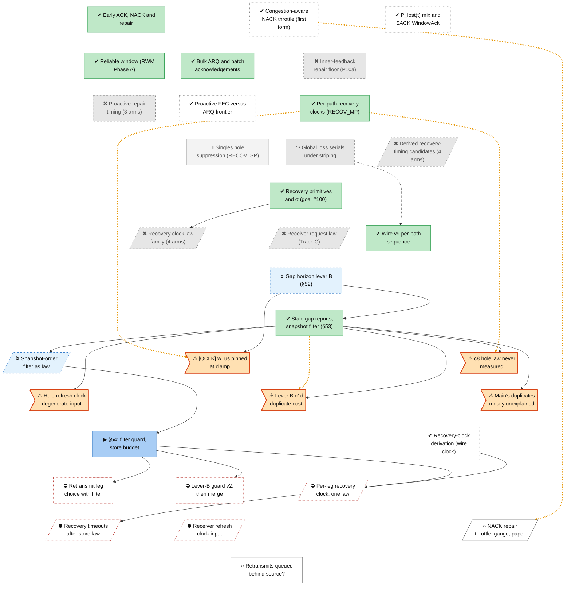

<!-- Generated by tools/roadmap/build.py from docs/roadmap/nodes.yaml. Do not edit. -->

# rec - recovery

Scope: ARQ, SACK, the hole law, recovery clocks, gap horizon, snapshot order, tail sweep.

[Back to the roadmap](../../roadmap.md)

<!-- BEGIN GENERATED: track-rec -->

<!-- END GENERATED: track-rec -->

## Node table

<!-- BEGIN GENERATED: table-rec -->
| id | title | state | outcome | headline | evidence | depends_on |
|---|---|---|---|---|---|---|
| `rec-early-arq` | Early ACK, NACK and repair | done | successful |  | ADR-0003; ADR-0005; ADR-0007; ADR-0025 |  |
| `rec-plost-sack` | P_lost(t) mix and SACK WindowAck | done | unrated |  | commit 5b9f6def |  |
| `rec-bulk-arq` | Bulk ARQ and batch acknowledgements | done | successful |  | branch P8 |  |
| `rec-reliable-window` | Reliable window (RWM Phase A) | done | successful |  | branch RWM Phase A |  |
| `rec-fec-vs-arq` | Proactive FEC versus ARQ frontier | done | unrated |  | branch proactive-frontier diagnosis |  |
| `rec-proactive-repair` | Proactive repair timing (3 arms) | abandoned | dead-end |  | tag archive/RWM_REPAIR_WAIT; tag archive/RWM_PROACTIVE_PACER |  |
| `rec-per-path-clocks` | Per-path recovery clocks (RECOV_MP) | done | successful | repair share ×2.2–2.5 | ADR-0059 |  |
| `rec-mp-serial` | Global loss serials under striping | abandoned | superseded | 0.1 % | paper §10 row Global loss serials under striping (`RWM_RECOV_MP_SERIAL`) |  |
| `rec-clock-candidates` | Derived recovery-timing candidates (4 arms) | abandoned | dead-end | −23 % | tag archive/RWM_DERIVED_SWEEP |  |
| `rec-goal100` | Recovery primitives and σ (goal #100) | done | successful |  | commit 6e1e356a |  |
| `rec-goal101` | Recovery clock law family (4 arms) | abandoned | dead-end |  | tag archive/RWM_HOLDDOWN_Q; tag archive/RWM_REFRESH_FLOOR_US | rec-goal100 |
| `rec-receiver-law` | Receiver request law (Track C) | abandoned | dead-end |  | status §2 row "Receiver-law battery (Track C)"; status §3.1 item 1 | meas-wire-v8 |
| `rec-cost-ratio-decision` | Cost-ratio decision (owner ruling) | done | n/a |  | commit ca058db4 |  |
| `rec-wire-v9` | Wire v9 per-path sequence | done | successful |  | status §3.5 item 2 |  |
| `rec-gap-horizon` | Gap horizon lever B (§52) | in-progress | mixed | p = 0.2471 | status §52; branch gaphorizon; branch cand52; branch base52 | meas-guard-41c, cc-bbrrs-r1 |
| `rec-snapver-filter` | Stale gap reports, snapshot filter (§53) | done | successful | CANDS duplicates (mean 1 291) | status §53; derivation dup-diag.md (branch dup-diag); branch dup-diag; branch dup-diag-instr; branch cand53; branch base53; branch test-debts | rec-gap-horizon |
| `rec-snapver-law` | Snapshot-order filter as law | in-progress | unrated |  | branch snapver-law (head 8191b3de); paper §7.1 "Snapshot order"; plan Live state 2026-11-13 item 1 | rec-snapver-filter |
| `rec-defect-qclk-clamp` | [QCLK] w_us pinned at clamp | in-progress | unrated | p05 = p95 = 100 000 µs | status §3.10 item 4; status §3.5 item 5 | rec-gap-horizon |
| `rec-defect-hole-law` | c8 hole law never measured | in-progress | unrated | 3.7–6.6 k times per run | status §3.10 item 5 | rec-gap-horizon, rec-snapver-filter |
| `rec-defect-refresh-input` | Hole refresh clock degenerate input | in-progress | unrated | srtt = exactly 50 000 µs | status §3.10 item 6 | rec-snapver-filter |
| `rec-p10a-repair-floor` | Inner-feedback repair floor (P10a) | abandoned | dead-end |  | branch P10a |  |
| `rec-recov-sp` | Singles hole suppression (RECOV_SP) | parked | unrated | +0.3 Mbit/s | paper §10 row Singles hole suppression (`RWM_RECOV_SP`) |  |
| `rec-leverb-c1d-cost` | Lever B c1d duplicate cost | in-progress | unrated | +13 % | status §53 open item 2 | rec-snapver-filter |
| `rec-defect-base-duplicates` | Main's duplicates mostly unexplained | in-progress | unrated |  | status §53 open item 3 | rec-snapver-filter |
| `rec-s54-session` | §54: filter guard, store budget | in-progress | unrated |  | plan Live state items 1-2; branch p0-dwell-diag §8 | meas-guard-v2-impl, rec-snapver-law, store-s54-budget |
| `rec-w0-leg-question` | Retransmit leg choice with filter | blocked | unrated |  | status §53 open item 5 ("W0 with the filter is the row that answers it"); plan W3.6f | rec-s54-session, place-wdiv |
| `rec-leverb-guard` | Lever-B guard v2, then merge | blocked | unrated |  | plan Live state item 4; status §53 "What follows" | rec-s54-session, meas-guard-v2-impl, rec-gap-horizon |
| `rec-recovery-timeouts` | Recovery timeouts after store law | blocked | unrated |  | plan W3.6; status §3.10 items 4 and 6 | store-engine-form-impl, rec-fix-perleg-clock-n1 |
| `rec-wire-clock-derivation` | Recovery-clock derivation (wire clock) | done | unrated |  | branch wire-clock-derive (17bfcefb); docs/derivations/wire-clock.md; status §55 Erratum 1 (github/main 5e28791b) | model-law-ledger |
| `rec-fix-perleg-clock-n1` | Per-leg recovery clock, one law | blocked | unrated |  | status §55 Erratum 1; docs/derivations/wire-clock.md §8; law ledger rows E11, C01, C04, C05 | rec-s54-session, rec-wire-clock-derivation |
| `rec-fix-refresh-clock` | Receiver refresh clock input | blocked | unrated |  | law ledger rows E10, C07 | store-engine-form-impl |
| `rec-fix-nack-throttle` | NACK repair throttle: gauge, paper | next | unrated |  | law ledger rows C09 |  |
| `rec-retx-behind-source` | Retransmits queued behind source? | next | unrated |  | plan W3.6d (unanswered); status §55 Erratum 1 ("plan item 6d, unanswered") |  |
| `rec-nack-congestion` | Congestion-aware NACK throttle (first form) | done | unrated |  | ADR-0046 | meas-matrix-bench |

### Details per node

| id | title | notes | evidence |
|---|---|---|---|
| `rec-early-arq` | Early ACK, NACK and repair | March 2026 direct landings: ACK feedback, echo RTT, NACK retransmit, cross-path repair, tapered repair interleaving (ADR-0003/5/7/29/37/42-47). Dates: ADR end dates in the raw set equal their start (placeholder); ADR-0052..0067 carry the 2026-07-21 migration date. | ADR-0003; ADR-0005; ADR-0007; ADR-0025 |
| `rec-plost-sack` | P_lost(t) mix and SACK WindowAck | Direct landings 2026-03-21 to 2026-04-07; no recorded verdict. Folded the remaining April commits (2026-04-01..12), no separate development. | commit 5b9f6def |
| `rec-bulk-arq` | Bulk ARQ and batch acknowledgements | P4/P6/P8/P10b of the July wave. P10a is its own node (rec-p10a-repair-floor). | branch P8 |
| `rec-reliable-window` | Reliable window (RWM Phase A) | Paper §16 (fountain multipath aggregation, then Reliable Windowed Multipath) and Phase A: retain-until-acked window, auto-switch removed. | branch RWM Phase A |
| `rec-fec-vs-arq` | Proactive FEC versus ARQ frontier | 2026-07-07/08 arc; folds the FEC recovery bug fix, transport sender fixes, the store-bloat fix and the O(n^2) per-symbol fix found along the way. | branch proactive-frontier diagnosis |
| `rec-proactive-repair` | Proactive repair timing (3 arms) | Three proactive-repair timing arms refuted 2026-07-08 (repair-wait, present-at-stall pacer) and 2026-07-27 (inline/frontier repair); REPAIR_WAIT and PROACTIVE_PACER archived 2026-11-10 (Group A, ADR-0073). Arms (3): repair-wait RWM_REPAIR_WAIT; present-at-stall pacer RWM_PROACTIVE_PACER; inline/frontier repair RWM_INLINE_REPAIR, RWM_FRONTIER*. Replaced by the unified span machine: the inline-repair delete commit says "superseded on geometry", and the trailing-span geometry is that machine's (owner-side decision 2026-11-13). Dates: paper §10 rows carry an end (removal) date only; archive/RWM_REPAIR_WAIT archived 2026-11-10 (tag date not used for end); archive/RWM_PROACTIVE_PACER archived 2026-11-10 (tag date not used for end). | tag archive/RWM_REPAIR_WAIT; tag archive/RWM_PROACTIVE_PACER |
| `rec-per-path-clocks` | Per-path recovery clocks (RECOV_MP) | ADR-0059 records the 2026-07-21 migration date; the work is G401/G402 (2026-07-21). RWM_RECOV_SP is its own node (rec-recov-sp). Dates: ADR end dates in the raw set equal their start (placeholder); ADR-0052..0067 carry the 2026-07-21 migration date. | ADR-0059 |
| `rec-mp-serial` | Global loss serials under striping | Dates: paper §10 rows carry an end (removal) date only. | paper §10 row Global loss serials under striping (`RWM_RECOV_MP_SERIAL`) |
| `rec-clock-candidates` | Derived recovery-timing candidates (4 arms) | Derived recovery-timing candidates 2026-08-07 to 2026-08-19, each refuted; RWM_DERIVED_SWEEP archived 2026-11-12 (§50). Arms (4): derived patience RWM_PATIENCE_DERIVED; derived recovery sweep RWM_DERIVED_SWEEP; RACK-shaped clocks RWM_RACK_CLOCKS/RWM_RACK_REO_MULT; Cantelli clock RWM_QUANTILE_CLOCKS/RWM_ALPHA_OVERRIDE. Dates: paper §10 rows carry an end (removal) date only; archive/RWM_DERIVED_SWEEP archived 2026-11-12 (tag date not used for end). Folded Unlock The Default part 2 (derived patience): premises refuted pre-battery 4307a6cc, RESULTS 65e92b3a NO FLIP; part 1 (ack-merge) is perf-ack-merge. | tag archive/RWM_DERIVED_SWEEP |
| `rec-goal100` | Recovery primitives and σ (goal #100) | Goal #100 (2026-08-20): primitives re-measured, [RFA] instrument, alpha-sweep, the 287x estimator spread. Closed NEEDS-MORE. Folded the alpha-sweep commits (pre-registration a04300e3, SCORED e0334855: NO VERDICT, UNSEPARATED at 50 of 50 pairs). | commit 6e1e356a |
| `rec-goal101` | Recovery clock law family (4 arms) | Folds the quantile-native clock, the hold-down clock and the refresh-floor lift (each removed; HOLDDOWN_Q and REFRESH_FLOOR_US archived 2026-11-12) and paper §11.1 open question 7. Terminal closure: the shipped clamp survives on merit. Arms (4): quantile-native clock RWM_W_FORM; hold-down clock RWM_HOLDDOWN_Q; refresh-floor lift RWM_REFRESH_FLOOR_US; the dispersion (σ) estimators, fixed-sample-lag and fixed-time-lag (paper row still "open"). Later verdict: goal #101 closed with "the clamp survives on merit", but status §3.10 item 4 (2026-11-13) finds that clamp always binds at c8, so the clamp's survival was never tested in its operating regime. Dates: paper §10 rows carry an end (removal) date only; archive/RWM_HOLDDOWN_Q archived 2026-11-12 (tag date not used for end); archive/RWM_REFRESH_FLOOR_US archived 2026-11-12 (tag date not used for end). Folded the Quantile-Native alpha-sweep (ab545cfe, SCORED 6b3d3c38: the arms separate, F2 fires at 5 of 5, the measurand is refuted). Folded the (q, refresh) sweep commits (2026-08 audit; mapped outcome there: mixed). Folded the Successor Arrival commits (2026-08 audit; mapped outcome there: unrated). Folded the Verdict battery (paper 16.79) commits (2026-08 audit; mapped outcome there: successful). | tag archive/RWM_HOLDDOWN_Q; tag archive/RWM_REFRESH_FLOOR_US |
| `rec-receiver-law` | Receiver request law (Track C) | Folds §3.1 item 1 (the self-heal estimator counted retransmits; fixed, battery not re-run). Dates: paper §10 rows carry an end (removal) date only. | status §2 row "Receiver-law battery (Track C)"; status §3.1 item 1 |
| `rec-wire-v9` | Wire v9 per-path sequence | fix/wire-v9 (7825196): per-path path_seq, next_expected, received_above. | status §3.5 item 2 |
| `rec-gap-horizon` | Gap horizon lever B (§52) | §52 guard PASS; c8 600 MB tail 4.19 -> 0.40 s with receiver duplicates x2.1 beyond BASE; the merge went to the owner. Plan 2026-11-13: lever B re-guarded on the new main, cand52 superseded. Dates: status-section end dates are the section file's last edit, not the verdict date. | status §52; branch gaphorizon; branch cand52; branch base52 |
| `rec-snapver-filter` | Stale gap reports, snapshot filter (§53) | dup-diag diagnosis + [SNAPV] instrument + RWM_RECOV_SNAPVER arm measured in §53; CANDS duplicates 4004 -> 1291. Owner approved shipping the filter as a law 2026-11-13 (plan Live state). test-debts fixes the §52 holeclass flake on base53. Dates: status-section end dates are the section file's last edit, not the verdict date. | status §53; derivation dup-diag.md (branch dup-diag); branch dup-diag; branch dup-diag-instr; branch cand53; branch base53; branch test-debts |
| `rec-snapver-law` | Snapshot-order filter as law | Law ledger: C03 (rank 5, P0), ships with C02. The owner-approved order ships the filter first; the ledger allows it (the filter alone left main's duplicates inside its range in §53). No raw record. snapver-law head 8191b3de (2026-11-13): the paper §7.1 + A.6 law first (4d848355), shipped with no env arm (87c2135d), serve_gaps seam extracted so tests drive the shipped code (00a42e38), red-then-green seam tests; derivation status SHIPPED LAW. In progress until its filter-only guard (v2) passes and it merges. | branch snapver-law (head 8191b3de); paper §7.1 "Snapshot order"; plan Live state 2026-11-13 item 1 |
| `rec-defect-qclk-clamp` | [QCLK] w_us pinned at clamp | Folds status §3.5 item 5: the recovery-clock bind fractions were measured on the saturation-filtered path set and never re-measured. | status §3.10 item 4; status §3.5 item 5 |
| `rec-defect-hole-law` | c8 hole law never measured | §53 open item 6: [HOLD] is skewed on main too (hn and ripe_frac mostly re-stamps from stale reports), so item 5's "main already wastes about 12 % of its retransmits" must be re-checked if it came from this gauge. | status §3.10 item 5 |
| `rec-p10a-repair-floor` | Inner-feedback repair floor (P10a) | Split from rec-bulk-arq (its parent). The source names no replacement; P10b (window-mode reactive repair, G236) merged the same day. | branch P10a |
| `rec-recov-sp` | Singles hole suppression (RECOV_SP) | Split from rec-per-path-clocks (its parent). Not refuted and not archived: the paper row reads "off (kept; open)" and status §1 keeps RWM_RECOV_SP as an off arm, so it is parked and unrated, not dead-end as the review asked. Dates are placeholders (the RECOV_MP work, 2026-07-21; paper row end 2026-07-27). Dates: paper §10 rows carry an end (removal) date only. | paper §10 row Singles hole suppression (`RWM_RECOV_SP`) |
| `rec-leverb-c1d-cost` | Lever B c1d duplicate cost | No raw record (§53 open items are in the section text, not extracted as items). Goes with the lever-B merge question. | status §53 open item 2 |
| `rec-defect-base-duplicates` | Main's duplicates mostly unexplained | No raw record. §53 open item 6 ([HOLD] skewed on main; §3.10 item 5's "12 % wasted" to re-check) is attached to rec-defect-hole-law. | status §53 open item 3 |
| `rec-s54-session` | §54: filter guard, store budget | Done when: the §54 Result is in status: the filter-only guard v2 against main PASSes and snapver-law merges, and the store-budget block (reduced RWM_STORE_PATH_POOL on BASE' and CAND', quinn evictions, tail/H0, in-order delay, the pool-arm causal test of §53 Erratum 1) is reported. | plan Live state items 1-2; branch p0-dwell-diag §8 |
| `rec-w0-leg-question` | Retransmit leg choice with filter | Needs the RWM_PLACE_WDIV knob, which lives on the unmerged branch wdiv-diag (node place-wdiv). Option: run it as a reported block inside the lever-B guard session instead of a session of its own. Done when: a reported-only W0 row (retransmits placed like source) on main + filter + lever B answers the open leg question under the 64-gap horizon, with the duplicate account complete (pt_st and det explained). | status §53 open item 5 ("W0 with the filter is the row that answers it"); plan W3.6f |
| `rec-leverb-guard` | Lever-B guard v2, then merge | Law ledger: C02 (rank 4, P0), ships with C03: lever B must not merge without the filter. Done when: lever B on the new main (main + the snapshot-order law) passes its own guard v2 and the owner's go merges it, with its c1d duplicate cost and the leg answer in the merge question (cand52 superseded). | plan Live state item 4; status §53 "What follows" |
| `rec-recovery-timeouts` | Recovery timeouts after store law | Law ledger: C06 (rank 17, P2), the tail sweep, derived from self-heal lateness after E11. Done when: the tail-sweep and refresh clocks are re-derived on the store law's hold time H with measured inputs and a bind-fraction gauge; the 100 ms clamp no longer binds always at c8. | plan W3.6; status §3.10 items 4 and 6 |
| `rec-wire-clock-derivation` | Recovery-clock derivation (wire clock) | No raw record (newer than the extract). The app-echo clock shares the flight stamp with the age it is compared against, and two cells reject a wire clock post hoc (c1d: loop 19-23 ms on a 2-3 ms wire RTT; c2: bbr_rs drops the wire RTT 5x with the loop unchanged). E01 stays dishonest for the store law and the other RTprop consumers (E03, S01, E12, R07), and for the recovery clocks it is inflated by the store defect, so it waits on the store fix. Unrated by the non-merge rule: recorded in status, but so far only forward nodes build on it. | branch wire-clock-derive (17bfcefb); docs/derivations/wire-clock.md; status §55 Erratum 1 (github/main 5e28791b) |
| `rec-fix-perleg-clock-n1` | Per-leg recovery clock, one law | Law ledger: E11, C01, C04, C05. Replaces rec-fix-wire-clock (dissolved by §55 Erratum 1), and folds the former rec-fix-pooled-clock (E11), rec-fix-time-threshold (C01, C04) and rec-fix-cooldown (C05). Based on cand54 (both change the gap-batch tuple), so it waits for the §54 session; next once that session is done. Left out of this change: the latest-sample clock (with the per-leg state), the receiver refresh (rec-fix-refresh-clock) and the NACK throttle (rec-fix-nack-throttle, gauge first). The 10 ms floor is kept. Done when: the paper text is written first (§7.1, A.6, §11.2; drafted in the derivation's §8); red-first host tests show each seq's clock reads its own leg, the N = 1 age gate is gone with the SACK ranges handed to the packet-threshold evidence ingest (branch A), and a seq with no flight record does not re-fire on every report; then a guard v2 passes with a registered c2 goodput prediction (branch B as the falsifier) and fast/fired at N = 1 as a readout. The cooldown stays one session behind a bind counter predicted 0 and is deleted when the VM reads 0. | status §55 Erratum 1; docs/derivations/wire-clock.md §8; law ledger rows E11, C01, C04, C05 |
| `rec-fix-refresh-clock` | Receiver refresh clock input | Law ledger: E10, C07. Blocked on the store fix: today the refresh clamps bind (at c1 the 25 ms floor would move the refresh from 100 to 25 ms where the CPU clause is tightest; at c8 2·srtt stays above the 100 ms ceiling), so the honest input only moves the output once the store defect is gone (§55 Erratum 1). Fixes the open defect rec-defect-refresh-input. Done when: the receiver reads the data sender's honest RTT (published or measured at the receiver) and the refresh cadence is derived in the paper, with a bind-fraction gauge; ships E10 and C07 together. | law ledger rows E10, C07 |
| `rec-fix-nack-throttle` | NACK repair throttle: gauge, paper | Law ledger: C09. Gauge first: it needs no clock change to be measured (§55 Erratum 1 leaves it out of the clock fix). Done when: a gauge reports the per-report cap and multiplier bind fractions at c8, then the throttle gets a paper entry with provenance for its seven constants, or is deleted. | law ledger rows C09 |
| `rec-retx-behind-source` | Retransmits queued behind source? | §55 Erratum 1: at c8 the recovery lever is the dwell, i.e. the store fix and this question. Done when: a diagnosis from the code path (transport.send_symbols to the per-path I/O owner) and the committed §48b/§53 ledgers says whether retransmits wait behind source symbols in quinn's per-path send buffer, with the measured dwell, and names the fix (a priority seam in the I/O owner) if they do. | plan W3.6d (unanswered); status §55 Erratum 1 ("plan item 6d, unanswered") |
| `rec-nack-congestion` | Congestion-aware NACK throttle (first form) | ADR-0046 (Accepted), prompted by the ADR-0045 matrix run. The ledger's defect on NackCongestionState is rec-fix-nack-throttle. | ADR-0046 |
<!-- END GENERATED: table-rec -->
