<!-- Generated by build.py from roadmap/nodes.yaml. Do not edit. -->

# store - store law

Scope: flow control and the store law: store cap, SACK-clocked release, the time term, δ's seat.

[Back to the page](../../roadmap.md) · [legend](../../roadmap.md#legend)

```mermaid
flowchart TB
    store_sack_flowctl["✖ SACK sender flow<br/>control"]
    store_sack_prune["↷ SACK pruning of the<br/>store"]
    store_reasm_bdp["✖ Never-evict<br/>reassembly clamp"]
    store_src_bp["↷ Source backpressure"]
    store_xn_pool[/"↷ Path-scaled pool ×N"/]
    store_percap_family["✖ Per-path store<br/>accounts"]
    store_borrow["✖ Bounded account<br/>borrowing"]
    store_honest_cap_family[/"✖ Honest floor-clock<br/>cap"/]
    store_anchor_hygiene[/"✔ Anchor hygiene laws"/]
    store_plain_rs["✖ Plain-mode send-<br/>interval sampler"]
    store_sack_release["✔ SACK-clocked store<br/>release"]
    store_capw["✖ Capacity-weighted<br/>pool"]
    store_sender_decoupling["✖ Window decoupling"]
    store_pool_anchor_flip["✔ Composed store flip"]
    store_pool_deliv["✖ Delivery-clocked<br/>pool anchors"]
    store_slack_clock[/"✖ Slack-bench: queue-<br/>free slack clock"/]
    store_three_term[/"✖ Three-term<br/>outstanding law"/]
    store_coverage_term[/"✖ Coverage: the fourth<br/>store term"/]
    store_honest_inputs["✔ Honest inputs and<br/>O(1) anchor"]
    store_latency_lever["✔ Three-term cap as<br/>latency control"]
    store_cap_unification[/"✔ Store-cap<br/>unification over live<br/>paths"/]
    store_composed_cap[/"✖ Composed cap"/]
    store_deadwall_modehunt["✔ Deadwall and mode-<br/>hunt batteries"]
    store_sf_latency_feedback["✔ SF latency feedback"]
    store_queue_fix_premise["✔ Queue fix premise<br/>refuted"]
    store_cap_law_cluster["✔ Cap-law cluster:<br/>formulas first"]
    store_sum_cap[/"✔ Ladder battery: ×N<br/>deletion"/]
    store_delta_cap[/"✔ In-flight limit:<br/>derived factor<br/>replaces doubling"/]
    store_s18_one_law[/"✔ One store law, first<br/>session"/]
    store_adr72_one_law[/"✔ One in-flight limit,<br/>any path count"/]
    store_input_search["✔ Single-path anchor<br/>over-read"]
    store_s24_inputs["✖ Loop time and quinn<br/>rate"]
    store_power_law[/"✖ Self-tuning in-<br/>flight limit"/]
    store_s27_premises["✖ Spread law premises"]
    store_probe_gain[/"✖ Probe-gain store law"/]
    store_dw_window["✖ Noise-sized window"]
    store_s34_input["✖ Store-law input<br/>after the anchor fix"]
    store_s36_dispersion["✔ Receiver dispersion<br/>as link rate"]
    store_s40_p90["✔ p90 dispersion<br/>estimator"]
    store_s42_engine_path["✔ Engine path for<br/>dispersion"]
    store_engine_form["✔ Oracle store law,<br/>closed loop"]
    store_s43b_retuned["✔ Oracle store law re-<br/>tuned"]
    store_w1_who_limits[/"⏳ What enforces the<br/>latency setting"/]
    store_s54_budget["✔ Store-budget test<br/>design"]
    store_defect_cap_constant>"⚠ In-flight limit<br/>stuck at its ceiling"]
    store_law_derivation["▶ Deriving the in-<br/>flight data limit"]
    store_s56_sweep["✔ Store-pool sweep"]
    store_s57a_burst["✔ Emission-burst test,<br/>400 Mbit path"]
    store_s57b_c1d["✔ 400 Mbit two-path<br/>pool sweep"]
    store_defect_delta_nan>"✔ Latency-dial setting<br/>pinned the store cap"]
    store_law_r67["✔ Lowest-store floor<br/>candidate"]
    store_slaw_gauge["⏳ Readout for the in-<br/>flight limit"]
    store_s60_pre["✔ Gauge suites and<br/>reference binary"]
    store_s60a["✔ Queue-free floor on<br/>small stores"]
    store_s60b["✔ Floor sign test, 400<br/>Mbit path"]
    store_defect_allowance_short>"⚠ In-flight safety<br/>margin too small"]
    store_s61a["✔ Slow-link knee<br/>sweep, first try"]
    store_s61b["✔ 100 Mbit price below<br/>the knee"]
    store_s61a_rerun["✔ Slow-link knee<br/>sweep, re-run"]
    store_law_g_rederive[/"✔ Re-derive the knee-<br/>margin term"/]
    store_s62_j0["✔ Slow link measured<br/>without jitter"]
    store_count_rule["✔ Fixed delay-sample<br/>count: none stable"]
    store_defect_b0p_brake>"⚠ Start-up sample<br/>skews the in-flight<br/>limit"]
    store_sampler_design[/"○ How the in-flight<br/>limit samples delay"/]
    store_fix_maxbw_minrtt[/"⛔ Honest link-rate and<br/>delay measurements"/]
    store_engine_form_impl[/"⛔ In-flight limit<br/>rebuilt on measured<br/>inputs"/]
    store_engine_form_guard[/"⛔ Network check of<br/>rebuilt in-flight<br/>limit"/]
    store_delta_seat[/"⛔ In-flight limit<br/>follows the latency<br/>dial"/]
    store_s48c_session[/"⛔ Network test: limit<br/>follows latency dial"/]
    store_sack_flowctl ~~~ store_reasm_bdp
    store_sack_prune ~~~ store_src_bp
    store_sack_prune ~~~ store_xn_pool
    store_reasm_bdp ~~~ store_percap_family
    store_src_bp ~~~ store_percap_family
    store_xn_pool ~~~ store_percap_family
    store_percap_family ~~~ store_borrow
    store_percap_family ~~~ store_honest_cap_family
    store_percap_family ~~~ store_anchor_hygiene
    store_borrow ~~~ store_plain_rs
    store_honest_cap_family ~~~ store_sack_release
    store_anchor_hygiene ~~~ store_capw
    store_plain_rs ~~~ store_sender_decoupling
    store_sack_release ~~~ store_pool_anchor_flip
    store_capw ~~~ store_pool_anchor_flip
    store_sender_decoupling ~~~ store_pool_deliv
    store_pool_anchor_flip ~~~ store_slack_clock
    store_pool_anchor_flip ~~~ store_three_term
    store_pool_deliv ~~~ store_coverage_term
    store_slack_clock ~~~ store_honest_inputs
    store_three_term ~~~ store_latency_lever
    store_coverage_term ~~~ store_cap_unification
    store_honest_inputs ~~~ store_composed_cap
    store_latency_lever ~~~ store_composed_cap
    store_cap_unification ~~~ store_deadwall_modehunt
    store_composed_cap ~~~ store_sf_latency_feedback
    store_composed_cap ~~~ store_queue_fix_premise
    store_deadwall_modehunt ~~~ store_cap_law_cluster
    store_sf_latency_feedback ~~~ store_cap_law_cluster
    store_queue_fix_premise ~~~ store_cap_law_cluster
    store_cap_law_cluster ~~~ store_sum_cap
    store_sum_cap ~~~ store_delta_cap
    store_delta_cap ~~~ store_s18_one_law
    store_s18_one_law ~~~ store_adr72_one_law
    store_adr72_one_law ~~~ store_input_search
    store_input_search ~~~ store_s24_inputs
    store_input_search ~~~ store_power_law
    store_input_search ~~~ store_s27_premises
    store_s24_inputs ~~~ store_probe_gain
    store_power_law ~~~ store_dw_window
    store_s27_premises ~~~ store_dw_window
    store_probe_gain ~~~ store_s34_input
    store_dw_window ~~~ store_s34_input
    store_s34_input ~~~ store_s36_dispersion
    store_s36_dispersion ~~~ store_s40_p90
    store_s40_p90 ~~~ store_s42_engine_path
    store_s42_engine_path ~~~ store_engine_form
    store_engine_form ~~~ store_s43b_retuned
    store_engine_form ~~~ store_w1_who_limits
    store_engine_form ~~~ store_s54_budget
    store_s43b_retuned ~~~ store_defect_cap_constant
    store_w1_who_limits ~~~ store_defect_cap_constant
    store_s54_budget ~~~ store_defect_cap_constant
    store_defect_cap_constant ~~~ store_law_derivation
    store_defect_cap_constant ~~~ store_s56_sweep
    store_law_derivation ~~~ store_s57a_burst
    store_s56_sweep ~~~ store_s57b_c1d
    store_s56_sweep ~~~ store_defect_delta_nan
    store_s57a_burst ~~~ store_law_r67
    store_s57b_c1d ~~~ store_slaw_gauge
    store_defect_delta_nan ~~~ store_slaw_gauge
    store_law_r67 ~~~ store_s60_pre
    store_slaw_gauge ~~~ store_s60_pre
    store_s60_pre ~~~ store_s60a
    store_s60a ~~~ store_s60b
    store_s60a ~~~ store_defect_allowance_short
    store_s60b ~~~ store_s61a
    store_defect_allowance_short ~~~ store_s61b
    store_s61a ~~~ store_s61a_rerun
    store_s61b ~~~ store_s61a_rerun
    store_s61a_rerun ~~~ store_law_g_rederive
    store_law_g_rederive ~~~ store_s62_j0
    store_s62_j0 ~~~ store_count_rule
    store_count_rule ~~~ store_defect_b0p_brake
    store_defect_b0p_brake ~~~ store_sampler_design
    store_defect_b0p_brake ~~~ store_fix_maxbw_minrtt
    store_sampler_design ~~~ store_engine_form_impl
    store_fix_maxbw_minrtt ~~~ store_engine_form_impl
    store_engine_form_impl ~~~ store_engine_form_guard
    store_engine_form_impl ~~~ store_delta_seat
    store_engine_form_guard ~~~ store_s48c_session
    store_delta_seat ~~~ store_s48c_session
    store_sack_prune -.-> store_sack_release
    store_sack_flowctl --> store_reasm_bdp
    store_src_bp -.-> store_percap_family
    store_xn_pool -.-> store_sum_cap
    store_percap_family --> store_borrow
    store_anchor_hygiene -.-> store_defect_cap_constant
    store_anchor_hygiene --> store_plain_rs
    store_pool_anchor_flip --> store_pool_deliv
    store_three_term --> store_coverage_term
    store_three_term --> store_latency_lever
    store_honest_inputs --> store_cap_unification
    store_three_term --> store_composed_cap
    store_cap_unification --> store_deadwall_modehunt
    store_cap_unification --> store_sf_latency_feedback
    store_cap_unification --> store_cap_law_cluster
    store_xn_pool --> store_sum_cap
    store_cap_law_cluster --> store_sum_cap
    store_sum_cap -.-> store_defect_cap_constant
    store_sum_cap --> store_delta_cap
    store_delta_cap -.-> store_defect_cap_constant
    store_delta_cap --> store_s18_one_law
    store_s18_one_law -.-> store_adr72_one_law
    store_s18_one_law --> store_adr72_one_law
    store_adr72_one_law -.-> store_defect_cap_constant
    store_adr72_one_law --> store_input_search
    store_input_search --> store_s24_inputs
    store_input_search --> store_power_law
    store_s27_premises --> store_probe_gain
    store_power_law --> store_dw_window
    store_dw_window --> store_s34_input
    store_s34_input --> store_s36_dispersion
    store_s36_dispersion --> store_s40_p90
    store_s40_p90 --> store_s42_engine_path
    store_s42_engine_path --> store_engine_form
    store_engine_form --> store_s43b_retuned
    store_s54_budget --> store_law_derivation
    store_defect_cap_constant --> store_law_derivation
    store_s54_budget --> store_s56_sweep
    store_defect_cap_constant --> store_s56_sweep
    store_s56_sweep --> store_s57a_burst
    store_s56_sweep --> store_s57b_c1d
    store_s57b_c1d --> store_law_r67
    store_law_derivation --> store_slaw_gauge
    store_slaw_gauge --> store_s60_pre
    store_s60_pre --> store_s60a
    store_law_r67 --> store_s60a
    store_s60a --> store_s60b
    store_s60a --> store_defect_allowance_short
    store_s60b --> store_s61a
    store_w1_who_limits --> store_s61a
    store_s60b --> store_s61b
    store_s61a --> store_s61a_rerun
    store_s61a_rerun --> store_law_g_rederive
    store_s61b --> store_law_g_rederive
    store_law_g_rederive --> store_s62_j0
    store_s62_j0 --> store_count_rule
    store_count_rule --> store_defect_b0p_brake
    store_defect_b0p_brake --> store_sampler_design
    store_w1_who_limits --> store_engine_form_impl
    store_fix_maxbw_minrtt --> store_engine_form_impl
    store_engine_form_impl --> store_engine_form_guard
    store_engine_form_impl --> store_delta_seat
    store_delta_seat --> store_s48c_session
    linkStyle 87,99,101,105 stroke:#e69500,stroke-width:3px,stroke-dasharray:2 3
    classDef vsucc fill:#2e9e4f,stroke:#1b6b34,color:#fff
    classDef succ fill:#bfe8c8,stroke:#2e9e4f,color:#111
    classDef mixed fill:#ffd37a,stroke:#c98a00,color:#111
    classDef bad fill:#f28b82,stroke:#b3261e,color:#111
    classDef dead fill:#e6e6e6,stroke:#777,stroke-dasharray:5 5,color:#555
    classDef inprog fill:#a8cdf5,stroke:#1f6fc5,color:#111
    classDef next fill:#fff,stroke:#333,color:#111
    classDef blocked fill:#fff,stroke:#b3261e,stroke-dasharray:2 2,color:#111
    classDef parked fill:#f3f3f3,stroke:#999,color:#555
    classDef unrated fill:#fff,stroke:#333,stroke-dasharray:1 3,color:#111
    classDef gate fill:#d9c2f0,stroke:#7b3fb5,color:#111
    classDef decided fill:#ece0f7,stroke:#7b3fb5,stroke-dasharray:2 2,color:#111
    classDef finding fill:#ffe0b2,stroke:#d84315,stroke-width:2px,color:#111
    classDef waiting fill:#e3f2fd,stroke:#1f6fc5,stroke-dasharray:5 5,color:#111
    class store_sack_flowctl,store_sack_prune,store_reasm_bdp,store_src_bp,store_xn_pool,store_percap_family,store_borrow,store_honest_cap_family,store_plain_rs,store_capw,store_sender_decoupling,store_pool_deliv,store_slack_clock,store_three_term,store_coverage_term,store_composed_cap,store_sf_latency_feedback,store_queue_fix_premise,store_s18_one_law,store_s24_inputs,store_power_law,store_s27_premises,store_probe_gain,store_dw_window,store_s34_input dead
    class store_anchor_hygiene,store_sack_release,store_honest_inputs,store_sum_cap,store_adr72_one_law,store_defect_delta_nan,store_s60_pre,store_s61b succ
    class store_pool_anchor_flip,store_s61a bad
    class store_latency_lever,store_cap_unification,store_s60a,store_s60b,store_s61a_rerun,store_law_g_rederive,store_s62_j0 mixed
    class store_deadwall_modehunt,store_cap_law_cluster,store_input_search,store_s36_dispersion,store_s40_p90,store_s42_engine_path,store_engine_form,store_s43b_retuned,store_s54_budget,store_s56_sweep,store_s57a_burst,store_s57b_c1d,store_law_r67,store_count_rule unrated
    class store_delta_cap vsucc
    class store_w1_who_limits,store_slaw_gauge waiting
    class store_defect_cap_constant,store_defect_allowance_short,store_defect_b0p_brake finding
    class store_law_derivation inprog
    class store_sampler_design next
    class store_fix_maxbw_minrtt,store_engine_form_impl,store_engine_form_guard,store_delta_seat,store_s48c_session blocked
```

<!-- BEGIN GENERATED: track-store -->

<!-- END GENERATED: track-store -->

## Node table

<!-- BEGIN GENERATED: table-store -->
| id | title | kind | lane | state | outcome | start | end | depends_on | replaced_by | qualified_by | headline | evidence |
|---|---|---|---|---|---|---|---|---|---|---|---|---|
| `store-xn-pool` | Path-scaled pool ×N | law | vm | abandoned | superseded | 2026-07-14 | 2026-08-19 |  | store-sum-cap |  |  | paper §10 row ×N pool multiplier `clamp(gain·N·Σ, floor, N·knee)`; ADR-0058 |
| `store-percap-family` | Per-path store accounts | mechanism | vm | abandoned | dead-end | 2026-07-18 | 2026-07-19 |  |  |  | 0.89–0.94× | paper §10 row Per-path store accounts (`RWM_STORE_PERCAP`, `RWM_PERCAP_GUARD`); commit 4b8e5384; commit 4bb5b28f |
| `store-borrow` | Bounded account borrowing | mechanism | vm | abandoned | dead-end | 2026-07-19 | 2026-07-19 | store-percap-family |  |  |  | paper §10 row Bounded account borrowing (`RWM_STORE_BORROW`); commit 7c3343ff |
| `store-capw` | Capacity-weighted pool | mechanism | vm | abandoned | dead-end | 2026-07-27 | 2026-07-27 |  |  |  |  | paper §10 row Capacity-weighted pool (`RWM_STORE_CAPW`); commit 4fb5b15 |
| `store-honest-cap-family` | Honest floor-clock cap | law | vm | abandoned | dead-end | 2026-07-19 | 2026-08-11 |  |  |  |  | tag archive/RWM_HONEST_CAP; tag archive/RWM_HONEST_K; paper §10 row Honest floor-clock store cap (`RWM_HONEST_CAP`; resolved on, acted only with `RWM_PLAIN_RS`); paper §10 row Raw-sample echo-ratio floor (`RWM_HONEST_K`) and the honest-cap law family it fed (`honest_store_cap`, `honest_cap_terms`, `k_raw`); commit 1ad01c4d |
| `store-plain-rs` | Plain-mode send-interval sampler | mechanism | vm | abandoned | dead-end | 2026-07-19 | 2026-10-26 | store-anchor-hygiene |  |  |  | tag archive/RWM_PLAIN_RS; tag archive/RWM_RS_ATTR; paper §10 row Plain-mode send-interval sampler (`RWM_PLAIN_RS`, sampling-only `CopaFeed`); paper §10 row Flight-time witness for cross-path ack attribution (`RWM_RS_ATTR`); status §23 |
| `store-pool-deliv` | Delivery-clocked pool anchors | mechanism | vm | abandoned | dead-end | 2026-08-07 | 2026-08-07 | store-pool-anchor-flip |  |  | 0.931–0.958×Σ | paper §10 row Pool delivery-clocked anchor (`RWM_POOL_DELIV`); paper §10 row Floor-bound anchor (`RWM_FLOOR_BOUND`); commit 8afd4dd7 |
| `store-pool-anchor-flip` | Composed store flip | mechanism | vm | done | bad | 2026-08-07 | 2026-08-07 | rate-est-cadence |  |  | 0.959–0.968× | tag archive/RWM_POOL_ANCHOR; commit 60f833a7; commit e84ef1c5; paper §10 row Composed estimator-cadence plus pool-anchor default |
| `store-sack-prune` | SACK pruning of the store | mechanism | vm | abandoned | superseded | 2026-07-08 | 2026-07-27 |  | store-sack-release |  |  | paper §10 row SACK pruning of the store (`RWM_SACK_PRUNE`) |
| `store-sack-release` | SACK-clocked store release | mechanism | vm | done | successful | 2026-07-21 | 2026-07-21 |  |  |  |  | ADR-0060 |
| `store-sender-decoupling` | Window decoupling | mechanism | vm | abandoned | dead-end | 2026-08-06 | 2026-08-06 |  |  |  | 27 ms | paper §10 row Window decoupling (`RWM_WIN_DECOUPLE`); commit 48f60c4f |
| `store-sack-flowctl` | SACK sender flow control | mechanism | vm | abandoned | dead-end | 2026-07-07 | 2026-07-07 |  |  |  |  | commit 5adba96e; commit 2b898456 |
| `store-reasm-bdp` | Never-evict reassembly clamp | mechanism | vm | abandoned | dead-end | 2026-07-08 | 2026-07-08 | store-sack-flowctl |  |  |  | tag archive/RWM_REASM_BDP; paper §10 row Never-evict-undelivered reassembly clamp (`RWM_REASM_BDP`); commit 6d2a05b2 |
| `store-src-bp` | Source backpressure | mechanism | vm | abandoned | superseded | 2026-07-12 | 2026-07-27 |  | store-percap-family |  |  | paper §10 row Source backpressure (`RWM_SRC_BP`); commit 4606829f; commit 8902d246 |
| `store-anchor-hygiene` | Anchor hygiene laws | law | vm | done | successful | 2026-07-19 | 2026-07-21 |  |  | store-defect-cap-constant, cc-defect-copa-minrtt | +31% | ADR-0061 |
| `store-three-term` | Three-term outstanding law | law | vm | abandoned | dead-end | 2026-08-10 | 2026-08-10 |  |  |  |  | paper §10 row Three-term outstanding law (`RWM_THREE_TERM`); commit 5de30ed3; commit 448a82e |
| `store-coverage-term` | Coverage: the fourth store term | law | vm | abandoned | dead-end | 2026-08-10 | 2026-08-10 | store-three-term |  |  |  | commit e113c9ab; paper §16.44 |
| `store-slack-clock` | Slack-bench: queue-free slack clock | law | vm | abandoned | dead-end | 2026-08-09 | 2026-08-18 |  |  |  |  | paper §10 row Queue-free slack clock; commit 7e03ef9b; commit 7e302e2a |
| `store-composed-cap` | Composed cap | law | vm | abandoned | dead-end | 2026-08-12 | 2026-08-13 | store-three-term |  |  | 2.4× | tag archive/RWM_COMPOSED_CAP; paper §10 row Composed cap (`RWM_COMPOSED_CAP`); commit 161b4eae |
| `store-cap-unification` | Store-cap unification over live paths | law | vm | done | mixed | 2026-08-11 | 2026-09-30 | store-honest-inputs |  |  | +16–25 % | status §3.5 item 3; paper §10 row Store-cap unification over live paths (`RWM_STORE_CAP_UNIFIED`) |
| `store-deadwall-modehunt` | Deadwall and mode-hunt batteries | research | vm | done | unrated | 2026-08-12 | 2026-08-12 | store-cap-unification |  |  |  | paper §10 row The dead-wall and mode-hunt batteries; commit d583593a; commit cfc1793f |
| `store-cap-law-cluster` | Cap-law cluster: formulas first | research | vm | done | unrated | 2026-08-18 | 2026-08-18 | store-cap-unification |  |  |  | commit 7e302e2a; commit 6335e206 |
| `store-honest-inputs` | Honest inputs and O(1) anchor | mechanism | vm | done | successful | 2026-08-10 | 2026-08-11 |  |  |  |  | commit 9f6e56ba |
| `store-sum-cap` | Ladder battery: ×N deletion | law | vm | done | successful | 2026-08-18 | 2026-08-19 | store-xn-pool, store-cap-law-cluster |  | store-defect-cap-constant |  | branch RWM_SUM_CAP DEFAULT ON |
| `store-delta-cap` | In-flight limit: derived factor replaces doubling | law | vm | done | very-successful | 2026-08-19 | 2026-08-19 | store-sum-cap |  | store-defect-cap-constant | queue −10 to −200 ms | paper §10 row Pool gain 2.0 (N ≥ 2) |
| `store-s18-one-law` | One store law, first session | law | vm | done | superseded | 2026-10-26 | 2026-10-26 | store-delta-cap, meas-formula-first | store-adr72-one-law |  |  | status §18; commit 48ee42a3 |
| `store-adr72-one-law` | One in-flight limit, any path count | law | vm | done | successful | 2026-10-26 | 2026-10-26 | store-s18-one-law |  | store-defect-cap-constant |  | ADR-0072; status §19; commit bdb37b40 |
| `store-input-search` | Single-path anchor over-read | research | vm | done | unrated | 2026-10-26 | 2026-10-26 | store-adr72-one-law |  |  |  | status §23; commit 4ed22f38 |
| `store-s24-inputs` | Loop time and quinn rate | research | vm | abandoned | dead-end | 2026-10-26 | 2026-10-26 | store-input-search |  |  |  | status §24; commit de3e11a1 |
| `store-s27-premises` | Spread law premises | research | vm | abandoned | dead-end | 2026-10-27 | 2026-10-27 |  |  |  |  | status §27; commit 35b16607 |
| `store-probe-gain` | Probe-gain store law | law | vm | abandoned | dead-end | 2026-10-27 | 2026-10-28 | store-s27-premises |  |  |  | paper §10 row (P) probe gain: `cap' = (1 + q + g)·D̂·τ`; status §27 |
| `store-power-law` | Self-tuning in-flight limit | law | vm | abandoned | dead-end | 2026-10-26 | 2026-10-27 | store-input-search |  |  | ×5–12 | status §29; tag archive/store-power; branch archive/wt-status29-power; paper §10 row (D) power seeker: `n* = argmax D(n)^α(δ)/T(n)`, dithered extremum seeker |
| `store-dw-window` | Noise-sized window | research | vm | abandoned | dead-end | 2026-10-28 | 2026-10-28 | store-power-law |  |  |  | status §30; paper §10 row (D-W) noise-sized window: `W*(δ) = min W : σ²(W) ≤ (q/2)²`; commit 9677a3c9 |
| `store-s34-input` | Store-law input after the anchor fix | research | vm | abandoned | dead-end | 2026-11-01 | 2026-11-02 | perf-decoder-prune, store-dw-window |  |  | knee is 1 024 at both cells | status §34; paper §10 row (b1) quinn's BBR window as the knee: `cap = (1 + q)·K`, `K = Σᵢ (2·L̂_q,ᵢ·min_rttᵢ + hᵢ) / W`; paper §10 row (b2) cwnd-binding share as an input: grow while the cap binds, hold where quinn binds; paper §10 row (b3) path memory: n̄ carried across transfers per path (RFC 9040 temporal sharing); paper §10 row (b4) receiver capacity as a ceiling: `Σᵢ … ≤ (1 + q)·μ_R·(RTprop + S̄(n))`; commit a75bc9ca |
| `store-s36-dispersion` | Receiver dispersion as link rate | research | vm | done | unrated | 2026-11-09 | 2026-11-10 | store-s34-input |  |  |  | status §36; commit 4dd26760 |
| `store-s40-p90` | p90 dispersion estimator | research | vm | done | unrated | 2026-11-10 | 2026-11-10 | store-s36-dispersion |  |  |  | status §40; commit b0b07b1b |
| `store-s42-engine-path` | Engine path for dispersion | research | vm | done | unrated | 2026-11-10 | 2026-11-10 | store-s40-p90 |  |  |  | status §42; commit af06313d |
| `store-engine-form` | Oracle store law, closed loop | research | vm | done | unrated | 2026-11-10 | 2026-11-10 | store-s42-engine-path |  |  |  | status §43; branch harness43; branch run43; commit 1eca3ee2 |
| `store-s43b-retuned` | Oracle store law re-tuned | research | vm | done | unrated | 2026-11-10 | 2026-11-10 | store-engine-form |  |  |  | status §43b; commit bab838c1 |
| `store-w1-who-limits` | What enforces the latency setting | law | no-cargo | in-progress | unrated | 2026-11-12 |  | cc-bbrrs-r1, store-engine-form |  |  |  | derivation w1-who-limits.md (branch derive-w1); branch derive-w1; branch w1r2 |
| `store-s54-budget` | Store-budget test design | research | no-cargo | done | unrated | 2026-11-13 | 2026-11-13 | rec-snapver-filter |  |  | from a mean of about 5.3 s to about 1.0 s | derivation p0-dwell-diag.md (branch p0-dwell-diag); branch p0-dwell-diag |
| `store-law-derivation` | Deriving the in-flight data limit | research | no-cargo | in-progress | unrated | 2026-11-14 |  | store-s54-budget, store-defect-cap-constant, model-law-ledger |  |  |  | status §54 Result, launch 2, owner decision; law ledger §4 items 1-2; branch store-law-rev6; derivation store-law-r67.md; status §60 |
| `store-s56-sweep` | Store-pool sweep | instrument | vm | done | unrated | 2026-11-14 | 2026-11-14 | store-s54-budget, store-defect-cap-constant |  |  | c2 flat to W 192, c8 to 512 | status §56; derivation store-law.md §13 |
| `store-s57a-burst` | Emission-burst test, 400 Mbit path | instrument | vm | done | unrated | 2026-11-14 | 2026-11-14 | store-s56-sweep |  |  | burst knob reaches 79 at 256; S 0.62 | status §57a Result; status §57 Amendment 1 |
| `store-s57b-c1d` | 400 Mbit two-path pool sweep | instrument | vm | done | unrated | 2026-11-14 | 2026-11-14 | store-s56-sweep |  |  | c1d store-bound only at W <= 512; T not reached | status §57b Result; status §57 Amendment 1; branch harness57b |
| `store-law-r67` | Lowest-store floor candidate | research | no-cargo | done | unrated | 2026-11-15 | 2026-11-15 | store-s57b-c1d |  |  |  | derivation store-law-r67.md; commit d85d048b; branch store-law-r67 |
| `store-slaw-gauge` | Readout for the in-flight limit | instrument | host-cargo | in-progress | unrated | 2026-11-15 |  | store-law-derivation |  |  |  | status §60; branch slaw-gauge; branch s60-tree |
| `store-s60-pre` | Gauge suites and reference binary | instrument | vm | done | successful | 2026-11-15 | 2026-11-15 | store-slaw-gauge |  |  | bin_sha e410d640… | status 60-pre; status 60-pre Result; commit f950956b; commit 0367ea59 |
| `store-s60a` | Queue-free floor on small stores | research | vm | done | mixed | 2026-11-15 | 2026-11-16 | store-s60-pre, store-law-r67 |  |  | c2 SHORT 1.69 ms; c8 B2 unscoreable | status §60; status §60 Amendment 1; derivation s60-registration.md; branch s60-design; branch harness60; status §60 Result |
| `store-s60b` | Floor sign test, 400 Mbit path | research | vm | done | mixed | 2026-11-16 | 2026-11-16 | store-s60a |  |  | c1s control and G/C unread (collapse rule) | status §60 Amendment 2; branch harness60-a2; status §60 Result |
| `store-s61a` | Slow-link knee sweep, first try | research | vm | done | bad | 2026-11-17 | 2026-11-17 | store-s60b, store-user-u1u3 |  |  | 66/66 clean, nothing scored (two rule defects) | status §61 Amendment 1; status §61a Result; branch harness61; status Owner decisions (2026-11-17) item 9 |
| `store-s61b` | 100 Mbit price below the knee | research | vm | done | successful | 2026-11-17 | 2026-11-17 | store-s60b |  |  | c2 price below the knee, merged with §60 | status §61b Result |
| `store-s61a-rerun` | Slow-link knee sweep, re-run | research | vm | done | mixed | 2026-11-17 | 2026-11-17 | store-s61a |  |  | rho_3 0.457 vs rho_2 0.797 | status §61 Amendment 2; status §61 Amendment 3; status §61a re-run Result; status §61a re-run Result, Erratum 1 |
| `store-law-g-rederive` | Re-derive the knee-margin term | law | no-cargo | done | mixed | 2026-11-17 | 2026-11-17 | store-s61a-rerun, store-s61b |  |  |  | status §61a re-run Result; status §61a re-run Result, Erratum 1; status "The knee-margin re-derivation, closed post hoc"; branch knee-margin-rederive 399407f4 |
| `store-s62-j0` | Slow link measured without jitter | research | vm | done | mixed | 2026-11-18 | 2026-11-18 | store-law-g-rederive |  |  | floor still count-dependent at J = 0 (D0 3.36 ms) | status §62; status §62 Amendment 1; status §62 Result; branch s62-design 0f40a59d; branch harness62 95dafa59; docs/l1-raw/s62/ |
| `store-count-rule` | Fixed delay-sample count: none stable | research | no-cargo | done | unrated | 2026-11-18 | 2026-11-18 | store-s62-j0 |  |  | 84–87 % of low-mode windows, against 5–8 % of the rest | status "The count-rule derivation"; status §62 Result; branch count-rule 2d557191 |
| `store-defect-b0p-brake` | Start-up sample skews the in-flight limit | defect-verdict | no-cargo | next | unrated |  |  | store-count-rule |  |  | F swings 37-139 ms from one boot window | status "The count-rule derivation" |
| `store-sampler-design` | How the in-flight limit samples delay | law | no-cargo | next | unrated |  |  | store-defect-b0p-brake, store-count-rule |  |  |  | status "The count-rule derivation" |
| `store-user-jitter-sweep` | Owner call on the jitter sweep | user-decision | user | done | n/a | 2026-11-17 | 2026-11-17 |  |  |  | run it after the framing check | status Owner decisions (2026-11-17) item 13 |
| `store-defect-allowance-short` | In-flight safety margin too small | defect-verdict | none | next | unrated | 2026-11-16 |  | store-s60a |  |  | SHORT 1.69 ms at c2 | status §60 Result; derivation store-law-r67.md |
| `store-defect-delta-nan` | Latency-dial setting pinned the store cap | defect-verdict | vm | done | unrated | 2026-11-14 | 2026-11-14 |  |  |  | merged 9b8b42ca; decision_trace_pin 7/7 on Linux | status "Engine defect F1"; derivation shared-core-design.md F1; status §58 Amendment 2; commit 9b8b42ca |
| `store-defect-cap-constant` | In-flight limit stuck at its ceiling | defect-verdict | none | in-progress | unrated | 2026-11-13 |  | rec-snapver-filter |  |  | N·pool = 4 096 | status §3.10 item 8 |
| `store-engine-form-guard` | Network check of rebuilt in-flight limit | law | vm | blocked | unrated |  |  | store-engine-form-impl, meas-guard-v2-impl |  |  |  | plan VM queue 8 |
| `store-s48c-session` | Network test: limit follows latency dial | law | vm | blocked | unrated |  |  | store-delta-seat, meas-s51-session, meas-guard-v2-impl |  |  |  | plan W1.4 |
| `store-user-u1u3` | Owner calls on who sets latency | user-decision | user | done | n/a | 2026-11-16 | 2026-11-17 | store-w1-who-limits |  |  |  | plan user decisions 3 and 10; status Owner decisions (2026-11-16) items 1-2; status Owner decisions (2026-11-17) item 8 |
| `store-engine-form-impl` | In-flight limit rebuilt on measured inputs | law | host-cargo | blocked | unrated |  |  | place-per-leg-impl, store-user-u1u3, store-fix-maxbw-minrtt, model-law-ledger |  |  |  | plan W3.3; CLAUDE.md FORMULA-FIRST |
| `store-delta-seat` | In-flight limit follows the latency dial | law | host-cargo | blocked | unrated |  |  | store-user-u1u3, store-engine-form-impl |  |  |  | plan W1.2 RESULT, W1.3, W1 round 2 (iii) |
| `store-fix-maxbw-minrtt` | Honest link-rate and delay measurements | law | no-cargo | blocked | unrated |  |  | model-law-ledger, cc-bbrrs-r2 |  |  |  | law ledger rows E04, E03; store-input-search (§23, §24, §27, §34); store-engine-form (§36, §40, §42, §43b) |
| `store-latency-lever` | Three-term cap as latency control | research | vm | done | mixed | 2026-08-10 | 2026-08-10 | store-three-term |  |  |  | commit f6d95c99; commit ec6a5ec7 |
| `store-sf-latency-feedback` | SF latency feedback | research | vm | done | dead-end | 2026-08-12 | 2026-08-12 | store-cap-unification |  |  |  | commit c0fb1d79; commit 4320fc48 |
| `store-queue-fix-premise` | Queue fix premise refuted | research | vm | done | dead-end | 2026-08-12 | 2026-08-12 |  |  |  |  | commit 9ae50ee6 |

### Details per node

| id | title | verdict | headline | in plain words | notes | confirmed | waiting on | queue order | order reason |
|---|---|---|---|---|---|---|---|---|---|
| `store-xn-pool` | Path-scaled pool ×N | quadratic in N under a linear ceiling, pinned at 4 096 in 121 of 126 dual reps; deleting the ×N cost nothing |  | Scaling the in-flight data allowance with the number of paths, later replaced by a simpler rule. | RWM_STORE_PATHS stays on; what was superseded is the ×N multiplier in its formula. Dates: paper §10 rows carry an end (removal) date only. |  |  |  |  |
| `store-percap-family` | Per-path store accounts | wins the symmetric dual (0.89–0.94×Σ) and loses the heterogeneous one (0.54–0.55 against pooled 0.62–0.69×Σ) | 0.89–0.94× | Giving each path its own in-flight data limit helped two equal paths (0.89 to 0.94 of the sum) but lost on two unequal paths against the pooled limit, so the idea was refuted and removed. | Split 2026-11-16 from the former family node 'Per-path store accounts family (4 arms)'. Per-path accounts (d190b296) and the delay-aware redirect guard (689b9f1b; 'halves the c8 percap regression', 4bb5b28f) share one paper row. Siblings: store-borrow, store-capw. Folds paper §11.1 open question 5. |  |  |  |  |
| `store-borrow` | Bounded account borrowing | loans are identically zero at symmetric cells by construction; neutral at the heterogeneous dual and behind pooled |  | Tried letting one path borrow in-flight data allowance from another within bounds; the loans come out at zero on symmetric links and add nothing on unequal ones, so the idea was dropped. | Split 2026-11-16 from the former family node 'Per-path store accounts family (4 arms)'. 7c3343ff: 'the law is gauge-perfect, the tax is NOT repaid; pooled path-scaled VINDICATED at c8, flip NO'. |  |  |  |  |
| `store-capw` | Capacity-weighted pool | the heterogeneous binder is slow-path conversion, not pool size (0.74–0.79 against 0.87×Σ) |  | Tried sizing the shared in-flight pool by each path's capacity; it was refuted, because the real limit on unequal paths is how slowly the slow path converts, not the pool size. | Split 2026-11-16 from the former family node 'Per-path store accounts family (4 arms)'. C8-Aware Pool Law results (4fb5b15): 'capacity-weighted pool REFUTED at c8, the binder renamed (slow-path conversion)'. Was titled 'Capacity-weighted pool (C8-aware)'. |  |  |  |  |
| `store-honest-cap-family` | Honest floor-clock cap | Ledger + paper 16.19 honest-cap addendum: sc2 -20% RESOLVED exactly, c7 percap >= PBS both seeds, c8 no-borrowing tax CONFIRMED as the binder; flip NO |  | A store limit sized from more honest clock readings; it was never adopted, and the law family it fed was archived. | Split 2026-11-16 from the former family node 'Honest floor-clock cap family (6 arms)': the plain-mode sampler and its flight witness are store-plain-rs, the delivery-clocked and floor-bound anchors are store-pool-deliv. The raw-sample echo-ratio floor (HONEST_K) shares this verdict: old ledger GG:23650, 2026-08-11, pre-wire-v9 substrate. Archived 2026-11-10 (simplification batch 1, ADR-0073; tag dates not used for end). |  |  |  |  |
| `store-plain-rs` | Plain-mode send-interval sampler | verdict: the PRS diagnostic (`RWM_PLAIN_RS=1`, n=3, not scored) collapsed the law to its floor (c1s −72 %, c2 −92 %), status §23, 2026-10-26, current wire-v9 substrate; route: structural (status §23/§27); removed 2026-11-10 (simplification batch 1, ADR-0073); |  | Tried a plain sampler of send intervals as a clock input; a diagnostic run collapsed the law to its floor on two test links, so it was dropped and its code removed in the cleanup. | Split 2026-11-16 from the former family node 'Honest floor-clock cap family (6 arms)'. Built as anchor-hygiene fix 3 (988960c1); the flight-time witness (RWM_RS_ATTR) acted only under it and was removed with it. Archived 2026-11-10. |  |  |  |  |
| `store-pool-deliv` | Delivery-clocked pool anchors | worked exactly as specified and moved the symmetric dual the wrong way (0.931–0.958×Σ) | 0.931–0.958×Σ | Basing pooled in-flight limits on delivery timing worked as designed but moved the two-equal-paths result the wrong way, to 0.931 to 0.958 of the sum, so it was refuted. | Split 2026-11-16 from the former family node 'Honest floor-clock cap family (6 arms)'. One battery, two arms (8afd4dd7: 'arm A's MECHANISM lands completely and c7 gets WORSE ...; arm B fails both its clauses; NO FLIP'): arm A the delivery-clocked pool anchor (RWM_POOL_DELIV), arm B the floor-bound anchor (RWM_FLOOR_BOUND; paper: −14 % at c1). Attempt 2 after the composed flip (store-pool-anchor-flip). Was titled 'Ship The Wins 1b: pool anchors'. |  |  |  |  |
| `store-pool-anchor-flip` | Composed store flip | flipped, then reverted by its pre-set symmetric-dual clause (0.959–0.968×Σ); the pool anchor was the binding cap at the duals | 0.959–0.968× | The combined default switch for the pooled in-flight limit was flipped on, then reverted when its preset check on two equal paths failed at 0.959 to 0.968; the pooled anchor was the binding cap. | Paper rows carry the end date only; flip e84ef1c and revert on 2026-08-07; the end date is the RWM_POOL_ANCHOR archive tag (2026-11-10). Dates: paper §10 rows carry an end (removal) date only; archive/RWM_POOL_ANCHOR archived 2026-11-10 (tag date not used for end). Ship The Wins 1 (pre-registration 201ada44, results 60f833a7: 'c1 463/482 (PRIMARY met) but the c7 clause fails 0.968/0.959; NO FLIP') is this flip; moved here 2026-11-16 from store-honest-inputs. Was titled 'Ship The Wins 1: composed flip'. |  |  |  |  |
| `store-sack-prune` | SACK pruning of the store | pruning destroys the only retransmittable copy (in-order duals wedged); flat on a single path; replaced by SACK-clocked release |  | Pruning the in-flight store using acknowledgements was dropped because it destroyed the only copy available for re-sending, wedging ordered two-path runs and doing nothing on one path; acknowledgement-clocked release replaced it. | Start date is a placeholder (the 2026-07-08 SACK work); the row carries the removal date only. Dates: paper §10 rows carry an end (removal) date only. |  |  |  |  |
| `store-sack-release` | SACK-clocked store release | Accepted (`RWM_STORE_SACK_RELEASE` default ON). Supersedes the refuted `RWM_SACK_PRUNE` experiment (since deleted) |  | Made the sender free in-flight data when selective acknowledgements arrive instead of on a separate timer; it was accepted and turned on the same day, replacing an earlier refuted pruning experiment. | Pre-registered 2026-07-21 (discipline 11) and flipped the same day. Dates: ADR end dates in the raw set equal their start (placeholder); ADR-0052..0067 carry the 2026-07-21 migration date. |  |  |  |  |
| `store-sender-decoupling` | Window decoupling | the queue died (echo RTT 108 → 27 ms) and goodput did not follow; re-fires are re-serve-clocked. Its sibling, compact wire framing, shipped (+2.6/+3.6 Mbit/s) | 27 ms | Decoupling the sender window cut queue delay from 108 to 27 ms but did not raise throughput, because re-sends stay tied to the send clock, so it was dropped while compact framing shipped. | Split 2026-11-16 from the former family node 'Sender decoupling attempts (4 arms)'; siblings store-sack-flowctl, store-reasm-bdp, store-src-bp. Window Decoupling + MTU Scaling, part 1 (pre-registration b03b3ad8); part 2, compact framing, shipped (cod-wire-compact). |  |  |  |  |
| `store-sack-flowctl` | SACK sender flow control | Merge SACK sender flow-control (REFUTED, gated off) — limiter is receiver-side, sharpened |  | Limiting the sender with acknowledgement-based flow control was refuted and left off, because the real limit sits at the receiver; the experiment sharpened that diagnosis. | Split 2026-11-16 from the former family node 'Sender decoupling attempts (4 arms)'. |  |  |  |  |
| `store-reasm-bdp` | Never-evict reassembly clamp | Merge SACK+BDP reassembly: sender-decoupling now SAFE but FLAT — bound is recovery-latency, not the sender |  | A reassembly clamp that never evicts undelivered data made sender decoupling safe but changed nothing, since the clamp never binds and the real limit is recovery latency; it was archived. | Split 2026-11-16 from the former family node 'Sender decoupling attempts (4 arms)'. Paper row: the clamp never binds. Archived 2026-11-10 (ADR-0073). |  |  |  |  |
| `store-src-bp` | Source backpressure | −53 % at the heterogeneous dual; source is the pipeline clock, not a holdable emitter |  | Holding back the source to apply backpressure cut speed by 53 percent on two unequal paths, because the source is the pipeline clock and cannot be paused; it was deleted in favour of per-path accounts, also refuted. | Split 2026-11-16 from the former family node 'Sender decoupling attempts (4 arms)'. Refuted at L1 2026-07-12 (4606829f); the delete commit 8902d246 says 'superseded by the percap account family' (decision 2026-11-13), itself refuted. |  |  |  |  |
| `store-anchor-hygiene` | Anchor hygiene laws | Accepted (M* pair and clock-gap default ON; A* anchor default ON under `RWM_UNIFIED`; `RWM_PLAIN_RS` retained gated, default OFF) | +31% | Added rules for keeping rate estimates honest, such as a windowed-maximum anchor and a stall check on the process clock, gaining about 31 percent; accepted and switched on by default. | A* windowed-max anchor, M* pair, process-clock stall witness (2026-07-19); flips in the 2026-07-21 consolidation battery. End date from commit 5ebbcda8 (the 2026-07-21 consolidation flip of MSTAR_ANCHOR and CLOCK_GAP); the ADR date is the migration. Dates: ADR end dates in the raw set equal their start (placeholder); ADR-0052..0067 carry the 2026-07-21 migration date. |  |  |  |  |
| `store-three-term` | Three-term outstanding law | the terms are right and the lever is wrong: the store is sized and occupied, throughput does not follow |  | Candidate formulas for the in-flight allowance that were tested and did not earn a place. | Split 2026-11-16 from the former family node 'Three-term and composed caps (5 arms)'; siblings store-coverage-term, store-slack-clock, store-composed-cap; the latency battery is store-latency-lever. Paper status 'off': the gate stays because scheduler/place.rs reads it (placement H term, fenced). |  |  |  |  |
| `store-coverage-term` | Coverage: the fourth store term | coverage: VERDICT - the fourth term is REFUTED; goal-gate "Coverage: derivable or not" + paper 16.44 |  | Tested whether coverage could serve as a fourth term in the in-flight limit formula; the verdict was that it cannot be derived, so the term was refuted and not added. | Split 2026-11-16 from the former family node 'Three-term and composed caps (5 arms)'. |  |  |  |  |
| `store-slack-clock` | Slack-bench: queue-free slack clock | removes 1.7 % of a 90 % overshoot at the heterogeneous dual, by its own arithmetic |  | Tested a queue-free slack clock for the in-flight limit; by its own arithmetic it removes only 1.7 percent of a 90 percent overshoot on unequal paths, so it was refuted and never shipped. | Split 2026-11-16 from the former family node 'Three-term and composed caps (5 arms)'. Slack-bench (pre-registration 530bbaa2; results 7e03ef9b: 'the three-term model SURVIVES; the CLOCK is what fails it'); the slack-clock charge refuted in the cap-law cluster ledger (7e302e2a). Refuted, never shipped. |  |  |  |  |
| `store-composed-cap` | Composed cap | merge: composed-cap battery - SHAPE CONFIRMED, MAGNITUDE REFUTED; the law loses where it is interior; legacy deletion OFF the table | 2.4× | A combined in-flight limit formula had the right shape but the wrong size, losing where it applied, with a 2.4 times headline; it was removed, though its per-path sending-window brake survives under another name. | Split 2026-11-16 from the former family node 'Three-term and composed caps (5 arms)'. Removed 2026-11-10 (simplification batch 1); the brake survives as RWM_LATE_BRAKE. Tag archived 2026-11-10 (tag date not used for end). |  |  |  |  |
| `store-cap-unification` | Store-cap unification over live paths | removes a boot-cap cliff at c1 (+16–25 %) and costs −19.6 % at the heterogeneous dual, where it carries a dead-wall mode | +16–25 % | Using one in-flight allowance rule across all live paths. | Shipped unconditionally; folds the e1ce7e7 live-path fix (§3.5 item 3). HONEST INPUTS phase 3 named the active_paths() store-cap cliff that the unification battery measured. The dead-wall and mode-hunt batteries (store-deadwall-modehunt) and the cap-law cluster (store-cap-law-cluster) are their own nodes since 2026-11-16. |  |  |  |  |
| `store-deadwall-modehunt` | Deadwall and mode-hunt batteries | both fired their own stop rules; the dead-wall mode belongs to the store-cap-unification arm and vanishes at 8× the transfer size |  | Ran two batteries hunting for a dead-wall stall and hidden operating modes; both hit their own stop rules, the stall belongs to the cap-unification work and vanishes at eight times the transfer size. | Split 2026-11-16 from 'Store-cap unification over live paths'. Paper status: unscored. The mitigations list mapped onto the recovery plane built nothing (79d2fa83). |  |  |  |  |
| `store-cap-law-cluster` | Cap-law cluster: formulas first | Cap-law cluster: the LEDGER — two FIXED, one REFUTED-with-record, the gate battery, and the wire questions LISTED not run |  | Wrote the in-flight limit formulas into the paper before any code and settled the open items; two issues were fixed, one idea was refuted with a record, and the wire questions were listed rather than run. | Split 2026-11-16 from 'Store-cap unification' and 'Sum cap'. The formulas and adjudications went into the paper before the code (6335e206); the sweep items: K adjudicated into the formula, the slack-clock charge refuted, the floor derived to 10 (items 1+2+4), un-metered channels charged (5), the quad lock-in refuted (6). Item 6 is its own node since 2026-11-20 (place-quad-lockin). |  |  |  |  |
| `store-honest-inputs` | Honest inputs and O(1) anchor | flip: RWM_HONEST_ANCHOR DEFAULT ON - the value-identical O(1) max filter ships |  | Fixed a slow rate measurement so it stops holding up the sender; now on by default. | HONEST INPUTS battery (2026-08-10/11): the -35 % was an O(rate^2) fold under the scheduler lock; RWM_HONEST_ANCHOR shipped. Flip commit 9f6e56ba (RWM_HONEST_ANCHOR default on, 2026-08-11). |  |  |  |  |
| `store-sum-cap` | Ladder battery: ×N deletion | merge: RWM_SUM_CAP DEFAULT ON - the xN deletion ships; the shipped store-cap law is now cap = clamp(gain*Sigma, floor, N*knee) |  | Removing a multiplier from the in-flight allowance that grew with path count without reason. | The 2026-08-18 cap-law sweep and ladder, ADR-0071 (successor candidates, for review). Owner's formula request 2026-08-18 (user-requests). Folded: the RWM_SUM_CAP merge, the Ladder Battery (pre-registration 2026-08-18, RESULTS 2026-08-19: the xN deletion DELIVERED) and the flip commits. |  |  |  |  |
| `store-delta-cap` | In-flight limit: derived factor replaces doubling | no derivation; replaced by 1 + q(δ): goodput parity 6/6, queue −10 to −200 ms | queue −10 to −200 ms | Replaced a hand-picked doubling factor in the in-flight data limit with one derived from the latency dial, cutting queueing delay at equal throughput. | RWM_DELTA_CAP default on (2026-08-19); CoDel derivation transferred; the literature cross-check and Tier-0/1 re-scores folded in. Dates: paper §10 rows carry an end (removal) date only. Flip commit e9c6b242 (RWM_DELTA_CAP default on, 2026-08-19). Tier-0 and Tier-1 are their own nodes since 2026-11-20 (model-tier0-corrections, model-tier1-rescores). Was titled 'Derived setpoint 1 + q(δ)'. |  |  |  |  |
| `store-s18-one-law` | One store law, first session | `REFUTED` through `CONTROL-MOVED` at c1d and c2 (not through the c1s contrast, which reads `PINNED`); attributed to the cross-session reference in §19; nothing ships or flips |  | Tried a single in-flight limit law in its first session; it was refuted because the controls moved, blamed on a design weakness in the control, so nothing shipped and it was superseded by a later re-read. | Split 2026-11-16 from 'One store law (ADR-0072)'. The lead's ruling: it stands as scored, REFUTED; the cross-session control reference is a design weakness (7e13dc06). §19 re-read the law against a same-session main. |  |  |  |  |
| `store-adr72-one-law` | One in-flight limit, any path count | Accepted (status §19: no N≥2 move at c1d/c8 against a same-session main; c1s PINNED, c2 INERT-AS-DERIVED; §18 read REFUTED against a cross-session reference) |  | Made one in-flight data limit rule apply to any number of paths, removing a special case for single-path links. | ADR-0072 accepted on §19, the same-session control (§18 is store-s18-one-law). Dates: ADR end dates in the raw set equal their start (placeholder). Was titled 'One store law'. |  |  |  |  |
| `store-input-search` | Single-path anchor over-read | Q1 `MECHANISM-CONFIRMED` at c1s and c2; Q2 `HONEST` by its rule, but the send-interval anchor under-reads ×0.1–0.5; Q3 `HEADROOM-MISSING` at both single-path cells; no input change built |  | Searched for why the single-path limit input over-reads; the mechanism was confirmed and the send-interval anchor reads too low, and the headroom was missing, but no input change was built. | Split 2026-11-16 from 'Store-law input search (8 inputs)': the inputs are now one node per session or paper row (store-s24-inputs, store-s27-premises, store-probe-gain, store-dw-window, store-s34-input). §23 found the c1 over-read is the 1 ms ack-interval floor (4ed22f38). |  |  |  |  |
| `store-s24-inputs` | Loop time and quinn rate | no candidate passes: option 1 (min-filtered loop time) `INFLATES`; option 3 (quinn's rate) `OVER-READ` ×7.6 at c2 and `NEITHER` at c1s; its ask `MISSES` the knee band |  | Tested loop time and the quinn rate as inputs to the limit law across 46 rows; none passed, since one inflates, the other over-reads about 7.6 times on one link, and its ask misses the knee. | Split 2026-11-16 from 'Store-law input search (8 inputs)'. 46 rows at c2-100 and c1s-400. |  |  |  |  |
| `store-s27-premises` | Spread law premises | `PREMISES-FAIL`: bbr_rs reads the delivered rate, not the link (Q1 never `FLAT-AT-LINK`; `CIRCULAR` at c2); the spread inflates with the cap except at c2 (Q2); Q3 misses everywhere |  | Tested the premises of a spread-based limit law; they failed because our BBR controller reads the delivered rate rather than the link, and the spread grows with the limit, so the law was dropped. | Split 2026-11-16 from 'Store-law input search (8 inputs)'. [LOOPDIAG] instrument on main, 4 cells, 128 rows. |  |  |  |  |
| `store-probe-gain` | Probe-gain store law | with τ = RTprop the fixed point is the delay ratio T(n*) = (1 + q + g)·RTprop, a constant that misses at least three of four cells' knee ratios |  | Worked out a probe-gain version of the limit law on paper; it reduces to a constant delay ratio that misses the knee on at least three of four cells, so it was closed by derivation and never built. | Split 2026-11-16 from 'Store-law input search (8 inputs)'. Closed by derivation, never built (status §27–§29); the gain 2.0 of paper §6.2 returns under another name. |  |  |  |  |
| `store-power-law` | Self-tuning in-flight limit | NOT-VIABLE by the decision rule: STABILITY is NOISE-DOMINATED at all four cells, GOODPUT is WORSE at c2 and c1s, and FIXED-POINT is IN-BAND only at c8. | ×5–12 | Tried a self-tuning in-flight limit that hunts for the best throughput-to-delay balance; its measurements were too noisy to work. | §29 NOT-VIABLE; code at archive/store-power. The noise-sized window (§30) is its own node (store-dw-window). Dates: archive/store-power archived 2026-10-27. Was titled 'Power-seeking store law D' (candidate D). Was titled 'Power-seeking store law'. |  |  |  |  |
| `store-dw-window` | Noise-sized window | c1's noise is red (γ 0.58–0.70), so W* ≥ 579–765 rounds and a decision takes ≥ 6 s against a 4–5 s transfer |  | Tried sizing the limit's noise window from the measured noise; the noise is correlated, so a decision would take at least six seconds against a four to five second transfer, and the idea was dropped. | Split 2026-11-16 from 'Power-seeking store law D'. Status §2: DOES-NOT-CLOSE; §34's R2 re-read it after the receiver change (CLOSED). |  |  |  |  |
| `store-s34-input` | Store-law input after the anchor fix | By the decision rule no branch fires: the store law's input stays open. | knee is 1 024 at both cells | Looked for what should feed the store-size law after the earlier anchor fix; none of the candidate inputs settled it, and the knee sat at 1 024 in both test cases, so the question stayed open. | Split 2026-11-16 from 'Store-law input search (8 inputs)'. One derivation (NONE-CLOSES) closed the four candidates (b1)–(b4), then a static-cap diagnostic R1–R4 at c1s and c1d: R1 knee 1 024 at both, R2 D-W CLOSED, R3 AMBIGUOUS with the fixed point MISSES (457), R4 QUINN-SHARES. |  |  |  |  |
| `store-s36-dispersion` | Receiver dispersion as link rate | `NOT-YET`: at k = 4, D1 `CIRCULAR` and D2 `NOISY` on c1s, c2 and both c8 legs; no k passes either clause |  |  | Split 2026-11-16 from 'Dispersion and oracle store law'. Capture diagnostic, 58 rows, no engine diff; the post hoc p90 addendum led to §40. |  |  |  |  |
| `store-s40-p90` | p90 dispersion estimator | `NOT-YET`, failed on one leg: c8's slow leg (E3 fails at cap 32, E4 unscoreable at 256); E1–E4 pass at c1s, c2 and c8's fast leg; `AGG-OVER-READ` ×2.05 (`c2slot`) |  |  | Split 2026-11-16 from 'Dispersion and oracle store law'. Nothing ships. |  |  |  |  |
| `store-s42-engine-path` | Engine path for dispersion | (a) Kernel receive timestamps for an engine L̂. `FEASIBLE-IN-TREE`, not built. |  |  | Split 2026-11-16 from 'Dispersion and oracle store law'. Derivation and feasibility record, no VM: a wire-clocked S does not close c1s (af06313d). |  |  |  |  |
| `store-engine-form` | Oracle store law, closed loop | c2 `BISTABLE`, c1s `UNSTABLE` (the c1s runaway is quinn's window collapse); diagnostic only, nothing ships |  | Tests of how the in-flight data limit could read the real link rate and delay found no reliable source yet, so the work is on hold until better measurements exist. | Split 2026-11-16 from 'Dispersion and oracle store law' (§36, §40, §42, §43, §43b, rated successful as a family): those are now store-s36-dispersion, store-s40-p90, store-s42-engine-path and store-s43b-retuned; this node is §43 alone, a diagnostic with no rating. RWM_STORE_LAW=oracle, 24 rows; continues as plan W3.3. |  |  |  |  |
| `store-s43b-retuned` | Oracle store law re-tuned | c2 `CONVERGES-ONE-POINT`: both starts in band (191 / 187), Tp50 18–19.6 ms vs main ≈ 208 ms, goodput ≈ 2 % lower; diagnostic only, nothing ships |  |  | Split 2026-11-16 from 'Dispersion and oracle store law'. G = 0.9, τ = 5 ms, c2, SL/SH starts, n = 3 each. |  |  |  |  |
| `store-w1-who-limits` | What enforces the latency setting | The final pick waits on §48b's cost attribution (Section 5). |  | Working out whether the congestion controller or the in-flight data limit should carry the latency setting; the answer so far is the limit. | Derivation (derive-w1, w1r2): δ's seat on the store, bbr_rs window δ-free; waits on owner questions U1-U3 (plan user decision 10). Its three owner questions are answered (owner decisions 1, 2 and 8); only the docs merge is left. Was titled 'Who limits at each δ'. |  | merge to main |  |  |
| `store-s54-budget` | Store-budget test design | lever B, from a mean of about 5.3 s to about 1.0 s. | from a mean of about 5.3 s to about 1.0 s | Designed a test of whether a smaller in-flight budget stops data from piling up in the send queue after the end-of-transfer fix. | p0-dwell-diag: lever B triples p0 quinn backlog; §8 holds the §54 store-budget test design (reduced RWM_STORE_PATH_POOL on BASE' and CAND'), plan item 2 of 2026-11-13. |  |  |  |  |
| `store-law-derivation` | Deriving the in-flight data limit |  |  | Working out the formula for how much unconfirmed data the sender may hold, from the link and the delay dial, instead of a fixed number that is far too big. | Owner decision 2026-11-14: before the lever-B guard. One derivation for the store law, its rate and delay inputs (E04, E03) and the gap horizon (C02); §54b is the c8 anchor (slope only, the knee is not bracketed). Fable reviews before code. Progress 2026-11-14..15: the R6.4/R6.5 amendments with §57a/§57b (store-law-rev6, merged); R6.7 (store-law-r67: candidate floor C, no recommendation); the §60 gauge session measures the queue-free floors, tests the target form at c8 and scores R6.7's allowance shortfall at c2. Next derivation: R6.7's allowance item; a large sweep only after it. Was titled 'Store-law derivation'. |  |  |  |  |
| `store-s56-sweep` | Store-pool sweep | c2 and c8 have a wide flat region; c1s pays at every cut. | c2 flat to W 192, c8 to 512 | Measured how throughput and delay change as the in-flight data limit shrinks, on three test links, to find where throughput starts to drop. | Reported only, no build (RWM_STORE_PATH_POOL). 64 rows at c8/c2/c1s plus one RWM_SUCC_DUMP row. Feeds the store law's Part B and the owner's U2. |  |  |  |  |
| `store-s57a-burst` | Emission-burst test, 400 Mbit path | UNDERPOWERED. | burst knob reaches 79 at 256; S 0.62 | Testing whether the number of packets the sender releases at once holds extra queue on the fast single-path link. | Reported only, 63 rows. Post hoc: paired B256-B64 -2.2 k/s (n 6); a session-position slowdown from replicate 9, possibly host builds. Was titled 'Emission-burst block at c1s'. |  |  |  |  |
| `store-s57b-c1d` | 400 Mbit two-path pool sweep | T = UNSCOREABLE. | c1d store-bound only at W <= 512; T not reached | Measured the 400 Mbit two-path link at six store sizes to see whether its throughput depends on standing queue the way the single-path link's does. | Reported only, 30 rows, host cargo paused. Smallest store-bound pool at q_l 2.64 ms > 2.1; post hoc c1d reads like c1s at the same W. Next registration must reach q_l <= 2.1 ms. |  |  |  |  |
| `store-law-r67` | Lowest-store floor candidate | store-law r67: the two floors (ℓ̂, b̂₀⁺), K and n₀ — a candidate floor, not a recommendation |  |  | Candidate C, not a recommendation: one floor, the median absolute window minimum over the K windows of lowest store size seen so far, from n₀ = 10 with no boot hold. It costs 3.75–5.4 s to reach n = 128 and exposes an allowance gap at c2 (5–33 slots below the knee on the static map). §60 scores its c2 prediction (D SHORT, +0.9 to +2.2 ms). Was titled 'R6.7 floors: candidate C'. |  |  |  |  |
| `store-slaw-gauge` | Readout for the in-flight limit |  |  | Engine logging that shows, per window, the inputs and outputs of the in-flight data limit, so the session can read its floors. | slaw-gauge d416d59b: the [SLAW] gauge and the [WSTORE] fec= window means of the rate seat's inputs; s60-tree cb88df3a is main + the gauge, the §60 measured tree. Main does not take the gauge, because it changes the release binary and has had no guard; the tools merge after the Result. Done when: the gauge reaches main through a guard, or is dropped after the §60 Result. Was titled 'Store-law gauge build (B-1)'. Status Owner decisions (2026-11-16), closing note: still held. The c3 sweeps use it on their own tree. Was titled 'Store-law gauge build'. |  | the owner's call: reach main through a stacked merge guard, or be dropped |  |  |
| `store-s60-pre` | Gauge suites and reference binary | 60-pre Result (2026-11-15, 13:39–14:25Z): PASS. | bin_sha e410d640… | Prepared the measurement suites and a fixed reference build before the next test session; every suite passed, including the first Linux run of the gauge's tests. | Release 1156/0, debug 1008/0, wasm 50/0, core 2/0, doc and parsers rc 0; decision_trace_pin 7/7 in both profiles; the first Linux run of the gauge's tests. ref60-manifest (187 files) is committed and passed as LD_REF_MANIFEST to every §60 launch. |  |  |  |  |
| `store-s60a` | Queue-free floor on small stores | RESULT C2-SHORT SHORT (D=+1.692 ms [+1.588,+1.836]; floor CONVERGED; ROBUST) | c2 SHORT 1.69 ms; c8 B2 unscoreable | Measured on the test network where the queue-free floor of the in-flight data limit lies on very small stores, and tested the limit's target form against it. | 96/96 slots live at harness60 8565e7d2 (10:07–12:12Z 2026-11-16), bin_sha e410d640, suite-reuse HIT. Scored: c2 SHORT (the allowance sigma + q*l falls 1.69 ms short of the knee on a floor converged to 0.18 ms; a defect finding for F01); R-SIGN PASS at c2 and c8 (60b gate open); c8 B2 UNSCOREABLE (leg 1 calibrates at W 256 and its anchor does not bind; DECISION 12 pools legs). Reported: P1 holds, P3 rises (l is load-dependent), B1 fired on 3 leg-rows; the leg-1 floor gate is uninformative (a gap in DECISION 7). |  |  |  |  |
| `store-s60b` | Floor sign test, 400 Mbit path | RESULT C1S-CONTROL UNDERPOWERED (n_s=0 pos=0) | c1s control and G/C unread (collapse rule) | The second half of the floor measurement: the fast link's sign test and the gauge's own cost, now without the rows that overloaded the link. | 40/40 slots live at harness60-a2 1ecee59d (12:31–13:26Z 2026-11-16), same bin_sha, HIT; the rehearsal re-ran first and passed. c1s: floor FLAT, P1 holds (43x), B1 does not fire. The control sign and the G/C pairs are unread: the frozen absolute collapse rule (X = 6.1 ms) flags all 22 W 2048 rows, because the standing queue alone gives 13-17 ms of excess; genuine collapse (qcwnd share) is 7 of 22. Host re-score byte-equal; owed stub run and shell tests passed. |  |  |  |  |
| `store-s61a` | Slow-link knee sweep, first try | LABEL61 CONTROL-c3 CONTROL-MOVED | 66/66 clean, nothing scored (two rule defects) | The second-link-shape measurement of the knee margin ran cleanly but could not be scored: the collapse rule flagged every healthy control and the pilot placed the knee arms too high. | harness61 14e2bacd, bin_sha e410d640, HIT. CR61's ratio clause flagged all six W 2048 controls (1.51-1.90, healthy goodput); the straddle pilot overshot the knee by ~10% (W95 106.8-109.7 vs K1 112). Post-hoc bound (not scored): rho_3 in [0.31-0.46, 0.50-0.56] against rho_2 0.797, pointing toward DISAGREES. Owner decision 9: the c3 sweep runs on the VM (single leg, static pools, the §60 gauge tree). |  |  |  |  |
| `store-s61b` | 100 Mbit price below the knee | LABEL61 DRIFT-c2 DRIFT-OK | c2 price below the knee, merged with §60 | Measured how much speed and delay the 100 Mbit test link trades below its knee; it matches the earlier session, so the two combine into one table. | 30/30 live, CONTROL-c2 OK (control ratios 0.99-1.06), DRIFT-OK at W 160 (tmin 12.295 vs 12.33). u concave and tmin under the chord at W 96/128/144. Landing table reported for the owner. |  |  |  |  |
| `store-s61a-rerun` | Slow-link knee sweep, re-run | LABEL61 RHO DISAGREES | rho_3 0.457 vs rho_2 0.797 | The registered knee test disagreed at the second link shape, but the reading mixes two sample counts, so what the margin scales with is not settled. | W 512 control outright (LD_CTL61=512, enforced), R6 go/no-go with CR61, proportional pilot capped at 128; a new tools-only launch sha with red-first tests and a STUBRUN_FULL 61a run at W 512. Scored 66/66: rho_3 0.457 [0.409, 0.483], DISAGREES, not floor-sensitive; every allowance candidate COVERED; need_3 4.43 ms vs need_2 4.05. Erratum 1: the floor minimum falls with the sample count (c3 W12 42.75 at n 60 to 33.23 at n 4223); the constant-in-ms lead and the S_F-is-not-the-term reading are withdrawn; an estimator count rule comes first. |  |  |  |  |
| `store-law-g-rederive` | Re-derive the knee-margin term | These rows cannot settle decision 8, and no further round on them can add evidence. |  | Tried to work out what the knee margin scales with; the existing runs could not settle it, which led to the slow-link run without jitter. | Registered consequence of DISAGREES. Round 1 (fc0d1514) gave Erratum 1 (the floor minimum falls with the sample count; the constant-in-ms lead withdrawn); closed post hoc after three rounds (399407f4, Fable-reviewed): these rows cannot settle decision 8; the count drop above 250 samples follows jitter; two cells can give every label. It led to the jitter-free sweep (store-s62-j0, sketch in its doc §5). Decision 8 stands as decided, F07 stays UNDERIVED. The branch is not on main (infra-derivation-merges). |  |  |  |  |
| `store-s62-j0` | Slow link measured without jitter | LABEL62 GO-c3j0 NO-GO-GATE | floor still count-dependent at J = 0 (D0 3.36 ms) | Measured the slow link with its delay jitter switched off: the delay floor still depended on how many samples were counted, so the point where throughput tops out (the knee) could not be read. | Registration s62-design 0f40a59d (J = 0 only, about 1.4 h; owner decision 13 and its shape note). Rehearsal 62r0: LABEL62 GO-c3j0 NO-GO-GATE, so UNSCOREABLE; 62a did not run. D0 3.36 ms against the 0.5 ms gate, 2.97 ms of it below 250 samples. Registered consequence: R6.7 item 4's count rule first (store-count-rule). The 3 ms jitter point stays parked (§62). Was titled 'Slow-link knee without jitter'. |  |  |  |  |
| `store-count-rule` | Fixed delay-sample count: none stable | no count rule exists on these rows. The open question is the sampler's design. | 84–87 % of low-mode windows, against 5–8 % of the rest | Checked on the existing runs whether a fixed number of delay samples gives a stable floor: none does, and the in-flight limit's start-up estimate of one of its terms turned out to be faulty. | Post hoc on s62's D12 dump and floor pair (count-rule 2d557191, Fable-reviewed): the J = 0 floor has a queue-free low mode at 41.2-41.9 ms, seen in 29-32 % of native windows and mostly next to a retransmission (84-87 %); s62's D0 is the law's own brake term in steady state. The 500-sample minimum still drifts, so it is dropped. Found the boot-time brake defect (store-defect-b0p-brake) and set the next step, the sampler design (store-sampler-design). Hypotheses left open: m̂ as the floor anchor, burst serialization as the bulk offset. The branch is not on main (infra-derivation-merges). Was titled 'Sample-count rule derivation'. |  |  |  |  |
| `store-defect-b0p-brake` | Start-up sample skews the in-flight limit | So one window sets F for the whole row | F swings 37-139 ms from one boot window | The in-flight data limit estimates its delay floor from the first few quarter-seconds of a connection, so one odd early sample can skew it for the whole run. | b0p = max(tmin - m-hat) over the first 8 windows of the 250 ms sampler (slaw.rs:150-165, slaw-gauge d416d59b), latched during the start transient while m-hat still falls; boot windows hold 3-223 samples, so one window sets F for the row (37.2-46.2 ms on 61c, 42.9-138.5 on 61a). s62's D0 equals the steady-state brake (3.36 ms at J = 0). Owed: the law-ledger row beside F07 and E13, and the check whether the 61a row with the 103.4 ms brake is G12 s42 r5, the B1 outlier both §61a Results left open. Done when: the ledger row is recorded and the outlier check is in status. Was titled 'Boot-time brake estimate latches transients'. |  |  |  |  |
| `store-sampler-design` | How the in-flight limit samples delay |  |  | Work out how the in-flight data limit should sample delay, since the no-queue delay shows up mostly after retransmissions and a quarter-second window usually misses it. | The count-rule derivation's 'Next' (a fresh Opus agent, no VM, no s62 re-run). Questions: how to estimate the brake as windows fill (2.97 of 3.36 ms is gone by 250 samples at J = 0); whether the knee minimum is set by post-loss drains; what anchors the floor under jitter. Kept for it: the order-statistics criterion (a p-quantile is count-free to ε when m·p ≥ 1/ε) and RWM_RTT_DUMP. Decision 8 (g(δ)·S_F + q(δ)·F̂) stays unsettled until then; g's Realtime end, and whether Realtime may land below the knee (from a price table with Tp50, the 61b landing table), follow it. The 3 ms jitter point stays parked. Done when: a derivation is reviewed by Fable and its formula and provenance are in the paper (FORMULA-FIRST). Was titled 'Store-law delay sampler design'. |  |  |  |  |
| `store-user-jitter-sweep` | Owner call on the jitter sweep |  | run it after the framing check | The owner approved measuring the slow link with its delay jitter switched off, queued behind the framing fix check. | Decision 13; its shape later narrowed to jitter 0 only (about 1.4 h), the 3 ms point a later call. |  |  |  |  |
| `store-defect-allowance-short` | In-flight safety margin too small | D = +1.692 ms, 90 % CI [+1.588, +1.836] on a floor converged to 0.18 ms | SHORT 1.69 ms at c2 | Open problem: with correctly measured delay floors, the in-flight data limit's safety margin is too small on the 100 Mbit single-path test, so it would set the limit below the point where throughput tops out. | Needs a law-ledger verdict under F01 (FORMULA-FIRST), in R6.7's derivation (open item 2, the allowance form). With it: l (the lifetime echo minimum) is load-dependent (P3 RISES at c2 and c8 leg 0), under E03. Owed: the ledger's F07 entry updated to cite the §61a re-run Result (status §61a re-run Result: 'F07's ledger entry is owed an update'); F07 stays UNDERIVED. Done when: that ledger row is updated and the allowance's verdict is recorded. Was titled 'Allowance short of 100 Mbit knee'. |  |  |  |  |
| `store-defect-delta-nan` | Latency-dial setting pinned the store cap | With RWM_DELTA set, q(delta) = 0/0 = NaN. | merged 9b8b42ca; decision_trace_pin 7/7 on Linux | Fixed a bug where setting the delay dial by number made the in-flight data limit collapse to its minimum. | Fixed: f1-delta-nan (39008a01) merged to main 9b8b42ca after §58 Part A (all suites green on Linux, decision_trace_pin 7/7 in release and debug), under the owner's guard waiver of 2026-11-14. Still open from the defect record: whether any r_battery.sh MID ledger row postdates the defect. |  |  |  |  |
| `store-defect-cap-constant` | In-flight limit stuck at its ceiling | The store cap is a constant at c8, on main too. | N·pool = 4 096 | Open problem: on the hardest two-path test the in-flight data limit is stuck at its ceiling, because both of its inputs read far too high. | Plan 2026-11-13: the store law becomes its own track (items 8-9). Was titled 'Store cap pinned at its clamp'. |  |  |  |  |
| `store-engine-form-guard` | Network check of rebuilt in-flight limit |  |  | Real-network check of the rebuilt in-flight data limit, confirming it no longer sits stuck at its ceiling. | Law ledger: F01 battery (with E03, E04). Done when: guard v2 against main PASSes and the c8 clamp bind fraction is reported below 1 (the law is not pinned over its operating range). Was titled 'Store-law engine form guard'. |  |  |  |  |
| `store-s48c-session` | Network test: limit follows latency dial |  |  | Real-network test of tying the in-flight limit to the latency dial, including one low-latency row. | Done when: the §48c (a) reported-only fixed-gain/fixed-τ rows and the (b) guard v2 battery of the derived δ seat (c1s, c2, c8 and a Realtime row at c2) are in status. Was titled 'δ seat diagnostic and guard'. |  |  |  |  |
| `store-user-u1u3` | Owner calls on who sets latency |  |  | The owner decided that the in-flight limit, not the congestion controller, is in charge of delay, that the latency dial scales a measured margin, and that a small bulk-speed cost is worth about ten times less delay. | U1 store leads, U3 accepted (2026-11-16); U2 (2026-11-17): the dial scales a measured knee margin g(delta)*S_F + q(delta)*F-hat, g(Bulk) = 1, the Realtime end set by the c3 sweep (status Owner decisions, items 8-10). The c3 sweep (§61a re-run) DISAGREES as registered; Erratum 1 withdraws reading it as S_F not being the term (the reading mixes sample counts); the estimator count rule comes first (store-law-g-rederive). Was titled 'Owner calls U1–U3'. Mapping: U1 = owner decision 1, U3 = decision 2 (2026-11-16), U2 = decision 8 (2026-11-17). |  |  |  |  |
| `store-engine-form-impl` | In-flight limit rebuilt on measured inputs |  |  | Rebuilding the in-flight data limit on measured link rate and delay, written as a derived formula first. | Law ledger: F01 (rank 3, P0), the law change that ships with E03 and E04 in one change and battery: write the hole-population term and the no-queue offset b0 that the paper's Little's-law sentence omits, with [SUMCAP] pin= and ask= gauges. Done when: the store law reads an engine L̂ and time term from the per-leg state (formula and derivation in the paper first), with a bind-fraction gauge on its clamp and red-first law tests. Was titled 'Store-law engine form'. |  |  |  |  |
| `store-delta-seat` | In-flight limit follows the latency dial |  |  | Making the in-flight data limit follow the latency dial smoothly, so lower-latency settings queue less. | Done when: the store time term carries δ (W1.2 candidate A) with absolute tests continuous and monotone through every preset (±2 %), in cc_sim. Was titled 'δ seat on the store'. |  |  |  |  |
| `store-fix-maxbw-minrtt` | Honest link-rate and delay measurements |  |  | An open research problem: nobody has yet found an honest way to measure link speed and minimum delay for the in-flight data limit, after seven failed attempts, so this node may end with a declared fallback instead of a fix. | Law ledger: E04, E03. Ranks 1-2, ships with F01 (store-engine-form-impl). OPEN RESEARCH PROBLEM. Seven failed attempts, all already in the tree: the send-interval sampler under-reads x0.1-0.5 (§23) and the quinn-rate and loop-time options fail (§24, both store-input-search); bbr_rs's delivered rate is circular at c2 (§27, store-input-search); the derivation from committed ledgers NONE-CLOSES (§34, store-input-search); receiver dispersion is NOT-YET (§36, §40, store-engine-form); the netem-oracle L converges only at c2 (§43b, store-engine-form); the power-seeking law is not viable (§29, store-power-law). Untested candidates: for RTprop, quinn's wire rtt.min() and bbr_rs's m-hat; for the rate, bbr_rs's b-hat or a law that needs no rate. The bbr_rs estimates come from the round-2 work, hence the edge to cc-bbrrs-r2. Fallback if no honest input is found: ship the law with the N·pool ceiling as a declared resource bound outside the law (FORMULA-FIRST provenance class), its bind fraction gauged and reported on every battery, and the inputs marked DISHONEST-INPUT in the ledger with the store law left open. Done when: a derivation in the paper names a link-rate source the store cap does not itself set (or a law that needs none) and an RTprop from a wire clock, each with a test that it reads the link at c8 within a stated bound; or, failing that, the fallback above is written into the paper and the ledger. Ships in one change and one battery with the store-law fix. Was titled 'Honest rate and delay inputs'. |  |  |  |  |
| `store-latency-lever` | Three-term cap as latency control | the limit is a signed, predictable latency control at goodput parity, and it still does not earn a default |  | Measured a way to trade delay for throughput; it works as predicted but was not worth turning on by default. | Pre-registration ec6a5ec7; scored by lat_report.py (fc860371). Mapped to mixed: works, no default. Track store: the battery tested the three-term cap as a latency control (follows the three-term battery's specification failure, f334471e). Was titled 'Latency Lever battery'. |  |  |  |  |
| `store-sf-latency-feedback` | SF latency feedback | RESULTS — the hypothesis is REFUTED on three independent legs, and the c8 collapse is RE-ATTRIBUTED to appended dead wall |  | Tested whether delay feedback explains a collapse; it does not, the cause is idle time at the end. | REFUTED: dead-end. Track store: its verdict re-attributes the c8 collapse to dead wall, which the paper places in the store-cap-unification arm. Its merge 99514afb (latency-feedback REFUTED) moved here from meas-pipeline-verification on 2026-11-20. |  |  |  |  |
| `store-queue-fix-premise` | Queue fix premise refuted | merge: the queue fix - premise refuted twice over; the wire queues MORE (5.8-10.5x RTprop) and the store cap is NOT the brake at the duals |  | A proposed queue fix assumed the store cap limits queueing on two-path links; measurement refuted that twice, because the wire itself queues more. | Split 2026-11-20 from meas-pipeline-verification (own refuted verdict). |  |  |  |  |

### Folded items per node

- `store-xn-pool`: Path-scaled pool ×N
  - commit 5cace520
  - commit a7ad963b
  - branch feat/c8-pool-law
  - branch fix/store-cap-triplication
  - commit 7387ad9d
- `store-percap-family`: Per-path store accounts
  - commit d190b296
  - commit 689b9f1b
  - paper §11.1 open question 5
  - Remove refuted per-path store accounts (2026-09-27, commit ae83022e)
- `store-borrow`: Bounded account borrowing
  - commit 477ab328
- `store-capw`: Capacity-weighted pool
  - C8-aware capacity-weighted pool law (2026-07-27, commit 080073c4)
- `store-honest-cap-family`: Honest floor-clock cap
  - commit efc8f759
  - commit 5d30c026
- `store-plain-rs`: Plain-mode send-interval sampler
  - commit 988960c1
- `store-pool-deliv`: Delivery-clocked pool anchors
  - branch feat/pool-delivery-anchor
  - commit 47fdf550
  - Ship The Wins 1b: delivery-clocked pool anchor (2026-08-07, commit f62caf78, commit 8e9b489c, commit a43bab82)
- `store-pool-anchor-flip`: Composed store flip
  - paper §10 row Pool anchor (`RWM_POOL_ANCHOR`): pooled cap = Σᵢ honest_store_cap on each path's send-interval anchor
  - commit 201ada44
  - commit a43bab82
- `store-sack-prune`: SACK pruning of the store
  - Delete SACK prune chain (2026-07-27, commit 3dcb39c7)
- `store-sack-release`: SACK-clocked store release
  - commit 7145fcc6
  - commit a52105d0
  - SACK-clocked store release (2026-07-21, commit ff7acb4c)
- `store-sender-decoupling`: Window decoupling
  - commit b03b3ad8
  - commit 3e7f43af
  - commit 354461af
  - winmtu battery: diagnosis instruments, scope fix and crown-gate arms (2026-08-06, commit 7ebba0eb, commit 2ea195f0, commit 8b77abc6, commit 282e6aae, commit 44fe5aa0)
- `store-sack-flowctl`: SACK sender flow control
  - branch SACK sender flow-control (REFUTED, gated off)
- `store-reasm-bdp`: Never-evict reassembly clamp
  - branch SACK+BDP reassembly
  - commit 56179503
- `store-anchor-hygiene`: Anchor hygiene laws
  - commit 988960c1
  - commit d6bed885
- `store-three-term`: Three-term outstanding law
  - commit 90f9ca72
  - commit 70833cda
  - commit c7cc6bca
  - branch three-term law L1 battery
  - branch the binder is the LINK
  - Three-Term Law loopback: the gate routes in the composed arm (2026-08-10, commit f36a758b)
- `store-coverage-term`: Coverage: the fourth store term
  - commit 2b55dbda
  - commit dda6670e
- `store-slack-clock`: Slack-bench: queue-free slack clock
  - commit 530bbaa2
  - commit 0e187521
  - Slack bench: recovery-model driver moved to shared test module (2026-08-09, commit aa947d5a)
- `store-composed-cap`: Composed cap
  - branch composed-cap battery
  - branch the composed cap law lands INTERIOR everywhere on the bench; the [WALL] instrument; two catches by the new discipline
  - paper §10 row Composed cap (`RWM_COMPOSED_CAP`): three-term pool law plus the per-path cwnd brake
  - commit d408b7ee
  - Composed cap law: formula stated in the paper before the code (2026-08-12, commit 56569b57)
  - Composed cap gate and dead-wall onset instrument (ADR-0070 steps 2-3) (2026-08-12, commit 1f440db0)
- `store-cap-unification`: Store-cap unification over live paths
  - branch store-cap unification battery
  - branch the c8 SF mechanism
  - branch fix/live-path-membership
  - Store-cap triplication: unify the honest cap law (2026-08-09, commit 7608a8b9)
- `store-deadwall-modehunt`: Deadwall and mode-hunt batteries
  - branch mode-hunt battery UNSCORED by its own stop rule
  - branch dead-wall battery
  - branch dead-wall mitigations (nothing built
  - commit b8fd6d9c
  - commit 2a3d82e8
  - commit 5fce47cf
  - commit 465c28ef
  - commit 2dd7bb2d
  - commit 79d2fa83
- `store-cap-law-cluster`: Cap-law cluster: formulas first
  - branch sweep item 5
  - branch sweep items 1+2+4
  - Boot cap derived as 128 and found to dissolve into the floor (2026-08-18, commit 94a6e6c3)
  - Cap-law cluster: derived store floor and formula agreement tests (2026-08-18, commit 8bab64c3)
- `store-honest-inputs`: Honest inputs and O(1) anchor
  - branch the flip battery
  - branch HONEST INPUTS phase 3
  - branch HONEST INPUTS battery
  - branch HONEST INPUTS phase 1
- `store-sum-cap`: Ladder battery: ×N deletion
  - branch LADDER RESULTS
  - branch the ladder contract + drivers (local half of item 2)
  - branch ladder item 1
  - branch ADR-0071
  - branch ladder item 5
  - commit 27e36e3f
  - commit 6a653802
  - commit 923aa9dc
  - Ladder battery contract: pre-registered before any VM contact (2026-08-18, commit 91c00ddf)
  - Ladder item 1: x-N deletion of the store cap, late brake extracted (2026-08-18, commit 6794dec9, commit fb85f8b0, commit 85b4d1df, commit 5ddf7f6b, commit 41296b7c)
  - FULL-arm expressibility check before the ladder pre-registration (2026-08-18, commit 07aedebd)
  - Ladder item 5: srtt RFC assert and two zero-assertion CI tests (2026-08-18, commit 6f14ccdb)
  - Composition ladder on the store cap (2026-08-19, commit 62f078bf)
- `store-delta-cap`: In-flight limit: derived factor replaces doubling
  - branch RWM_DELTA_CAP DEFAULT ON
  - branch CANDIDATES RESULTS
  - branch the derived-setpoint laws
  - branch the literature cross-check
  - commit e9c6b242
  - Derived setpoint laws and the delta cap (2026-08-19, commit 036dbab3, commit 70777c78, commit 0055c5da)
- `store-s18-one-law`: One store law, first session
  - commit 245a586c
  - commit 7e13dc06
- `store-adr72-one-law`: One in-flight limit, any path count
  - branch ADR-0072 accepted
- `store-input-search`: Single-path anchor over-read
  - branch §23 store-cap input diagnosis
  - Store-cap input diagnosis (section 23) (2026-10-26, commit 3982bd10, commit 025bc526, commit 1b8ef4b9)
- `store-power-law`: Self-tuning in-flight limit
  - Power-seeking store law and spread premises (2026-10-27, commit 317520f5)
- `store-dw-window`: Noise-sized window
  - branch §30 store law D with a noise-sized window DOES-NOT-CLOSE
  - Delay-closed store law D with a noise-sized window (2026-10-28, commit 9133507d, commit 71aa3ee5)
- `store-s34-input`: Store-law input after the anchor fix
  - branch §34 static-cap grid result
  - branch §34 store-law input NONE-CLOSES on committed ledgers
  - Loop-delay instrument on a run branch (2026-10-26, commit a48f25fb)
- `store-law-r67`: Lowest-store floor candidate
  - commit 34166c90
  - commit 4cff88d0
  - commit c49c0a77
- `store-s60-pre`: Gauge suites and reference binary
  - commit 204cbc81
- `store-s60a`: Queue-free floor on small stores
  - commit fd24c86b
  - commit 80eda329
  - commit 2967ef8d
  - commit b17ec7c1
  - commit 10272273
- `store-s60b`: Floor sign test, 400 Mbit path
  - commit 45eb2c90
- `store-s61a`: Slow-link knee sweep, first try
  - commit 33f36c36
- `store-s61b`: 100 Mbit price below the knee
  - commit 04aedaf2
- `store-latency-lever`: Three-term cap as latency control
  - commit ec6a5ec7
  - commit fc860371
  - commit f6d95c99
  - branch the latency battery
  - branch latency-lever instruments, pre-registration, and the specification-failure record
- `store-sf-latency-feedback`: SF latency feedback
  - commit 4320fc48
  - commit c0fb1d79
  - Sf latency feedback: closed-loop Reno source and its pre-registration (2026-08-12, commit 2b14cc60)
  - branch latency-feedback REFUTED (no inner TCP exists)
- `store-queue-fix-premise`: Queue fix premise refuted
  - branch the queue fix
<!-- END GENERATED: table-store -->
