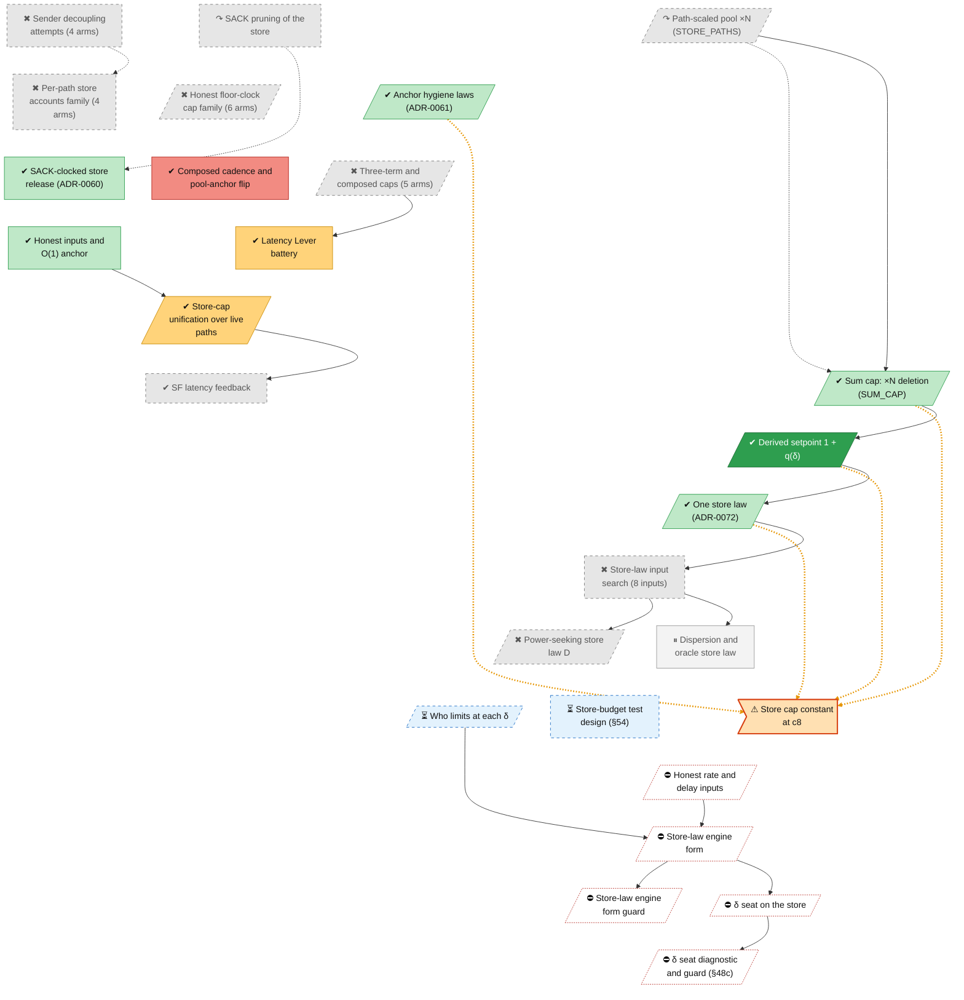

<!-- Generated by tools/roadmap/build.py from docs/roadmap/nodes.yaml. Do not edit. -->

# store - store law

Scope: flow control and the store law: store cap, SACK-clocked release, the time term, δ's seat.

[Back to the roadmap](../../roadmap.md)

<!-- BEGIN GENERATED: track-store -->

<!-- END GENERATED: track-store -->

## Node table

<!-- BEGIN GENERATED: table-store -->
| id | title | state | outcome | headline | evidence | depends_on |
|---|---|---|---|---|---|---|
| `store-xn-pool` | Path-scaled pool ×N (STORE_PATHS) | abandoned | superseded |  | paper §10 row ×N pool multiplier `clamp(gain·N·Σ, floor, N·knee)`; ADR-0058 |  |
| `store-percap-family` | Per-path store accounts family (4 arms) | abandoned | dead-end | 0.89–0.94× | paper §10 row Per-path store accounts (`RWM_STORE_PERCAP`, `RWM_PERCAP_GUARD`) |  |
| `store-honest-cap-family` | Honest floor-clock cap family (6 arms) | abandoned | dead-end |  | tag archive/RWM_HONEST_CAP; tag archive/RWM_HONEST_K; tag archive/RWM_PLAIN_RS; tag archive/RWM_RS_ATTR |  |
| `store-pool-anchor-flip` | Composed cadence and pool-anchor flip | done | bad | 0.959–0.968× | tag archive/RWM_POOL_ANCHOR | rate-est-cadence |
| `store-sack-prune` | SACK pruning of the store | abandoned | superseded |  | paper §10 row SACK pruning of the store (`RWM_SACK_PRUNE`) |  |
| `store-sack-release` | SACK-clocked store release (ADR-0060) | done | successful |  | ADR-0060 |  |
| `store-sender-decoupling` | Sender decoupling attempts (4 arms) | abandoned | dead-end | 27 ms | tag archive/RWM_REASM_BDP |  |
| `store-anchor-hygiene` | Anchor hygiene laws (ADR-0061) | done | successful | +31% | ADR-0061 |  |
| `store-three-term` | Three-term and composed caps (5 arms) | abandoned | dead-end | 2.4× | tag archive/RWM_COMPOSED_CAP |  |
| `store-cap-unification` | Store-cap unification over live paths | done | mixed | +16–25 % | status §3.5 item 3 | store-honest-inputs |
| `store-honest-inputs` | Honest inputs and O(1) anchor | done | successful |  | commit 9f6e56ba |  |
| `store-sum-cap` | Sum cap: ×N deletion (SUM_CAP) | done | successful |  | branch RWM_SUM_CAP DEFAULT ON | store-xn-pool |
| `store-delta-cap` | Derived setpoint 1 + q(δ) | done | very-successful | queue −10 to −200 ms | paper §10 row Pool gain 2.0 (N ≥ 2) | store-sum-cap |
| `store-adr72-one-law` | One store law (ADR-0072) | done | successful |  | ADR-0072; status §18; status §19 | store-delta-cap, meas-formula-first |
| `store-input-search` | Store-law input search (8 inputs) | abandoned | dead-end | knee is 1 024 at both cells | status §23; status §24; status §27; status §34 | store-adr72-one-law |
| `store-power-law` | Power-seeking store law D | abandoned | dead-end | ×5–12 | status §29; status §30; tag archive/store-power; branch archive/wt-status29-power | store-input-search |
| `store-engine-form` | Dispersion and oracle store law | parked | successful |  | status §36; status §40; status §42; status §43; branch harness43; branch run43 | store-input-search |
| `store-w1-who-limits` | Who limits at each δ | in-progress | unrated |  | derivation w1-who-limits.md (branch derive-w1); branch derive-w1; branch w1r2 | cc-bbrrs-r1, store-engine-form |
| `store-s54-budget` | Store-budget test design (§54) | in-progress | unrated | from a mean of about 5.3 s to about 1.0 s | derivation p0-dwell-diag.md (branch p0-dwell-diag); branch p0-dwell-diag | rec-snapver-filter |
| `store-defect-cap-constant` | Store cap constant at c8 | in-progress | unrated | N·pool = 4 096 | status §3.10 item 8 | rec-snapver-filter |
| `store-engine-form-guard` | Store-law engine form guard | blocked | unrated |  | plan VM queue 8 | store-engine-form-impl, meas-guard-v2-impl |
| `store-s48c-session` | δ seat diagnostic and guard (§48c) | blocked | unrated |  | plan W1.4 | store-delta-seat, meas-s51-session, meas-guard-v2-impl |
| `store-user-u1u3` | Owner calls U1–U3 | next | n/a |  | plan user decisions 3 and 10 | store-w1-who-limits |
| `store-engine-form-impl` | Store-law engine form | blocked | unrated |  | plan W3.3; CLAUDE.md FORMULA-FIRST | place-per-leg-impl, store-user-u1u3, store-fix-maxbw-minrtt, model-law-ledger |
| `store-delta-seat` | δ seat on the store | blocked | unrated |  | plan W1.2 RESULT, W1.3, W1 round 2 (iii) | store-user-u1u3, store-engine-form-impl |
| `store-fix-maxbw-minrtt` | Honest rate and delay inputs | blocked | unrated |  | law ledger rows E04, E03; store-input-search (§23, §24, §27, §34); store-engine-form (§36, §40, §42, §43b) | model-law-ledger, cc-bbrrs-r2 |
| `store-latency-lever` | Latency Lever battery | done | mixed |  | commit f6d95c99; commit ec6a5ec7 | store-three-term |
| `store-sf-latency-feedback` | SF latency feedback | done | dead-end |  | commit c0fb1d79; commit 4320fc48 | store-cap-unification |

### Details per node

| id | title | notes | evidence |
|---|---|---|---|
| `store-xn-pool` | Path-scaled pool ×N (STORE_PATHS) | RWM_STORE_PATHS stays on; what was superseded is the ×N multiplier in its formula. Dates: paper §10 rows carry an end (removal) date only. | paper §10 row ×N pool multiplier `clamp(gain·N·Σ, floor, N·knee)`; ADR-0058 |
| `store-percap-family` | Per-path store accounts family (4 arms) | Folds per-path accounts, the delay-aware redirect guard, bounded borrowing, the capacity-weighted pool and paper §11.1 open question 5. Arms (4): per-path store accounts RWM_STORE_PERCAP; delay-aware redirect guard RWM_PERCAP_GUARD; bounded account borrowing RWM_STORE_BORROW; capacity-weighted pool RWM_STORE_CAPW. Dates: paper §10 rows carry an end (removal) date only. | paper §10 row Per-path store accounts (`RWM_STORE_PERCAP`, `RWM_PERCAP_GUARD`) |
| `store-honest-cap-family` | Honest floor-clock cap family (6 arms) | Honest cap, raw echo-ratio floor, plain-mode sampler, flight witness, delivery- and floor-bound anchors (2026-07-19 to 2026-08-07); archived 2026-11-10 (simplify batch 1). Arms (6): honest floor-clock cap RWM_HONEST_CAP; raw-sample echo-ratio floor RWM_HONEST_K; plain-mode send-interval sampler RWM_PLAIN_RS; flight-time witness RWM_RS_ATTR; delivery-clocked anchor RWM_POOL_DELIV; floor-bound anchor RWM_FLOOR_BOUND. Dates: paper §10 rows carry an end (removal) date only; archive/RWM_HONEST_CAP archived 2026-11-10 (tag date not used for end); archive/RWM_HONEST_K archived 2026-11-10 (tag date not used for end); archive/RWM_PLAIN_RS archived 2026-11-10 (tag date not used for end); archive/RWM_RS_ATTR archived 2026-11-10 (tag date not used for end). Folded Ship The Wins 1b RESULTS 8afd4dd7 (delivery-clocked pool anchor, NO FLIP). | tag archive/RWM_HONEST_CAP; tag archive/RWM_HONEST_K; tag archive/RWM_PLAIN_RS; tag archive/RWM_RS_ATTR |
| `store-pool-anchor-flip` | Composed cadence and pool-anchor flip | Paper rows carry the end date only; flip e84ef1c and revert on 2026-08-07; the end date is the RWM_POOL_ANCHOR archive tag (2026-11-10). Dates: paper §10 rows carry an end (removal) date only; archive/RWM_POOL_ANCHOR archived 2026-11-10 (tag date not used for end). | tag archive/RWM_POOL_ANCHOR |
| `store-sack-prune` | SACK pruning of the store | Start date is a placeholder (the 2026-07-08 SACK work); the row carries the removal date only. Dates: paper §10 rows carry an end (removal) date only. | paper §10 row SACK pruning of the store (`RWM_SACK_PRUNE`) |
| `store-sack-release` | SACK-clocked store release (ADR-0060) | Pre-registered 2026-07-21 (discipline 11) and flipped the same day. Dates: ADR end dates in the raw set equal their start (placeholder); ADR-0052..0067 carry the 2026-07-21 migration date. | ADR-0060 |
| `store-sender-decoupling` | Sender decoupling attempts (4 arms) | SACK sender flow control, the reassembly BDP clamp, source backpressure (2026-07-07 to 2026-07-12) and window decoupling (2026-08-06); each refuted. The compact framing sibling shipped (cod-wire-compact). Arms (4): SACK sender flow control; never-evict reassembly clamp RWM_REASM_BDP; source backpressure RWM_SRC_BP; window decoupling RWM_WIN_DECOUPLE. Replaced by the per-path account family: the source-backpressure delete commit says "superseded by the percap account family" (decision 2026-11-13); that family was itself refuted. Dates: paper §10 rows carry an end (removal) date only; archive/RWM_REASM_BDP archived 2026-11-10 (tag date not used for end). | tag archive/RWM_REASM_BDP |
| `store-anchor-hygiene` | Anchor hygiene laws (ADR-0061) | A* windowed-max anchor, M* pair, process-clock stall witness (2026-07-19); flips in the 2026-07-21 consolidation battery. End date from commit 5ebbcda8 (the 2026-07-21 consolidation flip of MSTAR_ANCHOR and CLOCK_GAP); the ADR date is the migration. Dates: ADR end dates in the raw set equal their start (placeholder); ADR-0052..0067 carry the 2026-07-21 migration date. | ADR-0061 |
| `store-three-term` | Three-term and composed caps (5 arms) | Three-term outstanding law (2026-08-10), its fourth-term coverage verdict, the latency battery, the queue-free slack clock and the composed cap (2026-08-12/13; archived 2026-11-10). Arms (5): three-term outstanding law RWM_THREE_TERM; the fourth (coverage) term; queue-free slack clock; the latency-battery lever (shipped default off); composed cap RWM_COMPOSED_CAP. Dates: paper §10 rows carry an end (removal) date only; archive/RWM_COMPOSED_CAP archived 2026-11-10 (tag date not used for end). Folded: the slack-bench (RESULTS 2026-08-10: the three-term model SURVIVES, the clock fails it) and coverage (VERDICT 2026-08-10: the fourth term REFUTED; paper 16.44) clusters. | tag archive/RWM_COMPOSED_CAP |
| `store-cap-unification` | Store-cap unification over live paths | Shipped unconditionally; folds the dead-wall and mode-hunt batteries (the paper row places the dead-wall mode in this arm) and the e1ce7e7 live-path fix (§3.5 item 3). HONEST INPUTS phase 3 named the active_paths() store-cap cliff that the unification battery measured. Dates: paper §10 rows carry an end (removal) date only. Folded: the Cap-law cluster (2026-08-18: formulas in the paper first, derived floor, ledger with two FIXED and one REFUTED). Folded the Mode-hunt battery commits (2026-08 audit; mapped outcome there: dead-end). Folded the Deadwall battery commits (2026-08 audit; mapped outcome there: dead-end). | status §3.5 item 3 |
| `store-honest-inputs` | Honest inputs and O(1) anchor | HONEST INPUTS battery (2026-08-10/11): the -35 % was an O(rate^2) fold under the scheduler lock; RWM_HONEST_ANCHOR shipped. Flip commit 9f6e56ba (RWM_HONEST_ANCHOR default on, 2026-08-11). Folded Ship The Wins 1 (est x honest-anchor): pre-registration 201ada44, RESULTS 60f833a7 (NO FLIP, c7 clause fails). | commit 9f6e56ba |
| `store-sum-cap` | Sum cap: ×N deletion (SUM_CAP) | The 2026-08-18 cap-law sweep and ladder, ADR-0071 (successor candidates, for review). Owner's formula request 2026-08-18 (user-requests). Folded: the RWM_SUM_CAP merge, the Ladder Battery (pre-registration 2026-08-18, RESULTS 2026-08-19: the xN deletion DELIVERED) and the flip commits. | branch RWM_SUM_CAP DEFAULT ON |
| `store-delta-cap` | Derived setpoint 1 + q(δ) | RWM_DELTA_CAP default on (2026-08-19); CoDel derivation transferred; the literature cross-check and Tier-0/1 re-scores folded in. Dates: paper §10 rows carry an end (removal) date only. Flip commit e9c6b242 (RWM_DELTA_CAP default on, 2026-08-19). | paper §10 row Pool gain 2.0 (N ≥ 2) |
| `store-adr72-one-law` | One store law (ADR-0072) | Dates: ADR end dates in the raw set equal their start (placeholder); ADR-0052..0067 carry the 2026-07-21 migration date; status-section end dates are the section file's last edit, not the verdict date. | ADR-0072; status §18; status §19 |
| `store-input-search` | Store-law input search (8 inputs) | §23 (c1 over-read MECHANISM-CONFIRMED), §24 (no candidate passes), §27 PREMISES-FAIL with the probe-gain row (P), §34 NONE-CLOSES with rows b1-b4. Candidate inputs (8): §23 send-interval anchor; §24 min-filtered loop time; §24 quinn BBR rate; §27 (P) probe gain; §34 (b1) BBR window knee; (b2) cwnd-binding share; (b3) path memory; (b4) receiver-capacity ceiling. Dates: status-section end dates are the section file's last edit, not the verdict date; paper §10 rows carry an end (removal) date only. | status §23; status §24; status §27; status §34 |
| `store-power-law` | Power-seeking store law D | §29 NOT-VIABLE, §30 DOES-NOT-CLOSE; code at archive/store-power. Dates: status-section end dates are the section file's last edit, not the verdict date; paper §10 rows carry an end (removal) date only; archive/store-power archived 2026-10-27 (tag date not used for end). | status §29; status §30; tag archive/store-power; branch archive/wt-status29-power |
| `store-engine-form` | Dispersion and oracle store law | §36/§40 receiver dispersion as link rate (NOT-YET), §42 kernel timestamps FEASIBLE-IN-TREE, §43 oracle law (c2 BISTABLE, c1s UNSTABLE) and §43b (CONVERGES-ONE-POINT, in the §43 file). Continues as plan W3.3. Dates: status-section end dates are the section file's last edit, not the verdict date. | status §36; status §40; status §42; status §43; branch harness43; branch run43 |
| `store-w1-who-limits` | Who limits at each δ | Derivation (derive-w1, w1r2): δ's seat on the store, bbr_rs window δ-free; waits on owner questions U1-U3 (plan user decision 10). | derivation w1-who-limits.md (branch derive-w1); branch derive-w1; branch w1r2 |
| `store-s54-budget` | Store-budget test design (§54) | p0-dwell-diag: lever B triples p0 quinn backlog; §8 holds the §54 store-budget test design (reduced RWM_STORE_PATH_POOL on BASE' and CAND'), plan item 2 of 2026-11-13. | derivation p0-dwell-diag.md (branch p0-dwell-diag); branch p0-dwell-diag |
| `store-defect-cap-constant` | Store cap constant at c8 | Plan 2026-11-13: the store law becomes its own track (items 8-9). | status §3.10 item 8 |
| `store-engine-form-guard` | Store-law engine form guard | Law ledger: F01 battery (with E03, E04). Done when: guard v2 against main PASSes and the c8 clamp bind fraction is reported below 1 (the law is not pinned over its operating range). | plan VM queue 8 |
| `store-s48c-session` | δ seat diagnostic and guard (§48c) | Done when: the §48c (a) reported-only fixed-gain/fixed-τ rows and the (b) guard v2 battery of the derived δ seat (c1s, c2, c8 and a Realtime row at c2) are in status. | plan W1.4 |
| `store-user-u1u3` | Owner calls U1–U3 | Done when: the owner answers U1 (substrate as controller or safety net), U2 (δ's authority: q's band or A(c) with a c_B source) and U3 (~2 % Bulk goodput for Tp50 19 vs 208 ms), recorded in status or the plan. | plan user decisions 3 and 10 |
| `store-engine-form-impl` | Store-law engine form | Law ledger: F01 (rank 3, P0), the law change that ships with E03 and E04 in one change and battery: write the hole-population term and the no-queue offset b0 that the paper's Little's-law sentence omits, with [SUMCAP] pin= and ask= gauges. Done when: the store law reads an engine L̂ and time term from the per-leg state (formula and derivation in the paper first), with a bind-fraction gauge on its clamp and red-first law tests. | plan W3.3; CLAUDE.md FORMULA-FIRST |
| `store-delta-seat` | δ seat on the store | Done when: the store time term carries δ (W1.2 candidate A) with absolute tests continuous and monotone through every preset (±2 %), in cc_sim. | plan W1.2 RESULT, W1.3, W1 round 2 (iii) |
| `store-fix-maxbw-minrtt` | Honest rate and delay inputs | Law ledger: E04, E03. Ranks 1-2, ships with F01 (store-engine-form-impl). OPEN RESEARCH PROBLEM. Seven failed attempts, all already in the tree: the send-interval sampler under-reads x0.1-0.5 (§23) and the quinn-rate and loop-time options fail (§24, both store-input-search); bbr_rs's delivered rate is circular at c2 (§27, store-input-search); the derivation from committed ledgers NONE-CLOSES (§34, store-input-search); receiver dispersion is NOT-YET (§36, §40, store-engine-form); the netem-oracle L converges only at c2 (§43b, store-engine-form); the power-seeking law is not viable (§29, store-power-law). Untested candidates: for RTprop, quinn's wire rtt.min() and bbr_rs's m-hat; for the rate, bbr_rs's b-hat or a law that needs no rate. The bbr_rs estimates come from the round-2 work, hence the edge to cc-bbrrs-r2. Fallback if no honest input is found: ship the law with the N·pool ceiling as a declared resource bound outside the law (FORMULA-FIRST provenance class), its bind fraction gauged and reported on every battery, and the inputs marked DISHONEST-INPUT in the ledger with the store law left open. Done when: a derivation in the paper names a link-rate source the store cap does not itself set (or a law that needs none) and an RTprop from a wire clock, each with a test that it reads the link at c8 within a stated bound; or, failing that, the fallback above is written into the paper and the ledger. Ships in one change and one battery with the store-law fix. | law ledger rows E04, E03; store-input-search (§23, §24, §27, §34); store-engine-form (§36, §40, §42, §43b) |
| `store-latency-lever` | Latency Lever battery | Pre-registration ec6a5ec7; scored by lat_report.py (fc860371). Mapped to mixed: works, no default. Track store: the battery tested the three-term cap as a latency control (follows the three-term battery's specification failure, f334471e). | commit f6d95c99; commit ec6a5ec7 |
| `store-sf-latency-feedback` | SF latency feedback | REFUTED: dead-end. Track store: its verdict re-attributes the c8 collapse to dead wall, which the paper places in the store-cap-unification arm. | commit c0fb1d79; commit 4320fc48 |
<!-- END GENERATED: table-store -->
