<!-- Generated by tools/roadmap/build.py from docs/roadmap/nodes.yaml. Do not edit. -->

# store - store law

Scope: flow control and the store law: store cap, SACK-clocked release, the time term, δ's seat.

[Back to the roadmap](../../roadmap.md) · [legend](../../roadmap.md#legend)

```mermaid
flowchart TB
    store_sack_flowctl["✖ SACK sender flow<br/>control"]
    store_sack_prune["↷ SACK pruning of the<br/>store"]
    store_reasm_bdp["✖ Never-evict<br/>reassembly clamp"]
    store_src_bp["↷ Source backpressure"]
    store_xn_pool[/"↷ Path-scaled pool ×N"/]
    store_percap_family["✖ Per-path store<br/>accounts"]
    store_borrow["✖ Bounded account<br/>borrowing"]
    store_honest_cap_family[/"✖ Honest floor-clock<br/>cap"/]
    store_anchor_hygiene[/"✔ Anchor hygiene laws"/]
    store_plain_rs["✖ Plain-mode send-<br/>interval sampler"]
    store_sack_release["✔ SACK-clocked store<br/>release"]
    store_capw["✖ Capacity-weighted<br/>pool"]
    store_sender_decoupling["✖ Window decoupling"]
    store_pool_anchor_flip["✔ Composed store flip"]
    store_pool_deliv["✖ Delivery-clocked<br/>pool anchors"]
    store_slack_clock[/"✖ Slack-bench: queue-<br/>free slack clock"/]
    store_three_term[/"✖ Three-term<br/>outstanding law"/]
    store_coverage_term[/"✖ Coverage: the fourth<br/>store term"/]
    store_honest_inputs["✔ Honest inputs and<br/>O(1) anchor"]
    store_latency_lever["✔ Three-term cap as<br/>latency control"]
    store_cap_unification[/"✔ Store-cap<br/>unification over live<br/>paths"/]
    store_composed_cap[/"✖ Composed cap"/]
    store_deadwall_modehunt["✔ Deadwall and mode-<br/>hunt batteries"]
    store_sf_latency_feedback["✔ SF latency feedback"]
    store_cap_law_cluster["✔ Cap-law cluster:<br/>formulas first"]
    store_sum_cap[/"✔ Ladder battery: ×N<br/>deletion"/]
    store_delta_cap[/"✔ Derived setpoint 1 +<br/>q(δ)"/]
    store_s18_one_law[/"✔ One store law, first<br/>session"/]
    store_adr72_one_law[/"✔ One store law"/]
    store_input_search["✔ Single-path anchor<br/>over-read"]
    store_s24_inputs["✖ Loop time and quinn<br/>rate"]
    store_power_law[/"✖ Power-seeking store<br/>law D"/]
    store_s27_premises["✖ Spread law premises"]
    store_probe_gain[/"✖ Probe-gain store law"/]
    store_dw_window["✖ Noise-sized window"]
    store_s34_input["✖ Store-law input<br/>after the anchor fix"]
    store_s36_dispersion["✔ Receiver dispersion<br/>as link rate"]
    store_s40_p90["✔ p90 dispersion<br/>estimator"]
    store_s42_engine_path["✔ Engine path for<br/>dispersion"]
    store_engine_form["✔ Oracle store law,<br/>closed loop"]
    store_s43b_retuned["✔ Oracle store law re-<br/>tuned"]
    store_w1_who_limits[/"⏳ Who limits at each δ"/]
    store_s54_budget["✔ Store-budget test<br/>design"]
    store_defect_cap_constant>"⚠ Store cap pinned at<br/>its clamp"]
    store_law_derivation["▶ Store-law derivation"]
    store_s56_sweep["✔ Store-pool sweep"]
    store_s57a_burst["✔ Emission-burst test,<br/>fast single path"]
    store_s57b_c1d["✔ Fast two-path pool<br/>sweep"]
    store_defect_delta_nan>"✔ Latency-dial setting<br/>pinned the store cap"]
    store_law_r67["✔ Lowest-store floor<br/>candidate"]
    store_slaw_gauge["⏳ Store-law gauge<br/>build"]
    store_s60_pre["✔ Gauge suites and<br/>reference binary"]
    store_s60a["✔ Queue-free floor on<br/>small stores"]
    store_s60b["✔ Floor sign test,<br/>fast single path"]
    store_defect_allowance_short>"⚠ Allowance short of<br/>the fast-link knee"]
    store_s61a["✔ Slow-link knee<br/>sweep, first try"]
    store_s61b["✔ Fast-link price<br/>below the knee"]
    store_s61a_rerun["✔ Slow-link knee<br/>sweep, re-run"]
    store_law_g_rederive[/"✔ Re-derive the knee-<br/>margin term"/]
    store_s62_j0["✔ Slow-link knee<br/>without jitter"]
    store_count_rule["✔ Sample-count rule<br/>derivation"]
    store_defect_b0p_brake>"⚠ Boot-time brake<br/>estimate latches<br/>transients"]
    store_sampler_design[/"○ Store-law delay<br/>sampler design"/]
    store_fix_maxbw_minrtt[/"⛔ Honest rate and<br/>delay inputs"/]
    store_engine_form_impl[/"⛔ Store-law engine<br/>form"/]
    store_engine_form_guard[/"⛔ Store-law engine<br/>form guard"/]
    store_delta_seat[/"⛔ δ seat on the store"/]
    store_s48c_session[/"⛔ δ seat diagnostic<br/>and guard"/]
    store_sack_flowctl ~~~ store_reasm_bdp
    store_sack_prune ~~~ store_src_bp
    store_sack_prune ~~~ store_xn_pool
    store_reasm_bdp ~~~ store_percap_family
    store_src_bp ~~~ store_percap_family
    store_xn_pool ~~~ store_percap_family
    store_percap_family ~~~ store_borrow
    store_percap_family ~~~ store_honest_cap_family
    store_percap_family ~~~ store_anchor_hygiene
    store_borrow ~~~ store_plain_rs
    store_honest_cap_family ~~~ store_sack_release
    store_anchor_hygiene ~~~ store_capw
    store_plain_rs ~~~ store_sender_decoupling
    store_sack_release ~~~ store_pool_anchor_flip
    store_capw ~~~ store_pool_anchor_flip
    store_sender_decoupling ~~~ store_pool_deliv
    store_pool_anchor_flip ~~~ store_slack_clock
    store_pool_anchor_flip ~~~ store_three_term
    store_pool_deliv ~~~ store_coverage_term
    store_slack_clock ~~~ store_honest_inputs
    store_three_term ~~~ store_latency_lever
    store_coverage_term ~~~ store_cap_unification
    store_honest_inputs ~~~ store_composed_cap
    store_latency_lever ~~~ store_composed_cap
    store_cap_unification ~~~ store_deadwall_modehunt
    store_composed_cap ~~~ store_sf_latency_feedback
    store_composed_cap ~~~ store_cap_law_cluster
    store_deadwall_modehunt ~~~ store_sum_cap
    store_sf_latency_feedback ~~~ store_sum_cap
    store_cap_law_cluster ~~~ store_sum_cap
    store_sum_cap ~~~ store_delta_cap
    store_delta_cap ~~~ store_s18_one_law
    store_s18_one_law ~~~ store_adr72_one_law
    store_adr72_one_law ~~~ store_input_search
    store_input_search ~~~ store_s24_inputs
    store_input_search ~~~ store_power_law
    store_input_search ~~~ store_s27_premises
    store_s24_inputs ~~~ store_probe_gain
    store_power_law ~~~ store_dw_window
    store_s27_premises ~~~ store_dw_window
    store_probe_gain ~~~ store_s34_input
    store_dw_window ~~~ store_s34_input
    store_s34_input ~~~ store_s36_dispersion
    store_s36_dispersion ~~~ store_s40_p90
    store_s40_p90 ~~~ store_s42_engine_path
    store_s42_engine_path ~~~ store_engine_form
    store_engine_form ~~~ store_s43b_retuned
    store_engine_form ~~~ store_w1_who_limits
    store_engine_form ~~~ store_s54_budget
    store_s43b_retuned ~~~ store_defect_cap_constant
    store_w1_who_limits ~~~ store_defect_cap_constant
    store_s54_budget ~~~ store_defect_cap_constant
    store_defect_cap_constant ~~~ store_law_derivation
    store_defect_cap_constant ~~~ store_s56_sweep
    store_law_derivation ~~~ store_s57a_burst
    store_s56_sweep ~~~ store_s57b_c1d
    store_s56_sweep ~~~ store_defect_delta_nan
    store_s57a_burst ~~~ store_law_r67
    store_s57b_c1d ~~~ store_slaw_gauge
    store_defect_delta_nan ~~~ store_slaw_gauge
    store_law_r67 ~~~ store_s60_pre
    store_slaw_gauge ~~~ store_s60_pre
    store_s60_pre ~~~ store_s60a
    store_s60a ~~~ store_s60b
    store_s60a ~~~ store_defect_allowance_short
    store_s60b ~~~ store_s61a
    store_defect_allowance_short ~~~ store_s61b
    store_s61a ~~~ store_s61a_rerun
    store_s61b ~~~ store_s61a_rerun
    store_s61a_rerun ~~~ store_law_g_rederive
    store_law_g_rederive ~~~ store_s62_j0
    store_s62_j0 ~~~ store_count_rule
    store_count_rule ~~~ store_defect_b0p_brake
    store_defect_b0p_brake ~~~ store_sampler_design
    store_defect_b0p_brake ~~~ store_fix_maxbw_minrtt
    store_sampler_design ~~~ store_engine_form_impl
    store_fix_maxbw_minrtt ~~~ store_engine_form_impl
    store_engine_form_impl ~~~ store_engine_form_guard
    store_engine_form_impl ~~~ store_delta_seat
    store_engine_form_guard ~~~ store_s48c_session
    store_delta_seat ~~~ store_s48c_session
    store_sack_prune -.-> store_sack_release
    store_sack_flowctl --> store_reasm_bdp
    store_src_bp -.-> store_percap_family
    store_xn_pool -.-> store_sum_cap
    store_percap_family --> store_borrow
    store_anchor_hygiene -.-> store_defect_cap_constant
    store_anchor_hygiene --> store_plain_rs
    store_pool_anchor_flip --> store_pool_deliv
    store_three_term --> store_coverage_term
    store_three_term --> store_latency_lever
    store_honest_inputs --> store_cap_unification
    store_three_term --> store_composed_cap
    store_cap_unification --> store_deadwall_modehunt
    store_cap_unification --> store_sf_latency_feedback
    store_cap_unification --> store_cap_law_cluster
    store_xn_pool --> store_sum_cap
    store_cap_law_cluster --> store_sum_cap
    store_sum_cap -.-> store_defect_cap_constant
    store_sum_cap --> store_delta_cap
    store_delta_cap -.-> store_defect_cap_constant
    store_delta_cap --> store_s18_one_law
    store_s18_one_law -.-> store_adr72_one_law
    store_s18_one_law --> store_adr72_one_law
    store_adr72_one_law -.-> store_defect_cap_constant
    store_adr72_one_law --> store_input_search
    store_input_search --> store_s24_inputs
    store_input_search --> store_power_law
    store_s27_premises --> store_probe_gain
    store_power_law --> store_dw_window
    store_dw_window --> store_s34_input
    store_s34_input --> store_s36_dispersion
    store_s36_dispersion --> store_s40_p90
    store_s40_p90 --> store_s42_engine_path
    store_s42_engine_path --> store_engine_form
    store_engine_form --> store_s43b_retuned
    store_s54_budget --> store_law_derivation
    store_defect_cap_constant --> store_law_derivation
    store_s54_budget --> store_s56_sweep
    store_defect_cap_constant --> store_s56_sweep
    store_s56_sweep --> store_s57a_burst
    store_s56_sweep --> store_s57b_c1d
    store_s57b_c1d --> store_law_r67
    store_law_derivation --> store_slaw_gauge
    store_slaw_gauge --> store_s60_pre
    store_s60_pre --> store_s60a
    store_law_r67 --> store_s60a
    store_s60a --> store_s60b
    store_s60a --> store_defect_allowance_short
    store_s60b --> store_s61a
    store_w1_who_limits --> store_s61a
    store_s60b --> store_s61b
    store_s61a --> store_s61a_rerun
    store_s61a_rerun --> store_law_g_rederive
    store_s61b --> store_law_g_rederive
    store_law_g_rederive --> store_s62_j0
    store_s62_j0 --> store_count_rule
    store_count_rule --> store_defect_b0p_brake
    store_defect_b0p_brake --> store_sampler_design
    store_w1_who_limits --> store_engine_form_impl
    store_fix_maxbw_minrtt --> store_engine_form_impl
    store_engine_form_impl --> store_engine_form_guard
    store_engine_form_impl --> store_delta_seat
    store_delta_seat --> store_s48c_session
    linkStyle 86,98,100,104 stroke:#e69500,stroke-width:3px,stroke-dasharray:2 3
    classDef vsucc fill:#2e9e4f,stroke:#1b6b34,color:#fff
    classDef succ fill:#bfe8c8,stroke:#2e9e4f,color:#111
    classDef mixed fill:#ffd37a,stroke:#c98a00,color:#111
    classDef bad fill:#f28b82,stroke:#b3261e,color:#111
    classDef dead fill:#e6e6e6,stroke:#777,stroke-dasharray:5 5,color:#555
    classDef inprog fill:#a8cdf5,stroke:#1f6fc5,color:#111
    classDef next fill:#fff,stroke:#333,color:#111
    classDef blocked fill:#fff,stroke:#b3261e,stroke-dasharray:2 2,color:#111
    classDef parked fill:#f3f3f3,stroke:#999,color:#555
    classDef unrated fill:#fff,stroke:#333,stroke-dasharray:1 3,color:#111
    classDef userdec fill:#d9c2f0,stroke:#7b3fb5,color:#111
    classDef defect fill:#ffe0b2,stroke:#d84315,stroke-width:2px,color:#111
    classDef waiting fill:#e3f2fd,stroke:#1f6fc5,stroke-dasharray:5 5,color:#111
    class store_sack_flowctl,store_sack_prune,store_reasm_bdp,store_src_bp,store_xn_pool,store_percap_family,store_borrow,store_honest_cap_family,store_plain_rs,store_capw,store_sender_decoupling,store_pool_deliv,store_slack_clock,store_three_term,store_coverage_term,store_composed_cap,store_sf_latency_feedback,store_s18_one_law,store_s24_inputs,store_power_law,store_s27_premises,store_probe_gain,store_dw_window,store_s34_input dead
    class store_anchor_hygiene,store_sack_release,store_honest_inputs,store_sum_cap,store_adr72_one_law,store_defect_delta_nan,store_s60_pre,store_s61b succ
    class store_pool_anchor_flip,store_s61a bad
    class store_latency_lever,store_cap_unification,store_s60a,store_s60b,store_s61a_rerun,store_law_g_rederive,store_s62_j0 mixed
    class store_deadwall_modehunt,store_cap_law_cluster,store_input_search,store_s36_dispersion,store_s40_p90,store_s42_engine_path,store_engine_form,store_s43b_retuned,store_s54_budget,store_s56_sweep,store_s57a_burst,store_s57b_c1d,store_law_r67,store_count_rule unrated
    class store_delta_cap vsucc
    class store_w1_who_limits,store_slaw_gauge waiting
    class store_defect_cap_constant,store_defect_allowance_short,store_defect_b0p_brake defect
    class store_law_derivation inprog
    class store_sampler_design next
    class store_fix_maxbw_minrtt,store_engine_form_impl,store_engine_form_guard,store_delta_seat,store_s48c_session blocked
```

<!-- BEGIN GENERATED: track-store -->

<!-- END GENERATED: track-store -->

## Node table

<!-- BEGIN GENERATED: table-store -->
| id | title | state | outcome | headline | evidence | depends_on |
|---|---|---|---|---|---|---|
| `store-xn-pool` | Path-scaled pool ×N | abandoned | superseded |  | paper §10 row ×N pool multiplier `clamp(gain·N·Σ, floor, N·knee)`; ADR-0058 |  |
| `store-percap-family` | Per-path store accounts | abandoned | dead-end | 0.89–0.94× | paper §10 row Per-path store accounts (`RWM_STORE_PERCAP`, `RWM_PERCAP_GUARD`); commit 4b8e5384; commit 4bb5b28f |  |
| `store-borrow` | Bounded account borrowing | abandoned | dead-end |  | paper §10 row Bounded account borrowing (`RWM_STORE_BORROW`); commit 7c3343ff | store-percap-family |
| `store-capw` | Capacity-weighted pool | abandoned | dead-end |  | paper §10 row Capacity-weighted pool (`RWM_STORE_CAPW`); commit 4fb5b15 |  |
| `store-honest-cap-family` | Honest floor-clock cap | abandoned | dead-end |  | tag archive/RWM_HONEST_CAP; tag archive/RWM_HONEST_K; paper §10 row Honest floor-clock store cap (`RWM_HONEST_CAP`; resolved on, acted only with `RWM_PLAIN_RS`); paper §10 row Raw-sample echo-ratio floor (`RWM_HONEST_K`) and the honest-cap law family it fed (`honest_store_cap`, `honest_cap_terms`, `k_raw`); commit 1ad01c4d |  |
| `store-plain-rs` | Plain-mode send-interval sampler | abandoned | dead-end |  | tag archive/RWM_PLAIN_RS; tag archive/RWM_RS_ATTR; paper §10 row Plain-mode send-interval sampler (`RWM_PLAIN_RS`, sampling-only `CopaFeed`); paper §10 row Flight-time witness for cross-path ack attribution (`RWM_RS_ATTR`); status §23 | store-anchor-hygiene |
| `store-pool-deliv` | Delivery-clocked pool anchors | abandoned | dead-end | 0.931–0.958×Σ | paper §10 row Pool delivery-clocked anchor (`RWM_POOL_DELIV`); paper §10 row Floor-bound anchor (`RWM_FLOOR_BOUND`); commit 8afd4dd7 | store-pool-anchor-flip |
| `store-pool-anchor-flip` | Composed store flip | done | bad | 0.959–0.968× | tag archive/RWM_POOL_ANCHOR; commit 60f833a7; commit e84ef1c5; paper §10 row Composed estimator-cadence plus pool-anchor default | rate-est-cadence |
| `store-sack-prune` | SACK pruning of the store | abandoned | superseded |  | paper §10 row SACK pruning of the store (`RWM_SACK_PRUNE`) |  |
| `store-sack-release` | SACK-clocked store release | done | successful |  | ADR-0060 |  |
| `store-sender-decoupling` | Window decoupling | abandoned | dead-end | 27 ms | paper §10 row Window decoupling (`RWM_WIN_DECOUPLE`); commit 48f60c4f |  |
| `store-sack-flowctl` | SACK sender flow control | abandoned | dead-end |  | commit 5adba96e; commit 2b898456 |  |
| `store-reasm-bdp` | Never-evict reassembly clamp | abandoned | dead-end |  | tag archive/RWM_REASM_BDP; paper §10 row Never-evict-undelivered reassembly clamp (`RWM_REASM_BDP`); commit 6d2a05b2 | store-sack-flowctl |
| `store-src-bp` | Source backpressure | abandoned | superseded |  | paper §10 row Source backpressure (`RWM_SRC_BP`); commit 4606829f; commit 8902d246 |  |
| `store-anchor-hygiene` | Anchor hygiene laws | done | successful | +31% | ADR-0061 |  |
| `store-three-term` | Three-term outstanding law | abandoned | dead-end |  | paper §10 row Three-term outstanding law (`RWM_THREE_TERM`); commit 5de30ed3; commit 448a82e |  |
| `store-coverage-term` | Coverage: the fourth store term | abandoned | dead-end |  | commit e113c9ab; paper §16.44 | store-three-term |
| `store-slack-clock` | Slack-bench: queue-free slack clock | abandoned | dead-end |  | paper §10 row Queue-free slack clock; commit 7e03ef9b; commit 7e302e2a |  |
| `store-composed-cap` | Composed cap | abandoned | dead-end | 2.4× | tag archive/RWM_COMPOSED_CAP; paper §10 row Composed cap (`RWM_COMPOSED_CAP`); commit 161b4eae | store-three-term |
| `store-cap-unification` | Store-cap unification over live paths | done | mixed | +16–25 % | status §3.5 item 3; paper §10 row Store-cap unification over live paths (`RWM_STORE_CAP_UNIFIED`) | store-honest-inputs |
| `store-deadwall-modehunt` | Deadwall and mode-hunt batteries | done | unrated |  | paper §10 row The dead-wall and mode-hunt batteries; commit d583593a; commit cfc1793f | store-cap-unification |
| `store-cap-law-cluster` | Cap-law cluster: formulas first | done | unrated |  | commit 7e302e2a; commit 6335e206 | store-cap-unification |
| `store-honest-inputs` | Honest inputs and O(1) anchor | done | successful |  | commit 9f6e56ba |  |
| `store-sum-cap` | Ladder battery: ×N deletion | done | successful |  | branch RWM_SUM_CAP DEFAULT ON | store-xn-pool, store-cap-law-cluster |
| `store-delta-cap` | Derived setpoint 1 + q(δ) | done | very-successful | queue −10 to −200 ms | paper §10 row Pool gain 2.0 (N ≥ 2) | store-sum-cap |
| `store-s18-one-law` | One store law, first session | done | superseded |  | status §18; commit 48ee42a3 | store-delta-cap, meas-formula-first |
| `store-adr72-one-law` | One store law | done | successful |  | ADR-0072; status §19; commit bdb37b40 | store-s18-one-law |
| `store-input-search` | Single-path anchor over-read | done | unrated |  | status §23; commit 4ed22f38 | store-adr72-one-law |
| `store-s24-inputs` | Loop time and quinn rate | abandoned | dead-end |  | status §24; commit de3e11a1 | store-input-search |
| `store-s27-premises` | Spread law premises | abandoned | dead-end |  | status §27; commit 35b16607 |  |
| `store-probe-gain` | Probe-gain store law | abandoned | dead-end |  | paper §10 row (P) probe gain: `cap' = (1 + q + g)·D̂·τ`; status §27 | store-s27-premises |
| `store-power-law` | Power-seeking store law D | abandoned | dead-end | ×5–12 | status §29; tag archive/store-power; branch archive/wt-status29-power; paper §10 row (D) power seeker: `n* = argmax D(n)^α(δ)/T(n)`, dithered extremum seeker | store-input-search |
| `store-dw-window` | Noise-sized window | abandoned | dead-end |  | status §30; paper §10 row (D-W) noise-sized window: `W*(δ) = min W : σ²(W) ≤ (q/2)²`; commit 9677a3c9 | store-power-law |
| `store-s34-input` | Store-law input after the anchor fix | abandoned | dead-end | knee is 1 024 at both cells | status §34; paper §10 row (b1) quinn's BBR window as the knee: `cap = (1 + q)·K`, `K = Σᵢ (2·L̂_q,ᵢ·min_rttᵢ + hᵢ) / W`; paper §10 row (b2) cwnd-binding share as an input: grow while the cap binds, hold where quinn binds; paper §10 row (b3) path memory: n̄ carried across transfers per path (RFC 9040 temporal sharing); paper §10 row (b4) receiver capacity as a ceiling: `Σᵢ … ≤ (1 + q)·μ_R·(RTprop + S̄(n))`; commit a75bc9ca | perf-decoder-prune, store-dw-window |
| `store-s36-dispersion` | Receiver dispersion as link rate | done | unrated |  | status §36; commit 4dd26760 | store-s34-input |
| `store-s40-p90` | p90 dispersion estimator | done | unrated |  | status §40; commit b0b07b1b | store-s36-dispersion |
| `store-s42-engine-path` | Engine path for dispersion | done | unrated |  | status §42; commit af06313d | store-s40-p90 |
| `store-engine-form` | Oracle store law, closed loop | done | unrated |  | status §43; branch harness43; branch run43; commit 1eca3ee2 | store-s42-engine-path |
| `store-s43b-retuned` | Oracle store law re-tuned | done | unrated |  | status §43b; commit bab838c1 | store-engine-form |
| `store-w1-who-limits` | Who limits at each δ | in-progress | unrated |  | derivation w1-who-limits.md (branch derive-w1); branch derive-w1; branch w1r2 | cc-bbrrs-r1, store-engine-form |
| `store-s54-budget` | Store-budget test design | done | unrated | from a mean of about 5.3 s to about 1.0 s | derivation p0-dwell-diag.md (branch p0-dwell-diag); branch p0-dwell-diag | rec-snapver-filter |
| `store-law-derivation` | Store-law derivation | in-progress | unrated |  | status §54 Result, launch 2, owner decision; law ledger §4 items 1-2; branch store-law-rev6; derivation store-law-r67.md; status §60 | store-s54-budget, store-defect-cap-constant, model-law-ledger |
| `store-s56-sweep` | Store-pool sweep | done | unrated | c2 flat to W 192, c8 to 512 | status §56; derivation store-law.md §13 | store-s54-budget, store-defect-cap-constant |
| `store-s57a-burst` | Emission-burst test, fast single path | done | unrated | burst knob reaches 79 at 256; S 0.62 | status §57a Result; status §57 Amendment 1 | store-s56-sweep |
| `store-s57b-c1d` | Fast two-path pool sweep | done | unrated | c1d store-bound only at W <= 512; T not reached | status §57b Result; status §57 Amendment 1; branch harness57b | store-s56-sweep |
| `store-law-r67` | Lowest-store floor candidate | done | unrated |  | derivation store-law-r67.md; commit d85d048b; branch store-law-r67 | store-s57b-c1d |
| `store-slaw-gauge` | Store-law gauge build | in-progress | unrated |  | status §60; branch slaw-gauge; branch s60-tree | store-law-derivation |
| `store-s60-pre` | Gauge suites and reference binary | done | successful | bin_sha e410d640… | status 60-pre; status 60-pre Result; commit f950956b; commit 0367ea59 | store-slaw-gauge |
| `store-s60a` | Queue-free floor on small stores | done | mixed | c2 SHORT 1.69 ms; c8 B2 unscoreable | status §60; status §60 Amendment 1; derivation s60-registration.md; branch s60-design; branch harness60; status §60 Result | store-s60-pre, store-law-r67 |
| `store-s60b` | Floor sign test, fast single path | done | mixed | c1s control and G/C unread (collapse rule) | status §60 Amendment 2; branch harness60-a2; status §60 Result | store-s60a |
| `store-s61a` | Slow-link knee sweep, first try | done | bad | 66/66 clean, nothing scored (two rule defects) | status §61 Amendment 1; status §61a Result; branch harness61; status Owner decisions (2026-11-17) item 9 | store-s60b, store-user-u1u3 |
| `store-s61b` | Fast-link price below the knee | done | successful | c2 price below the knee, merged with §60 | status §61b Result | store-s60b |
| `store-s61a-rerun` | Slow-link knee sweep, re-run | done | mixed | rho_3 0.457 vs rho_2 0.797 | status §61 Amendment 2; status §61 Amendment 3; status §61a re-run Result; status §61a re-run Result, Erratum 1 | store-s61a |
| `store-law-g-rederive` | Re-derive the knee-margin term | done | mixed |  | status §61a re-run Result; status §61a re-run Result, Erratum 1; status "The knee-margin re-derivation, closed post hoc"; branch knee-margin-rederive 399407f4 | store-s61a-rerun, store-s61b |
| `store-s62-j0` | Slow-link knee without jitter | done | mixed | floor still count-dependent at J = 0 (D0 3.36 ms) | status §62; status §62 Amendment 1; status §62 Result; branch s62-design 0f40a59d; branch harness62 95dafa59; docs/l1-raw/s62/ | store-law-g-rederive |
| `store-count-rule` | Sample-count rule derivation | done | unrated | J = 0 low mode in 29-32 % of windows, 84-87 % beside a retransmit | status "The count-rule derivation"; status §62 Result; branch count-rule 2d557191 | store-s62-j0 |
| `store-defect-b0p-brake` | Boot-time brake estimate latches transients | next | unrated | F swings 37-139 ms from one boot window | status "The count-rule derivation" | store-count-rule |
| `store-sampler-design` | Store-law delay sampler design | next | unrated |  | status "The count-rule derivation" | store-defect-b0p-brake, store-count-rule |
| `store-user-jitter-sweep` | Owner call on the jitter sweep | done | n/a | run it after the framing check | status Owner decisions (2026-11-17) item 13 |  |
| `store-defect-allowance-short` | Allowance short of the fast-link knee | next | unrated | SHORT 1.69 ms at c2 | status §60 Result; derivation store-law-r67.md | store-s60a |
| `store-defect-delta-nan` | Latency-dial setting pinned the store cap | done | unrated | merged 9b8b42ca; decision_trace_pin 7/7 on Linux | status "Engine defect F1"; derivation shared-core-design.md F1; status §58 Amendment 2; commit 9b8b42ca |  |
| `store-defect-cap-constant` | Store cap pinned at its clamp | in-progress | unrated | N·pool = 4 096 | status §3.10 item 8 | rec-snapver-filter |
| `store-engine-form-guard` | Store-law engine form guard | blocked | unrated |  | plan VM queue 8 | store-engine-form-impl, meas-guard-v2-impl |
| `store-s48c-session` | δ seat diagnostic and guard | blocked | unrated |  | plan W1.4 | store-delta-seat, meas-s51-session, meas-guard-v2-impl |
| `store-user-u1u3` | Owner calls on who sets latency | done | n/a |  | plan user decisions 3 and 10; status Owner decisions (2026-11-16) items 1-2; status Owner decisions (2026-11-17) item 8 | store-w1-who-limits |
| `store-engine-form-impl` | Store-law engine form | blocked | unrated |  | plan W3.3; CLAUDE.md FORMULA-FIRST | place-per-leg-impl, store-user-u1u3, store-fix-maxbw-minrtt, model-law-ledger |
| `store-delta-seat` | δ seat on the store | blocked | unrated |  | plan W1.2 RESULT, W1.3, W1 round 2 (iii) | store-user-u1u3, store-engine-form-impl |
| `store-fix-maxbw-minrtt` | Honest rate and delay inputs | blocked | unrated |  | law ledger rows E04, E03; store-input-search (§23, §24, §27, §34); store-engine-form (§36, §40, §42, §43b) | model-law-ledger, cc-bbrrs-r2 |
| `store-latency-lever` | Three-term cap as latency control | done | mixed |  | commit f6d95c99; commit ec6a5ec7 | store-three-term |
| `store-sf-latency-feedback` | SF latency feedback | done | dead-end |  | commit c0fb1d79; commit 4320fc48 | store-cap-unification |

### Details per node

| id | title | notes | evidence |
|---|---|---|---|
| `store-xn-pool` | Path-scaled pool ×N | RWM_STORE_PATHS stays on; what was superseded is the ×N multiplier in its formula. Dates: paper §10 rows carry an end (removal) date only. | paper §10 row ×N pool multiplier `clamp(gain·N·Σ, floor, N·knee)`; ADR-0058 |
| `store-percap-family` | Per-path store accounts | Split 2026-11-16 from the former family node 'Per-path store accounts family (4 arms)'. Per-path accounts (d190b296) and the delay-aware redirect guard (689b9f1b; 'halves the c8 percap regression', 4bb5b28f) share one paper row. Siblings: store-borrow, store-capw. Folds paper §11.1 open question 5. | paper §10 row Per-path store accounts (`RWM_STORE_PERCAP`, `RWM_PERCAP_GUARD`); commit 4b8e5384; commit 4bb5b28f |
| `store-borrow` | Bounded account borrowing | Split 2026-11-16 from the former family node 'Per-path store accounts family (4 arms)'. 7c3343ff: 'the law is gauge-perfect, the tax is NOT repaid; pooled path-scaled VINDICATED at c8, flip NO'. | paper §10 row Bounded account borrowing (`RWM_STORE_BORROW`); commit 7c3343ff |
| `store-capw` | Capacity-weighted pool | Split 2026-11-16 from the former family node 'Per-path store accounts family (4 arms)'. C8-Aware Pool Law results (4fb5b15): 'capacity-weighted pool REFUTED at c8, the binder renamed (slow-path conversion)'. Was titled 'Capacity-weighted pool (C8-aware)'. | paper §10 row Capacity-weighted pool (`RWM_STORE_CAPW`); commit 4fb5b15 |
| `store-honest-cap-family` | Honest floor-clock cap | Split 2026-11-16 from the former family node 'Honest floor-clock cap family (6 arms)': the plain-mode sampler and its flight witness are store-plain-rs, the delivery-clocked and floor-bound anchors are store-pool-deliv. The raw-sample echo-ratio floor (HONEST_K) shares this verdict: old ledger GG:23650, 2026-08-11, pre-wire-v9 substrate. Archived 2026-11-10 (simplification batch 1, ADR-0073; tag dates not used for end). | tag archive/RWM_HONEST_CAP; tag archive/RWM_HONEST_K; paper §10 row Honest floor-clock store cap (`RWM_HONEST_CAP`; resolved on, acted only with `RWM_PLAIN_RS`); paper §10 row Raw-sample echo-ratio floor (`RWM_HONEST_K`) and the honest-cap law family it fed (`honest_store_cap`, `honest_cap_terms`, `k_raw`); commit 1ad01c4d |
| `store-plain-rs` | Plain-mode send-interval sampler | Split 2026-11-16 from the former family node 'Honest floor-clock cap family (6 arms)'. Built as anchor-hygiene fix 3 (988960c1); the flight-time witness (RWM_RS_ATTR) acted only under it and was removed with it. Archived 2026-11-10. | tag archive/RWM_PLAIN_RS; tag archive/RWM_RS_ATTR; paper §10 row Plain-mode send-interval sampler (`RWM_PLAIN_RS`, sampling-only `CopaFeed`); paper §10 row Flight-time witness for cross-path ack attribution (`RWM_RS_ATTR`); status §23 |
| `store-pool-deliv` | Delivery-clocked pool anchors | Split 2026-11-16 from the former family node 'Honest floor-clock cap family (6 arms)'. One battery, two arms (8afd4dd7: 'arm A's MECHANISM lands completely and c7 gets WORSE ...; arm B fails both its clauses; NO FLIP'): arm A the delivery-clocked pool anchor (RWM_POOL_DELIV), arm B the floor-bound anchor (RWM_FLOOR_BOUND; paper: −14 % at c1). Attempt 2 after the composed flip (store-pool-anchor-flip). Was titled 'Ship The Wins 1b: pool anchors'. | paper §10 row Pool delivery-clocked anchor (`RWM_POOL_DELIV`); paper §10 row Floor-bound anchor (`RWM_FLOOR_BOUND`); commit 8afd4dd7 |
| `store-pool-anchor-flip` | Composed store flip | Paper rows carry the end date only; flip e84ef1c and revert on 2026-08-07; the end date is the RWM_POOL_ANCHOR archive tag (2026-11-10). Dates: paper §10 rows carry an end (removal) date only; archive/RWM_POOL_ANCHOR archived 2026-11-10 (tag date not used for end). Ship The Wins 1 (pre-registration 201ada44, results 60f833a7: 'c1 463/482 (PRIMARY met) but the c7 clause fails 0.968/0.959; NO FLIP') is this flip; moved here 2026-11-16 from store-honest-inputs. Was titled 'Ship The Wins 1: composed flip'. | tag archive/RWM_POOL_ANCHOR; commit 60f833a7; commit e84ef1c5; paper §10 row Composed estimator-cadence plus pool-anchor default |
| `store-sack-prune` | SACK pruning of the store | Start date is a placeholder (the 2026-07-08 SACK work); the row carries the removal date only. Dates: paper §10 rows carry an end (removal) date only. | paper §10 row SACK pruning of the store (`RWM_SACK_PRUNE`) |
| `store-sack-release` | SACK-clocked store release | Pre-registered 2026-07-21 (discipline 11) and flipped the same day. Dates: ADR end dates in the raw set equal their start (placeholder); ADR-0052..0067 carry the 2026-07-21 migration date. | ADR-0060 |
| `store-sender-decoupling` | Window decoupling | Split 2026-11-16 from the former family node 'Sender decoupling attempts (4 arms)'; siblings store-sack-flowctl, store-reasm-bdp, store-src-bp. Window Decoupling + MTU Scaling, part 1 (pre-registration b03b3ad8); part 2, compact framing, shipped (cod-wire-compact). | paper §10 row Window decoupling (`RWM_WIN_DECOUPLE`); commit 48f60c4f |
| `store-sack-flowctl` | SACK sender flow control | Split 2026-11-16 from the former family node 'Sender decoupling attempts (4 arms)'. | commit 5adba96e; commit 2b898456 |
| `store-reasm-bdp` | Never-evict reassembly clamp | Split 2026-11-16 from the former family node 'Sender decoupling attempts (4 arms)'. Paper row: the clamp never binds. Archived 2026-11-10 (ADR-0073). | tag archive/RWM_REASM_BDP; paper §10 row Never-evict-undelivered reassembly clamp (`RWM_REASM_BDP`); commit 6d2a05b2 |
| `store-src-bp` | Source backpressure | Split 2026-11-16 from the former family node 'Sender decoupling attempts (4 arms)'. Refuted at L1 2026-07-12 (4606829f); the delete commit 8902d246 says 'superseded by the percap account family' (decision 2026-11-13), itself refuted. | paper §10 row Source backpressure (`RWM_SRC_BP`); commit 4606829f; commit 8902d246 |
| `store-anchor-hygiene` | Anchor hygiene laws | A* windowed-max anchor, M* pair, process-clock stall witness (2026-07-19); flips in the 2026-07-21 consolidation battery. End date from commit 5ebbcda8 (the 2026-07-21 consolidation flip of MSTAR_ANCHOR and CLOCK_GAP); the ADR date is the migration. Dates: ADR end dates in the raw set equal their start (placeholder); ADR-0052..0067 carry the 2026-07-21 migration date. | ADR-0061 |
| `store-three-term` | Three-term outstanding law | Split 2026-11-16 from the former family node 'Three-term and composed caps (5 arms)'; siblings store-coverage-term, store-slack-clock, store-composed-cap; the latency battery is store-latency-lever. Paper status 'off': the gate stays because scheduler/place.rs reads it (placement H term, fenced). | paper §10 row Three-term outstanding law (`RWM_THREE_TERM`); commit 5de30ed3; commit 448a82e |
| `store-coverage-term` | Coverage: the fourth store term | Split 2026-11-16 from the former family node 'Three-term and composed caps (5 arms)'. | commit e113c9ab; paper §16.44 |
| `store-slack-clock` | Slack-bench: queue-free slack clock | Split 2026-11-16 from the former family node 'Three-term and composed caps (5 arms)'. Slack-bench (pre-registration 530bbaa2; results 7e03ef9b: 'the three-term model SURVIVES; the CLOCK is what fails it'); the slack-clock charge refuted in the cap-law cluster ledger (7e302e2a). Refuted, never shipped. | paper §10 row Queue-free slack clock; commit 7e03ef9b; commit 7e302e2a |
| `store-composed-cap` | Composed cap | Split 2026-11-16 from the former family node 'Three-term and composed caps (5 arms)'. Removed 2026-11-10 (simplification batch 1); the brake survives as RWM_LATE_BRAKE. Tag archived 2026-11-10 (tag date not used for end). | tag archive/RWM_COMPOSED_CAP; paper §10 row Composed cap (`RWM_COMPOSED_CAP`); commit 161b4eae |
| `store-cap-unification` | Store-cap unification over live paths | Shipped unconditionally; folds the e1ce7e7 live-path fix (§3.5 item 3). HONEST INPUTS phase 3 named the active_paths() store-cap cliff that the unification battery measured. The dead-wall and mode-hunt batteries (store-deadwall-modehunt) and the cap-law cluster (store-cap-law-cluster) are their own nodes since 2026-11-16. | status §3.5 item 3; paper §10 row Store-cap unification over live paths (`RWM_STORE_CAP_UNIFIED`) |
| `store-deadwall-modehunt` | Deadwall and mode-hunt batteries | Split 2026-11-16 from 'Store-cap unification over live paths'. Paper status: unscored. The mitigations list mapped onto the recovery plane built nothing (79d2fa83). | paper §10 row The dead-wall and mode-hunt batteries; commit d583593a; commit cfc1793f |
| `store-cap-law-cluster` | Cap-law cluster: formulas first | Split 2026-11-16 from 'Store-cap unification' and 'Sum cap'. The formulas and adjudications went into the paper before the code (6335e206); the sweep items: K adjudicated into the formula, the slack-clock charge refuted, the floor derived to 10 (items 1+2+4), un-metered channels charged (5), the quad lock-in refuted (6). | commit 7e302e2a; commit 6335e206 |
| `store-honest-inputs` | Honest inputs and O(1) anchor | HONEST INPUTS battery (2026-08-10/11): the -35 % was an O(rate^2) fold under the scheduler lock; RWM_HONEST_ANCHOR shipped. Flip commit 9f6e56ba (RWM_HONEST_ANCHOR default on, 2026-08-11). | commit 9f6e56ba |
| `store-sum-cap` | Ladder battery: ×N deletion | The 2026-08-18 cap-law sweep and ladder, ADR-0071 (successor candidates, for review). Owner's formula request 2026-08-18 (user-requests). Folded: the RWM_SUM_CAP merge, the Ladder Battery (pre-registration 2026-08-18, RESULTS 2026-08-19: the xN deletion DELIVERED) and the flip commits. | branch RWM_SUM_CAP DEFAULT ON |
| `store-delta-cap` | Derived setpoint 1 + q(δ) | RWM_DELTA_CAP default on (2026-08-19); CoDel derivation transferred; the literature cross-check and Tier-0/1 re-scores folded in. Dates: paper §10 rows carry an end (removal) date only. Flip commit e9c6b242 (RWM_DELTA_CAP default on, 2026-08-19). | paper §10 row Pool gain 2.0 (N ≥ 2) |
| `store-s18-one-law` | One store law, first session | Split 2026-11-16 from 'One store law (ADR-0072)'. The lead's ruling: it stands as scored, REFUTED; the cross-session control reference is a design weakness (7e13dc06). §19 re-read the law against a same-session main. | status §18; commit 48ee42a3 |
| `store-adr72-one-law` | One store law | ADR-0072 accepted on §19, the same-session control (§18 is store-s18-one-law). Dates: ADR end dates in the raw set equal their start (placeholder). | ADR-0072; status §19; commit bdb37b40 |
| `store-input-search` | Single-path anchor over-read | Split 2026-11-16 from 'Store-law input search (8 inputs)': the inputs are now one node per session or paper row (store-s24-inputs, store-s27-premises, store-probe-gain, store-dw-window, store-s34-input). §23 found the c1 over-read is the 1 ms ack-interval floor (4ed22f38). | status §23; commit 4ed22f38 |
| `store-s24-inputs` | Loop time and quinn rate | Split 2026-11-16 from 'Store-law input search (8 inputs)'. 46 rows at c2-100 and c1s-400. | status §24; commit de3e11a1 |
| `store-s27-premises` | Spread law premises | Split 2026-11-16 from 'Store-law input search (8 inputs)'. [LOOPDIAG] instrument on main, 4 cells, 128 rows. | status §27; commit 35b16607 |
| `store-probe-gain` | Probe-gain store law | Split 2026-11-16 from 'Store-law input search (8 inputs)'. Closed by derivation, never built (status §27–§29); the gain 2.0 of paper §6.2 returns under another name. | paper §10 row (P) probe gain: `cap' = (1 + q + g)·D̂·τ`; status §27 |
| `store-power-law` | Power-seeking store law D | §29 NOT-VIABLE; code at archive/store-power. The noise-sized window (§30) is its own node (store-dw-window). Dates: archive/store-power archived 2026-10-27. | status §29; tag archive/store-power; branch archive/wt-status29-power; paper §10 row (D) power seeker: `n* = argmax D(n)^α(δ)/T(n)`, dithered extremum seeker |
| `store-dw-window` | Noise-sized window | Split 2026-11-16 from 'Power-seeking store law D'. Status §2: DOES-NOT-CLOSE; §34's R2 re-read it after the receiver change (CLOSED). | status §30; paper §10 row (D-W) noise-sized window: `W*(δ) = min W : σ²(W) ≤ (q/2)²`; commit 9677a3c9 |
| `store-s34-input` | Store-law input after the anchor fix | Split 2026-11-16 from 'Store-law input search (8 inputs)'. One derivation (NONE-CLOSES) closed the four candidates (b1)–(b4), then a static-cap diagnostic R1–R4 at c1s and c1d: R1 knee 1 024 at both, R2 D-W CLOSED, R3 AMBIGUOUS with the fixed point MISSES (457), R4 QUINN-SHARES. | status §34; paper §10 row (b1) quinn's BBR window as the knee: `cap = (1 + q)·K`, `K = Σᵢ (2·L̂_q,ᵢ·min_rttᵢ + hᵢ) / W`; paper §10 row (b2) cwnd-binding share as an input: grow while the cap binds, hold where quinn binds; paper §10 row (b3) path memory: n̄ carried across transfers per path (RFC 9040 temporal sharing); paper §10 row (b4) receiver capacity as a ceiling: `Σᵢ … ≤ (1 + q)·μ_R·(RTprop + S̄(n))`; commit a75bc9ca |
| `store-s36-dispersion` | Receiver dispersion as link rate | Split 2026-11-16 from 'Dispersion and oracle store law'. Capture diagnostic, 58 rows, no engine diff; the post hoc p90 addendum led to §40. | status §36; commit 4dd26760 |
| `store-s40-p90` | p90 dispersion estimator | Split 2026-11-16 from 'Dispersion and oracle store law'. Nothing ships. | status §40; commit b0b07b1b |
| `store-s42-engine-path` | Engine path for dispersion | Split 2026-11-16 from 'Dispersion and oracle store law'. Derivation and feasibility record, no VM: a wire-clocked S does not close c1s (af06313d). | status §42; commit af06313d |
| `store-engine-form` | Oracle store law, closed loop | Split 2026-11-16 from 'Dispersion and oracle store law' (§36, §40, §42, §43, §43b, rated successful as a family): those are now store-s36-dispersion, store-s40-p90, store-s42-engine-path and store-s43b-retuned; this node is §43 alone, a diagnostic with no rating. RWM_STORE_LAW=oracle, 24 rows; continues as plan W3.3. | status §43; branch harness43; branch run43; commit 1eca3ee2 |
| `store-s43b-retuned` | Oracle store law re-tuned | Split 2026-11-16 from 'Dispersion and oracle store law'. G = 0.9, τ = 5 ms, c2, SL/SH starts, n = 3 each. | status §43b; commit bab838c1 |
| `store-w1-who-limits` | Who limits at each δ | Derivation (derive-w1, w1r2): δ's seat on the store, bbr_rs window δ-free; waits on owner questions U1-U3 (plan user decision 10). Its three owner questions are answered (owner decisions 1, 2 and 8); only the docs merge is left. | derivation w1-who-limits.md (branch derive-w1); branch derive-w1; branch w1r2 |
| `store-s54-budget` | Store-budget test design | p0-dwell-diag: lever B triples p0 quinn backlog; §8 holds the §54 store-budget test design (reduced RWM_STORE_PATH_POOL on BASE' and CAND'), plan item 2 of 2026-11-13. | derivation p0-dwell-diag.md (branch p0-dwell-diag); branch p0-dwell-diag |
| `store-law-derivation` | Store-law derivation | Owner decision 2026-11-14: before the lever-B guard. One derivation for the store law, its rate and delay inputs (E04, E03) and the gap horizon (C02); §54b is the c8 anchor (slope only, the knee is not bracketed). Fable reviews before code. Progress 2026-11-14..15: the R6.4/R6.5 amendments with §57a/§57b (store-law-rev6, merged); R6.7 (store-law-r67: candidate floor C, no recommendation); the §60 gauge session measures the queue-free floors, tests the target form at c8 and scores R6.7's allowance shortfall at c2. Next derivation: R6.7's allowance item; a large sweep only after it. | status §54 Result, launch 2, owner decision; law ledger §4 items 1-2; branch store-law-rev6; derivation store-law-r67.md; status §60 |
| `store-s56-sweep` | Store-pool sweep | Reported only, no build (RWM_STORE_PATH_POOL). 64 rows at c8/c2/c1s plus one RWM_SUCC_DUMP row. Feeds the store law's Part B and the owner's U2. | status §56; derivation store-law.md §13 |
| `store-s57a-burst` | Emission-burst test, fast single path | Reported only, 63 rows. Post hoc: paired B256-B64 -2.2 k/s (n 6); a session-position slowdown from replicate 9, possibly host builds. Was titled 'Emission-burst block at c1s'. | status §57a Result; status §57 Amendment 1 |
| `store-s57b-c1d` | Fast two-path pool sweep | Reported only, 30 rows, host cargo paused. Smallest store-bound pool at q_l 2.64 ms > 2.1; post hoc c1d reads like c1s at the same W. Next registration must reach q_l <= 2.1 ms. | status §57b Result; status §57 Amendment 1; branch harness57b |
| `store-law-r67` | Lowest-store floor candidate | Candidate C, not a recommendation: one floor, the median absolute window minimum over the K windows of lowest store size seen so far, from n₀ = 10 with no boot hold. It costs 3.75–5.4 s to reach n = 128 and exposes an allowance gap at c2 (5–33 slots below the knee on the static map). §60 scores its c2 prediction (D SHORT, +0.9 to +2.2 ms). Was titled 'R6.7 floors: candidate C'. | derivation store-law-r67.md; commit d85d048b; branch store-law-r67 |
| `store-slaw-gauge` | Store-law gauge build | slaw-gauge d416d59b: the [SLAW] gauge and the [WSTORE] fec= window means of the rate seat's inputs; s60-tree cb88df3a is main + the gauge, the §60 measured tree. Main does not take the gauge, because it changes the release binary and has had no guard; the tools merge after the Result. Done when: the gauge reaches main through a guard, or is dropped after the §60 Result. Was titled 'Store-law gauge build (B-1)'. Status Owner decisions (2026-11-16), closing note: still held. The c3 sweeps use it on their own tree. | status §60; branch slaw-gauge; branch s60-tree |
| `store-s60-pre` | Gauge suites and reference binary | Release 1156/0, debug 1008/0, wasm 50/0, core 2/0, doc and parsers rc 0; decision_trace_pin 7/7 in both profiles; the first Linux run of the gauge's tests. ref60-manifest (187 files) is committed and passed as LD_REF_MANIFEST to every §60 launch. | status 60-pre; status 60-pre Result; commit f950956b; commit 0367ea59 |
| `store-s60a` | Queue-free floor on small stores | 96/96 slots live at harness60 8565e7d2 (10:07–12:12Z 2026-11-16), bin_sha e410d640, suite-reuse HIT. Scored: c2 SHORT (the allowance sigma + q*l falls 1.69 ms short of the knee on a floor converged to 0.18 ms; a defect finding for F01); R-SIGN PASS at c2 and c8 (60b gate open); c8 B2 UNSCOREABLE (leg 1 calibrates at W 256 and its anchor does not bind; DECISION 12 pools legs). Reported: P1 holds, P3 rises (l is load-dependent), B1 fired on 3 leg-rows; the leg-1 floor gate is uninformative (a gap in DECISION 7). | status §60; status §60 Amendment 1; derivation s60-registration.md; branch s60-design; branch harness60; status §60 Result |
| `store-s60b` | Floor sign test, fast single path | 40/40 slots live at harness60-a2 1ecee59d (12:31–13:26Z 2026-11-16), same bin_sha, HIT; the rehearsal re-ran first and passed. c1s: floor FLAT, P1 holds (43x), B1 does not fire. The control sign and the G/C pairs are unread: the frozen absolute collapse rule (X = 6.1 ms) flags all 22 W 2048 rows, because the standing queue alone gives 13-17 ms of excess; genuine collapse (qcwnd share) is 7 of 22. Host re-score byte-equal; owed stub run and shell tests passed. | status §60 Amendment 2; branch harness60-a2; status §60 Result |
| `store-s61a` | Slow-link knee sweep, first try | harness61 14e2bacd, bin_sha e410d640, HIT. CR61's ratio clause flagged all six W 2048 controls (1.51-1.90, healthy goodput); the straddle pilot overshot the knee by ~10% (W95 106.8-109.7 vs K1 112). Post-hoc bound (not scored): rho_3 in [0.31-0.46, 0.50-0.56] against rho_2 0.797, pointing toward DISAGREES. Owner decision 9: the c3 sweep runs on the VM (single leg, static pools, the §60 gauge tree). | status §61 Amendment 1; status §61a Result; branch harness61; status Owner decisions (2026-11-17) item 9 |
| `store-s61b` | Fast-link price below the knee | 30/30 live, CONTROL-c2 OK (control ratios 0.99-1.06), DRIFT-OK at W 160 (tmin 12.295 vs 12.33). u concave and tmin under the chord at W 96/128/144. Landing table reported for the owner. | status §61b Result |
| `store-s61a-rerun` | Slow-link knee sweep, re-run | W 512 control outright (LD_CTL61=512, enforced), R6 go/no-go with CR61, proportional pilot capped at 128; a new tools-only launch sha with red-first tests and a STUBRUN_FULL 61a run at W 512. Scored 66/66: rho_3 0.457 [0.409, 0.483], DISAGREES, not floor-sensitive; every allowance candidate COVERED; need_3 4.43 ms vs need_2 4.05. Erratum 1: the floor minimum falls with the sample count (c3 W12 42.75 at n 60 to 33.23 at n 4223); the constant-in-ms lead and the S_F-is-not-the-term reading are withdrawn; an estimator count rule comes first. | status §61 Amendment 2; status §61 Amendment 3; status §61a re-run Result; status §61a re-run Result, Erratum 1 |
| `store-law-g-rederive` | Re-derive the knee-margin term | Registered consequence of DISAGREES. Round 1 (fc0d1514) gave Erratum 1 (the floor minimum falls with the sample count; the constant-in-ms lead withdrawn); closed post hoc after three rounds (399407f4, Fable-reviewed): these rows cannot settle decision 8; the count drop above 250 samples follows jitter; two cells can give every label. It led to the jitter-free sweep (store-s62-j0, sketch in its doc §5). Decision 8 stands as decided, F07 stays UNDERIVED. The branch is not on main (infra-derivation-merges). | status §61a re-run Result; status §61a re-run Result, Erratum 1; status "The knee-margin re-derivation, closed post hoc"; branch knee-margin-rederive 399407f4 |
| `store-s62-j0` | Slow-link knee without jitter | Registration s62-design 0f40a59d (J = 0 only, about 1.4 h; owner decision 13 and its shape note). Rehearsal 62r0: LABEL62 GO-c3j0 NO-GO-GATE, so UNSCOREABLE; 62a did not run. D0 3.36 ms against the 0.5 ms gate, 2.97 ms of it below 250 samples. Registered consequence: R6.7 item 4's count rule first (store-count-rule). The 3 ms jitter point stays parked (§62). | status §62; status §62 Amendment 1; status §62 Result; branch s62-design 0f40a59d; branch harness62 95dafa59; docs/l1-raw/s62/ |
| `store-count-rule` | Sample-count rule derivation | Post hoc on s62's D12 dump and floor pair (count-rule 2d557191, Fable-reviewed): the J = 0 floor has a queue-free low mode at 41.2-41.9 ms, seen in 29-32 % of native windows and mostly next to a retransmission (84-87 %); s62's D0 is the law's own brake term in steady state. The 500-sample minimum still drifts, so it is dropped. Found the boot-time brake defect (store-defect-b0p-brake) and set the next step, the sampler design (store-sampler-design). Hypotheses left open: m̂ as the floor anchor, burst serialization as the bulk offset. The branch is not on main (infra-derivation-merges). | status "The count-rule derivation"; status §62 Result; branch count-rule 2d557191 |
| `store-defect-b0p-brake` | Boot-time brake estimate latches transients | b0p = max(tmin - m-hat) over the first 8 windows of the 250 ms sampler (slaw.rs:150-165, slaw-gauge d416d59b), latched during the start transient while m-hat still falls; boot windows hold 3-223 samples, so one window sets F for the row (37.2-46.2 ms on 61c, 42.9-138.5 on 61a). s62's D0 equals the steady-state brake (3.36 ms at J = 0). Owed: the law-ledger row beside F07 and E13, and the check whether the 61a row with the 103.4 ms brake is G12 s42 r5, the B1 outlier both §61a Results left open. Done when: the ledger row is recorded and the outlier check is in status. | status "The count-rule derivation" |
| `store-sampler-design` | Store-law delay sampler design | The count-rule derivation's 'Next' (a fresh Opus agent, no VM, no s62 re-run). Questions: how to estimate the brake as windows fill (2.97 of 3.36 ms is gone by 250 samples at J = 0); whether the knee minimum is set by post-loss drains; what anchors the floor under jitter. Kept for it: the order-statistics criterion (a p-quantile is count-free to ε when m·p ≥ 1/ε) and RWM_RTT_DUMP. Decision 8 (g(δ)·S_F + q(δ)·F̂) stays unsettled until then; g's Realtime end, and whether Realtime may land below the knee (from a price table with Tp50, the 61b landing table), follow it. The 3 ms jitter point stays parked. Done when: a derivation is reviewed by Fable and its formula and provenance are in the paper (FORMULA-FIRST). | status "The count-rule derivation" |
| `store-user-jitter-sweep` | Owner call on the jitter sweep | Decision 13; its shape later narrowed to jitter 0 only (about 1.4 h), the 3 ms point a later call. | status Owner decisions (2026-11-17) item 13 |
| `store-defect-allowance-short` | Allowance short of the fast-link knee | Needs a law-ledger verdict under F01 (FORMULA-FIRST), in R6.7's derivation (open item 2, the allowance form). With it: l (the lifetime echo minimum) is load-dependent (P3 RISES at c2 and c8 leg 0), under E03. Owed: the ledger's F07 entry updated to cite the §61a re-run Result (status §61a re-run Result: 'F07's ledger entry is owed an update'); F07 stays UNDERIVED. Done when: that ledger row is updated and the allowance's verdict is recorded. | status §60 Result; derivation store-law-r67.md |
| `store-defect-delta-nan` | Latency-dial setting pinned the store cap | Fixed: f1-delta-nan (39008a01) merged to main 9b8b42ca after §58 Part A (all suites green on Linux, decision_trace_pin 7/7 in release and debug), under the owner's guard waiver of 2026-11-14. Still open from the defect record: whether any r_battery.sh MID ledger row postdates the defect. | status "Engine defect F1"; derivation shared-core-design.md F1; status §58 Amendment 2; commit 9b8b42ca |
| `store-defect-cap-constant` | Store cap pinned at its clamp | Plan 2026-11-13: the store law becomes its own track (items 8-9). | status §3.10 item 8 |
| `store-engine-form-guard` | Store-law engine form guard | Law ledger: F01 battery (with E03, E04). Done when: guard v2 against main PASSes and the c8 clamp bind fraction is reported below 1 (the law is not pinned over its operating range). | plan VM queue 8 |
| `store-s48c-session` | δ seat diagnostic and guard | Done when: the §48c (a) reported-only fixed-gain/fixed-τ rows and the (b) guard v2 battery of the derived δ seat (c1s, c2, c8 and a Realtime row at c2) are in status. | plan W1.4 |
| `store-user-u1u3` | Owner calls on who sets latency | U1 store leads, U3 accepted (2026-11-16); U2 (2026-11-17): the dial scales a measured knee margin g(delta)*S_F + q(delta)*F-hat, g(Bulk) = 1, the Realtime end set by the c3 sweep (status Owner decisions, items 8-10). The c3 sweep (§61a re-run) DISAGREES as registered; Erratum 1 withdraws reading it as S_F not being the term (the reading mixes sample counts); the estimator count rule comes first (store-law-g-rederive). Was titled 'Owner calls U1–U3'. Mapping: U1 = owner decision 1, U3 = decision 2 (2026-11-16), U2 = decision 8 (2026-11-17). | plan user decisions 3 and 10; status Owner decisions (2026-11-16) items 1-2; status Owner decisions (2026-11-17) item 8 |
| `store-engine-form-impl` | Store-law engine form | Law ledger: F01 (rank 3, P0), the law change that ships with E03 and E04 in one change and battery: write the hole-population term and the no-queue offset b0 that the paper's Little's-law sentence omits, with [SUMCAP] pin= and ask= gauges. Done when: the store law reads an engine L̂ and time term from the per-leg state (formula and derivation in the paper first), with a bind-fraction gauge on its clamp and red-first law tests. | plan W3.3; CLAUDE.md FORMULA-FIRST |
| `store-delta-seat` | δ seat on the store | Done when: the store time term carries δ (W1.2 candidate A) with absolute tests continuous and monotone through every preset (±2 %), in cc_sim. | plan W1.2 RESULT, W1.3, W1 round 2 (iii) |
| `store-fix-maxbw-minrtt` | Honest rate and delay inputs | Law ledger: E04, E03. Ranks 1-2, ships with F01 (store-engine-form-impl). OPEN RESEARCH PROBLEM. Seven failed attempts, all already in the tree: the send-interval sampler under-reads x0.1-0.5 (§23) and the quinn-rate and loop-time options fail (§24, both store-input-search); bbr_rs's delivered rate is circular at c2 (§27, store-input-search); the derivation from committed ledgers NONE-CLOSES (§34, store-input-search); receiver dispersion is NOT-YET (§36, §40, store-engine-form); the netem-oracle L converges only at c2 (§43b, store-engine-form); the power-seeking law is not viable (§29, store-power-law). Untested candidates: for RTprop, quinn's wire rtt.min() and bbr_rs's m-hat; for the rate, bbr_rs's b-hat or a law that needs no rate. The bbr_rs estimates come from the round-2 work, hence the edge to cc-bbrrs-r2. Fallback if no honest input is found: ship the law with the N·pool ceiling as a declared resource bound outside the law (FORMULA-FIRST provenance class), its bind fraction gauged and reported on every battery, and the inputs marked DISHONEST-INPUT in the ledger with the store law left open. Done when: a derivation in the paper names a link-rate source the store cap does not itself set (or a law that needs none) and an RTprop from a wire clock, each with a test that it reads the link at c8 within a stated bound; or, failing that, the fallback above is written into the paper and the ledger. Ships in one change and one battery with the store-law fix. | law ledger rows E04, E03; store-input-search (§23, §24, §27, §34); store-engine-form (§36, §40, §42, §43b) |
| `store-latency-lever` | Three-term cap as latency control | Pre-registration ec6a5ec7; scored by lat_report.py (fc860371). Mapped to mixed: works, no default. Track store: the battery tested the three-term cap as a latency control (follows the three-term battery's specification failure, f334471e). Was titled 'Latency Lever battery'. | commit f6d95c99; commit ec6a5ec7 |
| `store-sf-latency-feedback` | SF latency feedback | REFUTED: dead-end. Track store: its verdict re-attributes the c8 collapse to dead wall, which the paper places in the store-cap-unification arm. | commit c0fb1d79; commit 4320fc48 |
<!-- END GENERATED: table-store -->
