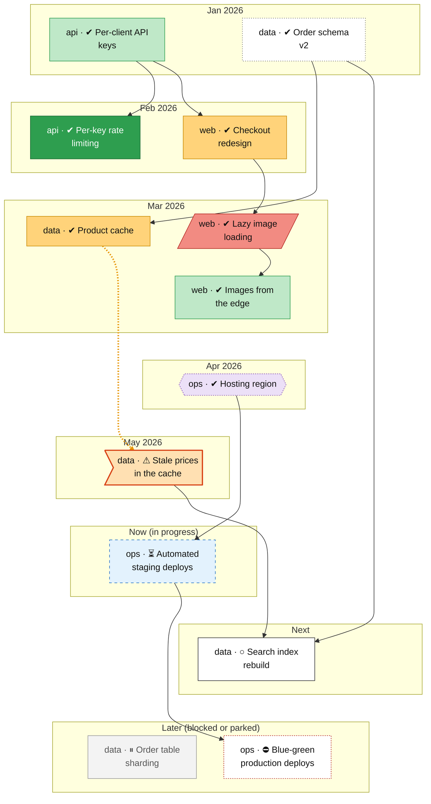

# Web shop roadmap

This page is a fixture for the tech-tree scripts. The text outside the markers is hand-written and the build keeps it byte for byte.

## How to read the pictures

```mermaid
flowchart TB
    %% legend
    subgraph lg_g0["Done: colour is the rating"]
        direction LR
        lg_s0["✔ very successful"]
        lg_s1["✔ successful, or fixed"]
        lg_s2["✔ mixed"]
        lg_s3["✔ bad (regression)"]
        lg_s4["✔ done, not rated"]
    end
    subgraph lg_g1["Closed"]
        direction LR
        lg_s5["✖ dead end"]
        lg_s6["↷ superseded"]
    end
    subgraph lg_g2["Open: colour is the state"]
        direction LR
        lg_s7["▶ in progress"]
        lg_s8["⏳ built, waiting"]
        lg_s9["○ next"]
        lg_s10["⛔ blocked"]
        lg_s11["⏸ parked"]
        lg_s12>"⚠ open, never rated"]
    end
    subgraph lg_shape["Shape: kind"]
        direction LR
        lg_k0["○ feature"]
        lg_k1[/"○ experiment"/]
        lg_k2["○ refactor"]
        lg_k3["○ tooling"]
        lg_k4>"⚠ defect"]
        lg_k5{{"○ owner-decision<br/>(open, not drawn)"}}
        lg_k6{{"✔ owner-decision<br/>(decided)"}}
    end
    subgraph lg_edge["Arrow (in the trees every arrow points down, forward in time)"]
        direction LR
        lg_e0a["prerequisite"]
        lg_e0b["depends on it"]
        lg_e1a["old design"]
        lg_e1b["replaced by"]
        lg_e2a["rated node"]
        lg_e2b["qualified by a later finding"]
    end
    lg_g0 ~~~ lg_g1 ~~~ lg_g2 ~~~ lg_shape ~~~ lg_edge
    lg_e0a --> lg_e0b
    lg_e1a -.-> lg_e1b
    lg_e2a -.-> lg_e2b
    linkStyle 6 stroke:#e69500,stroke-width:3px,stroke-dasharray:2 3
    classDef vsucc fill:#2e9e4f,stroke:#1b6b34,color:#fff
    classDef succ fill:#bfe8c8,stroke:#2e9e4f,color:#111
    classDef mixed fill:#ffd37a,stroke:#c98a00,color:#111
    classDef bad fill:#f28b82,stroke:#b3261e,color:#111
    classDef dead fill:#e6e6e6,stroke:#777,stroke-dasharray:5 5,color:#555
    classDef inprog fill:#a8cdf5,stroke:#1f6fc5,color:#111
    classDef next fill:#fff,stroke:#333,color:#111
    classDef blocked fill:#fff,stroke:#b3261e,stroke-dasharray:2 2,color:#111
    classDef parked fill:#f3f3f3,stroke:#999,color:#555
    classDef unrated fill:#fff,stroke:#333,stroke-dasharray:1 3,color:#111
    classDef gate fill:#d9c2f0,stroke:#7b3fb5,color:#111
    classDef decided fill:#ece0f7,stroke:#7b3fb5,stroke-dasharray:2 2,color:#111
    classDef finding fill:#ffe0b2,stroke:#d84315,stroke-width:2px,color:#111
    classDef waiting fill:#e3f2fd,stroke:#1f6fc5,stroke-dasharray:5 5,color:#111
    class lg_s0 vsucc
    class lg_s1 succ
    class lg_s2 mixed
    class lg_s3 bad
    class lg_s4 unrated
    class lg_s5,lg_s6 dead
    class lg_s7 inprog
    class lg_s8 waiting
    class lg_s9,lg_k0,lg_k1,lg_k2,lg_k3,lg_e0a,lg_e0b,lg_e1a,lg_e1b,lg_e2a,lg_e2b next
    class lg_s10 blocked
    class lg_s11 parked
    class lg_s12,lg_k4 finding
    class lg_k5 gate
    class lg_k6 decided
```

<!-- BEGIN GENERATED: legend -->

Owner calls are the purple shape. A decided owner call is drawn in the overview only, never in the track trees; an open one is listed under *Waiting on the owner*. The prefix on an overview box is its track. A prerequisite implied by a longer chain is not drawn; the node tables keep every edge.
<!-- END GENERATED: legend -->

## How far the ratings are confirmed

<!-- BEGIN GENERATED: ratings -->
5 of 8 rated nodes are confirmed by the owner.

Not yet confirmed: `web-checkout-redesign`, `web-image-cdn`, `data-cache-layer`.
<!-- END GENERATED: ratings -->

## Overview

<!-- BEGIN GENERATED: overview -->

<!-- END GENERATED: overview -->

## In plain words

<!-- BEGIN GENERATED: plain-words -->
| title | status | in plain words |
|---|---|---|
| Per-client API keys | ✔ done · successful | Every client gets its own key, so we can tell who calls what. |
| Per-key rate limiting | ✔ done · very-successful | Each API key gets its own request budget, so one noisy client cannot slow the rest. |
| Checkout redesign | ✔ done · mixed | A shorter checkout form: more people finish, but it loads slowly on phones. |
| Lazy image loading | ✔ done · bad | Loading product images only when scrolled to made the page jump around, so it was reverted. |
| Images from the edge | ✔ done · successful | Product images come from a nearby server, which fixes the slow mobile load. |
| Order schema v2 | ✔ done · unrated | Orders move to a cleaner table layout; nothing changes for shoppers. |
| Product cache | ✔ done · mixed ⚠ | Popular products are served from memory, which is fast but sometimes shows an old price. |
| Stale prices in the cache | ⚠ open | A price change can take up to five minutes to show; we are finding out why. |
| Search index rebuild | ○ next | Rebuild the product search index on the new schema. |
| Order data retention period | ○ next | The owner decides how long old orders are kept. |
| Order table sharding | ⏸ parked | Split the order table by year; waits for the retention decision. |
| Hosting region | ✔ done · n/a | The owner picked the cloud region closest to most shoppers. |
| Automated staging deploys | ⏳ waiting | Pushing to the main branch updates the staging site by itself. |
| Blue-green production deploys | ⛔ blocked | Switch production traffic between two copies so a bad deploy can be undone at once. |
| Cloud cost alerts | ▶ in progress | Email when the monthly cloud bill passes a set limit. |
<!-- END GENERATED: plain-words -->

## Ready now

<!-- BEGIN GENERATED: ready-now -->
**staging**

- `data-search-index`: Search index rebuild
<!-- END GENERATED: ready-now -->

## Running

<!-- BEGIN GENERATED: running -->
**local**

- `ops-cost-alerts`: Cloud cost alerts
<!-- END GENERATED: running -->

## Built, waiting

<!-- BEGIN GENERATED: built-waiting -->
**staging deploy freeze**

- `ops-staging-deploy`: Automated staging deploys
<!-- END GENERATED: built-waiting -->

## Waiting on the owner

<!-- BEGIN GENERATED: waiting-on-owner -->
- `data-retention-policy`: Order data retention period
<!-- END GENERATED: waiting-on-owner -->

## The staging queue

<!-- BEGIN GENERATED: queue -->
1. `ops-staging-deploy`: Automated staging deploys. everything else on staging needs it
2. `data-search-index`: Search index rebuild. needs the staging environment once the deploy freeze ends
3. `ops-blue-green`: Blue-green production deploys. last: it reuses the staging pipeline
<!-- END GENERATED: queue -->

## Timeline

<!-- BEGIN GENERATED: timeline -->
[The timeline](roadmap/timeline.md) shows every dated node as a bar from its start to its end.

Generated on 2026-06-30.
<!-- END GENERATED: timeline -->

## Done, by month

<!-- BEGIN GENERATED: done-by-month -->

<b>Apr 2026</b>: 3 done

- `web-image-cdn`: Images from the edge (✔ done · successful). Product images come from a nearby server, which fixes the slow mobile load.
- `data-cache-layer`: Product cache (✔ done · mixed). Popular products are served from memory, which is fast but sometimes shows an old price.
- `ops-region-choice`: Hosting region (✔ done · n/a). The owner picked the cloud region closest to most shoppers.

<b>Mar 2026</b>: 2 done, 2 abandoned

- `api-graphql-gateway`: GraphQL gateway (✖ dead end)
  - Schema stitching prototype (2026-02-20)
- `web-skeleton-loader`: Skeleton loading screens (↷ superseded)
- `web-checkout-redesign`: Checkout redesign (✔ done · mixed). A shorter checkout form: more people finish, but it loads slowly on phones.
  - Address autocomplete (2026-03-02)
  - Guest checkout toggle (2026-03-05)
- `web-image-lazyload`: Lazy image loading (✔ done · bad). Loading product images only when scrolled to made the page jump around, so it was reverted.

<b>Feb 2026</b>: 2 done

- `data-schema-v2`: Order schema v2 (✔ done · unrated). Orders move to a cleaner table layout; nothing changes for shoppers.
- `api-rate-limit`: Per-key rate limiting (✔ done · very-successful). Each API key gets its own request budget, so one noisy client cannot slow the rest.
  - Retry-After header (2026-02-05)

<b>Jan 2026</b>: 1 done

- `api-auth-keys`: Per-client API keys (✔ done · successful). Every client gets its own key, so we can tell who calls what.

<!-- END GENERATED: done-by-month -->

## Tracks

<!-- BEGIN GENERATED: tracks -->
Each track has its own page with its tree, node table and per-node details.

- [api - API](roadmap/tracks/api.md): 3 nodes (2 done, 1 abandoned)
- [web - web front end](roadmap/tracks/web.md): 4 nodes (3 done, 1 abandoned)
- [data - data](roadmap/tracks/data.md): 6 nodes (2 done, 1 in progress, 2 next, 1 parked)
- [ops - operations](roadmap/tracks/ops.md): 4 nodes (1 done, 2 in progress, 1 blocked)
<!-- END GENERATED: tracks -->

The end.
