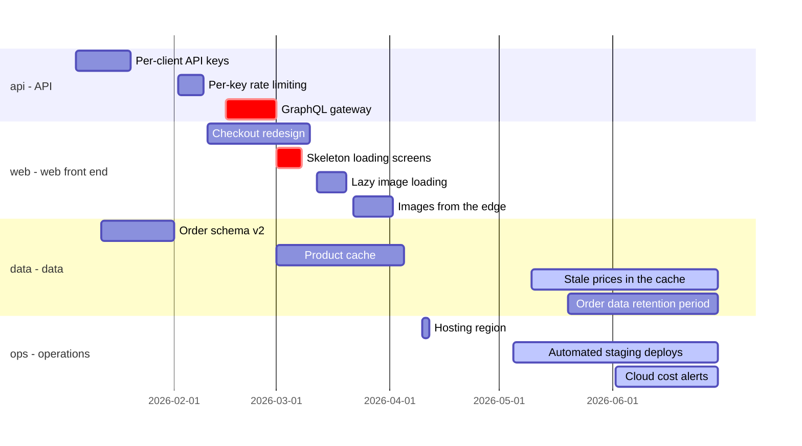

<!-- Generated by build.py from nodes.yaml. Do not edit. -->

# Timeline

[Back to the page](../roadmap.md)

Generated on 2026-06-30. Open bars end on that date.

<!-- BEGIN GENERATED: timeline -->

Not shown (no `start`): `data-search-index`, `data-sharding`, `ops-blue-green`
<!-- END GENERATED: timeline -->
