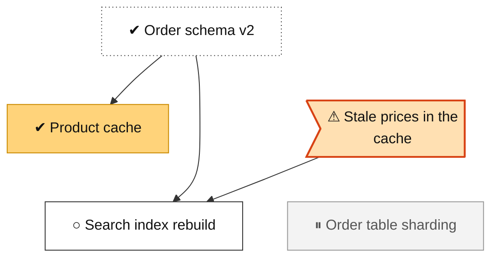

<!-- Generated by build.py from nodes.yaml. Do not edit. -->

# data - data

Scope: schema, migrations, caching, search index.

[Back to the page](../../roadmap.md) · [legend](../../roadmap.md#legend)

<!-- BEGIN GENERATED: track-data -->

<!-- END GENERATED: track-data -->

## Node table

<!-- BEGIN GENERATED: table-data -->
| id | title | kind | lane | state | outcome | start | end | depends_on | replaced_by | qualified_by | headline | evidence |
|---|---|---|---|---|---|---|---|---|---|---|---|---|
| `data-schema-v2` | Order schema v2 | refactor | none | done | unrated | 2026-01-12 | 2026-02-01 |  |  |  |  | PR #150 |
| `data-cache-layer` | Product cache | feature | none | done | mixed | 2026-03-01 | 2026-04-05 | data-schema-v2 |  | data-stale-cache | hit rate 92% | PR #260 |
| `data-stale-cache` | Stale prices in the cache | defect | local | in-progress | unrated | 2026-05-10 |  |  |  |  |  |  |
| `data-search-index` | Search index rebuild | feature | staging | next | unrated |  |  | data-schema-v2, data-stale-cache |  |  |  |  |
| `data-retention-policy` | Order data retention period | owner-decision | owner | next | n/a | 2026-05-20 |  |  |  |  |  |  |
| `data-sharding` | Order table sharding | feature | none | parked | unrated |  |  | data-retention-policy |  |  |  |  |

### Details per node

| id | title | verdict | headline | in plain words | notes | confirmed | waiting on | queue order | order reason |
|---|---|---|---|---|---|---|---|---|---|
| `data-schema-v2` | Order schema v2 |  |  | Orders move to a cleaner table layout; nothing changes for shoppers. |  |  |  |  |  |
| `data-cache-layer` | Product cache | Merged; hit rate 92% but stale reads reported on price changes. | hit rate 92% | Popular products are served from memory, which is fast but sometimes shows an old price. |  |  |  |  |  |
| `data-stale-cache` | Stale prices in the cache |  |  | A price change can take up to five minutes to show; we are finding out why. | Done when: the cause is written down and a fix is scheduled. |  |  |  |  |
| `data-search-index` | Search index rebuild |  |  | Rebuild the product search index on the new schema. | Done when: the rebuild finishes on the staging copy in under an hour. |  |  | 2 | needs the staging environment once the deploy freeze ends |
| `data-retention-policy` | Order data retention period |  |  | The owner decides how long old orders are kept. | Done when: the owner names a period. |  |  |  |  |
| `data-sharding` | Order table sharding |  |  | Split the order table by year; waits for the retention decision. |  |  |  |  |  |
<!-- END GENERATED: table-data -->
