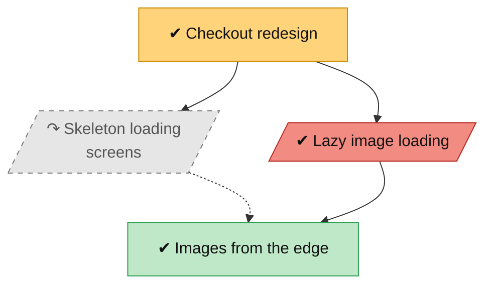

<!-- Generated by build.py from nodes.yaml. Do not edit. -->

# web - web front end

Scope: storefront UI, checkout flow, accessibility.

[Back to the page](../../roadmap.md) · [legend](../../roadmap.md#legend)

<!-- BEGIN GENERATED: track-web -->

<!-- END GENERATED: track-web -->

## Node table

<!-- BEGIN GENERATED: table-web -->
| id | title | kind | lane | state | outcome | start | end | depends_on | replaced_by | qualified_by | headline | evidence |
|---|---|---|---|---|---|---|---|---|---|---|---|---|
| `web-checkout-redesign` | Checkout redesign | feature | none | done | mixed | 2026-02-10 | 2026-03-10 | api-auth-keys |  |  | conversion +4% | PR #230 |
| `web-skeleton-loader` | Skeleton loading screens | experiment | none | abandoned | superseded | 2026-03-01 | 2026-03-08 | web-checkout-redesign | web-image-cdn |  |  | notes/skeleton.md |
| `web-image-lazyload` | Lazy image loading | experiment | none | done | bad | 2026-03-12 | 2026-03-20 | web-checkout-redesign |  |  | layout shift 0.02 -> 0.31 | PR #241 (reverted) |
| `web-image-cdn` | Images from the edge | feature | none | done | successful | 2026-03-22 | 2026-04-02 | web-image-lazyload |  |  |  | PR #255 |

### Details per node

| id | title | verdict | headline | in plain words | notes | confirmed | waiting on | queue order | order reason |
|---|---|---|---|---|---|---|---|---|---|
| `web-checkout-redesign` | Checkout redesign | Conversion up 4%, but the page is 30% slower on mobile. | conversion +4% | A shorter checkout form: more people finish, but it loads slowly on phones. | Mobile slowdown is tracked in the image work below. |  |  |  |  |
| `web-skeleton-loader` | Skeleton loading screens | Superseded by the CDN approach, which fixed the same problem server side. |  |  |  | 2026-03-30 |  |  |  |
| `web-image-lazyload` | Lazy image loading | Reverted: layout shift made the product grid unusable. | layout shift 0.02 -> 0.31 | Loading product images only when scrolled to made the page jump around, so it was reverted. |  | 2026-03-25 |  |  |  |
| `web-image-cdn` | Images from the edge | Merged; no layout change, images served from the edge. |  | Product images come from a nearby server, which fixes the slow mobile load. |  |  |  |  |  |

### Folded items per node

- `web-checkout-redesign`: Checkout redesign
  - Address autocomplete (2026-03-02, commit 9a8b7c6d)
  - Guest checkout toggle (2026-03-05, session record)
<!-- END GENERATED: table-web -->
