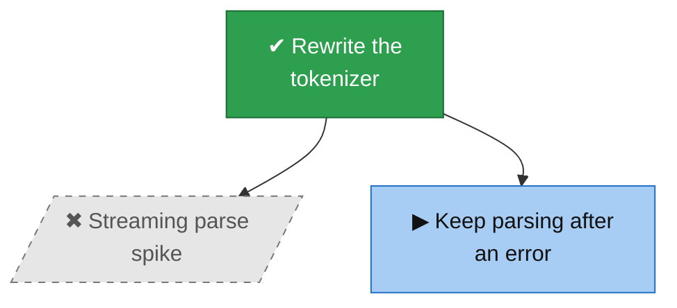

<!-- Generated by build.py from nodes.yaml. Do not edit. -->

# core - parser core

Scope: tokenizer, grammar, error recovery.

[Back to the page](../../roadmap.md) · [legend](../../roadmap.md#legend)

<!-- BEGIN GENERATED: track-core -->

<!-- END GENERATED: track-core -->

## Node table

<!-- BEGIN GENERATED: table-core -->
| id | title | kind | lane | state | outcome | start | end | depends_on | replaced_by | qualified_by | headline | evidence |
|---|---|---|---|---|---|---|---|---|---|---|---|---|
| `core-tokenizer` | Rewrite the tokenizer | change | none | done | very-successful | 2026-02-01 | 2026-02-14 |  |  |  | 3.4 s -> 1.2 s | PR #12 |
| `core-streaming` | Streaming parse spike | spike | none | abandoned | dead-end | 2026-02-20 | 2026-03-02 | core-tokenizer |  |  |  | notes/streaming.md |
| `core-error-recovery` | Keep parsing after an error | change | local | in-progress | unrated | 2026-03-10 |  | core-tokenizer |  |  |  |  |
| `core-api-freeze` | Freeze the public API | decision | owner | next | n/a |  |  | core-error-recovery |  |  |  |  |

### Details per node

| id | title | verdict | headline | in plain words | notes | confirmed | waiting on | queue order | order reason |
|---|---|---|---|---|---|---|---|---|---|
| `core-tokenizer` | Rewrite the tokenizer | Merged; parsing the benchmark file takes 1.2 s instead of 3.4 s. | 3.4 s -> 1.2 s | The first stage of the parser is now almost three times faster. |  | 2026-02-20 |  |  |  |
| `core-streaming` | Streaming parse spike | Dropped: the grammar needs unbounded lookahead. |  | Parsing a file piece by piece did not work with our grammar. |  | 2026-03-05 |  |  |  |
| `core-error-recovery` | Keep parsing after an error |  |  | Report every error in a file, not just the first. | Done when: the error test corpus reports all planted errors. |  |  |  |  |
| `core-api-freeze` | Freeze the public API |  |  | The maintainer decides when the public API stops changing. |  |  |  |  |  |

### Folded items per node

- `core-tokenizer`: Rewrite the tokenizer
  - Unicode escapes (2026-02-10, commit a1b2c3d4)
<!-- END GENERATED: table-core -->
